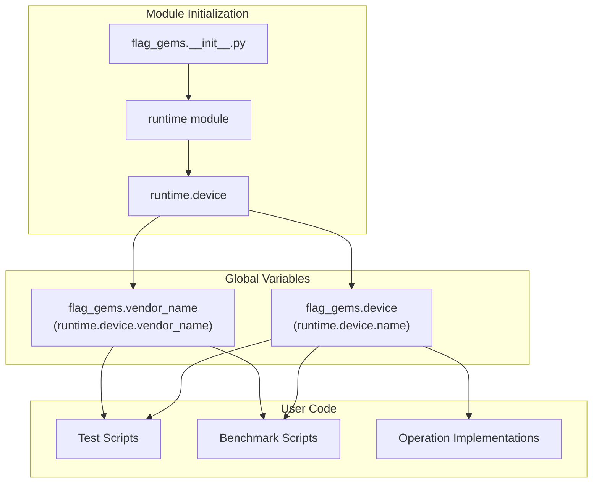
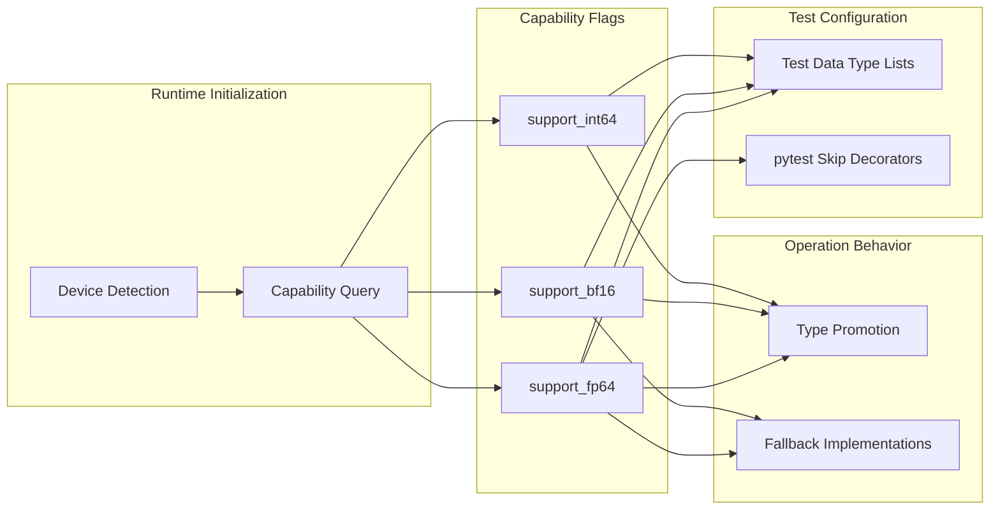
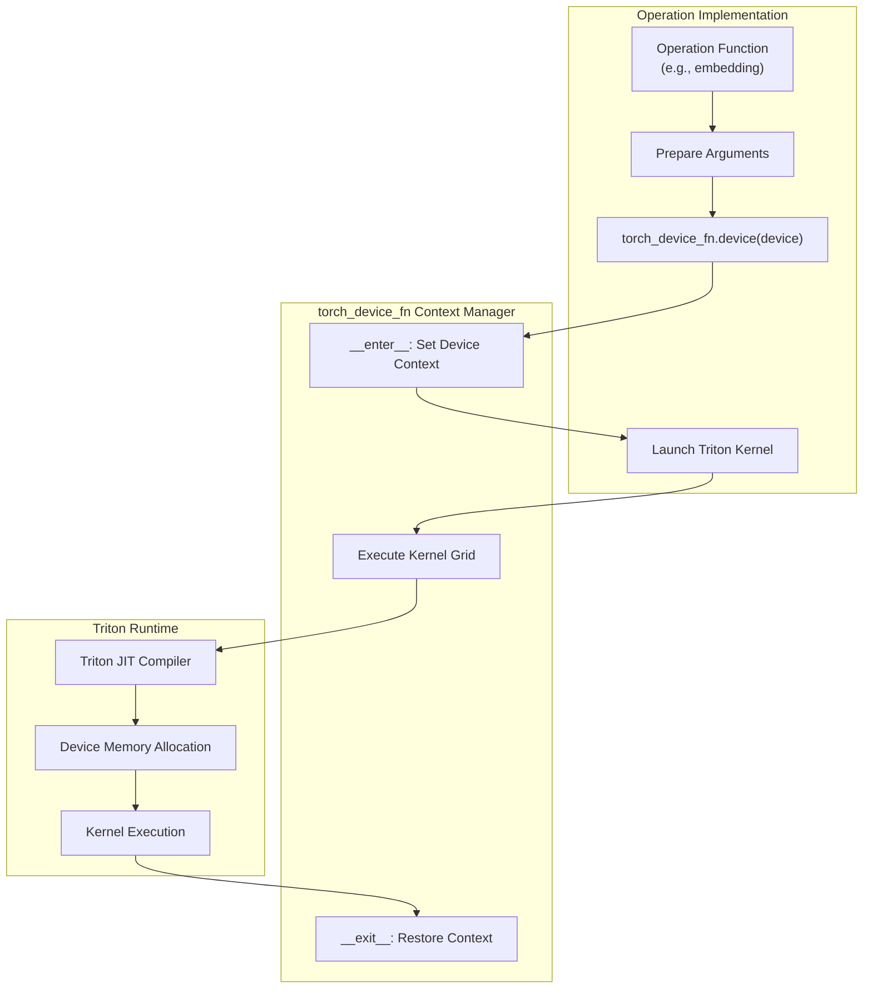
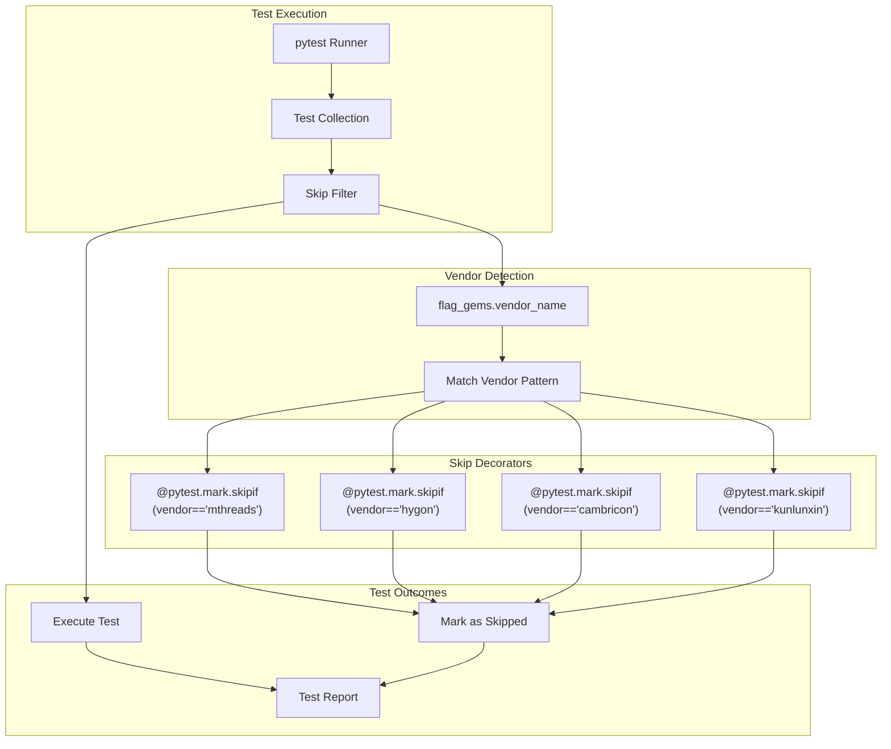
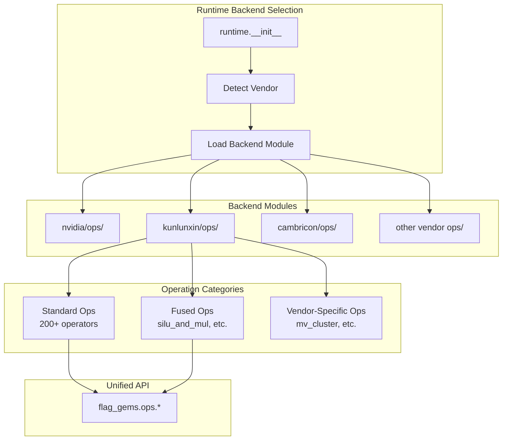

<!-- source: DeepWiki mcp.deepwiki.com · repo FlagOpen/FlagGems · page 2.5 Runtime and Device Management · fetched 2026-10-21 -->

# Runtime and Device Management

<details>
<summary>Relevant source files</summary>

The following files were used as context for generating this wiki page:

- [benchmark/test_special_perf.py](benchmark/test_special_perf.py)
- [benchmark/test_unary_pointwise_perf.py](benchmark/test_unary_pointwise_perf.py)
- [src/flag_gems/__init__.py](src/flag_gems/__init__.py)
- [src/flag_gems/ops/__init__.py](src/flag_gems/ops/__init__.py)
- [src/flag_gems/ops/elu.py](src/flag_gems/ops/elu.py)
- [src/flag_gems/ops/embedding.py](src/flag_gems/ops/embedding.py)
- [src/flag_gems/ops/nllloss.py](src/flag_gems/ops/nllloss.py)
- [src/flag_gems/runtime/backend/_kunlunxin/fused/__init__.py](src/flag_gems/runtime/backend/_kunlunxin/fused/__init__.py)
- [src/flag_gems/runtime/backend/_kunlunxin/fused/moe_align_block_size.py](src/flag_gems/runtime/backend/_kunlunxin/fused/moe_align_block_size.py)
- [src/flag_gems/runtime/backend/_kunlunxin/fused/rwkv_ka_fusion.py](src/flag_gems/runtime/backend/_kunlunxin/fused/rwkv_ka_fusion.py)
- [src/flag_gems/runtime/backend/_kunlunxin/fused/rwkv_mm_sparsity.py](src/flag_gems/runtime/backend/_kunlunxin/fused/rwkv_mm_sparsity.py)
- [src/flag_gems/runtime/backend/_kunlunxin/fused/silu_and_mul.py](src/flag_gems/runtime/backend/_kunlunxin/fused/silu_and_mul.py)
- [src/flag_gems/runtime/backend/_kunlunxin/ops/__init__.py](src/flag_gems/runtime/backend/_kunlunxin/ops/__init__.py)
- [src/flag_gems/runtime/backend/_kunlunxin/ops/addmm.py](src/flag_gems/runtime/backend/_kunlunxin/ops/addmm.py)
- [src/flag_gems/runtime/backend/_kunlunxin/ops/addmv.py](src/flag_gems/runtime/backend/_kunlunxin/ops/addmv.py)
- [src/flag_gems/runtime/backend/_kunlunxin/ops/atan.py](src/flag_gems/runtime/backend/_kunlunxin/ops/atan.py)
- [src/flag_gems/runtime/backend/_kunlunxin/ops/bitwise_left_shift.py](src/flag_gems/runtime/backend/_kunlunxin/ops/bitwise_left_shift.py)
- [src/flag_gems/runtime/backend/_kunlunxin/ops/bitwise_right_shift.py](src/flag_gems/runtime/backend/_kunlunxin/ops/bitwise_right_shift.py)
- [src/flag_gems/runtime/backend/_kunlunxin/ops/clamp.py](src/flag_gems/runtime/backend/_kunlunxin/ops/clamp.py)
- [tests/accuracy_utils.py](tests/accuracy_utils.py)
- [tests/test_binary_pointwise_ops.py](tests/test_binary_pointwise_ops.py)
- [tests/test_special_ops.py](tests/test_special_ops.py)
- [tests/test_unary_pointwise_ops.py](tests/test_unary_pointwise_ops.py)

</details>


## Purpose and Scope

This document describes FlagGems' runtime system for device detection, hardware capability checking, and device-specific execution context management. It covers vendor identification, data type support detection, and device context switching for kernel execution across multiple hardware backends.

For operator registration and dispatching, see [Operator Registration System](#2.1). For backend-specific operation implementations, see [Hardware Backend Support](#4).

---

## Device Information Access

FlagGems exposes device information through the `runtime.device` object, which is initialized when the library is imported. The main entry point provides global access to device properties.

### Device Properties

The runtime system exposes two primary device identifiers:

| Property | Description | Example Values |
|----------|-------------|----------------|
| `flag_gems.device` | PyTorch device name | `"cuda"`, `"xpu"`, `"cpu"` |
| `flag_gems.vendor_name` | Hardware vendor identifier | `"nvidia"`, `"kunlunxin"`, `"cambricon"`, `"mthreads"`, `"hygon"`, `"aipu"` |

**Sources:** [src/flag_gems/__init__.py:16-17]()



**Device Information Flow**

**Sources:** [src/flag_gems/__init__.py:1-21]()

### Usage in Tests

Tests access device information to determine hardware-specific behavior and skip incompatible test cases:

```python
# Device name access
device = flag_gems.device  # Returns "cuda", "xpu", etc.

# Vendor-specific test skipping
if flag_gems.vendor_name == "kunlunxin":
    torch.manual_seed(0)
    torch.cuda.manual_seed_all(0)
```

**Sources:** [tests/test_special_ops.py:34](), [tests/test_special_ops.py:42-44](), [tests/test_unary_pointwise_ops.py:57-59]()

---

## Hardware Capability Detection

The runtime system detects hardware capabilities at initialization time and exposes them through boolean flags. This enables operations to adapt behavior based on supported data types and features.

### Supported Data Types

FlagGems checks support for extended data types that may not be available on all hardware:

| Capability Flag | Data Type | Purpose |
|-----------------|-----------|---------|
| `runtime.device.support_fp64` | `torch.float64` | Double precision floating point |
| `runtime.device.support_bf16` | `torch.bfloat16` | Brain floating point format |
| `runtime.device.support_int64` | `torch.int64` | 64-bit integer operations |

**Sources:** [tests/accuracy_utils.py:12-14](), [benchmark/test_unary_pointwise_perf.py:16]()



**Capability Detection and Usage Flow**

**Sources:** [tests/accuracy_utils.py:12-14](), [tests/accuracy_utils.py:157-166]()

### Data Type List Configuration

Test suites dynamically configure data type lists based on detected capabilities:

```python
# Float types with conditional bfloat16
PRIMARY_FLOAT_DTYPES = [torch.float16, torch.float32]
FLOAT_DTYPES = (
    PRIMARY_FLOAT_DTYPES + [torch.bfloat16]
    if bf16_is_supported
    else PRIMARY_FLOAT_DTYPES
)

# Extended float types with conditional float64
ALL_FLOAT_DTYPES = FLOAT_DTYPES + [torch.float64] if fp64_is_supported else FLOAT_DTYPES

# Integer types with conditional int64
INT_DTYPES = [torch.int16, torch.int32]
ALL_INT_DTYPES = INT_DTYPES + [torch.int64] if int64_is_supported else INT_DTYPES
```

**Sources:** [tests/accuracy_utils.py:157-166]()

---

## Device Context Management

Operations must execute kernels in the correct device context. FlagGems provides the `torch_device_fn` utility for device context management during kernel launches.

### torch_device_fn Usage Pattern

The `torch_device_fn.device()` context manager ensures Triton kernels execute on the correct device:

```python
from flag_gems.runtime import torch_device_fn

# Kernel launch with device context
with torch_device_fn.device(weight.device):
    embedding_kernel[M,](output, indices, weight, N, BLOCK_SIZE)
```

**Sources:** [src/flag_gems/ops/embedding.py:7](), [src/flag_gems/ops/embedding.py:126-127]()



**Device Context Management Flow**

**Sources:** [src/flag_gems/ops/embedding.py:126-127](), [src/flag_gems/runtime/backend/_kunlunxin/ops/addmm.py:91-110]()

### Multi-Operation Context Usage

Complex operations may launch multiple kernels with proper device context management:

```python
# Multiple kernel launches in sequence
with torch_device_fn.device(grad_outputs.device):
    indice_freq_kernel[indice_grid](indice_freq, indices, M, INDICE_BLOCK_SIZE)
    
with torch_device_fn.device(grad_outputs.device):
    embedding_backward_kernel[M,](
        grad_inputs, grad_outputs, indices, 
        padding_idx, HAS_PADDING_IDX, N, BLOCK_SIZE
    )
    
with torch_device_fn.device(grad_outputs.device):
    embedding_grad_scale_kernel[M,](
        grad_inputs, indice_freq, num_weights, N, BLOCK_SIZE
    )
```

**Sources:** [src/flag_gems/ops/embedding.py:166-190]()

---

## Vendor-Specific Behavior

FlagGems implements vendor-specific workarounds and optimizations based on detected hardware vendors. This enables optimal performance while maintaining compatibility across diverse hardware.

### Test Skipping by Vendor

Tests use pytest markers to skip incompatible or problematic test cases on specific vendors:

```python
# Skip by vendor name
@pytest.mark.skipif(flag_gems.vendor_name == "mthreads", reason="AssertionError")
@pytest.mark.skipif(flag_gems.vendor_name == "hygon", reason="AssertionError")
def test_accuracy_unique(...):
    ...

@pytest.mark.skipif(flag_gems.vendor_name == "cambricon", reason="fix")
def test_upsample(...):
    ...
```

**Sources:** [tests/test_special_ops.py:357-358](), [tests/test_special_ops.py:534]()



**Vendor-Based Test Filtering Architecture**

**Sources:** [tests/test_special_ops.py:357-442](), [benchmark/test_special_perf.py:71-73](), [benchmark/test_special_perf.py:96-98]()

### Vendor-Specific Workarounds

Some operations implement vendor-specific behavior to work around hardware limitations or optimize performance:

| Vendor | Workaround Type | Example |
|--------|-----------------|---------|
| `kunlunxin` | Manual seed setting | `torch.manual_seed(0); torch.cuda.manual_seed_all(0)` |
| `kunlunxin` | Device transfer for exp2 | `ref_out = torch.exp2(ref_inp.cpu()).to(device)` |
| `kunlunxin` | CPU intermediate computation | Non-contiguous tensor handling |
| `aipu` | Increased tolerance | Higher `atol` for float16 operations |

**Sources:** [tests/test_special_ops.py:42-44](), [tests/test_unary_pointwise_ops.py:277-280](), [tests/test_special_ops.py:495-504](), [tests/test_unary_pointwise_ops.py:318-320]()

### Runtime Conditional Execution

Operations check vendor at runtime to apply appropriate behavior:

```python
# Conditional seeding for deterministic tests
if flag_gems.vendor_name == "kunlunxin":
    torch.manual_seed(0)
    torch.cuda.manual_seed_all(0)

# Conditional device transfer for unsupported ops
if flag_gems.vendor_name == "kunlunxin" and dtype == torch.float16:
    ref_x = ref_x.cuda()
    # ... compute ...
    if TO_CPU:
        ref_value = ref_value.cpu()
        ref_index = ref_index.cpu()

# Conditional tolerance adjustments
atol = 1e-4
if flag_gems.vendor_name == "aipu" and dtype == torch.float16:
    atol = 1e-3
```

**Sources:** [tests/test_special_ops.py:232-234](), [tests/test_special_ops.py:327-335](), [tests/test_unary_pointwise_ops.py:318-320]()

---

## Environment Variables

While not explicitly shown in the provided files, the system architecture diagrams mention `GEMS_VENDOR` as a configuration mechanism for vendor detection.

### GEMS_VENDOR Configuration

The `GEMS_VENDOR` environment variable allows manual override of vendor detection:

| Variable | Purpose | Possible Values |
|----------|---------|-----------------|
| `GEMS_VENDOR` | Override detected vendor | `"nvidia"`, `"kunlunxin"`, `"cambricon"`, `"mthreads"`, `"hygon"`, `"aipu"` |

This enables testing vendor-specific behavior without physical hardware access.

**Sources:** Inferred from architecture diagrams in context

---

## Backend Directory Structure

Vendor-specific implementations are organized in separate backend directories:

```
src/flag_gems/runtime/backend/
├── _kunlunxin/
│   ├── ops/              # Kunlunxin-specific operators
│   │   ├── __init__.py   # Re-exports 200+ operators
│   │   ├── addmm.py      # Matrix operations
│   │   ├── embedding.py  # Embedding operations
│   │   ├── clamp.py      # Clamping operations
│   │   └── ...
│   └── fused/            # Kunlunxin-specific fused ops
│       ├── __init__.py
│       ├── silu_and_mul.py
│       ├── rwkv_ka_fusion.py
│       ├── rwkv_mm_sparsity.py
│       └── ...
└── ...                   # Other vendor backends
```

**Sources:** [src/flag_gems/runtime/backend/_kunlunxin/ops/__init__.py:1-456](), [src/flag_gems/runtime/backend/_kunlunxin/fused/__init__.py:1-40]()



**Backend Selection and Operation Loading**

**Sources:** [src/flag_gems/runtime/backend/_kunlunxin/ops/__init__.py:1-456](), [src/flag_gems/runtime/backend/_kunlunxin/fused/__init__.py:1-40]()

### Vendor-Specific Operations

Some backends provide unique operations not available in the standard interface:

```python
# Kunlunxin-specific operations
from .mv import mv, mv_cluster  # Cluster-optimized matrix-vector multiply
from .rsub import rsub          # Reverse subtraction

# Standard operations with vendor optimizations
from .addmm import addmm, addmm_out
from .embedding import embedding, embedding_backward
from .clamp import clamp, clamp_, clamp_min, clamp_min_
```

**Sources:** [src/flag_gems/runtime/backend/_kunlunxin/ops/__init__.py:123](), [src/flag_gems/runtime/backend/_kunlunxin/ops/__init__.py:165]()

---

## Integration with Operation Implementations

Operations use runtime device information to ensure correct execution:

### Kernel Launch Pattern

Standard pattern for device-aware kernel launches:

```python
def operation_impl(inputs, ...):
    # Prepare tensors and parameters
    output = torch.empty(shape, device=inputs.device, dtype=inputs.dtype)
    
    # Configure grid based on problem size
    grid = lambda META: (compute_blocks(META), ...)
    
    # Launch with device context
    with torch_device_fn.device(inputs.device):
        kernel[grid](inputs, output, ...)
    
    return output
```

**Sources:** [src/flag_gems/ops/embedding.py:113-129](), [src/flag_gems/runtime/backend/_kunlunxin/ops/addmm.py:73-111]()

### Multi-Stage Operations

Operations with multiple kernels manage device context per stage:

```python
# Stage 1: Frequency counting
with torch_device_fn.device(grad_outputs.device):
    indice_freq_kernel[indice_grid](...)

# Stage 2: Backward gradient computation  
with torch_device_fn.device(grad_outputs.device):
    embedding_backward_kernel[M,](...)
    
# Stage 3: Gradient scaling (if needed)
if scale_grad_by_freq:
    with torch_device_fn.device(grad_outputs.device):
        embedding_grad_scale_kernel[M,](...)
```

**Sources:** [src/flag_gems/ops/embedding.py:132-195]()

---

## Summary

The Runtime and Device Management system provides:

1. **Device Detection**: Automatic identification of device name and vendor through `runtime.device`
2. **Capability Checking**: Boolean flags for extended data type support (`fp64`, `bf16`, `int64`)
3. **Context Management**: `torch_device_fn.device()` for correct kernel execution contexts
4. **Vendor Adaptation**: Test filtering and runtime workarounds for vendor-specific behavior
5. **Backend Organization**: Modular structure for vendor-specific operation implementations

This architecture enables FlagGems to maintain a unified API while supporting diverse hardware platforms with varying capabilities.

**Sources:** [src/flag_gems/__init__.py:1-21](), [tests/accuracy_utils.py:12-14](), [src/flag_gems/ops/embedding.py:7](), [tests/test_special_ops.py:34-44](), [src/flag_gems/runtime/backend/_kunlunxin/ops/__init__.py:1-456]()

---

