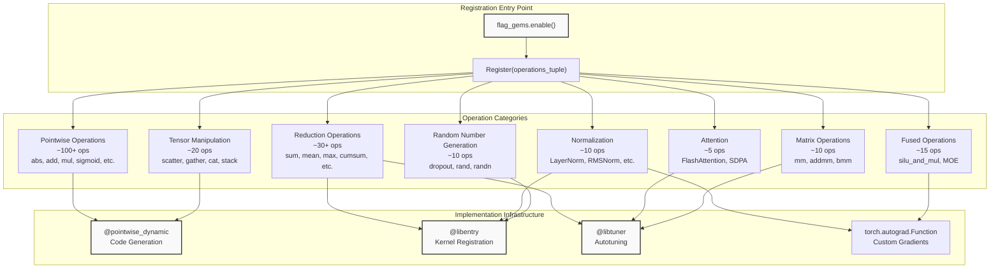
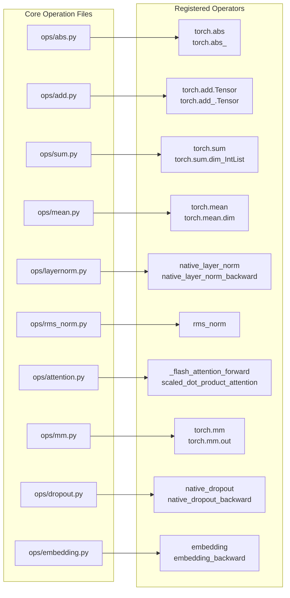

<!-- source: DeepWiki mcp.deepwiki.com · repo FlagOpen/FlagGems · page 3 Operations Reference · fetched 2026-10-21 -->

# Operations Reference

<details>
<summary>Relevant source files</summary>

The following files were used as context for generating this wiki page:

- [benchmark/test_special_perf.py](benchmark/test_special_perf.py)
- [benchmark/test_unary_pointwise_perf.py](benchmark/test_unary_pointwise_perf.py)
- [src/flag_gems/__init__.py](src/flag_gems/__init__.py)
- [src/flag_gems/ops/__init__.py](src/flag_gems/ops/__init__.py)
- [src/flag_gems/ops/elu.py](src/flag_gems/ops/elu.py)
- [src/flag_gems/ops/embedding.py](src/flag_gems/ops/embedding.py)
- [src/flag_gems/ops/nllloss.py](src/flag_gems/ops/nllloss.py)
- [tests/accuracy_utils.py](tests/accuracy_utils.py)
- [tests/test_binary_pointwise_ops.py](tests/test_binary_pointwise_ops.py)
- [tests/test_special_ops.py](tests/test_special_ops.py)
- [tests/test_unary_pointwise_ops.py](tests/test_unary_pointwise_ops.py)

</details>


This document provides a comprehensive reference for the 200+ operations implemented in FlagGems. It serves as a catalog of all available operator replacements for PyTorch, organized by computational pattern and functionality. Each operation category follows specific implementation patterns optimized for GPU execution via Triton.

For information about how operations are registered and enabled in PyTorch, see [Operator Registration System](#2.1). For details on the underlying autotuning and kernel caching infrastructure, see [LibEntry and Kernel Caching](#2.2) and [LibTuner and Autotuning](#2.3). For framework integration patterns, see [Framework Integration](#6.2).

## Overview

FlagGems implements operations across eight major categories, each with distinct implementation strategies and performance characteristics. All operations are automatically registered with PyTorch's ATen backend when `flag_gems.enable()` is called, replacing the default implementations with optimized Triton kernels.

Sources: [src/flag_gems/__init__.py:24-325]()

### Operation Categories and Implementation Patterns



**Operation Category Architecture and Registration Flow**

This diagram illustrates how operations are organized into categories and registered with PyTorch. Each category employs specific decorators and infrastructure components based on its complexity and performance requirements.

Sources: [src/flag_gems/__init__.py:24-325](), [src/flag_gems/ops/__init__.py:1-483]()

### Operation Registration in Code

The following table maps operation categories to their registration locations and implementation files:

| Category | Registration Lines | Primary Files | Key Patterns |
|----------|-------------------|---------------|--------------|
| Pointwise | [__init__.py:44-308]() | `ops/abs.py`, `ops/add.py`, `ops/sigmoid.py`, etc. | `@pointwise_dynamic` decorator, automatic broadcasting |
| Reduction | [__init__.py:53-294]() | `ops/sum.py`, `ops/mean.py`, `ops/cumsum.py` | Two-stage reduction, `@libentry` |
| Normalization | [__init__.py:213-220]() | `ops/layernorm.py`, `ops/rms_norm.py`, `ops/groupnorm.py` | Multiple kernel variants, custom autograd |
| Attention | [__init__.py:35-39]() | `ops/attention.py` | Split-K strategies, `@libtuner` |
| Matrix | [__init__.py:51-206]() | `ops/mm.py`, `ops/addmm.py`, `ops/bmm.py` | StreamK algorithm, autotuning |
| Tensor Manipulation | [__init__.py:84-285]() | `ops/scatter.py`, `ops/gather.py`, `ops/cat.py` | Dynamic code generation |
| Fused | [__init__.py:8]() | `fused/` directory | `torch.autograd.Function`, multi-kernel |
| Random | [__init__.py:215-249]() | `ops/dropout.py`, `ops/rand.py`, `ops/uniform.py` | Philox RNG, seeding |

Sources: [src/flag_gems/__init__.py:1-367](), [src/flag_gems/ops/__init__.py:1-483]()

### Operation-to-File Mapping



**File-to-Operator Mapping for Core Operations**

This diagram shows the mapping between implementation files in `src/flag_gems/ops/` and the PyTorch operators they replace. Each file typically implements both forward and backward variants.

Sources: [src/flag_gems/ops/__init__.py:1-483]()

## Implementation Complexity Hierarchy

Operations in FlagGems are implemented with varying levels of complexity, from simple element-wise operations to sophisticated multi-kernel algorithms:

### Simple Operations (Low Complexity)

**Characteristics:**
- Single Triton kernel
- Automatic code generation via `@pointwise_dynamic`
- Automatic broadcasting and type promotion
- No manual autotuning required

**Examples:** `abs`, `sigmoid`, `gelu`, `tanh`, `neg`, `reciprocal`

**Implementation Pattern:**
```python
@pointwise_dynamic(is_tensor=[True], promotion_methods=[(0, "DEFAULT")])
@triton.jit
def operation_kernel(x):
    return computation(x)
```

Sources: [src/flag_gems/ops/abs.py:1-20](), [benchmark/test_unary_pointwise_perf.py:41-78]()

### Medium Complexity Operations

**Characteristics:**
- Two-stage or multi-kernel implementations
- Manual kernel specialization
- LibEntry registration for caching
- Dimension-wise strategies

**Examples:** `sum`, `mean`, `max`, `cumsum`, `layer_norm`

**Implementation Pattern:**
- Stage 1: Partial reduction or computation
- Stage 2: Final aggregation or normalization
- Custom backward pass implementations

Sources: [src/flag_gems/ops/cumsum.py:1-100](), [tests/test_reduction_ops.py:1-500]()

### High Complexity Operations

**Characteristics:**
- Sophisticated algorithms (StreamK, FlashAttention)
- LibTuner autotuning with configuration spaces
- Multiple kernel variants per operation
- Framework-specific integration (vLLM patches)

**Examples:** `mm`, `flash_attention_forward`, `fused_moe`, `scaled_dot_product_attention`

**Implementation Pattern:**
- Multiple tile strategies
- Split-K or split-Q parallelization
- Persistent kernel variants
- Extensive autotuning configurations

Sources: [src/flag_gems/ops/mm.py:1-200](), [src/flag_gems/ops/attention.py:1-500]()

## Operation Testing Infrastructure

All operations are validated through a comprehensive testing framework that compares FlagGems implementations against PyTorch reference implementations:

| Test Category | Files | Test Pattern |
|---------------|-------|--------------|
| Unary Pointwise | [test_unary_pointwise_ops.py]() | Compare against PyTorch for multiple shapes and dtypes |
| Binary Pointwise | [test_binary_pointwise_ops.py]() | Test with broadcasting, scalars, in-place variants |
| Reduction | [test_reduction_ops.py]() | Test dimension-wise reduction, keepdim variants |
| Special Operations | [test_special_ops.py]() | Dropout, embedding, unique, multinomial, etc. |
| Normalization | [test_norm_ops.py]() | Forward and backward pass validation |
| Attention | [test_attention_ops.py]() | FlashAttention variants, varlen sequences |
| BLAS | [test_blas_ops.py]() | Matrix multiplication variants |

**Test Validation Pattern:**
```python
ref_inp = to_reference(inp, upcast=True)
ref_out = torch.operation(ref_inp)

with flag_gems.use_gems():
    res_out = torch.operation(inp)
    
gems_assert_close(res_out, ref_out, dtype)
```

Sources: [tests/test_unary_pointwise_ops.py:1-100](), [tests/test_special_ops.py:1-100](), [tests/accuracy_utils.py:196-206]()

## Operation Categories Overview

The following subsections provide detailed documentation for each operation category:

- **[Pointwise Operations](#3.1)**: Element-wise operations including unary (abs, exp, sigmoid) and binary (add, mul, div) operations with automatic broadcasting
- **[Reduction Operations](#3.2)**: Operations that reduce tensor dimensions including sum, mean, max, min, and cumulative variants
- **[Normalization Operations](#3.3)**: Layer normalization, RMS normalization, group normalization, and batch normalization with optimized backward passes
- **[Attention Operations](#3.4)**: FlashAttention implementations, scaled dot-product attention, and MLA variants
- **[Matrix Operations](#3.5)**: Matrix multiplication (mm, addmm, bmm) with StreamK algorithm and specialized autotuning
- **[Tensor Manipulation Operations](#3.6)**: Scatter, gather, index operations, concatenation, and stacking operations
- **[Fused Operations](#3.7)**: Combined operations like silu_and_mul, gelu_and_mul, fused_add_rms_norm, and MOE kernels
- **[Random Number Generation](#3.8)**: Dropout, random tensor generation, and sampling operations with Philox RNG

### Complete Operation List

The table below summarizes all 200+ operations by registration name in PyTorch:

| Operation Name | Category | In-Place Variant | Backward Pass | File Location |
|----------------|----------|------------------|---------------|---------------|
| abs | Pointwise | abs_ | No | ops/abs.py |
| add.Tensor | Pointwise | add_.Tensor | No | ops/add.py |
| sigmoid | Pointwise | sigmoid_ | sigmoid_backward | ops/sigmoid.py |
| sum | Reduction | No | No | ops/sum.py |
| sum.dim_IntList | Reduction | No | No | ops/sum.py |
| native_layer_norm | Normalization | No | native_layer_norm_backward | ops/layernorm.py |
| rms_norm | Normalization | No | No | ops/rms_norm.py |
| _flash_attention_forward | Attention | No | No | ops/attention.py |
| mm | Matrix | No | No | ops/mm.py |
| native_dropout | Random | No | native_dropout_backward | ops/dropout.py |
| embedding | Special | No | embedding_backward | ops/embedding.py |
| ... | ... | ... | ... | ... |

*Note: Full operation list spans 200+ operators. See individual category sections for complete listings.*

Sources: [src/flag_gems/__init__.py:34-320](), [src/flag_gems/ops/__init__.py:1-483]()

## Performance Benchmarking

All operations are benchmarked for performance against PyTorch's implementations. Benchmark results include:

- **Latency**: Time per operation execution
- **Speedup**: Relative performance vs PyTorch
- **TFLOPS**: Throughput in floating-point operations per second
- **GBPS**: Memory bandwidth utilization

Benchmark configurations are defined in `benchmark/core_shapes.yaml` and executed through the `GenericBenchmark` framework.

Sources: [benchmark/test_unary_pointwise_perf.py:1-230](), [benchmark/test_special_perf.py:1-577]()

## Usage Examples

### Basic Operation Usage

```python
import torch
import flag_gems

# Enable FlagGems operators
flag_gems.enable()

# Operations now use FlagGems implementations
x = torch.randn(1024, 1024, device='cuda')
y = torch.sigmoid(x)  # Uses flag_gems.sigmoid
z = torch.sum(x, dim=1)  # Uses flag_gems.sum_dim
```

### Context Manager Usage

```python
# Use FlagGems selectively
x = torch.randn(1024, 1024, device='cuda')

with flag_gems.use_gems():
    y = torch.sigmoid(x)  # FlagGems implementation
    
z = torch.sigmoid(x)  # PyTorch implementation
```

### Direct API Usage

```python
# Call FlagGems operations directly
import flag_gems

x = torch.randn(1024, 1024, device='cuda')
y = flag_gems.sigmoid(x)
```

Sources: [src/flag_gems/__init__.py:24-366]()

---

