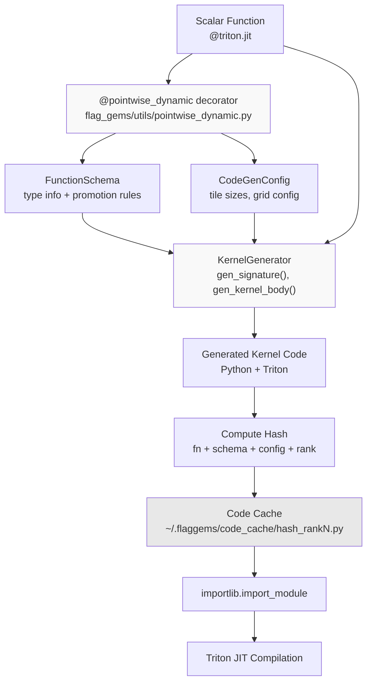
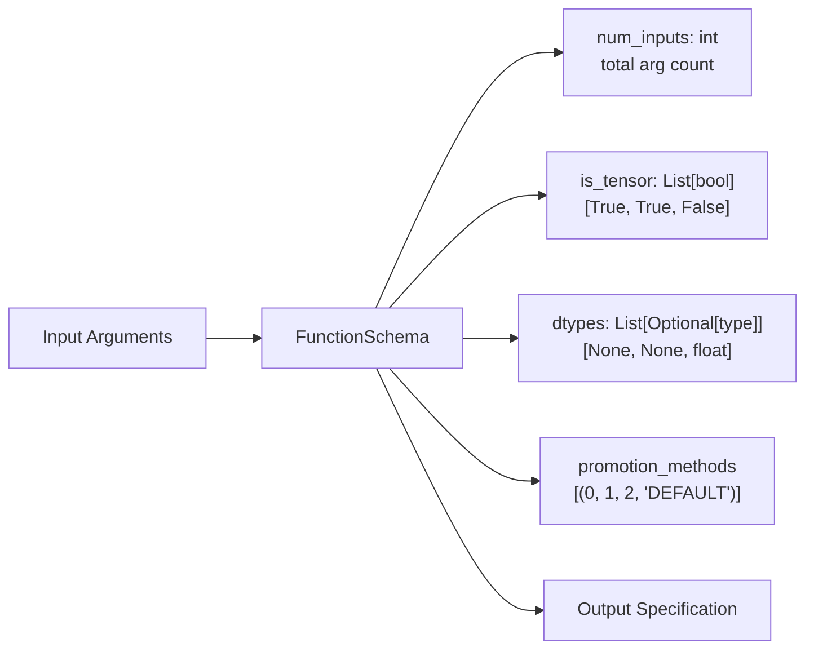
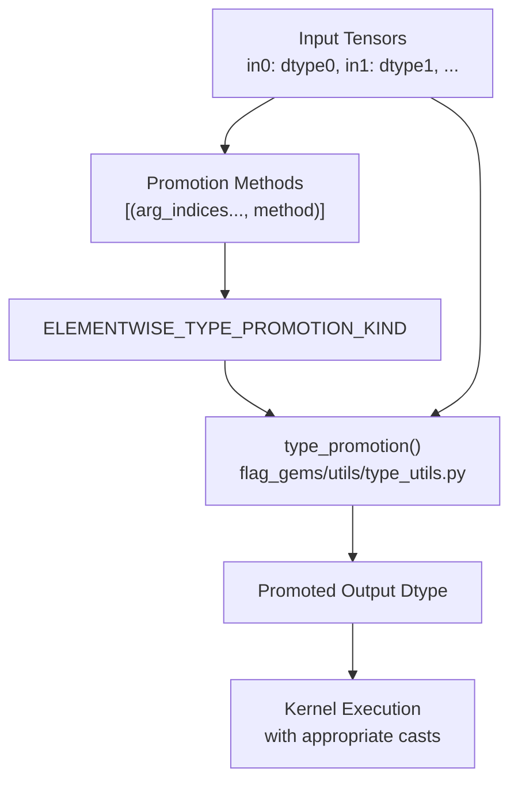
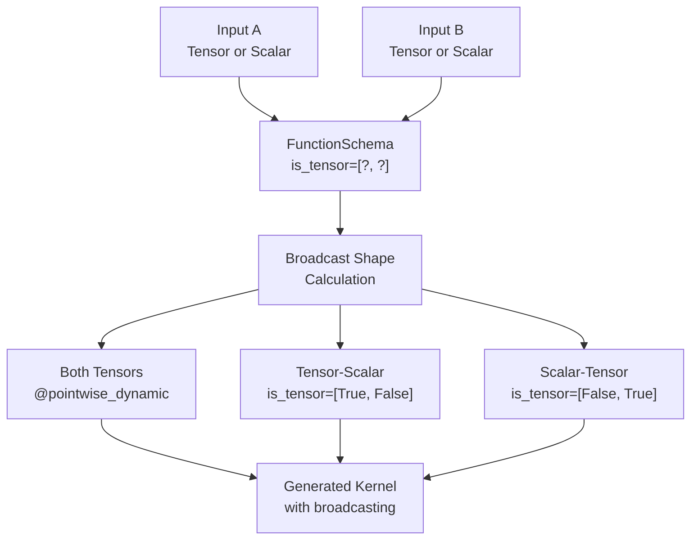
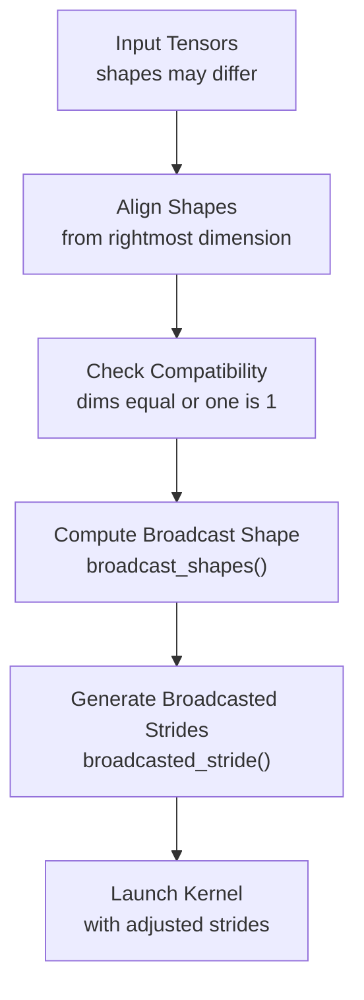
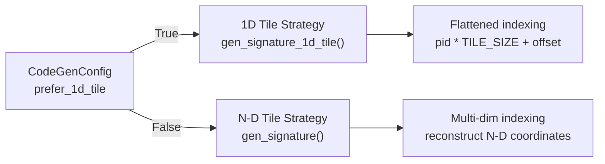
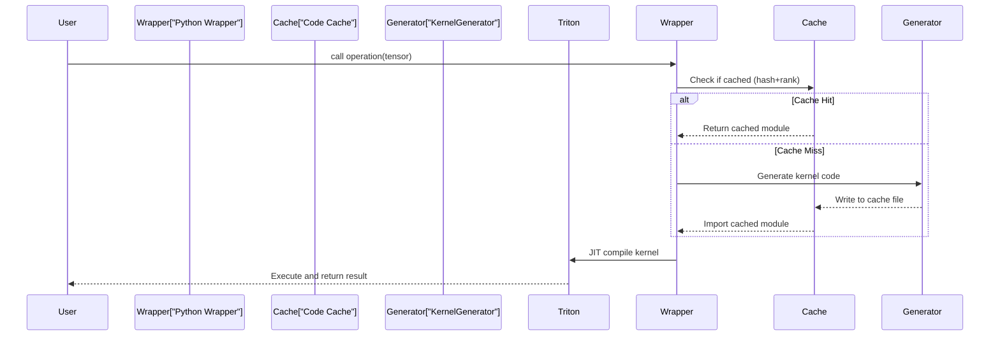

<!-- source: DeepWiki mcp.deepwiki.com · repo FlagOpen/FlagGems · page 3.1 Pointwise Operations · fetched 2026-10-21 -->

# Pointwise Operations

<details>
<summary>Relevant source files</summary>

The following files were used as context for generating this wiki page:

- [benchmark/test_special_perf.py](benchmark/test_special_perf.py)
- [benchmark/test_unary_pointwise_perf.py](benchmark/test_unary_pointwise_perf.py)
- [src/flag_gems/__init__.py](src/flag_gems/__init__.py)
- [src/flag_gems/fused/gelu_and_mul.py](src/flag_gems/fused/gelu_and_mul.py)
- [src/flag_gems/ops/__init__.py](src/flag_gems/ops/__init__.py)
- [src/flag_gems/ops/elu.py](src/flag_gems/ops/elu.py)
- [src/flag_gems/ops/embedding.py](src/flag_gems/ops/embedding.py)
- [src/flag_gems/ops/gelu.py](src/flag_gems/ops/gelu.py)
- [src/flag_gems/ops/isinf.py](src/flag_gems/ops/isinf.py)
- [src/flag_gems/ops/isnan.py](src/flag_gems/ops/isnan.py)
- [src/flag_gems/ops/nllloss.py](src/flag_gems/ops/nllloss.py)
- [src/flag_gems/ops/pow.py](src/flag_gems/ops/pow.py)
- [src/flag_gems/ops/sigmoid.py](src/flag_gems/ops/sigmoid.py)
- [src/flag_gems/ops/tanh.py](src/flag_gems/ops/tanh.py)
- [src/flag_gems/ops/vector_norm.py](src/flag_gems/ops/vector_norm.py)
- [src/flag_gems/runtime/backend/_kunlunxin/ops/div.py](src/flag_gems/runtime/backend/_kunlunxin/ops/div.py)
- [src/flag_gems/utils/code_cache.py](src/flag_gems/utils/code_cache.py)
- [src/flag_gems/utils/code_utils.py](src/flag_gems/utils/code_utils.py)
- [src/flag_gems/utils/pointwise_dynamic.py](src/flag_gems/utils/pointwise_dynamic.py)
- [tests/accuracy_utils.py](tests/accuracy_utils.py)
- [tests/test_binary_pointwise_ops.py](tests/test_binary_pointwise_ops.py)
- [tests/test_pointwise_dynamic.py](tests/test_pointwise_dynamic.py)
- [tests/test_special_ops.py](tests/test_special_ops.py)
- [tests/test_tensor_wrapper.py](tests/test_tensor_wrapper.py)
- [tests/test_unary_pointwise_ops.py](tests/test_unary_pointwise_ops.py)

</details>


Pointwise operations are element-wise operations that apply a mathematical function independently to each element of one or more input tensors. This page documents FlagGems' implementation of over 200 pointwise operators, including unary operations (abs, exp, sigmoid, tanh), binary operations (add, mul, div), comparison operations (eq, gt, lt), and specialized operations (clamp, where). These operations use the `pointwise_dynamic` code generation system to automatically produce optimized Triton kernels with automatic broadcasting, type promotion, and rank-agnostic execution.

For reduction operations that aggregate across dimensions, see [Reduction Operations](#3.2). For fused operations that combine multiple pointwise steps, see [Fused Operations](#3.7).

## Pointwise Dynamic Code Generation System

FlagGems implements pointwise operations using a dynamic code generation approach. Rather than writing individual Triton kernels for each operation and tensor rank, developers write scalar functions decorated with `@pointwise_dynamic`, which automatically generates specialized kernels for each tensor dimensionality at runtime.

### System Architecture



**Diagram: Pointwise Dynamic Code Generation Flow**

The system generates a unique kernel for each combination of scalar function, function schema, configuration, and tensor rank, caching the generated code to disk for reuse.

Sources: [src/flag_gems/utils/pointwise_dynamic.py:1-700]()

### Function Schema

The `FunctionSchema` class describes the signature and type promotion behavior of a pointwise operation:

| Attribute | Purpose | Example |
|-----------|---------|---------|
| `_num_inputs` | Total number of inputs (tensor + scalar) | 2 for binary ops |
| `_is_tensor` | Which inputs are tensors | `[True, False]` for tensor-scalar |
| `_dtypes` | Fixed dtypes for non-tensor inputs | `[None, float]` |
| `_num_outputs` | Number of output tensors | 1 for most ops, 2+ for multi-output |
| `_promotion_methods` | Type promotion strategy per output | `[(0, 1, "DEFAULT")]` |



**Diagram: FunctionSchema Components**

Sources: [src/flag_gems/utils/pointwise_dynamic.py:64-220]()

### Example: Sigmoid Implementation

```python
# From src/flag_gems/ops/sigmoid.py
@pointwise_dynamic(promotion_methods=[(0, "INT_TO_FLOAT")])
@triton.jit
def sigmoid_forward(x):
    log2e: tl.constexpr = 1.4426950408889634
    return 1 / (1 + exp2(-x.to(tl.float32) * log2e))
```

The decorator:
1. Infers `num_inputs=1` (single output function)
2. Assumes `is_tensor=[True]` (tensor input)
3. Applies `INT_TO_FLOAT` promotion (converts integer inputs to float)
4. Generates kernels for ranks 0-7 on first invocation
5. Caches generated code in `~/.flaggems/code_cache/`

Sources: [src/flag_gems/ops/sigmoid.py:12-19]()

## Type Promotion Strategies

FlagGems implements PyTorch-compatible type promotion for pointwise operations. The promotion strategy is specified per output in the `promotion_methods` parameter.

### Promotion Kinds

| Promotion Kind | Behavior | Use Case |
|----------------|----------|----------|
| `"DEFAULT"` | PyTorch default promotion | General arithmetic (add, mul) |
| `"INT_TO_FLOAT"` | Integer → Float32, preserves float types | Transcendental functions (exp, log, sigmoid) |
| `"BOOL_TO_LONG"` | Bool → Int64, preserves other types | Power operations |
| `"ALWAYS_BOOL"` | Always outputs bool | Comparison ops (eq, lt, gt) |
| `"NO_OPMATH"` | No intermediate precision boost | Operations where precision is critical |

### Type Promotion Flow



**Diagram: Type Promotion Resolution**

Sources: [src/flag_gems/utils/type_utils.py:1-100](), [src/flag_gems/utils/pointwise_dynamic.py:144-152]()

### Multi-Output Type Promotion

For operations with multiple outputs, each output can have its own promotion rule:

```python
# Example: gelu_and_mul with gradient
@pointwise_dynamic(
    promotion_methods=[
        (0, 1, 2, "DEFAULT"),  # First output: combine all 3 inputs
        (0, 1, 2, "DEFAULT")   # Second output: same promotion
    ],
    num_outputs=2
)
@triton.jit
def gelu_none_and_mul_grad_kernel(x, y, dgrad):
    # Returns dx, dy
    ...
```

Sources: [src/flag_gems/fused/gelu_and_mul.py:24-48]()

## Operation Categories

### Unary Operations

Unary operations take a single tensor input and produce a single tensor output. The scalar function operates on individual elements.

**Activation Functions:**
- `sigmoid` - Logistic sigmoid: σ(x) = 1/(1+e^(-x))
- `tanh` - Hyperbolic tangent
- `relu` - Rectified Linear Unit: max(0, x)
- `gelu` - Gaussian Error Linear Unit (with "none" or "tanh" approximation)
- `silu` - Sigmoid Linear Unit (Swish): x·σ(x)
- `elu` - Exponential Linear Unit
- `celu` - Continuously differentiable ELU
- `softplus` - log(1 + e^x)

**Mathematical Functions:**
- `abs` - Absolute value
- `neg` - Negation
- `exp`, `exp2` - Exponential functions
- `log` - Natural logarithm
- `sqrt`, `rsqrt` - Square root and reciprocal square root
- `reciprocal` - Multiplicative inverse

**Trigonometric Functions:**
- `sin`, `cos` - Sine and cosine
- `atan` - Arctangent
- `tanh` - Hyperbolic tangent

**Bitwise Operations:**
- `bitwise_not` - Bitwise NOT

**Numerical Checks:**
- `isinf` - Check for infinity
- `isnan` - Check for NaN
- `isfinite` - Check if finite

Sources: [src/flag_gems/ops/__init__.py:1-215](), [tests/test_unary_pointwise_ops.py:41-78]()

### Binary Operations

Binary operations take two inputs (tensors or scalars) and produce one output. The system automatically handles broadcasting.

**Arithmetic Operations:**
- `add` - Addition with optional alpha scaling
- `sub` - Subtraction
- `mul` - Multiplication
- `div`, `true_divide` - Division
- `floor_divide` - Floor division
- `remainder` - Remainder after division
- `pow` - Power function

**Comparison Operations:**
- `eq`, `ne` - Equality and inequality
- `lt`, `le`, `gt`, `ge` - Less than, greater than comparisons
- `maximum`, `minimum` - Element-wise maximum/minimum

**Bitwise Operations:**
- `bitwise_and`, `bitwise_or` - Bitwise AND/OR
- `bitwise_left_shift`, `bitwise_right_shift` - Bit shifting

**Logical Operations:**
- `logical_and`, `logical_or`, `logical_xor`, `logical_not`



**Diagram: Binary Operation Dispatch**

Sources: [src/flag_gems/ops/add.py](), [tests/test_binary_pointwise_ops.py:31-138]()

### Ternary and Multi-Input Operations

Some operations take more than two inputs:

**Ternary Operations:**
- `addcdiv` - Performs (input + value * tensor1 / tensor2)
- `addcmul` - Performs (input + value * tensor1 * tensor2)
- `clamp` - Clamps values between min and max
- `lerp` - Linear interpolation
- `where` - Element-wise selection

Example signature for a ternary operation:

```python
@pointwise_dynamic(
    num_inputs=3,
    is_tensor=[True, True, False],  # Two tensors, one scalar
    promotion_methods=[(0, 1, "DEFAULT")]
)
@triton.jit
def axpy(x, y, alpha):
    return alpha * x + y
```

Sources: [tests/test_pointwise_dynamic.py:178-206]()

## In-Place Operations

In-place operations (suffixed with `_`) modify the input tensor directly rather than allocating a new output. These are implemented by passing the input tensor as the output buffer.

### In-Place Pattern

```python
# Out-of-place version
def sigmoid(self):
    output = sigmoid_forward(self)
    return output

# In-place version
def sigmoid_(A):
    out = sigmoid_forward(A, out0=A)  # Write to input buffer
    return out
```

The `out0=A` parameter instructs the generated kernel to use tensor `A` as the output buffer for the first (index 0) output.

### Registered In-Place Operations

From [src/flag_gems/__init__.py:44-319](), in-place variants are registered for:

| Operation | In-Place Variant | Registration |
|-----------|------------------|--------------|
| `abs` | `abs_` | Line 45 |
| `add` | `add_` | Line 47 |
| `sigmoid` | `sigmoid_` | Line 278 |
| `tanh` | `tanh_` | Line 296 |
| `exp` | `exp_` | Line 132 |
| `neg` | `neg_` | Line 224 |
| `bitwise_not` | `bitwise_not_` | Line 77 |
| `clamp` | `clamp_` | Line 90 |

Sources: [src/flag_gems/ops/sigmoid.py:42-46](), [src/flag_gems/__init__.py:44-319]()

## Broadcasting and Shape Handling

The `pointwise_dynamic` system automatically handles broadcasting between tensors of different shapes, following PyTorch's broadcasting semantics.

### Broadcasting Rules



**Diagram: Broadcasting Implementation**

### Stride Calculation

For a tensor with shape `[N, 1, M]` broadcasting to `[N, K, M]`:
- Original strides: `[M, M, 1]`
- Broadcasted strides: `[M, 0, 1]` (stride of 0 for broadcast dimension)

The kernel uses these strides to index the original tensor correctly:
```
index = i0 * stride0 + i1 * stride1 + i2 * stride2
      = i0 * M + i1 * 0 + i2 * 1  # i1 term vanishes
```

Sources: [src/flag_gems/utils/shape_utils.py:1-200](), [src/flag_gems/utils/pointwise_dynamic.py:298-335]()

## Code Generation Details

### Generated Kernel Structure

For each rank (tensor dimensionality), the `KernelGenerator` produces a complete Triton kernel with the following structure:

1. **Signature**: Input pointers, scalar arguments, output pointers, strides, task space dimensions
2. **Task ID calculation**: Map thread blocks to N-dimensional iteration space
3. **Multi-index reconstruction**: Convert 1D task ID to N-D coordinates
4. **Pointer arithmetic**: Calculate memory addresses using strides
5. **Data loading**: Load tile of data from each input
6. **Scalar function invocation**: Call user's `@triton.jit` function
7. **Data storing**: Store results to output buffer

### Code Generation Strategies

The system supports two tiling strategies, controlled by `CodeGenConfig.prefer_1d_tile`:

**1D Tiling** (default for most operations):
- Flattens the tensor into a 1D array
- Uses a single `TILE_SIZE` parameter
- Simple address calculation
- Best for memory-bound operations

**N-D Tiling** (for specific patterns):
- Maintains multi-dimensional structure
- Uses separate tile size for each dimension
- More complex addressing but better cache locality
- Used when spatial relationships matter



**Diagram: Tiling Strategy Selection**

Sources: [src/flag_gems/utils/pointwise_dynamic.py:222-600]()

### Kernel Signature Example

For a binary operation with 2D tensors:

```python
def add_rank2(
    in0_ptr: tl.tensor,  # First input pointer
    in1_ptr: tl.tensor,  # Second input pointer
    out0_ptr: tl.tensor, # Output pointer
    in0_stride0: int, in0_stride1: int,  # Strides for in0
    in1_stride0: int, in1_stride1: int,  # Strides for in1
    out0_stride0: int, out0_stride1: int, # Strides for out0
    s0: int, s1: int,    # Shape dimensions
    num_tasks: int,      # Total number of tiles
    tiles_per_cta: int,  # Tiles per thread block
    tile_size0: tl.constexpr,  # Tile size dim 0
    tile_size1: tl.constexpr,  # Tile size dim 1
    one_tile_per_cta: tl.constexpr,  # Optimization flag
):
    # Kernel implementation
    ...
```

Sources: [src/flag_gems/utils/pointwise_dynamic.py:266-335]()

## Code Cache Management

Generated kernel code is cached to avoid regeneration overhead on subsequent runs.

### Cache Directory Structure

```
~/.flaggems/code_cache/
├── <hash1>_rank0.py
├── <hash1>_rank1.py
├── <hash1>_rank2.py
├── <hash2>_rank0.py
└── ...
```

Each cached file contains:
1. Quoted source of the original scalar function (as documentation)
2. Generated Triton kernel for specific rank
3. Python wrapper function

### Hash Computation

The cache key is computed from:
- Scalar function source code
- Function schema (input types, promotion rules)
- Code generation configuration
- Tensor rank

```python
# From pointwise_dynamic.py
hash_val = hash(
    (fn_src, repr(schema), repr(config), rank)
)
cache_file = f"{hash_val}_rank{rank}.py"
```

Sources: [src/flag_gems/utils/pointwise_dynamic.py:800-900](), [src/flag_gems/utils/code_cache.py:1-41]()

### Cache Lifecycle



**Diagram: Code Cache Interaction**

Sources: [src/flag_gems/utils/pointwise_dynamic.py:700-1000]()

## Backward Pass Support

Many pointwise operations support automatic differentiation with custom backward implementations.

### Backward Operation Pattern

```python
# Forward pass
@pointwise_dynamic(promotion_methods=[(0, "INT_TO_FLOAT")])
@triton.jit
def sigmoid_forward(x):
    return 1 / (1 + exp2(-x.to(tl.float32) * log2e))

# Backward pass
@pointwise_dynamic(promotion_methods=[(0, "INT_TO_FLOAT")])
@triton.jit
def sigmoid_backward_kernel(dy, y):
    y_f32 = y.to(tl.float32)
    dy_f32 = dy.to(tl.float32)
    return dy_f32 * (1.0 - y_f32) * y_f32

def sigmoid_backward(grad_output, output):
    grad_input = sigmoid_backward_kernel(grad_output, output)
    return grad_input
```

The backward kernel takes:
- `grad_output` (dy): Gradient from upstream
- `output` (y): Forward pass output (for operations where derivative depends on output)
- Returns `grad_input` (dx): Gradient to propagate downstream

### Registered Backward Operations

From [src/flag_gems/__init__.py]():

| Operation | Backward Function | Registration Line |
|-----------|-------------------|-------------------|
| `gelu` | `gelu_backward` | Line 155 |
| `sigmoid` | `sigmoid_backward` | Line 279 |
| `tanh` | `tanh_backward` | Line 297 |
| `silu` | `silu_backward` | Line 282 |
| `elu` | `elu_backward` | Line 124 |
| `glu` | `glu_backward` | Line 157 |

Sources: [src/flag_gems/ops/sigmoid.py:22-28](), [src/flag_gems/ops/gelu.py:33-59](), [src/flag_gems/ops/tanh.py:19-24]()

## Testing and Validation

Pointwise operations are tested for both accuracy and performance.

### Accuracy Testing

Tests compare FlagGems implementations against PyTorch reference implementations:

```python
# Pattern from test_unary_pointwise_ops.py
def test_accuracy_sigmoid(shape, dtype):
    inp = torch.randn(shape, dtype=dtype, device=flag_gems.device)
    ref_inp = to_reference(inp)
    
    ref_out = torch.sigmoid(ref_inp)
    with flag_gems.use_gems():
        res_out = torch.sigmoid(inp)
    
    gems_assert_close(res_out, ref_out, dtype)
```

Test shapes include:
- Empty: `()`
- 1D: `(1,)`, `(1024, 1024)` 
- 2D-4D: Various combinations
- Irregular: `(16, 7, 57, 32, 29)`

Sources: [tests/test_unary_pointwise_ops.py:22-238](), [tests/test_binary_pointwise_ops.py:31-517]()

### Performance Benchmarking

The `UnaryPointwiseBenchmark` and `BinaryPointwiseBenchmark` classes measure:
- Latency (milliseconds)
- Throughput (GB/s, TFLOPS)
- Speedup vs PyTorch

```python
# From test_unary_pointwise_perf.py
class UnaryPointwiseBenchmark(Benchmark):
    DEFAULT_METRICS = ["latency", "speedup", "gbps", "tflops"]
    
    def get_tflops(self, op, *args, **kwargs):
        shape = list(args[0].shape)
        return torch.tensor(shape).prod().item()
```

Sources: [benchmark/test_unary_pointwise_perf.py:19-98](), [benchmark/test_binary_pointwise_perf.py:1-230]()

## Multi-Output Operations

Some operations produce multiple outputs, each with potentially different type promotions.

### Multi-Output Declaration

```python
@pointwise_dynamic(
    num_inputs=3,
    is_tensor=[True, True, True],
    num_outputs=2,  # Specify number of outputs
    promotion_methods=[
        (0, 1, 2, "DEFAULT"),  # First output promotion
        (0, 1, 2, "DEFAULT")   # Second output promotion
    ]
)
@triton.jit
def multi_output_op(x, y, z):
    out0 = x + y * z
    out1 = x - y * z
    return out0, out1
```

### Multi-Output Kernel Generation

For multi-output operations, the generator creates:
- Separate output pointer parameters for each output
- Separate stride parameters for each output
- Multiple store operations in the kernel body

Example from gelu_and_mul gradient:

```python
@pointwise_dynamic(
    promotion_methods=[(0, 1, 2, "DEFAULT"), (0, 1, 2, "DEFAULT")],
    num_outputs=2
)
@triton.jit
def gelu_none_and_mul_grad_kernel(x, y, dgrad):
    # ... compute dx and dy ...
    return dx, dy
```

Sources: [src/flag_gems/fused/gelu_and_mul.py:24-48](), [tests/test_pointwise_dynamic.py:209-238]()

## Special Cases and Edge Conditions

### Scalar-Only Operations

The system handles cases where all inputs are scalars:

```python
# Both inputs are Python scalars
result = torch.add(5.0, 3.0)  # Returns tensor(8.0)
```

This bypasses the kernel generation and returns a scalar tensor directly.

### Zero-Rank Tensors

Zero-rank (scalar) tensors `torch.tensor(5.0)` are treated as rank-0 and get specialized kernels with no indexing overhead.

### Empty Tensors

Tensors with zero elements in any dimension are handled gracefully:
- Kernel generation proceeds normally
- Grid size becomes 0
- No threads are launched
- Returns correctly shaped empty output

### Non-Contiguous Tensors

The stride-based indexing naturally handles non-contiguous tensors (transposed, sliced, etc.):

```python
x = torch.randn(100, 100)
x_t = x.t()  # Non-contiguous transposed view
result = sigmoid(x_t)  # Works correctly with adjusted strides
```

Sources: [src/flag_gems/utils/shape_utils.py:1-200](), [tests/test_binary_pointwise_ops.py:118-138]()

## Configuration Options

### CodeGenConfig Parameters

| Parameter | Type | Default | Purpose |
|-----------|------|---------|---------|
| `max_tile_size` | int | 1024 | Maximum elements per tile |
| `max_grid_size` | tuple | (65535, 65535, 65535) | GPU grid size limits |
| `max_num_warps_per_cta` | int | 32 | Maximum warps per CTA |
| `prefer_block_pointer` | bool | False | Use block pointers (Triton 3.0+) |
| `prefer_1d_tile` | bool | True | Use 1D tiling strategy |

### Custom Configuration Example

```python
from flag_gems.utils.pointwise_dynamic import CodeGenConfig

config = CodeGenConfig(
    max_tile_size=2048,
    prefer_1d_tile=False,  # Use N-D tiling
    prefer_block_pointer=True  # Use block pointers
)

@pointwise_dynamic(
    num_inputs=2,
    promotion_methods=[(0, 1, "DEFAULT")],
    config=config
)
@triton.jit
def custom_op(x, y):
    return x + y
```

Sources: [src/flag_gems/utils/codegen_config_utils.py:1-100](), [tests/test_pointwise_dynamic.py:152-176]()

## Integration with ATen

Pointwise operations are registered with PyTorch's ATen dispatcher through the `enable()` function in `flag_gems.__init__`:

```python
# From flag_gems/__init__.py
def enable(lib=aten_lib, ...):
    current_work_registrar = registrar(
        (
            ("abs", abs),
            ("abs_", abs_),
            ("add.Tensor", add),
            ("sigmoid", sigmoid),
            # ... 200+ operations
        ),
        lib=lib,
    )
```

When `flag_gems.enable()` is called, all pointwise operations become available as drop-in replacements for their PyTorch equivalents.

Sources: [src/flag_gems/__init__.py:24-326](), [src/flag_gems/runtime/register.py:1-100]()

---

