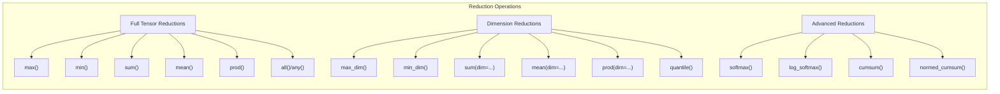
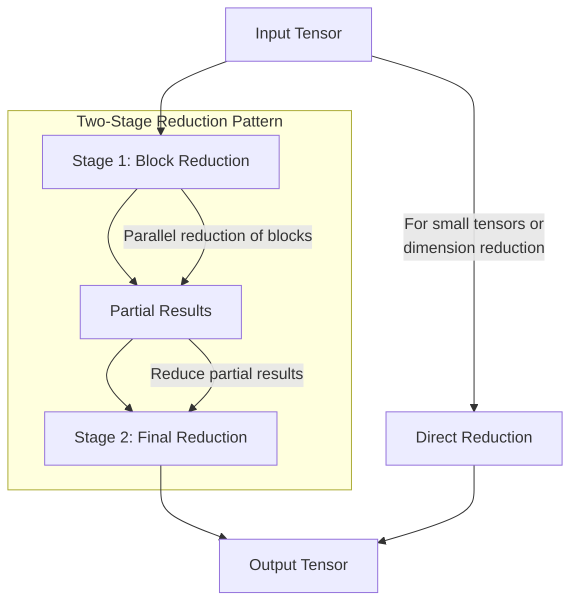
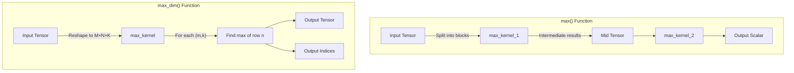
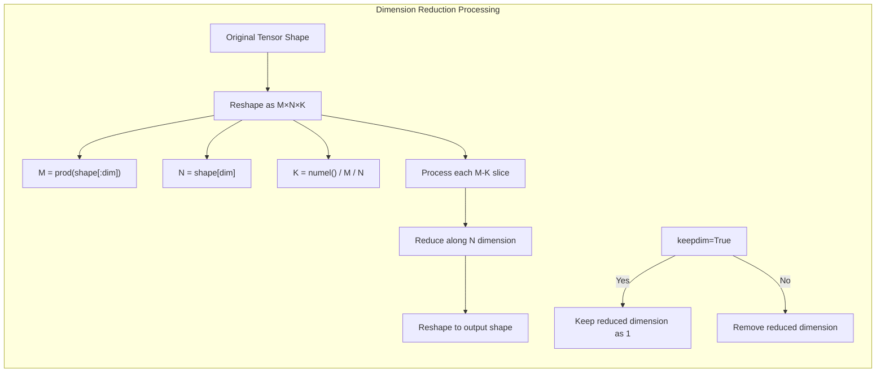
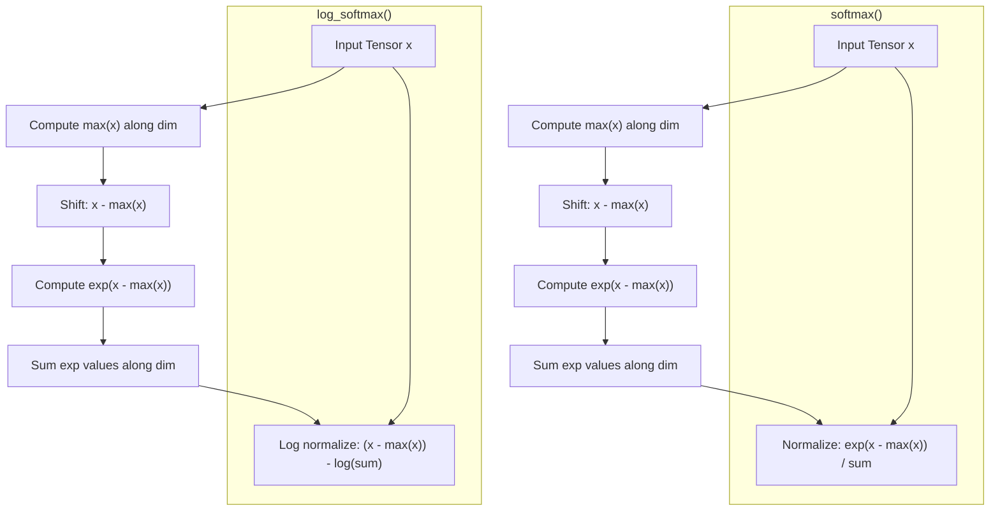
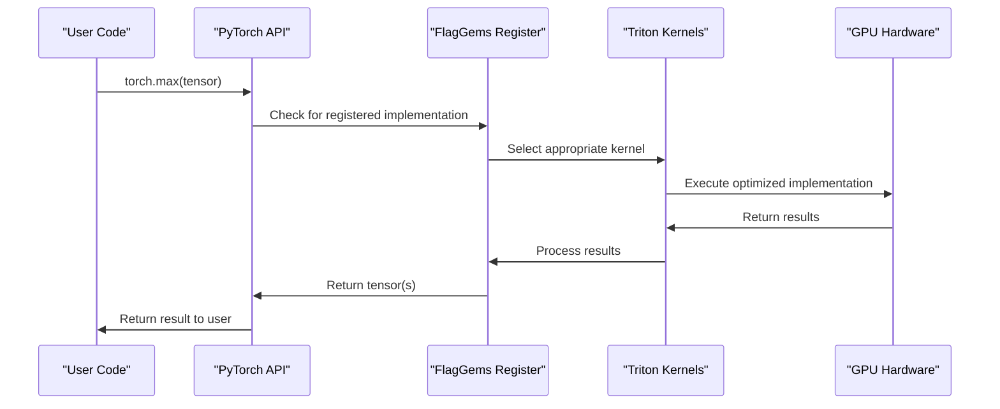

<!-- source: DeepWiki mcp.deepwiki.com · repo FlagOpen/FlagGems · page 3.2 Reduction Operations · fetched 2026-10-21 -->

# Reduction Operations

<details>
<summary>Relevant source files</summary>

The following files were used as context for generating this wiki page:

- [benchmark/test_binary_pointwise_perf.py](benchmark/test_binary_pointwise_perf.py)
- [benchmark/test_reduction_perf.py](benchmark/test_reduction_perf.py)
- [benchmark/test_select_and_slice_perf.py](benchmark/test_select_and_slice_perf.py)
- [src/flag_gems/ops/all.py](src/flag_gems/ops/all.py)
- [src/flag_gems/ops/amax.py](src/flag_gems/ops/amax.py)
- [src/flag_gems/ops/any.py](src/flag_gems/ops/any.py)
- [src/flag_gems/ops/argmax.py](src/flag_gems/ops/argmax.py)
- [src/flag_gems/ops/bmm.py](src/flag_gems/ops/bmm.py)
- [src/flag_gems/ops/cumsum.py](src/flag_gems/ops/cumsum.py)
- [src/flag_gems/ops/index_add.py](src/flag_gems/ops/index_add.py)
- [src/flag_gems/ops/index_put.py](src/flag_gems/ops/index_put.py)
- [src/flag_gems/ops/log_softmax.py](src/flag_gems/ops/log_softmax.py)
- [src/flag_gems/ops/max.py](src/flag_gems/ops/max.py)
- [src/flag_gems/ops/mean.py](src/flag_gems/ops/mean.py)
- [src/flag_gems/ops/min.py](src/flag_gems/ops/min.py)
- [src/flag_gems/ops/prod.py](src/flag_gems/ops/prod.py)
- [src/flag_gems/ops/softmax.py](src/flag_gems/ops/softmax.py)
- [src/flag_gems/ops/sum.py](src/flag_gems/ops/sum.py)
- [src/flag_gems/ops/triu.py](src/flag_gems/ops/triu.py)
- [src/flag_gems/ops/weightnorm.py](src/flag_gems/ops/weightnorm.py)
- [tests/test_norm_ops.py](tests/test_norm_ops.py)
- [tests/test_reduction_ops.py](tests/test_reduction_ops.py)

</details>


Reduction operations in FlagGems are optimized implementations of tensor operations that reduce data across one or more dimensions, producing outputs with fewer elements than the input. These operations are essential for deep learning tasks, from calculating loss functions to finding statistical properties of activations.

## Overview

Reduction operations transform tensors by aggregating values along specified dimensions. FlagGems provides highly optimized Triton-based implementations for common reduction operations that significantly outperform PyTorch's native implementations on supported hardware.



Sources: [tests/test_general_reduction_ops.py:1-431](), [src/flag_gems/ops/max.py:1-147](), [src/flag_gems/ops/min.py:1-148](), [src/flag_gems/ops/prod.py:1-141]()

## Implementation Architecture

Reduction operations in FlagGems use a multi-stage reduction approach for optimal performance, especially for large tensors. This pattern is common across most reduction operations in the library.



Sources: [src/flag_gems/ops/max.py:16-144](), [src/flag_gems/ops/min.py:16-146](), [src/flag_gems/ops/prod.py:14-140]()

## Supported Reduction Operations

FlagGems implements the following reduction operations:

| Operation | Description | Variants | Return Values |
|-----------|-------------|----------|--------------|
| `max` | Maximum value | Full tensor, dimension-specific | Value (or values and indices) |
| `min` | Minimum value | Full tensor, dimension-specific | Value (or values and indices) |
| `sum` | Sum of elements | Full tensor, dimension-specific | Sum value(s) |
| `mean` | Average of elements | Full tensor, dimension-specific | Mean value(s) |
| `prod` | Product of elements | Full tensor, dimension-specific | Product value(s) |
| `all` | Boolean AND reduction | Full tensor, dimension-specific | Boolean value(s) |
| `any` | Boolean OR reduction | Full tensor, dimension-specific | Boolean value(s) |
| `quantile` | Statistical quantiles | Full tensor, dimension-specific | Quantile value(s) |
| `argmax` | Indices of maximum values | Full tensor, dimension-specific | Index value(s) |
| `softmax` | Normalized exponentials | Dimension-specific | Normalized tensor |
| `log_softmax` | Log of normalized exponentials | Dimension-specific | Log-normalized tensor |
| `cumsum` | Cumulative sum | Dimension-specific | Cumulative tensor |

Sources: [tests/test_general_reduction_ops.py:41-430]()

## Implementation Details

### Common Reduction Pattern

Most reduction operations follow a similar implementation pattern, illustrated here with the `max` operation:



Sources: [src/flag_gems/ops/max.py:16-45](), [src/flag_gems/ops/max.py:52-97](), [src/flag_gems/ops/max.py:100-146]()

### Dimension Handling

When reducing along specific dimensions, FlagGems reshapes the tensor into a 3D representation for efficient processing:



Sources: [src/flag_gems/ops/max.py:118-146](), [src/flag_gems/ops/min.py:119-147](), [src/flag_gems/ops/prod.py:112-140]()

## Key Operations in Detail

### Max and Min Operations

The `max` and `min` operations come in two variants:
1. Full tensor reduction: Returns the maximum/minimum value in the entire tensor
2. Dimension reduction: Returns maximum/minimum values along specified dimensions, and optionally the corresponding indices

The implementation uses Triton kernels with a two-stage reduction approach for large tensors:

1. First stage: Divide tensor into blocks and find max/min of each block
2. Second stage: Find max/min of the partial results

Sources: [src/flag_gems/ops/max.py:16-146](), [src/flag_gems/ops/min.py:16-147]()

### Sum and Mean Operations

The `sum` and `mean` operations reduce a tensor by summing elements along specified dimensions. The `mean` operation additionally divides by the number of elements in the reduced dimensions.

These operations support:
- Full tensor reduction (reduce to a scalar)
- Dimension-specific reduction with `keepdim` option
- Various floating-point data types

Sources: [tests/test_general_reduction_ops.py:335-369]()

### Boolean Reductions: All and Any

The `all` and `any` operations perform boolean reductions on a tensor:
- `all`: Returns True if all elements are True (logical AND)
- `any`: Returns True if at least one element is True (logical OR)

Both operations support:
- Full tensor reduction
- Dimension-specific reduction with `keepdim` option
- Boolean and floating-point inputs (non-zero values are considered True)

Sources: [tests/test_general_reduction_ops.py:41-110]()

### Advanced Reductions

#### Quantile

The `quantile` operation computes quantiles (like percentiles) of a tensor:
- Supports different interpolation methods: linear, lower, higher, nearest, midpoint
- Handles multiple quantiles in a single operation
- Available as both full tensor and dimension-specific reductions

Sources: [tests/test_general_reduction_ops.py:372-430]()

#### Softmax and LogSoftmax

While softmax is not strictly a reduction operation, it includes a normalization step that involves reduction:



Sources: [src/flag_gems/ops/softmax.py:13-361](), [src/flag_gems/ops/log_softmax.py:13-165]()

## Performance Optimizations

FlagGems employs several strategies to optimize reduction operations:

1. **Block-based processing**: Dividing large tensors into blocks for parallel processing
2. **Two-stage reduction**: For operations like `max` and `min` on large tensors
3. **Triton autotune**: Using Triton's autotuning to select optimal kernel parameters
4. **LibEntry system**: For kernel management and configuration caching
5. **Data type handling**: Specialized handling for different data types
6. **Edge case optimization**: Special handling for common edge cases

Sources: [src/flag_gems/ops/max.py:16-45](), [src/flag_gems/ops/min.py:16-45](), [src/flag_gems/ops/prod.py:14-46]()

## Integration with PyTorch

Reduction operations in FlagGems are registered as replacements for PyTorch's native operations, allowing them to be used transparently when FlagGems is enabled:



To use FlagGems' optimized reduction operations, simply enable FlagGems and use standard PyTorch functions:

```python
import torch
import flag_gems

# Enable FlagGems optimizations
with flag_gems.use_gems():
    tensor = torch.randn(1000, 1000, device='cuda')
    
    # Full tensor reductions
    max_value = torch.max(tensor)
    sum_value = torch.sum(tensor)
    
    # Dimension reductions
    max_by_row, indices = torch.max(tensor, dim=0)
    mean_by_column = torch.mean(tensor, dim=1, keepdim=True)
```

Sources: [tests/test_general_reduction_ops.py:41-430]()

## Related Components

- For information about pointwise operations, see [Pointwise Operations](#3.1)
- For information about normalization operations, see [Normalization Operations](#3.3)
- For information about fused operations, see [Fused Operations](#3.5)

---

