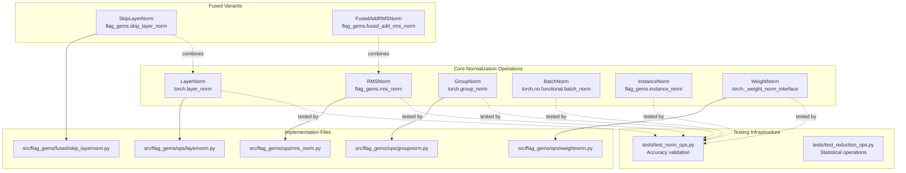
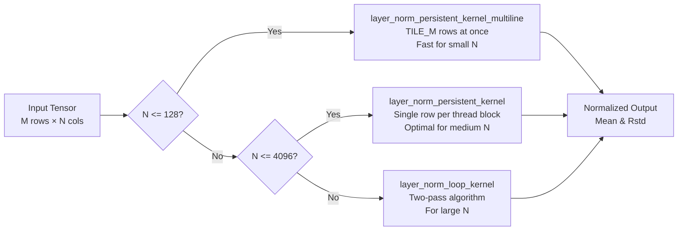
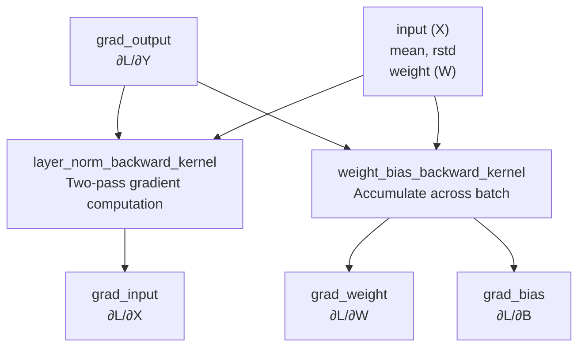
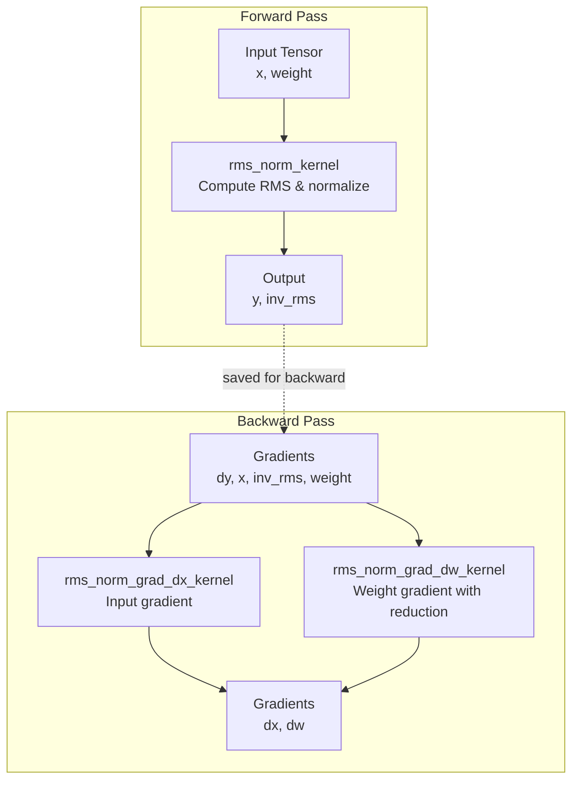
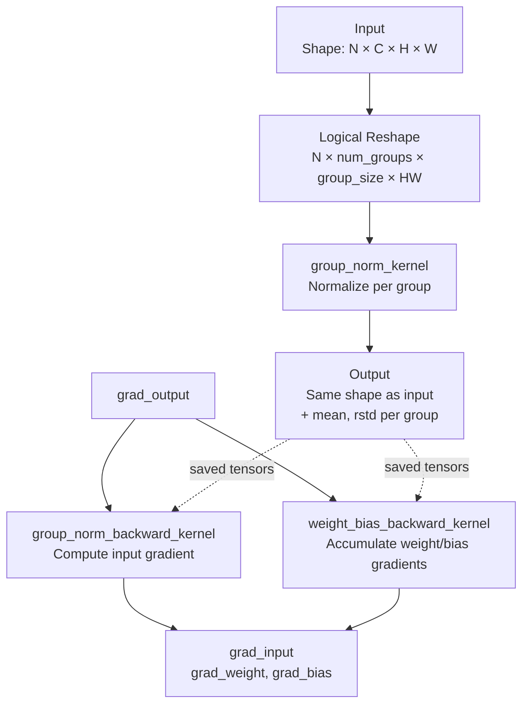
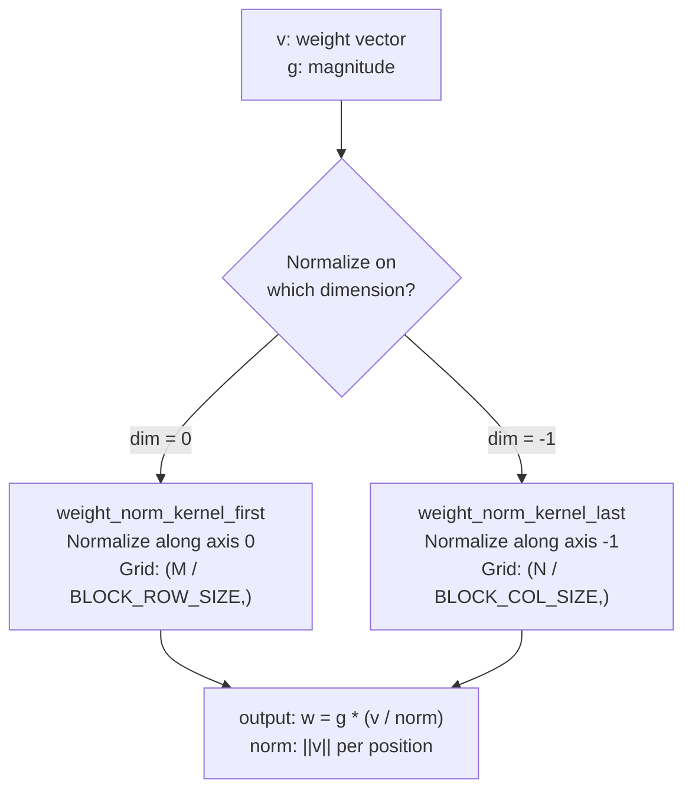

<!-- source: DeepWiki mcp.deepwiki.com · repo FlagOpen/FlagGems · page 3.3 Normalization Operations · fetched 2026-10-21 -->

# Normalization Operations

<details>
<summary>Relevant source files</summary>

The following files were used as context for generating this wiki page:

- [benchmark/test_binary_pointwise_perf.py](benchmark/test_binary_pointwise_perf.py)
- [benchmark/test_reduction_perf.py](benchmark/test_reduction_perf.py)
- [benchmark/test_select_and_slice_perf.py](benchmark/test_select_and_slice_perf.py)
- [src/flag_gems/fused/skip_layernorm.py](src/flag_gems/fused/skip_layernorm.py)
- [src/flag_gems/ops/dropout.py](src/flag_gems/ops/dropout.py)
- [src/flag_gems/ops/groupnorm.py](src/flag_gems/ops/groupnorm.py)
- [src/flag_gems/ops/index_add.py](src/flag_gems/ops/index_add.py)
- [src/flag_gems/ops/index_put.py](src/flag_gems/ops/index_put.py)
- [src/flag_gems/ops/layernorm.py](src/flag_gems/ops/layernorm.py)
- [src/flag_gems/ops/rms_norm.py](src/flag_gems/ops/rms_norm.py)
- [src/flag_gems/ops/var_mean.py](src/flag_gems/ops/var_mean.py)
- [src/flag_gems/ops/weightnorm.py](src/flag_gems/ops/weightnorm.py)
- [tests/test_norm_ops.py](tests/test_norm_ops.py)
- [tests/test_reduction_ops.py](tests/test_reduction_ops.py)

</details>


## Overview

This document describes the normalization operation implementations in FlagGems. Normalization operations standardize activations across different dimensions to improve training stability and convergence. FlagGems provides optimized Triton kernels for LayerNorm, RMSNorm, GroupNorm, BatchNorm, InstanceNorm, and WeightNorm, along with fused variants that combine normalization with other operations for improved performance.

For general pointwise operations, see [Pointwise Operations](#3.1). For reduction operations used in computing statistics, see [Reduction Operations](#3.2). For fused operations combining normalization with other computations, see [Fused Operations](#3.7).

## Normalization Operation Taxonomy



Sources: [src/flag_gems/ops/layernorm.py](), [src/flag_gems/ops/rms_norm.py](), [src/flag_gems/ops/groupnorm.py](), [src/flag_gems/ops/weightnorm.py](), [src/flag_gems/fused/skip_layernorm.py](), [tests/test_norm_ops.py]()

## Layer Normalization

Layer Normalization normalizes activations across the feature dimension for each sample independently. The operation computes mean and variance over the `normalized_shape` dimensions, then normalizes and applies an affine transformation.

### Kernel Variant Selection

LayerNorm uses different kernel implementations based on the size of the normalized dimensions (`N`). The selection logic optimizes for different data access patterns:



Sources: [src/flag_gems/ops/layernorm.py:333-395]()

### Forward Pass Implementation

The `layer_norm_persistent_kernel` handles single-row processing for medium-sized normalized shapes:

**Key Components:**
- **Input Processing**: [src/flag_gems/ops/layernorm.py:28-69]()
- **Statistics Computation**: Mean and reciprocal standard deviation (rstd) computed using Welford's algorithm
- **Normalization**: `(x - mean) * rstd`
- **Affine Transform**: Optional weight and bias application

The multiline variant `layer_norm_persistent_kernel_multiline` processes multiple rows per thread block for improved efficiency when `N` is small: [src/flag_gems/ops/layernorm.py:71-123]()

For large `N` values, `layer_norm_loop_kernel` uses a two-pass algorithm: [src/flag_gems/ops/layernorm.py:125-220]()
- **Pass 1**: Compute mean and variance using online algorithm with tiling
- **Pass 2**: Normalize and apply affine transformation

### Backward Pass Implementation

The backward pass computes gradients for input, weight, and bias:



Sources: [src/flag_gems/ops/layernorm.py:222-288]() (input gradient), [src/flag_gems/ops/layernorm.py:290-331]() (weight/bias gradients)

**Input Gradient Computation** [src/flag_gems/ops/layernorm.py:222-288]():
1. Compute partial sums: `dx_part2 = Σ(dy * w)` and `dx_part3 = Σ(dy * w * x_hat)`
2. Final gradient: `dx = rstd * (dx_hat - (dx_2 + x_hat * dx_3) / N)`

**Weight/Bias Gradient Computation** [src/flag_gems/ops/layernorm.py:290-331]():
- Accumulate gradients across batch dimension
- Weight gradient: `dw = Σ(dy * (x - mean) * rstd)`
- Bias gradient: `db = Σ(dy)`

## RMS Normalization

RMS Normalization computes root mean square normalization without centering (no mean subtraction). This is more efficient than LayerNorm and commonly used in modern language models.

### Implementation Architecture

RMSNorm is implemented as a custom `torch.autograd.Function` in class `RmsNorm`:



Sources: [src/flag_gems/ops/rms_norm.py:149-223]()

### Forward Kernel

The `rms_norm_kernel` [src/flag_gems/ops/rms_norm.py:15-52]() computes:
1. **Variance**: `var = sum(x²) / N`
2. **Inverse RMS**: `rrms = 1 / sqrt(var + eps)`
3. **Normalized Output**: `y = x * rrms * weight`

The inverse RMS is stored for backward pass efficiency.

### Backward Pass

**Input Gradient** [src/flag_gems/ops/rms_norm.py:54-92]():
- Computes `dx` using saved `inv_rms` and normalized values
- Formula: `dx = (dy * w - norm_val * row_sum_stats) * inv_rms / N`

**Weight Gradient** [src/flag_gems/ops/rms_norm.py:94-147]():
- Uses two-dimensional tiling for efficient reduction
- Partial results accumulated in buffer of shape `(row_block_num, N)`
- Final reduction sums across row blocks: [src/flag_gems/ops/rms_norm.py:216]()

## Group Normalization

GroupNorm divides channels into groups and normalizes within each group independently. This provides a middle ground between LayerNorm (group_size=1) and InstanceNorm (num_groups=C).

### Architecture



Sources: [src/flag_gems/ops/groupnorm.py:14-213]()

### Forward Implementation

The `group_norm_kernel` [src/flag_gems/ops/groupnorm.py:15-71]() processes each group independently:
- Each thread block handles one group: `pid = program_id`, maps to `N × num_groups` total blocks
- `group_size` channels processed together with spatial dimensions `HW`
- Statistics computed over `group_size × HW` elements
- Optional weight and bias applied per-channel after normalization

### Backward Implementation

**Input Gradient** [src/flag_gems/ops/groupnorm.py:73-138]():
- Two-pass algorithm similar to LayerNorm
- First pass accumulates `dx_part2` and `dx_part3`
- Second pass computes final gradient using accumulated values

**Weight/Bias Gradients** [src/flag_gems/ops/groupnorm.py:140-182]():
- Accumulates across batch dimension `N` and spatial dimensions `HW`
- Each channel's gradient computed independently
- Grid size is `(C, 1, 1)` with one thread block per channel

## Batch Normalization

BatchNorm normalizes across the batch dimension, maintaining running statistics for inference. The implementation computes statistics over `(N, H, W)` for each channel independently.

### Key Features

From test cases [tests/test_norm_ops.py:661-805]():
- **Training Mode**: Computes batch statistics and updates running mean/variance
- **Affine Parameters**: Optional learnable weight and bias per channel
- **Epsilon**: Small constant for numerical stability (default `1e-5`)
- **Running Statistics**: Exponential moving average with momentum

The forward pass signature:
```python
torch.nn.functional.batch_norm(input, running_mean, running_var, 
                              weight=None, bias=None, 
                              training=True, momentum=0.1, eps=1e-05)
```

Backward pass uses `torch.ops.aten.native_batch_norm_backward` with output mask controlling which gradients to compute [tests/test_norm_ops.py:759-796]().

## Instance Normalization

InstanceNorm normalizes each sample and channel independently over spatial dimensions. This is equivalent to GroupNorm with `num_groups = C`.

### Configuration Options

From test cases [tests/test_norm_ops.py:284-406]():
- **Use Input Stats**: Whether to compute statistics from input or use running stats
- **Has Running Stats**: Whether running mean/variance buffers are provided
- **Weight/Bias**: Optional affine parameters per channel
- **Momentum**: For updating running statistics (default `0.1`)

The function signature [tests/test_norm_ops.py:367-376]():
```python
flag_gems.instance_norm(input, weight=None, bias=None,
                       running_mean=None, running_var=None,
                       use_input_stats=True, momentum=0.1, eps=1e-05)
```

### Gradient Computation

The backward pass computes:
- **Input Gradient**: When `use_input_stats=True`, normalized using input statistics
- **Weight Gradient**: Accumulated across batch and spatial dimensions
- **Bias Gradient**: Sum of output gradients

## Weight Normalization

WeightNorm reparametrizes weight vectors by decoupling magnitude from direction: `w = g * (v / ||v||)`, where `v` is the weight vector, `g` is the magnitude, and `||v||` is the L2 norm.

### Dimension-Specific Kernels

WeightNorm provides specialized kernels for first and last dimension normalization:



Sources: [src/flag_gems/ops/weightnorm.py:16-98]() (forward), [src/flag_gems/ops/weightnorm.py:100-200]() (backward)

### Forward Pass

**First Dimension** [src/flag_gems/ops/weightnorm.py:58-98]():
- Each thread block processes `BLOCK_ROW_SIZE` rows
- Accumulates `v²` across columns to compute norm per row
- Applies normalization and magnitude: `output = v / norm * g`

**Last Dimension** [src/flag_gems/ops/weightnorm.py:16-56]():
- Each thread block processes `BLOCK_COL_SIZE` columns
- Accumulates `v²` across rows to compute norm per column
- Similar normalization and scaling logic

### Backward Pass

The backward kernels [src/flag_gems/ops/weightnorm.py:100-200]() compute:
- **v_grad**: `g * (w_grad / norm - v * (v · w_grad) / norm³)`
- **g_grad**: `(v · w_grad) / norm`

The interface functions `weight_norm_interface` and `weight_norm_interface_backward` dispatch to appropriate kernels based on `dim` [src/flag_gems/ops/weightnorm.py:202-269]().

## Fused Normalization Operations

Fused operations combine normalization with other computations to reduce memory traffic and improve performance.

### Skip Layer Normalization

`SkipLayerNorm` fuses residual addition with layer normalization in a single kernel pass:

| Operation | Formula | Implementation |
|-----------|---------|----------------|
| Residual Add | `x = x + residual` | Single load of both tensors |
| Compute Stats | `mean = sum(x) / N`<br/>`var = sum((x - mean)²) / N` | Online computation |
| Normalize | `x_hat = (x - mean) / sqrt(var + eps)` | Direct application |
| Affine | `y = w * x_hat + b` | Single kernel |

Sources: [src/flag_gems/fused/skip_layernorm.py:15-86]()

The `skip_layer_norm_kernel` [src/flag_gems/fused/skip_layernorm.py:15-60]() loads both input and residual, adds them, then performs normalization without intermediate materialization.

### Fused Add RMS Normalization

`FusedAddRMSNorm` combines residual addition with RMS normalization [tests/test_norm_ops.py:601-637]():

```python
def _torch_fused_add_rms_norm(x, residual, weight, eps):
    x = x + residual                          # Residual addition
    variance = x.pow(2).mean(-1, keepdim=True) # RMS computation
    hidden_states = x * torch.rsqrt(variance + eps)
    return weight * hidden_states, x           # Return normalized and new residual
```

This pattern is common in transformer architectures where residual connections appear before each normalization layer.

## Kernel Implementation Patterns

### Common Design Patterns

All normalization kernels share similar structural patterns:

| Pattern | Description | Example |
|---------|-------------|---------|
| **Two-Pass Statistics** | First pass computes mean/variance, second pass normalizes | `layer_norm_loop_kernel` |
| **Online Algorithms** | Compute statistics in single pass with accumulation | Welford's algorithm in variance computation |
| **Tile-Based Processing** | Process data in tiles that fit in shared memory | All kernels use `BLOCK_SIZE` tiling |
| **Output Masking** | Conditional gradient computation based on `output_mask` | Backward passes skip unused gradients |

### Autotuning Configuration

Normalization kernels use `@triton.autotune` with configurations from `runtime.get_tuned_config()`:

- **LayerNorm**: Tunes `BLOCK_ROW_SIZE` and `BLOCK_COL_SIZE` based on `M` and `N` [src/flag_gems/ops/layernorm.py:23-26]()
- **WeightNorm**: Separate configs for first/last dimension variants [src/flag_gems/ops/weightnorm.py:17-18]()
- **VarMean**: Used by some normalization statistics computation [src/flag_gems/ops/var_mean.py:27]()

See [LibTuner and Autotuning](#2.3) for details on the configuration system.

## Testing and Validation

### Accuracy Tests

The test suite [tests/test_norm_ops.py]() validates normalization operations against PyTorch references:

**Test Organization:**
- Forward pass accuracy with various shapes and dtypes
- Backward pass gradient computation
- Weight and bias gradient accuracy
- Vendor-specific skips for unsupported features

**Validation Method** [tests/test_norm_ops.py:10-15]():
```python
gems_assert_close(res_out, ref_out, dtype, reduce_dim=N)
```

This accounts for accumulated numerical errors proportional to reduction dimension `N`.

### Test Coverage Table

| Operation | Forward Test | Backward Test | Special Cases |
|-----------|-------------|---------------|---------------|
| LayerNorm | ✓ Multiple shapes | ✓ Input/weight/bias grads | `wb_none` parameter |
| RMSNorm | ✓ With numpy seed | ✓ Gradient validation | Vendor-specific tolerances |
| GroupNorm | ✓ Various group configs | ✓ Masked gradients | N, C, H, W variations |
| BatchNorm | ✓ Multiple dimensions | ✓ Affine parameter grads | Running stats update |
| InstanceNorm | ✓ 2D/3D inputs | ✓ Conditional stats | `use_input_stats` flag |
| WeightNorm | ✓ Interface test | ✓ Backward interface | Temporarily skipped |

Sources: [tests/test_norm_ops.py:24-805]()

### Shape and Configuration Coverage

Normalization tests use parametrized test matrices:

**LayerNorm Shapes** [tests/test_norm_ops.py:150-217]():
- Small: `(200, 36)`
- Medium: `(4096, 100)`, `(4096, 256)`
- Large: `(1, 40999)`, `(100, 40499)`

**GroupNorm Configurations** [tests/test_norm_ops.py:25-82]():
- Channel groups: 1, 8, 16, 32, 64
- Spatial sizes: `16×16`, `32×32`, `224×224`
- Batch sizes: 1, 16, 32

**Data Types** [tests/test_norm_ops.py:18]():
- `torch.float32` (Quick mode default)
- `torch.float16`, `torch.bfloat16` (Full test suite)

### Vendor-Specific Handling

Tests include conditional skipping for vendor-specific issues:

```python
@pytest.mark.skipif(flag_gems.vendor_name == "kunlunxin", reason="RESULT TODOFIX")
```

Common vendor considerations [tests/test_norm_ops.py]():
- Kunlunxin: Manual seeding required, some operations marked TODOFIX
- Cambricon: Manual seeding with different seed values
- mthreads: LLVM optimization compatibility flags

This ensures tests pass on supported hardware while tracking known issues.

---

