<!-- source: DeepWiki mcp.deepwiki.com · repo FlagOpen/FlagGems · page 3.4 Attention Operations · fetched 2026-10-21 -->

# Attention Operations

<details>
<summary>Relevant source files</summary>

The following files were used as context for generating this wiki page:

- [benchmark/test_attention_perf.py](benchmark/test_attention_perf.py)
- [examples/deepseek_with_vllm_test.py](examples/deepseek_with_vllm_test.py)
- [src/flag_gems/fused/flash_mla.py](src/flag_gems/fused/flash_mla.py)
- [src/flag_gems/ops/attention.py](src/flag_gems/ops/attention.py)
- [src/flag_gems/ops/flash_api.py](src/flag_gems/ops/flash_api.py)
- [src/flag_gems/ops/flash_kernel.py](src/flag_gems/ops/flash_kernel.py)
- [src/flag_gems/ops/get_scheduler_metadata.py](src/flag_gems/ops/get_scheduler_metadata.py)
- [src/flag_gems/runtime/backend/_nvidia/heuristics_config_utils.py](src/flag_gems/runtime/backend/_nvidia/heuristics_config_utils.py)
- [tests/test_attention_ops.py](tests/test_attention_ops.py)

</details>


## Purpose and Scope

This document covers the attention operation implementations in FlagGems, including scaled dot product attention, FlashAttention variants, and specialized attention mechanisms for inference workloads. These operations form the core computational primitives for transformer models and provide high-performance, memory-efficient attention computation.

For information about other operation categories, see:
- Normalization operations (LayerNorm, RMSNorm) - [3.3](#3.3)
- Fused operations - [3.7](#3.7)
- Matrix operations - [3.5](#3.5)

**Sources:** [src/flag_gems/ops/attention.py:1-664](), [tests/test_attention_ops.py:1-50]()

---

## Architecture Overview

The attention subsystem consists of four main layers that work together to provide efficient attention computation:

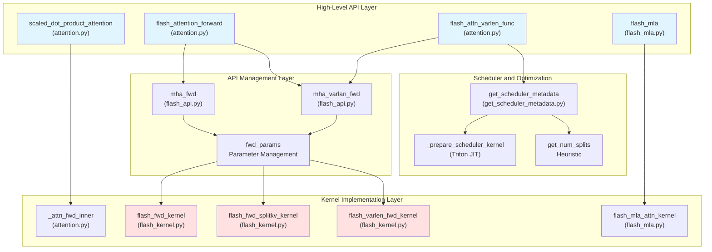

**Key Components:**

| Component | Purpose | File Location |
|-----------|---------|---------------|
| `scaled_dot_product_attention` | PyTorch-compatible SDPA API | [src/flag_gems/ops/attention.py:327-428]() |
| `flash_attention_forward` | FlashAttention forward pass | [src/flag_gems/ops/attention.py:431-513]() |
| `flash_attn_varlen_func` | Variable-length attention (vLLM) | [src/flag_gems/ops/attention.py:521-663]() |
| `flash_mla` | Multi-head Latent Attention | [src/flag_gems/fused/flash_mla.py:157-229]() |
| `flash_fwd_kernel` | Core FlashAttention kernel | [src/flag_gems/ops/flash_kernel.py:305-738]() |

**Sources:** [src/flag_gems/ops/attention.py:1-30](), [src/flag_gems/ops/flash_api.py:1-50](), [src/flag_gems/ops/flash_kernel.py:1-100]()

---

## Scaled Dot Product Attention

### Basic SDPA Implementation

The `scaled_dot_product_attention` function provides a PyTorch-compatible interface for scaled dot product attention with optional causal masking and attention masks. It uses a two-stage algorithm for causal attention and a single-stage algorithm for non-causal attention.

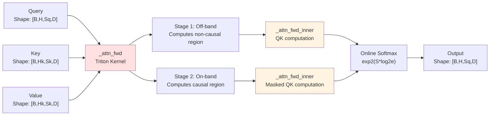

**Key Features:**

- **Multi-Query/Grouped-Query Attention (MQA/GQA)**: Supports different numbers of query and key/value heads via `enable_gqa` parameter
- **Causal Masking**: Implements efficient causal masking using two-stage computation (STAGE=3)
- **Attention Mask Support**: Accepts optional attention masks with automatic bool-to-float conversion
- **Head Dimension Support**: Handles head dimensions of 16, 32, 64, 128, or 256
- **Online Softmax**: Uses numerically stable online softmax with log2 computation

**Implementation Details:**

The kernel divides work into blocks of `BLOCK_M` rows and `BLOCK_N` columns. For each query block:

1. Load query block into SRAM once
2. Iterate over key/value blocks
3. Compute QK^T for current block
4. Apply masks (causal, attention mask)
5. Update running maximum and sum for softmax
6. Accumulate weighted value contribution

**Sources:** [src/flag_gems/ops/attention.py:327-428](), [src/flag_gems/ops/attention.py:17-124](), [src/flag_gems/ops/attention.py:146-324]()

---

## FlashAttention Forward

### Standard FlashAttention

The `flash_attention_forward` function implements FlashAttention algorithm for efficient attention computation with support for various features including dropout, causal masking, sliding window attention, and softcap.

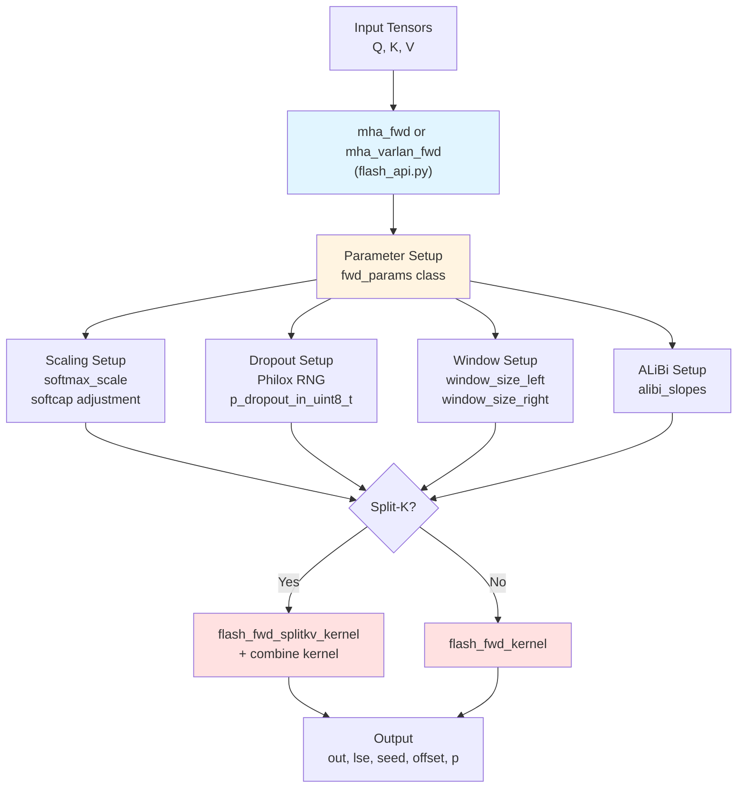

**Key Configuration Parameters:**

| Parameter | Type | Purpose |
|-----------|------|---------|
| `scale` | float | Softmax scale (default: 1/√d) |
| `softcap` | float | Softcap value for numerical stability (0.0 = disabled) |
| `window_size_left/right` | int | Sliding window attention bounds (-1 = infinite) |
| `alibi_slopes` | Tensor | ALiBi position encoding slopes |
| `dropout_p` | float | Dropout probability |
| `is_causal` | bool | Enable causal masking |
| `disable_splitkv` | bool | Disable split-K optimization |

**Sources:** [src/flag_gems/ops/attention.py:431-513](), [src/flag_gems/ops/flash_api.py:230-550]()

### Split-K Strategy

For decode-phase workloads with small query lengths and large KV sequence lengths, split-K parallelization improves performance by dividing the K/V dimension across multiple thread blocks.

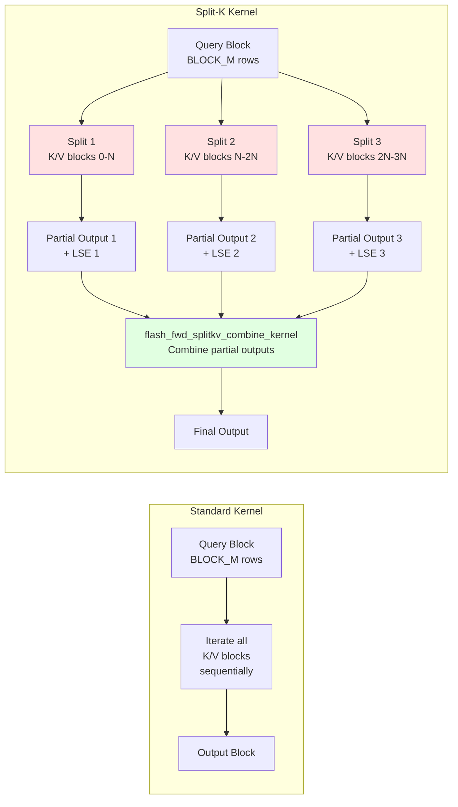

**Heuristics for Split-K:**

The system automatically determines the number of splits based on:
- Block dimensions: `BLOCK_M`, `BLOCK_N` determined by `block_m_splitkv_heuristic` and `block_n_splitkv_heuristic`
- Typical values: `BLOCK_M=128` for d≤128, else `BLOCK_M=64`; `BLOCK_N=64` for d≤64, else `BLOCK_N=32`

**Sources:** [src/flag_gems/ops/flash_kernel.py:213-218](), [src/flag_gems/ops/flash_kernel.py:746-1100]()

---

## Variable-Length Attention (flash_attn_varlen_func)

### Paged Attention Support

The `flash_attn_varlen_func` function implements variable-length attention for batched sequences with different lengths, supporting paged KV caching for efficient inference in systems like vLLM.

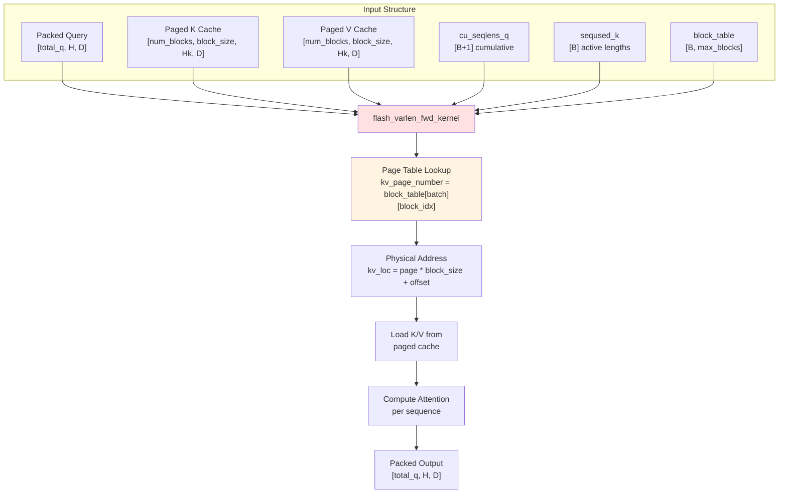

**Key Differences from Standard Attention:**

| Feature | Standard | Variable-Length |
|---------|----------|-----------------|
| **Input Shape** | [B, H, S, D] | [total_tokens, H, D] |
| **Sequence Indexing** | Fixed per batch | `cu_seqlens_q/k` cumulative indices |
| **KV Storage** | Contiguous | Paged via `block_table` |
| **Masking** | Global causal/window | Per-sequence causal/window |

**Paged KV Cache Access Pattern:**

The kernel computes physical addresses for paged KV cache as follows:

```python
# For each KV token index in sequence:
block_idx = token_idx // block_size          # Which block
block_offset = token_idx % block_size        # Offset within block
page_number = block_table[batch_id][block_idx]  # Physical block
physical_addr = page_number * block_size + block_offset
```

**Sources:** [src/flag_gems/ops/attention.py:521-663](), [src/flag_gems/ops/flash_api.py:230-550](), [tests/test_attention_ops.py:769-861]()

---

## Flash MLA (Multi-head Latent Attention)

### DeepSeek V3 Attention

Flash MLA implements the Multi-head Latent Attention mechanism used in DeepSeek V3 models, which uses a compressed KV representation with separate RoPE (Rotary Position Encoding) dimensions.

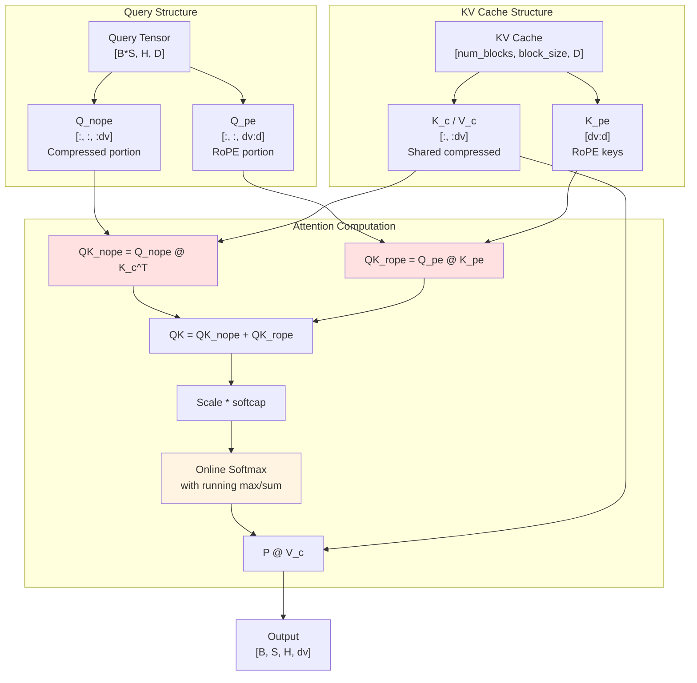

**MLA Design Rationale:**

MLA reduces KV cache memory by using:
1. **Compressed KV representation** (`dv` dimensions): Shared between K and V, used for value projection
2. **RoPE keys** (`d - dv` dimensions): Additional dimensions for positional encoding in keys only

Example dimensions for DeepSeek V3:
- `d = 576` (total query/key dimension)
- `dv = 512` (compressed KV dimension)
- RoPE dimension: `576 - 512 = 64`

**Paged Memory Access:**

MLA uses block table for paged access similar to standard paged attention:

```python
# For each token in sequence:
kv_page_number = block_table[batch_id][token_idx // PAGE_SIZE]
kv_loc = kv_page_number * PAGE_SIZE + (token_idx % PAGE_SIZE)

# Load both compressed and RoPE portions
v_c = kv_cache[kv_loc, :dv]        # Compressed V
k_c = v_c^T                         # K uses same compressed representation
k_pe = kv_cache[kv_loc, dv:d]      # RoPE portion of K
```

**Sources:** [src/flag_gems/fused/flash_mla.py:32-155](), [src/flag_gems/fused/flash_mla.py:157-229]()

---

## Kernel Implementation Details

### Core FlashAttention Algorithm

The `flash_fwd_kernel` implements the FlashAttention algorithm with online softmax computation to minimize memory traffic.

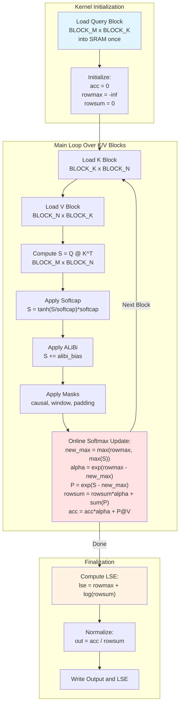

**Online Softmax Algorithm:**

The kernel maintains running statistics to compute softmax without materializing the full attention matrix:

1. **Running Maximum**: Track `rowmax` = max seen so far
2. **Running Sum**: Track `rowsum` = sum of exponentials
3. **Rescaling**: When new maximum found, rescale previous accumulator by `exp(old_max - new_max)`
4. **Accumulation**: Add current contribution `exp(S - new_max) @ V`

**Mathematical Formulation:**

```
For each block i:
  m_i = max(m_{i-1}, max(S_i))           # Update max
  α = exp(m_{i-1} - m_i)                 # Rescaling factor
  l_i = l_{i-1} * α + sum(exp(S_i - m_i)) # Update sum
  O_i = O_{i-1} * α + exp(S_i - m_i) @ V_i # Update output
```

**Sources:** [src/flag_gems/ops/flash_kernel.py:305-738](), [src/flag_gems/ops/flash_kernel.py:177-202]()

### Masking and Window Attention

The kernel supports multiple types of masking applied in sequence:

```mermaid
graph LR
    S["Attention Scores<br/>S = Q @ K^T"]
    
    S --> Softcap{Softcap?}
    Softcap -->|Yes| SC["S = tanh(S/cap)*cap"]
    Softcap -->|No| Alibi{ALiBi?}
    SC --> Alibi
    
    Alibi -->|Yes| AB["S += alibi_bias"]
    Alibi -->|No| Causal{Causal?}
    AB --> Causal
    
    Causal -->|Yes| CM["S[i,j] = -inf if j > i"]
    Causal -->|No| Local{Local?}
    CM --> Local
    
    Local -->|Yes| LM["S[i,j] = -inf if<br/>j < i-window_left or<br/>j > i+window_right"]
    Local -->|No| Padding{Padding?}
    LM --> Padding
    
    Padding -->|Yes| PM["S[i,j] = -inf if<br/>j >= seqlen_k"]
    Padding -->|No| Softmax["Softmax(S)"]
    PM --> Softmax
    
    style SC fill:#fff4e1
    style AB fill:#fff4e1
    style CM fill:#ffe1e1
    style LM fill:#ffe1e1
    style PM fill:#ffe1e1
```

**Implementation Functions:**

| Function | Purpose | Location |
|----------|---------|----------|
| `apply_softcap` | Numerical stability for large logits | [src/flag_gems/ops/flash_kernel.py:206-210]() |
| `apply_alibi` | ALiBi position encoding | [src/flag_gems/ops/flash_kernel.py:101-135]() |
| `apply_mask` | Causal/window/padding masks | [src/flag_gems/ops/flash_kernel.py:138-174]() |
| `apply_dropout` | Dropout using Philox RNG | [src/flag_gems/ops/flash_kernel.py:61-97]() |

**Sources:** [src/flag_gems/ops/flash_kernel.py:138-210]()

---

## Scheduler Metadata

### Dynamic Configuration

The `get_scheduler_metadata` function computes optimal execution parameters for attention kernels based on workload characteristics, including split-K decisions and block dimensions.

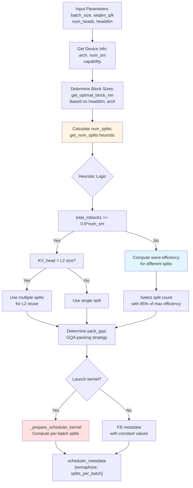

**Key Decision Criteria:**

1. **High Utilization (≥80% of SMs)**:
   - If KV cache size > L2 cache: Use splits for L2 reuse
   - Otherwise: Single split (sufficient parallelism)

2. **Low Utilization (<80% of SMs)**:
   - Compute wave efficiency for different split counts
   - Select split count achieving ≥85% of maximum efficiency

3. **Dynamic Split Computation**:
   - For batches ≤992: Launch kernel to compute per-sequence splits
   - For large batches: Use static heuristic value

**Sources:** [src/flag_gems/ops/get_scheduler_metadata.py:170-293](), [src/flag_gems/ops/get_scheduler_metadata.py:411-645]()

---

## Features and Optimizations

### Supported Features Matrix

| Feature | SDPA | FlashAttention | Varlen | MLA | Notes |
|---------|------|----------------|--------|-----|-------|
| **Causal Masking** | ✓ | ✓ | ✓ | ✓ | Two-stage algorithm |
| **Sliding Window** | ✗ | ✓ | ✓ | ✗ | Configurable left/right windows |
| **ALiBi Position** | ✗ | ✓ | ✓ | ✗ | Attention bias slopes |
| **Softcap** | ✗ | ✓ | ✓ | ✗ | Numerical stability |
| **Dropout** | ✗ | ✓ | ✗ | ✗ | Philox RNG-based |
| **MQA/GQA** | ✓ | ✓ | ✓ | ✓ | Multi-query/grouped-query |
| **Paged KV** | ✗ | ✗ | ✓ | ✓ | Block table indirection |
| **Split-K** | ✗ | ✓ | ✓ | ✗ | Decode optimization |
| **Head Dims** | 16-256 | 16-256 | 16-256 | Custom | Powers of 2 preferred |
| **Dtypes** | fp16, bf16 | fp16, bf16 | fp16, bf16 | fp16, bf16 | 2-byte precision |

**Sources:** [src/flag_gems/ops/attention.py:327-428](), [src/flag_gems/ops/attention.py:431-513](), [src/flag_gems/ops/attention.py:521-663](), [src/flag_gems/fused/flash_mla.py:157-229]()

### Performance Optimizations

```mermaid
graph TB
    subgraph "Memory Optimizations"
        LoadQ["Query Reuse<br/>Load once per block"]
        PreloadV["V Pre-loading<br/>Overlap compute & memory"]
        OnlineMax["Online Softmax<br/>No materialization"]
        L2Hint["Cache Hints<br/>.cg directive"]
    end
    
    subgraph "Compute Optimizations"
        TileSize["Adaptive Tile Sizes<br/>Based on head_dim & arch"]
        NumWarps["Warp Allocation<br/>4-8 warps per CTA"]
        Pipeline["Software Pipelining<br/>num_stages=1-3"]
        TF32["Disable TF32<br/>allow_tf32=False for accuracy"]
    end
    
    subgraph "Parallelization"
        SplitK["Split-K Strategy<br/>For small batch decode"]
        GQAPack["GQA Packing<br/>Reduce head parallelism"]
        BatchPar["Batch-Head Parallel<br/>2D grid launch"]
    end
    
    subgraph "Algorithmic"
        TwoStage["Two-Stage Causal<br/>Avoid unnecessary masking"]
        EarlyExit["Early Exit<br/>All-zero row handling"]
        BlockPrune["Block Pruning<br/>Skip out-of-window blocks"]
    end
    
    LoadQ --> Fast["Faster Execution"]
    PreloadV --> Fast
    OnlineMax --> Fast
    L2Hint --> Fast
    TileSize --> Fast
    NumWarps --> Fast
    Pipeline --> Fast
    TF32 --> Fast
    SplitK --> Fast
    GQAPack --> Fast
    BatchPar --> Fast
    TwoStage --> Fast
    EarlyExit --> Fast
    BlockPrune --> Fast
    
    style Fast fill:#e1ffe1
```

**Autotuning Configuration:**

The system uses LibEntry autotuning ([2.2](#2.2)) with device-specific configurations stored in `tune_configs.yaml`. Typical configurations:

```python
# Example for NVIDIA A100
{"BLOCK_M": 128, "BLOCK_N": 128, "num_warps": 8, "num_stages": 1}
{"BLOCK_M": 128, "BLOCK_N": 32, "num_warps": 4, "num_stages": 3}
```

Filter function `keep` ([src/flag_gems/ops/flash_kernel.py:257-265]()) prunes suboptimal configurations during autotuning.

**Sources:** [src/flag_gems/ops/flash_kernel.py:282-301](), [src/flag_gems/ops/attention.py:129-139]()

---

## Testing and Benchmarking

### Test Coverage

The test suite in `test_attention_ops.py` provides comprehensive coverage of attention operations:

```mermaid
graph TB
    subgraph "SDPA Tests"
        T1["test_sdpa_legacy<br/>Basic SDPA correctness"]
        T2["test_sdpa_square_qk_even_mn<br/>Square attention matrices"]
        T3["test_sdpa_nonsquare_qk<br/>Non-square matrices"]
    end
    
    subgraph "FlashAttention Tests"
        T4["test_flash_fwd_nonsquare_qk<br/>Forward pass accuracy"]
        T5["test_flash_fwd_gqa_alibi_softcap<br/>GQA + ALiBi + Softcap"]
        T6["test_flash_splitkv<br/>Split-K correctness"]
        T7["test_flash_fwd_swa<br/>Sliding window attention"]
    end
    
    subgraph "Varlen Tests"
        T8["test_flash_attn_varlen_func<br/>Paged attention"]
        T9["test_flash_attn_varlen_func_swap_qg<br/>Query-group swapping"]
    end
    
    subgraph "MLA Tests"
        T10["test_concat_and_cache_mla<br/>MLA KV caching"]
    end
    
    T1 --> Ref1["PyTorch Reference:<br/>torch.nn.functional.scaled_dot_product_attention"]
    T2 --> Ref1
    T3 --> Ref1
    
    T4 --> Ref2["PyTorch Reference:<br/>torch.ops.aten._flash_attention_forward"]
    T5 --> Ref2
    T6 --> Ref2
    T7 --> Ref2
    
    T8 --> Ref3["Reference Implementation:<br/>ref_paged_attn"]
    T9 --> Ref3
    
    T10 --> Ref4["Reference Implementation:<br/>Manual KV caching"]
    
    style Ref1 fill:#e1f5ff
    style Ref2 fill:#e1f5ff
    style Ref3 fill:#fff4e1
    style Ref4 fill:#fff4e1
```

**Test Parameterization:**

Tests are parameterized across multiple dimensions:
- **Batch sizes**: 1, 2, 4, 8
- **Sequence lengths**: 128-8192, including odd sizes (17, 1030)
- **Head counts**: Q heads: 1-128, KV heads: 1-16 (for GQA testing)
- **Head dimensions**: 16, 32, 64, 96, 128, 192, 256
- **Data types**: `torch.float16`, `torch.bfloat16`
- **Masking modes**: causal=True/False, window sizes

**Vendor-Specific Skipping:**

Tests use vendor detection to skip unsupported configurations:
```python
@pytest.mark.skipif(flag_gems.vendor_name == "kunlunxin", reason="RESULT TODOFIX")
@pytest.mark.skipif(flag_gems.vendor_name == "hygon", reason="RuntimeError")
```

**Sources:** [tests/test_attention_ops.py:280-348](), [tests/test_attention_ops.py:411-447](), [tests/test_attention_ops.py:769-861]()

### Performance Benchmarking

The benchmark suite measures performance against reference implementations:

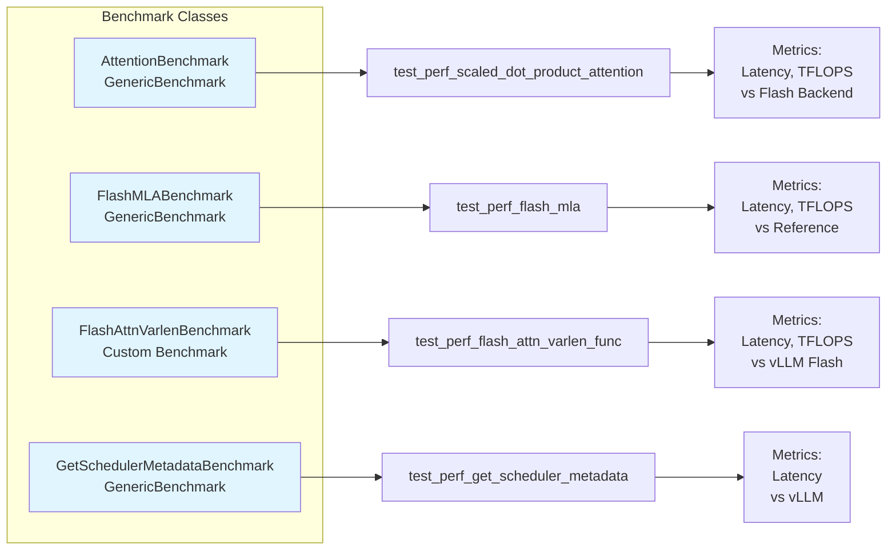

**Benchmark Configurations:**

Benchmarks test realistic workload patterns:

1. **SDPA Benchmark**: Square matrices with varying batch, head, sequence, and head dimension sizes
2. **Flash MLA Benchmark**: Decode-phase workloads with batch=128, seq_q=1, varying seq_k
3. **Varlen Benchmark**: Real vLLM request patterns with mixed prefill/decode sequences
4. **Scheduler Metadata**: Metadata computation overhead for various batch sizes

**Example Varlen Benchmark Configuration:**

From Qwen3-1.7B workload (`--random-input 512 --random-output 2048`):
- Prefill: `cu_seq_lens_q = (0, 512)`, `seqused_k = (512,)`
- Decode: `cu_seq_lens_q = (0, 1, 2, 72)`, `seqused_k = (1, 1, 70)`
- Mixed: Multiple sequences with varying lengths

**Sources:** [benchmark/test_attention_perf.py:14-62](), [benchmark/test_attention_perf.py:175-401]()

---

