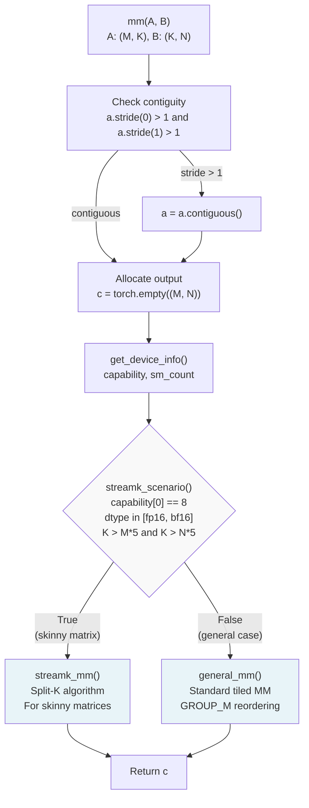
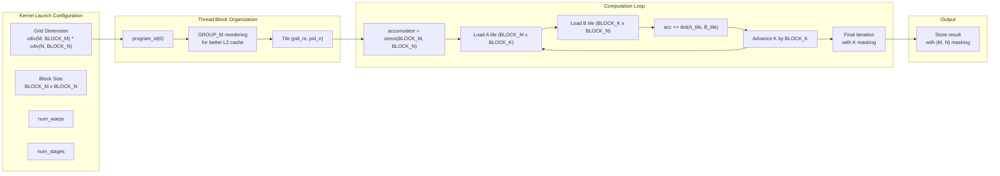
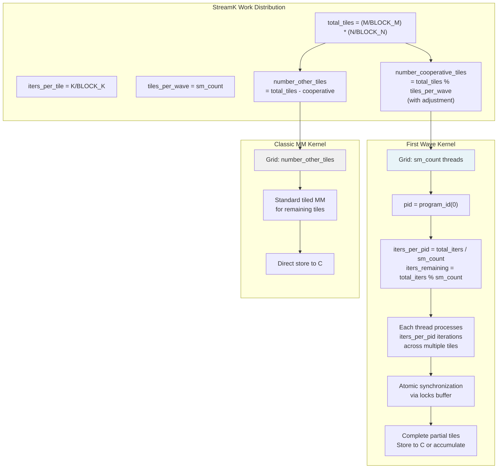
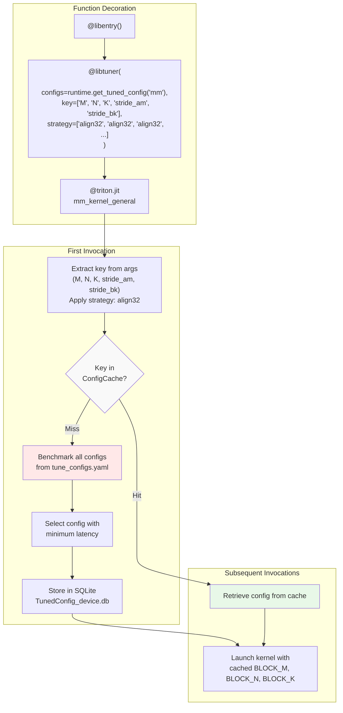

<!-- source: DeepWiki mcp.deepwiki.com · repo FlagOpen/FlagGems · page 3.5 Matrix Operations · fetched 2026-10-21 -->

# Matrix Operations

<details>
<summary>Relevant source files</summary>

The following files were used as context for generating this wiki page:

- [lib/addmm.cpp](lib/addmm.cpp)
- [lib/mm.cpp](lib/mm.cpp)
- [src/flag_gems/csrc/aten_patch.cpp](src/flag_gems/csrc/aten_patch.cpp)
- [src/flag_gems/fused/fused_add_rms_norm.py](src/flag_gems/fused/fused_add_rms_norm.py)
- [src/flag_gems/ops/addmm.py](src/flag_gems/ops/addmm.py)
- [src/flag_gems/ops/mm.py](src/flag_gems/ops/mm.py)
- [src/flag_gems/ops/mm_streamk.py](src/flag_gems/ops/mm_streamk.py)
- [src/flag_gems/runtime/backend/_nvidia/tune_configs.yaml](src/flag_gems/runtime/backend/_nvidia/tune_configs.yaml)
- [src/flag_gems/utils/libentry.py](src/flag_gems/utils/libentry.py)
- [tests/test_blas_ops.py](tests/test_blas_ops.py)
- [tests/test_libentry.py](tests/test_libentry.py)

</details>


## Overview

This document describes the matrix multiplication and linear algebra operations implemented in FlagGems. These operations provide high-performance GPU kernels for 2D matrix computations using Triton JIT compilation with automatic kernel selection and autotuning.

Matrix operations are part of the broader operator library. For element-wise operations, see [Pointwise Operations](#3.1). For operations involving reduction along dimensions, see [Reduction Operations](#3.2).

**Scope**: This page covers matrix-matrix multiplication (`mm`, `bmm`), matrix addition with multiplication (`addmm`), matrix-vector operations (`mv`, `addmv`), and specialized operations like `outer`, `dot`, `vdot`, and `addr`.

Sources: [src/flag_gems/ops/mm.py:1-238](), [src/flag_gems/ops/addmm.py:1-182](), [tests/test_blas_ops.py:1-351]()

## Supported Operations

FlagGems implements the following matrix operations:

| Operation | Description | Output Shape | Key Parameters |
|-----------|-------------|--------------|----------------|
| `mm` | Matrix-matrix multiplication | `(M, N)` | None |
| `bmm` | Batched matrix multiplication | `(B, M, N)` | None |
| `addmm` | Scaled addition with matrix multiplication: `beta*bias + alpha*mm(A,B)` | `(M, N)` | `alpha`, `beta` |
| `mv` | Matrix-vector multiplication | `(M,)` | None |
| `addmv` | Scaled addition with matrix-vector multiplication | `(M,)` | `alpha`, `beta` |
| `outer` | Outer product of two vectors | `(M, N)` | None |
| `dot` | Dot product of two 1D tensors | scalar | None |
| `vdot` | Conjugate dot product | scalar | None |
| `addr` | Outer product with scaling: `beta*input + alpha*outer(vec1, vec2)` | `(M, N)` | `alpha`, `beta` |

All operations support automatic operator registration through `flag_gems.enable()` or `flag_gems.use_gems()` context manager, providing drop-in replacement for PyTorch's native implementations.

Sources: [tests/test_blas_ops.py:24-351](), [src/flag_gems/ops/mm.py:200-238](), [src/flag_gems/ops/addmm.py:83-182]()

## Implementation Architecture

### Kernel Selection Strategy

The matrix multiplication implementation uses a two-tier kernel selection strategy based on matrix dimensions and hardware characteristics:



**Kernel Selection Criteria:**

The `streamk_scenario()` function determines whether to use the StreamK algorithm based on:
- GPU compute capability 8.x (A100 generation)
- Data types: `torch.float16` or `torch.bfloat16`
- Matrix shape: K dimension significantly larger than both M and N (`K > M*5` and `K > N*5`)

Sources: [src/flag_gems/ops/mm.py:186-220](), [lib/mm.cpp:65-69]()

### General Matrix Multiplication Kernel

The general matrix multiplication kernel (`mm_kernel_general`) implements a tiled algorithm with the following optimizations:



**Key Implementation Details:**

1. **GROUP_M Reordering**: Thread blocks are reordered to improve L2 cache locality. The reordering groups `GROUP_M` consecutive rows together to access adjacent memory regions.

2. **Loop Peeling**: The K-dimension loop separates the main iterations (which can avoid boundary checks) from the final iteration that handles remainder elements with masking.

3. **Contiguity Hints**: Uses `tl.max_contiguous()` and `tl.multiple_of()` to provide compiler hints for memory access patterns.

4. **Stride-aware Tuning**: The autotuning key includes `stride_am` and `stride_bk` to trigger separate tuning for column-major vs row-major layouts.

Sources: [src/flag_gems/ops/mm.py:48-135](), [src/flag_gems/ops/mm.py:154-183]()

### StreamK Algorithm Implementation

The StreamK (Stream-K) algorithm is a specialized matrix multiplication approach designed for matrices with large K dimensions ("skinny" matrices). It provides better load balancing across SMs by splitting work across the K dimension.



**StreamK Execution Model:**

1. **Cooperative Tiles**: A subset of tiles processed cooperatively by all SMs, with work split across the K dimension
2. **Work Assignment**: Each SM processes `iters_per_pid` K-iterations, potentially across multiple output tiles
3. **Synchronization**: For `bfloat16`, uses an intermediate buffer `P` to accumulate partial results; for other dtypes, uses atomic operations on the output buffer
4. **Classic Fallback**: Remaining tiles are processed with standard tiled multiplication

**BFloat16 Special Handling:**

The StreamK implementation has a separate kernel path for `bfloat16` (`first_wave_for_bf16`) that uses an intermediate accumulation buffer to avoid atomic operations on the lower-precision output buffer.

Sources: [src/flag_gems/ops/mm_streamk.py:1-577](), [src/flag_gems/ops/mm.py:186-198](), [lib/mm.cpp:71-237]()

## Autotuning System Integration

Matrix operations use the `LibTuner` and `LibEntry` decorators for automatic performance optimization:



**Strategy Functions:**

The tuning key uses strategy functions to normalize input dimensions:

- **`align32`**: Rounds up to the nearest multiple of 32 (`math.ceil(key / 32) * 32`)
- **`default`**: Uses the raw value without transformation
- **`log`**: Rounds up to the nearest power of 2 (`2 ** math.ceil(math.log2(key))`)

This normalization reduces the configuration space by grouping similar shapes together, allowing cache hits for shape variations.

Sources: [src/flag_gems/ops/mm.py:54-62](), [src/flag_gems/utils/libentry.py:608-622](), [src/flag_gems/utils/libentry.py:548-606]()

## Tuning Configurations

### MM Kernel Configurations

The general `mm` kernel has 13 predefined configurations in `tune_configs.yaml`:

| BLOCK_M | BLOCK_N | BLOCK_K | num_stages | num_warps | Use Case |
|---------|---------|---------|------------|-----------|----------|
| 64 | 64 | 64 | 5 | 4 | Small tiles, deep pipeline |
| 64 | 128 | 64 | 3 | 4 | Medium tiles |
| 64 | 64 | 128 | 4 | 8 | Large K reduction |
| 128 | 128 | 32 | 5 | 8 | Large tiles, smaller K |
| 16 | 64 | 256 | 4 | 4 | Very large K reduction |
| 16 | 64 | 64 | 5 | 2 | Small M dimension |

**Configuration Parameters:**

- **BLOCK_M, BLOCK_N, BLOCK_K**: Tile sizes for matrix dimensions
- **num_stages**: Number of pipeline stages for overlapping memory and compute
- **num_warps**: Number of warps per thread block (32 threads per warp)

The autotuner benchmarks all configurations for a given shape and selects the one with minimum latency.

Sources: [src/flag_gems/runtime/backend/_nvidia/tune_configs.yaml:126-210]()

### ADDMM Kernel Configurations

The `addmm` kernel (fused add + matrix multiply) has 7 configurations optimized for different matrix shapes:

| BLOCK_SIZE_M | BLOCK_SIZE_N | BLOCK_SIZE_K | num_stages | num_warps |
|--------------|--------------|--------------|------------|-----------|
| 128 | 256 | 64 | 3 | 8 |
| 64 | 256 | 32 | 4 | 4 |
| 128 | 128 | 32 | 4 | 4 |
| 64 | 128 | 32 | 4 | 4 |
| 128 | 32 | 32 | 4 | 4 |
| 64 | 32 | 32 | 5 | 2 |
| 32 | 64 | 32 | 5 | 2 |

The `addmm` implementation fuses the bias addition directly into the accumulator before writing to output, reducing memory traffic.

Sources: [src/flag_gems/runtime/backend/_nvidia/tune_configs.yaml:233-281](), [src/flag_gems/ops/addmm.py:24-81]()

### BMM Kernel Configurations

Batched matrix multiplication (`bmm`) has 12 configurations focused on tile size variations:

**Key Patterns:**
- Tile sizes range from 32x32 to 128x128
- Consistent BLOCK_K of 32 across all configs
- 2-3 pipeline stages
- GROUP_M values of 1-2 for different reordering strategies

Sources: [src/flag_gems/runtime/backend/_nvidia/tune_configs.yaml:28-112]()

### MV Kernel Configurations

Matrix-vector multiplication has autotuning configurations with a focus on the M dimension blocking:

**Configuration Space:**
- BLOCK_M: [32, 64, 128]
- BLOCK_N: [1, 2, 4, 8] (for vector tiling)
- num_warps: [4, 8]
- num_stages: [3, 4]

The smaller BLOCK_N values reflect that one dimension is a vector (size 1 in that dimension conceptually).

Sources: [src/flag_gems/runtime/backend/_nvidia/tune_configs.yaml:520-542]()

## Operation-Specific Details

### Matrix Multiplication (mm)

```python
def mm(a, b):
    # Shape validation: a.shape[1] == b.shape[0]
    # Contiguity handling
    # Output allocation
    # Device information retrieval
    # Kernel selection (streamk vs general)
    # Kernel launch with autotuning
```

**Implementation Flow:**

1. **Input Validation**: Ensures dimension compatibility (`a.shape[1] == b.shape[0]`)
2. **Contiguity Enforcement**: Makes inputs contiguous if necessary
3. **Device Query**: Retrieves SM count and compute capability
4. **Kernel Selection**: Chooses between StreamK and general based on heuristics
5. **Kernel Launch**: Executes selected kernel with LibEntry/LibTuner optimization

**Column-Major Support:**

The implementation handles both row-major and column-major layouts efficiently. The stride information (`stride_am`, `stride_bk`) is included in the autotuning key to ensure proper kernel selection for different layouts.

Sources: [src/flag_gems/ops/mm.py:200-220](), [src/flag_gems/ops/mm.py:15-41]()

### Add Matrix Multiplication (addmm)

```python
def addmm(bias, mat1, mat2, *, beta=1, alpha=1):
    # Computes: beta * bias + alpha * (mat1 @ mat2)
    # Supports broadcasting of bias
```

**Kernel Structure:**

The `addmm_kernel` performs matrix multiplication and bias addition in a single fused operation:

1. **MM Accumulation**: Accumulates `mat1 @ mat2` in float32
2. **Bias Loading**: Loads bias with broadcasting support
3. **Fused Scaling**: Applies `alpha * acc + beta * bias` before type conversion
4. **Output Store**: Writes result in original dtype

The fusion eliminates a separate memory read/write pass for the bias addition.

Sources: [src/flag_gems/ops/addmm.py:83-131](), [src/flag_gems/ops/addmm.py:24-81]()

### Matrix-Vector Multiplication (mv)

The `mv` operation computes `matrix @ vector` with specialized optimizations for the vector dimension:

**Key Characteristics:**
- Output shape: `(M,)` from `(M, N) @ (N,)`
- Reduced memory bandwidth due to vector reuse
- Tuning focuses on BLOCK_M and BLOCK_N parameters
- Support for non-contiguous inputs

Sources: [tests/test_blas_ops.py:168-182]()

### Outer Product (outer)

Computes the outer product of two vectors: `outer(a, b)[i,j] = a[i] * b[j]`

**Backward Pass Support:**
- Forward: `out = outer(inp1, inp2)`
- Backward `inp1`: Sum reduction along axis 1 of `grad_out`
- Backward `inp2`: Sum reduction along axis 0 of `grad_out`

The implementation uses `torch.autograd.Function` for custom gradient computation.

Sources: [tests/test_blas_ops.py:246-270]()

## C++ Extension Layer

FlagGems provides optional C++ wrappers for matrix operations to reduce Python overhead:

```mermaid
graph LR
    subgraph "C++ Operator Wrapper"
        CPPFunc["at::Tensor mm_tensor(<br/>  const at::Tensor& mat1,<br/>  const at::Tensor& mat2<br/>)"]
        
        ValidateInputs["Validate dimensions<br/>Check dtype compatibility"]
        
        AllocOutput["at::empty({M, N}, options)"]
        
        GetDevice["get_device_info()<br/>capability, sm_count"]
        
        SelectKernel{"streamk_scenario()?"}
        
        CallStreamK["streamk_mm_tensor(<br/>  TritonJITFunction)"]
        
        CallGeneral["general_mm_tensor(<br/>  TritonJITFunction)"]
    end
    
    subgraph "Triton JIT Interface"
        GetFunc["TritonJITFunction::get_instance(<br/>  'mm.py', 'mm_kernel_general')"]
        
        StreamHandle["c10::cuda::getCurrentCUDAStream()"]
        
        LaunchKernel["kernel(stream, grid_x, grid_y, grid_z,<br/>       num_warps, num_stages, args...)"]
    end
    
    CPPFunc --> ValidateInputs
    ValidateInputs --> AllocOutput
    AllocOutput --> GetDevice
    GetDevice --> SelectKernel
    
    SelectKernel -->|"True"| CallStreamK
    SelectKernel -->|"False"| CallGeneral
    
    CallStreamK --> GetFunc
    CallGeneral --> GetFunc
    
    GetFunc --> StreamHandle
    StreamHandle --> LaunchKernel
    
    style SelectKernel fill:#f9f9f9
```



**C++ Implementation Benefits:**
- Reduced Python interpreter overhead for tight loops
- Direct integration with PyTorch's ATen tensor API
- Explicit control over CUDA stream management
- Efficient argument passing to Triton kernels

**Registration:**

C++ operators can be registered using `TORCH_LIBRARY_IMPL` for automatic dispatch, though this is currently commented out in the codebase to allow per-operator control.

Sources: [lib/mm.cpp:1-335](), [lib/addmm.cpp:1-126](), [src/flag_gems/csrc/aten_patch.cpp:28-43]()

## Testing and Validation

Matrix operations have comprehensive test coverage in `test_blas_ops.py`:

**Test Categories:**

1. **Accuracy Tests**: Compare FlagGems output against PyTorch reference implementations using `gems_assert_close()`
2. **Shape Variations**: Test small shapes `(1, 32)`, medium shapes `(160, 1024)`, and large shapes `(5333, 497)`
3. **Data Type Coverage**: `torch.float32`, `torch.float16`, `torch.bfloat16` (when supported)
4. **Layout Testing**: Both row-major and column-major inputs (`b_column_major` parameter)
5. **Scalar Parameters**: Various `alpha` and `beta` values for scaled operations
6. **Out Variants**: Test in-place output variations (`addmm_out`, `mm_out`)

**Vendor-Specific Handling:**

Tests include skip decorators for vendor-specific limitations:
- `@pytest.mark.skipif(flag_gems.vendor_name == "kunlunxin", ...)` for operations not yet supported
- Conditional environment variables for vendor-specific features (e.g., `MUSA_ENABLE_SQMMA` for mthreads)

**Tolerance Checking:**

The `gems_assert_close()` function includes a `reduce_dim` parameter to account for numerical accumulation differences across the reduction dimension (typically K in matrix multiplication).

Sources: [tests/test_blas_ops.py:1-351]()

## Performance Characteristics

**General MM Performance Factors:**

1. **Tile Size Selection**: Larger tiles (128x128) generally better for large matrices, smaller tiles (16x64) better for skinny matrices
2. **Pipeline Depth**: More stages (4-5) improve performance when memory bandwidth is the bottleneck
3. **Warp Count**: More warps (8) better for large tiles, fewer warps (2) for small tiles to reduce occupancy overhead

**StreamK Advantages:**

- Better load balancing when K >> M and K >> N
- Reduced tail effects from uneven work distribution
- Optimal for A100 architecture with many SMs

**Memory Access Patterns:**

- GROUP_M reordering improves L2 cache hit rate by ~20-30% for large matrices
- Column-major handling avoids transpose operations
- Loop peeling reduces branch divergence in boundary conditions

Sources: [src/flag_gems/ops/mm.py:43-44](), [src/flag_gems/ops/mm_streamk.py:451-577]()

---

