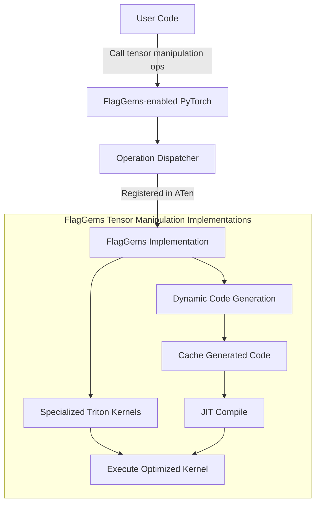
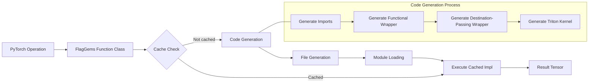
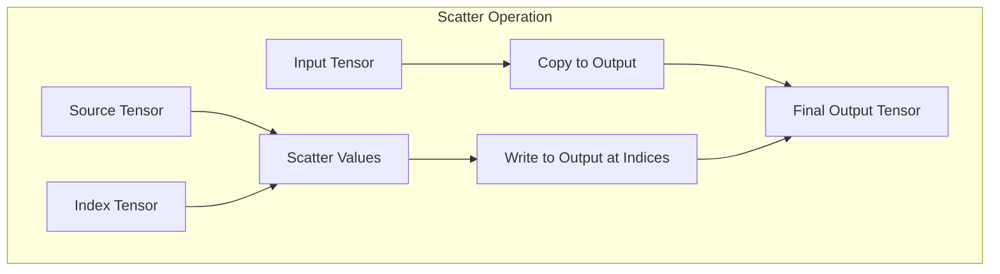
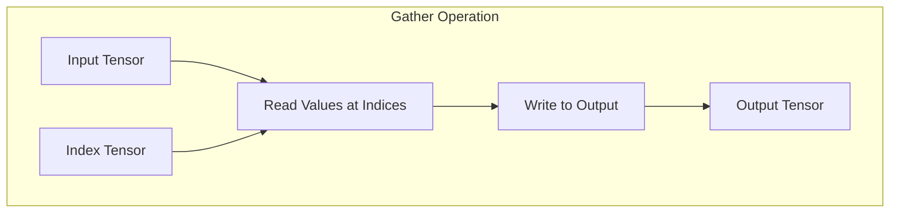
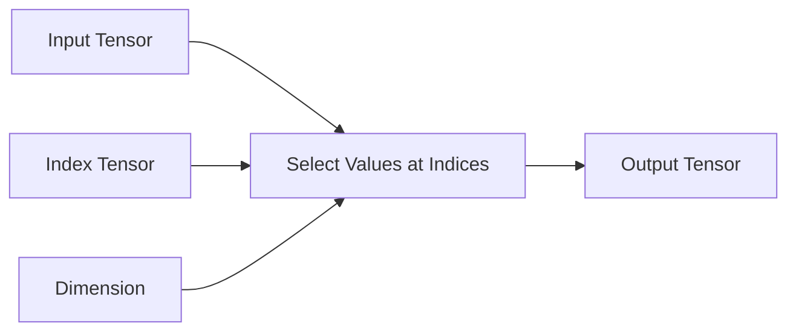
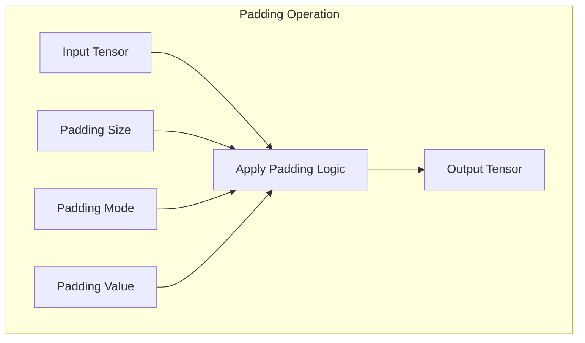
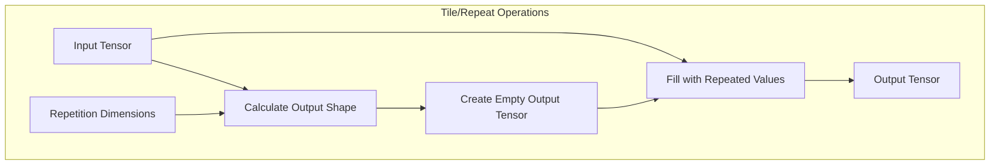
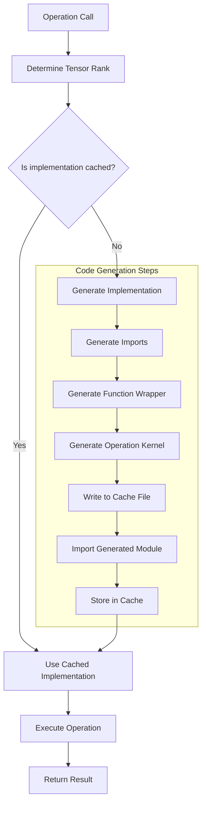
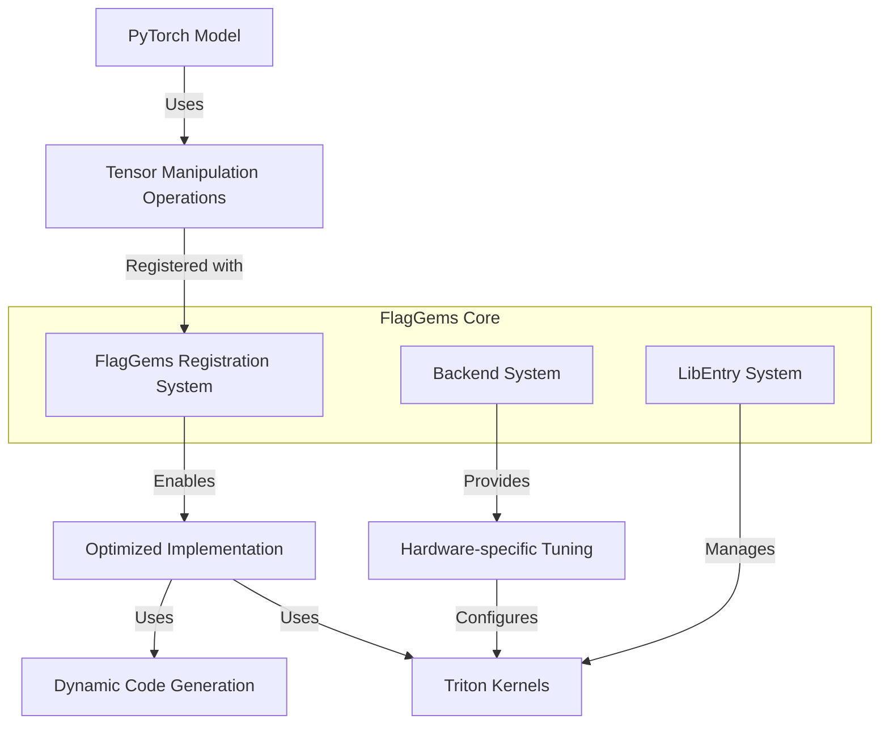

<!-- source: DeepWiki mcp.deepwiki.com · repo FlagOpen/FlagGems · page 3.6 Tensor Manipulation Operations · fetched 2026-10-21 -->

# Tensor Manipulation Operations

Relevant source files

The following files were used as context for generating this wiki page:

- [benchmark/test_binary_pointwise_perf.py](benchmark/test_binary_pointwise_perf.py)
- [benchmark/test_reduction_perf.py](benchmark/test_reduction_perf.py)
- [benchmark/test_select_and_slice_perf.py](benchmark/test_select_and_slice_perf.py)
- [benchmark/test_special_perf.py](benchmark/test_special_perf.py)
- [benchmark/test_unary_pointwise_perf.py](benchmark/test_unary_pointwise_perf.py)
- [src/flag_gems/__init__.py](src/flag_gems/__init__.py)
- [src/flag_gems/ops/__init__.py](src/flag_gems/ops/__init__.py)
- [src/flag_gems/ops/elu.py](src/flag_gems/ops/elu.py)
- [src/flag_gems/ops/embedding.py](src/flag_gems/ops/embedding.py)
- [src/flag_gems/ops/index_add.py](src/flag_gems/ops/index_add.py)
- [src/flag_gems/ops/index_put.py](src/flag_gems/ops/index_put.py)
- [src/flag_gems/ops/nllloss.py](src/flag_gems/ops/nllloss.py)
- [src/flag_gems/ops/weightnorm.py](src/flag_gems/ops/weightnorm.py)
- [tests/accuracy_utils.py](tests/accuracy_utils.py)
- [tests/test_binary_pointwise_ops.py](tests/test_binary_pointwise_ops.py)
- [tests/test_norm_ops.py](tests/test_norm_ops.py)
- [tests/test_reduction_ops.py](tests/test_reduction_ops.py)
- [tests/test_special_ops.py](tests/test_special_ops.py)
- [tests/test_unary_pointwise_ops.py](tests/test_unary_pointwise_ops.py)

This page documents the tensor manipulation operations provided by FlagGems. These operations modify or rearrange tensor data without fundamentally changing the underlying values. For mathematical operations like pointwise and reduction operations, see [Pointwise Operations](#3.1) and [Reduction Operations](#3.2) respectively.

## Overview

FlagGems implements several PyTorch tensor manipulation operations with optimized versions that leverage Triton kernels. These operations include:

- Gather and scatter operations
- Index selection
- Tensor padding
- Tensor tiling and repetition

Most operations follow a common pattern of dynamic code generation based on tensor rank, providing specialized implementations for optimal performance.

Sources: [src/flag_gems/ops/scatter.py](), [src/flag_gems/ops/gather.py](), [src/flag_gems/ops/index_select.py](), [src/flag_gems/ops/pad.py](), [src/flag_gems/ops/tile.py](), [src/flag_gems/ops/repeat.py]()

## Implementation Architecture

Most tensor manipulation operations follow a common architecture pattern:

1. **Specialized Function Class** - Creates and caches optimized implementations
2. **Dynamic Code Generation** - Generates specialized implementations based on tensor rank
3. **Kernel Implementation** - A Triton kernel that efficiently executes the operation
4. **Wrapper Functions** - Handle the PyTorch integration

Sources: [src/flag_gems/ops/scatter.py:188-319](), [src/flag_gems/ops/gather.py:142-180](), [src/flag_gems/ops/pad.py:386-434](), [src/flag_gems/ops/tile.py:388-432](), [src/flag_gems/ops/repeat.py:388-432]()

## Major Operations

### Scatter and Gather

The `scatter` and `gather` operations allow for non-contiguous memory access patterns, which are essential for many deep learning algorithms.

#### Scatter Operations

Scatter operations write values from a source tensor into specified locations of a destination tensor.

FlagGems provides both out-of-place scatter and in-place scatter_ operations:

- **scatter**: Creates a new tensor with values from source tensor placed at specified indices
- **scatter_**: Updates the input tensor in-place with values from source tensor

The implementation dynamically generates a Triton kernel specialized for the tensor rank. The kernel handles atomic operations when `reduce` mode is specified.

Sources: [src/flag_gems/ops/scatter.py:27-186](), [src/flag_gems/ops/scatter.py:325-393]()

#### Gather Operations

Gather operations read values from specified indices of a source tensor into a destination tensor.

The FlagGems gather implementation uses a similar approach to scatter, with a specialized Triton kernel generated based on tensor rank.

Sources: [src/flag_gems/ops/gather.py:29-125](), [src/flag_gems/ops/gather.py:185-193]()

### Index Selection

The `index_select` operation selects values from a tensor along a specified dimension according to the provided indices.

Unlike scatter and gather, `index_select` uses a direct implementation approach rather than dynamic code generation. It uses the `dim_compress` utility to simplify operations for non-innermost dimensions.

Sources: [src/flag_gems/ops/index_select.py:12-64]()

### Padding Operations

The `pad` operation adds padding around a tensor with specified values according to different modes:

- **constant**: Pads with a constant value
- **reflect**: Pads with reflections of the tensor
- **replicate**: Pads by replicating the last values
- **circular**: Pads with a circular repetition of the tensor

The implementation dynamically generates a specialized kernel based on tensor rank. The kernel contains separate logic for each padding mode.

Sources: [src/flag_gems/ops/pad.py:210-361](), [src/flag_gems/ops/pad.py:440-478]()

### Tile and Repeat Operations

These operations repeat tensor elements:

- **tile**: Constructs a tensor by repeating the input tensor along specified dimensions
- **repeat**: Similar to tile but with a slightly different behavior for handling dimensions

Both operations use dynamic code generation to create optimized kernels for different tensor ranks.

Sources: [src/flag_gems/ops/tile.py:209-366](), [src/flag_gems/ops/tile.py:438-442](), [src/flag_gems/ops/repeat.py:209-366](), [src/flag_gems/ops/repeat.py:438-442]()

### Other Operations

#### zeros_like

Creates a tensor of zeros with the same shape as the input tensor. Uses a direct implementation approach with a zeros kernel.

Sources: [src/flag_gems/ops/zeros_like.py:10-23]()

## Dynamic Code Generation Details

A key feature of FlagGems' tensor manipulation operations is their use of dynamic code generation for optimal performance.

Each operation class follows similar steps:

1. **Determine Operation Signature**: Based on tensor rank or other characteristics
2. **Check Cache**: See if an implementation already exists for this signature
3. **Generate Code**: If not cached, generate a specialized implementation
4. **Cache Implementation**: Store the generated implementation for future use

The generated code typically includes:

- **Import statements**: Required libraries and modules
- **Functional wrapper**: Main user-facing function
- **Destination-passing wrapper**: Handles low-level details
- **Triton kernel**: The optimized implementation

Sources: [src/flag_gems/ops/scatter.py:264-277](), [src/flag_gems/ops/gather.py:128-139](), [src/flag_gems/ops/pad.py:364-383](), [src/flag_gems/ops/tile.py:369-385](), [src/flag_gems/ops/repeat.py:369-385]()

## Performance Considerations

Tensor manipulation operations can be performance bottlenecks in deep learning models. FlagGems' implementations address several key performance issues:

1. **Memory Access Patterns**: Optimized for GPU memory access patterns
2. **Atomic Operations**: Efficient handling of atomic operations for concurrent updates
3. **Specialized Implementations**: Tuned based on tensor rank and operation type
4. **JIT Compilation**: Kernel compilation tailored to specific shapes and devices

The dynamic code generation approach allows for specialized implementations that can significantly outperform generic implementations, particularly for:

- Large tensors
- High-dimensional tensors
- Operations with complex access patterns

## Table of Operations

| Operation | Description | API | Implementation Approach |
|-----------|-------------|-----|-------------------------|
| scatter | Writes values from source tensor at specified indices | `scatter(inp, dim, index, src, reduce=None)` | Dynamic code generation |
| scatter_ | In-place version of scatter | `scatter_(inp, dim, index, src, reduce=None)` | Dynamic code generation |
| gather | Reads values from specified indices | `gather(inp, dim, index, out=None, sparse_grad=False)` | Dynamic code generation |
| index_select | Selects values along specified dimension | `index_select(inp, dim, index)` | Direct implementation |
| pad | Adds padding around tensor | `pad(self, pad, mode="constant", value=None)` | Dynamic code generation |
| constant_pad_nd | Pads with constant value | `constant_pad_nd(self, pad, value=0)` | Uses pad with constant mode |
| tile | Repeats tensor along dimensions | `tile(inp, dims)` | Dynamic code generation |
| repeat | Repeats tensor along dimensions | `repeat(inp, sizes)` | Dynamic code generation |
| zeros_like | Creates tensor of zeros with same shape | `zeros_like(x, *, dtype=None, ...)` | Direct implementation |

Sources: [src/flag_gems/ops/scatter.py:325-393](), [src/flag_gems/ops/gather.py:185-199](), [src/flag_gems/ops/index_select.py:34-64](), [src/flag_gems/ops/pad.py:440-482](), [src/flag_gems/ops/tile.py:438-442](), [src/flag_gems/ops/repeat.py:438-442](), [src/flag_gems/ops/zeros_like.py:10-23]()

## Integration with FlagGems Core

Tensor manipulation operations integrate with the core FlagGems architecture as follows:

These operations are registered with the PyTorch ATen library through FlagGems' registration system when `flag_gems.enable()` is called. This allows seamless integration with existing PyTorch code.

Sources: [src/flag_gems/ops/scatter.py:13-24](), [src/flag_gems/ops/gather.py:15-26](), [src/flag_gems/ops/index_select.py:7-9]()

---

