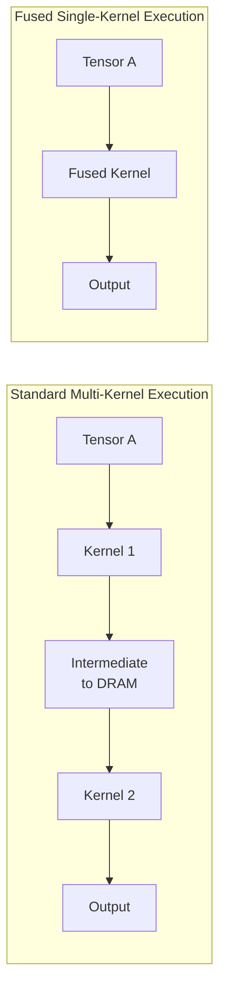
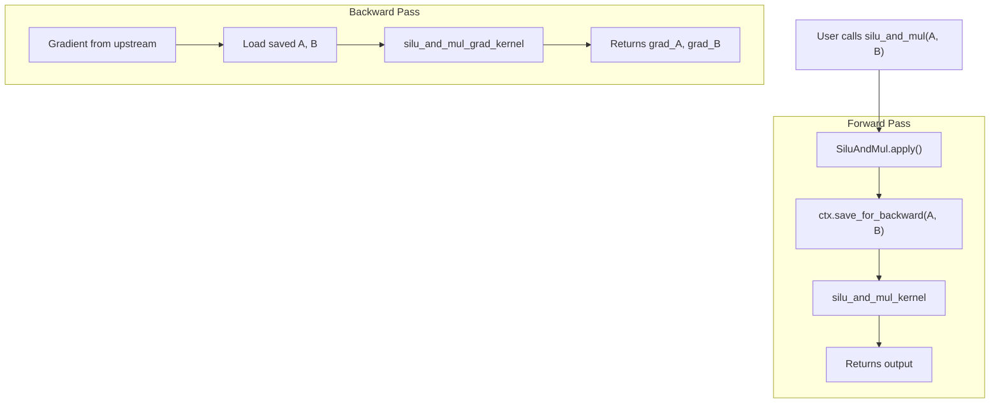
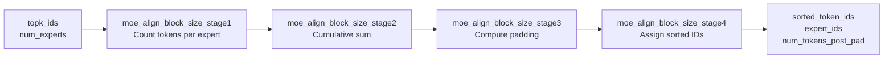
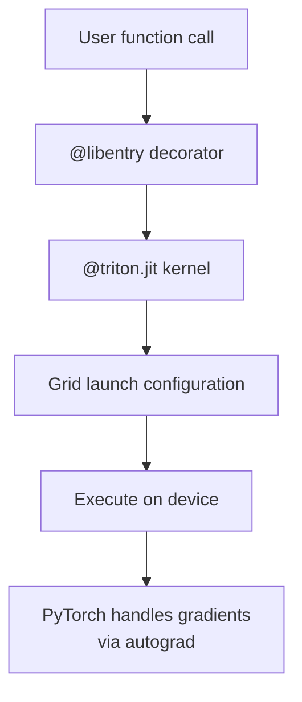
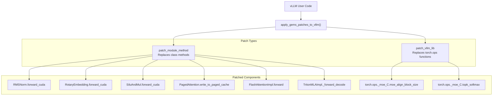
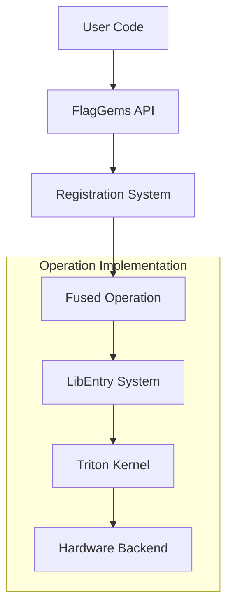

<!-- source: DeepWiki mcp.deepwiki.com · repo FlagOpen/FlagGems · page 3.7 Fused Operations · fetched 2026-10-21 -->

# Fused Operations

<details>
<summary>Relevant source files</summary>

The following files were used as context for generating this wiki page:

- [src/flag_gems/fused/__init__.py](src/flag_gems/fused/__init__.py)
- [src/flag_gems/fused/moe_align_block_size.py](src/flag_gems/fused/moe_align_block_size.py)
- [src/flag_gems/fused/reshape_and_cache.py](src/flag_gems/fused/reshape_and_cache.py)
- [src/flag_gems/fused/reshape_and_cache_flash.py](src/flag_gems/fused/reshape_and_cache_flash.py)
- [src/flag_gems/fused/silu_and_mul.py](src/flag_gems/fused/silu_and_mul.py)
- [src/flag_gems/fused/skip_layernorm.py](src/flag_gems/fused/skip_layernorm.py)
- [src/flag_gems/ops/dropout.py](src/flag_gems/ops/dropout.py)
- [src/flag_gems/ops/groupnorm.py](src/flag_gems/ops/groupnorm.py)
- [src/flag_gems/ops/layernorm.py](src/flag_gems/ops/layernorm.py)
- [src/flag_gems/ops/rms_norm.py](src/flag_gems/ops/rms_norm.py)
- [src/flag_gems/ops/var_mean.py](src/flag_gems/ops/var_mean.py)
- [src/flag_gems/patches/patch_util.py](src/flag_gems/patches/patch_util.py)
- [src/flag_gems/patches/patch_vllm_all.py](src/flag_gems/patches/patch_vllm_all.py)

</details>


## Purpose and Scope

Fused operations combine multiple computational steps into single optimized kernels, eliminating intermediate memory transfers and kernel launch overhead. FlagGems provides 20+ fused operations covering activation combinations, normalization variants, attention mechanisms, MoE (Mixture of Experts) operations, and specialized RWKV kernels. These operations integrate seamlessly with frameworks like vLLM through custom patches. For individual operation categories, see [Pointwise Operations](#3.1), [Reduction Operations](#3.2), and [Normalization Operations](#3.3).

## Overview

Fused operations reduce memory bandwidth by computing multiple steps in a single kernel pass. Standard execution requires loading data from global memory, computing, storing to intermediate buffers, then loading again for the next operation. Fused kernels keep intermediate values in registers or shared memory.



**Diagram: Memory access patterns in standard vs fused execution**

Sources: [src/flag_gems/fused/__init__.py:1-43]()

## Available Fused Operations

FlagGems implements 20+ fused operations organized by usage pattern:

### Activation-Multiplication Fusions

| Operation | Implementation | Description |
|-----------|---------------|-------------|
| `silu_and_mul` | [src/flag_gems/fused/silu_and_mul.py:14-18]() | SiLU(x) * y in single kernel |
| `silu_and_mul_out` | [src/flag_gems/fused/silu_and_mul.py:51-53]() | In-place variant |
| `gelu_and_mul` | [src/flag_gems/fused/gelu_and_mul.py]() | GELU(x) * y in single kernel |

### Normalization with Residual

| Operation | Implementation | Description |
|-----------|---------------|-------------|
| `skip_layer_norm` | [src/flag_gems/fused/skip_layernorm.py:17-60]() | x + residual + LayerNorm |
| `fused_add_rms_norm` | [src/flag_gems/fused/fused_add_rms_norm.py]() | x + residual + RMSNorm |

### Attention-Related Fusions

| Operation | Implementation | Description |
|-----------|---------------|-------------|
| `apply_rotary_pos_emb` | [src/flag_gems/fused/rotary_embedding.py]() | Apply RoPE to Q/K tensors |
| `flash_mla` | [src/flag_gems/fused/flash_mla.py]() | Multi-Latent Attention variant |
| `concat_and_cache_mla` | [src/flag_gems/fused/concat_and_cache_mla.py]() | Concatenate and cache for MLA |
| `reshape_and_cache` | [src/flag_gems/fused/reshape_and_cache.py:14-66]() | Reshape KV for paged attention |
| `reshape_and_cache_flash` | [src/flag_gems/fused/reshape_and_cache_flash.py:16-59]() | FlashAttention KV caching |

### Mixture of Experts (MoE)

| Operation | Implementation | Description |
|-----------|---------------|-------------|
| `moe_align_block_size` | [src/flag_gems/fused/moe_align_block_size.py:148-181]() | Align tokens to expert blocks |
| `moe_align_block_size_triton` | [src/flag_gems/fused/moe_align_block_size.py:101-145]() | Multi-stage kernel variant |
| `topk_softmax` | [src/flag_gems/fused/topk_softmax.py]() | Combined top-k and softmax |

### RWKV-Specific Operations

| Operation | Implementation | Description |
|-----------|---------------|-------------|
| `rwkv_ka_fusion` | [src/flag_gems/fused/rwkv_ka_fusion.py]() | RWKV kernel fusion |
| `rwkv_mm_sparsity` | [src/flag_gems/fused/rwkv_mm_sparsity.py]() | Sparse matrix multiply for RWKV |

### Other Fusions

| Operation | Implementation | Description |
|-----------|---------------|-------------|
| `cross_entropy_loss` | [src/flag_gems/fused/cross_entropy_loss.py]() | Combined softmax + CE loss |
| `outer` | [src/flag_gems/fused/outer.py]() | Outer product operation |
| `instance_norm` | [src/flag_gems/fused/instance_norm.py]() | Instance normalization |
| `weight_norm` | [src/flag_gems/fused/weight_norm.py]() | Weight normalization |

Sources: [src/flag_gems/fused/__init__.py:1-43]()

## Implementation Patterns

Fused operations in FlagGems follow three main implementation patterns depending on gradient requirements and computational complexity.

### Pattern 1: torch.autograd.Function with Separate Kernels

Used when operations require custom backward passes with distinct forward and backward kernels.



**Diagram: Autograd Function pattern with separate forward/backward kernels**

Example from `silu_and_mul`:
- Forward kernel: [src/flag_gems/fused/silu_and_mul.py:14-18]()
- Backward kernel: [src/flag_gems/fused/silu_and_mul.py:23-32]()
- Autograd wrapper: [src/flag_gems/fused/silu_and_mul.py:34-44]()

Sources: [src/flag_gems/fused/silu_and_mul.py:1-54]()

### Pattern 2: Multi-Stage Kernel Pipeline

Used for complex operations requiring sequential processing stages, such as MoE token alignment.



**Diagram: Multi-stage pipeline in moe_align_block_size_triton**

Implementation stages:
- Stage 1: Token counting [src/flag_gems/fused/moe_align_block_size.py:20-38]()
- Stage 2: Cumulative sum [src/flag_gems/fused/moe_align_block_size.py:41-52]()
- Stage 3: Padding calculation [src/flag_gems/fused/moe_align_block_size.py:55-69]()
- Stage 4: Token assignment [src/flag_gems/fused/moe_align_block_size.py:72-99]()

Sources: [src/flag_gems/fused/moe_align_block_size.py:101-145]()

### Pattern 3: Direct Kernel with @libentry

Used for simpler fusions without custom gradients, relying on PyTorch autograd.



**Diagram: Direct kernel pattern with libentry decorator**

Example from `reshape_and_cache`:
- Kernel: [src/flag_gems/fused/reshape_and_cache.py:14-66]()
- Wrapper: [src/flag_gems/fused/reshape_and_cache.py:69-106]()

Sources: [src/flag_gems/fused/reshape_and_cache.py:1-107]()

## Key Operation Implementations

### SiLU and Multiplication

Fuses `silu(x) * y` into a single kernel, commonly used in GLU-style MLP layers.

**Forward Kernel**: [src/flag_gems/fused/silu_and_mul.py:14-18]()
```python
@pointwise_dynamic(promotion_methods=[(0, 1, "DEFAULT")])
@triton.jit
def silu_and_mul_kernel(x, y):
    x_fp32 = x.to(tl.float32)
    x_silu = tl.fdiv(x_fp32, (1.0 + tl.exp(-x_fp32)))
    return x_silu * y
```

**Backward Kernel**: [src/flag_gems/fused/silu_and_mul.py:23-32]()
Computes gradients for both inputs in a single pass using saved activations.

**API**:
```python
from flag_gems.fused import silu_and_mul, silu_and_mul_out

# Functional interface
result = silu_and_mul(x, y)

# In-place interface
silu_and_mul_out(x, y, out=output_tensor)
```

Sources: [src/flag_gems/fused/silu_and_mul.py:1-54]()

### Skip Layer Normalization

Fuses residual addition with layer normalization: `LayerNorm(x + residual)`.

**Kernel**: [src/flag_gems/fused/skip_layernorm.py:17-60]()
- Loads input and residual in parallel
- Computes sum in registers
- Performs normalization statistics and output in single pass
- Uses `tl.float32` for statistics accumulation

**Grid Configuration**: One thread block per normalized sequence (M threads total).

**API**:
```python
from flag_gems.fused import skip_layer_norm

output = skip_layer_norm(
    x,                    # input tensor
    residual,             # residual tensor
    normalized_shape,     # tuple of dimensions to normalize
    weight,               # scale parameter
    bias,                 # shift parameter
    eps=1e-5              # epsilon for numerical stability
)
```

Sources: [src/flag_gems/fused/skip_layernorm.py:1-86]()

### MoE Align Block Size

Aligns expert tokens to block boundaries for efficient batched computation in MoE layers. Uses a four-stage pipeline:

1. **Stage 1**: Count tokens assigned to each expert per thread [src/flag_gems/fused/moe_align_block_size.py:20-38]()
2. **Stage 2**: Compute cumulative counts per expert [src/flag_gems/fused/moe_align_block_size.py:41-52]()
3. **Stage 3**: Calculate total padded tokens and offsets [src/flag_gems/fused/moe_align_block_size.py:55-69]()
4. **Stage 4**: Populate sorted token IDs and expert IDs [src/flag_gems/fused/moe_align_block_size.py:72-99]()

**API**:
```python
from flag_gems.fused import moe_align_block_size

sorted_token_ids, expert_ids, num_tokens_post_pad = moe_align_block_size(
    topk_ids,         # [num_tokens] expert assignments
    block_size,       # alignment block size
    num_experts,      # total number of experts
    expert_map=None,  # optional expert remapping
    pad_sorted_ids=False  # whether to pad to block size
)
```

Sources: [src/flag_gems/fused/moe_align_block_size.py:1-182]()

### Reshape and Cache (KV Caching)

Reshapes and stores key-value tensors in paged attention cache format.

**Standard Paging**: [src/flag_gems/fused/reshape_and_cache.py:14-66]()
- Layout: `[num_blocks, num_heads, head_size/x, block_size, x]`
- Supports arbitrary `x` parameter for memory alignment

**Flash Attention Variant**: [src/flag_gems/fused/reshape_and_cache_flash.py:16-59]()
- Layout: `[num_blocks, block_size, num_heads, head_size]`
- Optimized for FlashAttention memory access patterns

Both variants:
- Handle slot mapping for dynamic batching
- Support negative slot indices (skip caching)
- Prepared for FP8 quantization (placeholder)

**API**:
```python
from flag_gems.fused import reshape_and_cache, reshape_and_cache_flash

# Standard paging
reshape_and_cache(key, value, key_cache, value_cache, 
                  slot_mapping, kv_cache_dtype, k_scale, v_scale)

# Flash attention variant
reshape_and_cache_flash(key, value, key_cache, value_cache,
                        slot_mapping, kv_cache_dtype, k_scale, v_scale)
```

Sources: [src/flag_gems/fused/reshape_and_cache.py:1-107](), [src/flag_gems/fused/reshape_and_cache_flash.py:1-113]()

## vLLM Framework Integration

FlagGems provides custom patches for vLLM inference engine, replacing key operations with optimized fused kernels. The patching system uses method and library patching.



**Diagram: vLLM patching architecture mapping FlagGems operations to vLLM components**

### Patched Operations

**Normalization**: [src/flag_gems/patches/patch_vllm_all.py:9-12]()
- Replaces `RMSNorm.forward_cuda` with `gems_rms_forward`

**Rotary Embedding**: [src/flag_gems/patches/patch_vllm_all.py:15-60]()
- Replaces `RotaryEmbedding.forward_cuda` with `gems_rope_forward`
- Handles position offsets and interleaved/non-interleaved styles

**Activation**: [src/flag_gems/patches/patch_vllm_all.py:63-68](), [src/flag_gems/patches/patch_vllm_all.py:244-247]()
- Replaces `SiluAndMul.forward_cuda` and `torch.ops._C.silu_and_mul`

**KV Caching**: [src/flag_gems/patches/patch_vllm_all.py:71-92]()
- Replaces `PagedAttention.write_to_paged_cache` with `reshape_and_cache`

**Flash Attention**: [src/flag_gems/patches/patch_vllm_all.py:142-241]()
- Replaces `FlashAttentionImpl.forward` with varlen flash attention
- Integrates `reshape_and_cache_flash` for KV storage

**Multi-Latent Attention**: [src/flag_gems/patches/patch_vllm_all.py:95-139]()
- Replaces `TritonMLAImpl._forward_decode` with `flash_mla`

**MoE Operations**: [src/flag_gems/patches/patch_vllm_all.py:250-276]()
- Replaces `torch.ops._moe_C.moe_align_block_size` with `moe_align_block_size_triton`
- Replaces `torch.ops._moe_C.topk_softmax` with `topk_softmax`

### Patching Utilities

**Method Patching**: [src/flag_gems/patches/patch_util.py:14-21]()
```python
def patch_module_method(cls, method_name: str, new_method: callable, verbose=True):
    old_method = getattr(cls, method_name, None)
    setattr(cls, method_name, new_method)
    # prints confirmation if verbose=True
    return old_method
```

**Library Patching**: [src/flag_gems/patches/patch_util.py:24-32]()
```python
def patch_vllm_lib(lib_name, fn_name, fn, key, verbose=True):
    lib = libs[lib_name]  # torch.library.Library instances
    lib.impl(fn_name, fn, key)  # registers implementation
```

Supported library namespaces:
- `_C`: Core vLLM operations
- `_moe_C`: MoE-specific operations
- `_vllm_fa3_C`: FlashAttention v3 operations

Sources: [src/flag_gems/patches/patch_vllm_all.py:1-369](), [src/flag_gems/patches/patch_util.py:1-33]()

## Performance Optimization Techniques

Fused operations employ several Triton-level optimizations:

### Memory Access Patterns

1. **Coalesced Loads**: Ensure contiguous memory access [src/flag_gems/fused/reshape_and_cache.py:61-62]()
2. **Eviction Policies**: Use `eviction_policy="evict_first"` for streaming access [src/flag_gems/ops/dropout.py:54-72]()
3. **Masked Operations**: Avoid branches with mask-based conditional stores [src/flag_gems/fused/skip_layernorm.py:38-59]()

### Computational Efficiency

1. **In-Register Computation**: Keep intermediates in registers [src/flag_gems/fused/silu_and_mul.py:14-17]()
2. **FP32 Accumulation**: Use higher precision for statistics [src/flag_gems/ops/layernorm.py:47-56]()
3. **Early Returns**: Skip unnecessary work [src/flag_gems/fused/reshape_and_cache_flash.py:34-35]()

### Multi-Stage Optimization

For complex operations like MoE alignment:
- Stage 1: Parallel token counting per expert [src/flag_gems/fused/moe_align_block_size.py:26-37]()
- Stage 2: Prefix sum for offsets [src/flag_gems/fused/moe_align_block_size.py:46-51]()
- Stage 3: Padding computation [src/flag_gems/fused/moe_align_block_size.py:63-68]()
- Stage 4: Final assignment [src/flag_gems/fused/moe_align_block_size.py:87-98]()

Each stage is optimized independently but shares data through global memory efficiently.

Sources: [src/flag_gems/fused/moe_align_block_size.py:20-99](), [src/flag_gems/fused/silu_and_mul.py:14-17](), [src/flag_gems/fused/reshape_and_cache_flash.py:34-35]()

## Integration with FlagGems

Fused operations integrate with the core FlagGems architecture through:

1. Registration in the `__init__.py` file
2. The `libentry()` decorator for kernel management
3. Integration with the hardware backend system
4. Proper tensor formatting for memory layout optimization



Sources: [src/flag_gems/fused/__init__.py:1-13](), [src/flag_gems/fused/rotary_embedding.py:13-14](), [src/flag_gems/fused/skip_rms_norm.py:13-14]()

## Conclusion

Fused operations provide significant performance benefits by reducing memory transfers and kernel launch overhead. They are particularly effective in transformer-based models where these operations frequently appear in sequence. By leveraging the Triton programming model and PyTorch's autograd system, FlagGems delivers optimized implementations that are both efficient and fully differentiable.

---

