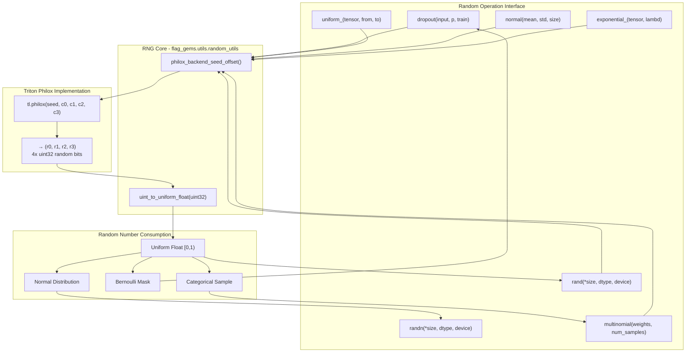
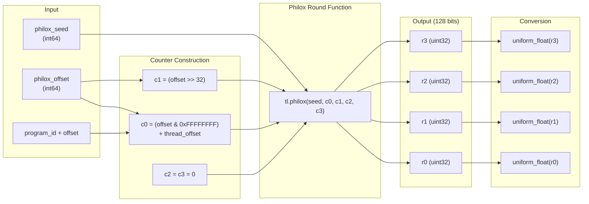
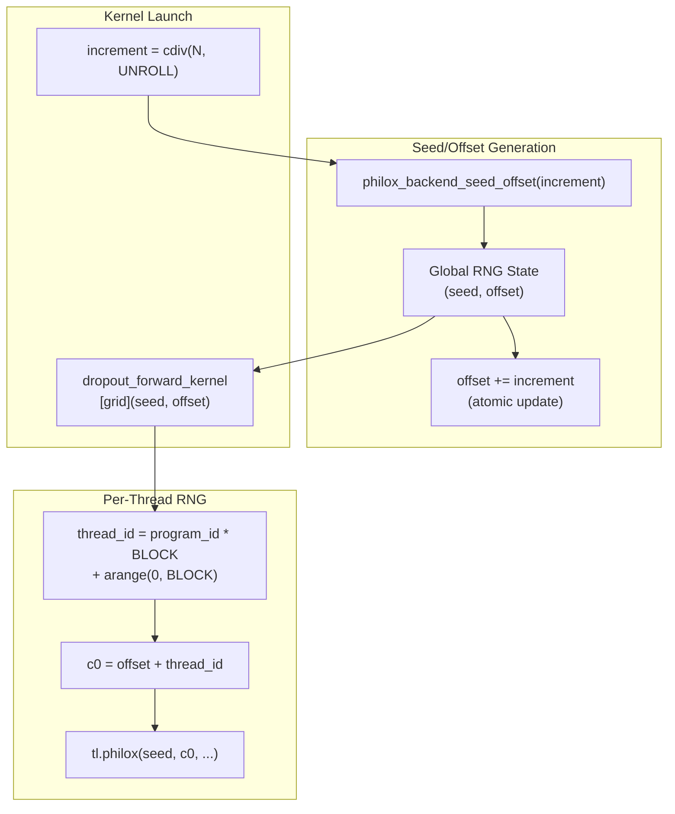
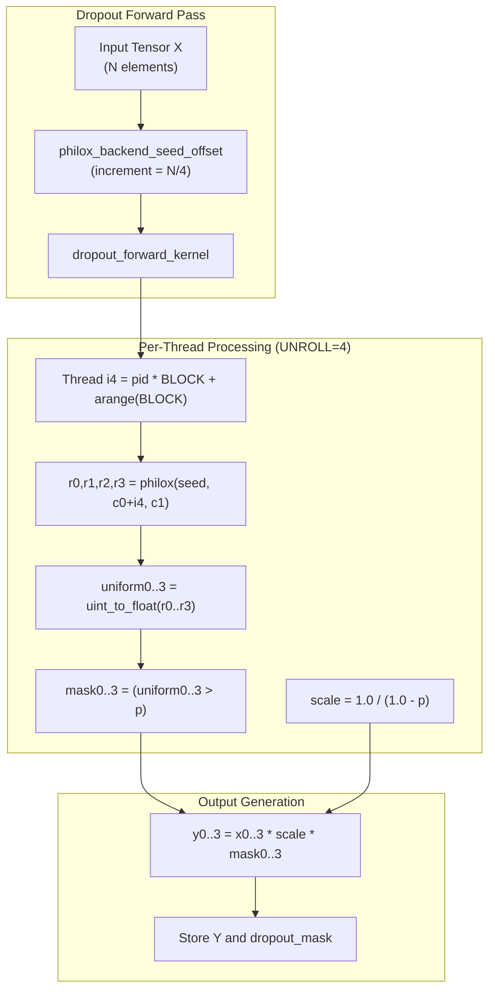
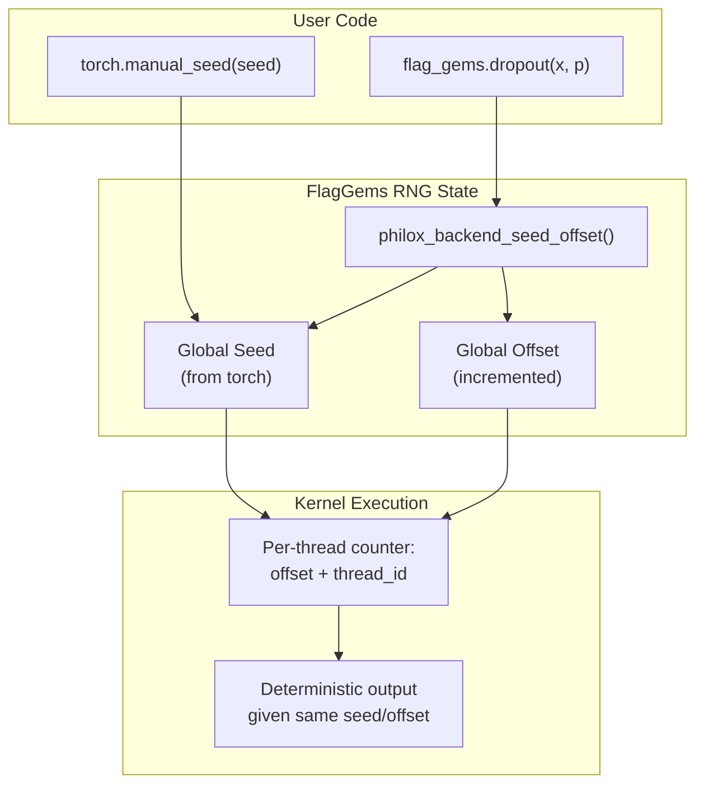
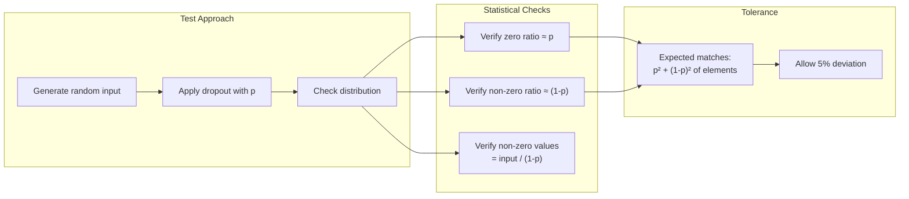

<!-- source: DeepWiki mcp.deepwiki.com · repo FlagOpen/FlagGems · page 3.8 Random Number Generation · fetched 2026-10-21 -->

# Random Number Generation

<details>
<summary>Relevant source files</summary>

The following files were used as context for generating this wiki page:

- [benchmark/test_special_perf.py](benchmark/test_special_perf.py)
- [benchmark/test_unary_pointwise_perf.py](benchmark/test_unary_pointwise_perf.py)
- [src/flag_gems/__init__.py](src/flag_gems/__init__.py)
- [src/flag_gems/fused/skip_layernorm.py](src/flag_gems/fused/skip_layernorm.py)
- [src/flag_gems/ops/__init__.py](src/flag_gems/ops/__init__.py)
- [src/flag_gems/ops/dropout.py](src/flag_gems/ops/dropout.py)
- [src/flag_gems/ops/elu.py](src/flag_gems/ops/elu.py)
- [src/flag_gems/ops/embedding.py](src/flag_gems/ops/embedding.py)
- [src/flag_gems/ops/groupnorm.py](src/flag_gems/ops/groupnorm.py)
- [src/flag_gems/ops/layernorm.py](src/flag_gems/ops/layernorm.py)
- [src/flag_gems/ops/nllloss.py](src/flag_gems/ops/nllloss.py)
- [src/flag_gems/ops/rms_norm.py](src/flag_gems/ops/rms_norm.py)
- [src/flag_gems/ops/var_mean.py](src/flag_gems/ops/var_mean.py)
- [tests/accuracy_utils.py](tests/accuracy_utils.py)
- [tests/test_binary_pointwise_ops.py](tests/test_binary_pointwise_ops.py)
- [tests/test_special_ops.py](tests/test_special_ops.py)
- [tests/test_unary_pointwise_ops.py](tests/test_unary_pointwise_ops.py)

</details>


## Purpose and Scope

This document describes the random number generation (RNG) infrastructure in FlagGems. FlagGems implements various random operations using the Philox counter-based random number generator algorithm, which is well-suited for parallel GPU execution. This includes random tensor creation operations (`rand`, `randn`), in-place random fills (`uniform_`, `exponential_`), sampling operations (`multinomial`, `randperm`), and random operations used in neural network training (`dropout`).

For information about dropout as a neural network layer, see the usage in normalization and attention operations. This page focuses on the underlying RNG mechanism and the random operation implementations.

## RNG Architecture

FlagGems uses a counter-based random number generation approach built on the Philox algorithm, which generates random numbers deterministically from a seed and offset pair. This design is ideal for GPU parallelization since each thread can independently generate random numbers without coordination.



**Sources:** [src/flag_gems/ops/dropout.py:9-12](), [src/flag_gems/__init__.py:245-249]()

## Philox Counter-Based RNG

The Philox algorithm is a counter-based pseudo-random number generator that produces 128 bits (four 32-bit unsigned integers) of random data per invocation. It takes a 64-bit seed and a 64-bit counter as input, making it ideal for parallel execution where each thread can use a different counter value.

### Philox Implementation in Triton



**Sources:** [src/flag_gems/ops/dropout.py:18-41]()

### Seed and Offset Management

The `philox_backend_seed_offset()` function manages the global RNG state by returning a seed and offset pair. The offset is incremented based on the number of random values consumed, enabling deterministic generation across multiple kernel invocations.



**Sources:** [src/flag_gems/ops/dropout.py:115-123]()

## Random Operations

FlagGems implements the following random operations, all registered with PyTorch's dispatcher:

| Operation | Description | Output Distribution |
|-----------|-------------|---------------------|
| `rand` | Random tensor from uniform [0, 1) | Uniform(0, 1) |
| `rand_like` | Random tensor matching input shape | Uniform(0, 1) |
| `randn` | Random tensor from standard normal | Normal(0, 1) |
| `randn_like` | Random tensor matching input shape | Normal(0, 1) |
| `uniform_(tensor, from, to)` | Fill tensor with uniform values | Uniform(from, to) |
| `exponential_(tensor, lambd)` | Fill tensor with exponential values | Exponential(λ) |
| `normal` variants | Normal distribution with mean/std | Normal(μ, σ) |
| `multinomial` | Categorical sampling | Categorical |
| `randperm` | Random permutation | Permutation |

**Sources:** [src/flag_gems/__init__.py:245-249](), [src/flag_gems/ops/__init__.py:159-163](), [src/flag_gems/ops/__init__.py:141-145]()

### Uniform to Other Distributions

The `uint_to_uniform_float()` function converts 32-bit unsigned integers to floating-point values in [0, 1):

```
uniform_float(uint32_val) → float in [0, 1)
```

Other distributions are derived from uniform samples:
- **Normal:** Box-Muller or inverse CDF transformation
- **Exponential:** Inverse CDF: `-log(1 - uniform) / lambda`
- **Bernoulli:** Threshold comparison: `uniform > p`

**Sources:** [src/flag_gems/ops/dropout.py:10-11]()

## Dropout Implementation

Dropout is a key consumer of random number generation in neural networks. It demonstrates efficient use of Philox RNG by generating 4 random values per Philox call and processing 4 elements per thread.



### Dropout Kernel Structure

The dropout kernel efficiently generates 4 random masks per Philox invocation:

| Thread Processing | Details |
|-------------------|---------|
| Block size | `BLOCK` elements per thread block |
| Unroll factor | 4 (processes 4 elements per RNG call) |
| Elements per thread | `BLOCK * 4` |
| Random bits generated | 128 bits (4 × 32-bit) per call |
| Mask generation | Compare `uniform_float > p` |
| Scaling | Multiply by `1.0 / (1.0 - p)` |

**Sources:** [src/flag_gems/ops/dropout.py:17-73](), [src/flag_gems/ops/dropout.py:95-125]()

### Dropout Forward Kernel

The kernel processes data in chunks of 4 elements aligned with Philox's 4-output structure:

```
UNROLL = 4  # Philox generates 4 random values

for each thread block:
    i4 = program_id * BLOCK + arange(0, BLOCK)
    r0, r1, r2, r3 = philox(seed, offset + i4, ...)
    
    # Load 4 elements
    off_0, off_1, off_2, off_3 = base_offset + [0, BLOCK, 2*BLOCK, 3*BLOCK]
    x0, x1, x2, x3 = load(X + off_0..3)
    
    # Generate masks and apply dropout
    mask0..3 = (uniform_float(r0..3) > p)
    y0..3 = x0..3 * scale * mask0..3
    
    # Store outputs
    store(Y + off_0..3, y0..3)
    store(dropout_mask + off_0..3, mask0..3)
```

**Sources:** [src/flag_gems/ops/dropout.py:29-72]()

### Dropout Backward Pass

The backward pass is simpler, using the saved dropout mask:

```
dx = dy * mask * scale
```

where `scale = 1.0 / (1.0 - p)`.

**Sources:** [src/flag_gems/ops/dropout.py:75-93](), [src/flag_gems/ops/dropout.py:127-135]()

## Seeding and Reproducibility

### Manual Seeding

For reproducible results, set the random seed before operations:

```python
torch.manual_seed(0)
torch.cuda.manual_seed_all(0)  # For CUDA devices
```

Some vendors require explicit seeding for reproducibility:

**Sources:** [tests/test_special_ops.py:42-44](), [tests/test_special_ops.py:88-90]()

### Seed Management



The offset is automatically incremented based on the number of random values consumed, ensuring different random values across multiple operations while maintaining reproducibility when the seed is fixed.

**Sources:** [src/flag_gems/ops/dropout.py:118-123]()

## Multinomial Sampling

Multinomial sampling draws categorical samples from a probability distribution, with two modes:

### With Replacement

Each sample is independent. The implementation generates uniform random values and uses them to select categories based on cumulative probability:

```
for each sample:
    u = uniform(0, 1)
    category = find where u < cumulative_probability
```

### Without Replacement

Ensures all samples are unique by using a modified sampling approach that prevents duplicate selections.

**Sources:** [tests/test_special_ops.py:444-487]()

## Testing Random Operations

Random operations are tested for statistical properties rather than exact values:

### Dropout Testing Strategy



### Dropout Test Implementation

The test verifies dropout behavior statistically:

1. **Zero ratio check:** Number of zeros should be approximately `p * numel()`
2. **Scale check:** Non-zero values should equal `input / (1 - p)`
3. **Comparison with reference:** Expected number of matching elements is `(p² + (1-p)²) * numel()` with 5% tolerance

**Sources:** [tests/test_special_ops.py:37-81]()

### Multinomial Testing

For multinomial with replacement, the test verifies that sampled categories respect the input distribution by masking categories with probability `p` and checking that samples fall in unmasked categories > 99.9% of the time.

For multinomial without replacement, the test verifies uniqueness using one-hot encoding:

```python
idx_cnt = torch.nn.functional.one_hot(out).sum(1)
assert torch.all(idx_cnt <= 1)  # No duplicates
```

**Sources:** [tests/test_special_ops.py:448-487]()

## Random Operation Registration

All random operations are registered with PyTorch's dispatcher in the main initialization:

| Registered Name | Implementation Function | ATen Variant |
|----------------|-------------------------|--------------|
| `rand` | `flag_gems.ops.rand` | Default |
| `rand_like` | `flag_gems.ops.rand_like` | Default |
| `randn` | `flag_gems.ops.randn` | Default |
| `randn_like` | `flag_gems.ops.randn_like` | Default |
| `randperm` | `flag_gems.ops.randperm` | Default |
| `uniform_` | `flag_gems.ops.uniform_` | Default |
| `exponential_` | `flag_gems.ops.exponential_` | Default |
| `multinomial` | `flag_gems.ops.multinomial` | Default |
| `normal.float_Tensor` | `flag_gems.ops.normal_float_tensor` | Overload variant |
| `normal.Tensor_float` | `flag_gems.ops.normal_tensor_float` | Overload variant |
| `normal.Tensor_Tensor` | `flag_gems.ops.normal_tensor_tensor` | Overload variant |
| `native_dropout` | `flag_gems.ops.dropout` | Native variant |
| `native_dropout_backward` | `flag_gems.ops.dropout_backward` | Native variant |

**Sources:** [src/flag_gems/__init__.py:215-216](), [src/flag_gems/__init__.py:230-232](), [src/flag_gems/__init__.py:245-249](), [src/flag_gems/__init__.py:308]()

## Performance Considerations

### Philox Efficiency

The Philox algorithm provides excellent performance characteristics for GPU execution:

- **Parallel-friendly:** Each thread generates random numbers independently
- **Cache-efficient:** Counter-based approach requires no shared state
- **Vectorized:** Generates 4 values per invocation (128 bits)
- **Hardware support:** Triton's `tl.philox` uses hardware-optimized implementations

### Dropout Optimization

The dropout kernel optimizes throughput by:

1. **Unrolling:** Processing 4 elements per Philox call
2. **Coalesced memory:** Sequential memory access patterns
3. **Mask storage:** Saving boolean masks for backward pass
4. **Eviction policy:** Using `evict_first` for better cache utilization

**Sources:** [src/flag_gems/ops/dropout.py:29](), [src/flag_gems/ops/dropout.py:54-72]()

## Summary

FlagGems implements a complete random number generation infrastructure based on the Philox counter-based RNG algorithm. This design provides:

- **Parallel efficiency:** Each thread generates random numbers independently
- **Reproducibility:** Controlled through PyTorch's manual seeding
- **Completeness:** Support for all common random distributions and operations
- **Performance:** Optimized kernels that leverage Philox's 4-output structure
- **Testing:** Statistical validation of random operation correctness

The dropout implementation serves as a representative example of efficient RNG usage in neural network operations.

---

