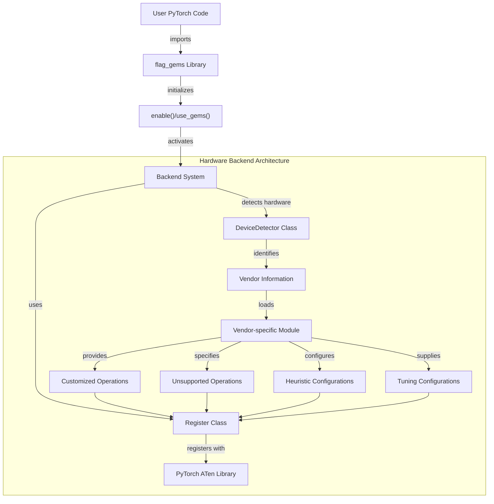
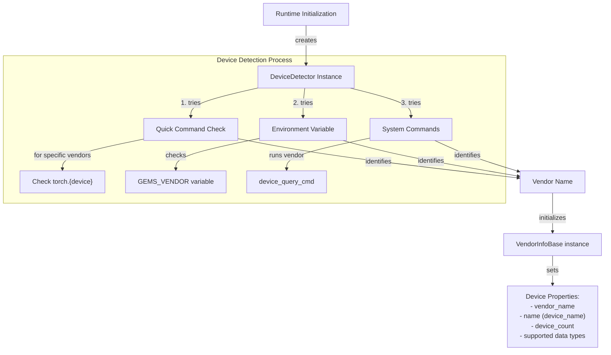
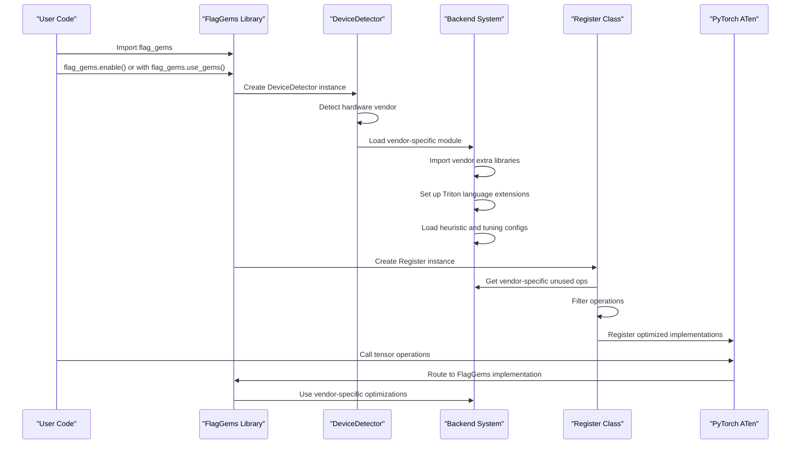

<!-- source: DeepWiki mcp.deepwiki.com · repo FlagOpen/FlagGems · page 4 Hardware Backend Support · fetched 2026-10-21 -->

# Hardware Backends

<details>
<summary>Relevant source files</summary>

The following files were used as context for generating this wiki page:

- [README.md](README.md)
- [README_cn.md](README_cn.md)
- [benchmark/test_special_perf.py](benchmark/test_special_perf.py)
- [benchmark/test_unary_pointwise_perf.py](benchmark/test_unary_pointwise_perf.py)
- [docs/add_a_cpp_wrapper.md](docs/add_a_cpp_wrapper.md)
- [docs/get_start_with_flaggems.md](docs/get_start_with_flaggems.md)
- [docs/how_to_use_flaggems.md](docs/how_to_use_flaggems.md)
- [docs/index.md](docs/index.md)
- [docs/installation.md](docs/installation.md)
- [docs/pointwise_dynamic.md](docs/pointwise_dynamic.md)
- [examples/integration_gems_with_vllm.py](examples/integration_gems_with_vllm.py)
- [mkdocs.yml](mkdocs.yml)
- [pyproject.toml](pyproject.toml)
- [src/flag_gems/__init__.py](src/flag_gems/__init__.py)
- [src/flag_gems/ops/__init__.py](src/flag_gems/ops/__init__.py)
- [src/flag_gems/ops/elu.py](src/flag_gems/ops/elu.py)
- [src/flag_gems/ops/embedding.py](src/flag_gems/ops/embedding.py)
- [src/flag_gems/ops/nllloss.py](src/flag_gems/ops/nllloss.py)
- [src/flag_gems/ops/sqrt.py](src/flag_gems/ops/sqrt.py)
- [tests/accuracy_utils.py](tests/accuracy_utils.py)
- [tests/test_binary_pointwise_ops.py](tests/test_binary_pointwise_ops.py)
- [tests/test_special_ops.py](tests/test_special_ops.py)
- [tests/test_unary_pointwise_ops.py](tests/test_unary_pointwise_ops.py)

</details>


This page provides a comprehensive overview of the hardware backend system in FlagGems, which enables the library to support multiple hardware platforms and vendors. The hardware backend system forms the foundation for FlagGems' ability to optimize operations across different accelerators while maintaining a consistent API.

For information about specific hardware implementations, see the [NVIDIA GPU Support](#4.1) and [KunlunXin Support](#4.2) pages. To learn how to add support for new hardware, refer to [Adding Custom Backends](#4.3).

Sources: [README.md:19-20](), [README_cn.md:19-20]()

## Backend Architecture

The hardware backend system consists of several key components that work together to detect hardware, load appropriate implementations, and register optimized operations with PyTorch.



Sources: [src/flag_gems/runtime/backend/__init__.py](), [src/flag_gems/runtime/register.py](), [src/flag_gems/runtime/backend/device.py]()

### Device Detection

The device detection process is managed by the `DeviceDetector` class, which identifies the current hardware platform using several methods:

1. Quick command checks for specific vendors (e.g., checking if `torch.mlu` exists for Cambricon)
2. Environment variable (`GEMS_VENDOR`)
3. System commands to detect available hardware

Once detected, the appropriate vendor-specific module is loaded with its configurations.



Sources: [src/flag_gems/runtime/backend/device.py:26-124]()

### Operation Registration

The `Register` class handles the registration of optimized operations with PyTorch's ATen backend. It filters operations based on vendor-specific constraints and user configurations:

1. Initializes with device information from `DeviceDetector`
2. Gets vendor-specific unused operations list
3. Filters operations based on both vendor and user constraints
4. Registers implementations with the appropriate ATen device key

Sources: [src/flag_gems/runtime/register.py:5-62]()

## Supported Hardware Platforms

FlagGems supports multiple hardware platforms with different capabilities. Each platform has different levels of support for data types and operations.

| Vendor | Device Name | Float16 | Float32 | BFloat16 | Float64 | Int64 |
|--------|-------------|:-------:|:-------:|:--------:|:-------:|:-----:|
| NVIDIA | CUDA        | ✓      | ✓       | ✓        | ✓       | ✓     |
| KunlunXin | XPU      | ✓      | ✓       | ✓        | ✗       | ✓     |
| Cambricon | MLU      | ✓      | ✓       | ✓        | ✗       | ✓     |
| Iluvatar | COREX     | ✓      | ✓       | ✓        | ✗       | ✓     |
| MThreads | MUSA      | ✓      | ✓       | ✓        | ✗       | ✓     |
| AIPU   | AIPU        | ✓      | ✓       | ✗        | ✗       | ✗     |
| Hygon  | HIP         | ✓      | ✓       | ✓        | ✓       | ✓     |
| Metax  | METAX       | ✓      | ✓       | ✓        | ✓       | ✓     |
| AMD    | ROC         | ✓      | ✓       | ✓        | ✓       | ✓     |

Sources: [README.md:70-75](), [src/flag_gems/runtime/backend/device.py:11-23](), [src/flag_gems/runtime/commom_utils.py:8-34]()

## Vendor-Specific Implementation

Each hardware vendor implementation in FlagGems follows a consistent structure while accommodating vendor-specific requirements and optimizations.

### Backend Module Structure

```mermaid
graph TD
    subgraph "Vendor Module (_vendor_name)"
        VendorInfo["vendor_info = VendorInfoBase(...)"]
        UnusedOps["CUSTOMIZED_UNUSED_OPS = (...)"]
        
        subgraph "Operations"
            OpsModule["ops/__init__.py"]
            CustomOps["Custom operation implementations"]
        end
        
        subgraph "Fused Operations"
            FusedModule["fused/__init__.py"]
            CustomFused["Custom fused operation implementations"]
        end
        
        HeuristicConfig["heuristics_config_utils.py"]
        TuneConfig["tune_configs.yaml"]
    end
    
    VendorInfo --- UnusedOps
    UnusedOps --- OpsModule
    OpsModule --- CustomOps
    CustomOps --- FusedModule
    FusedModule --- CustomFused
    CustomFused --- HeuristicConfig
    HeuristicConfig --- TuneConfig
```



Sources: [src/flag_gems/runtime/backend/_aipu/__init__.py](), [src/flag_gems/runtime/backend/_aipu/ops/__init__.py](), [src/flag_gems/runtime/backend/_aipu/fused/__init__.py](), [src/flag_gems/runtime/backend/_aipu/heuristics_config_utils.py](), [src/flag_gems/runtime/backend/_aipu/tune_configs.yaml]()

### Vendor Information

Each vendor module defines a `vendor_info` object using the `VendorInfoBase` class with three essential properties:
- `vendor_name`: Internal name for the vendor (e.g., "nvidia")
- `device_name`: Device name recognized by PyTorch (e.g., "cuda")
- `device_query_cmd`: Command to detect the device availability

```python
vendor_info = VendorInfoBase(
    vendor_name="aipu", device_name="aipu", device_query_cmd="aipu"
)
```

Sources: [src/flag_gems/runtime/backend/_aipu/__init__.py:4-6]()

### Heuristic Configurations

Heuristic configurations define how to select optimal kernel parameters for operations based on input shapes and types. These are vendor-specific and tuned for best performance on each hardware platform.

The `heuristics_config_utils.py` file contains functions that dynamically determine parameters such as:
- Block sizes
- Tile dimensions
- Number of warps
- Other kernel-specific parameters

These functions are grouped in a `HEURISTICS_CONFIGS` dictionary that maps operation names to their heuristic functions.

Sources: [src/flag_gems/runtime/backend/_aipu/heuristics_config_utils.py:4-302]()

### Tuning Configurations

Pre-tuned configurations for operations are stored in `tune_configs.yaml`. These bypass the autotuning process by providing known optimal parameters for specific operations and input shapes.

The tuning configuration defines:
- Meta-parameters (block sizes, tile dimensions)
- Number of warps
- Number of stages
- Other operation-specific parameters

Sources: [src/flag_gems/runtime/backend/_aipu/tune_configs.yaml]()

### Customized Operations

Vendors can provide customized implementations of operations optimized for their hardware. These are organized in the `ops` and `fused` modules within the vendor's package.

They can also specify operations that should not be used on their hardware through the `CUSTOMIZED_UNUSED_OPS` list.

```python
CUSTOMIZED_UNUSED_OPS = ()  # Empty for AIPU, may contain ops for other vendors
```

Sources: [src/flag_gems/runtime/backend/_aipu/__init__.py:11](), [src/flag_gems/runtime/backend/_aipu/ops/__init__.py](), [src/flag_gems/runtime/backend/_aipu/fused/__init__.py]()

## Runtime Flow

When FlagGems is enabled, the hardware backend system follows this runtime flow to set up and use the appropriate vendor-specific optimizations:



Sources: [src/flag_gems/runtime/backend/__init__.py:11-178](), [src/flag_gems/runtime/register.py:5-62]()

## Vendor Identification

The `DeviceDetector` class identifies the vendor using a combination of approaches:

1. Quick checks for vendor-specific attributes in PyTorch:
   ```python
   cmd = {
       "cambricon": "mlu",
       "mthreads": "musa",
       "iluvatar": "corex",
   }
   for vendor_name, flag in cmd.items():
       if hasattr(torch, flag):
           return vendor_name
   ```

2. Environment variable check:
   ```python
   device_from_evn = os.environ.get("GEMS_VENDOR")
   return None if device_from_evn not in self.vendor_list else device_from_evn
   ```

3. System command execution (run in parallel threads):
   ```python
   # For each vendor info
   device_query_cmd = single_info.device_query_cmd
   result = subprocess.run([device_query_cmd], capture_output=True, text=True)
   if result.returncode == 0:
       result_single_info.put(single_info)
   ```

Sources: [src/flag_gems/runtime/backend/device.py:55-124]()

## Future Hardware Support

FlagGems' hardware backend architecture is designed to be extensible for future hardware platforms. The consistent structure allows for easy addition of new vendors while maintaining compatibility with the overall system.

For information on how to add support for new hardware backends, refer to the [Adding Custom Backends](#4.3) page.

Sources: [CONTRIBUTING.md:24-47](), [CONTRIBUTING_cn.md:22-44]()

---

