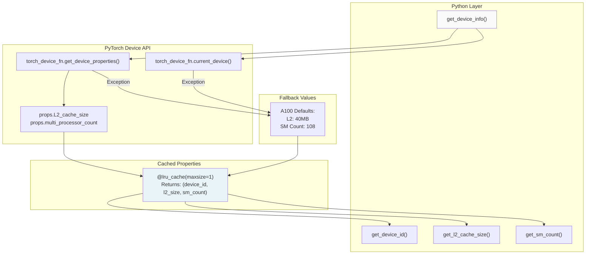
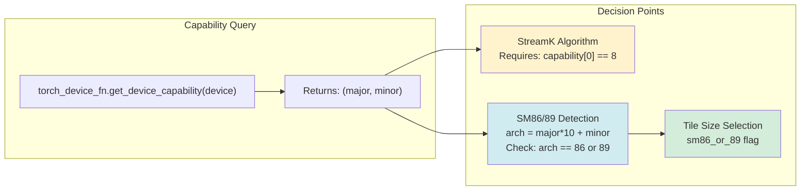
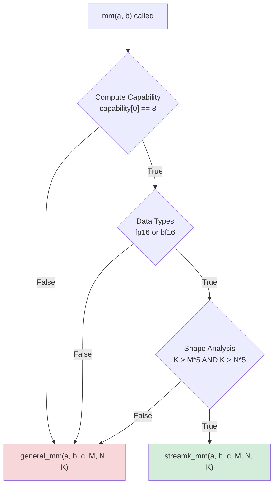
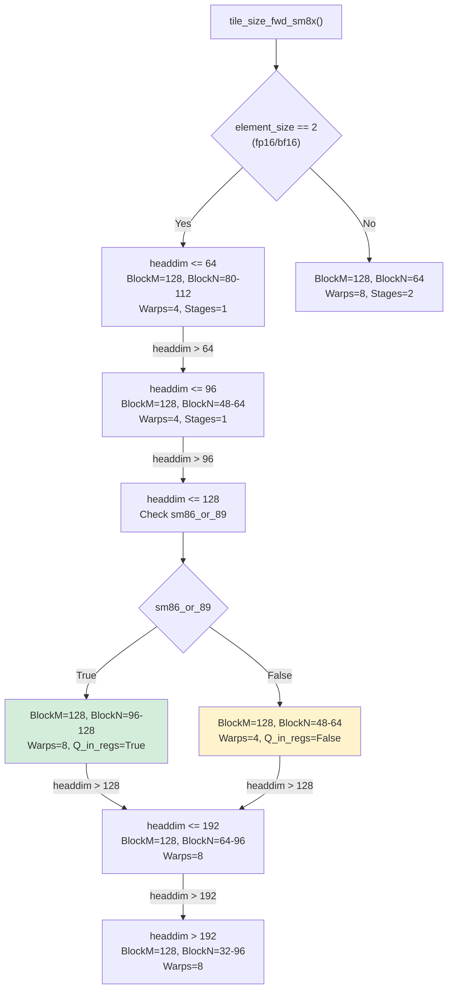
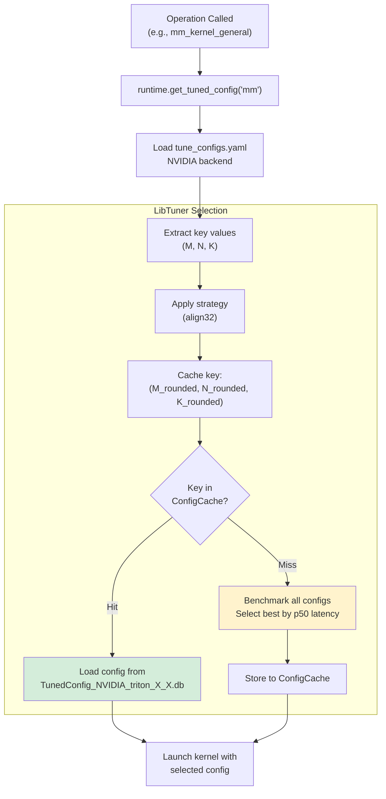
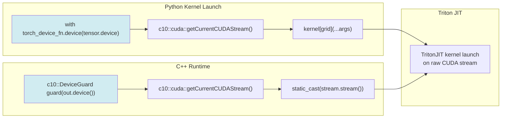

<!-- source: DeepWiki mcp.deepwiki.com · repo FlagOpen/FlagGems · page 4.1 NVIDIA GPU Support · fetched 2026-10-21 -->

# NVIDIA GPU Support

<details>
<summary>Relevant source files</summary>

The following files were used as context for generating this wiki page:

- [benchmark/test_attention_perf.py](benchmark/test_attention_perf.py)
- [examples/deepseek_with_vllm_test.py](examples/deepseek_with_vllm_test.py)
- [lib/addmm.cpp](lib/addmm.cpp)
- [lib/mm.cpp](lib/mm.cpp)
- [src/flag_gems/csrc/aten_patch.cpp](src/flag_gems/csrc/aten_patch.cpp)
- [src/flag_gems/fused/flash_mla.py](src/flag_gems/fused/flash_mla.py)
- [src/flag_gems/fused/fused_add_rms_norm.py](src/flag_gems/fused/fused_add_rms_norm.py)
- [src/flag_gems/ops/addmm.py](src/flag_gems/ops/addmm.py)
- [src/flag_gems/ops/attention.py](src/flag_gems/ops/attention.py)
- [src/flag_gems/ops/flash_api.py](src/flag_gems/ops/flash_api.py)
- [src/flag_gems/ops/flash_kernel.py](src/flag_gems/ops/flash_kernel.py)
- [src/flag_gems/ops/get_scheduler_metadata.py](src/flag_gems/ops/get_scheduler_metadata.py)
- [src/flag_gems/ops/mm.py](src/flag_gems/ops/mm.py)
- [src/flag_gems/ops/mm_streamk.py](src/flag_gems/ops/mm_streamk.py)
- [src/flag_gems/runtime/backend/_nvidia/heuristics_config_utils.py](src/flag_gems/runtime/backend/_nvidia/heuristics_config_utils.py)
- [src/flag_gems/runtime/backend/_nvidia/tune_configs.yaml](src/flag_gems/runtime/backend/_nvidia/tune_configs.yaml)
- [src/flag_gems/utils/libentry.py](src/flag_gems/utils/libentry.py)
- [tests/test_attention_ops.py](tests/test_attention_ops.py)
- [tests/test_blas_ops.py](tests/test_blas_ops.py)
- [tests/test_libentry.py](tests/test_libentry.py)

</details>


## Overview

This page details FlagGems' NVIDIA GPU-specific implementations, including compute capability detection, hardware property queries, StreamK optimizations for skinny matrix multiplications on A100/H100, and SM8x-specific kernel configurations for attention operations. 

For general multi-vendor backend architecture, see [Multi-Vendor Architecture](#4.3). For autotuning system details, see [LibTuner and Autotuning](#2.3).

---

## Device Detection and Properties

FlagGems detects NVIDIA GPU properties at runtime to enable hardware-specific optimizations. The system queries three critical properties: device ID, L2 cache size, and streaming multiprocessor (SM) count.

### Device Property Query System



**Sources:** [src/flag_gems/ops/mm.py:15-40]()

The device info query is cached using `@lru_cache(maxsize=1)` to avoid repeated system calls. If queries fail, the system falls back to A100 defaults (40MB L2 cache, 108 SMs), ensuring degraded but functional operation.

### C++ Device Info Implementation

The C++ runtime layer provides an equivalent device detection system for performance-critical paths:

| Component | Implementation | Fallback |
|-----------|---------------|----------|
| Device ID | `cudaGetDevice()` | 0 |
| L2 Cache Size | `props.l2CacheSize` (CUDA 11.2+) | 40MB |
| SM Count | `props.multiProcessorCount` | 108 |
| Compute Capability | `props.major` | 8 (A100) |

**Sources:** [lib/mm.cpp:14-46]()

The C++ implementation uses a static singleton pattern to cache device properties, with fallback values matching the Python layer for consistency.

---

## Compute Capability Detection

FlagGems uses NVIDIA compute capability to enable architecture-specific optimizations. Compute capability is queried through `torch_device_fn.get_device_capability()`, returning a tuple `(major, minor)`.

### Compute Capability Usage Map



**Sources:** [src/flag_gems/ops/mm.py:186-197](), [src/flag_gems/ops/get_scheduler_metadata.py:105-107]()

### Architecture-Specific Optimizations

**StreamK Algorithm (Compute Capability 8.x)**

StreamK is enabled only on SM80 (A100) and SM89 (H100) architectures for optimal performance on skinny matrix shapes:

```python
capability = torch_device_fn.get_device_capability(get_device_info())
return (
    capability[0] == 8
    and a.dtype in [torch.float16, torch.bfloat16]
    and b.dtype in [torch.float16, torch.bfloat16]
    and K > M * 5
    and K > N * 5
)
```

**Sources:** [src/flag_gems/ops/mm.py:186-197]()

**SM86/89 Tile Configuration**

Compute capabilities 8.6 (RTX 30xx) and 8.9 (RTX 40xx/H100) receive specialized tile configurations:

| Architecture | Compute Cap | Tile Strategy |
|--------------|-------------|---------------|
| SM86 | 8.6 | 8 warps for headdim>128, optimized Q_in_regs |
| SM89 | 8.9 | 8 warps for headdim>128, optimized Q_in_regs |
| SM80 (A100) | 8.0 | 4 warps for headdim>128, standard config |

**Sources:** [src/flag_gems/ops/get_scheduler_metadata.py:42-54]()

---

## StreamK Optimization for Matrix Multiplication

StreamK is an advanced matrix multiplication algorithm specifically optimized for "skinny" matrices (where K >> M and K >> N) on NVIDIA compute capability 8.x GPUs (A100/H100).

### StreamK Scenario Detection Flow



**Sources:** [src/flag_gems/ops/mm.py:186-219]()

### StreamK Algorithm Characteristics

**Grid Configuration**

StreamK uses a specialized grid layout that differs from standard tiled matrix multiplication:

| Parameter | Standard MM | StreamK |
|-----------|-------------|---------|
| Grid Strategy | `(M/BLOCK_M, N/BLOCK_N)` | Linear tiles with swizzling |
| Tile Ordering | Group-based | Column-first or swizzled |
| Work Distribution | Static per-tile | Dynamic iters per CTA |
| Reduction | Direct write | Two-stage with locks |

**Sources:** [src/flag_gems/ops/mm_streamk.py:18-54]()

**Performance Characteristics**

StreamK provides superior performance for skinny matrices by:
- Reducing synchronization overhead through streaming computation
- Better SM utilization for imbalanced workloads
- Improved memory access patterns for large K dimension

**Example Configuration**
```
Matrix Shape: M=512, N=512, K=8192
Standard: 16x16=256 CTAs (unbalanced)
StreamK: 64 tiles with dynamic iteration assignment
```

**Sources:** [src/flag_gems/ops/mm.py:213-219](), [lib/mm.cpp:54-127]()

---

## Attention Kernel Optimizations for SM8x

FlagGems implements specialized tile size heuristics for attention operations on SM8x architectures (A100/H100), optimizing for different head dimensions and operation modes.

### Tile Size Selection Logic



**Sources:** [src/flag_gems/ops/get_scheduler_metadata.py:14-90]()

### SM8x Tile Configuration Table

| Head Dim | SM86/89 | Other SM8x | BlockN | Warps | Q_in_regs | Stages |
|----------|---------|------------|--------|-------|-----------|--------|
| ≤64 | - | - | 80-112 | 4 | False | 1 |
| ≤96 | - | - | 48-64 | 4 | False | 1 |
| ≤128 | Yes | No | 96-128 | 8 | True | 1 |
| ≤128 | No | Yes | 48-64 | 4 | False | 1 |
| ≤192 | Yes | No | 64-96 | 8 | True | 1-2 |
| >192 | Yes | No | 32-64 | 8 | True | 1 |
| >192 | No | Yes | 48-96 | 8 | False | 1 |

**Sources:** [src/flag_gems/ops/get_scheduler_metadata.py:26-82]()

### Architecture-Specific Flags

The tile selection considers multiple operational flags:

| Flag | Purpose | Impact on Tile Selection |
|------|---------|-------------------------|
| `sm86_or_89` | SM86/89 detection | Enables 8-warp configs, Q_in_regs |
| `varlen_and_split` | Variable length + split-K | Reduces BlockN for better balance |
| `is_local` | Local attention window | Reduces BlockN for causality |
| `paged_kv` | Paged KV cache | Adjusts BlockN for memory access |
| `append_kv` | KV cache append mode | Further reduces BlockN |

**Sources:** [src/flag_gems/ops/get_scheduler_metadata.py:93-110]()

---

## NVIDIA-Specific Autotuning Configurations

FlagGems maintains a comprehensive set of pre-tuned kernel configurations for NVIDIA GPUs in `tune_configs.yaml`. These configurations are automatically selected based on input characteristics.

### Configuration Categories

**Attention Operations**

```yaml
attention:
  - gen: true
    param_map:
      META:
        BLOCK_M: [32, 64, 128]
        BLOCK_N: [32, 64, 128]
        PRE_LOAD_V: [true, false]
      num_warps: [4, 8]
      num_stages: [2, 3, 4]
```

This generates 72 configurations (3×3×2×2×3) for autotuning attention kernels.

**Sources:** [src/flag_gems/runtime/backend/_nvidia/tune_configs.yaml:1-27]()

**Matrix Multiplication**

```yaml
mm:
  - META:
      BLOCK_M: 64
      BLOCK_N: 64
      BLOCK_K: 64
    num_stages: 5
    num_warps: 4
  - META:
      BLOCK_M: 128
      BLOCK_N: 128
      BLOCK_K: 32
    num_stages: 4
    num_warps: 8
```

Provides 13 distinct configurations optimized for different matrix shapes and memory access patterns.

**Sources:** [src/flag_gems/runtime/backend/_nvidia/tune_configs.yaml:126-210]()

### Configuration Selection Process



**Sources:** [src/flag_gems/utils/libentry.py:548-605](), [src/flag_gems/runtime/backend/_nvidia/tune_configs.yaml:1-27]()

### Kernel-Specific Optimizations

**LayerNorm Persistent vs Loop**

| Mode | Configuration | Use Case |
|------|--------------|----------|
| Persistent | Warps: 4-16, no tiling | Small N (< 4096) |
| Loop | Warps: 4-16, TILE_N: 1024-8192 | Large N (≥ 4096) |

**Sources:** [src/flag_gems/runtime/backend/_nvidia/tune_configs.yaml:347-370]()

**Cross Entropy Loss**

```yaml
cross_entropy_loss:
  - META:
      BLOCK_C: [256, 512, 1024]
      BLOCK_D: [1, 4, 16]
    num_warps: 4
```

Tiles across classes (C) and batch dimensions (D) for optimal memory coalescing.

**Sources:** [src/flag_gems/runtime/backend/_nvidia/tune_configs.yaml:282-318]()

---

## SQLite-Based Configuration Caching

FlagGems persists autotuned configurations in SQLite databases, with NVIDIA-specific naming and device identification.

### Cache File Naming Convention

```python
cache_file_name = (
    f"TunedConfig_{torch.cuda.get_device_name().replace(' ', '_')}_triton_{major_version}_{minor_version}.db"
    if vendor_module.vendor_info.vendor_name == "nvidia"
    else f"TunedConfig_{vendor_module.vendor_info.vendor_name}_triton_{major_version}_{minor_version}.db"
)
```

Example cache file names:
- `TunedConfig_NVIDIA_A100-SXM4-40GB_triton_3_0.db`
- `TunedConfig_NVIDIA_GeForce_RTX_3090_triton_2_1.db`

**Sources:** [src/flag_gems/utils/libentry.py:294-298]()

### Cache Schema

The SQLite database contains two types of tables per kernel:

**ConfigCache Table**
```sql
CREATE TABLE IF NOT EXISTS kernel_name_hash (
    key_0 INTEGER,
    key_1 INTEGER,
    ...
    num_warps INTEGER,
    num_stages INTEGER,
    BLOCK_M INTEGER,
    BLOCK_N INTEGER,
    ...
    PRIMARY KEY (key_0, key_1, ...)
);
```

**BenchmarkCache Table**
```sql
CREATE TABLE IF NOT EXISTS kernel_name_hash_benchmark (
    key_0 INTEGER,
    ...
    config_param_1 INTEGER,
    config_param_2 INTEGER,
    ...
    p50 DOUBLE,
    p20 DOUBLE,
    p80 DOUBLE,
    PRIMARY KEY (key_0, ..., config_param_1, ...)
);
```

**Sources:** [src/flag_gems/utils/libentry.py:113-280]()

---

## Integration with PyTorch CUDA Context

FlagGems integrates with PyTorch's CUDA device management for proper stream handling and device guards.

### Device Context Management



**Sources:** [lib/mm.cpp:140-145](), [lib/addmm.cpp:32-34]()

### CUDA Stream Handling

Both Python and C++ layers ensure kernels launch on the correct CUDA stream:

**Python Layer:**
```python
with torch_device_fn.device(a.device):
    mm_kernel_general[grid](...)
```

**C++ Layer:**
```cpp
c10::DeviceGuard guard(out.device());
c10::cuda::CUDAStream stream = c10::cuda::getCurrentCUDAStream();
CUstream raw_stream = static_cast<CUstream>(stream.stream());
f(/* CUstream = */ raw_stream, /* grid_x = */ grid_x, ...);
```

**Sources:** [src/flag_gems/ops/mm.py:167-182](), [lib/mm.cpp:140-160]()

---

## Performance Considerations

### L2 Cache Awareness

The `CACHE_USAGE_THRESHOLD` constant (0.8) is used in future optimizations to determine when matrix tiles fit in L2 cache:

```python
CACHE_USAGE_THRESHOLD = 0.8
l2_cache_size = get_l2_cache_size()  # 40MB on A100
```

**Sources:** [src/flag_gems/ops/mm.py:43-45]()

### SM Count Utilization

StreamK algorithm uses SM count to determine optimal work distribution:

```python
sm_count = get_sm_count()  # 108 on A100
if streamk_scenario(a, b, M, N, K):
    return streamk_mm(a, b, c, M, N, K, sm_count=sm_count)
```

**Sources:** [src/flag_gems/ops/mm.py:215-217]()

### Warp Count Selection

NVIDIA GPUs support different warp counts (4, 8, 16) based on SM resources:
- **4 warps**: Low register pressure, small tiles
- **8 warps**: Balanced, most attention kernels
- **16 warps**: Large tiles, high parallelism

**Sources:** [src/flag_gems/runtime/backend/_nvidia/tune_configs.yaml:21-23]()

---

