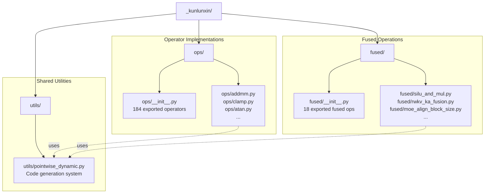
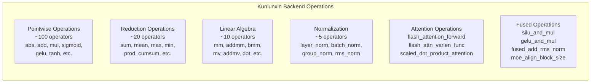
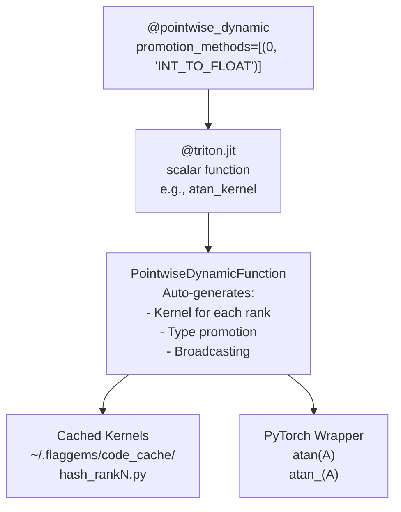
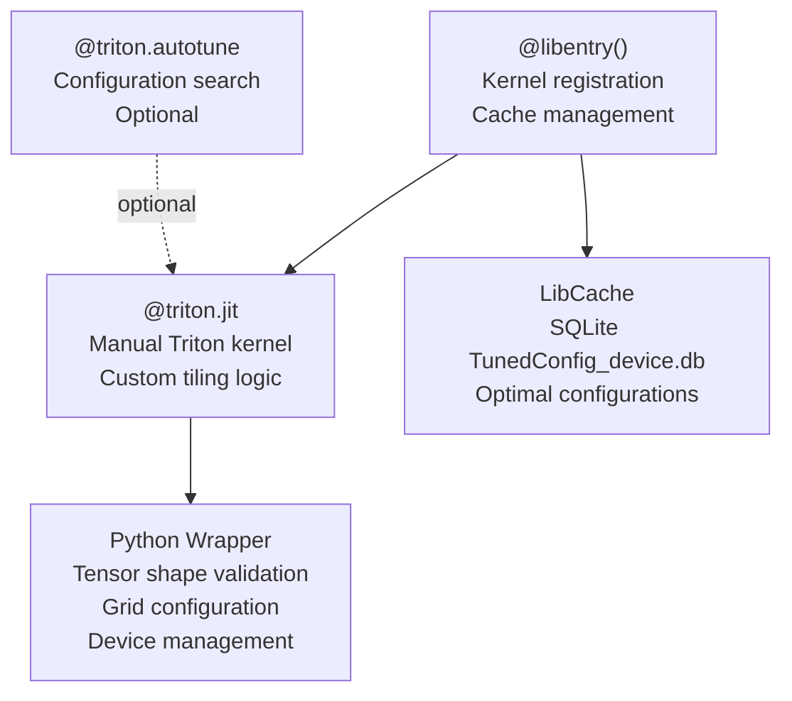
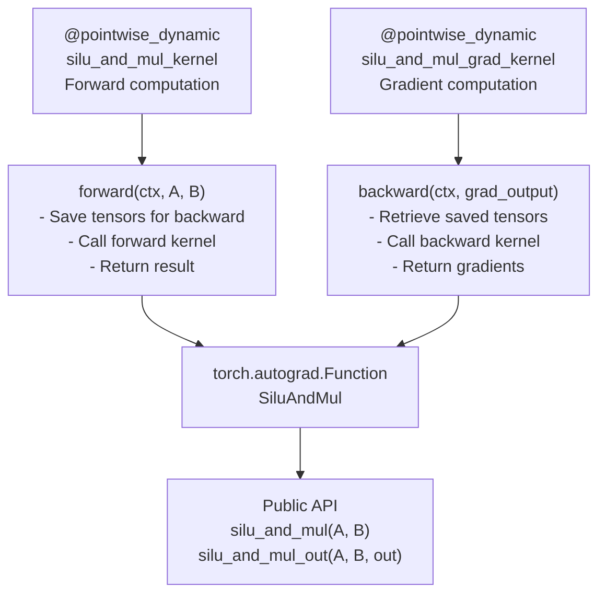
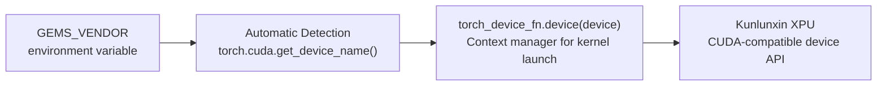
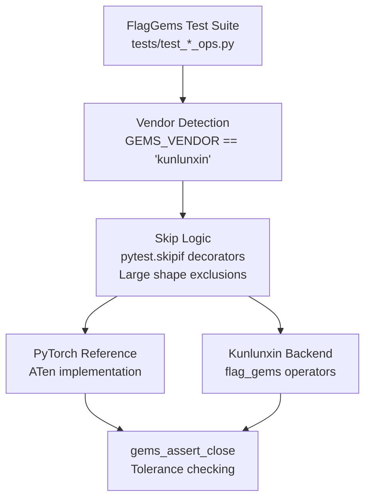

<!-- source: DeepWiki mcp.deepwiki.com · repo FlagOpen/FlagGems · page 4.2 Kunlunxin Support · fetched 2026-10-21 -->

# Kunlunxin Support

<details>
<summary>Relevant source files</summary>

The following files were used as context for generating this wiki page:

- [README.md](README.md)
- [README_cn.md](README_cn.md)
- [docs/add_a_cpp_wrapper.md](docs/add_a_cpp_wrapper.md)
- [docs/get_start_with_flaggems.md](docs/get_start_with_flaggems.md)
- [docs/how_to_use_flaggems.md](docs/how_to_use_flaggems.md)
- [docs/index.md](docs/index.md)
- [docs/installation.md](docs/installation.md)
- [docs/pointwise_dynamic.md](docs/pointwise_dynamic.md)
- [examples/integration_gems_with_vllm.py](examples/integration_gems_with_vllm.py)
- [mkdocs.yml](mkdocs.yml)
- [pyproject.toml](pyproject.toml)
- [src/flag_gems/ops/sqrt.py](src/flag_gems/ops/sqrt.py)
- [src/flag_gems/runtime/backend/_kunlunxin/fused/__init__.py](src/flag_gems/runtime/backend/_kunlunxin/fused/__init__.py)
- [src/flag_gems/runtime/backend/_kunlunxin/fused/moe_align_block_size.py](src/flag_gems/runtime/backend/_kunlunxin/fused/moe_align_block_size.py)
- [src/flag_gems/runtime/backend/_kunlunxin/fused/rwkv_ka_fusion.py](src/flag_gems/runtime/backend/_kunlunxin/fused/rwkv_ka_fusion.py)
- [src/flag_gems/runtime/backend/_kunlunxin/fused/rwkv_mm_sparsity.py](src/flag_gems/runtime/backend/_kunlunxin/fused/rwkv_mm_sparsity.py)
- [src/flag_gems/runtime/backend/_kunlunxin/fused/silu_and_mul.py](src/flag_gems/runtime/backend/_kunlunxin/fused/silu_and_mul.py)
- [src/flag_gems/runtime/backend/_kunlunxin/ops/__init__.py](src/flag_gems/runtime/backend/_kunlunxin/ops/__init__.py)
- [src/flag_gems/runtime/backend/_kunlunxin/ops/addmm.py](src/flag_gems/runtime/backend/_kunlunxin/ops/addmm.py)
- [src/flag_gems/runtime/backend/_kunlunxin/ops/addmv.py](src/flag_gems/runtime/backend/_kunlunxin/ops/addmv.py)
- [src/flag_gems/runtime/backend/_kunlunxin/ops/atan.py](src/flag_gems/runtime/backend/_kunlunxin/ops/atan.py)
- [src/flag_gems/runtime/backend/_kunlunxin/ops/bitwise_left_shift.py](src/flag_gems/runtime/backend/_kunlunxin/ops/bitwise_left_shift.py)
- [src/flag_gems/runtime/backend/_kunlunxin/ops/bitwise_right_shift.py](src/flag_gems/runtime/backend/_kunlunxin/ops/bitwise_right_shift.py)
- [src/flag_gems/runtime/backend/_kunlunxin/ops/clamp.py](src/flag_gems/runtime/backend/_kunlunxin/ops/clamp.py)

</details>


## Purpose and Scope

This document describes FlagGems' support for Kunlunxin XPU hardware, including the backend architecture, operator coverage, implementation patterns, and vendor-specific considerations. The Kunlunxin backend enables FlagGems operators to run on Kunlunxin R200 and compatible accelerators through the unified Triton compilation infrastructure.

For general multi-backend architecture concepts, see [Multi-Vendor Architecture](#4.3). For NVIDIA-specific implementations, see [NVIDIA GPU Support](#4.1).

---

## Backend Architecture

The Kunlunxin backend is implemented as a self-contained module within FlagGems' multi-backend system. It provides vendor-specific operator implementations while reusing the core FlagGems infrastructure including LibEntry, LibTuner, and the pointwise dynamic code generation system.

### Directory Structure



**Sources:** [src/flag_gems/runtime/backend/_kunlunxin/ops/__init__.py:1-467](), [src/flag_gems/runtime/backend/_kunlunxin/fused/__init__.py:1-40]()

### Backend Component Organization

| Component | Location | Purpose |
|-----------|----------|---------|
| Standard Operators | `_kunlunxin/ops/` | ATen-compatible operators (184 total) |
| Fused Operations | `_kunlunxin/fused/` | Multi-kernel fused operators (18 total) |
| Utilities | `_kunlunxin/utils/` | Shared code generation and helper functions |

---

## Operator Coverage

The Kunlunxin backend provides comprehensive operator support covering most PyTorch ATen operations used in LLM training and inference.

### Operator Categories



**Sources:** [src/flag_gems/runtime/backend/_kunlunxin/ops/__init__.py:198-466](), [src/flag_gems/runtime/backend/_kunlunxin/fused/__init__.py:19-39]()

### Complete Operator List

The following table summarizes operator support across major categories:

| Category | Example Operators | Count |
|----------|------------------|-------|
| **Pointwise Binary** | `add`, `mul`, `sub`, `div`, `pow` | ~40 |
| **Pointwise Unary** | `abs`, `exp`, `log`, `sqrt`, `sigmoid`, `gelu`, `silu`, `tanh` | ~50 |
| **Comparison** | `eq`, `ne`, `lt`, `le`, `gt`, `ge`, `isnan`, `isinf`, `isfinite` | ~15 |
| **Bitwise** | `bitwise_and`, `bitwise_or`, `bitwise_not`, `bitwise_left_shift`, `bitwise_right_shift` | ~10 |
| **Reduction** | `sum`, `mean`, `max`, `min`, `prod`, `all`, `any`, `argmax`, `argmin` | ~20 |
| **Matrix Operations** | `mm`, `addmm`, `bmm`, `mv`, `addmv`, `dot` | ~10 |
| **Normalization** | `layer_norm`, `batch_norm`, `group_norm`, `rms_norm` | ~5 |
| **Attention** | `flash_attention_forward`, `flash_attn_varlen_func`, `scaled_dot_product_attention` | ~3 |
| **Tensor Manipulation** | `cat`, `stack`, `scatter`, `gather`, `index_select`, `flip`, `repeat` | ~20 |
| **Random** | `rand`, `randn`, `uniform_`, `exponential_`, `multinomial` | ~10 |
| **Other** | `embedding`, `conv1d`, `conv2d`, `conv3d`, `dropout`, `topk`, `sort` | ~20 |

**Sources:** [src/flag_gems/runtime/backend/_kunlunxin/ops/__init__.py:1-467]()

---

## Implementation Patterns

The Kunlunxin backend follows consistent implementation patterns that leverage FlagGems' infrastructure while accommodating vendor-specific requirements.

### Pattern 1: Pointwise Dynamic Operations

Most element-wise operations use the `@pointwise_dynamic` decorator for automatic code generation:



**Example: Atan Operation**

[src/flag_gems/runtime/backend/_kunlunxin/ops/atan.py:1-30]()

```python
@pointwise_dynamic(promotion_methods=[(0, "INT_TO_FLOAT")])
@triton.jit
def atan_kernel(x):
    return _atan(x.to(tl.float32))

def atan(A):
    return atan_kernel(A)

def atan_(A):
    atan_kernel(A, out0=A)  # In-place variant
    return A
```

**Sources:** [src/flag_gems/runtime/backend/_kunlunxin/ops/atan.py:1-30](), [src/flag_gems/runtime/backend/_kunlunxin/ops/bitwise_left_shift.py:1-19](), [src/flag_gems/runtime/backend/_kunlunxin/ops/bitwise_right_shift.py:1-18]()

### Pattern 2: Manual Triton Kernels with LibEntry

Operations requiring custom tiling or autotuning use `@libentry` decorator with manual Triton kernels:



**Example: Addmm Operation**

[src/flag_gems/runtime/backend/_kunlunxin/ops/addmm.py:15-111]()

```python
@libentry()
@triton.autotune(configs=[], generate_configs="addmm", key=["M", "N", "K"])
@triton.jit(do_not_specialize=["alpha", "beta"])
def addmm_kernel(a_ptr, b_ptr, i_ptr, c_ptr, alpha, beta,
                 M, N, K, stride_am, stride_ak, ...):
    # Custom matrix multiplication with bias addition
    pid_m = tle.program_id(0)
    pid_n = tle.program_id(1)
    # ... tiling and computation logic ...

def addmm(bias, mat1, mat2, *, beta=1.0, alpha=1.0):
    M, K = mat1.shape
    _, N = mat2.shape
    out = torch.empty((M, N), device=mat1.device, dtype=mat1.dtype)
    grid = lambda META: (triton.cdiv(M, META["BLOCK_SIZE_M"]),
                         triton.cdiv(N, META["BLOCK_SIZE_N"]))
    with torch_device_fn.device(mat1.device):
        addmm_kernel[grid](mat1, mat2, bias, out, ...)
    return out
```

**Sources:** [src/flag_gems/runtime/backend/_kunlunxin/ops/addmm.py:1-155](), [src/flag_gems/runtime/backend/_kunlunxin/ops/addmv.py:1-133]()

### Pattern 3: Fused Operations with Autograd

Fused operations combine multiple kernels and often implement custom backward passes using `torch.autograd.Function`:



**Example: Silu And Mul Fused Operation**

[src/flag_gems/runtime/backend/_kunlunxin/fused/silu_and_mul.py:12-53]()

```python
@pointwise_dynamic(promotion_methods=[(0, 1, "DEFAULT")])
@triton.jit
def silu_and_mul_kernel(x, y):
    x_fp32 = x.to(tl.float32)
    x_silu = tl.fdiv(x_fp32, (1.0 + tl.exp(-x_fp32)))
    return x_silu * y

@pointwise_dynamic(promotion_methods=[(0, 1, 2, "DEFAULT"), (0, 1, 2, "DEFAULT")], 
                   num_outputs=2)
@triton.jit
def silu_and_mul_grad_kernel(x, y, dgrad):
    # Custom gradient computation
    ...

class SiluAndMul(torch.autograd.Function):
    @staticmethod
    def forward(ctx, A, B):
        ctx.save_for_backward(A, B)
        return silu_and_mul_kernel(A, B)
    
    def backward(ctx, grad_output):
        A, B = ctx.saved_tensors
        grad_A, grad_B = silu_and_mul_grad_kernel(A, B, grad_output)
        return grad_A, grad_B
```

**Sources:** [src/flag_gems/runtime/backend/_kunlunxin/fused/silu_and_mul.py:1-54]()

---

## Vendor-Specific Considerations

The Kunlunxin backend shares most implementation code with other backends but includes specific optimizations and handling for XPU hardware characteristics.

### Device Management

Device selection and context management use vendor-agnostic APIs that automatically detect Kunlunxin hardware:



Device context is applied when launching kernels to ensure proper device binding:

[src/flag_gems/runtime/backend/_kunlunxin/ops/addmm.py:91-111]()

```python
with torch_device_fn.device(mat1.device):
    addmm_kernel[grid](mat1, mat2, bias, out, ...)
```

**Sources:** [src/flag_gems/runtime/backend/_kunlunxin/ops/addmm.py:91-92](), [src/flag_gems/runtime/backend/_kunlunxin/ops/addmv.py:85-101]()

### Data Type Support

The Kunlunxin backend supports the following data types:

| Data Type | Supported | Notes |
|-----------|-----------|-------|
| `float16` | ✅ | Full support |
| `float32` | ✅ | Full support |
| `bfloat16` | ✅ | Full support |
| `float64` | ⚠️ | Limited - vendor dependent |
| `int32` | ✅ | Integer operations |
| `int64` | ⚠️ | Limited - vendor dependent |
| `bool` | ✅ | Comparison and logical operations |

Type promotion follows PyTorch's standard promotion rules, implemented through the `promotion_methods` parameter in `@pointwise_dynamic`.

**Sources:** [README.md:96-110](), [README_cn.md:89-104]()

### Configuration and Tuning

Kunlunxin-specific autotuning configurations are stored per-device in the LibCache system:

```
~/.flaggems/
├── code_cache/              # Generated pointwise kernels
│   └── hash_rankN.py
└── cache/                   # Autotuning results
    └── TunedConfig_kunlunxin_device.db  # SQLite database
```

The autotuning system automatically benchmarks kernel configurations on the target Kunlunxin device and caches results for future runs.

---

## Testing and Validation

The Kunlunxin backend undergoes the same testing procedures as other FlagGems backends but may include vendor-specific test filtering.

### Test Infrastructure



### Vendor-Specific Test Filtering

Some test cases may be skipped on Kunlunxin hardware based on:

1. **Hardware Limitations**: Operations not fully supported by XPU
2. **Shape Constraints**: Very large tensor shapes that exceed memory limits
3. **Data Type Restrictions**: Operations with limited dtype support

Test skipping is typically implemented using pytest decorators:

```python
@pytest.mark.skipif(
    GEMS_VENDOR == "kunlunxin" and shape_too_large,
    reason="Large shapes not supported on Kunlunxin"
)
def test_operator():
    ...
```

### Accuracy Validation

All enabled tests validate accuracy against PyTorch reference implementations using tolerance-based comparison:

- **Relative Tolerance**: Typically 1e-3 for float32, 1e-2 for float16
- **Absolute Tolerance**: Typically 1e-5 for float32, 1e-3 for float16

**Sources:** Based on general testing patterns from [docs/how_to_use_flaggems.md:87-128]()

---

## Implementation Example Walkthrough

### Clamp Operation with Tensor Bounds

The `clamp` operator demonstrates how the Kunlunxin backend handles operations with multiple overloads:

[src/flag_gems/runtime/backend/_kunlunxin/ops/clamp.py:1-109]()

**Kernel Definitions:**

```python
# Clamp with both min and max tensors
@pointwise_dynamic(promotion_methods=[(0, 1, 2, "DEFAULT")])
@triton.jit
def clamp_func_tensor(x, mini, maxi):
    return tl.minimum(maxi, tl.maximum(mini, x.to(tl.float32)))

# Clamp with only min tensor
@pointwise_dynamic(promotion_methods=[(0, 1, "DEFAULT")])
@triton.jit
def clamp_func_min_tensor(x, mini):
    return tl.maximum(mini, x.to(tl.float32))

# Clamp with only max tensor
@pointwise_dynamic(promotion_methods=[(0, 1, "DEFAULT")])
@triton.jit
def clamp_func_max_tensor(x, maxi):
    return tl.minimum(maxi, x.to(tl.float32))
```

**Dispatch Logic:**

```python
def clamp_tensor(A, mini=None, maxi=None):
    if mini is None and maxi is None:
        raise ValueError("At least one of mini or maxi must not be None")
    elif mini is None:
        return clamp_func_max_tensor(A, maxi)
    elif maxi is None:
        return clamp_func_min_tensor(A, mini)
    else:
        return clamp_func_tensor(A, mini, maxi)
```

This pattern illustrates:
1. **Multiple kernel variants** for different argument combinations
2. **Type promotion** using the `promotion_methods` parameter
3. **Conditional dispatch** based on runtime arguments
4. **Broadcasting support** automatically handled by `pointwise_dynamic`

**Sources:** [src/flag_gems/runtime/backend/_kunlunxin/ops/clamp.py:1-109]()

---

## RWKV-Specific Fused Operators

The Kunlunxin backend includes specialized support for RWKV language model operations, demonstrating vendor-specific optimization capabilities.

### RWKV KA Fusion

[src/flag_gems/runtime/backend/_kunlunxin/fused/rwkv_ka_fusion.py:1-68]()

This fused operation combines multiple RWKV-specific computations into a single kernel:

```python
@triton.jit
def rwkv_ka_fusion_kernel(k_ptr, kk_ptr, a_ptr, ka_ptr, 
                          o_k_ptr, o_kk_ptr, o_kka_ptr,
                          T, C, H, N, N_size: tl.constexpr, 
                          block_size: tl.constexpr):
    # Fuses:
    # 1. k normalization with kk
    # 2. k modulation with a and ka  
    # 3. Multiple outputs in single pass
    ...
```

### RWKV Sparse Matrix Multiplication

[src/flag_gems/runtime/backend/_kunlunxin/fused/rwkv_mm_sparsity.py:1-62]()

Optimized sparse matrix multiplication for RWKV's sparse attention patterns:

```python
@triton.jit
def rwkv_mm_sparsity_kernel(k_ptr, v_ptr, output_ptr,
                            v_cols: tl.constexpr,
                            blk_size: tl.constexpr,
                            k_size: tl.constexpr,
                            block_size: tl.constexpr):
    # Skips zero elements in k for efficient computation
    k_nonzero_mask = k != 0
    # Only loads and computes with non-zero k values
    ...
```

These specialized fused kernels demonstrate the flexibility of the Kunlunxin backend to accommodate model-specific optimizations beyond standard operator coverage.

**Sources:** [src/flag_gems/runtime/backend/_kunlunxin/fused/rwkv_ka_fusion.py:1-68](), [src/flag_gems/runtime/backend/_kunlunxin/fused/rwkv_mm_sparsity.py:1-62]()

---

## Usage Examples

### Basic Usage with Kunlunxin

```python
import torch
import flag_gems

# Automatic vendor detection
print(flag_gems.vendor_name)  # Should output: 'kunlunxin'

# Enable FlagGems globally
flag_gems.enable()

# All operators automatically use Kunlunxin backend
x = torch.randn(1024, 1024, device='cuda')
y = torch.randn(1024, 1024, device='cuda')
z = torch.mm(x, y)  # Uses Kunlunxin-optimized mm kernel
```

### Manual Vendor Override

If automatic detection fails:

```bash
export GEMS_VENDOR=kunlunxin
python your_script.py
```

### Framework Integration

The Kunlunxin backend works seamlessly with vLLM and other frameworks:

```python
import flag_gems
from vllm import LLM, SamplingParams

flag_gems.enable()
flag_gems.apply_gems_patches_to_vllm(verbose=True)

llm = LLM(model="meta-llama/Llama-2-7b-hf", tensor_parallel_size=2)
outputs = llm.generate("Hello world", SamplingParams(max_tokens=100))
```

**Sources:** [docs/how_to_use_flaggems.md:87-134](), [examples/integration_gems_with_vllm.py:1-67]()

---

## Summary

The Kunlunxin backend provides comprehensive operator support for FlagGems on Kunlunxin XPU hardware through:

| Aspect | Details |
|--------|---------|
| **Operator Count** | 184 standard operators + 18 fused operations |
| **Data Types** | float16, float32, bfloat16 (full support) |
| **Architecture** | Unified Triton compilation with vendor-specific optimizations |
| **Code Generation** | Leverages `pointwise_dynamic` for automatic kernel generation |
| **Autotuning** | Per-device configuration caching via LibTuner/LibCache |
| **Testing** | Full test suite with vendor-specific filtering |
| **Framework Support** | Compatible with PyTorch, vLLM, Transformers, Megatron-LM |

The implementation maintains API compatibility with PyTorch while delivering optimized performance on Kunlunxin accelerators through efficient Triton kernel compilation and execution.

**Sources:** [src/flag_gems/runtime/backend/_kunlunxin/ops/__init__.py:1-467](), [src/flag_gems/runtime/backend/_kunlunxin/fused/__init__.py:1-40](), [README.md:96-110]()

---

