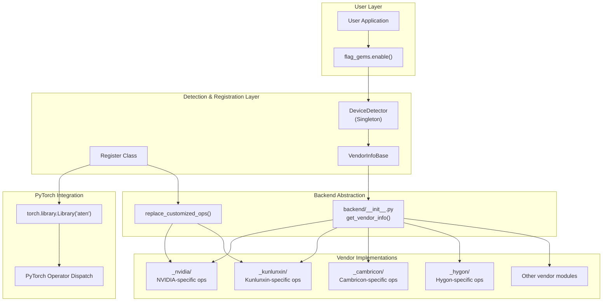
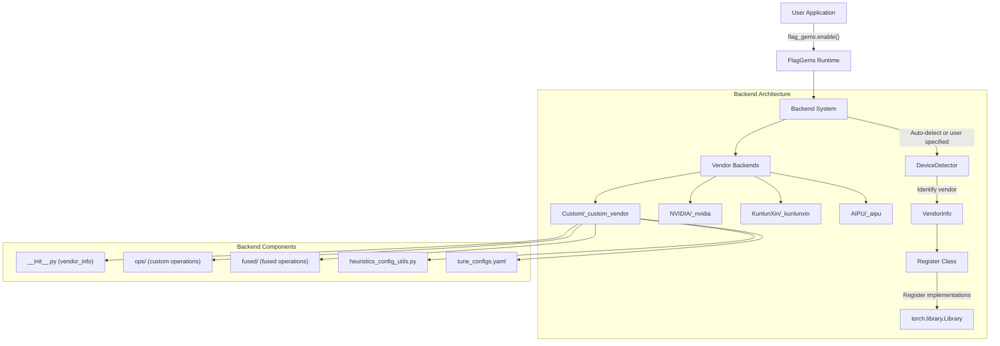
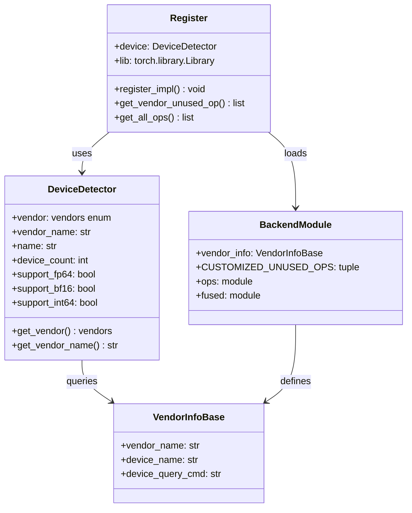
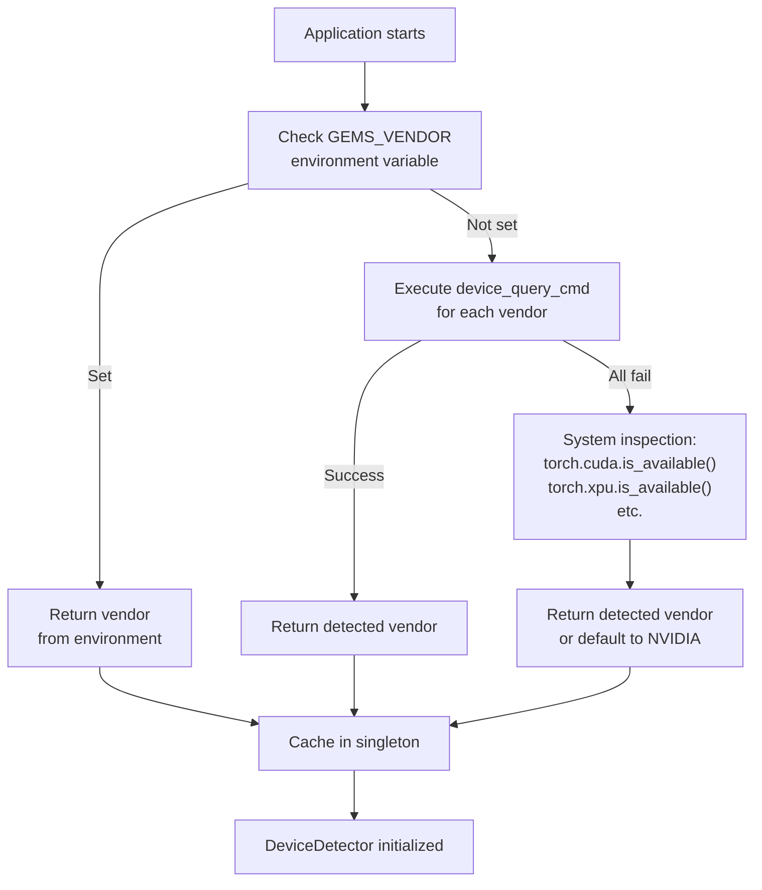
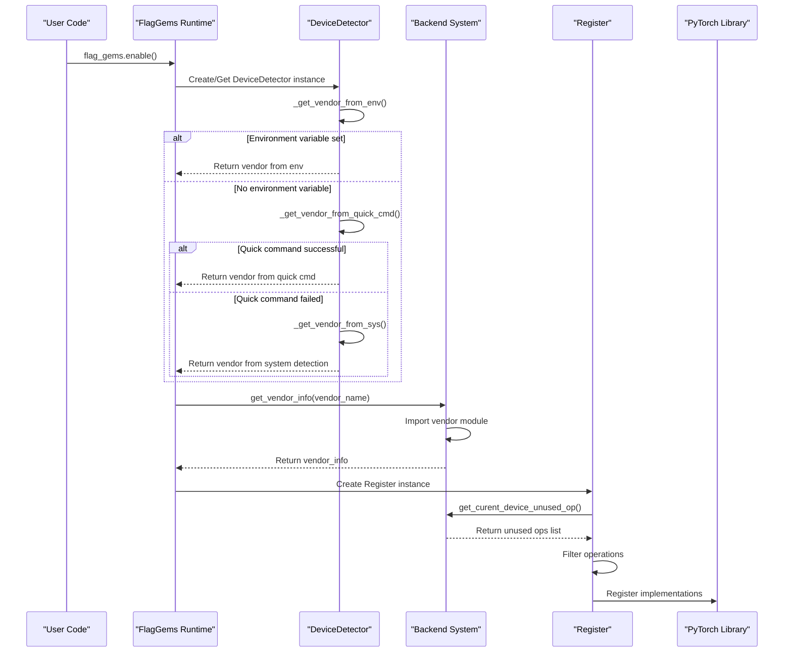

<!-- source: DeepWiki mcp.deepwiki.com · repo FlagOpen/FlagGems · page 4.3 Multi-Vendor Architecture · fetched 2026-10-21 -->

# Multi-Vendor Architecture

<details>
<summary>Relevant source files</summary>

The following files were used as context for generating this wiki page:

- [README.md](README.md)
- [README_cn.md](README_cn.md)
- [benchmark/test_special_perf.py](benchmark/test_special_perf.py)
- [benchmark/test_unary_pointwise_perf.py](benchmark/test_unary_pointwise_perf.py)
- [docs/add_a_cpp_wrapper.md](docs/add_a_cpp_wrapper.md)
- [docs/get_start_with_flaggems.md](docs/get_start_with_flaggems.md)
- [docs/how_to_use_flaggems.md](docs/how_to_use_flaggems.md)
- [docs/index.md](docs/index.md)
- [docs/installation.md](docs/installation.md)
- [docs/pointwise_dynamic.md](docs/pointwise_dynamic.md)
- [examples/integration_gems_with_vllm.py](examples/integration_gems_with_vllm.py)
- [mkdocs.yml](mkdocs.yml)
- [pyproject.toml](pyproject.toml)
- [src/flag_gems/__init__.py](src/flag_gems/__init__.py)
- [src/flag_gems/ops/__init__.py](src/flag_gems/ops/__init__.py)
- [src/flag_gems/ops/elu.py](src/flag_gems/ops/elu.py)
- [src/flag_gems/ops/embedding.py](src/flag_gems/ops/embedding.py)
- [src/flag_gems/ops/nllloss.py](src/flag_gems/ops/nllloss.py)
- [src/flag_gems/ops/sqrt.py](src/flag_gems/ops/sqrt.py)
- [tests/accuracy_utils.py](tests/accuracy_utils.py)
- [tests/test_binary_pointwise_ops.py](tests/test_binary_pointwise_ops.py)
- [tests/test_special_ops.py](tests/test_special_ops.py)
- [tests/test_unary_pointwise_ops.py](tests/test_unary_pointwise_ops.py)

</details>


FlagGems provides a unified abstraction layer that enables support for diverse hardware platforms through a flexible multi-vendor backend system. This architecture allows operations to run on 10+ different hardware vendors including NVIDIA, Kunlunxin, Cambricon, Hygon, and others, while maintaining a consistent user-facing API. For vendor-specific details, see [NVIDIA GPU Support](#4.1) and [Kunlunxin Support](#4.2).

## Architecture Overview

The multi-vendor architecture consists of three layers: automatic device detection, unified operation registration, and vendor-specific implementations. This design separates hardware-specific optimizations from the core operator library, enabling seamless hardware portability.
</thinking>



Sources: [src/flag_gems/__init__.py:1-367](), [src/flag_gems/runtime/backend/device.py:1-124](), [src/flag_gems/runtime/backend/__init__.py:1-180](), [src/flag_gems/runtime/register.py:1-61]()



## Core Components

The multi-vendor system consists of four primary components that work together to provide hardware abstraction:

### DeviceDetector

The `DeviceDetector` class ([src/flag_gems/runtime/backend/device.py:26-124]()) is a singleton that automatically identifies the hardware vendor and device properties. It provides:

- **Automatic vendor detection** through environment variables, quick commands, or system inspection
- **Device enumeration** to count available accelerators
- **Capability reporting** for data type support (FP64, BF16, INT64)

### VendorInfoBase

The `VendorInfoBase` dataclass ([src/flag_gems/runtime/backend/backend_utils.py]()) encapsulates vendor-specific metadata:

| Attribute | Description |
|-----------|-------------|
| `vendor_name` | Canonical vendor identifier (e.g., "nvidia", "kunlunxin") |
| `device_name` | PyTorch device name (e.g., "cuda", "xpu") |
| `device_query_cmd` | Shell command to detect hardware presence |

### Register

The `Register` class ([src/flag_gems/runtime/register.py:5-61]()) manages operator registration with PyTorch's library system. It:

- Filters operators based on vendor capabilities and exclusion lists
- Registers implementations with `torch.library.Library`
- Handles both standard operators and vendor-specific patches

### Backend Modules

Vendor-specific backend modules ([src/flag_gems/runtime/backend/_*/__init__.py]()) provide:

- Custom operator implementations in `ops/` subdirectories
- Fused operations in `fused/` subdirectories
- Tuning configurations in `tune_configs.yaml`
- Heuristic configuration utilities in `heuristics_config_utils.py`

**Component Relationships:**



Sources: [src/flag_gems/runtime/backend/device.py:26-124](), [src/flag_gems/runtime/register.py:5-61](), [src/flag_gems/runtime/backend/__init__.py:1-180]()

## Automatic Vendor Detection

FlagGems employs a three-tier detection strategy to identify the hardware vendor at runtime. The detection process is handled by `DeviceDetector._get_vendor()` ([src/flag_gems/runtime/backend/device.py:55-112]()):

**Detection Flow:**



### Detection Methods

| Priority | Method | Description |
|----------|--------|-------------|
| 1 | Environment Variable | Check `GEMS_VENDOR` environment variable |
| 2 | Quick Command | Execute `device_query_cmd` from each vendor's `VendorInfoBase` |
| 3 | System Inspection | Query PyTorch's device availability APIs |

The detected vendor is cached in the singleton `DeviceDetector` instance and accessible via:

```python
import flag_gems
print(flag_gems.vendor_name)  # e.g., "nvidia", "kunlunxin"
print(flag_gems.device)        # e.g., "cuda", "xpu"
```

Sources: [src/flag_gems/__init__.py:14-18](), [src/flag_gems/runtime/backend/device.py:55-112]()

## Hardware Capability Checking

FlagGems tracks vendor-specific data type support through exclusion lists in `device.py`. The system automatically determines capability based on the detected vendor:

| Capability | Check Method | Excluded Vendors (as of v3.0) |
|------------|--------------|-------------------------------|
| FP64 Support | `device.support_fp64` | kunlunxin, cambricon, hygon, iluvatar, metax, mthreads, aipu, ascend |
| BF16 Support | `device.support_bf16` | aipu, ascend |
| INT64 Support | `device.support_int64` | kunlunxin, cambricon, hygon, iluvatar, mthreads, aipu, ascend |

These capabilities are exposed through boolean properties on the `DeviceDetector` instance and are used by the testing framework to skip unsupported test cases. For example:

- Tests check `flag_gems.runtime.device.support_fp64` before running FP64 tests
- Operations may fall back to FP32 if BF16 is not supported
- Test shapes are adjusted based on INT64 support

Sources: [src/flag_gems/runtime/backend/device.py:11-23](), [tests/accuracy_utils.py:12-14]()

## Backend Structure

Each vendor backend follows a standardized directory structure that separates operator implementations, configurations, and metadata:

```
src/flag_gems/runtime/backend/_vendor_name/
├── __init__.py                    # Vendor metadata and exclusions
├── ops/                           # Custom operator implementations
│   ├── __init__.py
│   └── custom_op.py
├── fused/                         # Fused operator implementations
│   ├── __init__.py
│   └── fused_op.py
├── heuristics_config_utils.py     # Dynamic parameter selection
└── tune_configs.yaml              # Pre-tuned kernel configurations
```

### Required Components

#### 1. Vendor Information (`__init__.py`)

Every backend must define a `vendor_info` object and optionally customize operator exclusions:

```python
from backend_utils import VendorInfoBase

vendor_info = VendorInfoBase(
    vendor_name="vendor_name",      # Must match directory name (without underscore prefix)
    device_name="torch_device",     # PyTorch device name (e.g., "cuda", "xpu", "mlu")
    device_query_cmd="query_cmd"    # Shell command to detect hardware (e.g., "nvidia-smi")
)

# Operators that should not be registered for this vendor
CUSTOMIZED_UNUSED_OPS = (
    "operator_name_1",
    "operator_name_2",
)

__all__ = ["*"]
```

The `vendor_name` must match the directory name without the underscore prefix. For example, `_nvidia` directory has `vendor_name="nvidia"`.

Sources: [src/flag_gems/runtime/backend/_aipu/__init__.py:1-14](), [src/flag_gems/runtime/backend/_kunlunxin/__init__.py:1-16]()

#### 2. Custom Operations (`ops/` and `fused/`)

Vendor-specific operator implementations go in `ops/` for standard operations and `fused/` for fused kernels. Each subdirectory must have an `__init__.py` that exports the implementations:

```python
# ops/__init__.py
from .custom_op import custom_op_impl

__all__ = ["custom_op_impl"]
```

These implementations are discovered by `replace_customized_ops()` ([src/flag_gems/runtime/backend/__init__.py:162-180]()) and registered to replace default implementations.

Sources: [src/flag_gems/runtime/backend/_kunlunxin/ops/__init__.py:1-14](), [src/flag_gems/runtime/backend/__init__.py:162-180]()

#### 3. Heuristic Configurations (`heuristics_config_utils.py`)

This module defines dynamic parameter selection functions that choose optimal kernel parameters based on runtime input characteristics:

```python
def operation_name_heur_param(args):
    """
    Dynamically select parameter value based on input args.
    args: dict with keys matching kernel parameter names
    """
    return computed_value

HEURISTICS_CONFIGS = {
    "operation_name": {
        "BLOCK_SIZE": operation_name_heur_block_size,
        "NUM_WARPS": operation_name_heur_num_warps,
    },
}
```

The `HEURISTICS_CONFIGS` dictionary maps operation names to parameter selection functions. These are used by the LibTuner system during kernel launch.

Sources: [src/flag_gems/runtime/backend/_aipu/heuristics_config_utils.py:1-302]()

#### 4. Tuning Configurations (`tune_configs.yaml`)

Pre-tuned kernel configurations for different input shapes and parameters:

```yaml
operation_name:
  - META:
      BLOCK_M: 128
      BLOCK_N: 128
      BLOCK_K: 32
    num_warps: 4
    num_stages: 2
  - META:
      BLOCK_M: 64
      BLOCK_N: 64
      BLOCK_K: 64
    num_warps: 2
    num_stages: 3
```

Each configuration specifies meta-parameters (kernel-specific), warp count, and pipeline stages. The LibTuner selects the best configuration during autotuning.

Sources: [src/flag_gems/runtime/backend/_aipu/tune_configs.yaml:1-794]()

## Adding a New Vendor Backend

Follow these steps to add support for a new hardware vendor:

### Step 1: Register Vendor Enum

Add your vendor to the `vendors` enum and `vendors_map` in [src/flag_gems/runtime/commom_utils.py:8-34]():

```python
class vendors(Enum):
    # Existing vendors...
    NEW_VENDOR = 11  # Use next available number

vendors_map = {
    # Existing mappings...
    "new_vendor": vendors.NEW_VENDOR,
}
```

### Step 2: Create Backend Directory

Create the directory structure under `src/flag_gems/runtime/backend/_new_vendor/`:

```
_new_vendor/
├── __init__.py
├── ops/
│   └── __init__.py
├── fused/
│   └── __init__.py
├── heuristics_config_utils.py  (optional)
└── tune_configs.yaml           (optional)
```

### Step 3: Define Vendor Metadata

Implement `__init__.py` with vendor information:

```python
from backend_utils import VendorInfoBase

vendor_info = VendorInfoBase(
    vendor_name="new_vendor",
    device_name="new_device",
    device_query_cmd="vendor-detect-cmd"
)

CUSTOMIZED_UNUSED_OPS = tuple()  # Empty if all ops supported

__all__ = ["*"]
```

### Step 4: Implement Custom Operations (Optional)

If your vendor requires custom implementations for specific operators:

1. Create operator files in `ops/` or `fused/`
2. Export them through `__init__.py`
3. The backend system will automatically override default implementations

### Step 5: Configure Capabilities (If Needed)

If your vendor doesn't support certain data types, add it to the exclusion lists in [src/flag_gems/runtime/backend/device.py:11-23]():

```python
UNSUPPORT_FP64 = [..., vendors.NEW_VENDOR]
UNSUPPORT_BF16 = [..., vendors.NEW_VENDOR]
UNSUPPORT_INT64 = [..., vendors.NEW_VENDOR]
```

### Step 6: Test Vendor Detection

Verify automatic detection works:

```python
import flag_gems
print(flag_gems.vendor_name)  # Should print "new_vendor"
print(flag_gems.device)        # Should print "new_device"
```

Or manually set via environment variable:

```bash
export GEMS_VENDOR=new_vendor
python your_script.py
```

Sources: [src/flag_gems/runtime/backend/device.py:1-124](), [src/flag_gems/runtime/commom_utils.py:8-34](), [src/flag_gems/__init__.py:14-21]()

## Registration and Initialization Flow

The following sequence diagram shows how vendor backends are detected, loaded, and registered when `flag_gems.enable()` is called:



Sources: [src/flag_gems/runtime/backend/device.py:55-112](), [src/flag_gems/runtime/register.py:5-50](), [src/flag_gems/runtime/backend/__init__.py:121-160]()

## Vendor-Specific Customizations

### Operation Selection

You can specify which operations should not be registered for your backend using the `CUSTOMIZED_UNUSED_OPS` tuple in your backend's `__init__.py` file. This allows you to skip operations that are not compatible with your hardware or that you haven't implemented yet.

### Device-Specific Optimization

FlagGems provides several mechanisms for optimizing operations for specific hardware:

1. **Heuristic Configurations**: Dynamic parameter selection based on input shapes and types
2. **Tuning Configurations**: Pre-defined parameter sets for various operations
3. **Custom Operations**: Completely custom implementations of operations

### Hardware Support Limitations

You may need to specify hardware limitations in your backend implementation:

```python
# In device.py, add your vendor to the appropriate lists if needed
UNSUPPORT_FP64 = [
    # Existing vendors
    vendors.CUSTOM_VENDOR,  # If your hardware doesn't support FP64
]

UNSUPPORT_BF16 = [
    # Existing vendors
    vendors.CUSTOM_VENDOR,  # If your hardware doesn't support BF16
]

UNSUPPORT_INT64 = [
    # Existing vendors
    vendors.CUSTOM_VENDOR,  # If your hardware doesn't support INT64
]
```

Sources: [src/flag_gems/runtime/backend/device.py:11-23]()

## Testing Your Custom Backend

After implementing your custom backend, you should:

1. Ensure your hardware is correctly detected by the `DeviceDetector`
2. Test that operations are correctly registered with PyTorch
3. Verify that operations produce correct results
4. Benchmark performance against PyTorch's native implementations

For detailed information on testing and benchmarking, see [Testing and Benchmarking](#5).

## Advanced Integration

For more complex backends, you might need to:

1. Implement custom Triton kernels
2. Add device-specific extensions to the LibEntry system
3. Create vendor-specific operation fusion patterns

These advanced topics are covered in more detail in [C++ Extensions](#6.1).

## Troubleshooting

Common issues when implementing a custom backend include:

1. **Device Detection Failures**: Ensure your `device_query_cmd` reliably detects your hardware
2. **Registration Issues**: Verify that the vendor name matches in all locations
3. **Performance Problems**: Check tuning configurations and heuristic functions

If you encounter any issues, see [Contributing to FlagGems](#6.2) for guidance on seeking help and reporting bugs.

---

