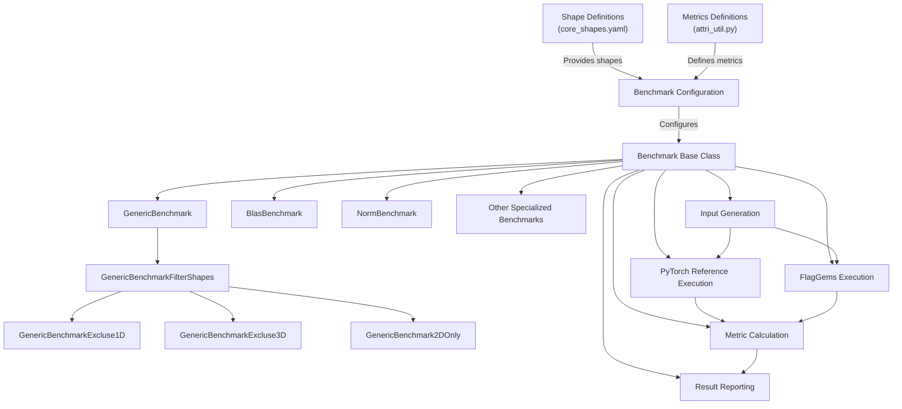
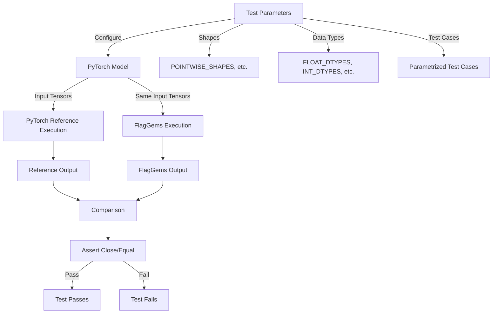
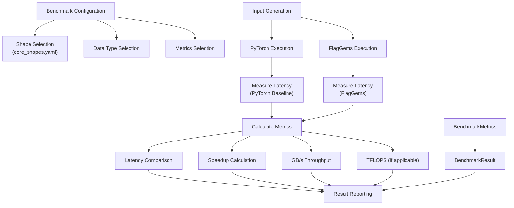
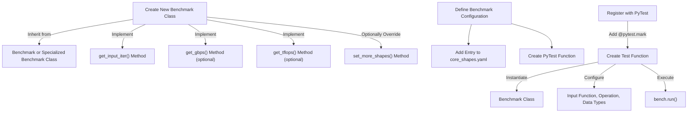

<!-- source: DeepWiki mcp.deepwiki.com · repo FlagOpen/FlagGems · page 5 Testing and Validation · fetched 2026-10-21 -->

# Testing and Benchmarking

<details>
<summary>Relevant source files</summary>

The following files were used as context for generating this wiki page:

- [.gitattributes](.gitattributes)
- [benchmark/attri_util.py](benchmark/attri_util.py)
- [benchmark/conftest.py](benchmark/conftest.py)
- [benchmark/core_shapes.yaml](benchmark/core_shapes.yaml)
- [benchmark/performance_utils.py](benchmark/performance_utils.py)
- [benchmark/summary_for_plot.py](benchmark/summary_for_plot.py)
- [benchmark/test_blas_perf.py](benchmark/test_blas_perf.py)
- [benchmark/test_fused_perf.py](benchmark/test_fused_perf.py)
- [benchmark/test_norm_perf.py](benchmark/test_norm_perf.py)
- [benchmark/test_tensor_concat_perf.py](benchmark/test_tensor_concat_perf.py)
- [src/flag_gems/fused/topk_softmax.py](src/flag_gems/fused/topk_softmax.py)
- [src/flag_gems/ops/addmv.py](src/flag_gems/ops/addmv.py)

</details>


This document provides a comprehensive overview of the testing and benchmarking framework in FlagGems. This framework enables developers and users to verify the correctness of optimized operations and measure their performance improvements compared to standard PyTorch implementations.

The testing and benchmarking system consists of two main components:
1. **Accuracy Testing**: Ensures that FlagGems operations produce results that match PyTorch reference implementations within acceptable tolerances
2. **Performance Benchmarking**: Measures and compares the performance of FlagGems operations against PyTorch baselines

For information about creating custom backends that could be tested using this framework, see [Adding Custom Backends](#4.3).

## Benchmark Framework Architecture

The benchmark framework in FlagGems is designed to provide a flexible and extensible system for measuring operation performance across different hardware backends, shapes, and data types.



The benchmark framework is built around the `Benchmark` base class, which provides core functionality for configuring and running benchmarks. Specialized benchmark classes extend this base class for different operation types.

Sources: [benchmark/performance_utils.py:63-390](), [benchmark/attri_util.py:22-29]()

### Core Components

1. **Benchmark Base Class**: The abstract base class that implements the core benchmark functionality, including:
   - Configuration management
   - Metrics calculation
   - Result reporting

2. **Specialized Benchmark Classes**:
   - `GenericBenchmark`: General-purpose benchmark for most operations
   - `BlasBenchmark`: Specialized for matrix multiplication operations
   - Specialized filter classes for different tensor dimensionality requirements

3. **Configuration**:
   - Shape definitions in YAML files
   - Configurable metrics (latency, speedup, GB/s, TFLOPS)
   - Supported data types

The benchmark system provides a unified interface for testing different operations with minimal boilerplate code.

Sources: [benchmark/performance_utils.py:393-448](), [benchmark/test_blas_perf.py:20-205](), [benchmark/attri_util.py:86-90]()

## Accuracy Testing

Accuracy testing ensures that FlagGems operations produce the same results as their PyTorch counterparts within acceptable numerical tolerances. This is crucial for maintaining the correctness of machine learning models when using accelerated operations.



Key aspects of accuracy testing:

1. **Testing Approach**:
   - Use PyTorch's reference implementation as the ground truth
   - Apply the same operation with identical inputs to both PyTorch and FlagGems implementations
   - Compare the outputs for numerical equivalence
   - Account for expected differences in floating-point precision

2. **Common Test Parameters**:
   - Input shapes: Various tensor dimensions to test different scenarios
   - Data types: Test with different precision levels (float32, float16, bfloat16)
   - Special values: Test edge cases like zeros, ones, NaNs, etc.

3. **Assert Functions**:
   - `gems_assert_close()`: Compares tensors with a tolerance for floating-point operations
   - `gems_assert_equal()`: Requires exact matching for integer and boolean operations

Sources: [tests/test_pointwise_type_promotion.py:1-135]()

## Performance Benchmarking

Performance benchmarking measures the speedup and efficiency of FlagGems operations compared to standard PyTorch implementations. The framework supports various metrics to quantify performance improvements.



### Benchmark Configuration

The benchmark system provides flexible configuration options:

1. **Benchmark Metrics**:
   - `latency_base`: Baseline PyTorch operation latency in milliseconds
   - `latency`: FlagGems operation latency in milliseconds
   - `speedup`: Ratio of baseline latency to FlagGems latency
   - `gbps`: Memory throughput in GB/s
   - `tflops`: Compute throughput in TFLOPS (for applicable operations)

2. **Shape Configurations**:
   The `core_shapes.yaml` file defines recommended testing shapes for different operations:
   
   ```yaml
   # Example shape configuration for UnaryPointwiseBenchmark
   UnaryPointwiseBenchmark:
     shapes:
       - [1073741824,]  # 1024 * 1024 * 1024
       - [64, 64]
       - [4096, 4096]
       - [64, 512, 512]
       - [1024, 1024, 1024]
     shape_desc: "(B), M, N"
   ```

3. **Benchmark Levels**:
   - `CORE`: Basic set of shapes and configurations for quick testing
   - `COMPREHENSIVE`: Expanded set of shapes and configurations for thorough testing

Sources: [benchmark/core_shapes.yaml:156-186](), [benchmark/attri_util.py:54-78](), [benchmark/attri_util.py:137-140]()

### Running Benchmarks

Benchmarks are executed using PyTest with specific markers to select which operations to benchmark. The framework automatically handles:

1. Setting up the benchmark environment
2. Generating appropriate inputs
3. Running both PyTorch and FlagGems implementations
4. Measuring performance metrics
5. Reporting results

Example benchmark execution for fused operations:

```python
# Benchmark for gelu_and_mul fused operation
def test_perf_gelu_and_mul():
    def torch_op(x, y):
        return torch.mul(torch.nn.functional.gelu(x), y)

    gems_op = flag_gems.gelu_and_mul
    bench = GenericBenchmark(
        input_fn=binary_input_fn,
        op_name="gelu_and_mul",
        torch_op=torch_op,
        dtypes=FLOAT_DTYPES,
    )
    bench.set_gems(gems_op)
    bench.run()
```

The `run()` method executes the benchmark with the specified configuration, collects metrics, and outputs the results.

Sources: [benchmark/test_fused_perf.py:14-27](), [benchmark/performance_utils.py:328-390]()

### Benchmark Result Format

Benchmark results are formatted as tables showing the performance comparison between PyTorch and FlagGems:

```
Operator: gelu_and_mul  Performance Test (dtype=torch.float16, mode=cuda, level=core)
Status     Torch Latency (ms)     Gems Latency (ms)        Gems Speedup          Size Detail
---------------------------------------------------------------------------------
SUCCESS         0.123456              0.045678                2.703            ([64, 64], [64, 64])
SUCCESS         1.234567              0.345678                3.571            ([4096, 4096], [4096, 4096])
```

The output includes:
- Operation name, data type, and benchmark level
- PyTorch baseline latency
- FlagGems optimized latency
- Speedup ratio
- Input shape details
- Additional metrics when specified (GBPS, TFLOPS)

Sources: [benchmark/attri_util.py:166-236]()

## Common Benchmark Classes

FlagGems provides several specialized benchmark classes for different operation types:

| Benchmark Class | Purpose | Example Operations |
|----------------|---------|-------------------|
| `GenericBenchmark` | General-purpose benchmark for most operations | Add, Mul, Sin, etc. |
| `BlasBenchmark` | Matrix multiplication operations | MM, BMM, AddMM |
| `NormBenchmark` | Normalization operations | LayerNorm, BatchNorm |
| `GenericBenchmarkExcluse1D` | Operations that don't support 1D tensors | Skip_LayerNorm |
| `GenericBenchmarkExcluse3D` | Operations that don't support 3D tensors | Specific operations |
| `GenericBenchmark2DOnly` | Operations that only support 2D tensors | Some linear algebra ops |

These classes provide specialized input generation and result processing for different operation characteristics.

Sources: [benchmark/performance_utils.py:393-450](), [benchmark/test_blas_perf.py:20-34]()

## Extending the Benchmark System

The benchmark system is designed to be extensible, allowing developers to create custom benchmarks for new operations or specialized testing scenarios.



To create a custom benchmark:

1. **Create a Benchmark Class**:
   - Inherit from `Benchmark` or a specialized benchmark class
   - Implement required methods like `get_input_iter()`
   - Optionally override other methods for customization

2. **Define Input Generation**:
   - Create functions that generate appropriate inputs for the operation
   - Handle different shapes, data types, and special cases

3. **Add Shape Configurations**:
   - Add entries to `core_shapes.yaml` for the new operation
   - Define shape description and recommended shapes

4. **Create a Test Function**:
   - Create a PyTest function that instantiates the benchmark
   - Configure the benchmark with appropriate parameters
   - Run the benchmark and capture results

Sources: [benchmark/test_blas_perf.py:141-146](), [benchmark/performance_utils.py:63-137]()

## Best Practices for Testing and Benchmarking

1. **Accuracy Testing**:
   - Test with a variety of shapes, including edge cases
   - Include all supported data types in tests
   - Test with special values (zeros, extremes, NaNs where applicable)
   - Use appropriate tolerances for different operations and precisions

2. **Performance Benchmarking**:
   - Include representative shapes from real-world models
   - Benchmark with all supported data types
   - Include both small and large tensor sizes
   - Consider memory access patterns when designing benchmark shapes
   - Ensure fair comparison with PyTorch (same configuration, warm-up, etc.)

3. **Reporting Results**:
   - Include complete shape information in reports
   - Report all relevant metrics (not just speedup)
   - Document testing environment (hardware, software versions)
   - Highlight any performance regressions or accuracy issues

Sources: [benchmark/attri_util.py:137-140](), [benchmark/performance_utils.py:242-273]()

---

