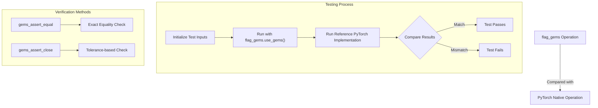
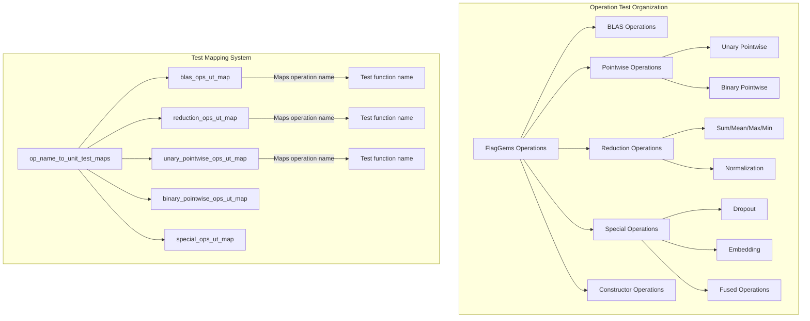
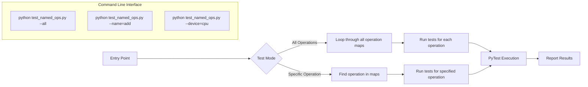
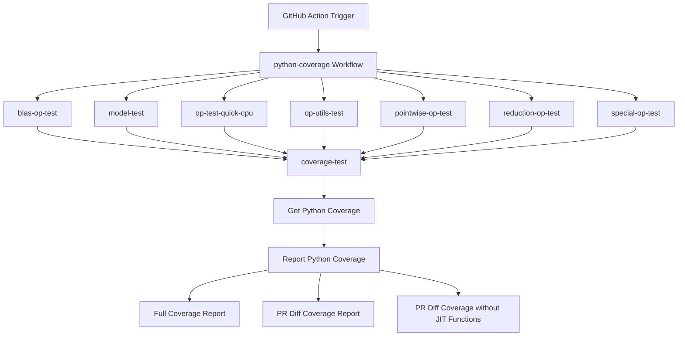

<!-- source: DeepWiki mcp.deepwiki.com · repo FlagOpen/FlagGems · page 5.1 Accuracy Testing · fetched 2026-10-21 -->

# Accuracy Testing

<details>
<summary>Relevant source files</summary>

The following files were used as context for generating this wiki page:

- [benchmark/test_attention_perf.py](benchmark/test_attention_perf.py)
- [benchmark/test_binary_pointwise_perf.py](benchmark/test_binary_pointwise_perf.py)
- [benchmark/test_reduction_perf.py](benchmark/test_reduction_perf.py)
- [benchmark/test_select_and_slice_perf.py](benchmark/test_select_and_slice_perf.py)
- [benchmark/test_special_perf.py](benchmark/test_special_perf.py)
- [benchmark/test_unary_pointwise_perf.py](benchmark/test_unary_pointwise_perf.py)
- [examples/deepseek_with_vllm_test.py](examples/deepseek_with_vllm_test.py)
- [src/flag_gems/__init__.py](src/flag_gems/__init__.py)
- [src/flag_gems/fused/flash_mla.py](src/flag_gems/fused/flash_mla.py)
- [src/flag_gems/ops/__init__.py](src/flag_gems/ops/__init__.py)
- [src/flag_gems/ops/attention.py](src/flag_gems/ops/attention.py)
- [src/flag_gems/ops/elu.py](src/flag_gems/ops/elu.py)
- [src/flag_gems/ops/embedding.py](src/flag_gems/ops/embedding.py)
- [src/flag_gems/ops/flash_api.py](src/flag_gems/ops/flash_api.py)
- [src/flag_gems/ops/flash_kernel.py](src/flag_gems/ops/flash_kernel.py)
- [src/flag_gems/ops/get_scheduler_metadata.py](src/flag_gems/ops/get_scheduler_metadata.py)
- [src/flag_gems/ops/index_add.py](src/flag_gems/ops/index_add.py)
- [src/flag_gems/ops/index_put.py](src/flag_gems/ops/index_put.py)
- [src/flag_gems/ops/nllloss.py](src/flag_gems/ops/nllloss.py)
- [src/flag_gems/ops/weightnorm.py](src/flag_gems/ops/weightnorm.py)
- [src/flag_gems/runtime/backend/_nvidia/heuristics_config_utils.py](src/flag_gems/runtime/backend/_nvidia/heuristics_config_utils.py)
- [tests/accuracy_utils.py](tests/accuracy_utils.py)
- [tests/test_attention_ops.py](tests/test_attention_ops.py)
- [tests/test_binary_pointwise_ops.py](tests/test_binary_pointwise_ops.py)
- [tests/test_norm_ops.py](tests/test_norm_ops.py)
- [tests/test_reduction_ops.py](tests/test_reduction_ops.py)
- [tests/test_special_ops.py](tests/test_special_ops.py)
- [tests/test_unary_pointwise_ops.py](tests/test_unary_pointwise_ops.py)

</details>


This page documents the accuracy testing framework used in FlagGems to ensure that optimized operations produce results consistent with PyTorch's native implementations. For information about performance benchmarking, see [Performance Benchmarking](#5.2).

## Purpose and Scope

The accuracy testing system in FlagGems verifies that all optimized operations produce numerically correct results when compared to PyTorch's native implementations. This ensures that FlagGems can be used as a drop-in replacement for PyTorch operations without affecting model correctness.

Sources: [tests/test_named_ops.py:1-11]()

## Testing Framework Overview



The accuracy testing framework employs a consistent methodology across different operation types:

1. Test inputs are generated with specific shapes and data types
2. The operation is executed with FlagGems enabled using the `flag_gems.use_gems()` context manager
3. The same operation is executed using the native PyTorch implementation
4. Results are compared to verify correctness

Sources: [tests/test_tensor_constructor_ops.py:20-43](), [tests/test_named_ops.py:70-89]()

## Operation Categories and Testing Organization

FlagGems organizes operations into several categories, each with dedicated test files:

| Operation Category | Example Operations | Test File |
|-------------------|-------------------|-----------|
| BLAS Operations | `linear`, `addmm`, `bmm`, `matmul` | test_blas_ops.py |
| Reduction Operations | `mean`, `sum`, `max`, `min` | test_reduction_ops.py |
| Unary Pointwise Operations | `abs`, `exp`, `gelu`, `relu` | test_unary_pointwise_ops.py |
| Binary Pointwise Operations | `add`, `mul`, `div`, `sub` | test_binary_pointwise_ops.py |
| Normalization Operations | `layer_norm`, `rmsnorm`, `group_norm` | test_reduction_ops.py |
| Tensor Constructor Operations | `zeros`, `ones`, `rand`, `full` | test_tensor_constructor_ops.py |
| Distribution Operations | `normal`, `uniform`, `exponential_` | test_distribution_ops.py |
| Special Operations | `dropout`, `embedding`, `apply_rotary_position_embedding` | test_special_ops.py |

Sources: [tests/test_named_ops.py:11-188]()



Sources: [tests/test_named_ops.py:11-188]()

## Test Implementation Methodology

Each operation category has specific test implementations that follow a consistent pattern:

1. **Test Parameterization**: Tests are parameterized using PyTest to run the same test with different input shapes and data types
2. **Input Generation**: Test inputs are generated with appropriate shapes, data types, and values
3. **Reference Execution**: The native PyTorch implementation is executed on the same inputs
4. **FlagGems Execution**: The same operation is executed with FlagGems enabled
5. **Result Verification**: Results are compared using appropriate assertion methods

### Example Test Implementation

For tensor constructor operations, tests verify that operations like `zeros`, `ones`, and `rand` produce outputs with the correct shape, data type, and value ranges:

```python
@pytest.mark.zeros
@pytest.mark.parametrize("shape", POINTWISE_SHAPES)
@pytest.mark.parametrize("dtype", BOOL_TYPES + ALL_INT_DTYPES + ALL_FLOAT_DTYPES)
def test_accuracy_zeros(shape, dtype):
    # with dtype
    with flag_gems.use_gems():
        res_out = torch.zeros(shape, dtype=dtype, device=flag_gems.device)
    gems_assert_equal(
        res_out, torch.zeros(shape, dtype=dtype, device="cpu" if TO_CPU else device)
    )
```

Sources: [tests/test_tensor_constructor_ops.py:69-83]()

### Type Promotion Testing

FlagGems also verifies correct type promotion rules when operations involve inputs of different data types:

```python
@pytest.mark.parametrize("shape", POINTWISE_SHAPES)
@pytest.mark.parametrize("alpha", SCALARS)
@pytest.mark.parametrize("float_type", FLOAT_DTYPES)
def test_type_promotion_default(shape, alpha, float_type):
    inp1 = torch.randint(10, shape, device=flag_gems.device)  # integer tensor
    inp2 = torch.randn(shape, dtype=float_type, device=flag_gems.device)  # float tensor
    ref_inp1 = to_reference(inp1, True)
    ref_inp2 = to_reference(inp2, True)
    # Test int + float
    ref_out = torch.add(ref_inp1, ref_inp2, alpha=alpha)
    with flag_gems.use_gems():
        res_out = torch.add(inp1, inp2, alpha=alpha)
    gems_assert_close(res_out, ref_out, float_type)
```

Sources: [tests/test_pointwise_type_promotion.py:21-38]()

## Verification Methods

FlagGems employs two primary methods for verifying operation correctness:

1. **Exact Equality** (`gems_assert_equal`): Used for operations where results must match exactly (e.g., integer operations, constructors)
2. **Approximate Equality** (`gems_assert_close`): Used for floating-point operations where small numerical differences are acceptable due to hardware differences

For stochastic operations like random number generators, tests verify statistical properties rather than exact values:

```python
@pytest.mark.randn
@pytest.mark.parametrize("shape", DISTRIBUTION_SHAPES)
@pytest.mark.parametrize("dtype", FLOAT_DTYPES)
def test_accuracy_randn(shape, dtype):
    with flag_gems.use_gems():
        res_out = torch.randn(shape, dtype=dtype, device=device)
    mean = torch.mean(res_out)
    std = torch.std(res_out)
    assert torch.abs(mean) < 0.01
    assert torch.abs(std - 1) < 0.01
```

Sources: [tests/test_tensor_constructor_ops.py:31-42]()

## Running Tests

The test framework provides mechanisms to run tests for specific operations or all operations:



The tests can be run with different options:

1. `--all`: Run tests for all operations
2. `--name=<operation>`: Run tests for a specific operation
3. `--device=<device>`: Specify the device to run reference tests on (default is `flag_gems.device`)

Sources: [tests/test_named_ops.py:190-244]()

## Continuous Integration and Code Coverage

FlagGems employs a robust continuous integration system that runs accuracy tests for all operation categories as part of the CI/CD pipeline:



Code coverage reports help identify areas of the codebase that need better test coverage and ensure that changes don't break existing functionality.

Sources: [.github/workflows/python-coverage.yaml:1-90](), [tools/code_coverage/report_coverage.sh:1-19]()

## Summary

The accuracy testing framework in FlagGems provides a comprehensive system for ensuring that all operations produce correct results. The framework is designed to:

1. Test all operation categories with appropriate input shapes and data types
2. Compare results with native PyTorch implementations
3. Use appropriate equality checks for different operation types
4. Run tests as part of continuous integration
5. Track code coverage to ensure adequate test coverage

This robust testing approach ensures that FlagGems can be safely used as a drop-in replacement for PyTorch operations without affecting model correctness.

---

