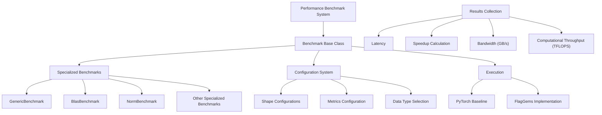
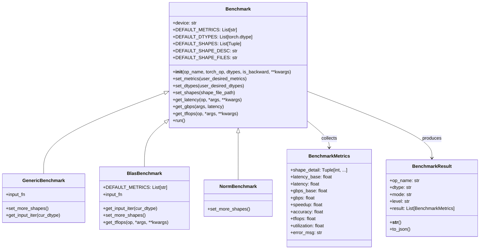
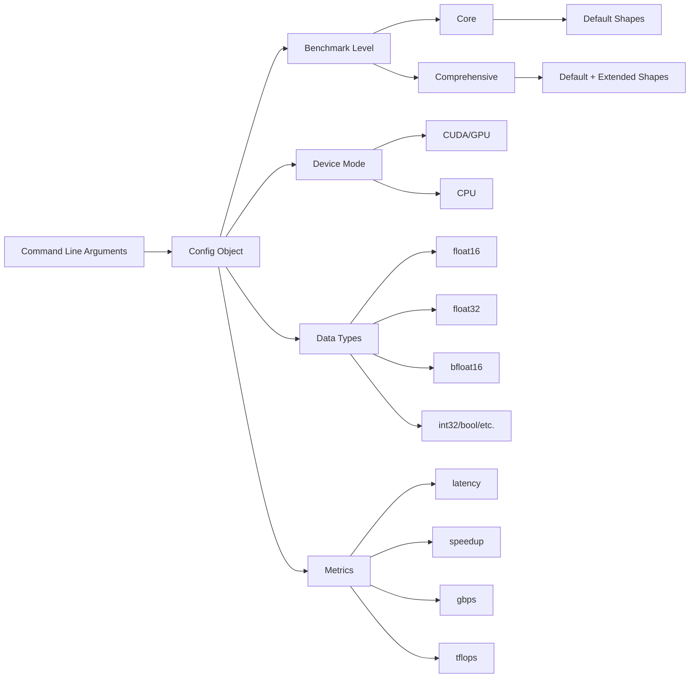
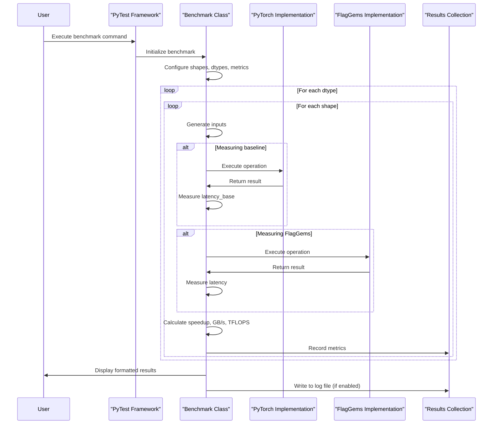
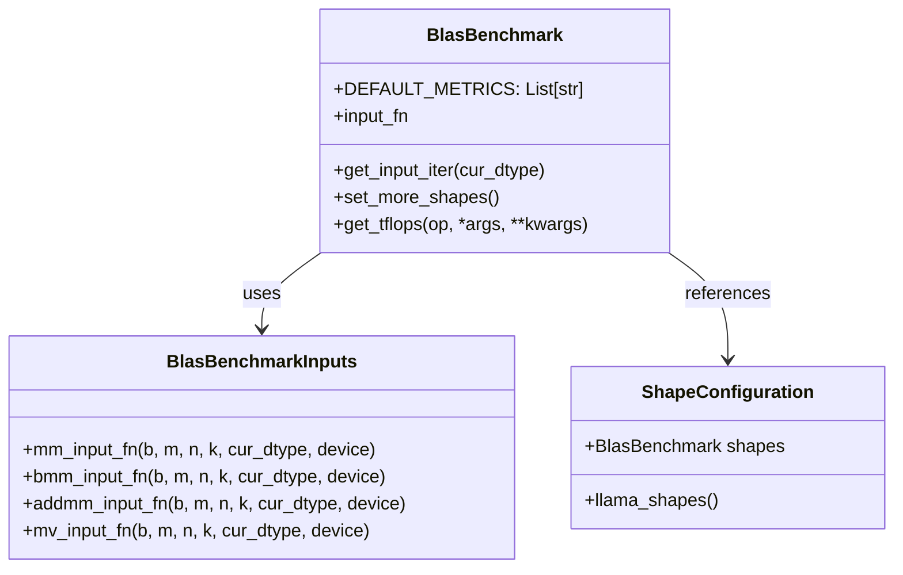
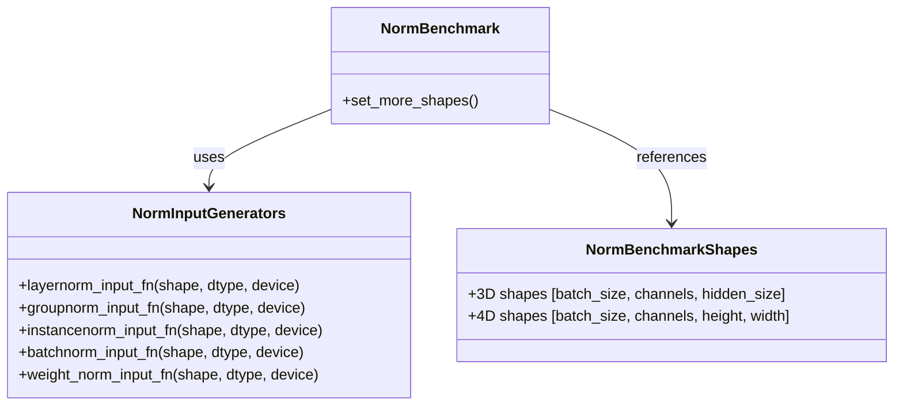

<!-- source: DeepWiki mcp.deepwiki.com · repo FlagOpen/FlagGems · page 5.2 Performance Benchmarking · fetched 2026-10-21 -->

# Performance Benchmarking

<details>
<summary>Relevant source files</summary>

The following files were used as context for generating this wiki page:

- [.gitattributes](.gitattributes)
- [benchmark/attri_util.py](benchmark/attri_util.py)
- [benchmark/conftest.py](benchmark/conftest.py)
- [benchmark/core_shapes.yaml](benchmark/core_shapes.yaml)
- [benchmark/performance_utils.py](benchmark/performance_utils.py)
- [benchmark/summary_for_plot.py](benchmark/summary_for_plot.py)
- [benchmark/test_blas_perf.py](benchmark/test_blas_perf.py)
- [benchmark/test_fused_perf.py](benchmark/test_fused_perf.py)
- [benchmark/test_norm_perf.py](benchmark/test_norm_perf.py)
- [benchmark/test_tensor_concat_perf.py](benchmark/test_tensor_concat_perf.py)
- [src/flag_gems/fused/topk_softmax.py](src/flag_gems/fused/topk_softmax.py)
- [src/flag_gems/ops/addmv.py](src/flag_gems/ops/addmv.py)

</details>


This document details the performance benchmarking system used in FlagGems to evaluate operation speed and efficiency across different hardware targets. For accuracy testing information, see [Accuracy Testing](#5.1).

## Overview

The FlagGems benchmarking framework provides tools to measure the performance of optimized operations compared to their PyTorch equivalents. It allows users to benchmark operations across different data types, shapes, and hardware backends, collecting metrics such as latency, speedup, throughput, and computational efficiency.



Sources: [benchmark/performance_utils.py:63-391](benchmark/performance_utils.py), [benchmark/attri_util.py:54-90](benchmark/attri_util.py)

## Benchmark Architecture

The benchmarking system is built around a core `Benchmark` class that implements the common functionality, with specialized subclasses for different operation types. The framework performs apples-to-apples comparisons between PyTorch and FlagGems implementations under identical conditions.



Sources: [benchmark/performance_utils.py:63-390](benchmark/performance_utils.py), [benchmark/attri_util.py:52-262](benchmark/attri_util.py)

## Core Benchmark Components

### Benchmark Base Class

The `Benchmark` class ([benchmark/performance_utils.py:63-390]()) serves as the foundation of the benchmarking system with these key functions:

1. **Configuration**: Setup of shapes, data types, and metrics
2. **Execution**: Running PyTorch and FlagGems implementations
3. **Measurement**: Timing operations and calculating metrics
4. **Reporting**: Formatting and displaying results

### Key Methods

- `get_latency(op, *args, **kwargs)`: Measures the execution time of an operation
- `get_gbps(args, latency)`: Calculates memory bandwidth
- `get_tflops(op, *args, **kwargs)`: Estimates computational throughput
- `run()`: Executes the benchmark workflow
 
Sources: [benchmark/performance_utils.py:63-270](benchmark/performance_utils.py)

### Specialized Benchmark Classes

FlagGems provides multiple specialized benchmark classes for different operation types:

| Benchmark Class | Purpose | Key Features |
|-----------------|---------|--------------|
| `GenericBenchmark` | General-purpose operations | Customizable input generation |
| `BlasBenchmark` | Matrix/vector operations | TFLOPS calculation, specialized shapes |
| `NormBenchmark` | Normalization operations | Special shapes for 3D/4D tensors |
| `ConcatBenchmark` | Tensor concatenation | Multiple tensor inputs |
| `TensorRepeatBenchmark` | Tensor repetition ops | Memory-sensitive operations |

Sources: [benchmark/performance_utils.py:392-488](benchmark/performance_utils.py), [benchmark/test_blas_perf.py:20-83](benchmark/test_blas_perf.py), [benchmark/test_norm_perf.py:16-30](benchmark/test_norm_perf.py), [benchmark/test_tensor_concat_perf.py:16-33](benchmark/test_tensor_concat_perf.py)

## Benchmark Metrics

The benchmark system collects several performance metrics:

| Metric | Description | Usage |
|--------|-------------|-------|
| `latency_base` | Baseline PyTorch latency (ms) | Measures native PyTorch performance |
| `latency` | FlagGems implementation latency (ms) | Measures optimized implementation performance |
| `speedup` | Ratio of baseline to FlagGems latency | Direct comparison between implementations |
| `gbps` | Memory throughput (GB/s) | Memory-bound operation efficiency |
| `tflops` | Computational throughput (TFLOPS) | Compute-bound operation efficiency |

These metrics can be configured via command-line arguments, allowing users to focus on specific aspects of performance.

Sources: [benchmark/attri_util.py:54-90](benchmark/attri_util.py), [benchmark/performance_utils.py:108-134](benchmark/performance_utils.py)

## Shape Configuration

Operation shapes are defined in YAML configuration files, with core shapes specified in `core_shapes.yaml`. This allows for consistent testing across different operations.

Example shape definitions:

```yaml
UnaryPointwiseBenchmark:
  shapes:
    - [1073741824,]  # 1024 * 1024 * 1024
    - [64, 64]
    - [4096, 4096]
    - [64, 512, 512]
    - [1024, 1024, 1024]
  shape_desc: "(B), M, N"

BlasBenchmark:
  shapes:
    - [2, 4096, 4096, 4096]
    - [16, 384, 384, 384]
    - [16, 1024, 1024, 1024]
    - [16, 2048, 2048, 2048]
    - [16, 4096, 4096, 4096]
  shape_desc: "B, M, N, K"   # shapes are defined as (B, M, N, K)
```

Benchmarks can also define additional shapes via the `set_more_shapes()` method, allowing for comprehensive testing across a range of sizes.

Sources: [benchmark/core_shapes.yaml:1-218](benchmark/core_shapes.yaml), [benchmark/performance_utils.py:155-203](benchmark/performance_utils.py)

## Running Benchmarks

### Command Line Options

The benchmarking system provides numerous command-line options to customize the benchmark execution:

| Option | Description | Example |
|--------|-------------|---------|
| `--mode` | Measurement mode (CPU or device) | `--mode cuda` |
| `--level` | Benchmark level (comprehensive or core) | `--level core` |
| `--warmup` | Number of warmup iterations | `--warmup 100` |
| `--iter` | Number of measurement iterations | `--iter 500` |
| `--metrics` | Metrics to measure | `--metrics latency speedup` |
| `--dtypes` | Data types to test | `--dtypes float16 float32` |
| `--shape_file` | Custom shape file | `--shape_file custom_shapes.yaml` |
| `--record` | Record results to log file | `--record log` |

Sources: [benchmark/conftest.py:48-130](benchmark/conftest.py)

### Benchmark Levels

Two benchmark levels are supported:

1. **Core**: Tests a smaller set of representative shapes for quicker testing
2. **Comprehensive**: Tests additional shapes for more thorough evaluation



Sources: [benchmark/attri_util.py:137-140](benchmark/attri_util.py), [benchmark/conftest.py:27-45](benchmark/conftest.py)

### Example Commands

To run a benchmark for BLAS operations:

```bash
pytest benchmark/test_blas_perf.py --level core --record log
```

To run benchmarks for specific operations:

```bash
pytest benchmark/test_norm_perf.py::test_group_and_layer_and_instance_norm_benchmark -k "layer_norm"
```

To specify custom metrics and data types:

```bash
pytest benchmark/test_fused_perf.py --metrics latency speedup tflops --dtypes float16 float32
```

Sources: [benchmark/summary_for_plot.py:3-26](benchmark/summary_for_plot.py)

## Benchmark Execution Workflow

The benchmark execution follows a well-defined workflow:



Sources: [benchmark/performance_utils.py:326-390](benchmark/performance_utils.py)

## Analyzing Benchmark Results

Benchmark results are displayed in a formatted table showing metrics for each shape and data type:

```
Operator: layer_norm  Performance Test (dtype=torch.float32, mode=cuda,level=comprehensive)
Status        Torch Latency (ms)      Gems Latency (ms)         Gems Speedup        Size Detail
-------------------------------------------------------------------------------------------
SUCCESS           0.039417               0.025598                 1.540          ([16, 16, 128], [128], tensor([128]), tensor([128]))
SUCCESS           0.049971               0.027301                 1.830          ([16, 16, 64], [64], tensor([64]), tensor([64]))
SUCCESS           0.048458               0.029606                 1.637          ([16, 16, 1024], [1024], tensor([1024]), tensor([1024]))
SUCCESS           0.087453               0.049706                 1.760          ([16, 16, 4098], [4098], tensor([4098]), tensor([4098]))
```

The benchmark system also includes a summary script (`summary_for_plot.py`) that can process log files to generate aggregate results across operations and data types.

Example summary output:

```
op_name                         float16_speedup         float32_speedup         bfloat16_speedup        int16_speedup          int32_speedup          bool_speedup           cfloat_speedup         all_tests_passed     
layer_norm                      1.823401                1.691730                1.774554                0.000000                0.000000                0.000000                0.000000               yes                  
gelu_and_mul                    2.541023                2.103564                2.444980                0.000000                0.000000                0.000000                0.000000               yes                  
mm                              1.475634                1.221049                1.391832                0.000000                0.000000                0.000000                0.000000               yes
```

Sources: [benchmark/attri_util.py:166-235](benchmark/attri_util.py), [benchmark/summary_for_plot.py:44-97](benchmark/summary_for_plot.py)

## Example: BLAS Benchmarking Implementation

The BLAS benchmarking implementation demonstrates a specialized benchmark class for matrix operations:



This class extends the base `Benchmark` class with BLAS-specific functionality:

- Enhanced metrics, including TFLOPS
- BLAS-specific shape configurations
- Special input generation for matrix operations
- Operation-specific TFLOPS calculation

Sources: [benchmark/test_blas_perf.py:20-137](benchmark/test_blas_perf.py), [benchmark/attri_util.py:33-51](benchmark/attri_util.py)

## Example: Normalization Benchmarking Implementation

Normalization operations require specialized handling for their unique tensor shapes and parameters:



The `NormBenchmark` class includes 3D and 4D tensor shapes common in deep learning models, with specialized input functions for each normalization type:

- Layer normalization
- Group normalization
- Instance normalization
- Batch normalization
- Weight normalization

Sources: [benchmark/test_norm_perf.py:16-193](benchmark/test_norm_perf.py), [src/flag_gems/runtime/backend/_kunlunxin/ops/layernorm.py:15-434](src/flag_gems/runtime/backend/_kunlunxin/ops/layernorm.py)

## Extending the Benchmarking System

To benchmark new operations, users can follow these steps:

1. Create an input generator function
2. Choose an appropriate benchmark class (or create a new one)
3. Register the benchmark with pytest

For example, to benchmark a new pointwise operation:

```python
def new_op_input_fn(shape, dtype, device):
    # Generate appropriate inputs
    inp1 = generate_tensor_input(shape, dtype, device)
    inp2 = generate_tensor_input(shape, dtype, device) 
    yield inp1, inp2

@pytest.mark.new_op
def test_new_op_benchmark():
    bench = GenericBenchmark(
        input_fn=new_op_input_fn,
        op_name="new_op",
        torch_op=torch.new_op,
        dtypes=FLOAT_DTYPES
    )
    bench.run()
```

For operations with complex input requirements or specialized metrics, users can create custom benchmark classes by inheriting from the base `Benchmark` class.

Sources: [benchmark/test_fused_perf.py:1-99](benchmark/test_fused_perf.py)

## Conclusion

The FlagGems performance benchmarking system provides a comprehensive framework for evaluating the performance of optimized operations against their PyTorch equivalents. By supporting a wide range of metrics, data types, and hardware targets, it enables users to make informed decisions about which optimizations will benefit their specific workloads.

For more information on specific topics:
- For testing accuracy of operations, see [Accuracy Testing](#5.1)
- For detailed information about optimized operations, see [Operations](#3)
- For hardware-specific optimizations, see [Hardware Backends](#4)

---

