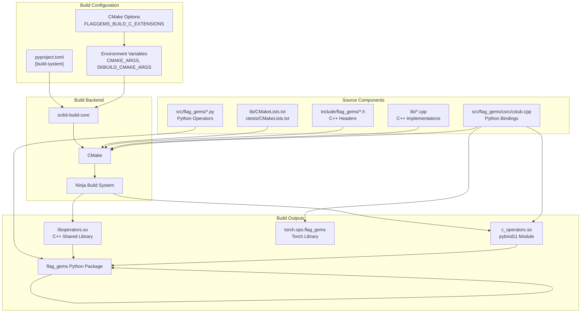
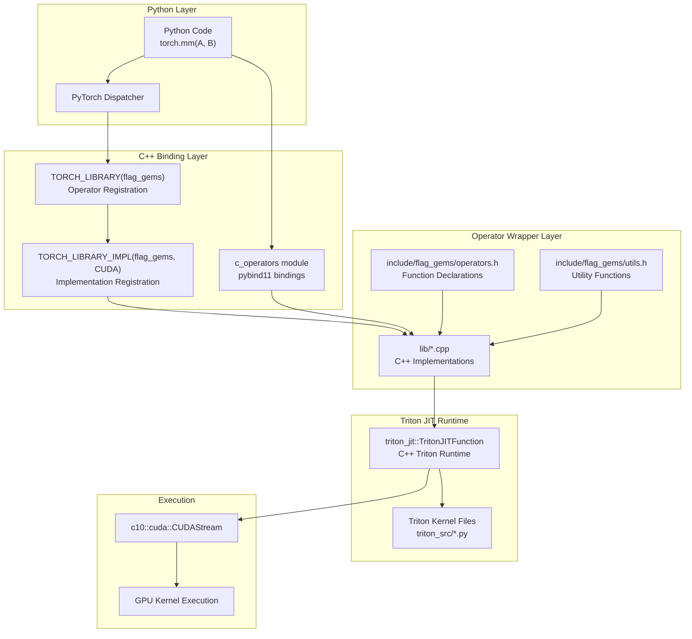
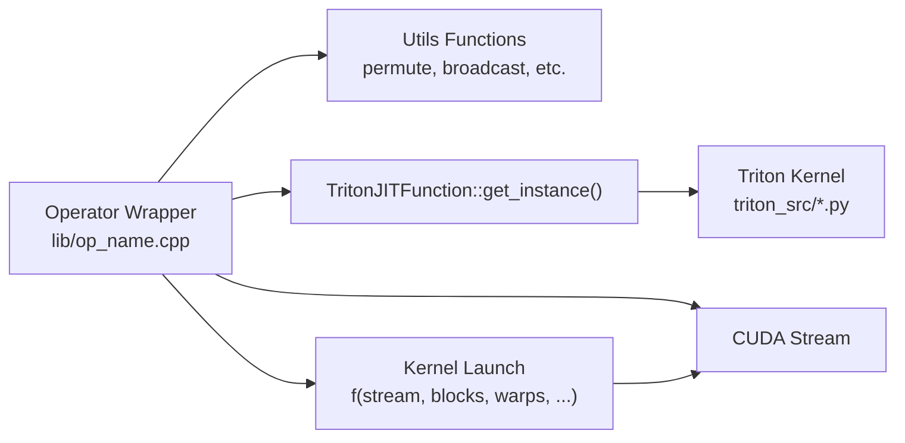
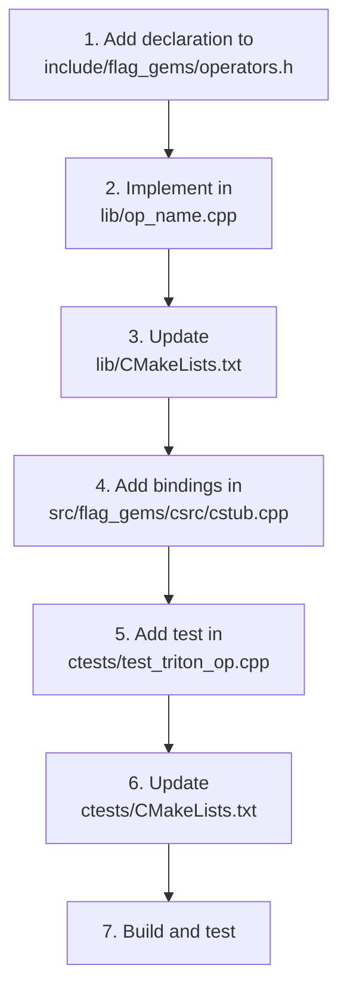
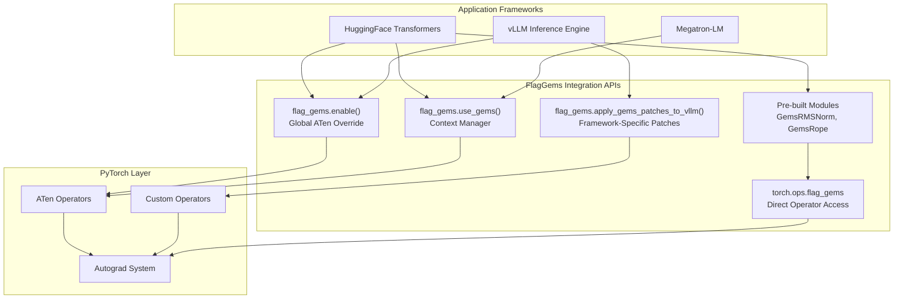
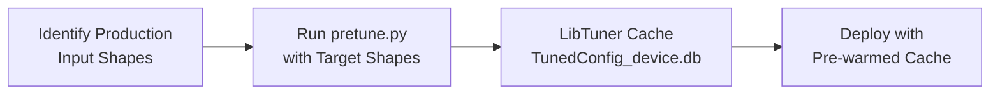
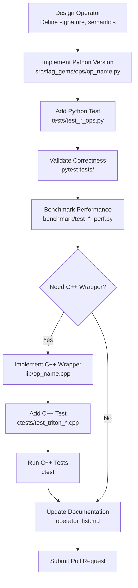

<!-- source: DeepWiki mcp.deepwiki.com · repo FlagOpen/FlagGems · page 6 Advanced Topics · fetched 2026-10-21 -->

# Advanced Topics

<details>
<summary>Relevant source files</summary>

The following files were used as context for generating this wiki page:

- [README.md](README.md)
- [README_cn.md](README_cn.md)
- [ctests/CMakeLists.txt](ctests/CMakeLists.txt)
- [ctests/test_triton_reduction.cpp](ctests/test_triton_reduction.cpp)
- [ctests/test_triton_rwkv_ka_fusion.cpp](ctests/test_triton_rwkv_ka_fusion.cpp)
- [ctests/test_triton_rwkv_mm_sparsity.cpp](ctests/test_triton_rwkv_mm_sparsity.cpp)
- [docs/add_a_cpp_wrapper.md](docs/add_a_cpp_wrapper.md)
- [docs/get_start_with_flaggems.md](docs/get_start_with_flaggems.md)
- [docs/how_to_use_flaggems.md](docs/how_to_use_flaggems.md)
- [docs/index.md](docs/index.md)
- [docs/installation.md](docs/installation.md)
- [docs/pointwise_dynamic.md](docs/pointwise_dynamic.md)
- [examples/integration_gems_with_vllm.py](examples/integration_gems_with_vllm.py)
- [include/flag_gems/operators.h](include/flag_gems/operators.h)
- [include/flag_gems/utils.h](include/flag_gems/utils.h)
- [lib/CMakeLists.txt](lib/CMakeLists.txt)
- [lib/rwkv_ka_fusion.cpp](lib/rwkv_ka_fusion.cpp)
- [lib/rwkv_mm_sparsity.cpp](lib/rwkv_mm_sparsity.cpp)
- [lib/utils.cpp](lib/utils.cpp)
- [mkdocs.yml](mkdocs.yml)
- [pyproject.toml](pyproject.toml)
- [src/flag_gems/csrc/cstub.cpp](src/flag_gems/csrc/cstub.cpp)
- [src/flag_gems/ops/sqrt.py](src/flag_gems/ops/sqrt.py)

</details>


This page covers advanced usage patterns, extension mechanisms, and integration strategies for power users and contributors. The material here is intended for users who need deeper control over FlagGems behavior, want to integrate with specific frameworks, extend the library with new operators, or contribute to the codebase.

For basic usage patterns and operator reference, see [Overview](#1). For testing and validation, see [Testing and Validation](#5).

---

## Build System and Configuration

FlagGems supports two installation modes: pure Python and C++ extensions. The build system is based on modern Python packaging standards and CMake for C++ components.

### Build Backend Architecture

The build process follows PEP 517/518 standards using `scikit-build-core` as the build backend, which bridges CMake and Python packaging.



**Sources:** [pyproject.toml:1-59](), [lib/CMakeLists.txt:1-53](), [docs/installation.md:17-95]()

### CMake Configuration Options

The following CMake options control the build process:

| Option | Description | Default |
|--------|-------------|---------|
| `FLAGGEMS_BUILD_C_EXTENSIONS` | Enable C++ extension building | OFF (pure Python) |
| `FLAGGEMS_USE_EXTERNAL_TRITON_JIT` | Use external TritonJIT library | OFF |
| `FLAGGEMS_USE_EXTERNAL_PYBIND11` | Use external pybind11 | ON |
| `FLAGGEMS_BUILD_CTESTS` | Build C++ unit tests | Same as C_EXTENSIONS |
| `FLAGGEMS_INSTALL` | Install CMake package files | ON (top-level) |

**Sources:** [docs/installation.md:54-62]()

### Build Commands

```bash
# Pure Python installation
pip install --no-build-isolation .

# C++ extensions with embedded TritonJIT
CMAKE_ARGS="-DFLAGGEMS_BUILD_C_EXTENSIONS=ON" \
pip install --no-build-isolation -v -e .

# C++ extensions with external TritonJIT
CMAKE_ARGS="-DFLAGGEMS_BUILD_C_EXTENSIONS=ON \
            -DFLAGGEMS_USE_EXTERNAL_TRITON_JIT=ON \
            -DTritonJIT_ROOT=/path/to/tritonjit" \
pip install --no-build-isolation -v -e .
```

**Sources:** [docs/installation.md:80-94](), [README.md:48-51]()

---

## C++ Extension Architecture

The C++ extension layer provides reduced Python overhead for operator dispatch and execution. It consists of operator wrappers, PyTorch library registration, and Python bindings.

### C++ Runtime Components



**Sources:** [src/flag_gems/csrc/cstub.cpp:1-118](), [include/flag_gems/operators.h:1-109](), [lib/rwkv_mm_sparsity.cpp:1-38]()

### Operator Registration Mechanism

FlagGems uses PyTorch's `TORCH_LIBRARY` mechanism to register operators in the `flag_gems` namespace. Two registration macros are used:

1. **TORCH_LIBRARY(flag_gems, m)** - Defines operator schemas
2. **TORCH_LIBRARY_IMPL(flag_gems, CUDA, m)** - Provides CUDA implementations

Example registration pattern:

```cpp
// In src/flag_gems/csrc/cstub.cpp
TORCH_LIBRARY(flag_gems, m) {
  m.def("sum(Tensor self, *, ScalarType? dtype=None) -> Tensor");
  m.def("rms_norm(Tensor input, Tensor weight, float epsilon) -> Tensor");
  m.def("rotary_embedding(Tensor q, Tensor k, Tensor cos, Tensor sin, "
        "Tensor? position_ids=None, bool rotary_interleaved=False) -> (Tensor, Tensor)");
}

TORCH_LIBRARY_IMPL(flag_gems, CUDA, m) {
  m.impl("sum", TORCH_FN(sum));
  m.impl("rms_norm", TORCH_FN(rms_norm));
  m.impl("rotary_embedding", TORCH_FN(rotary_embedding));
}
```

Operators can then be called via `torch.ops.flag_gems`:

```python
output = torch.ops.flag_gems.rms_norm(input, weight, 1e-5)
q_out, k_out = torch.ops.flag_gems.rotary_embedding(q, k, cos, sin)
```

**Sources:** [src/flag_gems/csrc/cstub.cpp:26-116](), [docs/how_to_use_flaggems.md:421-429]()

### C++ Wrapper Implementation Pattern

Each C++ wrapper follows a standard pattern:



Implementation structure (example from `rwkv_mm_sparsity.cpp`):

```cpp
at::Tensor rwkv_mm_sparsity(const at::Tensor &k, const at::Tensor &v) {
  // 1. Extract input metadata
  at::IntArrayRef k_sizes = k.sizes();
  at::IntArrayRef v_sizes = v.sizes();
  
  // 2. Allocate output
  at::Tensor out = at::empty({v_sizes[1]}, k.options());
  
  // 3. Get Triton JIT function
  const TritonJITFunction &f = TritonJITFunction::get_instance(
      std::string(utils::get_flag_gems_src_path() / "fused" / "rwkv_mm_sparsity.py"),
      "rwkv_mm_sparsity_kernel");
  
  // 4. Calculate launch configuration
  int64_t block_size = 16;
  const int num_warps = 4;
  const int num_stages = 8;
  const unsigned int num_blocks = (v_sizes[1] + block_size - 1) / block_size;
  
  // 5. Get CUDA stream and launch
  c10::cuda::CUDAStream stream = c10::cuda::getCurrentCUDAStream();
  c10::DeviceGuard guard(out.device());
  CUstream raw_stream = static_cast<CUstream>(stream.stream());
  f(raw_stream, num_blocks, 1, 1, num_warps, num_stages, 
    k, v, out, v_sizes[1], blk_size, k_size, block_size);
    
  return out;
}
```

**Sources:** [lib/rwkv_mm_sparsity.cpp:10-35](), [lib/rwkv_ka_fusion.cpp:10-66]()

### Utility Functions

The `flag_gems::utils` namespace provides helper functions for common operations:

| Function | Purpose |
|----------|---------|
| `get_path_of_this_library()` | Resolve library installation path |
| `get_triton_src_path()` | Locate Triton kernel sources |
| `get_flag_gems_src_path()` | Locate FlagGems Python sources |
| `next_power_of_2(n)` | Round up to next power of 2 |
| `broadcastable_to(s1, s2)` | Check shape broadcastability |
| `permute_reduction_axes_right(tensor, axes)` | Reorder reduction dimensions |
| `parse_reduction_axes(tensor, axis)` | Parse reduction metadata |

**Sources:** [include/flag_gems/utils.h:13-26](), [lib/utils.cpp:1-160]()

### Adding a New C++ Wrapper

The process for adding a new C++ operator wrapper:



**Example declaration:**
```cpp
// include/flag_gems/operators.h
namespace flag_gems {
  at::Tensor my_operator(const at::Tensor &input, double epsilon);
}
```

**Example implementation:**
```cpp
// lib/my_operator.cpp
#include "flag_gems/operators.h"
#include "flag_gems/utils.h"
#include "triton_jit/triton_jit_function.h"

namespace flag_gems {
  at::Tensor my_operator(const at::Tensor &input, double epsilon) {
    // Implementation following the pattern above
  }
}
```

**Example CMake update:**
```cmake
# lib/CMakeLists.txt
add_library(operators SHARED
  # ... existing files
  my_operator.cpp
)
```

**Example bindings:**
```cpp
// src/flag_gems/csrc/cstub.cpp
PYBIND11_MODULE(c_operators, m) {
  m.def("my_operator", &flag_gems::my_operator);
}

TORCH_LIBRARY(flag_gems, m) {
  m.def("my_operator(Tensor input, float epsilon) -> Tensor");
}

TORCH_LIBRARY_IMPL(flag_gems, CUDA, m) {
  m.impl("my_operator", TORCH_FN(my_operator));
}
```

**Sources:** [docs/add_a_cpp_wrapper.md:1-27](), [lib/CMakeLists.txt:1-27]()

### C++ Unit Testing

C++ tests use Google Test framework and are configured via CTest:

```cpp
// ctests/test_triton_my_operator.cpp
#include <gtest/gtest.h>
#include "flag_gems/operators.h"
#include "torch/torch.h"

TEST(my_operator_test, basic) {
  const torch::Device device(torch::kCUDA, 0);
  torch::Tensor input = torch::randn({32, 1024}, device);
  
  torch::Tensor out_torch = /* reference implementation */;
  torch::Tensor out_triton = flag_gems::my_operator(input, 1e-5);
  
  EXPECT_TRUE(torch::allclose(out_torch, out_triton, 1e-5, 1e-8));
}
```

**Sources:** [ctests/test_triton_reduction.cpp:1-181](), [ctests/CMakeLists.txt:1-89]()

---

## Framework Integration Patterns

FlagGems provides multiple integration strategies for popular deep learning frameworks.

### Integration Architecture



**Sources:** [docs/how_to_use_flaggems.md:136-276](), [examples/integration_gems_with_vllm.py:1-67]()

### vLLM Integration

vLLM requires two-level integration: ATen operator override and custom operator patching.

**Integration steps:**

1. **Enable ATen operator replacement:**
```python
import flag_gems
flag_gems.enable()  # Overrides standard PyTorch operators
```

2. **Patch vLLM custom operators:**
```python
flag_gems.apply_gems_patches_to_vllm(verbose=True)
```

This patches internal vLLM functions:
- `RMSNorm.forward_cuda` → `custom_gems_rms_forward_cuda`
- `RotaryEmbedding.forward_cuda` → `custom_gems_rope_forward_cuda`
- `SiluAndMul.forward_cuda` → `custom_gems_silu_and_mul`

**Complete example:**
```python
from vllm import LLM, SamplingParams
import flag_gems

flag_gems.enable()
flag_gems.apply_gems_patches_to_vllm(verbose=True)

llm = LLM(model="Qwen/Qwen2.5-7B-Instruct", tensor_parallel_size=1)
sampling_params = SamplingParams(temperature=0.8, max_tokens=128)
output = llm.generate("Tell me a joke.", sampling_params)
```

**Multi-node deployment:** For distributed inference, workers must initialize FlagGems independently. Inject initialization code into worker scripts:

```python
# In vllm/v1/worker/gpu_model_runner.py or vllm/worker/model_runner.py
import os
if os.getenv("USE_FLAGGEMS", "false").lower() in ("1", "true", "yes"):
    try:
        import flag_gems
        flag_gems.enable()
        flag_gems.apply_gems_patches_to_vllm(verbose=True)
        logger.info("Successfully enabled flag_gems")
    except ImportError:
        logger.warning("Failed to import flag_gems")
```

Set environment variable across all nodes:
```bash
export USE_FLAGGEMS=1
```

**Sources:** [docs/how_to_use_flaggems.md:172-336](), [examples/integration_gems_with_vllm.py:9-12]()

### HuggingFace Transformers Integration

Transformers integration uses context managers for selective acceleration:

```python
from transformers import AutoModelForCausalLM, AutoTokenizer
import flag_gems

tokenizer = AutoTokenizer.from_pretrained("meta-llama/Llama-2-7b-hf")
model = AutoModelForCausalLM.from_pretrained("meta-llama/Llama-2-7b-hf")

device = flag_gems.device
model.to(device).eval()

inputs = tokenizer("Hello, my name is", return_tensors="pt").to(device)

# Enable FlagGems only during generation
with flag_gems.use_gems():
    output = model.generate(**inputs, max_length=100, num_beams=5)
```

**Sources:** [docs/how_to_use_flaggems.md:141-170]()

### Megatron-LM Integration

Megatron requires targeted integration at the training loop level due to tight coupling with distributed primitives.

**Recommended injection point:** Modify `train_step` in `megatron/training/training.py`:

```python
def train_step(forward_step_func, data_iterator, model, optimizer, ...):
    # ... setup code
    
    while rerun_state_machine.should_run_forward_backward(data_iterator):
        # Wrap forward_backward_func with FlagGems
        import flag_gems
        with flag_gems.use_gems():
            forward_backward_func = get_forward_backward_func()
            losses_reduced = forward_backward_func(
                forward_step_func=forward_step_func,
                data_iterator=data_iterator,
                model=model,
                # ... other parameters
            )
    
    # ... post-step operations
```

**Why context manager instead of global enable?** Megatron's data loading and optimizer steps may conflict with global operator override. Context manager limits acceleration to computation stages.

**Sources:** [docs/how_to_use_flaggems.md:222-276]()

### Pre-built Module Usage

FlagGems provides PyTorch `nn.Module` subclasses for direct model construction:

| Module | Description | Features |
|--------|-------------|----------|
| `GemsRMSNorm` | RMS Layer Normalization | Fused residual add, inplace/outplace |
| `GemsRope` | Rotary Position Embedding | Standard RoPE, inplace/outplace |
| `GemsDeepseekYarnRoPE` | DeepSeek-style RoPE with extrapolation | Inplace/outplace |
| `GemsSiluAndMul` | Fused SiLU + multiplication | Outplace only |

**Example usage:**
```python
from flag_gems.modules import GemsRMSNorm, GemsRope

# In model definition
self.norm = GemsRMSNorm(hidden_size, eps=1e-5)
self.rope = GemsRope(dim=64, max_position_embeddings=2048)

# In forward pass
normalized = self.norm(hidden_states)
q_rot, k_rot = self.rope(q, k, position_ids)
```

**Sources:** [docs/how_to_use_flaggems.md:337-356]()

---

## Performance Optimization Strategies

### Pre-tuning for Production Deployment

FlagGems uses `LibTuner` for persistent autotuning cache. Pre-tuning eliminates first-run latency spikes.

**Pre-tuning workflow:**



**Example pre-tuning script:**
```python
# examples/pretune.py
import torch
import flag_gems

flag_gems.enable()

# Define representative shapes
shapes = [
    (1024, 1024, 1024),  # Batch matmul shapes
    (2048, 4096),        # Large linear layers
    (4096, 4096, 128),   # Attention shapes
]

for M, N, K in shapes:
    A = torch.randn(M, K, device='cuda', dtype=torch.float16)
    B = torch.randn(K, N, device='cuda', dtype=torch.float16)
    
    # Trigger autotuning
    torch.mm(A, B)
```

Cache location: `~/.flaggems/libtuner_cache/TunedConfig_<device>.db`

**vLLM automatic pre-tuning:** vLLM's `--compile-mode` (≥v0.8.5) performs warmup, which triggers LibTuner autotuning if FlagGems is enabled.

**Sources:** [docs/how_to_use_flaggems.md:366-393]()

### C++ Operator Dispatch

C++ wrappers reduce Python overhead in operator dispatch:

**Performance comparison:**

| Path | Overhead | Use Case |
|------|----------|----------|
| Python `flag_gems.enable()` | ~10-50μs per call | Development, testing |
| C++ `torch.ops.flag_gems` | ~1-5μs per call | Production, latency-critical |

**Verification of C++ support:**
```python
try:
    from flag_gems import c_operators
    has_c_extension = True
except ImportError:
    has_c_extension = False
```

**Explicit C++ dispatch:**
```python
# Direct C++ operator access
output = torch.ops.flag_gems.fused_add_rms_norm(input, residual, weight, 1e-5)
q_out, k_out = torch.ops.flag_gems.rotary_embedding(q, k, cos, sin)
```

**Automatic C++ usage:** When C++ extensions are installed, `flag_gems.apply_gems_patches_to_vllm()` and `GemsRMSNorm` modules automatically prefer C++ implementations.

**Sources:** [docs/how_to_use_flaggems.md:394-446]()

---

## Development Workflow

### Project Structure

```
FlagGems/
├── src/flag_gems/          # Python operator library
│   ├── ops/                # Operator implementations
│   ├── fused/              # Fused operators
│   ├── modules/            # Pre-built nn.Modules
│   ├── runtime/            # Runtime utilities
│   └── csrc/               # Python bindings (cstub.cpp)
├── include/flag_gems/      # C++ headers
│   ├── operators.h         # Operator declarations
│   └── utils.h             # Utility declarations
├── lib/                    # C++ implementations
│   └── *.cpp               # Operator wrappers
├── triton_src/             # Triton kernels for C++ runtime
├── ctests/                 # C++ unit tests
├── tests/                  # Python unit tests
├── benchmark/              # Performance benchmarks
└── examples/               # Integration examples
```

**Sources:** Repository structure

### Operator Development Workflow



**Sources:** [docs/add_a_cpp_wrapper.md:1-27]()

### Python Operator Template

**Example: Implementing a pointwise operator**

```python
# src/flag_gems/ops/sqrt.py
import logging
import triton
import triton.language as tl
from flag_gems.utils import pointwise_dynamic

logger = logging.getLogger(__name__)

@pointwise_dynamic(promotion_methods=[(0, "INT_TO_FLOAT")])
@triton.jit
def sqrt_func(x):
    return tl.sqrt(x.to(tl.float32))

def sqrt(A):
    logger.debug("GEMS SQRT")
    return sqrt_func(A)

def sqrt_(A):
    logger.debug("GEMS SQRT_")
    sqrt_func(A, out0=A)
    return A
```

**Key components:**
1. `@pointwise_dynamic` decorator handles code generation
2. `@triton.jit` marks Triton kernel
3. Public functions provide torch-compatible API
4. Inplace variant uses `out0=A` pattern

**Sources:** [src/flag_gems/ops/sqrt.py:1-26]()

### Testing Requirements

**Python tests:**
- Location: `tests/test_*_ops.py`
- Framework: pytest
- Pattern: Compare against PyTorch reference
- Run: `pytest tests/test_unary_pointwise_ops.py`

**C++ tests:**
- Location: `ctests/test_triton_*.cpp`
- Framework: Google Test + CTest
- Pattern: Compare against PyTorch ATen
- Run: `cd build && ctest -R test_triton_reduction`

**Benchmark tests:**
- Location: `benchmark/test_*_perf.py`
- Framework: Custom benchmark harness
- Metrics: Latency, speedup, TFLOPS, GBPS
- Run: `pytest benchmark/test_blas_perf.py --verbose`

**Sources:** [ctests/test_triton_reduction.cpp:1-181]()

### Environment Configuration

**Key environment variables:**

| Variable | Purpose | Example |
|----------|---------|---------|
| `GEMS_VENDOR` | Override backend detection | `export GEMS_VENDOR=nvidia` |
| `FLAGGEMS_SOURCE_DIR` | C++ runtime kernel location | Set during build |
| `CMAKE_ARGS` | Pass options to CMake | `-DFLAGGEMS_BUILD_C_EXTENSIONS=ON` |
| `SKBUILD_CMAKE_ARGS` | Alternative CMake args syntax | Same as CMAKE_ARGS with `;` separator |

**Sources:** [lib/utils.cpp:35-44](), [docs/installation.md:50-53]()

### Contribution Checklist

Before submitting a pull request:

- [ ] Operator implementation passes accuracy tests
- [ ] Performance benchmark shows improvement over PyTorch
- [ ] C++ wrapper added (if applicable)
- [ ] C++ tests pass (if C++ wrapper added)
- [ ] Documentation updated
- [ ] Code follows project style guidelines
- [ ] PR includes performance data

**Sources:** [docs/add_a_cpp_wrapper.md:24-27](), [README.md:117-119]()

---

## Backend Vendor Support

FlagGems supports multiple hardware vendors through automatic detection and vendor-specific implementations.

### Vendor Detection Mechanism

Backend detection occurs at import time:

```python
import flag_gems
print(flag_gems.vendor_name)  # Outputs: "nvidia", "kunlunxin", etc.
```

Manual override via environment variable:
```bash
export GEMS_VENDOR=nvidia  # Force specific backend
```

**Sources:** [docs/how_to_use_flaggems.md:116-134]()

### Supported Platforms

| Vendor | Status | FP16 | FP32 | BF16 |
|--------|--------|------|------|------|
| NVIDIA | ✅ Full | ✅ | ✅ | ✅ |
| Kunlunxin | ✅ Full | ✅ | ✅ | ✅ |
| Cambricon | ✅ Full | ✅ | ✅ | ✅ |
| Hygon | ✅ Full | ✅ | ✅ | ✅ |
| Iluvatar | ✅ Full | ✅ | ✅ | ✅ |
| MetaX | ✅ Full | ✅ | ✅ | ✅ |
| MThreads | ✅ Full | ✅ | ✅ | ✅ |
| Ascend | ✅ Partial | ✅ | ✅ | ✅ |
| AIPU | ✅ Partial | ✅ | ✅ | ✅ |

**Requirements:** Each vendor requires compatible PyTorch and Triton builds. Contact vendor or use FlagTree project for unified Triton support.

**Sources:** [README.md:96-110](), [docs/how_to_use_flaggems.md:88-115]()

---

This page has covered the advanced aspects of FlagGems including build configuration, C++ extensions, framework integration patterns, performance optimization, and development workflows. For contributing new operators, see the development workflow section above and refer to existing implementations in [src/flag_gems/ops/]() for patterns.

---

