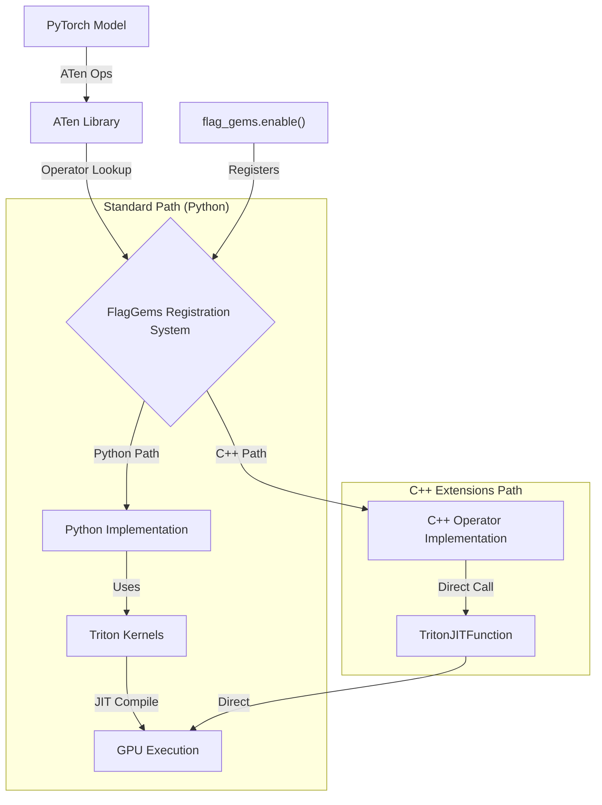
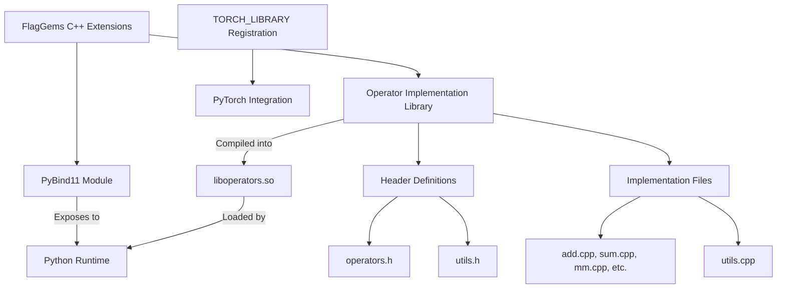
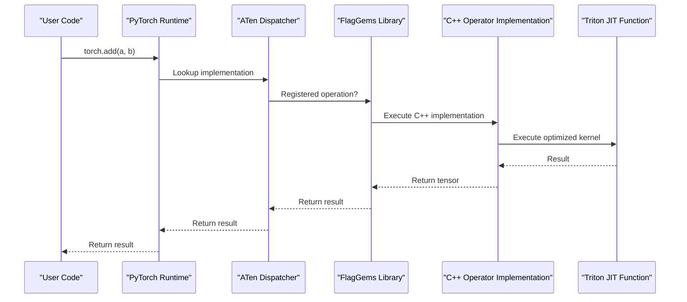
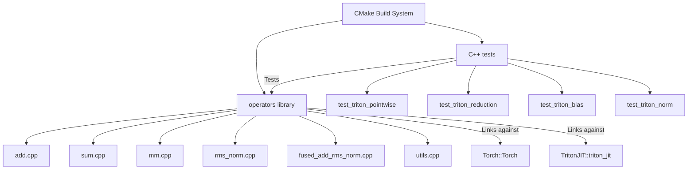

<!-- source: DeepWiki mcp.deepwiki.com · repo FlagOpen/FlagGems · page 6.1 C++ Extensions · fetched 2026-10-21 -->

# C++ Extensions

Relevant source files

The following files were used as context for generating this wiki page:

- [README.md](README.md)
- [README_cn.md](README_cn.md)
- [ctests/CMakeLists.txt](ctests/CMakeLists.txt)
- [ctests/test_triton_reduction.cpp](ctests/test_triton_reduction.cpp)
- [ctests/test_triton_rwkv_ka_fusion.cpp](ctests/test_triton_rwkv_ka_fusion.cpp)
- [ctests/test_triton_rwkv_mm_sparsity.cpp](ctests/test_triton_rwkv_mm_sparsity.cpp)
- [docs/add_a_cpp_wrapper.md](docs/add_a_cpp_wrapper.md)
- [docs/get_start_with_flaggems.md](docs/get_start_with_flaggems.md)
- [docs/how_to_use_flaggems.md](docs/how_to_use_flaggems.md)
- [docs/index.md](docs/index.md)
- [docs/installation.md](docs/installation.md)
- [docs/pointwise_dynamic.md](docs/pointwise_dynamic.md)
- [examples/integration_gems_with_vllm.py](examples/integration_gems_with_vllm.py)
- [include/flag_gems/operators.h](include/flag_gems/operators.h)
- [include/flag_gems/utils.h](include/flag_gems/utils.h)
- [lib/CMakeLists.txt](lib/CMakeLists.txt)
- [lib/rwkv_ka_fusion.cpp](lib/rwkv_ka_fusion.cpp)
- [lib/rwkv_mm_sparsity.cpp](lib/rwkv_mm_sparsity.cpp)
- [lib/utils.cpp](lib/utils.cpp)
- [mkdocs.yml](mkdocs.yml)
- [pyproject.toml](pyproject.toml)
- [src/flag_gems/csrc/cstub.cpp](src/flag_gems/csrc/cstub.cpp)
- [src/flag_gems/ops/sqrt.py](src/flag_gems/ops/sqrt.py)

The C++ Extensions system in FlagGems provides an alternative runtime implementation that significantly reduces the overhead associated with Python execution. This page details the architecture, implementation, and usage of the C++ Extensions mechanism in FlagGems.

For information about the core architecture and registration system, see [Core Architecture](#2) and [Registration System](#2.1).

## Purpose

The C++ Extensions system enables FlagGems to be installed and operated with native C++ implementations of key operators. While the standard Python implementation uses Triton kernels, the C++ Extensions provide an additional performance layer by:

1. Eliminating Python interpreter overhead
2. Providing direct integration with PyTorch's C++ backend
3. Reducing serialization/deserialization costs between Python and C++
4. Enabling more efficient memory management

Sources: [README.md:32-34]()

## Architecture

The C++ Extensions system is integrated with the broader FlagGems architecture but offers a direct path from PyTorch operations to optimized implementations, bypassing Python runtime overhead.

### Integration with FlagGems Architecture

Sources: [src/flag_gems/csrc/cstub.cpp:9-24](), [include/flag_gems/operators.h:1-18]()

### C++ Extensions Component Structure

Sources: [lib/CMakeLists.txt:1-32](), [src/flag_gems/csrc/cstub.cpp:1-25]()

## Implementation Details

### Operator Interface Definitions

The C++ Extensions define a clean interface in the `operators.h` header file, which provides function declarations for all implemented operators. These interfaces align with PyTorch's expected function signatures.

Key operators include:
- Basic arithmetic (add, mul, div)
- Matrix operations (mm, bmm)
- Reduction operations (sum, mean)
- Normalization operations (rms_norm, layer_norm)
- Fused operations (fused_add_rms_norm)

Sources: [include/flag_gems/operators.h:1-18]()

### PyTorch Integration Mechanism

FlagGems C++ Extensions use PyTorch's library registration system to make C++ implementations available to PyTorch's dispatcher. This is done through the `TORCH_LIBRARY` and `TORCH_LIBRARY_IMPL` macros.

Sources: [src/flag_gems/csrc/cstub.cpp:9-25]()

### Triton JIT Integration

The C++ Extensions use a `TritonJITFunction` class to interface with compiled Triton kernels. This provides a direct C++ to Triton bridge, eliminating Python overhead.

The workflow for a typical operator:
1. Define function signature and parameters in C++
2. Get Triton kernel instance using TritonJITFunction
3. Set up execution parameters (block size, warps, etc.)
4. Launch kernel on CUDA stream
5. Return resulting tensor

Sources: [lib/add.cpp:1-39](), [lib/sum.cpp:1-105]()

## Build System

The C++ Extensions use CMake for building the libraries and tests. The build system is responsible for:
1. Compiling C++ source files into a shared library
2. Setting up proper include paths
3. Linking against PyTorch and Triton
4. Installing headers and libraries
5. Configuring tests

Sources: [lib/CMakeLists.txt:1-32](), [ctests/CMakeLists.txt:1-19]()

## Utilities and Helper Functions

The C++ Extensions include utility functions to:
1. Locate the library at runtime
2. Find Triton source files
3. Perform mathematical operations required by kernel implementations

These utilities simplify the integration between C++ and Triton kernels.

Sources: [include/flag_gems/utils.h:1-16](), [lib/utils.cpp:1-46]()

## Performance Benefits

The C++ Extensions provide several performance advantages:

1. **Elimination of Python Overhead**: By implementing operators directly in C++, the system avoids Python interpreter overhead, GIL contention, and type conversions.

2. **Direct Memory Access**: C++ implementations can work directly with tensor memory without Python indirection.

3. **Efficient Dispatch**: The registration directly with PyTorch's ATen library provides a more efficient dispatch path.

4. **Reduced Serialization**: Data doesn't need to be serialized/deserialized between Python and C++ layers.

## Example: C++ Implementation of Addition Operator

The implementation of the `add_tensor` operator demonstrates the typical pattern for C++ Extensions in FlagGems:

1. Input tensors are broadcast to a common shape
2. Output tensor is created with the appropriate type and shape
3. Triton kernel is retrieved using TritonJITFunction
4. Execution parameters are configured
5. Kernel is launched on the CUDA stream
6. Result tensor is returned

Sources: [lib/add.cpp:1-39]()

## Adding New C++ Operators

To add a new C++ operator to FlagGems:

1. Define the operator interface in `include/flag_gems/operators.h`
2. Implement the operator in a new .cpp file in the `lib` directory
3. Add the implementation file to `lib/CMakeLists.txt`
4. Register the operator with PyTorch in `src/flag_gems/csrc/cstub.cpp`
5. Add tests in the `ctests` directory

## Conclusion

The C++ Extensions system in FlagGems provides a high-performance alternative to the Python implementation. By eliminating Python runtime overhead and directly integrating with PyTorch's C++ backend, it offers improved performance for critical operations in deep learning workloads.

---

