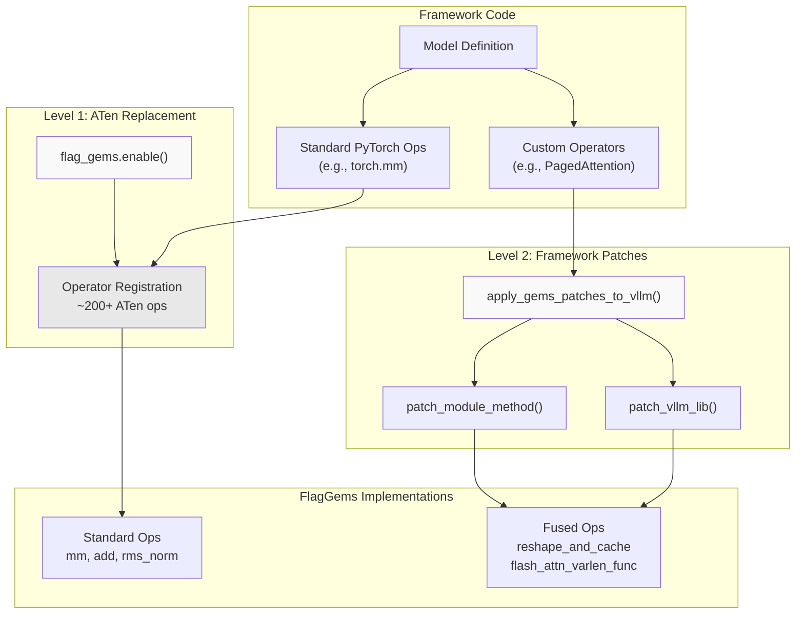
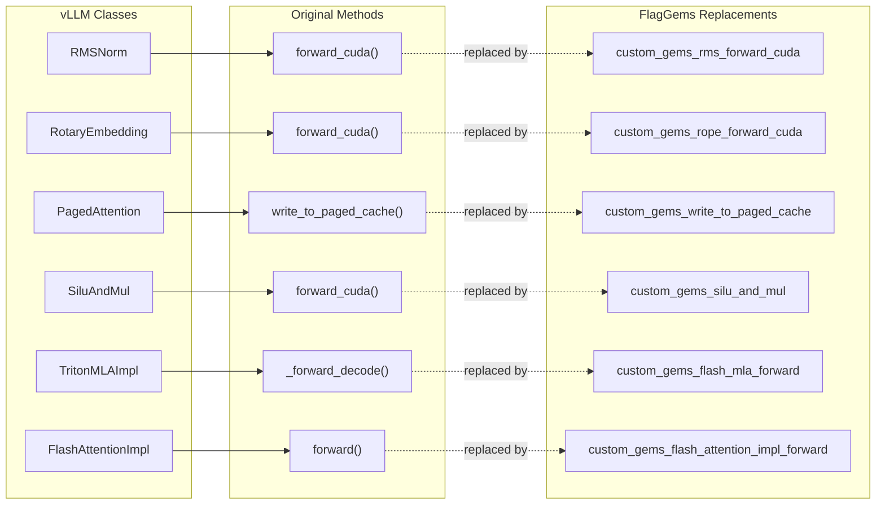
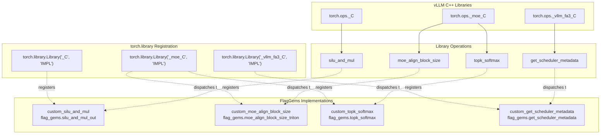
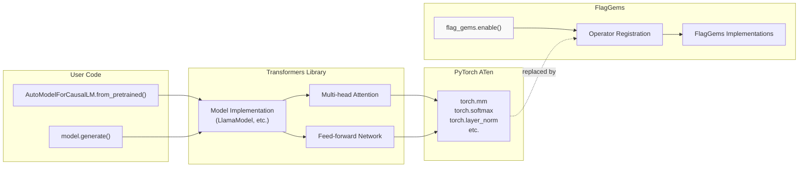
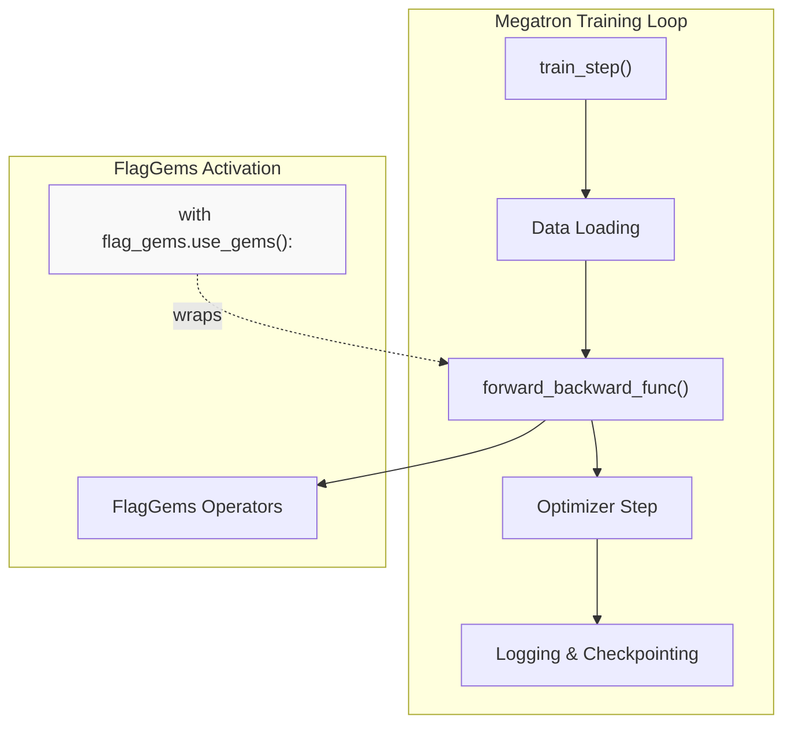
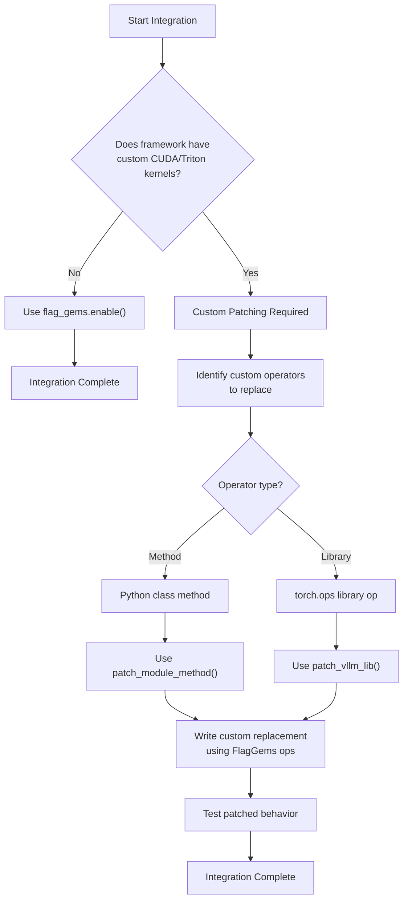

<!-- source: DeepWiki mcp.deepwiki.com · repo FlagOpen/FlagGems · page 6.2 Framework Integration · fetched 2026-10-21 -->

# Framework Integration

<details>
<summary>Relevant source files</summary>

The following files were used as context for generating this wiki page:

- [README.md](README.md)
- [README_cn.md](README_cn.md)
- [docs/add_a_cpp_wrapper.md](docs/add_a_cpp_wrapper.md)
- [docs/get_start_with_flaggems.md](docs/get_start_with_flaggems.md)
- [docs/how_to_use_flaggems.md](docs/how_to_use_flaggems.md)
- [docs/index.md](docs/index.md)
- [docs/installation.md](docs/installation.md)
- [docs/pointwise_dynamic.md](docs/pointwise_dynamic.md)
- [examples/integration_gems_with_vllm.py](examples/integration_gems_with_vllm.py)
- [mkdocs.yml](mkdocs.yml)
- [pyproject.toml](pyproject.toml)
- [src/flag_gems/fused/__init__.py](src/flag_gems/fused/__init__.py)
- [src/flag_gems/fused/moe_align_block_size.py](src/flag_gems/fused/moe_align_block_size.py)
- [src/flag_gems/fused/reshape_and_cache.py](src/flag_gems/fused/reshape_and_cache.py)
- [src/flag_gems/fused/reshape_and_cache_flash.py](src/flag_gems/fused/reshape_and_cache_flash.py)
- [src/flag_gems/fused/silu_and_mul.py](src/flag_gems/fused/silu_and_mul.py)
- [src/flag_gems/ops/sqrt.py](src/flag_gems/ops/sqrt.py)
- [src/flag_gems/patches/patch_util.py](src/flag_gems/patches/patch_util.py)
- [src/flag_gems/patches/patch_vllm_all.py](src/flag_gems/patches/patch_vllm_all.py)

</details>


This document describes how FlagGems integrates with popular deep learning frameworks such as vLLM, HuggingFace Transformers, and Megatron-LM. It covers the patching mechanisms used to replace both standard PyTorch operators and framework-specific custom kernels with FlagGems implementations.

For basic usage of FlagGems operator replacement, see [Quick Start Guide](#1.2). For information about the C++ extension layer that can enhance integration performance, see [C++ Extensions](#6.1).

## Integration Architecture

FlagGems provides a two-level integration strategy to accelerate framework execution:

**Level 1: ATen Operator Replacement** - Automatically replaces standard PyTorch operators (add, mul, matmul, etc.) by registering with PyTorch's ATen backend. This is activated via `flag_gems.enable()` and works transparently with any framework built on PyTorch.

**Level 2: Framework-Specific Patching** - Replaces custom kernels and optimized implementations that frameworks provide beyond standard PyTorch operators. This requires explicit patching APIs like `apply_gems_patches_to_vllm()`.

### Integration Strategy Comparison



**Sources:** [src/flag_gems/patches/patch_vllm_all.py:331-368](), [src/flag_gems/patches/patch_util.py:14-32](), [docs/how_to_use_flaggems.md:176-200]()

## vLLM Integration

vLLM is a high-throughput inference engine with custom CUDA/Triton kernels for operations like paged attention, rotary embeddings, and fused activations. FlagGems provides comprehensive integration through the `apply_gems_patches_to_vllm()` function.

### Patching Mechanism

The vLLM integration uses two patching strategies:

| Strategy | Target | Function | Purpose |
|----------|--------|----------|---------|
| **Module Method Patching** | Class instance methods | `patch_module_method()` | Replace Python methods like `RMSNorm.forward_cuda` |
| **Library Patching** | Torch library ops | `patch_vllm_lib()` | Replace C++/CUDA implementations via torch.library |

### Module Method Patching

Module method patching replaces class methods in vLLM modules with FlagGems implementations. This is used when vLLM provides multiple backend implementations (e.g., `forward_cuda`, `forward_xpu`).



**Implementation:** The `patch_module_method()` function [src/flag_gems/patches/patch_util.py:14-21]() replaces class methods using `setattr()`:

```python
def patch_module_method(cls, method_name: str, new_method: callable, verbose=True):
    old_method = getattr(cls, method_name, None)
    setattr(cls, method_name, new_method)
    # Prints: "Patched RMSNorm.forward_cuda with FLAGGEMS custom_gems_rms_forward_cuda"
    return old_method
```

**Sources:** [src/flag_gems/patches/patch_vllm_all.py:340-356](), [src/flag_gems/patches/patch_util.py:14-21]()

### Library Patching

Library patching registers FlagGems implementations for torch library operations that vLLM defines in its C++ extensions. vLLM defines custom operations in libraries like `torch.ops._C`, `torch.ops._moe_C`, and `torch.ops._vllm_fa3_C`.



**Implementation:** Library objects are pre-created [src/flag_gems/patches/patch_util.py:3-11]() and the `patch_vllm_lib()` function registers implementations:

```python
vllm_C_lib = torch.library.Library("_C", "IMPL")
vllm_moe_C_lib = torch.library.Library("_moe_C", "IMPL")
vllm_fa3_C_lib = torch.library.Library("_vllm_fa3_C", "IMPL")

def patch_vllm_lib(lib_name, fn_name, fn, key, verbose=True):
    lib = libs[lib_name]
    lib.impl(fn_name, fn, key)  # Register for "CUDA" dispatch key
```

**Sources:** [src/flag_gems/patches/patch_vllm_all.py:357-368](), [src/flag_gems/patches/patch_util.py:3-32]()

### vLLM Patched Components

The following table lists all components patched by `apply_gems_patches_to_vllm()`:

| Component | Original Implementation | FlagGems Replacement | Type |
|-----------|------------------------|---------------------|------|
| `RMSNorm.forward_cuda` | vLLM RMS normalization | `gems_rms_forward` from [src/flag_gems/modules/normalization.py]() | Module Method |
| `RotaryEmbedding.forward_cuda` | vLLM rotary embedding | `gems_rope_forward` from [src/flag_gems/modules/rotary_embedding.py]() | Module Method |
| `PagedAttention.write_to_paged_cache` | vLLM cache writing | `reshape_and_cache` from [src/flag_gems/fused/reshape_and_cache.py:69-106]() | Module Method |
| `SiluAndMul.forward_cuda` | vLLM fused activation | `gems_silu_and_mul` from [src/flag_gems/modules/activation.py]() | Module Method |
| `TritonMLAImpl._forward_decode` | vLLM MLA attention | `flash_mla` from [src/flag_gems/fused/flash_mla.py]() | Module Method |
| `FlashAttentionImpl.forward` | vLLM flash attention | `flash_attn_varlen_func` from [src/flag_gems/fused/flash_attn.py]() | Module Method |
| `torch.ops._C.silu_and_mul` | vLLM C++ kernel | `silu_and_mul_out` from [src/flag_gems/fused/silu_and_mul.py:51-53]() | Library |
| `torch.ops._moe_C.moe_align_block_size` | vLLM MoE utilities | `moe_align_block_size_triton` from [src/flag_gems/fused/moe_align_block_size.py:101-145]() | Library |
| `torch.ops._moe_C.topk_softmax` | vLLM MoE routing | `topk_softmax` from [src/flag_gems/fused/topk_softmax.py]() | Library |
| `torch.ops._vllm_fa3_C.get_scheduler_metadata` | FA3 scheduling | `get_scheduler_metadata` from FlagGems attention | Library |

**Sources:** [src/flag_gems/patches/patch_vllm_all.py:331-368](), [src/flag_gems/fused/__init__.py:1-42]()

### vLLM Integration Example

Basic integration with single-node inference:

```python
import flag_gems
from vllm import LLM, SamplingParams

# Level 1: Enable ATen operator replacement
flag_gems.enable()

# Level 2: Apply vLLM-specific patches
flag_gems.apply_gems_patches_to_vllm(verbose=True)

# Use vLLM normally
llm = LLM(model="Qwen/Qwen2.5-7B-Instruct")
sampling_params = SamplingParams(temperature=0.8, max_tokens=128)
outputs = llm.generate(["Hello, my name is"], sampling_params)
```

For multi-node deployments, the integration code must be injected into worker processes. This requires modifying vLLM source code to import and enable FlagGems before model loading [docs/how_to_use_flaggems.md:287-336]():

```python
# In vllm/v1/worker/gpu_model_runner.py or vllm/worker/model_runner.py
import os
if os.getenv("USE_FLAGGEMS", "false").lower() in ("1", "true", "yes"):
    try:
        import flag_gems
        flag_gems.enable()
        flag_gems.apply_gems_patches_to_vllm(verbose=True)
        logger.info("Successfully enabled flag_gems")
    except ImportError:
        logger.warning("Failed to import 'flag_gems'")
```

**Sources:** [examples/integration_gems_with_vllm.py:1-66](), [docs/how_to_use_flaggems.md:171-336]()

## HuggingFace Transformers Integration

Transformers integration is straightforward because the framework relies entirely on standard PyTorch operators without custom kernels. Level 1 integration (ATen operator replacement) is sufficient.

### Integration Pattern



### Example Usage

```python
from transformers import AutoModelForCausalLM, AutoTokenizer
import flag_gems

# Enable FlagGems globally
flag_gems.enable()

# Load model normally
tokenizer = AutoTokenizer.from_pretrained("meta-llama/Llama-2-7b-hf")
model = AutoModelForCausalLM.from_pretrained("meta-llama/Llama-2-7b-hf")
model.to(flag_gems.device).eval()

# Run inference - all ATen ops use FlagGems
inputs = tokenizer("Hello, my name is", return_tensors="pt").to(flag_gems.device)
output = model.generate(**inputs, max_length=100)
```

Alternatively, use the context manager for scoped acceleration:

```python
with flag_gems.use_gems():
    output = model.generate(**inputs, max_length=100)
```

**Sources:** [docs/how_to_use_flaggems.md:141-169](), [README.md:7-9]()

## Megatron-LM Integration

Megatron-LM requires manual integration because its tightly coupled training loop makes global patching problematic. The recommended approach is to wrap only the forward and backward computation stages with `flag_gems.use_gems()`.

### Integration Strategy



### Implementation

Modify the `train_step` function in [megatron/training/training.py](https://github.com/NVIDIA/Megatron-LM/blob/main/megatron/training/training.py#L1360):

```python
def train_step(forward_step_func, data_iterator, model, optimizer, 
               opt_param_scheduler, config):
    """Single training step."""
    # ... initialization code ...
    
    while rerun_state_machine.should_run_forward_backward(data_iterator):
        # Wrap computation with FlagGems context manager
        import flag_gems
        with flag_gems.use_gems():
            forward_backward_func = get_forward_backward_func()
            losses_reduced = forward_backward_func(
                forward_step_func=forward_step_func,
                data_iterator=data_iterator,
                model=model,
                num_microbatches=get_num_microbatches(),
                # ... other args ...
            )
    
    # ... post-computation code ...
```

**Rationale:** Megatron's data loading and setup phase may interact poorly with global operator replacement. Using the context manager restricts acceleration to the computation-intensive forward/backward passes while leaving other components unchanged.

**Alternative:** For broader acceleration, try `flag_gems.enable()` at the script entry point, but this is less tested and may require additional validation [docs/how_to_use_flaggems.md:223-275]().

**Sources:** [docs/how_to_use_flaggems.md:223-275]()

## Custom Framework Integration

To integrate FlagGems with other frameworks, follow this decision tree:



### Implementation Guidelines

**Step 1: Identify Custom Operations**

Profile the framework to find custom kernels or operators that bypass standard PyTorch:
- Look for `@torch.library.custom_op` definitions
- Search for direct Triton kernel launches
- Check for C++/CUDA extensions

**Step 2: Choose Patching Strategy**

| Scenario | Strategy | Function |
|----------|----------|----------|
| Python class methods (e.g., `forward_cuda()`) | Module method patching | `patch_module_method()` [src/flag_gems/patches/patch_util.py:14-21]() |
| Torch library ops (e.g., `torch.ops.custom::op`) | Library patching | `patch_vllm_lib()` [src/flag_gems/patches/patch_util.py:24-32]() |
| Direct kernel calls | Function wrapping | Standard Python function replacement |

**Step 3: Implement Replacements**

Use FlagGems building blocks:
- Standard operators from `flag_gems.ops`
- Fused operations from `flag_gems.fused` [src/flag_gems/fused/__init__.py:1-42]()
- Pre-built modules from `flag_gems.modules`

**Step 4: Create Patch Function**

Follow the vLLM pattern [src/flag_gems/patches/patch_vllm_all.py:331-368]():

```python
def apply_gems_patches_to_framework(verbose=True):
    from framework.module import CustomClass
    
    # Patch methods
    patch_module_method(CustomClass, "method_name", custom_gems_impl, verbose)
    
    # Patch library ops if needed
    patch_framework_lib("_framework_C", "custom_op", gems_op_wrapper, "CUDA", verbose)
```

**Sources:** [src/flag_gems/patches/patch_util.py:1-33](), [src/flag_gems/patches/patch_vllm_all.py:331-368]()

## Multi-Process and Multi-Node Deployment

When deploying frameworks across multiple processes or nodes, ensure FlagGems is initialized in each worker process:

| Deployment Type | Integration Approach |
|----------------|---------------------|
| **Single process** | Call `flag_gems.enable()` at script start |
| **Multi-process (single node)** | Call `flag_gems.enable()` before process spawn |
| **Multi-node** | Inject initialization into worker entry points |

For frameworks that spawn workers (like vLLM), the parent process initialization is insufficient. Workers must initialize independently by modifying framework source code [docs/how_to_use_flaggems.md:287-336]().

**Sources:** [docs/how_to_use_flaggems.md:277-336]()

## Integration Verification

After integration, verify FlagGems is active:

**Check for operator override warnings:**
```
Overriding a previously registered kernel for the same operator and the same dispatch key
  operator: aten::add.Tensor(Tensor self, Tensor other, *, Scalar alpha=1) -> Tensor
  dispatch key: CUDA
```

**Check verbose patch output:**
```
Patched RMSNorm.forward_cuda with FLAGGEMS custom_gems_rms_forward_cuda
Patched RotaryEmbedding.forward_cuda with FLAGGEMS custom_gems_rope_forward_cuda
```

**Verify runtime backend detection:**
```python
import flag_gems
print(flag_gems.vendor_name)  # Should show detected hardware vendor
```

**Enable debug logging:**
```python
flag_gems.enable(record=True, path="./gems_debug.log")
# Check log file for operator calls: "[DEBUG] flag_gems.ops.mm: GEMS MM"
```

**Sources:** [docs/how_to_use_flaggems.md:64-86](), [docs/how_to_use_flaggems.md:323-336]()

---

