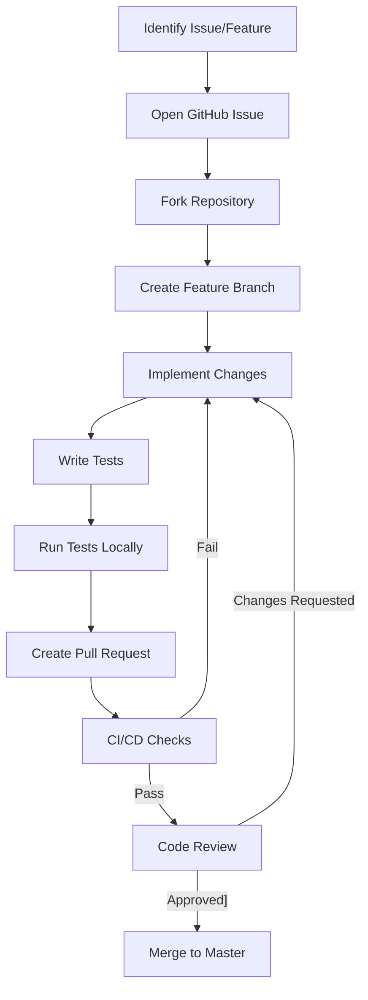
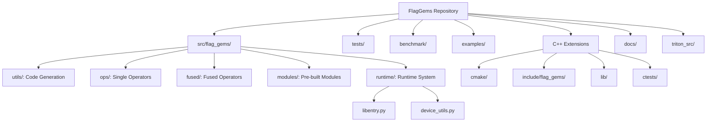
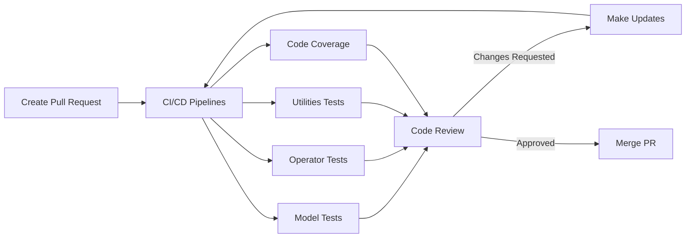
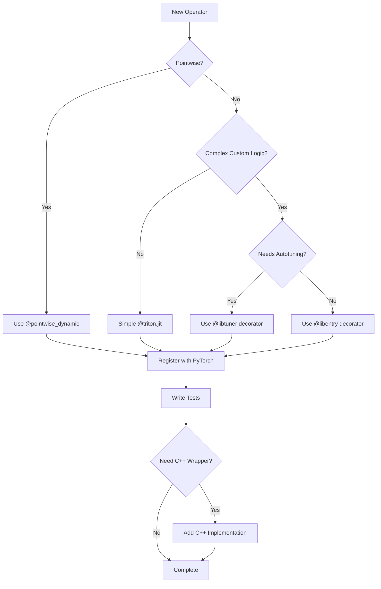
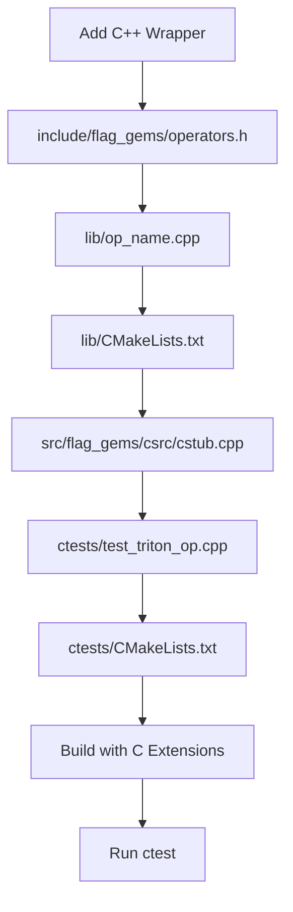

<!-- source: DeepWiki mcp.deepwiki.com · repo FlagOpen/FlagGems · page 6.3 Contributing to FlagGems · fetched 2026-10-21 -->

# Contributing to FlagGems

<details>
<summary>Relevant source files</summary>

The following files were used as context for generating this wiki page:

- [README.md](README.md)
- [README_cn.md](README_cn.md)
- [ctests/CMakeLists.txt](ctests/CMakeLists.txt)
- [ctests/test_triton_reduction.cpp](ctests/test_triton_reduction.cpp)
- [ctests/test_triton_rwkv_ka_fusion.cpp](ctests/test_triton_rwkv_ka_fusion.cpp)
- [ctests/test_triton_rwkv_mm_sparsity.cpp](ctests/test_triton_rwkv_mm_sparsity.cpp)
- [docs/add_a_cpp_wrapper.md](docs/add_a_cpp_wrapper.md)
- [docs/get_start_with_flaggems.md](docs/get_start_with_flaggems.md)
- [docs/how_to_use_flaggems.md](docs/how_to_use_flaggems.md)
- [docs/index.md](docs/index.md)
- [docs/installation.md](docs/installation.md)
- [docs/pointwise_dynamic.md](docs/pointwise_dynamic.md)
- [examples/integration_gems_with_vllm.py](examples/integration_gems_with_vllm.py)
- [include/flag_gems/operators.h](include/flag_gems/operators.h)
- [include/flag_gems/utils.h](include/flag_gems/utils.h)
- [lib/CMakeLists.txt](lib/CMakeLists.txt)
- [lib/rwkv_ka_fusion.cpp](lib/rwkv_ka_fusion.cpp)
- [lib/rwkv_mm_sparsity.cpp](lib/rwkv_mm_sparsity.cpp)
- [lib/utils.cpp](lib/utils.cpp)
- [mkdocs.yml](mkdocs.yml)
- [pyproject.toml](pyproject.toml)
- [src/flag_gems/csrc/cstub.cpp](src/flag_gems/csrc/cstub.cpp)
- [src/flag_gems/ops/sqrt.py](src/flag_gems/ops/sqrt.py)

</details>


This document provides detailed guidelines for contributing to the FlagGems project. It covers the contribution workflow, project structure, testing requirements, and best practices for submitting high-quality contributions that will be accepted into the codebase.

FlagGems is a high-performance operator library implemented in OpenAI Triton that aims to accelerate LLM training and inference by providing optimized implementations of PyTorch operations. This guide is intended for developers who want to contribute to the FlagGems project itself. If you're interested in using FlagGems in your own projects, please refer to [Quick Start Guide](#1.2).

## Contribution Workflow

The following diagram illustrates the general workflow for contributing to FlagGems:



Sources: [CONTRIBUTING.md:15-17](), [.github/workflows/python-coverage.yaml:4-9]()

## Development Environment Setup

Before contributing to FlagGems, you need to set up a proper development environment. FlagGems can be installed as either a pure Python package or with C++ extensions.

### Prerequisites

Install the required build dependencies:

```bash
pip install -U scikit-build-core>=0.11 pybind11 ninja cmake
```

Sources: [pyproject.toml:2](), [docs/installation.md:28-31]()

### Installing for Development

For development work, use an editable installation:

```bash
git clone https://github.com/FlagOpen/FlagGems.git
cd FlagGems
pip install --no-build-isolation -e .
```

To enable C++ extensions during development (recommended for testing C++ wrappers):

```bash
CMAKE_ARGS="-DFLAGGEMS_BUILD_C_EXTENSIONS=ON" \
pip install --no-build-isolation -v -e .
```

The build system uses `scikit-build-core` as the build backend, which bridges CMake and Python's build system.

Sources: [pyproject.toml:1-4](), [docs/installation.md:79-94]()

## Project Structure

Understanding the project structure is essential for effective contributions. FlagGems follows a well-organized directory structure that separates Python code, C++ extensions, tests, documentation, and other components:



The table below provides additional details on each directory's purpose:

| Directory | Purpose |
|-----------|---------|
| `src/flag_gems/` | Python source code for the library |
| `src/flag_gems/utils/` | Automatic code generation utilities (`pointwise_dynamic`) |
| `src/flag_gems/ops/` | Single operator implementations |
| `src/flag_gems/fused/` | Fused operator implementations |
| `src/flag_gems/modules/` | High-level modules (e.g., `GemsRMSNorm`, `GemsRope`) |
| `src/flag_gems/runtime/` | Runtime system (LibEntry, LibTuner, device management) |
| `tests/` | Python accuracy test files (`test_*_ops.py`) |
| `benchmark/` | Performance benchmarking files (`test_*_perf.py`) |
| `examples/` | Integration examples (vLLM, Transformers, etc.) |
| `cmake/` | C++ CMake configuration files |
| `include/flag_gems/` | C++ header files (`operators.h`, `utils.h`) |
| `lib/` | C++ source code for operator wrappers |
| `ctests/` | C++ unit tests using GoogleTest |
| `triton_src/` | Triton JIT functions for C++ runtime |
| `docs/` | Documentation files (Markdown) |

Sources: [lib/CMakeLists.txt:1-52](), [ctests/CMakeLists.txt:1-89](), [include/flag_gems/operators.h:1-109]()

## Bug Reporting

When reporting bugs, please create a GitHub issue with the following information:

1. A brief but clear summary of the problem
2. Detailed steps to reproduce the issue
3. Specific descriptions of expected vs. actual behavior
4. Sample code that demonstrates the problem (when possible)

Well-structured bug reports help maintainers quickly understand and address issues.

Sources: [CONTRIBUTING.md:7-14](), [CONTRIBUTING_cn.md:7-14]()

## Code Contribution Process

### Pull Request Requirements

Pull requests to FlagGems require approval from at least one project maintainer and must pass all continuous integration checks. When submitting a pull request:

1. Provide a clear description of the changes and their purpose
2. Reference any related issues
3. Ensure all tests pass locally before submission
4. Be responsive to review feedback

The pull request review process follows this flow:



Sources: [CONTRIBUTING.md:15-17](), [.github/workflows/python-coverage.yaml:10-90](), [.github/workflows/model-test.yaml:10-34]()

## Testing Requirements

The FlagGems project maintains high code quality through comprehensive testing. All contributions must include appropriate tests and meet code coverage requirements.

### Continuous Integration

Pull requests trigger multiple test pipelines that run in parallel:

- `blas-op-test`: Tests for BLAS operations
- `model-test`: End-to-end tests with supported models
- `op-test-quick-cpu`: Quick CPU-specific operator tests
- `op-utils-test`: Tests for utility functions
- `pointwise-op-test`: Tests for pointwise operations
- `reduction-op-test`: Tests for reduction operations
- `special-op-test`: Tests for special operations

After these tests complete, a code coverage report is generated.

Sources: [.github/workflows/python-coverage.yaml:10-89]()

### Code Coverage Requirements

Code changes should maintain or improve test coverage. The system requires high test coverage for non-Triton JIT functions (typically above 90%). Coverage is checked with specialized tools in the `tools/code_coverage` directory.

Three types of coverage reports may be generated:
1. Full Python coverage report
2. Coverage report for changed code only
3. Coverage report for changed code excluding Triton JIT functions

For pull requests to be accepted, the third report should show coverage above 90%.

Sources: [tools/code_coverage/report_coverage.sh:1-19](), [tools/code_coverage/coverage_lines.py:33-45]()

## Documentation

Documentation is stored in the `docs` directory and is built using MkDocs. The documentation undergoes nightly builds in the CI pipeline. When contributing documentation:

1. Follow the existing documentation style
2. Use clear, concise language
3. Include examples where appropriate
4. Update documentation to reflect code changes

Sources: [CONTRIBUTING.md:21-22](), [CONTRIBUTING_cn.md:19-20](), [.github/workflows/mkdocs.yaml:1-32]()

## Adding New Components

### Adding New Operators

When adding a new operator to FlagGems, follow this decision tree to determine the appropriate implementation approach:

Implementation Approach Decision Tree



Sources: [src/flag_gems/ops/sqrt.py:1-26](), [docs/pointwise_dynamic.md:74-86]()

#### Step 1: Implement the Python Operator

Choose the appropriate decorator based on operator characteristics:

**For Pointwise Operations** (element-wise, supporting broadcasting):

```python
# Example: sqrt operator
import triton
import triton.language as tl
from flag_gems.utils import pointwise_dynamic

@pointwise_dynamic(promotion_methods=[(0, "INT_TO_FLOAT")])
@triton.jit
def sqrt_func(x):
    return tl.sqrt(x.to(tl.float32))

def sqrt(A):
    return sqrt_func(A)
```

Key considerations for `@pointwise_dynamic`:
- Specify `promotion_methods` for type promotion rules
- Use `is_tensor` parameter to distinguish tensor/non-tensor inputs
- Return values become output tensors automatically
- Supports broadcasting, arbitrary ranks, and non-contiguous layouts

**For Operations Requiring Autotuning** (e.g., matrix operations):

Operations that benefit from configuration tuning should use `@libtuner` which provides persistent caching of optimal configurations via SQLite.

**For Standard Triton Kernels**:

Use `@libentry` to bypass Triton's runtime overhead while maintaining kernel caching.

Sources: [src/flag_gems/ops/sqrt.py:10-26](), [docs/pointwise_dynamic.md:75-111]()

#### Step 2: Register with PyTorch

Add the operator to FlagGems' registration system in the appropriate `ops` module file, then register it with PyTorch's ATen backend through the registration decorators.

#### Step 3: Write Tests

All operators require two types of tests:

**Accuracy Tests** (`tests/test_*_ops.py`):
- Compare against PyTorch reference implementation
- Test multiple input shapes and data types
- Use `gems_assert_close` for tolerance checking
- Include edge cases (empty tensors, broadcasting, etc.)

**Performance Benchmarks** (`benchmark/test_*_perf.py`):
- Measure latency and throughput
- Compare against PyTorch eager mode
- Test shapes defined in `core_shapes.yaml`
- Calculate speedup metrics

Example test structure:

```python
# tests/test_unary_pointwise_ops.py
def test_sqrt_accuracy():
    def torch_sqrt(x):
        return torch.sqrt(x)
    
    def gems_sqrt(x):
        return flag_gems.sqrt(x)
    
    gems_assert_equal(torch_sqrt, gems_sqrt, input_tensors, ...)
```

Sources: [ctests/test_triton_reduction.cpp:6-17]()

#### Step 4: Add Vendor-Specific Handling (if needed)

Some operations may not be supported on all hardware backends. Use conditional skipping:

```python
import pytest
from flag_gems.utils import GEMS_VENDOR

@pytest.mark.skipif(
    GEMS_VENDOR == "kunlunxin" and shape_too_large,
    reason="Large shapes not supported on Kunlunxin"
)
def test_operation():
    ...
```

Sources: [docs/how_to_use_flaggems.md:117-127]()

### Adding C++ Operator Wrappers

C++ wrappers reduce Python overhead for performance-critical operators. The process involves four files:

File Modification Checklist



Sources: [docs/add_a_cpp_wrapper.md:1-22]()

#### Step 1: Declare in Header

Add function declaration to `include/flag_gems/operators.h`:

```cpp
// include/flag_gems/operators.h
namespace flag_gems {
at::Tensor sqrt(const at::Tensor &input);
}
```

Sources: [include/flag_gems/operators.h:1-109]()

#### Step 2: Implement in C++

Create implementation file in `lib/`:

```cpp
// lib/sqrt.cpp
#include "flag_gems/operators.h"
#include "flag_gems/utils.h"
#include "triton_jit/triton_jit_function.h"

namespace flag_gems {
using namespace triton_jit;

at::Tensor sqrt(const at::Tensor &input) {
    at::Tensor out = at::empty_like(input);
    
    const TritonJITFunction &f = TritonJITFunction::get_instance(
        std::string(utils::get_flag_gems_src_path() / "ops" / "sqrt.py"),
        "sqrt_kernel");
    
    // Configure kernel launch parameters
    int64_t num_elements = input.numel();
    int64_t block_size = 512;
    int64_t num_blocks = (num_elements + block_size - 1) / block_size;
    
    // Launch kernel
    c10::cuda::CUDAStream stream = c10::cuda::getCurrentCUDAStream();
    CUstream raw_stream = static_cast<CUstream>(stream.stream());
    f(raw_stream, num_blocks, 1, 1, 4, 1, input, out, num_elements);
    
    return out;
}
}  // namespace flag_gems
```

Key components:
- Use `TritonJITFunction::get_instance()` to load Triton kernels
- Calculate launch parameters based on input size
- Use `c10::cuda::getCurrentCUDAStream()` for stream management
- Pass parameters to kernel using positional arguments

Sources: [lib/rwkv_mm_sparsity.cpp:1-38](), [lib/rwkv_ka_fusion.cpp:1-69]()

#### Step 3: Update CMakeLists

Add source file to `lib/CMakeLists.txt`:

```cmake
add_library(operators
            SHARED
            # ... existing files ...
            sqrt.cpp)
```

Sources: [lib/CMakeLists.txt:1-27]()

#### Step 4: Add Python Bindings

Register both Python and CUDA implementations in `src/flag_gems/csrc/cstub.cpp`:

```cpp
// Python bindings
PYBIND11_MODULE(c_operators, m) {
  m.def("sqrt", &flag_gems::sqrt);
}

// Torch library registration
TORCH_LIBRARY(flag_gems, m) {
  m.def("sqrt(Tensor self) -> Tensor");
}

// CUDA implementation
TORCH_LIBRARY_IMPL(flag_gems, CUDA, m) {
  m.impl("sqrt", TORCH_FN(sqrt));
}
```

Sources: [src/flag_gems/csrc/cstub.cpp:8-116]()

#### Step 5: Write C++ Tests

Add test file in `ctests/` and register in `ctests/CMakeLists.txt`:

```cpp
// ctests/test_triton_sqrt.cpp
#include <gtest/gtest.h>
#include "flag_gems/operators.h"
#include "torch/torch.h"

TEST(pointwise_op_test, sqrt) {
  const torch::Device device(torch::kCUDA, 0);
  torch::Tensor input = torch::randn({32, 1024}, device);
  
  torch::Tensor out_torch = at::sqrt(input);
  torch::Tensor out_triton = flag_gems::sqrt(input);
  
  EXPECT_TRUE(torch::allclose(out_torch, out_triton, 1e-5, 1e-8));
}
```

Update `ctests/CMakeLists.txt`:

```cmake
add_executable(test_triton_sqrt test_triton_sqrt.cpp)
target_link_libraries(test_triton_sqrt
  PRIVATE Torch::Torch operators GTest::gtest GTest::gtest_main)
add_test(NAME test_triton_sqrt COMMAND test_triton_sqrt)
```

Sources: [ctests/test_triton_reduction.cpp:6-17](), [ctests/CMakeLists.txt:1-89]()

### Implementing Backend Support

FlagGems supports multiple hardware vendors through a unified backend abstraction. To add support for a new backend:

1. Ensure PyTorch and Triton support the target hardware
2. Test operator implementations on the new hardware
3. Add vendor-specific configurations if needed
4. Update vendor detection logic if necessary
5. Document hardware-specific limitations

The system automatically detects hardware at runtime via `GEMS_VENDOR` environment variable.

Sources: [docs/how_to_use_flaggems.md:87-127]()

### Hardware Support

FlagGems supports 10+ hardware vendors through a unified Triton-based backend. When contributing, test on multiple platforms when possible:

| Vendor     | Status              | Data Types Support |
|------------|---------------------|-------------------|
| nvidia     | ✅ Full            | fp16, fp32, bf16  |
| kunlunxin  | ✅ Full            | fp16, fp32, bf16  |
| cambricon  | ✅ Full            | fp16, fp32, bf16  |
| hygon      | ✅ Full            | fp16, fp32, bf16  |
| iluvatar   | ✅ Full            | fp16, fp32, bf16  |
| metax      | ✅ Full            | fp16, fp32, bf16  |
| mthreads   | ✅ Full            | fp16, fp32, bf16  |
| aipu       | ✅ Partial         | fp16, fp32, bf16  |
| ascend     | ✅ Partial         | fp16, fp32, bf16  |

Vendor-specific considerations:
- Some platforms may not support all data types (check `has_fp64`, `has_bfloat16`)
- Large tensor operations may have platform-specific size limits
- Use `pytest.skipif` with `GEMS_VENDOR` for platform-specific test exclusions

Sources: [README.md:96-109]()

## License

Any contributions made to the FlagGems project will be under the Apache 2.0 License. Please ensure you understand and agree to this license before contributing.

Sources: [CONTRIBUTING.md:49-50](), [CONTRIBUTING_cn.md:46-47](), [README.md:90-92]()