# Page: Overview

# Overview

<details>
<summary>Relevant source files</summary>

The following files were used as context for generating this wiki page:

- [README.md](README.md)
- [README_cn.md](README_cn.md)
- [benchmark/test_special_perf.py](benchmark/test_special_perf.py)
- [benchmark/test_unary_pointwise_perf.py](benchmark/test_unary_pointwise_perf.py)
- [docs/add_a_cpp_wrapper.md](docs/add_a_cpp_wrapper.md)
- [docs/get_start_with_flaggems.md](docs/get_start_with_flaggems.md)
- [docs/how_to_use_flaggems.md](docs/how_to_use_flaggems.md)
- [docs/index.md](docs/index.md)
- [docs/installation.md](docs/installation.md)
- [docs/pointwise_dynamic.md](docs/pointwise_dynamic.md)
- [examples/integration_gems_with_vllm.py](examples/integration_gems_with_vllm.py)
- [mkdocs.yml](mkdocs.yml)
- [pyproject.toml](pyproject.toml)
- [src/flag_gems/__init__.py](src/flag_gems/__init__.py)
- [src/flag_gems/ops/__init__.py](src/flag_gems/ops/__init__.py)
- [src/flag_gems/ops/elu.py](src/flag_gems/ops/elu.py)
- [src/flag_gems/ops/embedding.py](src/flag_gems/ops/embedding.py)
- [src/flag_gems/ops/nllloss.py](src/flag_gems/ops/nllloss.py)
- [src/flag_gems/ops/sqrt.py](src/flag_gems/ops/sqrt.py)
- [tests/accuracy_utils.py](tests/accuracy_utils.py)
- [tests/test_binary_pointwise_ops.py](tests/test_binary_pointwise_ops.py)
- [tests/test_special_ops.py](tests/test_special_ops.py)
- [tests/test_unary_pointwise_ops.py](tests/test_unary_pointwise_ops.py)

</details>


FlagGems is a high-performance operator library for PyTorch, implemented using OpenAI's Triton programming language. It provides a collection of over 200 optimized operator implementations to accelerate machine learning workloads, with a focus on large language model (LLM) training and inference. FlagGems integrates seamlessly with PyTorch by registering alternative implementations with PyTorch's ATen backend through the `torch.library.Library` interface, enabling users to activate optimizations without modifying their model code.

Key capabilities include:
- **200+ Optimized Operators**: Comprehensive coverage of PyTorch operations including pointwise, reduction, BLAS, normalization, attention, and fused operations
- **Multi-Backend Support**: Validated on 10+ hardware platforms including NVIDIA, Kunlunxin, Cambricon, Hygon, Iluvatar, and others
- **Automatic Operator Replacement**: Seamless integration via `flag_gems.enable()` or the `use_gems` context manager
- **Dynamic Code Generation**: Automatic kernel generation for pointwise operations supporting arbitrary input types and layouts
- **Performance Optimization**: Hand-tuned kernels with autotuning support through LibEntry and LibTuner systems

Sources: [README.md:1-29](), [src/flag_gems/__init__.py:15-20](), [src/flag_gems/__init__.py:33-324]()

## Core Architecture

FlagGems is designed to integrate seamlessly with PyTorch while providing significant performance improvements through optimized implementations of common operations.

### FlagGems System Architecture

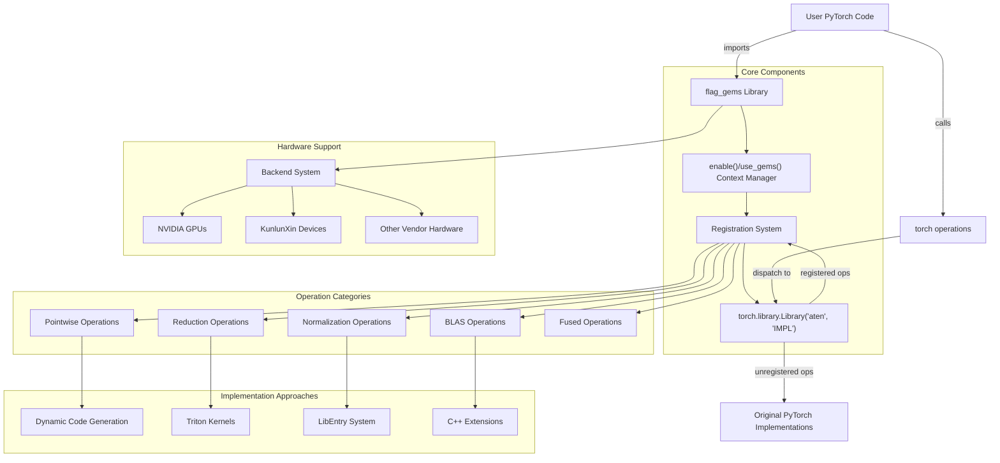

Sources: [src/flag_gems/__init__.py:21-27](), [src/flag_gems/__init__.py:43-326]()

### Operation Registration and Execution Flow

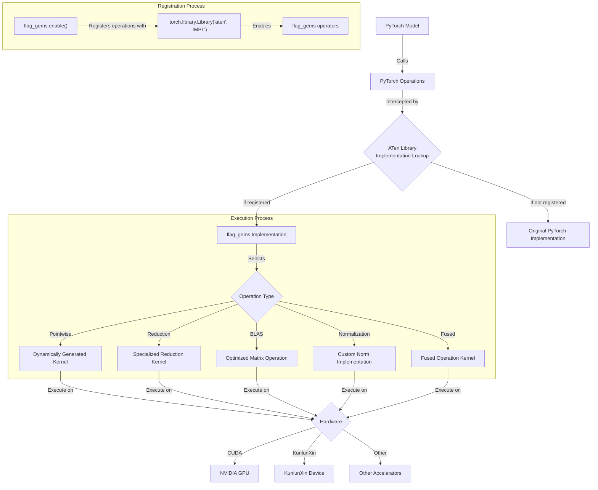

Sources: [src/flag_gems/__init__.py:43-326](), [src/flag_gems/ops/__init__.py:1-382]()

## Key Components

### Registration System

FlagGems provides two main mechanisms for enabling its optimized implementations:

1. **`flag_gems.enable()` function**: Registers FlagGems implementations globally with PyTorch's ATen library via `torch.library.Library("aten", "IMPL")`
2. **`flag_gems.use_gems` context manager**: Temporarily enables FlagGems implementations within a scoped context

The registration system uses the `Register` class to manage operator registration. At initialization, it creates a mapping of 200+ operators to their FlagGems implementations (lines 33-324 in `__init__.py`). The system supports selective operator exclusion via the `unused` parameter and handles vendor-specific operator filtering based on hardware capabilities.

#### Operator Registration Flow

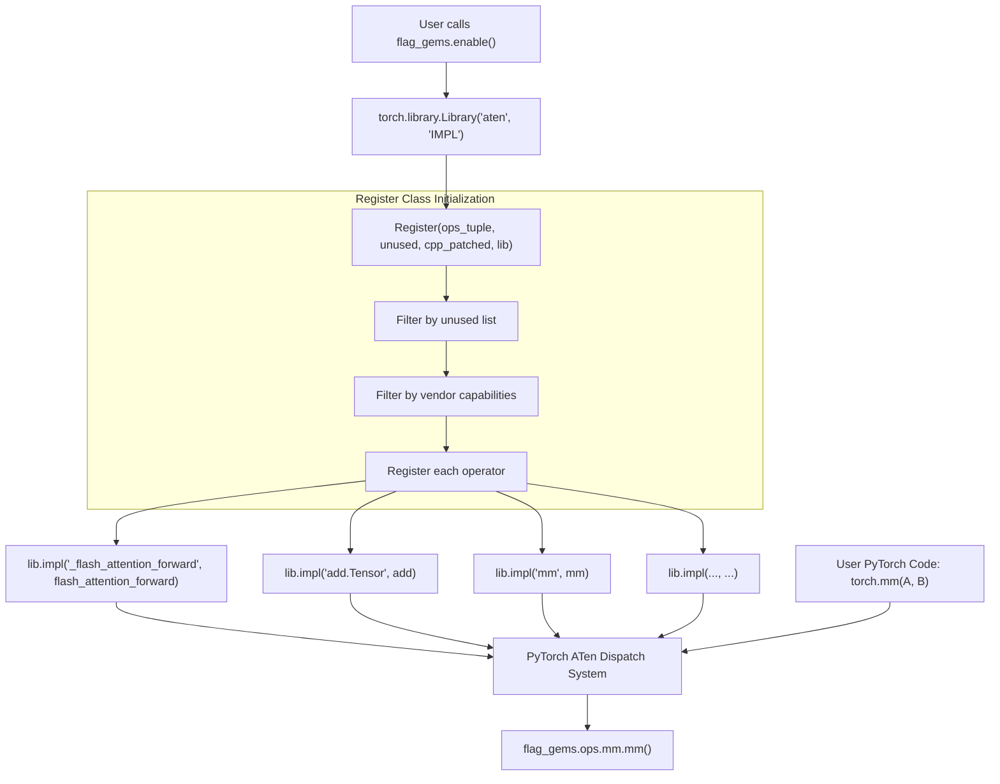

**Example usage:**

```python
# Global enablement with selective operator exclusion
import flag_gems
flag_gems.enable(unused=["sum", "mean"])  # Exclude specific operators

# Scoped enablement
with flag_gems.use_gems():
    result = torch.add(tensor1, tensor2)  # Uses flag_gems.ops.add
```

Sources: [src/flag_gems/__init__.py:24-31](), [src/flag_gems/__init__.py:33-324](), [src/flag_gems/__init__.py:328-357](), [src/flag_gems/runtime/register.py]()

### Operation Categories

FlagGems supports a wide range of PyTorch operations across several categories:

| Category | Description | Examples |
|----------|-------------|----------|
| Pointwise Operations | Element-wise operations on tensors | add, mul, div, abs, exp |
| Reduction Operations | Operations that reduce tensor dimensions | sum, mean, max, argmax |
| Normalization Operations | Statistical normalization operations | layer_norm, batch_norm, rms_norm |
| BLAS Operations | Basic linear algebra operations | mm, bmm, addmm |
| Fused Operations | Combined operations for better performance | gelu_and_mul, silu_and_mul, skip_layer_norm |
| Tensor Manipulation | Operations that rearrange tensor data | gather, scatter, masked_select |
| Random Number Generation | Operations that generate random data | rand, normal, dropout |

Sources: [src/flag_gems/ops/__init__.py:1-382](), [src/flag_gems/__init__.py:47-306]()

### Multi-Backend Support

FlagGems supports execution on 10+ hardware platforms through a vendor detection and configuration system. The `flag_gems.runtime.device` module automatically identifies the current hardware vendor and loads appropriate backend-specific configurations.

#### Supported Hardware Platforms

| Vendor | Status | fp16 | fp32 | bf16 | Device Detection |
|--------|--------|------|------|------|------------------|
| NVIDIA | ✅ Full | ✅ | ✅ | ✅ | CUDA devices |
| Kunlunxin | ✅ Full | ✅ | ✅ | ✅ | XPU devices |
| Cambricon | ✅ Full | ✅ | ✅ | ✅ | MLU devices |
| Hygon | ✅ Full | ✅ | ✅ | ✅ | DCU devices |
| Iluvatar | ✅ Full | ✅ | ✅ | ✅ | Corex devices |
| Metax | ✅ Full | ✅ | ✅ | ✅ | Metax devices |
| Mthreads | ✅ Full | ✅ | ✅ | ✅ | Musa devices |
| Ascend | ✅ Partial | ✅ | ✅ | ✅ | NPU devices |
| AIPU | ✅ Partial | ✅ | ✅ | ✅ | AIPU devices |
| ARM CPU | 🚧 WIP | - | - | - | - |
| Tsingmicro | 🚧 WIP | - | - | - | - |

#### Backend Architecture

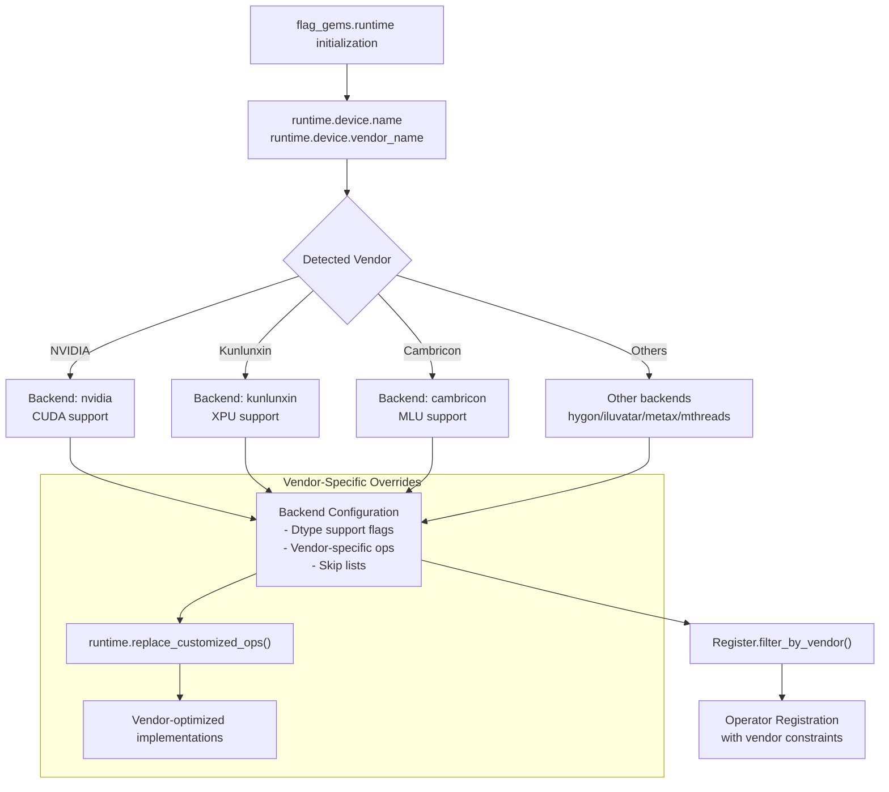

The `flag_gems.device` and `flag_gems.vendor_name` variables expose the detected hardware platform at runtime. Tests use `flag_gems.vendor_name` for platform-specific test skipping.

Sources: [README.md:96-110](), [src/flag_gems/__init__.py:16-17](), [src/flag_gems/__init__.py:21](), [tests/test_special_ops.py:34]()

### Dynamic Code Generation

FlagGems provides automatic code generation for pointwise operations through the `@pointwise_dynamic` decorator. This system generates specialized Triton kernels based on tensor rank, shape, stride, and data types at runtime, eliminating the need to write separate kernels for each tensor configuration.

#### Code Generation Pipeline

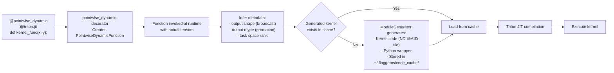

**Example usage:**

```python
from flag_gems.utils import pointwise_dynamic
import triton
import triton.language as tl

@pointwise_dynamic(promotion_methods=[(0, "DEFAULT")])
@triton.jit
def sqrt_func(x):
    return tl.sqrt(x.to(tl.float32))

# At runtime, specialized kernels are generated for each tensor rank/stride
result = sqrt_func(tensor)  # Generates kernel for tensor's configuration
```

The decorator supports:
- Arbitrary tensor ranks and shapes
- Broadcasting across inputs
- Type promotion rules
- Mixed tensor and non-tensor parameters
- In-place operations via `out0` parameter

Generated code is cached in `~/.flaggems/code_cache/` with hash-based filenames to avoid regeneration.

Sources: [README.md:36-40](), [src/flag_gems/ops/sqrt.py:11-25](), [src/flag_gems/ops/elu.py:11-69](), [docs/pointwise_dynamic.md:1-44]()

### LibEntry and LibTuner Systems

FlagGems provides two complementary systems for kernel execution optimization:

#### LibEntry - Kernel Cache Manager

`@libentry()` decorator manages per-device kernel caching, bypassing Triton's nested runtime invocations (`Autotuner`, `Heuristics`, `JitFunction`) to reduce dispatch overhead. It simplifies cache key computation and eliminates redundant parameter processing.

```python
from flag_gems.utils import libentry

@libentry()
@triton.jit
def embedding_kernel(out_ptr, in_ptr, weight_ptr, N: tl.constexpr, BLOCK_SIZE: tl.constexpr):
    pid = tle.program_id(0)
    # ... kernel implementation
```

LibEntry maintains a per-device cache (`kernel_cache`) that maps simplified cache keys directly to compiled kernels, achieving faster lookup than Triton's default multi-level caching.

#### LibTuner - Configuration Autotuning

`@libtuner()` decorator enables automatic performance tuning by evaluating multiple kernel configurations (block sizes, tile sizes, etc.) and selecting the optimal one. Results are persisted in SQLite databases (`TunedConfig_{device}.db`) for reuse across runs.

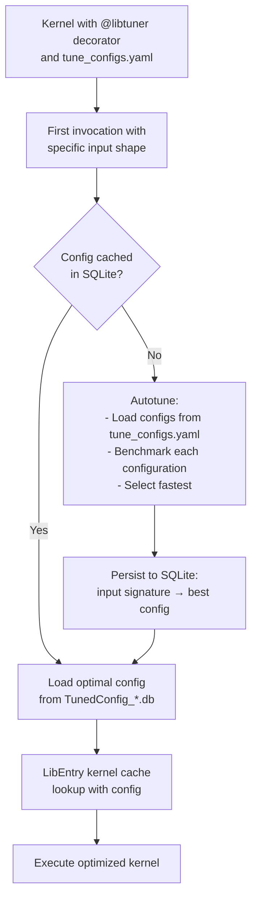

The combination of LibEntry (fast dispatch) and LibTuner (optimal configuration) provides both low overhead and high performance.

Sources: [README.md:42-47](), [src/flag_gems/ops/embedding.py:14-33](), [src/flag_gems/ops/embedding.py:36-51]()

## Usage Patterns

FlagGems is designed to be easy to integrate into existing PyTorch code. There are two main patterns for using FlagGems:

### Global Enabling

```python
import torch
import flag_gems

# Enable FlagGems globally
flag_gems.enable()

# All supported PyTorch operations will now use FlagGems implementations
result = torch.add(tensor1, tensor2)
```

### Context Manager

```python
import torch
import flag_gems

# Use FlagGems only within this context
with flag_gems.use_gems():
    # Operations here use FlagGems implementations
    result = torch.add(tensor1, tensor2)

# Operations here use standard PyTorch implementations
result2 = torch.add(tensor3, tensor4)
```

Sources: [src/flag_gems/__init__.py:43-326](), [src/flag_gems/__init__.py:328-357]()

## Performance Benefits

FlagGems provides significant performance improvements over standard PyTorch operations. The optimizations come from:

1. **Specialized Implementations**: Algorithms tailored for specific operation patterns
2. **Hardware Optimizations**: Kernels optimized for specific hardware capabilities
3. **Fusion Opportunities**: Combined operations that reduce memory traffic
4. **Triton Advantages**: Leveraging Triton's programming model for GPU optimization

Performance benchmarking in FlagGems measures metrics including:

- Latency (milliseconds)
- Speedup (compared to PyTorch)
- Throughput (GB/s)
- Computational performance (TFLOPS)

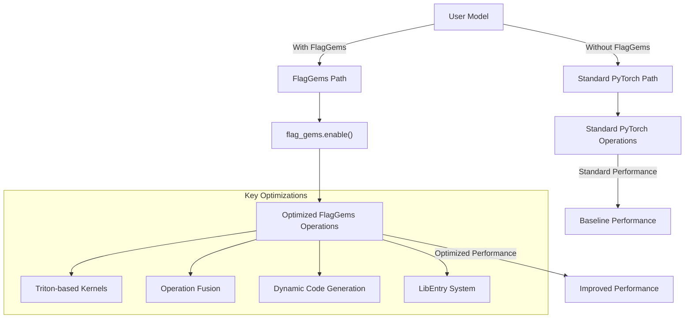

Sources: [README.md:76-80](), [benchmark/test_reduction_perf.py:22-33](), [benchmark/test_special_perf.py:9-17]()

## Supported Models and Hardware

### Supported Models

FlagGems has been tested and optimized for several popular deep learning models:

- Bert-base-uncased
- Llama-2-7b
- Llava-1.5-7b

### Supported Hardware

| Platform | float16 | float32 | bfloat16 |
|----------|---------|---------|----------|
| NVIDIA GPU | ✓ | ✓ | ✓ |

Additional hardware platforms are under development.

Sources: [README.md:64-69](), [README.md:70-75]()

---

# Page: Installation and Setup

# Installation and Setup

<details>
<summary>Relevant source files</summary>

The following files were used as context for generating this wiki page:

- [README.md](README.md)
- [README_cn.md](README_cn.md)
- [ctests/CMakeLists.txt](ctests/CMakeLists.txt)
- [ctests/test_triton_reduction.cpp](ctests/test_triton_reduction.cpp)
- [ctests/test_triton_rwkv_ka_fusion.cpp](ctests/test_triton_rwkv_ka_fusion.cpp)
- [ctests/test_triton_rwkv_mm_sparsity.cpp](ctests/test_triton_rwkv_mm_sparsity.cpp)
- [docs/add_a_cpp_wrapper.md](docs/add_a_cpp_wrapper.md)
- [docs/get_start_with_flaggems.md](docs/get_start_with_flaggems.md)
- [docs/how_to_use_flaggems.md](docs/how_to_use_flaggems.md)
- [docs/index.md](docs/index.md)
- [docs/installation.md](docs/installation.md)
- [docs/pointwise_dynamic.md](docs/pointwise_dynamic.md)
- [examples/integration_gems_with_vllm.py](examples/integration_gems_with_vllm.py)
- [include/flag_gems/operators.h](include/flag_gems/operators.h)
- [include/flag_gems/utils.h](include/flag_gems/utils.h)
- [lib/CMakeLists.txt](lib/CMakeLists.txt)
- [lib/rwkv_ka_fusion.cpp](lib/rwkv_ka_fusion.cpp)
- [lib/rwkv_mm_sparsity.cpp](lib/rwkv_mm_sparsity.cpp)
- [lib/utils.cpp](lib/utils.cpp)
- [mkdocs.yml](mkdocs.yml)
- [pyproject.toml](pyproject.toml)
- [src/flag_gems/csrc/cstub.cpp](src/flag_gems/csrc/cstub.cpp)
- [src/flag_gems/ops/sqrt.py](src/flag_gems/ops/sqrt.py)

</details>


## Purpose and Scope

This document covers the installation and setup process for FlagGems, including dependency requirements, installation methods, and build configuration options. It explains both pure Python installation (default) and C++ extension installation (advanced, for reduced runtime overhead).

For usage instructions after installation, see [Quick Start Guide](#1.2). For details about the C++ runtime capabilities, see [C++ Extensions](#6.1).

---

## Overview

FlagGems supports two installation modes:

| Installation Mode | Use Case | Build Time | Runtime Performance |
|------------------|----------|------------|-------------------|
| **Pure Python** | Standard usage, fastest setup | Minutes | Good |
| **C++ Extensions** | Production deployments, latency-sensitive scenarios | 10-20 minutes | Excellent |

The pure Python installation includes all core functionality. The C++ extensions provide an optional performance layer that reduces Python runtime overhead by implementing operator wrappers, registration, and dispatch logic in C++.

Sources: [README.md:48-50](), [docs/installation.md:34-48](), [pyproject.toml:1-59]()

---

## Build System Architecture

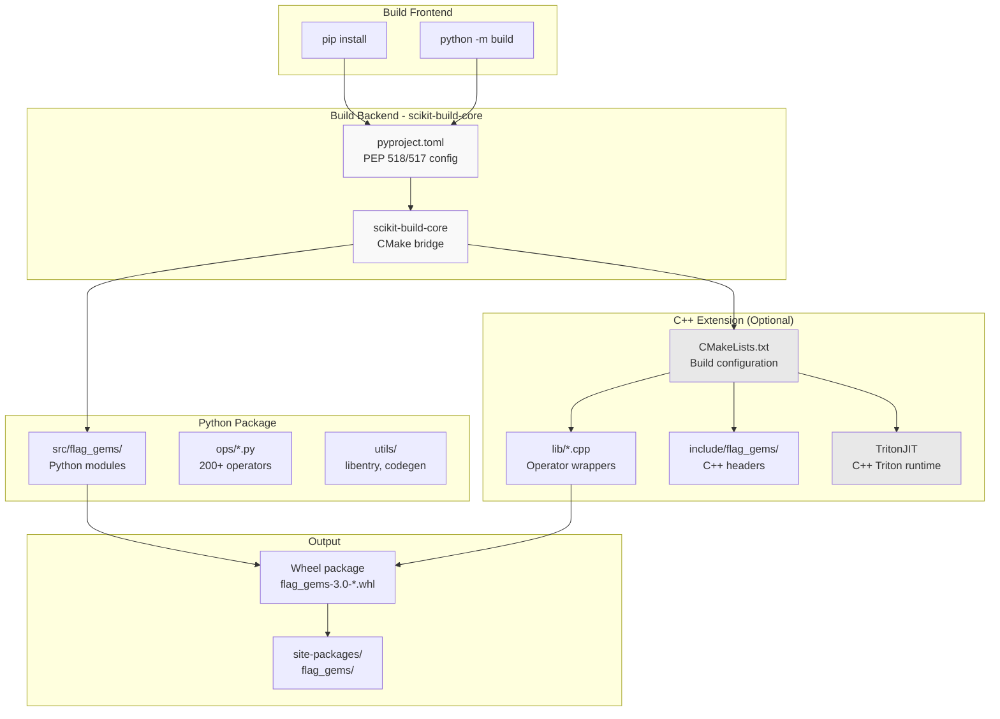

**FlagGems Build System**: The build uses `scikit-build-core` as the backend, bridging CMake and Python packaging. The Python package is always built; C++ extensions are conditionally compiled based on CMake options.

Sources: [pyproject.toml:1-59](), [docs/installation.md:16-20](), [lib/CMakeLists.txt:1-53]()

---

## Prerequisites

### Required Dependencies

The following dependencies are required for all installation modes:

```python
# Core runtime dependencies
torch >= 2.2.0      # PyTorch framework
packaging           # Version parsing utilities
pybind11           # Python-C++ bindings
PyYAML             # Configuration file parsing
```

### Build Dependencies

Additional dependencies required during installation:

```bash
# Build system requirements
setuptools >= 64.0
scikit-build-core >= 0.11
pybind11

# Development tools (for C++ extensions)
cmake              # Build system generator
ninja              # Fast build tool (optional but recommended)
```

Sources: [pyproject.toml:24-30](), [docs/installation.md:26-32](), [docs/get_start_with_flaggems.md:13-17]()

---

## Pure Python Installation

The pure Python installation is the default and recommended method for most users. It provides full FlagGems functionality without requiring C++ compilation.

### Installation Steps


**Pure Python Installation Flow**: Standard Python package installation workflow.

#### Step 1: Install Build Dependencies

```bash
pip install -U scikit-build-core>=0.11 pybind11 ninja cmake
```

#### Step 2: Clone Repository

```bash
git clone https://github.com/FlagOpen/FlagGems
cd FlagGems/
```

#### Step 3: Install Package

Choose one of the following installation methods:

**Standard Installation:**
```bash
pip install --no-build-isolation .
```

**Editable Installation** (for development):
```bash
pip install --no-build-isolation -e .
```

The `--no-build-isolation` flag is used because build dependencies are already installed. This speeds up installation and avoids redundant virtual environment creation.

Sources: [docs/installation.md:36-46](), [docs/get_start_with_flaggems.md:13-27](), [README.md:81-83]()

### Build Options

| pip Option | Effect |
|-----------|--------|
| `-v` | Verbose output (shows build progress) |
| `-e` | Editable install (changes reflected without reinstall) |
| `--no-build-isolation` | Skip virtual env creation (faster if deps installed) |
| `--no-deps` | Skip dependency installation |

Sources: [docs/installation.md:71-76]()

---

## C++ Extension Installation

The C++ extension build provides significant performance improvements by implementing the operator dispatch layer in C++ rather than Python. This reduces per-operator invocation overhead.

### Architecture with C++ Extensions

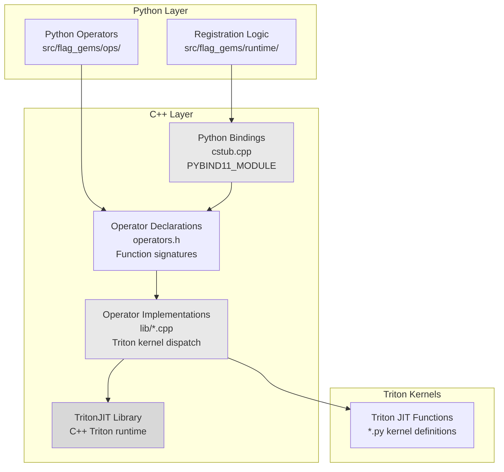

**C++ Extension Architecture**: C++ wrappers provide fast dispatch to Triton kernels, bypassing Python overhead for registered operators.

Sources: [include/flag_gems/operators.h:1-109](), [src/flag_gems/csrc/cstub.cpp:1-118](), [lib/CMakeLists.txt:1-53]()

### Build Configuration Options

The C++ build is controlled via CMake options passed through environment variables:

| CMake Option | Description | Default |
|-------------|-------------|---------|
| `FLAGGEMS_BUILD_C_EXTENSIONS` | Enable C++ extension build | `OFF` (pure Python) |
| `FLAGGEMS_USE_EXTERNAL_TRITON_JIT` | Use external TritonJIT library | `OFF` (fetch as subproject) |
| `FLAGGEMS_USE_EXTERNAL_PYBIND11` | Use external pybind11 library | `ON` |
| `FLAGGEMS_BUILD_CTESTS` | Build C++ unit tests | Same as `FLAGGEMS_BUILD_C_EXTENSIONS` |
| `FLAGGEMS_INSTALL` | Install CMake package files | `ON` when top-level project |

Sources: [docs/installation.md:54-62]()

### Installation with External TritonJIT

If you have TritonJIT pre-installed:

```bash
# Install build dependencies
pip install -U scikit-build-core ninja cmake pybind11

# Configure and install with external TritonJIT
CMAKE_ARGS="-DFLAGGEMS_BUILD_C_EXTENSIONS=ON \
            -DFLAGGEMS_USE_EXTERNAL_TRITON_JIT=ON \
            -DTritonJIT_ROOT=<path_to_triton_jit_install>" \
pip install --no-build-isolation -v -e .
```

Sources: [docs/installation.md:80-87]()

### Installation with TritonJIT as Subproject

For automatic TritonJIT download and build via CMake FetchContent:

```bash
# Install build dependencies
pip install -U scikit-build-core ninja cmake pybind11

# Configure and install (TritonJIT fetched automatically)
CMAKE_ARGS="-DFLAGGEMS_BUILD_C_EXTENSIONS=ON" \
pip install --no-build-isolation -v -e .
```

Sources: [docs/installation.md:89-94]()

### Environment Variables for Build Configuration

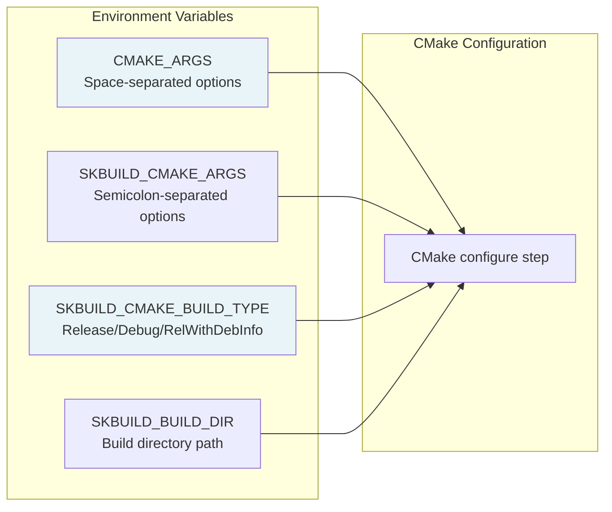

**Build Environment Variables**: Control CMake configuration through environment variables. Note: `CMAKE_ARGS` uses spaces, `SKBUILD_CMAKE_ARGS` uses semicolons.

| Variable | Purpose | Example |
|----------|---------|---------|
| `CMAKE_ARGS` | Pass CMake options (space-separated) | `"-DFLAGGEMS_BUILD_C_EXTENSIONS=ON"` |
| `SKBUILD_CMAKE_ARGS` | Pass CMake options (semicolon-separated) | `"-DFLAGGEMS_BUILD_C_EXTENSIONS=ON;-DCMAKE_BUILD_TYPE=Release"` |
| `SKBUILD_CMAKE_BUILD_TYPE` | Set build type | `Release`, `Debug`, `RelWithDebInfo`, `MinSizeRel` |
| `SKBUILD_BUILD_DIR` | Set build directory | `build/custom_dir` |

Sources: [docs/installation.md:51-69]()

---

## C++ Operator Wrappers

When C++ extensions are built, selected operators have C++ wrappers available:

```cpp
// Example operator declarations from operators.h
namespace flag_gems {
    at::Tensor sum(const at::Tensor &self, 
                   std::optional<at::ScalarType> dtype = std::nullopt);
    
    at::Tensor rms_norm(const at::Tensor &input, 
                        const at::Tensor &weight, 
                        double epsilon = 1e-5);
    
    at::Tensor mm_tensor(const at::Tensor &mat1, 
                         const at::Tensor &mat2);
    
    void fused_add_rms_norm(at::Tensor &input,
                           at::Tensor &residual,
                           const at::Tensor &weight,
                           double epsilon = 1e-5);
}
```

These operators are registered in the `flag_gems` namespace and accessible via `torch.ops.flag_gems.*`.

Currently supported C++ operators:

| Category | Operators |
|----------|-----------|
| **Reduction** | `sum`, `max`, `argmax`, `nonzero` |
| **Normalization** | `rms_norm`, `fused_add_rms_norm`, `softmax` |
| **Matrix Operations** | `mm`, `addmm`, `bmm` |
| **Tensor Operations** | `add`, `cat`, `contiguous`, `fill`, `zeros` |
| **Embedding** | `embedding`, `rotary_embedding` |
| **Special** | `topk`, `exponential_` |
| **RWKV** | `rwkv_mm_sparsity`, `rwkv_ka_fusion` |

Sources: [include/flag_gems/operators.h:5-109](), [src/flag_gems/csrc/cstub.cpp:8-116](), [lib/CMakeLists.txt:1-27]()

---

## Creating Distribution Packages

### Building a Wheel

To create a binary distribution (wheel) for distribution:

**Using `build` package (recommended):**
```bash
pip install -U build
python -m build --no-isolation --no-deps .
```

This creates both source distribution (`.tar.gz`) and wheel (`.whl`) in the `dist/` directory.

**Using `pip`:**
```bash
pip wheel --no-build-isolation --no-deps -w dist .
```

### Build Target Options

| Command | Output |
|---------|--------|
| `python -m build --no-isolation --no-deps .` | Both sdist and wheel |
| `python -m build --no-isolation --no-deps --sdist .` | Source distribution only |
| `python -m build --no-isolation --no-deps --wheel .` | Wheel only |

Sources: [docs/installation.md:96-131]()

---

## Runtime Environment Variables

After installation, FlagGems behavior can be configured via environment variables:

| Variable | Purpose | Values | Default |
|----------|---------|--------|---------|
| `GEMS_VENDOR` | Manually set backend vendor | `nvidia`, `kunlunxin`, `cambricon`, etc. | Auto-detected |
| `FLAGGEMS_SOURCE_DIR` | Path to source directory (C++ builds) | Directory path | Required for C++ extensions |

### Backend Auto-Detection

FlagGems automatically detects hardware vendor at runtime. To verify:

```python
import flag_gems
print(flag_gems.vendor_name)  # Prints detected vendor
```

Manual override (if auto-detection fails):
```bash
export GEMS_VENDOR=nvidia
```

Sources: [docs/how_to_use_flaggems.md:116-133](), [lib/utils.cpp:35-44]()

---

## Verification

After installation, verify that FlagGems is correctly installed:

### Basic Verification

```python
import flag_gems
print(f"FlagGems version: {flag_gems.__version__}")
print(f"Backend vendor: {flag_gems.vendor_name}")
print(f"Device: {flag_gems.device}")
```

### Verify C++ Extensions

To check if C++ extensions are available:

```python
try:
    from flag_gems import c_operators
    has_c_extension = True
    print("C++ extensions: Available")
except ImportError:
    has_c_extension = False
    print("C++ extensions: Not available")
```

### Verify Operator Registration

```python
import flag_gems
import torch

# Enable FlagGems
flag_gems.enable()

# Test a simple operation
x = torch.randn(10, 10, device=flag_gems.device)
y = torch.sum(x)  # Should use FlagGems implementation
print(f"Sum result: {y.item()}")
```

Sources: [docs/how_to_use_flaggems.md:406-417](), [docs/get_start_with_flaggems.md:42-64]()

---

## Installation Flow Diagram

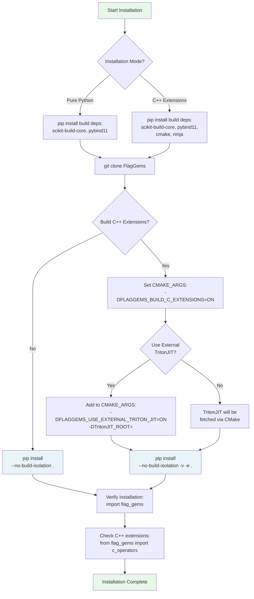

**Complete Installation Flow**: Decision tree showing installation paths for both pure Python and C++ extension builds.

Sources: [docs/installation.md:1-131](), [docs/get_start_with_flaggems.md:1-64]()

---

## Common Installation Issues

### Build Isolation Warnings

If you see warnings about missing build dependencies when using `--no-build-isolation`, ensure all dependencies from `[build-system.requires]` are installed:

```bash
pip install -U setuptools>=64.0 scikit-build-core>=0.11 pybind11
```

### CMake Configuration Errors

If CMake fails to configure:
1. Verify CMake version: `cmake --version` (requires ≥3.15)
2. Check that environment variables are properly set
3. Use `-v` flag for verbose output: `pip install -v ...`

### TritonJIT Linking Errors

If linking fails with external TritonJIT:
1. Verify TritonJIT is properly installed at the specified path
2. Ensure `TritonJIT_ROOT` points to the installation prefix (containing `lib/` and `include/`)
3. Check that TritonJIT was built for the same PyTorch version

Sources: [docs/installation.md:22-27](), [docs/installation.md:64-65]()

---

## Next Steps

After successful installation:
- See [Quick Start Guide](#1.2) for basic usage examples
- See [Runtime and Device Management](#2.5) for backend configuration
- See [C++ Extensions](#6.1) for advanced C++ runtime usage
- See [Framework Integration](#6.2) for integrating with vLLM, Transformers, etc.

Sources: [README.md:81-89](), [docs/get_start_with_flaggems.md:38-64]()

---

# Page: Quick Start Guide

# Quick Start Guide

<details>
<summary>Relevant source files</summary>

The following files were used as context for generating this wiki page:

- [README.md](README.md)
- [README_cn.md](README_cn.md)
- [benchmark/test_special_perf.py](benchmark/test_special_perf.py)
- [benchmark/test_unary_pointwise_perf.py](benchmark/test_unary_pointwise_perf.py)
- [docs/add_a_cpp_wrapper.md](docs/add_a_cpp_wrapper.md)
- [docs/get_start_with_flaggems.md](docs/get_start_with_flaggems.md)
- [docs/how_to_use_flaggems.md](docs/how_to_use_flaggems.md)
- [docs/index.md](docs/index.md)
- [docs/installation.md](docs/installation.md)
- [docs/pointwise_dynamic.md](docs/pointwise_dynamic.md)
- [examples/integration_gems_with_vllm.py](examples/integration_gems_with_vllm.py)
- [mkdocs.yml](mkdocs.yml)
- [pyproject.toml](pyproject.toml)
- [src/flag_gems/__init__.py](src/flag_gems/__init__.py)
- [src/flag_gems/fused/__init__.py](src/flag_gems/fused/__init__.py)
- [src/flag_gems/fused/moe_align_block_size.py](src/flag_gems/fused/moe_align_block_size.py)
- [src/flag_gems/fused/reshape_and_cache.py](src/flag_gems/fused/reshape_and_cache.py)
- [src/flag_gems/fused/reshape_and_cache_flash.py](src/flag_gems/fused/reshape_and_cache_flash.py)
- [src/flag_gems/fused/silu_and_mul.py](src/flag_gems/fused/silu_and_mul.py)
- [src/flag_gems/ops/__init__.py](src/flag_gems/ops/__init__.py)
- [src/flag_gems/ops/elu.py](src/flag_gems/ops/elu.py)
- [src/flag_gems/ops/embedding.py](src/flag_gems/ops/embedding.py)
- [src/flag_gems/ops/nllloss.py](src/flag_gems/ops/nllloss.py)
- [src/flag_gems/ops/sqrt.py](src/flag_gems/ops/sqrt.py)
- [src/flag_gems/patches/patch_util.py](src/flag_gems/patches/patch_util.py)
- [src/flag_gems/patches/patch_vllm_all.py](src/flag_gems/patches/patch_vllm_all.py)
- [tests/accuracy_utils.py](tests/accuracy_utils.py)
- [tests/test_binary_pointwise_ops.py](tests/test_binary_pointwise_ops.py)
- [tests/test_special_ops.py](tests/test_special_ops.py)
- [tests/test_unary_pointwise_ops.py](tests/test_unary_pointwise_ops.py)

</details>


This guide provides a practical introduction to FlagGems, a high-performance operator library for PyTorch that leverages OpenAI Triton. You'll learn how to install FlagGems, integrate it into your PyTorch code, and understand the performance benefits it offers. For more detailed information about the system architecture, see [Core Architecture](#2).

## Installation

FlagGems can be installed either as a pure Python package or with C++ extensions for improved performance.

### Basic Installation

```bash
pip install flag-gems
```

### Installation with C++ Extensions

For better performance, you can build FlagGems with C++ extensions:

```bash
git clone https://github.com/FlagOpen/FlagGems.git
cd FlagGems
pip install -e .
```

Sources: [README.md:33-35](), [README.md:56-58]()

## Basic Usage

There are two main ways to enable FlagGems in your PyTorch code:

### Using the `enable()` function

The `enable()` function registers FlagGems implementations with PyTorch's ATen library globally:

```python
import torch
import flag_gems

# Enable FlagGems globally
flag_gems.enable()

# Your PyTorch code remains unchanged
x = torch.randn(1000, 1000, device="cuda")
y = torch.randn(1000, 1000, device="cuda")
z = x + y  # This will use FlagGems' optimized implementation
```

### Using the `use_gems()` context manager

The `use_gems()` context manager enables FlagGems only within its scope:

```python
import torch
import flag_gems

# Use FlagGems only within this context
with flag_gems.use_gems():
    x = torch.randn(1000, 1000, device="cuda")
    y = torch.randn(1000, 1000, device="cuda")
    z = x + y  # This will use FlagGems' optimized implementation

# Outside the context, standard PyTorch implementations are used
a = torch.randn(1000, 1000, device="cuda")
b = torch.randn(1000, 1000, device="cuda")
c = a + b  # This will use PyTorch's standard implementation
```

Sources: [src/flag_gems/__init__.py:43-326](), [src/flag_gems/__init__.py:328-357]()

## Operation Registration Flow

The following diagram illustrates how FlagGems integrates with PyTorch:

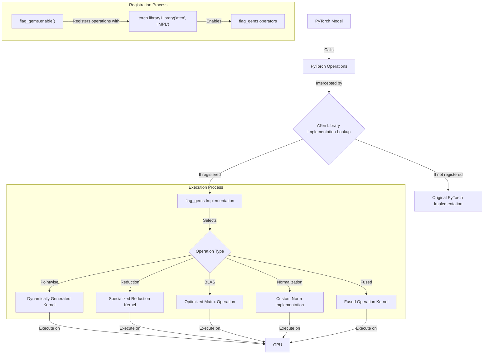

Sources: [src/flag_gems/__init__.py:23-27](), [src/flag_gems/__init__.py:43-326]()

## Examples of Common Operations

### Matrix Multiplication

```python
import torch
import flag_gems

with flag_gems.use_gems():
    # Matrix multiplication
    a = torch.randn(1024, 1024, device="cuda")
    b = torch.randn(1024, 1024, device="cuda")
    c = torch.mm(a, b)  # Uses FlagGems' optimized implementation
```

### Pointwise Operations

```python
import torch
import flag_gems

with flag_gems.use_gems():
    # Pointwise operations
    x = torch.randn(1000, 1000, device="cuda")
    y = torch.sin(x)  # Uses FlagGems' optimized implementation
    z = torch.exp(x)  # Uses FlagGems' optimized implementation
```

### Reduction Operations

```python
import torch
import flag_gems

with flag_gems.use_gems():
    # Reduction operations
    x = torch.randn(1000, 1000, device="cuda")
    y = torch.sum(x, dim=1)  # Uses FlagGems' optimized implementation
    z = torch.mean(x, dim=0)  # Uses FlagGems' optimized implementation
```

### Neural Network Operations

```python
import torch
import flag_gems

with flag_gems.use_gems():
    # Dropout
    x = torch.randn(1000, 1000, device="cuda")
    y = torch.nn.functional.dropout(x, p=0.3, training=True)
    
    # Embedding
    indices = torch.randint(0, 1000, (128, 20), device="cuda")
    embedding = torch.randn((1000, 768), device="cuda", requires_grad=True)
    output = torch.nn.functional.embedding(indices, embedding)
```

Sources: [tests/test_special_ops.py:31-84](), [tests/test_special_ops.py:205-241](), [tests/test_reduction_ops.py:381-404]()

## Categories of Supported Operations

FlagGems supports a wide range of PyTorch operations:

| Category | Examples | Description |
|----------|----------|-------------|
| Pointwise | `add`, `mul`, `div`, `sin`, `cos` | Element-wise operations on tensors |
| Reduction | `sum`, `mean`, `max`, `min` | Operations that reduce tensor dimensions |
| BLAS | `mm`, `bmm`, `addmm` | Basic Linear Algebra Subprograms |
| Normalization | `layer_norm`, `batch_norm`, `group_norm` | Normalization operations |
| Tensor Manipulation | `where`, `arange`, `repeat`, `masked_fill` | Operations that manipulate tensor structure |
| Neural Network | `embedding`, `dropout`, `softmax` | Operations commonly used in neural networks |
| Fused Operations | `apply_rotary_pos_emb`, `gelu_and_mul` | Optimized combinations of operations |

Sources: [src/flag_gems/ops/__init__.py:1-171](), [README.md:39-54]()

## Advanced Features

### Configuring Unused Operations

You can specify which operations should not be overridden by FlagGems:

```python
import torch
import flag_gems

# Keep PyTorch's implementation for softmax
unused_ops = ["softmax"]
flag_gems.enable(unused=unused_ops)

# or with context manager
with flag_gems.use_gems(unused=unused_ops):
    # Your code here
```

### Operation Logging

You can enable logging to track which operations are being used:

```python
import torch
import flag_gems

# Enable logging
flag_gems.enable(record=True)

# or with context manager
with flag_gems.use_gems(record=True):
    # Your code here
```

By default, logs are written to `~/.flaggems/oplist.log`. You can specify a custom path:

```python
import torch
import flag_gems

# Enable logging with custom path
flag_gems.enable(record=True, path="/path/to/logfile.log")
```

### One-time Logging

To log each operation only once per location in your code:

```python
import torch
import flag_gems

# Enable one-time logging
flag_gems.enable(record=True, once=True)
```

Sources: [src/flag_gems/__init__.py:43-326](), [src/flag_gems/__init__.py:328-357]()

## Performance Benchmarking

FlagGems can provide significant performance improvements. Here's a simple benchmarking example:

```python
import torch
import flag_gems
import time

# Prepare data
x = torch.randn(1024, 1024, device="cuda")
y = torch.randn(1024, 1024, device="cuda")

# Benchmark PyTorch
torch.cuda.synchronize()
start = time.time()
for _ in range(100):
    z = torch.mm(x, y)
torch.cuda.synchronize()
pytorch_time = time.time() - start

# Benchmark FlagGems
with flag_gems.use_gems():
    torch.cuda.synchronize()
    start = time.time()
    for _ in range(100):
        z = torch.mm(x, y)
    torch.cuda.synchronize()
    flaggems_time = time.time() - start

print(f"PyTorch time: {pytorch_time:.4f}s")
print(f"FlagGems time: {flaggems_time:.4f}s")
print(f"Speedup: {pytorch_time / flaggems_time:.2f}x")
```

For more comprehensive benchmarking, you can use the tools in the `benchmark` directory:

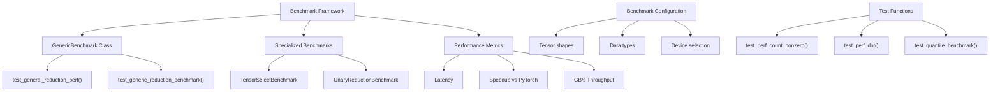

Sources: [benchmark/test_reduction_perf.py:22-36](), [benchmark/test_reduction_perf.py:52-86](), [benchmark/test_special_perf.py:41-73]()

## Supported Hardware and Operations

### Hardware Support

| Platform | float16 | float32 | bfloat16 |
|----------|---------|---------|----------|
| NVIDIA GPU | ✓ | ✓ | ✓ |

### Most Commonly Used Operations

| Operation | Description | Example |
|-----------|-------------|---------|
| `torch.mm` | Matrix multiplication | `torch.mm(a, b)` |
| `torch.bmm` | Batch matrix multiplication | `torch.bmm(a, b)` |
| `torch.add` | Element-wise addition | `torch.add(a, b)` |
| `torch.mul` | Element-wise multiplication | `torch.mul(a, b)` |
| `torch.div` | Element-wise division | `torch.div(a, b)` |
| `torch.sum` | Sum reduction | `torch.sum(a, dim=1)` |
| `torch.mean` | Mean reduction | `torch.mean(a, dim=0)` |
| `torch.max` | Maximum value | `torch.max(a, dim=1)` |
| `torch.sigmoid` | Sigmoid activation | `torch.sigmoid(a)` |
| `torch.tanh` | Tanh activation | `torch.tanh(a)` |
| `torch.gelu` | GELU activation | `torch.gelu(a)` |
| `torch.nn.functional.softmax` | Softmax activation | `torch.nn.functional.softmax(a, dim=1)` |
| `torch.nn.functional.dropout` | Dropout regularization | `torch.nn.functional.dropout(a, p=0.5)` |

For a complete list of supported operations, refer to [Operations](#3) in the wiki.

Sources: [README.md:71-75](), [src/flag_gems/ops/__init__.py:1-171]()

## Troubleshooting

### Operation Not Supported

If you encounter an operation that's not supported by FlagGems, you can add it to the `unused` list:

```python
import torch
import flag_gems

# Specify unsupported operations
unused_ops = ["unsupported_op"]
with flag_gems.use_gems(unused=unused_ops):
    # Your code here
```

### Performance Issues

If you encounter performance issues:

1. Ensure you're using the latest version of FlagGems and PyTorch
2. Consider building FlagGems with C++ extensions for better performance
3. Verify that your CUDA drivers and toolkit are up to date
4. Try different batch sizes or tensor shapes

Sources: [src/flag_gems/__init__.py:43-45](), [src/flag_gems/__init__.py:328-336]()

## Supported Models

FlagGems has been tested with the following models:

- Bert-base-uncased
- Llama-2-7b
- Llava-1.5-7b

These models can run correctly and efficiently with FlagGems-optimized operators.

Sources: [README.md:64-69]()

## Next Steps

- For more detailed information about the architecture, see [Core Architecture](#2) in the wiki
- For comprehensive information about specific operations, see [Operations](#3) in the wiki
- For information about hardware backends, see [Hardware Backends](#4) in the wiki
- For advanced topics, see [Advanced Topics](#6) in the wiki

---

# Page: Core Architecture

# Core Architecture

<details>
<summary>Relevant source files</summary>

The following files were used as context for generating this wiki page:

- [benchmark/test_special_perf.py](benchmark/test_special_perf.py)
- [benchmark/test_unary_pointwise_perf.py](benchmark/test_unary_pointwise_perf.py)
- [lib/addmm.cpp](lib/addmm.cpp)
- [lib/mm.cpp](lib/mm.cpp)
- [src/flag_gems/__init__.py](src/flag_gems/__init__.py)
- [src/flag_gems/csrc/aten_patch.cpp](src/flag_gems/csrc/aten_patch.cpp)
- [src/flag_gems/fused/fused_add_rms_norm.py](src/flag_gems/fused/fused_add_rms_norm.py)
- [src/flag_gems/ops/__init__.py](src/flag_gems/ops/__init__.py)
- [src/flag_gems/ops/addmm.py](src/flag_gems/ops/addmm.py)
- [src/flag_gems/ops/elu.py](src/flag_gems/ops/elu.py)
- [src/flag_gems/ops/embedding.py](src/flag_gems/ops/embedding.py)
- [src/flag_gems/ops/mm.py](src/flag_gems/ops/mm.py)
- [src/flag_gems/ops/mm_streamk.py](src/flag_gems/ops/mm_streamk.py)
- [src/flag_gems/ops/nllloss.py](src/flag_gems/ops/nllloss.py)
- [src/flag_gems/runtime/backend/_nvidia/tune_configs.yaml](src/flag_gems/runtime/backend/_nvidia/tune_configs.yaml)
- [src/flag_gems/utils/libentry.py](src/flag_gems/utils/libentry.py)
- [tests/accuracy_utils.py](tests/accuracy_utils.py)
- [tests/test_binary_pointwise_ops.py](tests/test_binary_pointwise_ops.py)
- [tests/test_blas_ops.py](tests/test_blas_ops.py)
- [tests/test_libentry.py](tests/test_libentry.py)
- [tests/test_special_ops.py](tests/test_special_ops.py)
- [tests/test_unary_pointwise_ops.py](tests/test_unary_pointwise_ops.py)

</details>


This document explains the fundamental architecture of FlagGems, including how operators are registered with PyTorch, how kernels are cached for performance, how configurations are auto-tuned, and how code is dynamically generated. These four systems form the core of FlagGems' ability to provide optimized operator implementations.

## Overview

FlagGems provides optimized Triton-based implementations for 200+ PyTorch operators. The architecture consists of four key systems:

1. **Operator Registration System** - Integrates with PyTorch's ATen library to intercept and replace operations
2. **LibEntry and Kernel Caching** - Manages compiled kernel caching to avoid JIT overhead
3. **LibTuner and Autotuning** - Automatically selects optimal kernel configurations
4. **Dynamic Code Generation** - Creates specialized kernels for pointwise operations

**System Architecture with Component Importance**

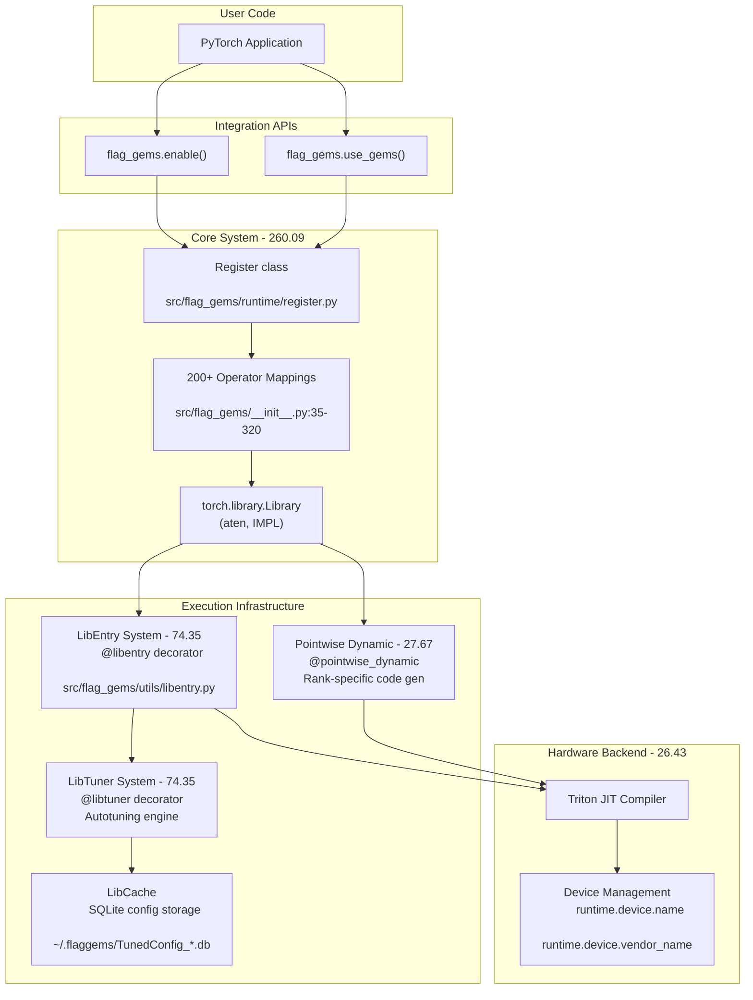

Sources:
- [src/flag_gems/__init__.py:1-367]()
- [src/flag_gems/utils/libentry.py:1-748]()

## Operator Registration System

The operator registration system is how FlagGems integrates with PyTorch's ATen library to provide optimized implementations. When enabled, FlagGems registers 200+ operator implementations that override PyTorch's default implementations.

### Registration APIs

FlagGems provides two APIs for enabling operator replacement:

| API | Scope | Usage |
|-----|-------|-------|
| `flag_gems.enable()` | Global | Registers operators for the entire program |
| `flag_gems.use_gems()` | Context manager | Registers operators only within a `with` block |

**Registration Flow**

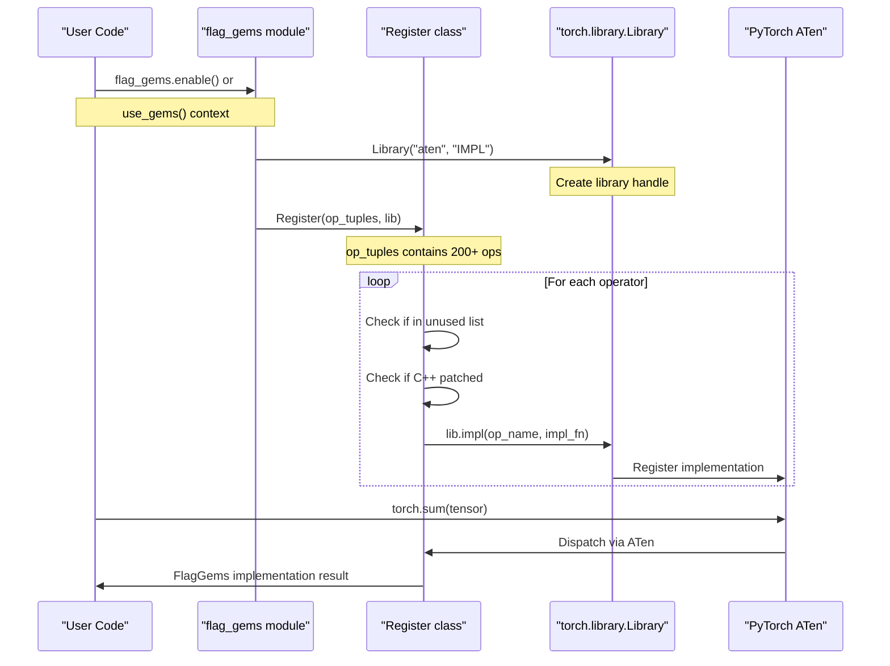

Sources:
- [src/flag_gems/__init__.py:24-64]()
- [src/flag_gems/__init__.py:328-357]()

### Registered Operations

The `enable()` function registers a tuple of 200+ operations defined in [src/flag_gems/__init__.py:35-320](). Each tuple entry contains:

```python
("operation.variant", implementation_function)
```

Examples:
- `("abs", abs)` - Absolute value
- `("add.Tensor", add)` - Tensor addition
- `("mm", mm)` - Matrix multiplication
- `("native_layer_norm", layer_norm)` - Layer normalization

The registration can be filtered by:
- `unused` parameter - List of operations to skip
- `cpp_patched_ops_list` - Operations with C++ implementations from [src/flag_gems/config.py:aten_patch_list]()

The global `current_work_registrar` instance tracks all registered operations and can be queried via `flag_gems.all_ops()`.

Sources:
- [src/flag_gems/__init__.py:33-326]()
- [src/flag_gems/ops/__init__.py:1-482]()
- [src/flag_gems/csrc/aten_patch.cpp:1-44]()

## LibEntry and Kernel Caching

The `LibEntry` system provides per-device kernel caching to avoid Triton's JIT compilation overhead. Each device maintains its own cache, and the `@libentry()` decorator manages cache lookups and kernel execution.

### LibEntry Decorator

The `@libentry()` decorator wraps Triton kernels to provide:

1. **Device-specific caching** - Separate cache per GPU device
2. **Bypasses nested runtime** - Avoids Triton's `Autotuner`, `Heuristics`, and `JITFunction` overhead
3. **Direct kernel invocation** - Reduces dispatch latency

**Kernel Cache Architecture**

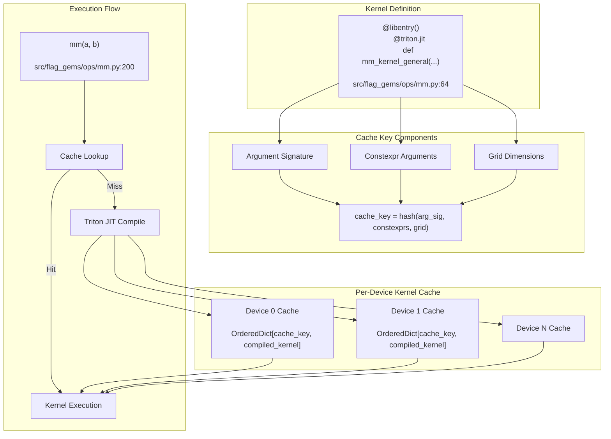

Sources:
- [src/flag_gems/utils/libentry.py:591-748]()
- [src/flag_gems/ops/mm.py:54-135]()

### Kernel Cache Implementation

The kernel cache is implemented in `LibEntry` class [src/flag_gems/utils/libentry.py:591-748](). Key features:

| Feature | Description |
|---------|-------------|
| Cache Storage | `OrderedDict` per device with LRU eviction |
| Cache Key | Hash of argument types, constexpr values, and grid config |
| Device Isolation | Each device has independent cache to avoid conflicts |
| Cache Size | Configurable maximum entries (default: 1024) |

The cache stores compiled kernels indexed by a hash of:
- Argument data types and shapes
- Constexpr parameter values (e.g., `BLOCK_M`, `BLOCK_N`, `BLOCK_K`)
- Grid launch configuration

**Example Usage**

```python
# From src/flag_gems/ops/embedding.py
@libentry()
@triton.jit
def embedding_kernel(
    out_ptr, in_ptr, weight_ptr,
    N: tl.constexpr,
    BLOCK_SIZE: tl.constexpr,
):
    # Kernel implementation
    ...
```

When `embedding_kernel` is called:
1. Cache key computed from argument types and constexpr values
2. If cache hit: use compiled kernel directly
3. If cache miss: compile via Triton, store in cache, then execute

Sources:
- [src/flag_gems/utils/libentry.py:591-748]()
- [src/flag_gems/ops/embedding.py:14-34]()

## LibTuner and Autotuning

The `LibTuner` system automatically selects optimal kernel configurations by benchmarking different tile sizes, warp counts, and pipeline stages. Tuned configurations are persisted in SQLite databases for reuse across runs.

### LibTuner Architecture

**Autotuning System Components**

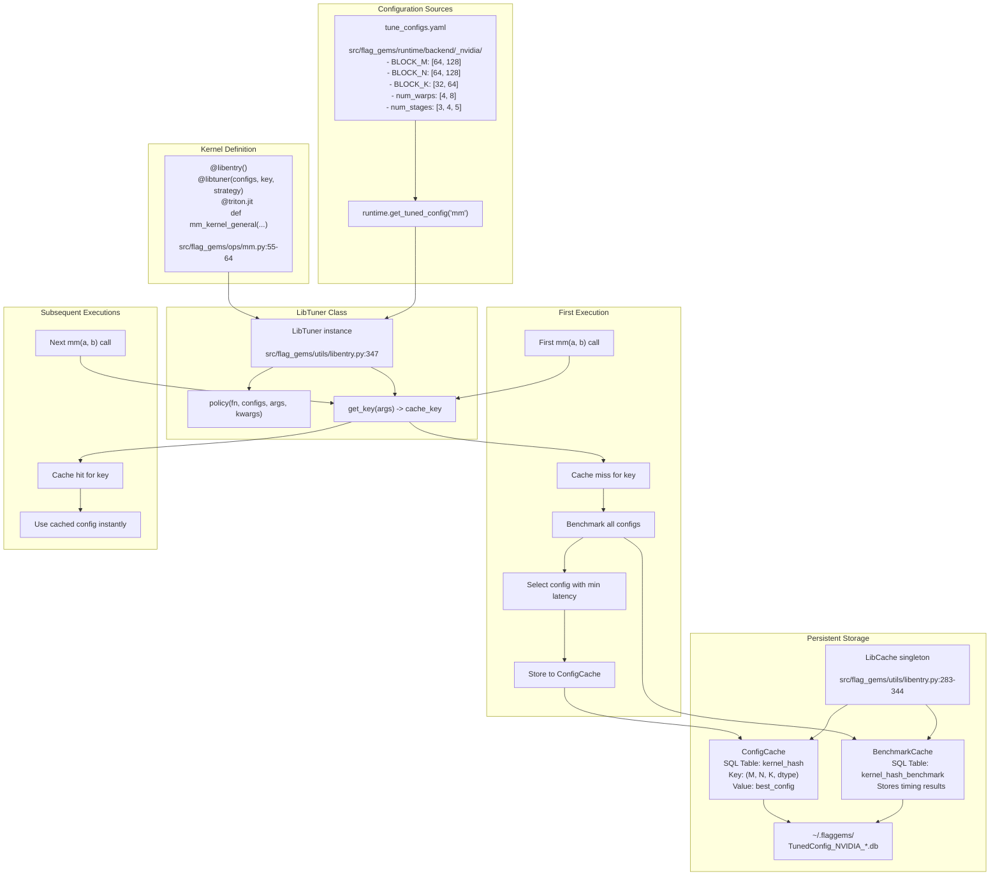

Sources:
- [src/flag_gems/utils/libentry.py:347-547]()
- [src/flag_gems/runtime/backend/_nvidia/tune_configs.yaml:1-500]()

### Configuration Tuning Process

The `LibTuner` class [src/flag_gems/utils/libentry.py:347-547]() extends Triton's `Autotuner` with persistent caching:

**Tuning Steps:**

1. **Cache Key Generation** - The `get_key()` method computes a key from:
   - Operator arguments specified in `key` parameter (e.g., `["M", "N", "K"]`)
   - Strategy transformations (e.g., `"align32"` rounds to nearest multiple of 32)
   - Data types of all tensor arguments

2. **Configuration Search** - On cache miss:
   - Load configs from YAML or programmatic source
   - Benchmark each config using `do_bench=True`
   - Store timing results in `BenchmarkCache`
   - Select config with minimum p50 latency

3. **Persistent Storage** - Store best config in `ConfigCache`:
   - SQLite table named `{kernel_name}_{kernel_hash}`
   - Primary key: tuple of cache key components
   - Value: `triton.Config` with optimal parameters

4. **Cache Retrieval** - On cache hit:
   - Instant lookup from SQLite
   - No benchmarking overhead
   - Direct kernel launch with optimal config

**Example Configuration**

From [src/flag_gems/runtime/backend/_nvidia/tune_configs.yaml:126-210]():

```yaml
mm:
  - META:
      BLOCK_M: 64
      BLOCK_N: 64
      BLOCK_K: 64
    num_stages: 5
    num_warps: 4
  - META:
      BLOCK_M: 128
      BLOCK_N: 128
      BLOCK_K: 32
    num_stages: 4
    num_warps: 8
```

These configs are benchmarked for each unique `(M, N, K, dtype)` combination, and the best is cached.

Sources:
- [src/flag_gems/utils/libentry.py:347-547]()
- [src/flag_gems/utils/libentry.py:113-220]() (ConfigCache)
- [src/flag_gems/utils/libentry.py:222-281]() (BenchmarkCache)

### Cache Storage Details

| Cache Type | Purpose | Storage |
|------------|---------|---------|
| `ConfigCache` | Maps input shapes to best config | SQLite table per kernel |
| `BenchmarkCache` | Stores timing results for configs | SQLite table with `_benchmark` suffix |
| `LibCache` | Singleton managing all caches | `~/.flaggems/TunedConfig_{device}_triton_{version}.db` |

The cache location is determined by `config_cache_dir()` [src/flag_gems/utils/code_cache.py](), defaulting to `~/.flaggems/`.

Sources:
- [src/flag_gems/utils/libentry.py:283-344]()
- [src/flag_gems/utils/code_cache.py]()

## Dynamic Code Generation

The `@pointwise_dynamic` decorator generates rank-specific Triton kernels for element-wise operations. This eliminates broadcasting overhead and enables aggressive compiler optimizations by specializing kernels for specific tensor ranks.

### Pointwise Dynamic System

**Code Generation Pipeline**

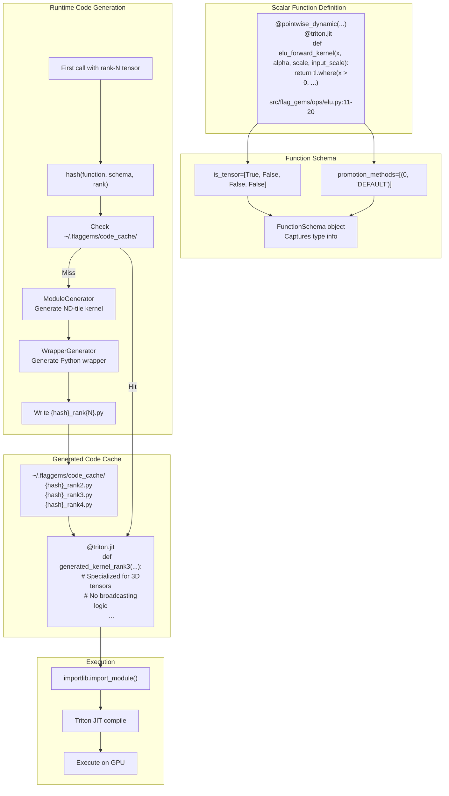

Sources:
- [src/flag_gems/ops/elu.py:11-20]()
- Code generation system referenced in architecture diagrams

### Code Generation Features

The `@pointwise_dynamic` decorator provides:

| Feature | Description |
|---------|-------------|
| Rank Specialization | Generates separate kernel for each tensor rank (1D, 2D, 3D, etc.) |
| Type Promotion | Handles dtype promotion rules (e.g., `int + float → float`) |
| Broadcasting Elimination | Specialized kernels avoid runtime broadcasting checks |
| Cache Persistence | Generated code stored in `~/.flaggems/code_cache/` |
| Lazy Generation | Kernels generated only for ranks actually used |

**Example: ELU Forward**

From [src/flag_gems/ops/elu.py:11-20]():

```python
@pointwise_dynamic(
    is_tensor=[True, False, False, False],
    promotion_methods=[(0, "DEFAULT")]
)
@triton.jit
def elu_forward_kernel(x, alpha, scale, input_scale):
    return tl.where(
        x > 0,
        scale * input_scale * x,
        scale * alpha * (tl.exp(x.to(tl.float32) * input_scale) - 1),
    )
```

When called with a 2D tensor:
1. Compute hash of function + schema + rank=2
2. Check if `{hash}_rank2.py` exists in cache
3. If not, generate specialized 2D kernel without broadcasting logic
4. Import and JIT compile via Triton
5. Execute on GPU

**Generated Kernel Structure**

For a 3D tensor, the generator creates:

```python
# Generated at ~/.flaggems/code_cache/{hash}_rank3.py
@triton.jit
def elu_forward_kernel_rank3(
    out_ptr, x_ptr, 
    N0, N1, N2,  # Dimensions
    stride_x0, stride_x1, stride_x2,
    alpha, scale, input_scale,
    BLOCK_SIZE: tl.constexpr
):
    # 3D-specific indexing
    pid0 = tl.program_id(0)
    pid1 = tl.program_id(1) 
    pid2 = tl.program_id(2)
    # ... specialized 3D logic
```

This eliminates the need for dynamic rank checks and broadcasting, resulting in faster execution.

Sources:
- [src/flag_gems/ops/elu.py:11-20]()
- [src/flag_gems/fused/fused_add_rms_norm.py:14-59]()

## Backend System

FlagGems supports multiple hardware backends through a pluggable backend system. The backend system is responsible for:

1. Detecting the available hardware
2. Selecting the appropriate implementation for each operation
3. Optimizing execution for the specific hardware

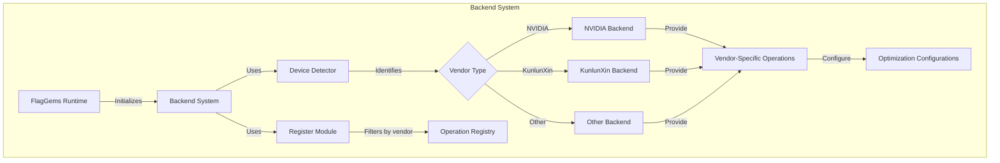

Sources:
- [src/flag_gems/__init__.py:22-24]()
- [src/flag_gems/runtime/backend/_kunlunxin/ops/masked_select.py:1-80]()

### Device Detection

FlagGems automatically detects the available hardware devices and selects the appropriate backend. The detected device is stored in the `device` and `vendor_name` variables in the `flag_gems` namespace.

Currently supported hardware includes:
- NVIDIA GPUs
- KunlunXin accelerators
- Other vendors (through the extensible backend system)

Sources:
- [src/flag_gems/__init__.py:22-24]()
- [README.md:70-74]()

## Summary Table of Key Components

| Component | Description | Primary Files |
|-----------|-------------|--------------|
| Registration System | Intercepts PyTorch operations and redirects to FlagGems | [src/flag_gems/__init__.py]() |
| Operation Implementations | Optimized versions of PyTorch operations | [src/flag_gems/ops/__init__.py]() |
| LibEntry System | Manages kernel caching and optimization | Various kernel implementation files |
| Dynamic Code Generation | Creates specialized Triton kernels at runtime | [src/flag_gems/ops/index_add.py]() |
| Backend System | Supports different hardware devices | [src/flag_gems/runtime/backend/*]() |
| Fused Operations | Combined operations for better performance | [tests/test_special_ops.py]() |

## Performance Characteristics

FlagGems offers significant performance improvements over native PyTorch implementations:

1. **For pointwise operations** (like add, mul, div): Up to 2-5x speedup
2. **For reduction operations** (like sum, mean): Up to 2-3x speedup
3. **For BLAS operations** (like mm, bmm): Up to 1.5-2x speedup
4. **For fused operations**: Up to 3-7x speedup compared to separate operations

Performance varies by hardware, tensor shapes, and data types. The benchmarking system provides detailed performance metrics for each operation.

Sources:
- [benchmark/test_reduction_perf.py:1-311]()
- [benchmark/test_special_perf.py:1-423]()
- [benchmark/test_select_and_slice_perf.py:1-419]()
- [README.md:76-80]()

---

# Page: Operator Registration System

# Operator Registration System

<details>
<summary>Relevant source files</summary>

The following files were used as context for generating this wiki page:

- [benchmark/test_special_perf.py](benchmark/test_special_perf.py)
- [benchmark/test_unary_pointwise_perf.py](benchmark/test_unary_pointwise_perf.py)
- [src/flag_gems/__init__.py](src/flag_gems/__init__.py)
- [src/flag_gems/ops/__init__.py](src/flag_gems/ops/__init__.py)
- [src/flag_gems/ops/elu.py](src/flag_gems/ops/elu.py)
- [src/flag_gems/ops/embedding.py](src/flag_gems/ops/embedding.py)
- [src/flag_gems/ops/nllloss.py](src/flag_gems/ops/nllloss.py)
- [tests/accuracy_utils.py](tests/accuracy_utils.py)
- [tests/test_binary_pointwise_ops.py](tests/test_binary_pointwise_ops.py)
- [tests/test_special_ops.py](tests/test_special_ops.py)
- [tests/test_unary_pointwise_ops.py](tests/test_unary_pointwise_ops.py)

</details>


This page describes how FlagGems registers over 200 optimized operator implementations with PyTorch's ATen backend, enabling automatic replacement of PyTorch operations with Triton-based kernels. For information about how individual operators are implemented, see [Operations Reference](#3). For details on the LibEntry kernel caching mechanism used after registration, see [LibEntry and Kernel Caching](#2.2).

## Overview

The operator registration system provides two primary APIs for activating FlagGems operators:
- **`flag_gems.enable()`**: Globally registers all operators for the duration of the program
- **`flag_gems.use_gems()`**: Context manager for scoped operator registration

Both APIs register FlagGems implementations with PyTorch's dispatcher, which intercepts calls to standard PyTorch operations (e.g., `torch.add`, `torch.mm`) and redirects them to the optimized Triton kernels.

**Sources:** [src/flag_gems/__init__.py:1-367]()

## Registration Architecture

The registration system consists of three layers: the user-facing API, the registration coordinator, and the PyTorch library backend.

```mermaid
graph TB
    subgraph "User Code Layer"
        UserCode["User Code<br/>torch.add(a, b)"]
        EnableAPI["flag_gems.enable()"]
        UseGemsCtx["flag_gems.use_gems()"]
    end
    
    subgraph "Registration Layer"
        Registrar["Register<br/>(runtime.register)"]
        OpTuple["Operator Tuple<br/>('add.Tensor', add)<br/>('mm', mm)<br/>...200+ ops"]
        UnusedList["user_unused_ops_list<br/>(selective exclusion)"]
        CppPatchList["cpp_patched_ops_list<br/>(from aten_patch_list)"]
    end
    
    subgraph "PyTorch Backend"
        AtenLib["torch.library.Library<br/>'aten', 'IMPL'"]
        Dispatcher["PyTorch Dispatcher"]
        OpImpl["Registered Implementation<br/>(FlagGems kernel)"]
    end
    
    subgraph "Operator Implementations"
        OpsModule["flag_gems.ops.*<br/>200+ operator modules"]
        PointwiseOps["Pointwise: abs, add, mul, etc."]
        ReductionOps["Reduction: sum, mean, max, etc."]
        BlasOps["BLAS: mm, addmm, bmm"]
        AttentionOps["Attention: flash_attention_forward"]
        NormOps["Norm: layer_norm, rms_norm"]
    end
    
    EnableAPI --> Registrar
    UseGemsCtx --> Registrar
    Registrar --> OpTuple
    Registrar --> UnusedList
    Registrar --> CppPatchList
    Registrar --> AtenLib
    
    OpTuple --> OpsModule
    OpsModule --> PointwiseOps
    OpsModule --> ReductionOps
    OpsModule --> BlasOps
    OpsModule --> AttentionOps
    OpsModule --> NormOps
    
    AtenLib --> Dispatcher
    Dispatcher --> OpImpl
    
    UserCode --> Dispatcher
```

**Diagram: Operator Registration Architecture**

The diagram shows how user-facing APIs interact with the registration coordinator (`Register`) to bind operator implementations to PyTorch's ATen library backend. The `Register` class processes the operator tuple, applies exclusions, and registers each operation with the dispatcher.

**Sources:** [src/flag_gems/__init__.py:18-19](), [src/flag_gems/__init__.py:24-326](), [src/flag_gems/ops/__init__.py:1-483]()

## The enable() Function

The `enable()` function provides global operator registration that persists for the entire program execution. It creates a `Register` instance with all available operators and optional exclusions.

```mermaid
graph LR
    subgraph "enable() Parameters"
        Lib["lib: torch.library.Library<br/>default: aten_lib"]
        Unused["unused: List[str]<br/>operators to exclude"]
        Registrar["registrar: Register<br/>registration class"]
        Record["record: bool<br/>logging control"]
        Once["once: bool<br/>logging frequency"]
        Path["path: str<br/>log file path"]
    end
    
    subgraph "Registration Process"
        CreateReg["Create Register instance<br/>current_work_registrar"]
        OpList["Operator tuple<br/>('_flash_attention_forward', flash_attention_forward)<br/>('abs', abs)<br/>('add.Tensor', add)<br/>...200+ entries"]
        Filter["Filter unused operators<br/>user_unused_ops_list"]
        PatchList["Apply cpp_patched_ops_list<br/>from aten_patch_list"]
    end
    
    subgraph "Output"
        GlobalReg["Global registration<br/>persists until program exit"]
        Logging["Setup logging<br/>setup_flaggems_logging()"]
    end
    
    Lib --> CreateReg
    Unused --> Filter
    Registrar --> CreateReg
    Record --> Logging
    Once --> Logging
    Path --> Logging
    
    CreateReg --> OpList
    OpList --> Filter
    Filter --> PatchList
    PatchList --> GlobalReg
    CreateReg --> Logging
```

**Diagram: enable() Function Flow**

The function signature and key behaviors:

| Parameter | Type | Default | Description |
|-----------|------|---------|-------------|
| `lib` | `torch.library.Library` | `aten_lib` | PyTorch library instance for registration |
| `unused` | `List[str]` | `None` | List of operator names to exclude from registration |
| `registrar` | `Register` | `Register` | Registration class to use |
| `record` | `bool` | `False` | Enable operation recording/logging |
| `once` | `bool` | `False` | Log each operation only once |
| `path` | `str` | `None` | Path for log output |

**Sources:** [src/flag_gems/__init__.py:24-326]()

### Operator Tuple Structure

The enable function registers operators using a large tuple where each entry maps an ATen operator signature to its FlagGems implementation:

```python
("abs", abs),                          # Basic unary operation
("add.Tensor", add),                   # Binary operation with tensor
("add_.Tensor", add_),                 # In-place variant
("native_layer_norm", layer_norm),     # Normalization operation
("mm.out", mm_out),                    # Output variant
```

**Operator naming conventions:**
- **Base name**: `"abs"`, `"add"`, `"mm"` - the core operation
- **Variant suffix**: `".Tensor"`, `".Scalar"`, `".out"` - indicates argument types or behavior
- **In-place suffix**: `"_"` at the end - indicates in-place modification (e.g., `"add_"`, `"abs_"`)

**Sources:** [src/flag_gems/__init__.py:35-320]()

## The use_gems Context Manager

The `use_gems` context manager provides scoped operator registration, allowing temporary replacement of PyTorch operations within a specific code block.

```mermaid
sequenceDiagram
    participant User as "User Code"
    participant Ctx as "use_gems Context"
    participant Lib as "torch.library.Library"
    participant Reg as "Register Instance"
    participant PyTorch as "PyTorch Dispatcher"
    
    User->>Ctx: __init__(unused=[], record=False, ...)
    Note over Ctx: Create local Library instance
    Note over Ctx: Store parameters
    
    User->>Ctx: __enter__()
    Ctx->>Lib: Create Library("aten", "IMPL")
    Ctx->>Reg: Create Register with operator tuple
    Reg->>PyTorch: Register all operators (excluding unused)
    Note over Reg: Set current_work_registrar
    Ctx-->>User: Enter context
    
    User->>PyTorch: torch.add(tensor_a, tensor_b)
    PyTorch->>Reg: Dispatch to registered add implementation
    Reg-->>User: Return result from FlagGems kernel
    
    User->>Ctx: __exit__()
    Ctx->>Lib: Delete Library instance
    Note over Ctx: Cleanup registrar and unused list
    Note over Ctx: Remove logging handlers if record=True
    Ctx-->>User: Exit context
    
    User->>PyTorch: torch.add(tensor_a, tensor_b)
    Note over PyTorch: Dispatch to default PyTorch implementation
```

**Diagram: use_gems Context Manager Lifecycle**

The context manager creates a local `torch.library.Library` instance that is automatically cleaned up on exit, reverting to PyTorch's default operators.

**Sources:** [src/flag_gems/__init__.py:328-357]()

### Context Manager Usage Pattern

```python
# Operators registered only within context
with flag_gems.use_gems(unused=['mm', 'addmm']):
    result = torch.add(x, y)      # Uses FlagGems
    result = torch.mm(a, b)       # Uses PyTorch (excluded)
    
# PyTorch default operators after context exit
result = torch.add(x, y)          # Uses PyTorch
```

**Sources:** [tests/test_special_ops.py:61-62](), [tests/test_unary_pointwise_ops.py:30-31]()

## Selective Operator Registration

The `unused` parameter allows fine-grained control over which operators are registered, enabling users to exclude specific operations that may have compatibility issues or performance regressions on their workload.

```mermaid
graph TB
    subgraph "Input: Unused Parameter"
        UnusedList["unused=['mm', 'addmm', 'bmm']"]
    end
    
    subgraph "Full Operator Set"
        AllOps["Complete Operator Tuple<br/>200+ operators"]
        MM["('mm', mm)"]
        ADDMM["('addmm', addmm)"]
        BMM["('bmm', bmm)"]
        ADD["('add.Tensor', add)"]
        ABS["('abs', abs)"]
        Others["... other operators"]
    end
    
    subgraph "Filtering Process"
        Convert["list(set(unused or []))"]
        Check["Check each operator name<br/>against unused list"]
    end
    
    subgraph "Registered Operators"
        RegOps["Registered Operators"]
        RegADD["add.Tensor → add"]
        RegABS["abs → abs"]
        RegOthers["... other operators"]
    end
    
    subgraph "Excluded Operators"
        ExcOps["Excluded (use PyTorch)"]
        ExcMM["mm → torch.mm"]
        ExcADDMM["addmm → torch.addmm"]
        ExcBMM["bmm → torch.bmm"]
    end
    
    UnusedList --> Convert
    Convert --> Check
    
    AllOps --> MM
    AllOps --> ADDMM
    AllOps --> BMM
    AllOps --> ADD
    AllOps --> ABS
    AllOps --> Others
    
    MM --> Check
    ADDMM --> Check
    BMM --> Check
    ADD --> Check
    ABS --> Check
    Others --> Check
    
    Check -->|excluded| ExcMM
    Check -->|excluded| ExcADDMM
    Check -->|excluded| ExcBMM
    Check -->|registered| RegADD
    Check -->|registered| RegABS
    Check -->|registered| RegOthers
```

**Diagram: Selective Operator Registration via unused Parameter**

The filtering mechanism deduplicates the unused list using `set()` and excludes matching operator names during registration initialization.

**Sources:** [src/flag_gems/__init__.py:321-324]()

## Operator Naming and Variant Types

PyTorch uses structured operator names in the ATen backend to distinguish between different argument types and behaviors. FlagGems follows this convention precisely to ensure correct dispatch.

| Operator Pattern | Example | Description |
|-----------------|---------|-------------|
| Base name | `"abs"`, `"sum"` | Core operation without qualifiers |
| Tensor argument variant | `"add.Tensor"`, `"mul.Tensor"` | Binary operation with tensor operands |
| Scalar argument variant | `"pow.Scalar"`, `"eq.Scalar"` | Operation with scalar parameter |
| Mixed variants | `"pow.Tensor_Scalar"`, `"bitwise_and.Scalar_Tensor"` | Different argument type combinations |
| Output variant | `"mm.out"`, `"sum.IntList_out"` | Pre-allocated output buffer |
| Dimension variant | `"sum.dim_IntList"`, `"max.dim"` | Dimension-specific operation |
| In-place operation | `"add_.Tensor"`, `"abs_"` | Modifies input tensor |
| Multiple qualifiers | `"sum.dim_IntList"`, `"div.Tensor_mode"` | Combined qualifiers |

**Examples from the operator tuple:**

```python
# Tensor-tensor operations
("add.Tensor", add),
("mul.Tensor", mul),

# In-place operations  
("add_.Tensor", add_),
("mul_.Tensor", mul_),

# Scalar operations
("eq.Scalar", eq_scalar),
("pow.Scalar", pow_scalar),

# Mixed scalar-tensor
("bitwise_and.Scalar_Tensor", bitwise_and_scalar_tensor),

# Output variants
("mm.out", mm_out),
("addmm.out", addmm_out),

# Dimension variants
("sum.dim_IntList", sum_dim),
("all.dim", all_dim),
```

**Sources:** [src/flag_gems/__init__.py:46-320]()

## Registration Process Details

The registration process involves several steps coordinated by the `Register` class, which manages the mapping between ATen operator signatures and FlagGems implementations.

```mermaid
graph TB
    subgraph "Initialization Phase"
        EnableCall["enable() or use_gems().__enter__()"]
        CreateReg["Create Register instance"]
        OpTuples["Operator tuples<br/>('op_name', implementation_fn)"]
        UnusedFilter["unused operator list"]
        CppPatch["cpp_patched_ops_list"]
    end
    
    subgraph "Register Instance Processing"
        ParseOps["Parse operator tuples"]
        FilterUnused["Filter out unused operators"]
        ApplyCppPatch["Track cpp patched operators"]
        BuildRegistry["Build operator registry"]
    end
    
    subgraph "PyTorch Integration"
        AtenLibrary["torch.library.Library<br/>namespace='aten'<br/>kind='IMPL'"]
        RegisterLoop["For each operator:<br/>lib.impl(op_name, impl_fn)"]
        Dispatcher["PyTorch Dispatcher<br/>Updated routing tables"]
    end
    
    subgraph "Runtime State"
        GlobalRegistrar["current_work_registrar<br/>(global variable)"]
        AllOpsMethod["all_ops() method<br/>returns registered operators"]
    end
    
    subgraph "User Invocation"
        TorchCall["torch.add(a, b)"]
        DispatchLookup["Dispatcher lookup:<br/>aten::add.Tensor"]
        CallImpl["Call FlagGems add()"]
        ReturnResult["Return result tensor"]
    end
    
    EnableCall --> CreateReg
    CreateReg --> OpTuples
    CreateReg --> UnusedFilter
    CreateReg --> CppPatch
    
    OpTuples --> ParseOps
    UnusedFilter --> FilterUnused
    CppPatch --> ApplyCppPatch
    
    ParseOps --> BuildRegistry
    FilterUnused --> BuildRegistry
    ApplyCppPatch --> BuildRegistry
    
    BuildRegistry --> AtenLibrary
    AtenLibrary --> RegisterLoop
    RegisterLoop --> Dispatcher
    
    CreateReg --> GlobalRegistrar
    GlobalRegistrar --> AllOpsMethod
    
    TorchCall --> DispatchLookup
    DispatchLookup --> Dispatcher
    Dispatcher --> CallImpl
    CallImpl --> ReturnResult
```

**Diagram: Complete Registration and Dispatch Flow**

The `Register` class is instantiated with the operator mapping and processes it through filtering and registration steps before updating PyTorch's dispatcher.

**Sources:** [src/flag_gems/__init__.py:18-19](), [src/flag_gems/__init__.py:33-34](), [src/flag_gems/__init__.py:321-324](), [src/flag_gems/__init__.py:359-361]()

## Global State Management

FlagGems maintains a global registrar instance to track the current registration state and provide introspection capabilities.

```mermaid
graph LR
    subgraph "Global Variables"
        AtenLib["aten_lib<br/>torch.library.Library"]
        Registrar["registrar<br/>Register class"]
        CurrentReg["current_work_registrar<br/>Register instance or None"]
    end
    
    subgraph "enable() Function"
        CreateReg["Creates new Register instance<br/>Stores in current_work_registrar"]
        SetupLog["Calls setup_flaggems_logging()"]
    end
    
    subgraph "use_gems Context"
        EnterCtx["__enter__(): Sets current_work_registrar"]
        ExitCtx["__exit__(): Deletes current_work_registrar"]
    end
    
    subgraph "Introspection API"
        AllOps["all_ops() function<br/>Returns registered operator list"]
    end
    
    AtenLib --> CreateReg
    Registrar --> CreateReg
    CreateReg --> CurrentReg
    CreateReg --> SetupLog
    
    EnterCtx --> CurrentReg
    ExitCtx --> CurrentReg
    
    CurrentReg --> AllOps
```

**Diagram: Global State Variables and Their Lifecycle**

The `current_work_registrar` global variable provides access to the active registration state:

```python
# After enable() or within use_gems() context
all_registered = flag_gems.all_ops()  # Returns list of registered operator names
```

**Sources:** [src/flag_gems/__init__.py:18-21](), [src/flag_gems/__init__.py:32](), [src/flag_gems/__init__.py:348](), [src/flag_gems/__init__.py:359-361]()

## Usage Examples

The test suite demonstrates common registration patterns across different testing scenarios.

### Basic Registration with Context Manager

```python
import torch
import flag_gems

# Create input tensors
inp = torch.randn((1024, 1024), dtype=torch.float32, device=flag_gems.device)

# Use FlagGems operators within context
with flag_gems.use_gems():
    result = torch.abs(inp)           # Dispatches to flag_gems.abs
    result = torch.add(inp, inp)      # Dispatches to flag_gems.add
    
# Back to PyTorch operators
result = torch.abs(inp)               # Uses torch.abs
```

**Sources:** [tests/test_unary_pointwise_ops.py:30-33](), [tests/test_binary_pointwise_ops.py:42-43]()

### Selective Registration

```python
import flag_gems

# Register all operators except matrix multiplication
with flag_gems.use_gems(unused=['mm', 'addmm', 'bmm']):
    result = torch.add(a, b)      # Uses FlagGems
    result = torch.mm(a, b)       # Uses PyTorch default
```

**Sources:** [src/flag_gems/__init__.py:329-345]()

### Global Registration

```python
import flag_gems

# Register globally at program start
flag_gems.enable()

# All subsequent operations use FlagGems
result = torch.add(a, b)      # FlagGems
result = torch.mm(a, b)       # FlagGems
```

**Sources:** [src/flag_gems/__init__.py:24-326]()

### Testing with Dropout (Seeded Operations)

```python
import flag_gems
import torch

# Set seed for reproducible results on specific vendors
if flag_gems.vendor_name == "kunlunxin":
    torch.manual_seed(0)
    torch.cuda.manual_seed_all(0)

inp = torch.randn((32768,), dtype=torch.float32, device=flag_gems.device)

with flag_gems.use_gems():
    result = torch.nn.functional.dropout(inp, p=0.5, training=True)
```

**Sources:** [tests/test_special_ops.py:42-62]()

## Operator Categories in Registration

The operator tuple in `enable()` includes diverse operation types, organized by computational pattern. The registration order does not affect functionality but follows a logical grouping.

| Category | Example Operators | Count (Approx.) |
|----------|------------------|-----------------|
| Pointwise unary | `abs`, `exp`, `cos`, `neg`, `sigmoid` | 30+ |
| Pointwise binary | `add`, `mul`, `div`, `pow` | 40+ |
| Comparison | `eq`, `ne`, `gt`, `lt`, `ge`, `le` | 10+ |
| Logical/Bitwise | `bitwise_and`, `bitwise_or`, `logical_and` | 10+ |
| Reduction | `sum`, `mean`, `max`, `min`, `prod`, `cumsum` | 20+ |
| Matrix operations | `mm`, `addmm`, `bmm`, `mv`, `dot` | 10+ |
| Normalization | `layer_norm`, `batch_norm`, `rms_norm`, `group_norm` | 8+ |
| Attention | `flash_attention_forward`, `scaled_dot_product_attention` | 3+ |
| Tensor manipulation | `cat`, `stack`, `scatter`, `gather`, `index_add` | 20+ |
| Creation/Fill | `zeros`, `ones`, `full`, `arange`, `randn` | 15+ |
| Special | `dropout`, `embedding`, `topk`, `sort` | 15+ |

**Sources:** [src/flag_gems/__init__.py:35-320](), [src/flag_gems/ops/__init__.py:1-483]()

## Cpp Patched Operators

Some operators have C++ extension implementations for reduced Python overhead. These are tracked separately via `aten_patch_list`.

```python
# From enable() function
current_work_registrar = registrar(
    # ... operator tuples ...
    user_unused_ops_list=list(set(unused or [])),
    cpp_patched_ops_list=list(set(aten_patch_list)),  # From config
    lib=lib,
)
```

The `aten_patch_list` is imported from `flag_gems.config` and indicates which operators have optional C++ implementations for performance. See [C++ Extensions](#6.1) for details on the C++ runtime layer.

**Sources:** [src/flag_gems/__init__.py:7](), [src/flag_gems/__init__.py:322]()

---

# Page: LibEntry and Kernel Caching

# LibEntry and Kernel Caching

<details>
<summary>Relevant source files</summary>

The following files were used as context for generating this wiki page:

- [lib/addmm.cpp](lib/addmm.cpp)
- [lib/mm.cpp](lib/mm.cpp)
- [src/flag_gems/csrc/aten_patch.cpp](src/flag_gems/csrc/aten_patch.cpp)
- [src/flag_gems/fused/fused_add_rms_norm.py](src/flag_gems/fused/fused_add_rms_norm.py)
- [src/flag_gems/ops/addmm.py](src/flag_gems/ops/addmm.py)
- [src/flag_gems/ops/mm.py](src/flag_gems/ops/mm.py)
- [src/flag_gems/ops/mm_streamk.py](src/flag_gems/ops/mm_streamk.py)
- [src/flag_gems/runtime/backend/_nvidia/tune_configs.yaml](src/flag_gems/runtime/backend/_nvidia/tune_configs.yaml)
- [src/flag_gems/utils/libentry.py](src/flag_gems/utils/libentry.py)
- [tests/test_blas_ops.py](tests/test_blas_ops.py)
- [tests/test_libentry.py](tests/test_libentry.py)

</details>


The `LibEntry` system is FlagGems' specialized kernel execution infrastructure that provides per-device caching of compiled Triton kernels. It bypasses Triton's nested runtime to avoid redundant parameter processing on every kernel invocation, significantly reducing execution overhead.

For information about autotuning and configuration caching, see page 2.3 (LibTuner and Autotuning). For dynamic code generation, see page 2.4.

## Overview

`LibEntry` wraps Triton kernels and manages their compilation and execution lifecycle. Instead of repeatedly invoking Triton's `Autotuner`, `Heuristics`, and `JITFunction` layers on each call, `LibEntry` compiles kernels once per unique argument signature and device, then executes them directly via cached kernel objects.

**LibEntry Execution Flow Bypassing Triton Runtime**

```mermaid
graph LR
    subgraph "Standard Triton Path"
        A1["Kernel Call"] --> A2["Autotuner.run()"]
        A2 --> A3["Heuristics.run()"]
        A3 --> A4["JITFunction.run()"]
        A4 --> A5["Compile"]
        A5 --> A6["Execute"]
    end
    
    subgraph "LibEntry Optimized Path"
        B1["Kernel Call"] --> B2["LibEntry.run()"]
        B2 --> B3{"kernel_cache\n[device_id][key]"}
        B3 -->|"cache hit"| B4["Execute Directly"]
        B3 -->|"cache miss"| B5["Compile Once"]
        B5 --> B6["Store in\nkernel_cache"]
        B6 --> B4
    end
```

Sources: [src/flag_gems/utils/libentry.py:733-905]()

## LibEntry Class Architecture

The `LibEntry` class extends `triton.KernelInterface` to intercept kernel execution and implement custom caching logic. It wraps any Triton kernel function (including those decorated with `@triton.autotune` and `@triton.heuristics`).

**LibEntry Class Structure**

```mermaid
classDiagram
    class triton_KernelInterface {
        <<triton.runtime>>
    }
    
    class LibEntry {
        +fn: decorated function
        +arg_names: List[str]
        +divisibility: int
        +kernel_cache: Tuple[Dict]
        +jit_function: triton.runtime.JITFunction
        +specialize_indices: List[int]
        +do_not_specialize_indices: List[int]
        +lock: multiprocessing.Lock
        +signature: inspect.Signature
        +__init__(fn)
        +key(spec_args, dns_args, const_args) Tuple
        +run(*args, **kwargs) Tuple
    }
    
    triton_KernelInterface <|-- LibEntry
    
    class libentry_decorator {
        <<function>>
        +decorator(fn) LibEntry
    }
    
    libentry_decorator --> LibEntry : creates
```

Key attributes:

| Attribute | Type | Description |
|-----------|------|-------------|
| `kernel_cache` | `Tuple[Dict]` | Per-device cache storing compiled kernels, initialized as `tuple(dict() for _ in range(DEVICE_COUNT))` |
| `jit_function` | `triton.runtime.JITFunction` | The underlying JIT function extracted from decorator stack |
| `specialize_indices` | `List[int]` | Indices of parameters that should be specialized during compilation |
| `do_not_specialize_indices` | `List[int]` | Indices of parameters marked with `do_not_specialize` |
| `lock` | `multiprocessing.Lock` | Ensures thread-safe access to kernel cache |

Sources: [src/flag_gems/utils/libentry.py:733-757]()

## Per-Device Kernel Caching

`LibEntry` maintains a separate kernel cache for each device to accommodate device-specific kernel compilation and optimization. The cache is initialized as a tuple of dictionaries:

```python
self.kernel_cache = tuple(dict() for _ in range(DEVICE_COUNT))
```

**Per-Device Cache Architecture**

```mermaid
graph TB
    subgraph "LibEntry Instance"
        LE["LibEntry\nfor mm_kernel_general"]
        KC["kernel_cache:\nTuple[Dict, Dict, ...]"]
    end
    
    subgraph "Device 0 Cache"
        K0["cache[0]:\n{cache_key_1: (kernel, constexprs),\n cache_key_2: (kernel, constexprs),\n ...}"]
    end
    
    subgraph "Device 1 Cache"
        K1["cache[1]:\n{cache_key_1: (kernel, constexprs),\n cache_key_2: (kernel, constexprs),\n ...}"]
    end
    
    subgraph "Device N Cache"
        KN["cache[N]:\n{cache_key_1: (kernel, constexprs),\n ...}"]
    end
    
    LE --> KC
    KC --> K0
    KC --> K1
    KC --> KN
```

Each cache entry stores a tuple containing:
- `kernel`: Compiled Triton kernel object
- `constexprs`: Dictionary of constexpr values collected from `Autotuner`, `Heuristics`, and `JITFunction` defaults

The cache is accessed using the current device ID:
```python
device = torch_device_fn.current_device()
cache = self.kernel_cache[device]
```

Sources: [src/flag_gems/utils/libentry.py:741](), [src/flag_gems/utils/libentry.py:821-822](), [src/flag_gems/utils/libentry.py:863-868]()

## Cache Key Generation

`LibEntry` generates cache keys based on the specialized representation of kernel arguments. The `key()` method categorizes arguments into three types and generates appropriate key components:

**Argument Categorization**

| Argument Type | Key Representation | Example |
|---------------|-------------------|---------|
| Specializable args | `(dtype, is_16B_aligned)` for tensors, `(type, value)` for scalars | `(torch.float32, True)` |
| Do-not-specialize args | `dtype` for tensors, type hint for scalars | `torch.float32` or `"i32"` |
| Constexpr args | Passed by position as-is | `(64, 128, 32)` |

The cache key is a tuple combining all three categories:

```python
entry_key = self.key(spec_args, dns_args, const_args)
# Example: ((torch.float32, True), (torch.float32, True), torch.float32, 64, 128, 32)
```

**Cache Key Generation Flow**

```mermaid
graph TD
    A["run(*args, **kwargs)"] --> B["Collect arguments"]
    B --> C["Categorize by\nspecialize_indices,\ndo_not_specialize_indices"]
    
    C --> D1["spec_args:\nargs to specialize"]
    C --> D2["dns_args:\ndo-not-specialize args"]
    C --> D3["const_args:\nconstexpr args"]
    
    D1 --> E1["spec_arg(arg):\nfor tensors: (dtype, 16B_aligned)\nfor scalars: (type, value)"]
    D2 --> E2["dns_arg(arg):\nfor tensors: dtype\nfor ints: i32/i64/u64"]
    D3 --> E3["Passed as-is"]
    
    E1 --> F["entry_key =\ntuple(spec_key + dns_key + const_args)"]
    E2 --> F
    E3 --> F
```

Sources: [src/flag_gems/utils/libentry.py:759-779](), [src/flag_gems/utils/libentry.py:786-819]()

## Execution Flow and Runtime Bypass

The `run()` method implements the core logic that bypasses Triton's nested runtime:

**Detailed Execution Sequence**

```mermaid
sequenceDiagram
    participant Op as "FlagGems Operation"
    participant LE as "LibEntry.run()"
    participant Cache as "kernel_cache[device]"
    participant Fn as "self.fn (Autotuner/Heuristics/JIT)"
    participant Triton as "Triton Runtime"
    
    Op->>LE: kernel[grid](*args, **kwargs)
    LE->>LE: Categorize arguments into<br/>spec_args, dns_args, const_args
    LE->>LE: Generate entry_key = key(spec_args, dns_args, const_args)
    LE->>Cache: Lookup entry_key
    
    alt Cache Hit
        Cache-->>LE: Return (kernel, constexprs)
        LE->>LE: Execute kernel directly:<br/>kernel[grid](*args)
    else Cache Miss
        Note over LE,Triton: First compilation - bypass nested runtime
        LE->>LE: Lock to ensure thread safety
        LE->>Fn: Call fn.run(*args, **kwargs)<br/>(triggers Autotuner/Heuristics/JIT)
        Fn->>Triton: Compile kernel
        Triton-->>Fn: Return compiled kernel
        Fn-->>LE: Return kernel
        LE->>LE: Extract constexprs from<br/>Autotuner.best_config,<br/>Heuristics.values, JIT defaults
        LE->>Cache: Store (kernel, constexprs, tune_constexprs, heur_constexprs)
        LE->>LE: Execute kernel[grid](*args)
    end
    
    LE-->>Op: Return kernel, constexprs
```

The key optimization is that after the first compilation, `LibEntry` directly invokes `kernel[grid](*args)` without re-entering the `Autotuner`, `Heuristics`, or `JITFunction` layers. This eliminates parameter processing overhead on subsequent calls.

Sources: [src/flag_gems/utils/libentry.py:781-904]()

## Usage Examples

The `@libentry()` decorator wraps Triton kernels to enable kernel caching. It works with plain `@triton.jit` kernels as well as those decorated with `@triton.autotune` or `@triton.heuristics`.

### Basic Usage with @triton.jit

```python
from flag_gems.utils import libentry
import triton
import triton.language as tl

@libentry()
@triton.jit
def simple_kernel(x_ptr, y_ptr, N, BLOCK_SIZE: tl.constexpr):
    pid = tl.program_id(0)
    offsets = pid * BLOCK_SIZE + tl.arange(0, BLOCK_SIZE)
    mask = offsets < N
    x = tl.load(x_ptr + offsets, mask=mask)
    tl.store(y_ptr + offsets, x * 2, mask=mask)
```

### With @triton.autotune

`LibEntry` preserves the functionality of `@triton.autotune` while adding caching:

```python
@libentry()
@triton.autotune(
    configs=[
        triton.Config({"BLOCK_M": 64, "BLOCK_N": 64}, num_warps=4),
        triton.Config({"BLOCK_M": 128, "BLOCK_N": 64}, num_warps=4),
    ],
    key=["M", "N", "K"],
)
@triton.jit
def mm_kernel_general(A, B, C, M, N, K, ...):
    # Matrix multiplication implementation
    pass
```

During the first invocation with a given argument signature, the `Autotuner` runs and selects the best config. On subsequent calls with the same signature, `LibEntry` uses the cached kernel with the previously selected config, bypassing the autotuning overhead.

### With @triton.heuristics

`LibEntry` also works with `@triton.heuristics`:

```python
@libentry()
@triton.autotune(
    configs=[triton.Config({"TILE_N": 32}), triton.Config({"TILE_N": 64})],
    key=["N"],
)
@triton.heuristics(
    values={
        "TILE_M": lambda args: 1024 // args["TILE_N"],
        "ONE_TILE_PER_CTA": lambda args: args["TILE_N"] >= args["N"],
    },
)
@triton.jit
def softmax_kernel_inner(output_ptr, input_ptr, M, N, TILE_M: tl.constexpr, ...):
    # Softmax implementation
    pass
```

The heuristic values are computed once during the first invocation and cached along with the kernel.

Sources: [src/flag_gems/utils/libentry.py:907-914](), [tests/test_libentry.py:98-170](), [src/flag_gems/ops/mm.py:54-135]()

## Real-World Example: Matrix Multiplication

The matrix multiplication kernel `mm_kernel_general` demonstrates `LibEntry` usage:

```python
@libentry()
@libtuner(
    configs=runtime.get_tuned_config("mm"),
    key=["M", "N", "K", "stride_am", "stride_bk"],
    strategy=["align32", "align32", "align32", "align32", "align32"],
    warmup=5,
    rep=10,
)
@triton.jit
def mm_kernel_general(A, B, C, M, N, K, stride_am, stride_ak, stride_bk, stride_bn,
                      stride_cm, stride_cn, BLOCK_M: tl.constexpr, BLOCK_N: tl.constexpr,
                      BLOCK_K: tl.constexpr, GROUP_M: tl.constexpr):
    # Implementation...
```

When invoked via:
```python
grid = lambda META: (triton.cdiv(M, META["BLOCK_M"]) * triton.cdiv(N, META["BLOCK_N"]),)
mm_kernel_general[grid](a, b, c, M, N, K, ...)
```

The first call with a given `(M, N, K, stride_am, stride_bk)` tuple triggers autotuning and compilation. Subsequent calls with the same tuple execute the cached kernel directly.

Sources: [src/flag_gems/ops/mm.py:54-135](), [src/flag_gems/ops/mm.py:154-183]()

## Thread Safety

`LibEntry` uses a `multiprocessing.Lock` to ensure thread-safe compilation and caching:

```python
with self.lock:
    if entry_key in cache:
        break
    kernel = self.fn.run(*args, **kwargs)
    # ... extract constexprs ...
    cache[entry_key] = (kernel, constexprs, tune_constexprs, heur_constexprs)
```

The lock is only acquired during the first compilation for a given cache key. Once the kernel is cached, subsequent executions proceed lock-free.

The test suite includes thread safety validation:

```python
def run_two_threads():
    devices = [0, 0]
    fs = []
    def task_fn(dev):
        x = torch.randn((128, 128, 128), device=dev)
        return softmax_inner_decorator_cascade(x, 1)
    for dev in devices:
        work = TaskThread(task_fn, (dev,))
        work.start()
        fs.append(work)
    for i in range(len(fs)):
        fs[i].join()
```

Sources: [src/flag_gems/utils/libentry.py:756](), [src/flag_gems/utils/libentry.py:826-868](), [tests/test_libentry.py:214-238]()

## Integration with FlagGems Operations

`LibEntry` is used throughout FlagGems for operations requiring efficient kernel caching. Key integration points include:

| Operation Category | Example Operations | Files |
|-------------------|-------------------|-------|
| Matrix Operations | `mm`, `addmm`, `bmm` | [src/flag_gems/ops/mm.py](), [src/flag_gems/ops/addmm.py]() |
| Attention | `flash_attn_varlen_func`, `scaled_dot_product_attention` | [src/flag_gems/ops/attention.py]() |
| Normalization | `layer_norm`, `rms_norm`, `group_norm` | [src/flag_gems/ops/layer_norm.py]() |
| Fused Operations | `fused_add_rms_norm`, `silu_and_mul` | [src/flag_gems/fused/]() |

Example from `fused_add_rms_norm.py`:

```python
@libentry()
@triton.jit(do_not_specialize=["eps"])
def fused_add_rms_norm_kernel(input_ptr, residual_ptr, w_ptr, ...):
    # Kernel implementation
    pass

def fused_add_rms_norm(x, residual, normalized_shape, weight, eps=1e-5):
    # ...
    with torch_device_fn.device(x.device):
        fused_add_rms_norm_kernel[M,](x, residual, weight, N, 1, N, 1, N, eps, BLOCK_SIZE)
    return x, residual
```

Sources: [src/flag_gems/fused/fused_add_rms_norm.py:14-82](), [src/flag_gems/ops/mm.py:54-62](), [src/flag_gems/ops/addmm.py:15-22]()

## Performance Benefits

`LibEntry` provides significant performance improvements over standard Triton kernel execution:

**Overhead Reduction**

| Optimization | Standard Triton | LibEntry | Benefit |
|--------------|----------------|----------|---------|
| Parameter processing | Every call | First call only | ~10-20μs saved per call |
| Type checking/wrapping | Every call | First call only | Reduced overhead |
| Config lookup (Autotuner) | Every call | First call only | Eliminates repeated tuning |
| Heuristics evaluation | Every call | First call only | Single evaluation |
| Nested function calls | Deep stack | Direct execution | Reduced call overhead |

**Cache Hit Performance**

Once a kernel is cached, execution follows this fast path:
1. Generate cache key from arguments (~1-2μs)
2. Dictionary lookup in `kernel_cache[device]` (~0.5μs)
3. Direct kernel execution (no additional overhead)

The performance gain is most significant for:
- Frequently called kernels with stable argument signatures (e.g., attention layers in transformers)
- Kernels with multiple `@triton.autotune` configs
- Operations in tight loops (e.g., per-layer operations in LLM inference)

Sources: [src/flag_gems/utils/libentry.py:733-905]()

## Limitations and Considerations

When using the LibEntry system, consider the following:

1. **Memory usage**: Each device has its own cache, which can increase memory usage in multi-device scenarios
2. **Thread safety**: While LibEntry is thread-safe, users should be cautious when modifying underlying Triton kernels
3. **Cache persistence**: The LibTuner SQLite database can grow large with many configurations
4. **Version compatibility**: The implementation adapts to different Triton versions but may need adjustments for future versions

Sources: [src/flag_gems/utils/libentry.py:20-23](), [tests/test_libentry.py:229-237]()

---

# Page: LibTuner and Autotuning

# LibTuner and Autotuning

<details>
<summary>Relevant source files</summary>

The following files were used as context for generating this wiki page:

- [README.md](README.md)
- [README_cn.md](README_cn.md)
- [docs/add_a_cpp_wrapper.md](docs/add_a_cpp_wrapper.md)
- [docs/get_start_with_flaggems.md](docs/get_start_with_flaggems.md)
- [docs/how_to_use_flaggems.md](docs/how_to_use_flaggems.md)
- [docs/index.md](docs/index.md)
- [docs/installation.md](docs/installation.md)
- [docs/pointwise_dynamic.md](docs/pointwise_dynamic.md)
- [examples/integration_gems_with_vllm.py](examples/integration_gems_with_vllm.py)
- [lib/addmm.cpp](lib/addmm.cpp)
- [lib/mm.cpp](lib/mm.cpp)
- [mkdocs.yml](mkdocs.yml)
- [pyproject.toml](pyproject.toml)
- [src/flag_gems/csrc/aten_patch.cpp](src/flag_gems/csrc/aten_patch.cpp)
- [src/flag_gems/fused/fused_add_rms_norm.py](src/flag_gems/fused/fused_add_rms_norm.py)
- [src/flag_gems/ops/addmm.py](src/flag_gems/ops/addmm.py)
- [src/flag_gems/ops/mm.py](src/flag_gems/ops/mm.py)
- [src/flag_gems/ops/mm_streamk.py](src/flag_gems/ops/mm_streamk.py)
- [src/flag_gems/ops/sqrt.py](src/flag_gems/ops/sqrt.py)
- [src/flag_gems/runtime/backend/_nvidia/tune_configs.yaml](src/flag_gems/runtime/backend/_nvidia/tune_configs.yaml)
- [src/flag_gems/utils/libentry.py](src/flag_gems/utils/libentry.py)
- [tests/test_blas_ops.py](tests/test_blas_ops.py)
- [tests/test_libentry.py](tests/test_libentry.py)

</details>


## Purpose and Scope

This document describes the LibTuner autotuning system, which automatically searches for optimal kernel configurations to maximize performance across different input shapes and hardware platforms. LibTuner extends Triton's built-in `Autotuner` with persistent caching, flexible tuning policies, and cache key transformation strategies. For information about kernel registration and caching, see [LibEntry and Kernel Caching](#2.2). For details on code generation for pointwise operations, see [Dynamic Code Generation](#2.4).

## System Architecture

LibTuner operates as the configuration optimization layer between operator implementations and the Triton JIT runtime. It manages the search space of kernel configurations and persists optimal choices across runs.

### LibTuner Position in Architecture

```mermaid
graph TB
    subgraph "Operator Layer"
        MMOp["mm operator<br/>src/flag_gems/ops/mm.py"]
        AddmmOp["addmm operator<br/>src/flag_gems/ops/addmm.py"]
        OtherOps["Other operators"]
    end
    
    subgraph "Autotuning System"
        LibTunerDecorator["@libtuner decorator"]
        LibTunerClass["LibTuner class<br/>extends triton.Autotuner"]
        PolicySystem["Policy System<br/>default_policy"]
        StrategySystem["Strategy System<br/>log, align32, default"]
    end
    
    subgraph "Cache System"
        LibCacheSingleton["LibCache singleton"]
        ConfigCache["ConfigCache<br/>key -> Config"]
        BenchmarkCache["BenchmarkCache<br/>(key,config) -> timings"]
        SQLiteDB["SQLite Database<br/>TunedConfig_device.db"]
    end
    
    subgraph "Configuration Sources"
        YAMLConfigs["tune_configs.yaml<br/>per-backend configs"]
        RuntimeGetConfig["runtime.get_tuned_config()"]
    end
    
    subgraph "Triton Runtime"
        TritonAutotuner["triton.Autotuner"]
        TritonJIT["triton.jit"]
        KernelExec["Kernel Execution"]
    end
    
    MMOp --> LibTunerDecorator
    AddmmOp --> LibTunerDecorator
    OtherOps --> LibTunerDecorator
    
    LibTunerDecorator --> LibTunerClass
    LibTunerClass --> PolicySystem
    LibTunerClass --> StrategySystem
    LibTunerClass -.extends.-> TritonAutotuner
    
    LibTunerClass --> LibCacheSingleton
    LibCacheSingleton --> ConfigCache
    LibCacheSingleton --> BenchmarkCache
    ConfigCache --> SQLiteDB
    BenchmarkCache --> SQLiteDB
    
    YAMLConfigs --> RuntimeGetConfig
    RuntimeGetConfig --> LibTunerDecorator
    
    LibTunerClass --> TritonJIT
    TritonJIT --> KernelExec
```

**Sources:** [src/flag_gems/utils/libentry.py:347-730](), [src/flag_gems/ops/mm.py:54-62](), [src/flag_gems/runtime/backend/_nvidia/tune_configs.yaml]()

## LibTuner Core Concepts

### LibTuner Class

The `LibTuner` class extends Triton's `Autotuner` to provide persistent caching and flexible tuning strategies. It maintains a dispatch table for policy variations and a strategy table for cache key transformations.

```mermaid
graph TB
    TritonAutotuner["triton.runtime.Autotuner"]
    LibTuner["LibTuner<br/>src/flag_gems/utils/libentry.py:347-606"]
    DefaultImpl["Default Policy Implementation<br/>registered as 'default'"]
    CustomImpl["Custom Policy Implementations<br/>via @register_policy"]
    
    TritonAutotuner -->|extends| LibTuner
    LibTuner -->|dispatch table| DefaultImpl
    LibTuner -->|dispatch table| CustomImpl
    
    LibTuner -->|has| DispatchTable["_dispatch_table<br/>Dict[str, Type[LibTuner]]"]
    LibTuner -->|has| StrategyTable["_strategy_table<br/>Dict[str, Callable]"]
    LibTuner -->|uses| ConfigCache["ConfigCache<br/>key -> best config"]
    LibTuner -->|uses| BenchmarkCache["BenchmarkCache<br/>(key,config) -> timing"]
    
    LibTuner -->|properties| KernelHash["kernel_hash<br/>MD5 of code + configs"]
    LibTuner -->|properties| CacheKey["cache_key<br/>from JITFunction"]
```

**Key Properties:**

| Property | Type | Description |
|----------|------|-------------|
| `kernel_hash` | str | MD5 hash of kernel code and configuration space |
| `cache_key` | str | Cache key from underlying JITFunction |
| `config_table_name` | str | Table name for configuration cache |
| `benchmark_table_name` | str | Table name for benchmark results |
| `strategy` | List[Callable] | Transformation functions for cache keys |

**Sources:** [src/flag_gems/utils/libentry.py:347-447]()

### Policy System

Policies define the algorithm used to select the best configuration from the search space. The default policy exhaustively benchmarks all configurations and selects the one with minimum latency.

```mermaid
graph LR
    PolicyDecorator["@LibTuner.register_policy(name)"]
    PolicyFunction["policy_impl function"]
    AnonymousClass["Anonymous LibTuner subclass"]
    DispatchTable["LibTuner._dispatch_table[name]"]
    
    PolicyDecorator --> PolicyFunction
    PolicyFunction --> AnonymousClass
    AnonymousClass --> DispatchTable
    
    DefaultPolicy["default_policy<br/>line 624-676"]
    DefaultPolicy -->|"registered as 'default'"| DispatchTable
```

**Default Policy Algorithm:**

1. Receive benchmark function and configuration iterator
2. Benchmark each configuration by calling `bench_fn(config)`
3. Return configuration with minimum timing

**Policy Function Signature:**
```python
def policy(
    bench_fn: Callable[[triton.Config], List[float]],
    configs: Iterator[triton.Config],
    args: Tuple[Any],
    kwargs: Dict[str, Any]
) -> Tuple[triton.Config, Dict[str, float]]
```

**Sources:** [src/flag_gems/utils/libentry.py:498-676]()

### Strategy System

Strategies transform cache keys to enable configuration reuse across similar input shapes. This reduces the number of autotuning runs by grouping similar inputs.

```mermaid
graph TB
    subgraph "Registered Strategies"
        DefaultStrat["default / None<br/>identity: key -> key<br/>line 608-611"]
        LogStrat["log<br/>power-of-2 ceiling<br/>line 614-616"]
        Align32Strat["align32<br/>align to 32<br/>line 619-621"]
    end
    
    subgraph "Strategy Application"
        OriginalKey["Original Key<br/>e.g., (M=100, N=200, K=150)"]
        TransformedKey["Transformed Key<br/>e.g., (M=128, N=256, K=160)"]
    end
    
    OriginalKey -->|"apply strategy per element"| TransformedKey
    
    LogStrat -.example.-> Example1["100 -> 128<br/>2^ceil(log2(100))"]
    Align32Strat -.example.-> Example2["100 -> 128<br/>ceil(100/32)*32"]
```

**Strategy Transformation Examples:**

| Strategy | Input | Output | Formula |
|----------|-------|--------|---------|
| `default` | 100 | 100 | identity |
| `log` | 100 | 128 | 2^⌈log₂(100)⌉ |
| `align32` | 100 | 128 | ⌈100/32⌉ × 32 |
| `log` | 1500 | 2048 | 2^⌈log₂(1500)⌉ |
| `align32` | 1500 | 1504 | ⌈1500/32⌉ × 32 |

**Sources:** [src/flag_gems/utils/libentry.py:608-621]()

### Configuration Search Process

The autotuning search occurs on first invocation with a new cache key. The process benchmarks configurations, applies the policy to select the best, and persists the result.

```mermaid
sequenceDiagram
    participant Op as "Operator Call"
    participant LT as "LibTuner.run()"
    participant Cache as "ConfigCache"
    participant BCache as "BenchmarkCache"
    participant Policy as "Policy Function"
    participant Triton as "Triton Runtime"
    
    Op->>LT: First call with args
    LT->>LT: Compute cache key from args + strategy
    LT->>Cache: Check if key in cache
    Cache-->>LT: Cache miss
    
    LT->>LT: Prune configs
    
    loop For each config
        LT->>BCache: Check benchmark cache
        alt Cached timing exists
            BCache-->>LT: Return cached timing
        else No cached timing
            LT->>Triton: Run benchmark with config
            Triton-->>LT: Return timing
            LT->>BCache: Store timing
        end
    end
    
    LT->>Policy: Select best config from timings
    Policy-->>LT: Return best config
    
    LT->>Cache: Store key -> config
    Cache->>SQLite: Persist to database
    
    LT->>Triton: Execute with best config
    Triton-->>Op: Return result
```

**Sources:** [src/flag_gems/utils/libentry.py:548-605]()

## LibCache System

LibCache provides persistent storage for tuning results across process restarts. It uses SQLite with write-ahead logging (WAL) for concurrent access and maintains separate tables for configuration mappings and benchmark timings.

### LibCache Architecture

```mermaid
graph TB
    subgraph "LibCache Singleton"
        LibCacheInstance["LibCache instance<br/>line 283-344"]
        GlobalCache["global_cache: Dict"]
        ConfigPool["config_cache_pool<br/>Dict[str, ConfigCache]"]
        BenchPool["benchmark_cache_pool<br/>Dict[tuple, BenchmarkCache]"]
    end
    
    subgraph "Connection Management"
        Connections["Connections class<br/>line 60-79"]
        ConnLock["multiprocessing.Lock"]
        ConnDict["conns: Dict[thread_id, Connection]"]
    end
    
    subgraph "Cache Types"
        ConfigCache["ConfigCache<br/>line 113-220<br/>Stores key -> Config"]
        BenchmarkCache["BenchmarkCache<br/>line 222-281<br/>Stores (key,config) -> timing"]
    end
    
    subgraph "Storage"
        SQLiteFile["SQLite Database<br/>~/.flaggems/code_cache/<br/>TunedConfig_device.db"]
        WAL["Write-Ahead Log<br/>journal=WAL"]
    end
    
    LibCacheInstance --> GlobalCache
    LibCacheInstance --> ConfigPool
    LibCacheInstance --> BenchPool
    LibCacheInstance --> Connections
    
    Connections --> ConnLock
    Connections --> ConnDict
    
    ConfigPool --> ConfigCache
    BenchPool --> BenchmarkCache
    
    ConfigCache --> SQLiteFile
    BenchmarkCache --> SQLiteFile
    SQLiteFile --> WAL
```

**Sources:** [src/flag_gems/utils/libentry.py:60-344]()

### ConfigCache

ConfigCache stores the mapping from tuning keys to optimal configurations. Each table represents one operator kernel variant identified by its hash.

**Table Structure:**
- **Key columns:** `key_0`, `key_1`, ..., `key_N` (dynamic based on key tuple length)
- **Config columns:** Parameters from `triton.Config` (e.g., `num_warps`, `num_stages`, `BLOCK_M`, etc.)
- **Primary key:** Composite of all key columns

**Key Operations:**

| Method | Purpose | Implementation |
|--------|---------|----------------|
| `get(key)` | Retrieve cached config | Check dict cache, then SQLite query |
| `set(key, config)` | Store new config | Create table if needed, insert/replace row |
| `__contains__(key)` | Check if key exists | Wrapper around `get()` |
| `__getitem__(key)` | Dict-like access | Wrapper around `get()` with KeyError |

**Sources:** [src/flag_gems/utils/libentry.py:113-220]()

### BenchmarkCache

BenchmarkCache stores detailed timing measurements for each configuration, enabling reuse of benchmark results across tuning sessions and reducing redundant measurements.

**Table Structure:**
- **Key columns:** From the tuning key (e.g., `key_0`, `key_1` for M, N, K)
- **Config columns:** Parameters from `triton.Config`
- **Timing columns:** `p50`, `p20`, `p80` (percentile timings)
- **Primary key:** Composite of key columns + config columns

**Benchmark Storage:**
```python
# Store benchmark result
cache[(M, N, K)] = config
benchmark_cache[config] = [p50, p20, p80]
```

**Sources:** [src/flag_gems/utils/libentry.py:222-281]()

### Database File Naming

The cache file name encodes device and Triton version information to prevent incompatible cache reuse:

```
TunedConfig_{device_name}_triton_{major}_{minor}.db
```

**Examples:**
- NVIDIA A100: `TunedConfig_NVIDIA_A100-SXM4-80GB_triton_3_2.db`
- Kunlunxin: `TunedConfig_kunlunxin_triton_3_2.db`

**Sources:** [src/flag_gems/utils/libentry.py:294-301]()

## Usage Patterns

### Decorator Syntax

The `@libtuner` decorator wraps Triton kernels to enable automatic configuration tuning with persistent caching.

```mermaid
graph TB
    subgraph "Decorator Parameters"
        Configs["configs<br/>List[triton.Config]<br/>search space"]
        Key["key<br/>List[str]<br/>argument names for cache key"]
        Strategy["strategy<br/>str | Callable | List<br/>key transformation"]
        Policy["policy<br/>str | Type[LibTuner]<br/>tuning algorithm"]
        Other["prune_configs_by, warmup,<br/>rep, reset_to_zero, etc."]
    end
    
    subgraph "Example: Matrix Multiplication"
        MMKernel["@libtuner(<br/>  configs=runtime.get_tuned_config('mm'),<br/>  key=['M', 'N', 'K', 'stride_am', 'stride_bk'],<br/>  strategy=['align32', 'align32', 'align32', 'align32', 'align32'],<br/>  warmup=5,<br/>  rep=10<br/>)<br/>@triton.jit<br/>def mm_kernel_general(...)"]
    end
    
    Configs --> MMKernel
    Key --> MMKernel
    Strategy --> MMKernel
```

**Complete Example from mm.py:**

The matrix multiplication kernel uses `libtuner` with align32 strategy to group similar shapes:

**Sources:** [src/flag_gems/ops/mm.py:54-62]()

### Configuration Spaces

Configuration spaces are defined in YAML files per backend, allowing hardware-specific optimization without code changes.

**Configuration Definition Format:**

```yaml
mm:
  - META:
      BLOCK_M: 64
      BLOCK_N: 64
      BLOCK_K: 64
    num_stages: 5
    num_warps: 4
  - META:
      BLOCK_M: 64
      BLOCK_N: 128
      BLOCK_K: 64
    num_stages: 3
    num_warps: 4
```

**Generated Configuration Space:**

| BLOCK_M | BLOCK_N | BLOCK_K | num_stages | num_warps |
|---------|---------|---------|------------|-----------|
| 64 | 64 | 64 | 5 | 4 |
| 64 | 128 | 64 | 3 | 4 |
| 64 | 64 | 128 | 4 | 8 |
| 128 | 128 | 32 | 5 | 8 |
| ... | ... | ... | ... | ... |

**Auto-generated Configurations:**

Some operators use `gen: true` to generate configurations programmatically:

```yaml
layer_norm_persistent:
  - gen: true
    param_map:
      META: {}
      num_warps: warps
    warps:
      - 4
      - 8
      - 16
```

This generates 3 configurations with `num_warps` set to 4, 8, and 16.

**Sources:** [src/flag_gems/runtime/backend/_nvidia/tune_configs.yaml:1-1002]()

### Integration in Operators

Matrix multiplication demonstrates complete integration of libtuner with configuration loading, strategy application, and cache-aware execution.

**Operator Integration Pattern:**

1. Load configuration space via `runtime.get_tuned_config(op_name)`
2. Decorate kernel with `@libtuner` specifying keys and strategies
3. Define grid computation lambda
4. Invoke kernel through grid syntax

**addmm Example:**

**Sources:** [src/flag_gems/ops/addmm.py:15-22]()

## Pre-tuning and Optimization

### Pre-tuning Workflow

Pre-tuning populates the cache with optimal configurations before deployment, eliminating first-run overhead in production.

```mermaid
graph TB
    subgraph "Pre-tuning Phase"
        ShapeGen["Generate representative<br/>input shapes"]
        BenchRun["Run benchmarks<br/>for each shape"]
        PopulateCache["Populate ConfigCache<br/>and BenchmarkCache"]
        ExportDB["Export SQLite database"]
    end
    
    subgraph "Deployment Phase"
        CopyDB["Copy database to<br/>production environment"]
        EnableCache["Set FLAGGEMS_ENABLE_DISK_CACHE=1"]
        FirstRun["First production run<br/>uses cached configs"]
    end
    
    ShapeGen --> BenchRun
    BenchRun --> PopulateCache
    PopulateCache --> ExportDB
    
    ExportDB --> CopyDB
    CopyDB --> EnableCache
    EnableCache --> FirstRun
```

**Environment Variables:**

| Variable | Default | Description |
|----------|---------|-------------|
| `FLAGGEMS_ENABLE_DISK_CACHE` | `"1"` | Enable persistent SQLite cache |
| `TRITON_PRINT_AUTOTUNING` | `"0"` | Print autotuning decisions |

**Disk Cache Control:**

Disk caching can be disabled for testing or to force re-tuning:
```python
os.environ["FLAGGEMS_ENABLE_DISK_CACHE"] = "0"  # Use memory-only cache
```

**Sources:** [src/flag_gems/utils/libentry.py:57](), [src/flag_gems/utils/libentry.py:591-595]()

### Cache Key Design

Effective cache keys balance reuse (fewer keys, more cache hits) against precision (more keys, better performance per shape).

**Cache Key Construction:**

```python
def get_key(self, args):
    # Apply strategy to each key argument
    key = tuple(
        self.strategy[idx](args[key_name])
        for idx, key_name in enumerate(self.keys)
    )
    # Append dtype information
    key += tuple(str(arg.dtype) for arg in args.values() if hasattr(arg, "dtype"))
    return key
```

**Example Key Transformation:**

| Original Args | Strategy | Transformed Key | Effect |
|---------------|----------|-----------------|--------|
| M=1024, N=512, K=768 | align32 | (1024, 512, 768) | Exact match |
| M=1025, N=513, K=769 | align32 | (1056, 544, 800) | Rounds up to align |
| M=1000, N=500, K=750 | log | (1024, 512, 1024) | Power-of-2 grouping |

**Sources:** [src/flag_gems/utils/libentry.py:448-459]()

### Multi-process Safety

LibCache uses process-level locks and SQLite's WAL mode to support concurrent access from multiple processes, enabling safe multi-GPU training and vLLM worker scenarios.

**Concurrency Features:**

1. **Thread-safe connections:** Separate SQLite connection per thread ID
2. **Process-safe locks:** `multiprocessing.Lock` for cache access
3. **WAL journaling:** Write-ahead log enables concurrent readers
4. **Atomic operations:** `INSERT OR REPLACE` for safe updates

**vLLM Signal Handling:**

When vLLM workers are terminated via signals (SIGTERM, SIGINT), LibCache ensures cache writes complete:

**Sources:** [src/flag_gems/utils/libentry.py:60-79](), [tests/test_libentry.py:358-508]()

### Performance Considerations

**First Run vs. Cached Run:**

| Scenario | Cold Cache | Warm Cache | Speedup |
|----------|------------|------------|---------|
| First operator call | 2-10s tuning | <1ms lookup | 1000x+ |
| Subsequent calls (same shape) | <1ms (no tuning) | <1ms | ~1x |
| Similar shape (with strategy) | 2-10s tuning | <1ms lookup | 1000x+ |

**Tuning Overhead:**

For matrix multiplication with 14 configurations, tuning takes approximately 5-10 seconds on A100. With caching:
- Configuration lookup: <1ms
- Kernel dispatch: ~0.1ms
- Total overhead: negligible

**Sources:** [src/flag_gems/utils/libentry.py:562-578]()

---

# Page: Dynamic Code Generation

# Dynamic Code Generation

<details>
<summary>Relevant source files</summary>

The following files were used as context for generating this wiki page:

- [README.md](README.md)
- [README_cn.md](README_cn.md)
- [docs/add_a_cpp_wrapper.md](docs/add_a_cpp_wrapper.md)
- [docs/get_start_with_flaggems.md](docs/get_start_with_flaggems.md)
- [docs/how_to_use_flaggems.md](docs/how_to_use_flaggems.md)
- [docs/index.md](docs/index.md)
- [docs/installation.md](docs/installation.md)
- [docs/pointwise_dynamic.md](docs/pointwise_dynamic.md)
- [examples/integration_gems_with_vllm.py](examples/integration_gems_with_vllm.py)
- [mkdocs.yml](mkdocs.yml)
- [pyproject.toml](pyproject.toml)
- [src/flag_gems/ops/sqrt.py](src/flag_gems/ops/sqrt.py)
- [src/flag_gems/runtime/backend/_kunlunxin/ops/div.py](src/flag_gems/runtime/backend/_kunlunxin/ops/div.py)
- [src/flag_gems/utils/code_cache.py](src/flag_gems/utils/code_cache.py)
- [src/flag_gems/utils/code_utils.py](src/flag_gems/utils/code_utils.py)
- [src/flag_gems/utils/pointwise_dynamic.py](src/flag_gems/utils/pointwise_dynamic.py)
- [tests/test_pointwise_dynamic.py](tests/test_pointwise_dynamic.py)
- [tests/test_tensor_wrapper.py](tests/test_tensor_wrapper.py)

</details>


## Purpose and Scope

The Dynamic Code Generation system in FlagGems automatically generates optimized Triton kernels and their Python wrappers for pointwise operations at runtime. This system eliminates the need to manually write separate kernels for each tensor rank (0D, 1D, 2D, etc.) by generating specialized implementations on-demand based on input characteristics. The generated code is cached to disk for reuse across runs.

This page covers the code generation machinery, schema definition, kernel generation, wrapper generation, and caching mechanisms. For the overall operator registration system that uses these generated operators, see [2.1](#2.1). For pre-tuning the generated kernels, see [2.3](#2.3).

## System Architecture

The dynamic code generation system consists of several interconnected components that work together to transform a simple scalar function into a fully-functional, rank-specialized Triton kernel.

```mermaid
graph TB
    subgraph "User Code"
        ScalarFn["@triton.jit<br/>scalar function"]
        Decorator["@pointwise_dynamic<br/>decorator"]
    end
    
    subgraph "Schema & Config"
        FunctionSchema["FunctionSchema<br/>type info & promotion rules"]
        CodeGenConfig["CodeGenConfig<br/>tile sizes & strategies"]
    end
    
    subgraph "Code Generation Pipeline"
        ModuleGen["ModuleGenerator<br/>orchestrates generation"]
        KernelGen["KernelGenerator<br/>generates Triton kernel"]
        WrapperGen["WrapperGenerator<br/>generates Python wrapper"]
        IndentedBuffer["IndentedBuffer<br/>code builder"]
    end
    
    subgraph "Runtime System"
        PDFunction["PointwiseDynamicFunction<br/>dispatch & caching"]
        HashCompute["hash computation<br/>fn + schema + config + rank"]
    end
    
    subgraph "Code Cache"
        CacheDir["~/.flaggems/code_cache/<br/>hash_rankN.py"]
        Import["importlib.import_module"]
    end
    
    subgraph "Execution"
        TritonKernel["Generated Triton kernel<br/>specialized for rank N"]
        PyWrapper["Generated Python wrapper<br/>broadcasting & allocation"]
    end
    
    ScalarFn --> Decorator
    Decorator --> FunctionSchema
    Decorator --> CodeGenConfig
    Decorator --> PDFunction
    
    FunctionSchema --> ModuleGen
    CodeGenConfig --> ModuleGen
    ScalarFn --> ModuleGen
    
    ModuleGen --> KernelGen
    ModuleGen --> WrapperGen
    KernelGen --> IndentedBuffer
    WrapperGen --> IndentedBuffer
    
    IndentedBuffer --> HashCompute
    HashCompute --> CacheDir
    CacheDir --> Import
    Import --> TritonKernel
    Import --> PyWrapper
    
    PDFunction --> HashCompute
    PDFunction --> TritonKernel
    PDFunction --> PyWrapper
```

**Sources:** [src/flag_gems/utils/pointwise_dynamic.py:1-1949]()

## Core Components

### FunctionSchema

`FunctionSchema` describes the signature and type promotion rules for a pointwise operation. It encapsulates metadata about inputs, outputs, and how types should be promoted during computation.

| Attribute | Type | Description |
|-----------|------|-------------|
| `_num_inputs` | `int` | Total number of input arguments |
| `_is_tensor` | `List[bool]` | Whether each input is a tensor or scalar |
| `_dtypes` | `List[Optional[type]]` | Type constraints for non-tensor inputs |
| `_num_outputs` | `int` | Number of output tensors |
| `_promotion_methods` | `List[Tuple[int, ...]]` | Type promotion rules per output |
| `_num_input_tensors` | `int` | Count of tensor inputs |
| `_num_non_tensor_inputs` | `int` | Count of scalar inputs |

The schema supports various type promotion methods defined in `ELEMENTWISE_TYPE_PROMOTION_KIND`:

```mermaid
graph LR
    subgraph "Type Promotion Methods"
        DEFAULT["DEFAULT<br/>standard numeric promotion"]
        NO_OPMATH["NO_OPMATH<br/>copy dtype as-is"]
        INT_TO_FLOAT["INT_TO_FLOAT<br/>convert int inputs to float"]
        ALWAYS_BOOL["ALWAYS_BOOL<br/>output is always bool"]
        COMPLEX_TO_FLOAT["COMPLEX_TO_FLOAT<br/>real output from complex input"]
        BOOL_TO_LONG["BOOL_TO_LONG<br/>convert bool to long"]
    end
    
    Usage["promotion_methods parameter"]
    
    Usage --> DEFAULT
    Usage --> NO_OPMATH
    Usage --> INT_TO_FLOAT
    Usage --> ALWAYS_BOOL
    Usage --> COMPLEX_TO_FLOAT
    Usage --> BOOL_TO_LONG
```

**Example Schema Definition:**

```python
# A simple unary operation (sqrt)
schema = FunctionSchema(
    num_inputs=1,
    promotion_methods=[(0, "INT_TO_FLOAT")]
)

# Binary operation with non-tensor alpha parameter
schema = FunctionSchema(
    num_inputs=3,
    is_tensor=[True, True, False],
    dtypes=[None, None, float],
    promotion_methods=[(0, 1, "DEFAULT")]
)
```

**Sources:** [src/flag_gems/utils/pointwise_dynamic.py:64-220](), [src/flag_gems/ops/sqrt.py:1-26]()

### KernelGenerator

`KernelGenerator` produces the Triton JIT kernel code specialized for a specific tensor rank. It generates different kernel variants based on configuration:

- **ND-tile kernels**: Multi-dimensional tiling with optional block pointer support
- **1D-tile kernels**: Linearized task space for simpler memory patterns

```mermaid
graph TB
    subgraph "KernelGenerator Methods"
        GenSignature["gen_signature()<br/>function parameters"]
        GenDecorators["gen_decorators()<br/>@libentry, @triton.jit"]
        GenBody["gen_body_*()<br/>kernel implementation"]
    end
    
    subgraph "Kernel Variants"
        NDTile["codegen_nd_tile()<br/>multi-dim tiling"]
        OneDTile["codegen_1d_tile()<br/>linearized tiling"]
    end
    
    subgraph "Memory Access Patterns"
        BlockPtr["with block pointers<br/>gen_body_*_with_bptr()"]
        RegularIdx["without block pointers<br/>gen_body_*_without_bptr()"]
    end
    
    Config["CodeGenConfig<br/>prefer_block_pointer<br/>prefer_1d_tile"]
    
    Config --> NDTile
    Config --> OneDTile
    
    NDTile --> BlockPtr
    NDTile --> RegularIdx
    OneDTile --> RegularIdx
    
    GenSignature --> NDTile
    GenSignature --> OneDTile
    GenDecorators --> NDTile
    GenDecorators --> OneDTile
    GenBody --> BlockPtr
    GenBody --> RegularIdx
```

The kernel generation process creates code with the following structure for an ND-tile kernel:

1. **Function signature**: Tensor pointers, scalar parameters, strides, task space dimensions
2. **Program ID retrieval**: `pid = tle.program_id(0)`
3. **Multi-index reconstruction**: Map linear PID to ND coordinates
4. **Memory offset computation**: Apply strides to get actual memory addresses
5. **Load operations**: Read input tensors with masks
6. **Scalar function invocation**: Call the user-provided computation
7. **Store operations**: Write results to output tensors

**Sources:** [src/flag_gems/utils/pointwise_dynamic.py:222-738]()

### WrapperGenerator

`WrapperGenerator` creates the Python wrapper function that handles:

- Broadcasting of input shapes
- Output allocation and dtype inference
- Task space partitioning (grid/block dimensions)
- Kernel invocation with proper arguments

```mermaid
graph TB
    subgraph "WrapperGenerator Components"
        Signature["gen_signature()<br/>Python function params"]
        SameShapeCheck["gen_same_shape_check()<br/>validate operand shapes"]
        TaskPartition["gen_task_partition()<br/>compute grid dimensions"]
        KernelLaunch["gen_kernel_launch()<br/>invoke Triton kernel"]
    end
    
    subgraph "Task Partitioning Logic"
        ShapeInfer["infer output shape<br/>via broadcasting"]
        TileSizeHeur["heuristics_for_tile_size()<br/>determine tile dimensions"]
        NumTiles["compute num_tiles<br/>cdiv(shape, tile_size)"]
        GridSize["compute grid size<br/>min(max_grid_size, num_tiles)"]
    end
    
    subgraph "Kernel Launch Details"
        StrideOrder["stride_order()<br/>compute memory layout order"]
        DeviceContext["torch_device_fn.device()<br/>set device context"]
        GridConfig["grid=(num_ctas, 1, 1)<br/>launch configuration"]
    end
    
    Signature --> SameShapeCheck
    SameShapeCheck --> TaskPartition
    TaskPartition --> ShapeInfer
    ShapeInfer --> TileSizeHeur
    TileSizeHeur --> NumTiles
    NumTiles --> GridSize
    GridSize --> KernelLaunch
    KernelLaunch --> StrideOrder
    StrideOrder --> DeviceContext
    DeviceContext --> GridConfig
```

The wrapper handles two execution strategies:

- **Monolithic kernel** (`one_tile_per_cta=True`): Each CTA processes exactly one tile
- **Grid-stride loop** (`tiles_per_cta > 1`): Each CTA processes multiple tiles in a loop

**Sources:** [src/flag_gems/utils/pointwise_dynamic.py:740-1028]()

### PointwiseDynamicFunction

`PointwiseDynamicFunction` is the runtime dispatcher that manages rank-specific kernel instantiations and caching.

```mermaid
graph TB
    subgraph "PointwiseDynamicFunction Structure"
        Init["__init__()<br/>store schema, config, scalar_fn"]
        Call["__call__()<br/>main entry point"]
        Instantiate["instantiate(rank)<br/>get rank-specific function"]
        GenerateOverload["_generate_overload(rank)<br/>create specialized function"]
    end
    
    subgraph "Dispatch Logic"
        CheckCache["check _overload_cache<br/>Dict[int, RankSpecificFn]"]
        InferRank["infer tensor rank<br/>from input shapes"]
        BroadcastInputs["broadcast_and_prepare()<br/>handle shape mismatches"]
    end
    
    subgraph "Overload Generation"
        ModuleGen2["ModuleGenerator<br/>generate Python module"]
        WriteCache["write_atomic()<br/>save to code_cache/"]
        ImportModule["importlib.import_module<br/>load generated code"]
        ExtractFn["extract wrapper function<br/>from module namespace"]
    end
    
    Call --> CheckCache
    CheckCache -->|miss| InferRank
    InferRank --> GenerateOverload
    GenerateOverload --> ModuleGen2
    ModuleGen2 --> WriteCache
    WriteCache --> ImportModule
    ImportModule --> ExtractFn
    ExtractFn --> CheckCache
    CheckCache -->|hit| BroadcastInputs
    BroadcastInputs --> Instantiate
    Instantiate --> RankSpecificFn["rank-specific function<br/>cached in _overload_cache"]
```

**Sources:** [src/flag_gems/utils/pointwise_dynamic.py:1030-1949]()

## Code Generation Process

The complete code generation pipeline transforms a scalar function into a specialized, cached implementation.

```mermaid
sequenceDiagram
    participant User as "User Code"
    participant Decorator as "@pointwise_dynamic"
    participant PDFunc as "PointwiseDynamic<br/>Function"
    participant ModGen as "ModuleGenerator"
    participant KernGen as "KernelGenerator"
    participant WrapGen as "WrapperGenerator"
    participant Hash as "Hash Computer"
    participant Cache as "Code Cache"
    participant Import as "importlib"
    
    User->>Decorator: define scalar function
    Decorator->>PDFunc: create dispatcher
    
    Note over User,Import: First Call with Rank N
    
    User->>PDFunc: call with tensors
    PDFunc->>PDFunc: infer rank from shapes
    PDFunc->>Hash: compute hash(fn, schema, config, rank)
    Hash->>Cache: check ~/.flaggems/code_cache/hash_rankN.py
    
    alt Cache Miss
        Cache-->>PDFunc: file not found
        PDFunc->>ModGen: generate code for rank N
        ModGen->>KernGen: generate Triton kernel
        KernGen-->>ModGen: kernel source code
        ModGen->>WrapGen: generate Python wrapper
        WrapGen-->>ModGen: wrapper source code
        ModGen->>ModGen: combine imports, kernel, wrapper
        ModGen->>Cache: write_atomic(hash_rankN.py)
    end
    
    PDFunc->>Import: import_module('hash_rankN')
    Import->>Cache: load module
    Cache-->>Import: compiled module
    Import-->>PDFunc: module with wrapper function
    PDFunc->>PDFunc: cache in _overload_cache[rank]
    
    Note over User,Import: Subsequent Calls
    
    User->>PDFunc: call with same rank
    PDFunc->>PDFunc: lookup _overload_cache[rank]
    PDFunc-->>User: execute cached function
```

**Generated File Structure:**

Each generated file follows this structure:

1. **Module header**: Import statements for required modules
2. **Scalar function quote**: Original source code as documentation
3. **Triton kernel**: JIT-compiled kernel with `@libentry()` and `@triton.jit`
4. **Python wrapper**: Function that handles setup and kernel invocation
5. **Heuristic functions**: Helpers for tile size and warp count selection

**Sources:** [src/flag_gems/utils/pointwise_dynamic.py:1029-1277]()

## Cache System

The code cache system stores generated Python modules on disk to avoid regenerating code across process restarts.

```mermaid
graph TB
    subgraph "Cache Directory Structure"
        Home["~/.flaggems/"]
        CodeCache["code_cache/"]
        Files["hash1_rank0.py<br/>hash1_rank1.py<br/>hash1_rank2.py<br/>hash2_rank0.py<br/>..."]
    end
    
    subgraph "Hash Computation"
        Inputs["scalar function source<br/>FunctionSchema<br/>CodeGenConfig<br/>tensor rank"]
        HashFunc["hash function<br/>Python hash()"]
        HashValue["cache key"]
    end
    
    subgraph "File Operations"
        WriteAtomic["write_atomic()<br/>atomic file creation"]
        TmpFile[".pid.tid.uuid.tmp<br/>temporary file"]
        Rename["tmp_path.replace(path)<br/>atomic rename"]
    end
    
    Home --> CodeCache
    CodeCache --> Files
    
    Inputs --> HashFunc
    HashFunc --> HashValue
    HashValue --> Files
    
    WriteAtomic --> TmpFile
    TmpFile --> Rename
    Rename --> Files
```

### Cache Directory Management

The cache directory path is determined by:

| Priority | Source | Default Value |
|----------|--------|---------------|
| 1 | `FLAGGEMS_CACHE_DIR` environment variable | - |
| 2 | Default location | `~/.flaggems/` |

Within the cache directory:
- `code_cache/` - Generated Python modules for pointwise kernels
- `config_cache/` - Autotuning configurations (see [2.3](#2.3))

**Cache Filename Format:**

```
{hash}_{rank}{ndim}.py
```

Where:
- `hash`: Hash of the function, schema, and configuration
- `rank`: "rank" string literal
- `ndim`: Tensor dimensionality (0, 1, 2, 3, ...)

**Cache Clearing:**

The entire cache can be cleared using `clear_cache()`, which removes `~/.flaggems/` and all subdirectories.

**Sources:** [src/flag_gems/utils/code_cache.py:1-41](), [src/flag_gems/utils/code_utils.py:187-201](), [src/flag_gems/utils/pointwise_dynamic.py:1148-1180]()

## Configuration System

`CodeGenConfig` controls how kernels are generated and executed.

### CodeGenConfig Parameters

| Parameter | Type | Description | Default |
|-----------|------|-------------|---------|
| `max_tile_size` | `int` | Maximum elements per tile | 1024 |
| `max_grid_size` | `Tuple[int, int, int]` | Maximum grid dimensions | `(65535, 65535, 65535)` |
| `max_num_warps_per_cta` | `int` | Maximum warps per CTA | 32 |
| `prefer_block_pointer` | `bool` | Use Triton block pointers | `True` |
| `prefer_1d_tile` | `bool` | Use 1D tiling strategy | `False` |

### Tile Strategy Selection

```mermaid
graph TB
    Config["CodeGenConfig"]
    
    TileStrategy{"prefer_1d_tile?"}
    NDTile["ND-tile strategy<br/>respects tensor dimensions"]
    OneDTile["1D-tile strategy<br/>linearize task space"]
    
    MemStrategy{"prefer_block_pointer?"}
    BlockPtr["Use block pointers<br/>tl.make_block_ptr()"]
    RegularIdx["Use regular indexing<br/>ptr + offsets"]
    
    Config --> TileStrategy
    TileStrategy -->|False| NDTile
    TileStrategy -->|True| OneDTile
    
    NDTile --> MemStrategy
    OneDTile --> RegularIdx
    
    MemStrategy -->|True| BlockPtr
    MemStrategy -->|False| RegularIdx
    
    Note1["Block pointers:<br/>+ cleaner code<br/>+ better optimization<br/>- limited to contiguous access"]
    Note2["Regular indexing:<br/>+ flexible memory access<br/>+ handles all strides<br/>- more complex code"]
    
    BlockPtr -.-> Note1
    RegularIdx -.-> Note2
```

The 1D-tile strategy is preferred when:
- Input tensors have complex broadcasting patterns
- There are zero strides in some dimensions
- Avoiding potential misaligned memory access issues

**Sources:** [src/flag_gems/utils/pointwise_dynamic.py:1-24](), [src/flag_gems/utils/codegen_config_utils.py:1-50]() (referenced), [tests/test_pointwise_dynamic.py:152-176]()

## Usage Patterns

### Basic Usage

The most common pattern is decorating a simple Triton JIT function:

```python
@pointwise_dynamic(promotion_methods=[(0, "INT_TO_FLOAT")])
@triton.jit
def sqrt_func(x):
    return tl.sqrt(x.to(tl.float32))

# Usage
A = torch.randn((100, 100), device='cuda')
result = sqrt_func(A)
```

**Sources:** [src/flag_gems/ops/sqrt.py:1-26](), [tests/test_pointwise_dynamic.py:152-176]()

### Operations with Non-Tensor Parameters

For operations that take scalar parameters in addition to tensors:

```python
@pointwise_dynamic(
    is_tensor=[True, True, False],
    dtypes=[None, None, float],
    promotion_methods=[(0, 1, "DEFAULT")]
)
@triton.jit
def axpy(x, y, alpha):
    return alpha * x + y

# Usage
x = torch.randn((100, 100), device='cuda')
y = torch.randn((100, 100), device='cuda')
result = axpy(x, y, 2.0)
```

**Sources:** [tests/test_pointwise_dynamic.py:178-206](), [docs/pointwise_dynamic.md:90-111]()

### Multiple Output Operations

For operations returning multiple tensors:

```python
@pointwise_dynamic(
    num_inputs=3,
    is_tensor=[True, True, False],
    num_outputs=2,
    promotion_methods=[(0, 1, "DEFAULT"), (0, 1, "DEFAULT")]
)
@triton.jit
def axpyaxmy(x, y, alpha):
    return alpha * x + y, alpha * x - y

# Usage
out0, out1 = axpyaxmy(x, y, 2.0)
```

**Sources:** [tests/test_pointwise_dynamic.py:208-238]()

### Manual Instantiation

For advanced use cases requiring manual control over rank instantiation:

```python
@pointwise_dynamic(
    is_tensor=[True],
    promotion_methods=[(0, "DEFAULT")]
)
@triton.jit
def copy_func(x):
    return x

# Manual instantiation for rank 3
rank3_copy = copy_func.instantiate(3)
out = torch.empty_like(input)
rank3_copy(input, out0=out)
```

This pattern is used when the operation needs custom tensor views (e.g., flipped strides) that bypass automatic shape inference.

**Sources:** [tests/test_pointwise_dynamic.py:418-445](), [docs/pointwise_dynamic.md:201-242]()

### Broadcasting Support

The system automatically handles broadcasting:

```python
x = torch.randn([10, 1, 10], device='cuda')  # Shape with broadcasting
y = torch.randn([1, 10, 1], device='cuda')   # Different broadcast pattern
result = axpy(x, y, 2.0)  # Automatically broadcasts to [10, 10, 10]
```

**Sources:** [tests/test_pointwise_dynamic.py:240-269](), [src/flag_gems/utils/pointwise_dynamic.py:1334-1370]()

### In-Place Operations

Output parameters can be specified for in-place operations:

```python
def sqrt_(A):
    sqrt_func(A, out0=A)
    return A
```

All output parameters must be passed by keyword using the `out{index}` naming convention.

**Sources:** [src/flag_gems/ops/sqrt.py:22-26](), [docs/pointwise_dynamic.md:166-184]()

## Integration with Operator Library

The pointwise dynamic system integrates with the broader FlagGems operator library:

```mermaid
graph TB
    subgraph "Operator Definitions"
        SqrtOp["sqrt.py<br/>sqrt operation"]
        DivOp["div.py<br/>division operations"]
        OtherOps["...other pointwise ops"]
    end
    
    subgraph "Dynamic Generation"
        PDDecorator["@pointwise_dynamic<br/>decorator"]
        JITFn["@triton.jit<br/>scalar function"]
    end
    
    subgraph "Registration"
        OpRegistry["operator registration<br/>see section 2.1"]
        ATenBackend["PyTorch ATen backend"]
    end
    
    subgraph "Runtime"
        UserCode["user calls torch.sqrt()"]
        Dispatch["dispatcher routes to gems"]
        Execute["execute generated kernel"]
    end
    
    SqrtOp --> PDDecorator
    DivOp --> PDDecorator
    OtherOps --> PDDecorator
    
    PDDecorator --> JITFn
    JITFn --> OpRegistry
    OpRegistry --> ATenBackend
    
    UserCode --> ATenBackend
    ATenBackend --> Dispatch
    Dispatch --> Execute
```

Most pointwise operations in the `src/flag_gems/ops/` directory use the `@pointwise_dynamic` decorator to avoid manual kernel writing for each rank. Backend-specific overrides (e.g., for Kunlunxin) may provide custom implementations while maintaining the same API.

**Sources:** [src/flag_gems/ops/sqrt.py:1-26](), [src/flag_gems/runtime/backend/_kunlunxin/ops/div.py:1-267]()

---

# Page: Runtime and Device Management

# Runtime and Device Management

<details>
<summary>Relevant source files</summary>

The following files were used as context for generating this wiki page:

- [benchmark/test_special_perf.py](benchmark/test_special_perf.py)
- [benchmark/test_unary_pointwise_perf.py](benchmark/test_unary_pointwise_perf.py)
- [src/flag_gems/__init__.py](src/flag_gems/__init__.py)
- [src/flag_gems/ops/__init__.py](src/flag_gems/ops/__init__.py)
- [src/flag_gems/ops/elu.py](src/flag_gems/ops/elu.py)
- [src/flag_gems/ops/embedding.py](src/flag_gems/ops/embedding.py)
- [src/flag_gems/ops/nllloss.py](src/flag_gems/ops/nllloss.py)
- [src/flag_gems/runtime/backend/_kunlunxin/fused/__init__.py](src/flag_gems/runtime/backend/_kunlunxin/fused/__init__.py)
- [src/flag_gems/runtime/backend/_kunlunxin/fused/moe_align_block_size.py](src/flag_gems/runtime/backend/_kunlunxin/fused/moe_align_block_size.py)
- [src/flag_gems/runtime/backend/_kunlunxin/fused/rwkv_ka_fusion.py](src/flag_gems/runtime/backend/_kunlunxin/fused/rwkv_ka_fusion.py)
- [src/flag_gems/runtime/backend/_kunlunxin/fused/rwkv_mm_sparsity.py](src/flag_gems/runtime/backend/_kunlunxin/fused/rwkv_mm_sparsity.py)
- [src/flag_gems/runtime/backend/_kunlunxin/fused/silu_and_mul.py](src/flag_gems/runtime/backend/_kunlunxin/fused/silu_and_mul.py)
- [src/flag_gems/runtime/backend/_kunlunxin/ops/__init__.py](src/flag_gems/runtime/backend/_kunlunxin/ops/__init__.py)
- [src/flag_gems/runtime/backend/_kunlunxin/ops/addmm.py](src/flag_gems/runtime/backend/_kunlunxin/ops/addmm.py)
- [src/flag_gems/runtime/backend/_kunlunxin/ops/addmv.py](src/flag_gems/runtime/backend/_kunlunxin/ops/addmv.py)
- [src/flag_gems/runtime/backend/_kunlunxin/ops/atan.py](src/flag_gems/runtime/backend/_kunlunxin/ops/atan.py)
- [src/flag_gems/runtime/backend/_kunlunxin/ops/bitwise_left_shift.py](src/flag_gems/runtime/backend/_kunlunxin/ops/bitwise_left_shift.py)
- [src/flag_gems/runtime/backend/_kunlunxin/ops/bitwise_right_shift.py](src/flag_gems/runtime/backend/_kunlunxin/ops/bitwise_right_shift.py)
- [src/flag_gems/runtime/backend/_kunlunxin/ops/clamp.py](src/flag_gems/runtime/backend/_kunlunxin/ops/clamp.py)
- [tests/accuracy_utils.py](tests/accuracy_utils.py)
- [tests/test_binary_pointwise_ops.py](tests/test_binary_pointwise_ops.py)
- [tests/test_special_ops.py](tests/test_special_ops.py)
- [tests/test_unary_pointwise_ops.py](tests/test_unary_pointwise_ops.py)

</details>


## Purpose and Scope

This document describes FlagGems' runtime system for device detection, hardware capability checking, and device-specific execution context management. It covers vendor identification, data type support detection, and device context switching for kernel execution across multiple hardware backends.

For operator registration and dispatching, see [Operator Registration System](#2.1). For backend-specific operation implementations, see [Hardware Backend Support](#4).

---

## Device Information Access

FlagGems exposes device information through the `runtime.device` object, which is initialized when the library is imported. The main entry point provides global access to device properties.

### Device Properties

The runtime system exposes two primary device identifiers:

| Property | Description | Example Values |
|----------|-------------|----------------|
| `flag_gems.device` | PyTorch device name | `"cuda"`, `"xpu"`, `"cpu"` |
| `flag_gems.vendor_name` | Hardware vendor identifier | `"nvidia"`, `"kunlunxin"`, `"cambricon"`, `"mthreads"`, `"hygon"`, `"aipu"` |

**Sources:** [src/flag_gems/__init__.py:16-17]()

```mermaid
graph TB
    subgraph "Module Initialization"
        Init["flag_gems.__init__.py"]
        Runtime["runtime module"]
        Device["runtime.device"]
    end
    
    subgraph "Global Variables"
        DeviceName["flag_gems.device<br/>(runtime.device.name)"]
        VendorName["flag_gems.vendor_name<br/>(runtime.device.vendor_name)"]
    end
    
    subgraph "User Code"
        TestCode["Test Scripts"]
        BenchCode["Benchmark Scripts"]
        OpCode["Operation Implementations"]
    end
    
    Init --> Runtime
    Runtime --> Device
    Device --> DeviceName
    Device --> VendorName
    
    DeviceName --> TestCode
    VendorName --> TestCode
    DeviceName --> BenchCode
    VendorName --> BenchCode
    DeviceName --> OpCode
```

**Device Information Flow**

**Sources:** [src/flag_gems/__init__.py:1-21]()

### Usage in Tests

Tests access device information to determine hardware-specific behavior and skip incompatible test cases:

```python
# Device name access
device = flag_gems.device  # Returns "cuda", "xpu", etc.

# Vendor-specific test skipping
if flag_gems.vendor_name == "kunlunxin":
    torch.manual_seed(0)
    torch.cuda.manual_seed_all(0)
```

**Sources:** [tests/test_special_ops.py:34](), [tests/test_special_ops.py:42-44](), [tests/test_unary_pointwise_ops.py:57-59]()

---

## Hardware Capability Detection

The runtime system detects hardware capabilities at initialization time and exposes them through boolean flags. This enables operations to adapt behavior based on supported data types and features.

### Supported Data Types

FlagGems checks support for extended data types that may not be available on all hardware:

| Capability Flag | Data Type | Purpose |
|-----------------|-----------|---------|
| `runtime.device.support_fp64` | `torch.float64` | Double precision floating point |
| `runtime.device.support_bf16` | `torch.bfloat16` | Brain floating point format |
| `runtime.device.support_int64` | `torch.int64` | 64-bit integer operations |

**Sources:** [tests/accuracy_utils.py:12-14](), [benchmark/test_unary_pointwise_perf.py:16]()

```mermaid
graph LR
    subgraph "Runtime Initialization"
        Detect["Device Detection"]
        Query["Capability Query"]
    end
    
    subgraph "Capability Flags"
        FP64["support_fp64"]
        BF16["support_bf16"]
        INT64["support_int64"]
    end
    
    subgraph "Test Configuration"
        DtypeList["Test Data Type Lists"]
        SkipLogic["pytest Skip Decorators"]
    end
    
    subgraph "Operation Behavior"
        TypePromo["Type Promotion"]
        Fallback["Fallback Implementations"]
    end
    
    Detect --> Query
    Query --> FP64
    Query --> BF16
    Query --> INT64
    
    FP64 --> DtypeList
    BF16 --> DtypeList
    INT64 --> DtypeList
    
    FP64 --> SkipLogic
    
    FP64 --> TypePromo
    BF16 --> TypePromo
    INT64 --> TypePromo
    
    FP64 --> Fallback
    BF16 --> Fallback
```

**Capability Detection and Usage Flow**

**Sources:** [tests/accuracy_utils.py:12-14](), [tests/accuracy_utils.py:157-166]()

### Data Type List Configuration

Test suites dynamically configure data type lists based on detected capabilities:

```python
# Float types with conditional bfloat16
PRIMARY_FLOAT_DTYPES = [torch.float16, torch.float32]
FLOAT_DTYPES = (
    PRIMARY_FLOAT_DTYPES + [torch.bfloat16]
    if bf16_is_supported
    else PRIMARY_FLOAT_DTYPES
)

# Extended float types with conditional float64
ALL_FLOAT_DTYPES = FLOAT_DTYPES + [torch.float64] if fp64_is_supported else FLOAT_DTYPES

# Integer types with conditional int64
INT_DTYPES = [torch.int16, torch.int32]
ALL_INT_DTYPES = INT_DTYPES + [torch.int64] if int64_is_supported else INT_DTYPES
```

**Sources:** [tests/accuracy_utils.py:157-166]()

---

## Device Context Management

Operations must execute kernels in the correct device context. FlagGems provides the `torch_device_fn` utility for device context management during kernel launches.

### torch_device_fn Usage Pattern

The `torch_device_fn.device()` context manager ensures Triton kernels execute on the correct device:

```python
from flag_gems.runtime import torch_device_fn

# Kernel launch with device context
with torch_device_fn.device(weight.device):
    embedding_kernel[M,](output, indices, weight, N, BLOCK_SIZE)
```

**Sources:** [src/flag_gems/ops/embedding.py:7](), [src/flag_gems/ops/embedding.py:126-127]()

```mermaid
graph TB
    subgraph "Operation Implementation"
        OpFunc["Operation Function<br/>(e.g., embedding)"]
        PrepareArgs["Prepare Arguments"]
        DeviceCtx["torch_device_fn.device(device)"]
        LaunchKernel["Launch Triton Kernel"]
    end
    
    subgraph "torch_device_fn Context Manager"
        Enter["__enter__: Set Device Context"]
        Execute["Execute Kernel Grid"]
        Exit["__exit__: Restore Context"]
    end
    
    subgraph "Triton Runtime"
        TritonJIT["Triton JIT Compiler"]
        DeviceAlloc["Device Memory Allocation"]
        KernelExec["Kernel Execution"]
    end
    
    OpFunc --> PrepareArgs
    PrepareArgs --> DeviceCtx
    DeviceCtx --> Enter
    Enter --> LaunchKernel
    LaunchKernel --> Execute
    Execute --> TritonJIT
    TritonJIT --> DeviceAlloc
    DeviceAlloc --> KernelExec
    KernelExec --> Exit
```

**Device Context Management Flow**

**Sources:** [src/flag_gems/ops/embedding.py:126-127](), [src/flag_gems/runtime/backend/_kunlunxin/ops/addmm.py:91-110]()

### Multi-Operation Context Usage

Complex operations may launch multiple kernels with proper device context management:

```python
# Multiple kernel launches in sequence
with torch_device_fn.device(grad_outputs.device):
    indice_freq_kernel[indice_grid](indice_freq, indices, M, INDICE_BLOCK_SIZE)
    
with torch_device_fn.device(grad_outputs.device):
    embedding_backward_kernel[M,](
        grad_inputs, grad_outputs, indices, 
        padding_idx, HAS_PADDING_IDX, N, BLOCK_SIZE
    )
    
with torch_device_fn.device(grad_outputs.device):
    embedding_grad_scale_kernel[M,](
        grad_inputs, indice_freq, num_weights, N, BLOCK_SIZE
    )
```

**Sources:** [src/flag_gems/ops/embedding.py:166-190]()

---

## Vendor-Specific Behavior

FlagGems implements vendor-specific workarounds and optimizations based on detected hardware vendors. This enables optimal performance while maintaining compatibility across diverse hardware.

### Test Skipping by Vendor

Tests use pytest markers to skip incompatible or problematic test cases on specific vendors:

```python
# Skip by vendor name
@pytest.mark.skipif(flag_gems.vendor_name == "mthreads", reason="AssertionError")
@pytest.mark.skipif(flag_gems.vendor_name == "hygon", reason="AssertionError")
def test_accuracy_unique(...):
    ...

@pytest.mark.skipif(flag_gems.vendor_name == "cambricon", reason="fix")
def test_upsample(...):
    ...
```

**Sources:** [tests/test_special_ops.py:357-358](), [tests/test_special_ops.py:534]()

```mermaid
graph TB
    subgraph "Test Execution"
        PyTest["pytest Runner"]
        Collect["Test Collection"]
        Filter["Skip Filter"]
    end
    
    subgraph "Vendor Detection"
        GetVendor["flag_gems.vendor_name"]
        CheckVendor["Match Vendor Pattern"]
    end
    
    subgraph "Skip Decorators"
        Skip1["@pytest.mark.skipif<br/>(vendor=='mthreads')"]
        Skip2["@pytest.mark.skipif<br/>(vendor=='hygon')"]
        Skip3["@pytest.mark.skipif<br/>(vendor=='cambricon')"]
        Skip4["@pytest.mark.skipif<br/>(vendor=='kunlunxin')"]
    end
    
    subgraph "Test Outcomes"
        Run["Execute Test"]
        Skipped["Mark as Skipped"]
        Report["Test Report"]
    end
    
    PyTest --> Collect
    Collect --> Filter
    Filter --> GetVendor
    GetVendor --> CheckVendor
    
    CheckVendor --> Skip1
    CheckVendor --> Skip2
    CheckVendor --> Skip3
    CheckVendor --> Skip4
    
    Skip1 --> Skipped
    Skip2 --> Skipped
    Skip3 --> Skipped
    Skip4 --> Skipped
    Filter --> Run
    
    Run --> Report
    Skipped --> Report
```

**Vendor-Based Test Filtering Architecture**

**Sources:** [tests/test_special_ops.py:357-442](), [benchmark/test_special_perf.py:71-73](), [benchmark/test_special_perf.py:96-98]()

### Vendor-Specific Workarounds

Some operations implement vendor-specific behavior to work around hardware limitations or optimize performance:

| Vendor | Workaround Type | Example |
|--------|-----------------|---------|
| `kunlunxin` | Manual seed setting | `torch.manual_seed(0); torch.cuda.manual_seed_all(0)` |
| `kunlunxin` | Device transfer for exp2 | `ref_out = torch.exp2(ref_inp.cpu()).to(device)` |
| `kunlunxin` | CPU intermediate computation | Non-contiguous tensor handling |
| `aipu` | Increased tolerance | Higher `atol` for float16 operations |

**Sources:** [tests/test_special_ops.py:42-44](), [tests/test_unary_pointwise_ops.py:277-280](), [tests/test_special_ops.py:495-504](), [tests/test_unary_pointwise_ops.py:318-320]()

### Runtime Conditional Execution

Operations check vendor at runtime to apply appropriate behavior:

```python
# Conditional seeding for deterministic tests
if flag_gems.vendor_name == "kunlunxin":
    torch.manual_seed(0)
    torch.cuda.manual_seed_all(0)

# Conditional device transfer for unsupported ops
if flag_gems.vendor_name == "kunlunxin" and dtype == torch.float16:
    ref_x = ref_x.cuda()
    # ... compute ...
    if TO_CPU:
        ref_value = ref_value.cpu()
        ref_index = ref_index.cpu()

# Conditional tolerance adjustments
atol = 1e-4
if flag_gems.vendor_name == "aipu" and dtype == torch.float16:
    atol = 1e-3
```

**Sources:** [tests/test_special_ops.py:232-234](), [tests/test_special_ops.py:327-335](), [tests/test_unary_pointwise_ops.py:318-320]()

---

## Environment Variables

While not explicitly shown in the provided files, the system architecture diagrams mention `GEMS_VENDOR` as a configuration mechanism for vendor detection.

### GEMS_VENDOR Configuration

The `GEMS_VENDOR` environment variable allows manual override of vendor detection:

| Variable | Purpose | Possible Values |
|----------|---------|-----------------|
| `GEMS_VENDOR` | Override detected vendor | `"nvidia"`, `"kunlunxin"`, `"cambricon"`, `"mthreads"`, `"hygon"`, `"aipu"` |

This enables testing vendor-specific behavior without physical hardware access.

**Sources:** Inferred from architecture diagrams in context

---

## Backend Directory Structure

Vendor-specific implementations are organized in separate backend directories:

```
src/flag_gems/runtime/backend/
├── _kunlunxin/
│   ├── ops/              # Kunlunxin-specific operators
│   │   ├── __init__.py   # Re-exports 200+ operators
│   │   ├── addmm.py      # Matrix operations
│   │   ├── embedding.py  # Embedding operations
│   │   ├── clamp.py      # Clamping operations
│   │   └── ...
│   └── fused/            # Kunlunxin-specific fused ops
│       ├── __init__.py
│       ├── silu_and_mul.py
│       ├── rwkv_ka_fusion.py
│       ├── rwkv_mm_sparsity.py
│       └── ...
└── ...                   # Other vendor backends
```

**Sources:** [src/flag_gems/runtime/backend/_kunlunxin/ops/__init__.py:1-456](), [src/flag_gems/runtime/backend/_kunlunxin/fused/__init__.py:1-40]()

```mermaid
graph TB
    subgraph "Runtime Backend Selection"
        RuntimeInit["runtime.__init__"]
        DetectVendor["Detect Vendor"]
        LoadBackend["Load Backend Module"]
    end
    
    subgraph "Backend Modules"
        NvidiaOps["nvidia/ops/"]
        KunlunxinOps["kunlunxin/ops/"]
        CambriconOps["cambricon/ops/"]
        OtherOps["other vendor ops/"]
    end
    
    subgraph "Operation Categories"
        StandardOps["Standard Ops<br/>200+ operators"]
        FusedOps["Fused Ops<br/>silu_and_mul, etc."]
        CustomOps["Vendor-Specific Ops<br/>mv_cluster, etc."]
    end
    
    subgraph "Unified API"
        PublicOps["flag_gems.ops.*"]
    end
    
    RuntimeInit --> DetectVendor
    DetectVendor --> LoadBackend
    
    LoadBackend --> NvidiaOps
    LoadBackend --> KunlunxinOps
    LoadBackend --> CambriconOps
    LoadBackend --> OtherOps
    
    KunlunxinOps --> StandardOps
    KunlunxinOps --> FusedOps
    KunlunxinOps --> CustomOps
    
    StandardOps --> PublicOps
    FusedOps --> PublicOps
```

**Backend Selection and Operation Loading**

**Sources:** [src/flag_gems/runtime/backend/_kunlunxin/ops/__init__.py:1-456](), [src/flag_gems/runtime/backend/_kunlunxin/fused/__init__.py:1-40]()

### Vendor-Specific Operations

Some backends provide unique operations not available in the standard interface:

```python
# Kunlunxin-specific operations
from .mv import mv, mv_cluster  # Cluster-optimized matrix-vector multiply
from .rsub import rsub          # Reverse subtraction

# Standard operations with vendor optimizations
from .addmm import addmm, addmm_out
from .embedding import embedding, embedding_backward
from .clamp import clamp, clamp_, clamp_min, clamp_min_
```

**Sources:** [src/flag_gems/runtime/backend/_kunlunxin/ops/__init__.py:123](), [src/flag_gems/runtime/backend/_kunlunxin/ops/__init__.py:165]()

---

## Integration with Operation Implementations

Operations use runtime device information to ensure correct execution:

### Kernel Launch Pattern

Standard pattern for device-aware kernel launches:

```python
def operation_impl(inputs, ...):
    # Prepare tensors and parameters
    output = torch.empty(shape, device=inputs.device, dtype=inputs.dtype)
    
    # Configure grid based on problem size
    grid = lambda META: (compute_blocks(META), ...)
    
    # Launch with device context
    with torch_device_fn.device(inputs.device):
        kernel[grid](inputs, output, ...)
    
    return output
```

**Sources:** [src/flag_gems/ops/embedding.py:113-129](), [src/flag_gems/runtime/backend/_kunlunxin/ops/addmm.py:73-111]()

### Multi-Stage Operations

Operations with multiple kernels manage device context per stage:

```python
# Stage 1: Frequency counting
with torch_device_fn.device(grad_outputs.device):
    indice_freq_kernel[indice_grid](...)

# Stage 2: Backward gradient computation  
with torch_device_fn.device(grad_outputs.device):
    embedding_backward_kernel[M,](...)
    
# Stage 3: Gradient scaling (if needed)
if scale_grad_by_freq:
    with torch_device_fn.device(grad_outputs.device):
        embedding_grad_scale_kernel[M,](...)
```

**Sources:** [src/flag_gems/ops/embedding.py:132-195]()

---

## Summary

The Runtime and Device Management system provides:

1. **Device Detection**: Automatic identification of device name and vendor through `runtime.device`
2. **Capability Checking**: Boolean flags for extended data type support (`fp64`, `bf16`, `int64`)
3. **Context Management**: `torch_device_fn.device()` for correct kernel execution contexts
4. **Vendor Adaptation**: Test filtering and runtime workarounds for vendor-specific behavior
5. **Backend Organization**: Modular structure for vendor-specific operation implementations

This architecture enables FlagGems to maintain a unified API while supporting diverse hardware platforms with varying capabilities.

**Sources:** [src/flag_gems/__init__.py:1-21](), [tests/accuracy_utils.py:12-14](), [src/flag_gems/ops/embedding.py:7](), [tests/test_special_ops.py:34-44](), [src/flag_gems/runtime/backend/_kunlunxin/ops/__init__.py:1-456]()

---

# Page: Operations Reference

# Operations Reference

<details>
<summary>Relevant source files</summary>

The following files were used as context for generating this wiki page:

- [benchmark/test_special_perf.py](benchmark/test_special_perf.py)
- [benchmark/test_unary_pointwise_perf.py](benchmark/test_unary_pointwise_perf.py)
- [src/flag_gems/__init__.py](src/flag_gems/__init__.py)
- [src/flag_gems/ops/__init__.py](src/flag_gems/ops/__init__.py)
- [src/flag_gems/ops/elu.py](src/flag_gems/ops/elu.py)
- [src/flag_gems/ops/embedding.py](src/flag_gems/ops/embedding.py)
- [src/flag_gems/ops/nllloss.py](src/flag_gems/ops/nllloss.py)
- [tests/accuracy_utils.py](tests/accuracy_utils.py)
- [tests/test_binary_pointwise_ops.py](tests/test_binary_pointwise_ops.py)
- [tests/test_special_ops.py](tests/test_special_ops.py)
- [tests/test_unary_pointwise_ops.py](tests/test_unary_pointwise_ops.py)

</details>


This document provides a comprehensive reference for the 200+ operations implemented in FlagGems. It serves as a catalog of all available operator replacements for PyTorch, organized by computational pattern and functionality. Each operation category follows specific implementation patterns optimized for GPU execution via Triton.

For information about how operations are registered and enabled in PyTorch, see [Operator Registration System](#2.1). For details on the underlying autotuning and kernel caching infrastructure, see [LibEntry and Kernel Caching](#2.2) and [LibTuner and Autotuning](#2.3). For framework integration patterns, see [Framework Integration](#6.2).

## Overview

FlagGems implements operations across eight major categories, each with distinct implementation strategies and performance characteristics. All operations are automatically registered with PyTorch's ATen backend when `flag_gems.enable()` is called, replacing the default implementations with optimized Triton kernels.

Sources: [src/flag_gems/__init__.py:24-325]()

### Operation Categories and Implementation Patterns

```mermaid
graph TB
    subgraph "Registration Entry Point"
        EnableAPI["flag_gems.enable()"]
        RegisterFunc["Register(operations_tuple)"]
    end
    
    subgraph "Operation Categories"
        Pointwise["Pointwise Operations<br/>~100+ ops<br/>abs, add, mul, sigmoid, etc."]
        Reduction["Reduction Operations<br/>~30+ ops<br/>sum, mean, max, cumsum, etc."]
        Normalization["Normalization<br/>~10 ops<br/>LayerNorm, RMSNorm, etc."]
        Attention["Attention<br/>~5 ops<br/>FlashAttention, SDPA"]
        Matrix["Matrix Operations<br/>~10 ops<br/>mm, addmm, bmm"]
        Tensor["Tensor Manipulation<br/>~20 ops<br/>scatter, gather, cat, stack"]
        Fused["Fused Operations<br/>~15 ops<br/>silu_and_mul, MOE"]
        Random["Random Number Generation<br/>~10 ops<br/>dropout, rand, randn"]
    end
    
    subgraph "Implementation Infrastructure"
        PointwiseDec["@pointwise_dynamic<br/>Code Generation"]
        LibEntryDec["@libentry<br/>Kernel Registration"]
        LibTunerDec["@libtuner<br/>Autotuning"]
        AutogradFunc["torch.autograd.Function<br/>Custom Gradients"]
    end
    
    EnableAPI --> RegisterFunc
    RegisterFunc --> Pointwise
    RegisterFunc --> Reduction
    RegisterFunc --> Normalization
    RegisterFunc --> Attention
    RegisterFunc --> Matrix
    RegisterFunc --> Tensor
    RegisterFunc --> Fused
    RegisterFunc --> Random
    
    Pointwise --> PointwiseDec
    Reduction --> LibEntryDec
    Reduction --> LibTunerDec
    Normalization --> LibEntryDec
    Normalization --> AutogradFunc
    Attention --> LibTunerDec
    Matrix --> LibTunerDec
    Tensor --> PointwiseDec
    Fused --> AutogradFunc
    Random --> LibEntryDec
    
    style EnableAPI fill:#f9f9f9,stroke:#333,stroke-width:2px
    style PointwiseDec fill:#f9f9f9,stroke:#333,stroke-width:2px
    style LibEntryDec fill:#f9f9f9,stroke:#333,stroke-width:2px
    style LibTunerDec fill:#f9f9f9,stroke:#333,stroke-width:2px
```

**Operation Category Architecture and Registration Flow**

This diagram illustrates how operations are organized into categories and registered with PyTorch. Each category employs specific decorators and infrastructure components based on its complexity and performance requirements.

Sources: [src/flag_gems/__init__.py:24-325](), [src/flag_gems/ops/__init__.py:1-483]()

### Operation Registration in Code

The following table maps operation categories to their registration locations and implementation files:

| Category | Registration Lines | Primary Files | Key Patterns |
|----------|-------------------|---------------|--------------|
| Pointwise | [__init__.py:44-308]() | `ops/abs.py`, `ops/add.py`, `ops/sigmoid.py`, etc. | `@pointwise_dynamic` decorator, automatic broadcasting |
| Reduction | [__init__.py:53-294]() | `ops/sum.py`, `ops/mean.py`, `ops/cumsum.py` | Two-stage reduction, `@libentry` |
| Normalization | [__init__.py:213-220]() | `ops/layernorm.py`, `ops/rms_norm.py`, `ops/groupnorm.py` | Multiple kernel variants, custom autograd |
| Attention | [__init__.py:35-39]() | `ops/attention.py` | Split-K strategies, `@libtuner` |
| Matrix | [__init__.py:51-206]() | `ops/mm.py`, `ops/addmm.py`, `ops/bmm.py` | StreamK algorithm, autotuning |
| Tensor Manipulation | [__init__.py:84-285]() | `ops/scatter.py`, `ops/gather.py`, `ops/cat.py` | Dynamic code generation |
| Fused | [__init__.py:8]() | `fused/` directory | `torch.autograd.Function`, multi-kernel |
| Random | [__init__.py:215-249]() | `ops/dropout.py`, `ops/rand.py`, `ops/uniform.py` | Philox RNG, seeding |

Sources: [src/flag_gems/__init__.py:1-367](), [src/flag_gems/ops/__init__.py:1-483]()

### Operation-to-File Mapping

```mermaid
graph LR
    subgraph "Core Operation Files"
        AbsFile["ops/abs.py"]
        AddFile["ops/add.py"]
        SumFile["ops/sum.py"]
        MeanFile["ops/mean.py"]
        LayerNormFile["ops/layernorm.py"]
        RMSNormFile["ops/rms_norm.py"]
        AttentionFile["ops/attention.py"]
        MMFile["ops/mm.py"]
        DropoutFile["ops/dropout.py"]
        EmbeddingFile["ops/embedding.py"]
    end
    
    subgraph "Registered Operators"
        AbsOp["torch.abs<br/>torch.abs_"]
        AddOp["torch.add.Tensor<br/>torch.add_.Tensor"]
        SumOp["torch.sum<br/>torch.sum.dim_IntList"]
        MeanOp["torch.mean<br/>torch.mean.dim"]
        LayerNormOp["native_layer_norm<br/>native_layer_norm_backward"]
        RMSNormOp["rms_norm"]
        AttentionOp["_flash_attention_forward<br/>scaled_dot_product_attention"]
        MMOp["torch.mm<br/>torch.mm.out"]
        DropoutOp["native_dropout<br/>native_dropout_backward"]
        EmbeddingOp["embedding<br/>embedding_backward"]
    end
    
    AbsFile --> AbsOp
    AddFile --> AddOp
    SumFile --> SumOp
    MeanFile --> MeanOp
    LayerNormFile --> LayerNormOp
    RMSNormFile --> RMSNormOp
    AttentionFile --> AttentionOp
    MMFile --> MMOp
    DropoutFile --> DropoutOp
    EmbeddingFile --> EmbeddingOp
```

**File-to-Operator Mapping for Core Operations**

This diagram shows the mapping between implementation files in `src/flag_gems/ops/` and the PyTorch operators they replace. Each file typically implements both forward and backward variants.

Sources: [src/flag_gems/ops/__init__.py:1-483]()

## Implementation Complexity Hierarchy

Operations in FlagGems are implemented with varying levels of complexity, from simple element-wise operations to sophisticated multi-kernel algorithms:

### Simple Operations (Low Complexity)

**Characteristics:**
- Single Triton kernel
- Automatic code generation via `@pointwise_dynamic`
- Automatic broadcasting and type promotion
- No manual autotuning required

**Examples:** `abs`, `sigmoid`, `gelu`, `tanh`, `neg`, `reciprocal`

**Implementation Pattern:**
```python
@pointwise_dynamic(is_tensor=[True], promotion_methods=[(0, "DEFAULT")])
@triton.jit
def operation_kernel(x):
    return computation(x)
```

Sources: [src/flag_gems/ops/abs.py:1-20](), [benchmark/test_unary_pointwise_perf.py:41-78]()

### Medium Complexity Operations

**Characteristics:**
- Two-stage or multi-kernel implementations
- Manual kernel specialization
- LibEntry registration for caching
- Dimension-wise strategies

**Examples:** `sum`, `mean`, `max`, `cumsum`, `layer_norm`

**Implementation Pattern:**
- Stage 1: Partial reduction or computation
- Stage 2: Final aggregation or normalization
- Custom backward pass implementations

Sources: [src/flag_gems/ops/cumsum.py:1-100](), [tests/test_reduction_ops.py:1-500]()

### High Complexity Operations

**Characteristics:**
- Sophisticated algorithms (StreamK, FlashAttention)
- LibTuner autotuning with configuration spaces
- Multiple kernel variants per operation
- Framework-specific integration (vLLM patches)

**Examples:** `mm`, `flash_attention_forward`, `fused_moe`, `scaled_dot_product_attention`

**Implementation Pattern:**
- Multiple tile strategies
- Split-K or split-Q parallelization
- Persistent kernel variants
- Extensive autotuning configurations

Sources: [src/flag_gems/ops/mm.py:1-200](), [src/flag_gems/ops/attention.py:1-500]()

## Operation Testing Infrastructure

All operations are validated through a comprehensive testing framework that compares FlagGems implementations against PyTorch reference implementations:

| Test Category | Files | Test Pattern |
|---------------|-------|--------------|
| Unary Pointwise | [test_unary_pointwise_ops.py]() | Compare against PyTorch for multiple shapes and dtypes |
| Binary Pointwise | [test_binary_pointwise_ops.py]() | Test with broadcasting, scalars, in-place variants |
| Reduction | [test_reduction_ops.py]() | Test dimension-wise reduction, keepdim variants |
| Special Operations | [test_special_ops.py]() | Dropout, embedding, unique, multinomial, etc. |
| Normalization | [test_norm_ops.py]() | Forward and backward pass validation |
| Attention | [test_attention_ops.py]() | FlashAttention variants, varlen sequences |
| BLAS | [test_blas_ops.py]() | Matrix multiplication variants |

**Test Validation Pattern:**
```python
ref_inp = to_reference(inp, upcast=True)
ref_out = torch.operation(ref_inp)

with flag_gems.use_gems():
    res_out = torch.operation(inp)
    
gems_assert_close(res_out, ref_out, dtype)
```

Sources: [tests/test_unary_pointwise_ops.py:1-100](), [tests/test_special_ops.py:1-100](), [tests/accuracy_utils.py:196-206]()

## Operation Categories Overview

The following subsections provide detailed documentation for each operation category:

- **[Pointwise Operations](#3.1)**: Element-wise operations including unary (abs, exp, sigmoid) and binary (add, mul, div) operations with automatic broadcasting
- **[Reduction Operations](#3.2)**: Operations that reduce tensor dimensions including sum, mean, max, min, and cumulative variants
- **[Normalization Operations](#3.3)**: Layer normalization, RMS normalization, group normalization, and batch normalization with optimized backward passes
- **[Attention Operations](#3.4)**: FlashAttention implementations, scaled dot-product attention, and MLA variants
- **[Matrix Operations](#3.5)**: Matrix multiplication (mm, addmm, bmm) with StreamK algorithm and specialized autotuning
- **[Tensor Manipulation Operations](#3.6)**: Scatter, gather, index operations, concatenation, and stacking operations
- **[Fused Operations](#3.7)**: Combined operations like silu_and_mul, gelu_and_mul, fused_add_rms_norm, and MOE kernels
- **[Random Number Generation](#3.8)**: Dropout, random tensor generation, and sampling operations with Philox RNG

### Complete Operation List

The table below summarizes all 200+ operations by registration name in PyTorch:

| Operation Name | Category | In-Place Variant | Backward Pass | File Location |
|----------------|----------|------------------|---------------|---------------|
| abs | Pointwise | abs_ | No | ops/abs.py |
| add.Tensor | Pointwise | add_.Tensor | No | ops/add.py |
| sigmoid | Pointwise | sigmoid_ | sigmoid_backward | ops/sigmoid.py |
| sum | Reduction | No | No | ops/sum.py |
| sum.dim_IntList | Reduction | No | No | ops/sum.py |
| native_layer_norm | Normalization | No | native_layer_norm_backward | ops/layernorm.py |
| rms_norm | Normalization | No | No | ops/rms_norm.py |
| _flash_attention_forward | Attention | No | No | ops/attention.py |
| mm | Matrix | No | No | ops/mm.py |
| native_dropout | Random | No | native_dropout_backward | ops/dropout.py |
| embedding | Special | No | embedding_backward | ops/embedding.py |
| ... | ... | ... | ... | ... |

*Note: Full operation list spans 200+ operators. See individual category sections for complete listings.*

Sources: [src/flag_gems/__init__.py:34-320](), [src/flag_gems/ops/__init__.py:1-483]()

## Performance Benchmarking

All operations are benchmarked for performance against PyTorch's implementations. Benchmark results include:

- **Latency**: Time per operation execution
- **Speedup**: Relative performance vs PyTorch
- **TFLOPS**: Throughput in floating-point operations per second
- **GBPS**: Memory bandwidth utilization

Benchmark configurations are defined in `benchmark/core_shapes.yaml` and executed through the `GenericBenchmark` framework.

Sources: [benchmark/test_unary_pointwise_perf.py:1-230](), [benchmark/test_special_perf.py:1-577]()

## Usage Examples

### Basic Operation Usage

```python
import torch
import flag_gems

# Enable FlagGems operators
flag_gems.enable()

# Operations now use FlagGems implementations
x = torch.randn(1024, 1024, device='cuda')
y = torch.sigmoid(x)  # Uses flag_gems.sigmoid
z = torch.sum(x, dim=1)  # Uses flag_gems.sum_dim
```

### Context Manager Usage

```python
# Use FlagGems selectively
x = torch.randn(1024, 1024, device='cuda')

with flag_gems.use_gems():
    y = torch.sigmoid(x)  # FlagGems implementation
    
z = torch.sigmoid(x)  # PyTorch implementation
```

### Direct API Usage

```python
# Call FlagGems operations directly
import flag_gems

x = torch.randn(1024, 1024, device='cuda')
y = flag_gems.sigmoid(x)
```

Sources: [src/flag_gems/__init__.py:24-366]()

---

# Page: Pointwise Operations

# Pointwise Operations

<details>
<summary>Relevant source files</summary>

The following files were used as context for generating this wiki page:

- [benchmark/test_special_perf.py](benchmark/test_special_perf.py)
- [benchmark/test_unary_pointwise_perf.py](benchmark/test_unary_pointwise_perf.py)
- [src/flag_gems/__init__.py](src/flag_gems/__init__.py)
- [src/flag_gems/fused/gelu_and_mul.py](src/flag_gems/fused/gelu_and_mul.py)
- [src/flag_gems/ops/__init__.py](src/flag_gems/ops/__init__.py)
- [src/flag_gems/ops/elu.py](src/flag_gems/ops/elu.py)
- [src/flag_gems/ops/embedding.py](src/flag_gems/ops/embedding.py)
- [src/flag_gems/ops/gelu.py](src/flag_gems/ops/gelu.py)
- [src/flag_gems/ops/isinf.py](src/flag_gems/ops/isinf.py)
- [src/flag_gems/ops/isnan.py](src/flag_gems/ops/isnan.py)
- [src/flag_gems/ops/nllloss.py](src/flag_gems/ops/nllloss.py)
- [src/flag_gems/ops/pow.py](src/flag_gems/ops/pow.py)
- [src/flag_gems/ops/sigmoid.py](src/flag_gems/ops/sigmoid.py)
- [src/flag_gems/ops/tanh.py](src/flag_gems/ops/tanh.py)
- [src/flag_gems/ops/vector_norm.py](src/flag_gems/ops/vector_norm.py)
- [src/flag_gems/runtime/backend/_kunlunxin/ops/div.py](src/flag_gems/runtime/backend/_kunlunxin/ops/div.py)
- [src/flag_gems/utils/code_cache.py](src/flag_gems/utils/code_cache.py)
- [src/flag_gems/utils/code_utils.py](src/flag_gems/utils/code_utils.py)
- [src/flag_gems/utils/pointwise_dynamic.py](src/flag_gems/utils/pointwise_dynamic.py)
- [tests/accuracy_utils.py](tests/accuracy_utils.py)
- [tests/test_binary_pointwise_ops.py](tests/test_binary_pointwise_ops.py)
- [tests/test_pointwise_dynamic.py](tests/test_pointwise_dynamic.py)
- [tests/test_special_ops.py](tests/test_special_ops.py)
- [tests/test_tensor_wrapper.py](tests/test_tensor_wrapper.py)
- [tests/test_unary_pointwise_ops.py](tests/test_unary_pointwise_ops.py)

</details>


Pointwise operations are element-wise operations that apply a mathematical function independently to each element of one or more input tensors. This page documents FlagGems' implementation of over 200 pointwise operators, including unary operations (abs, exp, sigmoid, tanh), binary operations (add, mul, div), comparison operations (eq, gt, lt), and specialized operations (clamp, where). These operations use the `pointwise_dynamic` code generation system to automatically produce optimized Triton kernels with automatic broadcasting, type promotion, and rank-agnostic execution.

For reduction operations that aggregate across dimensions, see [Reduction Operations](#3.2). For fused operations that combine multiple pointwise steps, see [Fused Operations](#3.7).

## Pointwise Dynamic Code Generation System

FlagGems implements pointwise operations using a dynamic code generation approach. Rather than writing individual Triton kernels for each operation and tensor rank, developers write scalar functions decorated with `@pointwise_dynamic`, which automatically generates specialized kernels for each tensor dimensionality at runtime.

### System Architecture

```mermaid
graph TB
    ScalarFunc["Scalar Function<br/>@triton.jit"]
    Decorator["@pointwise_dynamic decorator<br/>flag_gems/utils/pointwise_dynamic.py"]
    Schema["FunctionSchema<br/>type info + promotion rules"]
    Config["CodeGenConfig<br/>tile sizes, grid config"]
    
    Generator["KernelGenerator<br/>gen_signature(), gen_kernel_body()"]
    Code["Generated Kernel Code<br/>Python + Triton"]
    
    HashCompute["Compute Hash<br/>fn + schema + config + rank"]
    CodeCache["Code Cache<br/>~/.flaggems/code_cache/hash_rankN.py"]
    
    Import["importlib.import_module"]
    TritonJIT["Triton JIT Compilation"]
    
    ScalarFunc --> Decorator
    Decorator --> Schema
    Decorator --> Config
    Schema --> Generator
    Config --> Generator
    ScalarFunc --> Generator
    
    Generator --> Code
    Code --> HashCompute
    HashCompute --> CodeCache
    CodeCache --> Import
    Import --> TritonJIT
    
    style Decorator fill:#f9f9f9
    style Generator fill:#f9f9f9
    style CodeCache fill:#e8e8e8
```

**Diagram: Pointwise Dynamic Code Generation Flow**

The system generates a unique kernel for each combination of scalar function, function schema, configuration, and tensor rank, caching the generated code to disk for reuse.

Sources: [src/flag_gems/utils/pointwise_dynamic.py:1-700]()

### Function Schema

The `FunctionSchema` class describes the signature and type promotion behavior of a pointwise operation:

| Attribute | Purpose | Example |
|-----------|---------|---------|
| `_num_inputs` | Total number of inputs (tensor + scalar) | 2 for binary ops |
| `_is_tensor` | Which inputs are tensors | `[True, False]` for tensor-scalar |
| `_dtypes` | Fixed dtypes for non-tensor inputs | `[None, float]` |
| `_num_outputs` | Number of output tensors | 1 for most ops, 2+ for multi-output |
| `_promotion_methods` | Type promotion strategy per output | `[(0, 1, "DEFAULT")]` |

```mermaid
graph LR
    Inputs["Input Arguments"]
    Schema["FunctionSchema"]
    
    NumInputs["num_inputs: int<br/>total arg count"]
    IsTensor["is_tensor: List[bool]<br/>[True, True, False]"]
    Dtypes["dtypes: List[Optional[type]]<br/>[None, None, float]"]
    
    Promotion["promotion_methods<br/>[(0, 1, 2, 'DEFAULT')]"]
    
    Outputs["Output Specification"]
    
    Inputs --> Schema
    Schema --> NumInputs
    Schema --> IsTensor
    Schema --> Dtypes
    Schema --> Promotion
    Schema --> Outputs
```

**Diagram: FunctionSchema Components**

Sources: [src/flag_gems/utils/pointwise_dynamic.py:64-220]()

### Example: Sigmoid Implementation

```python
# From src/flag_gems/ops/sigmoid.py
@pointwise_dynamic(promotion_methods=[(0, "INT_TO_FLOAT")])
@triton.jit
def sigmoid_forward(x):
    log2e: tl.constexpr = 1.4426950408889634
    return 1 / (1 + exp2(-x.to(tl.float32) * log2e))
```

The decorator:
1. Infers `num_inputs=1` (single output function)
2. Assumes `is_tensor=[True]` (tensor input)
3. Applies `INT_TO_FLOAT` promotion (converts integer inputs to float)
4. Generates kernels for ranks 0-7 on first invocation
5. Caches generated code in `~/.flaggems/code_cache/`

Sources: [src/flag_gems/ops/sigmoid.py:12-19]()

## Type Promotion Strategies

FlagGems implements PyTorch-compatible type promotion for pointwise operations. The promotion strategy is specified per output in the `promotion_methods` parameter.

### Promotion Kinds

| Promotion Kind | Behavior | Use Case |
|----------------|----------|----------|
| `"DEFAULT"` | PyTorch default promotion | General arithmetic (add, mul) |
| `"INT_TO_FLOAT"` | Integer → Float32, preserves float types | Transcendental functions (exp, log, sigmoid) |
| `"BOOL_TO_LONG"` | Bool → Int64, preserves other types | Power operations |
| `"ALWAYS_BOOL"` | Always outputs bool | Comparison ops (eq, lt, gt) |
| `"NO_OPMATH"` | No intermediate precision boost | Operations where precision is critical |

### Type Promotion Flow

```mermaid
graph TD
    Inputs["Input Tensors<br/>in0: dtype0, in1: dtype1, ..."]
    
    Methods["Promotion Methods<br/>[(arg_indices..., method)]"]
    
    PromotionKind["ELEMENTWISE_TYPE_PROMOTION_KIND"]
    
    TypePromotion["type_promotion()<br/>flag_gems/utils/type_utils.py"]
    
    OutputDtype["Promoted Output Dtype"]
    
    Kernel["Kernel Execution<br/>with appropriate casts"]
    
    Inputs --> Methods
    Methods --> PromotionKind
    PromotionKind --> TypePromotion
    Inputs --> TypePromotion
    TypePromotion --> OutputDtype
    OutputDtype --> Kernel
```

**Diagram: Type Promotion Resolution**

Sources: [src/flag_gems/utils/type_utils.py:1-100](), [src/flag_gems/utils/pointwise_dynamic.py:144-152]()

### Multi-Output Type Promotion

For operations with multiple outputs, each output can have its own promotion rule:

```python
# Example: gelu_and_mul with gradient
@pointwise_dynamic(
    promotion_methods=[
        (0, 1, 2, "DEFAULT"),  # First output: combine all 3 inputs
        (0, 1, 2, "DEFAULT")   # Second output: same promotion
    ],
    num_outputs=2
)
@triton.jit
def gelu_none_and_mul_grad_kernel(x, y, dgrad):
    # Returns dx, dy
    ...
```

Sources: [src/flag_gems/fused/gelu_and_mul.py:24-48]()

## Operation Categories

### Unary Operations

Unary operations take a single tensor input and produce a single tensor output. The scalar function operates on individual elements.

**Activation Functions:**
- `sigmoid` - Logistic sigmoid: σ(x) = 1/(1+e^(-x))
- `tanh` - Hyperbolic tangent
- `relu` - Rectified Linear Unit: max(0, x)
- `gelu` - Gaussian Error Linear Unit (with "none" or "tanh" approximation)
- `silu` - Sigmoid Linear Unit (Swish): x·σ(x)
- `elu` - Exponential Linear Unit
- `celu` - Continuously differentiable ELU
- `softplus` - log(1 + e^x)

**Mathematical Functions:**
- `abs` - Absolute value
- `neg` - Negation
- `exp`, `exp2` - Exponential functions
- `log` - Natural logarithm
- `sqrt`, `rsqrt` - Square root and reciprocal square root
- `reciprocal` - Multiplicative inverse

**Trigonometric Functions:**
- `sin`, `cos` - Sine and cosine
- `atan` - Arctangent
- `tanh` - Hyperbolic tangent

**Bitwise Operations:**
- `bitwise_not` - Bitwise NOT

**Numerical Checks:**
- `isinf` - Check for infinity
- `isnan` - Check for NaN
- `isfinite` - Check if finite

Sources: [src/flag_gems/ops/__init__.py:1-215](), [tests/test_unary_pointwise_ops.py:41-78]()

### Binary Operations

Binary operations take two inputs (tensors or scalars) and produce one output. The system automatically handles broadcasting.

**Arithmetic Operations:**
- `add` - Addition with optional alpha scaling
- `sub` - Subtraction
- `mul` - Multiplication
- `div`, `true_divide` - Division
- `floor_divide` - Floor division
- `remainder` - Remainder after division
- `pow` - Power function

**Comparison Operations:**
- `eq`, `ne` - Equality and inequality
- `lt`, `le`, `gt`, `ge` - Less than, greater than comparisons
- `maximum`, `minimum` - Element-wise maximum/minimum

**Bitwise Operations:**
- `bitwise_and`, `bitwise_or` - Bitwise AND/OR
- `bitwise_left_shift`, `bitwise_right_shift` - Bit shifting

**Logical Operations:**
- `logical_and`, `logical_or`, `logical_xor`, `logical_not`

```mermaid
graph TD
    Input1["Input A<br/>Tensor or Scalar"]
    Input2["Input B<br/>Tensor or Scalar"]
    
    Schema["FunctionSchema<br/>is_tensor=[?, ?]"]
    
    BroadcastCheck["Broadcast Shape<br/>Calculation"]
    
    TensorTensor["Both Tensors<br/>@pointwise_dynamic"]
    TensorScalar["Tensor-Scalar<br/>is_tensor=[True, False]"]
    ScalarTensor["Scalar-Tensor<br/>is_tensor=[False, True]"]
    
    Kernel["Generated Kernel<br/>with broadcasting"]
    
    Input1 --> Schema
    Input2 --> Schema
    
    Schema --> BroadcastCheck
    
    BroadcastCheck --> TensorTensor
    BroadcastCheck --> TensorScalar
    BroadcastCheck --> ScalarTensor
    
    TensorTensor --> Kernel
    TensorScalar --> Kernel
    ScalarTensor --> Kernel
```

**Diagram: Binary Operation Dispatch**

Sources: [src/flag_gems/ops/add.py](), [tests/test_binary_pointwise_ops.py:31-138]()

### Ternary and Multi-Input Operations

Some operations take more than two inputs:

**Ternary Operations:**
- `addcdiv` - Performs (input + value * tensor1 / tensor2)
- `addcmul` - Performs (input + value * tensor1 * tensor2)
- `clamp` - Clamps values between min and max
- `lerp` - Linear interpolation
- `where` - Element-wise selection

Example signature for a ternary operation:

```python
@pointwise_dynamic(
    num_inputs=3,
    is_tensor=[True, True, False],  # Two tensors, one scalar
    promotion_methods=[(0, 1, "DEFAULT")]
)
@triton.jit
def axpy(x, y, alpha):
    return alpha * x + y
```

Sources: [tests/test_pointwise_dynamic.py:178-206]()

## In-Place Operations

In-place operations (suffixed with `_`) modify the input tensor directly rather than allocating a new output. These are implemented by passing the input tensor as the output buffer.

### In-Place Pattern

```python
# Out-of-place version
def sigmoid(self):
    output = sigmoid_forward(self)
    return output

# In-place version
def sigmoid_(A):
    out = sigmoid_forward(A, out0=A)  # Write to input buffer
    return out
```

The `out0=A` parameter instructs the generated kernel to use tensor `A` as the output buffer for the first (index 0) output.

### Registered In-Place Operations

From [src/flag_gems/__init__.py:44-319](), in-place variants are registered for:

| Operation | In-Place Variant | Registration |
|-----------|------------------|--------------|
| `abs` | `abs_` | Line 45 |
| `add` | `add_` | Line 47 |
| `sigmoid` | `sigmoid_` | Line 278 |
| `tanh` | `tanh_` | Line 296 |
| `exp` | `exp_` | Line 132 |
| `neg` | `neg_` | Line 224 |
| `bitwise_not` | `bitwise_not_` | Line 77 |
| `clamp` | `clamp_` | Line 90 |

Sources: [src/flag_gems/ops/sigmoid.py:42-46](), [src/flag_gems/__init__.py:44-319]()

## Broadcasting and Shape Handling

The `pointwise_dynamic` system automatically handles broadcasting between tensors of different shapes, following PyTorch's broadcasting semantics.

### Broadcasting Rules

```mermaid
graph TD
    Inputs["Input Tensors<br/>shapes may differ"]
    
    AlignRight["Align Shapes<br/>from rightmost dimension"]
    
    CheckCompat["Check Compatibility<br/>dims equal or one is 1"]
    
    BroadcastShape["Compute Broadcast Shape<br/>broadcast_shapes()"]
    
    GenerateStrides["Generate Broadcasted Strides<br/>broadcasted_stride()"]
    
    KernelLaunch["Launch Kernel<br/>with adjusted strides"]
    
    Inputs --> AlignRight
    AlignRight --> CheckCompat
    CheckCompat --> BroadcastShape
    BroadcastShape --> GenerateStrides
    GenerateStrides --> KernelLaunch
```

**Diagram: Broadcasting Implementation**

### Stride Calculation

For a tensor with shape `[N, 1, M]` broadcasting to `[N, K, M]`:
- Original strides: `[M, M, 1]`
- Broadcasted strides: `[M, 0, 1]` (stride of 0 for broadcast dimension)

The kernel uses these strides to index the original tensor correctly:
```
index = i0 * stride0 + i1 * stride1 + i2 * stride2
      = i0 * M + i1 * 0 + i2 * 1  # i1 term vanishes
```

Sources: [src/flag_gems/utils/shape_utils.py:1-200](), [src/flag_gems/utils/pointwise_dynamic.py:298-335]()

## Code Generation Details

### Generated Kernel Structure

For each rank (tensor dimensionality), the `KernelGenerator` produces a complete Triton kernel with the following structure:

1. **Signature**: Input pointers, scalar arguments, output pointers, strides, task space dimensions
2. **Task ID calculation**: Map thread blocks to N-dimensional iteration space
3. **Multi-index reconstruction**: Convert 1D task ID to N-D coordinates
4. **Pointer arithmetic**: Calculate memory addresses using strides
5. **Data loading**: Load tile of data from each input
6. **Scalar function invocation**: Call user's `@triton.jit` function
7. **Data storing**: Store results to output buffer

### Code Generation Strategies

The system supports two tiling strategies, controlled by `CodeGenConfig.prefer_1d_tile`:

**1D Tiling** (default for most operations):
- Flattens the tensor into a 1D array
- Uses a single `TILE_SIZE` parameter
- Simple address calculation
- Best for memory-bound operations

**N-D Tiling** (for specific patterns):
- Maintains multi-dimensional structure
- Uses separate tile size for each dimension
- More complex addressing but better cache locality
- Used when spatial relationships matter

```mermaid
graph LR
    Config["CodeGenConfig<br/>prefer_1d_tile"]
    
    OneDim["1D Tile Strategy<br/>gen_signature_1d_tile()"]
    NDim["N-D Tile Strategy<br/>gen_signature()"]
    
    OneDimCode["Flattened indexing<br/>pid * TILE_SIZE + offset"]
    NDimCode["Multi-dim indexing<br/>reconstruct N-D coordinates"]
    
    Config -->|True| OneDim
    Config -->|False| NDim
    
    OneDim --> OneDimCode
    NDim --> NDimCode
```

**Diagram: Tiling Strategy Selection**

Sources: [src/flag_gems/utils/pointwise_dynamic.py:222-600]()

### Kernel Signature Example

For a binary operation with 2D tensors:

```python
def add_rank2(
    in0_ptr: tl.tensor,  # First input pointer
    in1_ptr: tl.tensor,  # Second input pointer
    out0_ptr: tl.tensor, # Output pointer
    in0_stride0: int, in0_stride1: int,  # Strides for in0
    in1_stride0: int, in1_stride1: int,  # Strides for in1
    out0_stride0: int, out0_stride1: int, # Strides for out0
    s0: int, s1: int,    # Shape dimensions
    num_tasks: int,      # Total number of tiles
    tiles_per_cta: int,  # Tiles per thread block
    tile_size0: tl.constexpr,  # Tile size dim 0
    tile_size1: tl.constexpr,  # Tile size dim 1
    one_tile_per_cta: tl.constexpr,  # Optimization flag
):
    # Kernel implementation
    ...
```

Sources: [src/flag_gems/utils/pointwise_dynamic.py:266-335]()

## Code Cache Management

Generated kernel code is cached to avoid regeneration overhead on subsequent runs.

### Cache Directory Structure

```
~/.flaggems/code_cache/
├── <hash1>_rank0.py
├── <hash1>_rank1.py
├── <hash1>_rank2.py
├── <hash2>_rank0.py
└── ...
```

Each cached file contains:
1. Quoted source of the original scalar function (as documentation)
2. Generated Triton kernel for specific rank
3. Python wrapper function

### Hash Computation

The cache key is computed from:
- Scalar function source code
- Function schema (input types, promotion rules)
- Code generation configuration
- Tensor rank

```python
# From pointwise_dynamic.py
hash_val = hash(
    (fn_src, repr(schema), repr(config), rank)
)
cache_file = f"{hash_val}_rank{rank}.py"
```

Sources: [src/flag_gems/utils/pointwise_dynamic.py:800-900](), [src/flag_gems/utils/code_cache.py:1-41]()

### Cache Lifecycle

```mermaid
sequenceDiagram
    participant User
    participant Wrapper["Python Wrapper"]
    participant Cache["Code Cache"]
    participant Generator["KernelGenerator"]
    participant Triton
    
    User->>Wrapper: call operation(tensor)
    Wrapper->>Cache: Check if cached (hash+rank)
    
    alt Cache Hit
        Cache-->>Wrapper: Return cached module
    else Cache Miss
        Wrapper->>Generator: Generate kernel code
        Generator-->>Cache: Write to cache file
        Cache-->>Wrapper: Import cached module
    end
    
    Wrapper->>Triton: JIT compile kernel
    Triton-->>User: Execute and return result
```

**Diagram: Code Cache Interaction**

Sources: [src/flag_gems/utils/pointwise_dynamic.py:700-1000]()

## Backward Pass Support

Many pointwise operations support automatic differentiation with custom backward implementations.

### Backward Operation Pattern

```python
# Forward pass
@pointwise_dynamic(promotion_methods=[(0, "INT_TO_FLOAT")])
@triton.jit
def sigmoid_forward(x):
    return 1 / (1 + exp2(-x.to(tl.float32) * log2e))

# Backward pass
@pointwise_dynamic(promotion_methods=[(0, "INT_TO_FLOAT")])
@triton.jit
def sigmoid_backward_kernel(dy, y):
    y_f32 = y.to(tl.float32)
    dy_f32 = dy.to(tl.float32)
    return dy_f32 * (1.0 - y_f32) * y_f32

def sigmoid_backward(grad_output, output):
    grad_input = sigmoid_backward_kernel(grad_output, output)
    return grad_input
```

The backward kernel takes:
- `grad_output` (dy): Gradient from upstream
- `output` (y): Forward pass output (for operations where derivative depends on output)
- Returns `grad_input` (dx): Gradient to propagate downstream

### Registered Backward Operations

From [src/flag_gems/__init__.py]():

| Operation | Backward Function | Registration Line |
|-----------|-------------------|-------------------|
| `gelu` | `gelu_backward` | Line 155 |
| `sigmoid` | `sigmoid_backward` | Line 279 |
| `tanh` | `tanh_backward` | Line 297 |
| `silu` | `silu_backward` | Line 282 |
| `elu` | `elu_backward` | Line 124 |
| `glu` | `glu_backward` | Line 157 |

Sources: [src/flag_gems/ops/sigmoid.py:22-28](), [src/flag_gems/ops/gelu.py:33-59](), [src/flag_gems/ops/tanh.py:19-24]()

## Testing and Validation

Pointwise operations are tested for both accuracy and performance.

### Accuracy Testing

Tests compare FlagGems implementations against PyTorch reference implementations:

```python
# Pattern from test_unary_pointwise_ops.py
def test_accuracy_sigmoid(shape, dtype):
    inp = torch.randn(shape, dtype=dtype, device=flag_gems.device)
    ref_inp = to_reference(inp)
    
    ref_out = torch.sigmoid(ref_inp)
    with flag_gems.use_gems():
        res_out = torch.sigmoid(inp)
    
    gems_assert_close(res_out, ref_out, dtype)
```

Test shapes include:
- Empty: `()`
- 1D: `(1,)`, `(1024, 1024)` 
- 2D-4D: Various combinations
- Irregular: `(16, 7, 57, 32, 29)`

Sources: [tests/test_unary_pointwise_ops.py:22-238](), [tests/test_binary_pointwise_ops.py:31-517]()

### Performance Benchmarking

The `UnaryPointwiseBenchmark` and `BinaryPointwiseBenchmark` classes measure:
- Latency (milliseconds)
- Throughput (GB/s, TFLOPS)
- Speedup vs PyTorch

```python
# From test_unary_pointwise_perf.py
class UnaryPointwiseBenchmark(Benchmark):
    DEFAULT_METRICS = ["latency", "speedup", "gbps", "tflops"]
    
    def get_tflops(self, op, *args, **kwargs):
        shape = list(args[0].shape)
        return torch.tensor(shape).prod().item()
```

Sources: [benchmark/test_unary_pointwise_perf.py:19-98](), [benchmark/test_binary_pointwise_perf.py:1-230]()

## Multi-Output Operations

Some operations produce multiple outputs, each with potentially different type promotions.

### Multi-Output Declaration

```python
@pointwise_dynamic(
    num_inputs=3,
    is_tensor=[True, True, True],
    num_outputs=2,  # Specify number of outputs
    promotion_methods=[
        (0, 1, 2, "DEFAULT"),  # First output promotion
        (0, 1, 2, "DEFAULT")   # Second output promotion
    ]
)
@triton.jit
def multi_output_op(x, y, z):
    out0 = x + y * z
    out1 = x - y * z
    return out0, out1
```

### Multi-Output Kernel Generation

For multi-output operations, the generator creates:
- Separate output pointer parameters for each output
- Separate stride parameters for each output
- Multiple store operations in the kernel body

Example from gelu_and_mul gradient:

```python
@pointwise_dynamic(
    promotion_methods=[(0, 1, 2, "DEFAULT"), (0, 1, 2, "DEFAULT")],
    num_outputs=2
)
@triton.jit
def gelu_none_and_mul_grad_kernel(x, y, dgrad):
    # ... compute dx and dy ...
    return dx, dy
```

Sources: [src/flag_gems/fused/gelu_and_mul.py:24-48](), [tests/test_pointwise_dynamic.py:209-238]()

## Special Cases and Edge Conditions

### Scalar-Only Operations

The system handles cases where all inputs are scalars:

```python
# Both inputs are Python scalars
result = torch.add(5.0, 3.0)  # Returns tensor(8.0)
```

This bypasses the kernel generation and returns a scalar tensor directly.

### Zero-Rank Tensors

Zero-rank (scalar) tensors `torch.tensor(5.0)` are treated as rank-0 and get specialized kernels with no indexing overhead.

### Empty Tensors

Tensors with zero elements in any dimension are handled gracefully:
- Kernel generation proceeds normally
- Grid size becomes 0
- No threads are launched
- Returns correctly shaped empty output

### Non-Contiguous Tensors

The stride-based indexing naturally handles non-contiguous tensors (transposed, sliced, etc.):

```python
x = torch.randn(100, 100)
x_t = x.t()  # Non-contiguous transposed view
result = sigmoid(x_t)  # Works correctly with adjusted strides
```

Sources: [src/flag_gems/utils/shape_utils.py:1-200](), [tests/test_binary_pointwise_ops.py:118-138]()

## Configuration Options

### CodeGenConfig Parameters

| Parameter | Type | Default | Purpose |
|-----------|------|---------|---------|
| `max_tile_size` | int | 1024 | Maximum elements per tile |
| `max_grid_size` | tuple | (65535, 65535, 65535) | GPU grid size limits |
| `max_num_warps_per_cta` | int | 32 | Maximum warps per CTA |
| `prefer_block_pointer` | bool | False | Use block pointers (Triton 3.0+) |
| `prefer_1d_tile` | bool | True | Use 1D tiling strategy |

### Custom Configuration Example

```python
from flag_gems.utils.pointwise_dynamic import CodeGenConfig

config = CodeGenConfig(
    max_tile_size=2048,
    prefer_1d_tile=False,  # Use N-D tiling
    prefer_block_pointer=True  # Use block pointers
)

@pointwise_dynamic(
    num_inputs=2,
    promotion_methods=[(0, 1, "DEFAULT")],
    config=config
)
@triton.jit
def custom_op(x, y):
    return x + y
```

Sources: [src/flag_gems/utils/codegen_config_utils.py:1-100](), [tests/test_pointwise_dynamic.py:152-176]()

## Integration with ATen

Pointwise operations are registered with PyTorch's ATen dispatcher through the `enable()` function in `flag_gems.__init__`:

```python
# From flag_gems/__init__.py
def enable(lib=aten_lib, ...):
    current_work_registrar = registrar(
        (
            ("abs", abs),
            ("abs_", abs_),
            ("add.Tensor", add),
            ("sigmoid", sigmoid),
            # ... 200+ operations
        ),
        lib=lib,
    )
```

When `flag_gems.enable()` is called, all pointwise operations become available as drop-in replacements for their PyTorch equivalents.

Sources: [src/flag_gems/__init__.py:24-326](), [src/flag_gems/runtime/register.py:1-100]()

---

# Page: Reduction Operations

# Reduction Operations

<details>
<summary>Relevant source files</summary>

The following files were used as context for generating this wiki page:

- [benchmark/test_binary_pointwise_perf.py](benchmark/test_binary_pointwise_perf.py)
- [benchmark/test_reduction_perf.py](benchmark/test_reduction_perf.py)
- [benchmark/test_select_and_slice_perf.py](benchmark/test_select_and_slice_perf.py)
- [src/flag_gems/ops/all.py](src/flag_gems/ops/all.py)
- [src/flag_gems/ops/amax.py](src/flag_gems/ops/amax.py)
- [src/flag_gems/ops/any.py](src/flag_gems/ops/any.py)
- [src/flag_gems/ops/argmax.py](src/flag_gems/ops/argmax.py)
- [src/flag_gems/ops/bmm.py](src/flag_gems/ops/bmm.py)
- [src/flag_gems/ops/cumsum.py](src/flag_gems/ops/cumsum.py)
- [src/flag_gems/ops/index_add.py](src/flag_gems/ops/index_add.py)
- [src/flag_gems/ops/index_put.py](src/flag_gems/ops/index_put.py)
- [src/flag_gems/ops/log_softmax.py](src/flag_gems/ops/log_softmax.py)
- [src/flag_gems/ops/max.py](src/flag_gems/ops/max.py)
- [src/flag_gems/ops/mean.py](src/flag_gems/ops/mean.py)
- [src/flag_gems/ops/min.py](src/flag_gems/ops/min.py)
- [src/flag_gems/ops/prod.py](src/flag_gems/ops/prod.py)
- [src/flag_gems/ops/softmax.py](src/flag_gems/ops/softmax.py)
- [src/flag_gems/ops/sum.py](src/flag_gems/ops/sum.py)
- [src/flag_gems/ops/triu.py](src/flag_gems/ops/triu.py)
- [src/flag_gems/ops/weightnorm.py](src/flag_gems/ops/weightnorm.py)
- [tests/test_norm_ops.py](tests/test_norm_ops.py)
- [tests/test_reduction_ops.py](tests/test_reduction_ops.py)

</details>


Reduction operations in FlagGems are optimized implementations of tensor operations that reduce data across one or more dimensions, producing outputs with fewer elements than the input. These operations are essential for deep learning tasks, from calculating loss functions to finding statistical properties of activations.

## Overview

Reduction operations transform tensors by aggregating values along specified dimensions. FlagGems provides highly optimized Triton-based implementations for common reduction operations that significantly outperform PyTorch's native implementations on supported hardware.

```mermaid
flowchart LR
    subgraph "Reduction Operations"
        direction TB
        A["Full Tensor Reductions"] --> A1["max()"]
        A --> A2["min()"]
        A --> A3["sum()"] 
        A --> A4["mean()"]
        A --> A5["prod()"]
        A --> A6["all()/any()"]
        
        B["Dimension Reductions"] --> B1["max_dim()"]
        B --> B2["min_dim()"]
        B --> B3["sum(dim=...)"]
        B --> B4["mean(dim=...)"]
        B --> B5["prod(dim=...)"]
        B --> B6["quantile()"]
        
        C["Advanced Reductions"] --> C1["softmax()"]
        C --> C2["log_softmax()"]
        C --> C3["cumsum()"]
        C --> C4["normed_cumsum()"]
    end
```

Sources: [tests/test_general_reduction_ops.py:1-431](), [src/flag_gems/ops/max.py:1-147](), [src/flag_gems/ops/min.py:1-148](), [src/flag_gems/ops/prod.py:1-141]()

## Implementation Architecture

Reduction operations in FlagGems use a multi-stage reduction approach for optimal performance, especially for large tensors. This pattern is common across most reduction operations in the library.

```mermaid
flowchart TD
    Input["Input Tensor"] --> Stage1["Stage 1: Block Reduction"]
    Stage1 --> PartialResults["Partial Results"]
    PartialResults --> Stage2["Stage 2: Final Reduction"]
    Stage2 --> Output["Output Tensor"]
    
    subgraph "Two-Stage Reduction Pattern"
        direction LR
        Stage1 --> |"Parallel reduction of blocks"| PartialResults
        PartialResults --> |"Reduce partial results"| Stage2
    end
    
    Input --> |"For small tensors or\ndimension reduction"| DirectReduction["Direct Reduction"]
    DirectReduction --> Output
```

Sources: [src/flag_gems/ops/max.py:16-144](), [src/flag_gems/ops/min.py:16-146](), [src/flag_gems/ops/prod.py:14-140]()

## Supported Reduction Operations

FlagGems implements the following reduction operations:

| Operation | Description | Variants | Return Values |
|-----------|-------------|----------|--------------|
| `max` | Maximum value | Full tensor, dimension-specific | Value (or values and indices) |
| `min` | Minimum value | Full tensor, dimension-specific | Value (or values and indices) |
| `sum` | Sum of elements | Full tensor, dimension-specific | Sum value(s) |
| `mean` | Average of elements | Full tensor, dimension-specific | Mean value(s) |
| `prod` | Product of elements | Full tensor, dimension-specific | Product value(s) |
| `all` | Boolean AND reduction | Full tensor, dimension-specific | Boolean value(s) |
| `any` | Boolean OR reduction | Full tensor, dimension-specific | Boolean value(s) |
| `quantile` | Statistical quantiles | Full tensor, dimension-specific | Quantile value(s) |
| `argmax` | Indices of maximum values | Full tensor, dimension-specific | Index value(s) |
| `softmax` | Normalized exponentials | Dimension-specific | Normalized tensor |
| `log_softmax` | Log of normalized exponentials | Dimension-specific | Log-normalized tensor |
| `cumsum` | Cumulative sum | Dimension-specific | Cumulative tensor |

Sources: [tests/test_general_reduction_ops.py:41-430]()

## Implementation Details

### Common Reduction Pattern

Most reduction operations follow a similar implementation pattern, illustrated here with the `max` operation:

```mermaid
graph TD
    subgraph "max() Function"
        A["Input Tensor"] --> |"Split into blocks"| B["max_kernel_1"]
        B --> |"Intermediate results"| C["Mid Tensor"]
        C --> D["max_kernel_2"]
        D --> E["Output Scalar"]
    end

    subgraph "max_dim() Function"
        F["Input Tensor"] --> |"Reshape to M×N×K"| G["max_kernel"]
        G --> |"For each (m,k)"| H["Find max of row n"]
        H --> I["Output Tensor"]
        H --> J["Output Indices"]
    end
```

Sources: [src/flag_gems/ops/max.py:16-45](), [src/flag_gems/ops/max.py:52-97](), [src/flag_gems/ops/max.py:100-146]()

### Dimension Handling

When reducing along specific dimensions, FlagGems reshapes the tensor into a 3D representation for efficient processing:

```mermaid
graph LR
    subgraph "Dimension Reduction Processing"
        A["Original Tensor Shape"] --> B["Reshape as M×N×K"]
        B --> C["M = prod(shape[:dim])"]
        B --> D["N = shape[dim]"]
        B --> E["K = numel() / M / N"]
        
        B --> F["Process each M-K slice"]
        F --> G["Reduce along N dimension"]
        G --> H["Reshape to output shape"]
        
        I["keepdim=True"] --> |"Yes"| J["Keep reduced dimension as 1"]
        I --> |"No"| K["Remove reduced dimension"]
    end
```

Sources: [src/flag_gems/ops/max.py:118-146](), [src/flag_gems/ops/min.py:119-147](), [src/flag_gems/ops/prod.py:112-140]()

## Key Operations in Detail

### Max and Min Operations

The `max` and `min` operations come in two variants:
1. Full tensor reduction: Returns the maximum/minimum value in the entire tensor
2. Dimension reduction: Returns maximum/minimum values along specified dimensions, and optionally the corresponding indices

The implementation uses Triton kernels with a two-stage reduction approach for large tensors:

1. First stage: Divide tensor into blocks and find max/min of each block
2. Second stage: Find max/min of the partial results

Sources: [src/flag_gems/ops/max.py:16-146](), [src/flag_gems/ops/min.py:16-147]()

### Sum and Mean Operations

The `sum` and `mean` operations reduce a tensor by summing elements along specified dimensions. The `mean` operation additionally divides by the number of elements in the reduced dimensions.

These operations support:
- Full tensor reduction (reduce to a scalar)
- Dimension-specific reduction with `keepdim` option
- Various floating-point data types

Sources: [tests/test_general_reduction_ops.py:335-369]()

### Boolean Reductions: All and Any

The `all` and `any` operations perform boolean reductions on a tensor:
- `all`: Returns True if all elements are True (logical AND)
- `any`: Returns True if at least one element is True (logical OR)

Both operations support:
- Full tensor reduction
- Dimension-specific reduction with `keepdim` option
- Boolean and floating-point inputs (non-zero values are considered True)

Sources: [tests/test_general_reduction_ops.py:41-110]()

### Advanced Reductions

#### Quantile

The `quantile` operation computes quantiles (like percentiles) of a tensor:
- Supports different interpolation methods: linear, lower, higher, nearest, midpoint
- Handles multiple quantiles in a single operation
- Available as both full tensor and dimension-specific reductions

Sources: [tests/test_general_reduction_ops.py:372-430]()

#### Softmax and LogSoftmax

While softmax is not strictly a reduction operation, it includes a normalization step that involves reduction:

```mermaid
graph TD
    A["Input Tensor x"] --> B["Compute max(x) along dim"]
    B --> C["Shift: x - max(x)"]
    C --> D["Compute exp(x - max(x))"]
    D --> E["Sum exp values along dim"]
    E --> F["Normalize: exp(x - max(x)) / sum"]
    
    G["Input Tensor x"] --> H["Compute max(x) along dim"]
    H --> I["Shift: x - max(x)"]
    I --> J["Compute exp(x - max(x))"]
    J --> K["Sum exp values along dim"]
    K --> L["Log normalize: (x - max(x)) - log(sum)"]
    
    subgraph "softmax()"
        A --> F
    end
    
    subgraph "log_softmax()"
        G --> L
    end
```

Sources: [src/flag_gems/ops/softmax.py:13-361](), [src/flag_gems/ops/log_softmax.py:13-165]()

## Performance Optimizations

FlagGems employs several strategies to optimize reduction operations:

1. **Block-based processing**: Dividing large tensors into blocks for parallel processing
2. **Two-stage reduction**: For operations like `max` and `min` on large tensors
3. **Triton autotune**: Using Triton's autotuning to select optimal kernel parameters
4. **LibEntry system**: For kernel management and configuration caching
5. **Data type handling**: Specialized handling for different data types
6. **Edge case optimization**: Special handling for common edge cases

Sources: [src/flag_gems/ops/max.py:16-45](), [src/flag_gems/ops/min.py:16-45](), [src/flag_gems/ops/prod.py:14-46]()

## Integration with PyTorch

Reduction operations in FlagGems are registered as replacements for PyTorch's native operations, allowing them to be used transparently when FlagGems is enabled:

```mermaid
sequenceDiagram
    participant User as "User Code"
    participant PyTorch as "PyTorch API"
    participant FlagGems as "FlagGems Register"
    participant Kernels as "Triton Kernels"
    participant GPU as "GPU Hardware"
    
    User->>PyTorch: torch.max(tensor)
    PyTorch->>FlagGems: Check for registered implementation
    FlagGems->>Kernels: Select appropriate kernel
    Kernels->>GPU: Execute optimized implementation
    GPU->>Kernels: Return results
    Kernels->>FlagGems: Process results
    FlagGems->>PyTorch: Return tensor(s)
    PyTorch->>User: Return result to user
```

To use FlagGems' optimized reduction operations, simply enable FlagGems and use standard PyTorch functions:

```python
import torch
import flag_gems

# Enable FlagGems optimizations
with flag_gems.use_gems():
    tensor = torch.randn(1000, 1000, device='cuda')
    
    # Full tensor reductions
    max_value = torch.max(tensor)
    sum_value = torch.sum(tensor)
    
    # Dimension reductions
    max_by_row, indices = torch.max(tensor, dim=0)
    mean_by_column = torch.mean(tensor, dim=1, keepdim=True)
```

Sources: [tests/test_general_reduction_ops.py:41-430]()

## Related Components

- For information about pointwise operations, see [Pointwise Operations](#3.1)
- For information about normalization operations, see [Normalization Operations](#3.3)
- For information about fused operations, see [Fused Operations](#3.5)

---

# Page: Normalization Operations

# Normalization Operations

<details>
<summary>Relevant source files</summary>

The following files were used as context for generating this wiki page:

- [benchmark/test_binary_pointwise_perf.py](benchmark/test_binary_pointwise_perf.py)
- [benchmark/test_reduction_perf.py](benchmark/test_reduction_perf.py)
- [benchmark/test_select_and_slice_perf.py](benchmark/test_select_and_slice_perf.py)
- [src/flag_gems/fused/skip_layernorm.py](src/flag_gems/fused/skip_layernorm.py)
- [src/flag_gems/ops/dropout.py](src/flag_gems/ops/dropout.py)
- [src/flag_gems/ops/groupnorm.py](src/flag_gems/ops/groupnorm.py)
- [src/flag_gems/ops/index_add.py](src/flag_gems/ops/index_add.py)
- [src/flag_gems/ops/index_put.py](src/flag_gems/ops/index_put.py)
- [src/flag_gems/ops/layernorm.py](src/flag_gems/ops/layernorm.py)
- [src/flag_gems/ops/rms_norm.py](src/flag_gems/ops/rms_norm.py)
- [src/flag_gems/ops/var_mean.py](src/flag_gems/ops/var_mean.py)
- [src/flag_gems/ops/weightnorm.py](src/flag_gems/ops/weightnorm.py)
- [tests/test_norm_ops.py](tests/test_norm_ops.py)
- [tests/test_reduction_ops.py](tests/test_reduction_ops.py)

</details>


## Overview

This document describes the normalization operation implementations in FlagGems. Normalization operations standardize activations across different dimensions to improve training stability and convergence. FlagGems provides optimized Triton kernels for LayerNorm, RMSNorm, GroupNorm, BatchNorm, InstanceNorm, and WeightNorm, along with fused variants that combine normalization with other operations for improved performance.

For general pointwise operations, see [Pointwise Operations](#3.1). For reduction operations used in computing statistics, see [Reduction Operations](#3.2). For fused operations combining normalization with other computations, see [Fused Operations](#3.7).

## Normalization Operation Taxonomy

```mermaid
graph TB
    subgraph "Core Normalization Operations"
        LayerNorm["LayerNorm<br/>torch.layer_norm"]
        RMSNorm["RMSNorm<br/>flag_gems.rms_norm"]
        GroupNorm["GroupNorm<br/>torch.group_norm"]
        BatchNorm["BatchNorm<br/>torch.nn.functional.batch_norm"]
        InstanceNorm["InstanceNorm<br/>flag_gems.instance_norm"]
        WeightNorm["WeightNorm<br/>torch._weight_norm_interface"]
    end
    
    subgraph "Fused Variants"
        SkipLayerNorm["SkipLayerNorm<br/>flag_gems.skip_layer_norm"]
        FusedAddRMSNorm["FusedAddRMSNorm<br/>flag_gems.fused_add_rms_norm"]
    end
    
    subgraph "Implementation Files"
        LayerNormFile["src/flag_gems/ops/layernorm.py"]
        RMSNormFile["src/flag_gems/ops/rms_norm.py"]
        GroupNormFile["src/flag_gems/ops/groupnorm.py"]
        WeightNormFile["src/flag_gems/ops/weightnorm.py"]
        SkipLayerNormFile["src/flag_gems/fused/skip_layernorm.py"]
    end
    
    subgraph "Testing Infrastructure"
        NormTests["tests/test_norm_ops.py<br/>Accuracy validation"]
        ReductionTests["tests/test_reduction_ops.py<br/>Statistical operations"]
    end
    
    LayerNorm --> LayerNormFile
    RMSNorm --> RMSNormFile
    GroupNorm --> GroupNormFile
    WeightNorm --> WeightNormFile
    SkipLayerNorm --> SkipLayerNormFile
    
    LayerNorm -.tested by.-> NormTests
    RMSNorm -.tested by.-> NormTests
    GroupNorm -.tested by.-> NormTests
    BatchNorm -.tested by.-> NormTests
    InstanceNorm -.tested by.-> NormTests
    WeightNorm -.tested by.-> NormTests
    
    SkipLayerNorm -.combines.-> LayerNorm
    FusedAddRMSNorm -.combines.-> RMSNorm
```

Sources: [src/flag_gems/ops/layernorm.py](), [src/flag_gems/ops/rms_norm.py](), [src/flag_gems/ops/groupnorm.py](), [src/flag_gems/ops/weightnorm.py](), [src/flag_gems/fused/skip_layernorm.py](), [tests/test_norm_ops.py]()

## Layer Normalization

Layer Normalization normalizes activations across the feature dimension for each sample independently. The operation computes mean and variance over the `normalized_shape` dimensions, then normalizes and applies an affine transformation.

### Kernel Variant Selection

LayerNorm uses different kernel implementations based on the size of the normalized dimensions (`N`). The selection logic optimizes for different data access patterns:

```mermaid
graph LR
    Input["Input Tensor<br/>M rows × N cols"]
    
    Decision1{"N <= 128?"}
    Decision2{"N <= 4096?"}
    
    Kernel1["layer_norm_persistent_kernel_multiline<br/>TILE_M rows at once<br/>Fast for small N"]
    Kernel2["layer_norm_persistent_kernel<br/>Single row per thread block<br/>Optimal for medium N"]
    Kernel3["layer_norm_loop_kernel<br/>Two-pass algorithm<br/>For large N"]
    
    Output["Normalized Output<br/>Mean & Rstd"]
    
    Input --> Decision1
    Decision1 -->|Yes| Kernel1
    Decision1 -->|No| Decision2
    Decision2 -->|Yes| Kernel2
    Decision2 -->|No| Kernel3
    
    Kernel1 --> Output
    Kernel2 --> Output
    Kernel3 --> Output
```

Sources: [src/flag_gems/ops/layernorm.py:333-395]()

### Forward Pass Implementation

The `layer_norm_persistent_kernel` handles single-row processing for medium-sized normalized shapes:

**Key Components:**
- **Input Processing**: [src/flag_gems/ops/layernorm.py:28-69]()
- **Statistics Computation**: Mean and reciprocal standard deviation (rstd) computed using Welford's algorithm
- **Normalization**: `(x - mean) * rstd`
- **Affine Transform**: Optional weight and bias application

The multiline variant `layer_norm_persistent_kernel_multiline` processes multiple rows per thread block for improved efficiency when `N` is small: [src/flag_gems/ops/layernorm.py:71-123]()

For large `N` values, `layer_norm_loop_kernel` uses a two-pass algorithm: [src/flag_gems/ops/layernorm.py:125-220]()
- **Pass 1**: Compute mean and variance using online algorithm with tiling
- **Pass 2**: Normalize and apply affine transformation

### Backward Pass Implementation

The backward pass computes gradients for input, weight, and bias:

```mermaid
graph TB
    GradOut["grad_output<br/>∂L/∂Y"]
    
    InputData["input (X)<br/>mean, rstd<br/>weight (W)"]
    
    BackwardKernel["layer_norm_backward_kernel<br/>Two-pass gradient computation"]
    
    WeightBiasKernel["weight_bias_backward_kernel<br/>Accumulate across batch"]
    
    GradInput["grad_input<br/>∂L/∂X"]
    GradWeight["grad_weight<br/>∂L/∂W"]
    GradBias["grad_bias<br/>∂L/∂B"]
    
    GradOut --> BackwardKernel
    InputData --> BackwardKernel
    
    GradOut --> WeightBiasKernel
    InputData --> WeightBiasKernel
    
    BackwardKernel --> GradInput
    WeightBiasKernel --> GradWeight
    WeightBiasKernel --> GradBias
```

Sources: [src/flag_gems/ops/layernorm.py:222-288]() (input gradient), [src/flag_gems/ops/layernorm.py:290-331]() (weight/bias gradients)

**Input Gradient Computation** [src/flag_gems/ops/layernorm.py:222-288]():
1. Compute partial sums: `dx_part2 = Σ(dy * w)` and `dx_part3 = Σ(dy * w * x_hat)`
2. Final gradient: `dx = rstd * (dx_hat - (dx_2 + x_hat * dx_3) / N)`

**Weight/Bias Gradient Computation** [src/flag_gems/ops/layernorm.py:290-331]():
- Accumulate gradients across batch dimension
- Weight gradient: `dw = Σ(dy * (x - mean) * rstd)`
- Bias gradient: `db = Σ(dy)`

## RMS Normalization

RMS Normalization computes root mean square normalization without centering (no mean subtraction). This is more efficient than LayerNorm and commonly used in modern language models.

### Implementation Architecture

RMSNorm is implemented as a custom `torch.autograd.Function` in class `RmsNorm`:

```mermaid
graph TB
    subgraph "Forward Pass"
        ForwardInput["Input Tensor<br/>x, weight"]
        ForwardKernel["rms_norm_kernel<br/>Compute RMS & normalize"]
        ForwardOutput["Output<br/>y, inv_rms"]
    end
    
    subgraph "Backward Pass"
        BackwardInput["Gradients<br/>dy, x, inv_rms, weight"]
        DxKernel["rms_norm_grad_dx_kernel<br/>Input gradient"]
        DwKernel["rms_norm_grad_dw_kernel<br/>Weight gradient with reduction"]
        BackwardOutput["Gradients<br/>dx, dw"]
    end
    
    ForwardInput --> ForwardKernel
    ForwardKernel --> ForwardOutput
    ForwardOutput -.saved for backward.-> BackwardInput
    
    BackwardInput --> DxKernel
    BackwardInput --> DwKernel
    DxKernel --> BackwardOutput
    DwKernel --> BackwardOutput
```

Sources: [src/flag_gems/ops/rms_norm.py:149-223]()

### Forward Kernel

The `rms_norm_kernel` [src/flag_gems/ops/rms_norm.py:15-52]() computes:
1. **Variance**: `var = sum(x²) / N`
2. **Inverse RMS**: `rrms = 1 / sqrt(var + eps)`
3. **Normalized Output**: `y = x * rrms * weight`

The inverse RMS is stored for backward pass efficiency.

### Backward Pass

**Input Gradient** [src/flag_gems/ops/rms_norm.py:54-92]():
- Computes `dx` using saved `inv_rms` and normalized values
- Formula: `dx = (dy * w - norm_val * row_sum_stats) * inv_rms / N`

**Weight Gradient** [src/flag_gems/ops/rms_norm.py:94-147]():
- Uses two-dimensional tiling for efficient reduction
- Partial results accumulated in buffer of shape `(row_block_num, N)`
- Final reduction sums across row blocks: [src/flag_gems/ops/rms_norm.py:216]()

## Group Normalization

GroupNorm divides channels into groups and normalizes within each group independently. This provides a middle ground between LayerNorm (group_size=1) and InstanceNorm (num_groups=C).

### Architecture

```mermaid
graph TB
    Input["Input<br/>Shape: N × C × H × W"]
    
    Reshape["Logical Reshape<br/>N × num_groups × group_size × HW"]
    
    Forward["group_norm_kernel<br/>Normalize per group"]
    
    Output["Output<br/>Same shape as input<br/>+ mean, rstd per group"]
    
    GradOut["grad_output"]
    
    Backward["group_norm_backward_kernel<br/>Compute input gradient"]
    
    WeightBias["weight_bias_backward_kernel<br/>Accumulate weight/bias gradients"]
    
    GradOutput["grad_input<br/>grad_weight, grad_bias"]
    
    Input --> Reshape
    Reshape --> Forward
    Forward --> Output
    
    GradOut --> Backward
    Output -.saved tensors.-> Backward
    
    GradOut --> WeightBias
    Output -.saved tensors.-> WeightBias
    
    Backward --> GradOutput
    WeightBias --> GradOutput
```

Sources: [src/flag_gems/ops/groupnorm.py:14-213]()

### Forward Implementation

The `group_norm_kernel` [src/flag_gems/ops/groupnorm.py:15-71]() processes each group independently:
- Each thread block handles one group: `pid = program_id`, maps to `N × num_groups` total blocks
- `group_size` channels processed together with spatial dimensions `HW`
- Statistics computed over `group_size × HW` elements
- Optional weight and bias applied per-channel after normalization

### Backward Implementation

**Input Gradient** [src/flag_gems/ops/groupnorm.py:73-138]():
- Two-pass algorithm similar to LayerNorm
- First pass accumulates `dx_part2` and `dx_part3`
- Second pass computes final gradient using accumulated values

**Weight/Bias Gradients** [src/flag_gems/ops/groupnorm.py:140-182]():
- Accumulates across batch dimension `N` and spatial dimensions `HW`
- Each channel's gradient computed independently
- Grid size is `(C, 1, 1)` with one thread block per channel

## Batch Normalization

BatchNorm normalizes across the batch dimension, maintaining running statistics for inference. The implementation computes statistics over `(N, H, W)` for each channel independently.

### Key Features

From test cases [tests/test_norm_ops.py:661-805]():
- **Training Mode**: Computes batch statistics and updates running mean/variance
- **Affine Parameters**: Optional learnable weight and bias per channel
- **Epsilon**: Small constant for numerical stability (default `1e-5`)
- **Running Statistics**: Exponential moving average with momentum

The forward pass signature:
```python
torch.nn.functional.batch_norm(input, running_mean, running_var, 
                              weight=None, bias=None, 
                              training=True, momentum=0.1, eps=1e-05)
```

Backward pass uses `torch.ops.aten.native_batch_norm_backward` with output mask controlling which gradients to compute [tests/test_norm_ops.py:759-796]().

## Instance Normalization

InstanceNorm normalizes each sample and channel independently over spatial dimensions. This is equivalent to GroupNorm with `num_groups = C`.

### Configuration Options

From test cases [tests/test_norm_ops.py:284-406]():
- **Use Input Stats**: Whether to compute statistics from input or use running stats
- **Has Running Stats**: Whether running mean/variance buffers are provided
- **Weight/Bias**: Optional affine parameters per channel
- **Momentum**: For updating running statistics (default `0.1`)

The function signature [tests/test_norm_ops.py:367-376]():
```python
flag_gems.instance_norm(input, weight=None, bias=None,
                       running_mean=None, running_var=None,
                       use_input_stats=True, momentum=0.1, eps=1e-05)
```

### Gradient Computation

The backward pass computes:
- **Input Gradient**: When `use_input_stats=True`, normalized using input statistics
- **Weight Gradient**: Accumulated across batch and spatial dimensions
- **Bias Gradient**: Sum of output gradients

## Weight Normalization

WeightNorm reparametrizes weight vectors by decoupling magnitude from direction: `w = g * (v / ||v||)`, where `v` is the weight vector, `g` is the magnitude, and `||v||` is the L2 norm.

### Dimension-Specific Kernels

WeightNorm provides specialized kernels for first and last dimension normalization:

```mermaid
graph TB
    Input["v: weight vector<br/>g: magnitude"]
    
    DimCheck{"Normalize on<br/>which dimension?"}
    
    FirstDim["weight_norm_kernel_first<br/>Normalize along axis 0<br/>Grid: (M / BLOCK_ROW_SIZE,)"]
    
    LastDim["weight_norm_kernel_last<br/>Normalize along axis -1<br/>Grid: (N / BLOCK_COL_SIZE,)"]
    
    Output["output: w = g * (v / norm)<br/>norm: ||v|| per position"]
    
    Input --> DimCheck
    DimCheck -->|dim = 0| FirstDim
    DimCheck -->|dim = -1| LastDim
    FirstDim --> Output
    LastDim --> Output
```

Sources: [src/flag_gems/ops/weightnorm.py:16-98]() (forward), [src/flag_gems/ops/weightnorm.py:100-200]() (backward)

### Forward Pass

**First Dimension** [src/flag_gems/ops/weightnorm.py:58-98]():
- Each thread block processes `BLOCK_ROW_SIZE` rows
- Accumulates `v²` across columns to compute norm per row
- Applies normalization and magnitude: `output = v / norm * g`

**Last Dimension** [src/flag_gems/ops/weightnorm.py:16-56]():
- Each thread block processes `BLOCK_COL_SIZE` columns
- Accumulates `v²` across rows to compute norm per column
- Similar normalization and scaling logic

### Backward Pass

The backward kernels [src/flag_gems/ops/weightnorm.py:100-200]() compute:
- **v_grad**: `g * (w_grad / norm - v * (v · w_grad) / norm³)`
- **g_grad**: `(v · w_grad) / norm`

The interface functions `weight_norm_interface` and `weight_norm_interface_backward` dispatch to appropriate kernels based on `dim` [src/flag_gems/ops/weightnorm.py:202-269]().

## Fused Normalization Operations

Fused operations combine normalization with other computations to reduce memory traffic and improve performance.

### Skip Layer Normalization

`SkipLayerNorm` fuses residual addition with layer normalization in a single kernel pass:

| Operation | Formula | Implementation |
|-----------|---------|----------------|
| Residual Add | `x = x + residual` | Single load of both tensors |
| Compute Stats | `mean = sum(x) / N`<br/>`var = sum((x - mean)²) / N` | Online computation |
| Normalize | `x_hat = (x - mean) / sqrt(var + eps)` | Direct application |
| Affine | `y = w * x_hat + b` | Single kernel |

Sources: [src/flag_gems/fused/skip_layernorm.py:15-86]()

The `skip_layer_norm_kernel` [src/flag_gems/fused/skip_layernorm.py:15-60]() loads both input and residual, adds them, then performs normalization without intermediate materialization.

### Fused Add RMS Normalization

`FusedAddRMSNorm` combines residual addition with RMS normalization [tests/test_norm_ops.py:601-637]():

```python
def _torch_fused_add_rms_norm(x, residual, weight, eps):
    x = x + residual                          # Residual addition
    variance = x.pow(2).mean(-1, keepdim=True) # RMS computation
    hidden_states = x * torch.rsqrt(variance + eps)
    return weight * hidden_states, x           # Return normalized and new residual
```

This pattern is common in transformer architectures where residual connections appear before each normalization layer.

## Kernel Implementation Patterns

### Common Design Patterns

All normalization kernels share similar structural patterns:

| Pattern | Description | Example |
|---------|-------------|---------|
| **Two-Pass Statistics** | First pass computes mean/variance, second pass normalizes | `layer_norm_loop_kernel` |
| **Online Algorithms** | Compute statistics in single pass with accumulation | Welford's algorithm in variance computation |
| **Tile-Based Processing** | Process data in tiles that fit in shared memory | All kernels use `BLOCK_SIZE` tiling |
| **Output Masking** | Conditional gradient computation based on `output_mask` | Backward passes skip unused gradients |

### Autotuning Configuration

Normalization kernels use `@triton.autotune` with configurations from `runtime.get_tuned_config()`:

- **LayerNorm**: Tunes `BLOCK_ROW_SIZE` and `BLOCK_COL_SIZE` based on `M` and `N` [src/flag_gems/ops/layernorm.py:23-26]()
- **WeightNorm**: Separate configs for first/last dimension variants [src/flag_gems/ops/weightnorm.py:17-18]()
- **VarMean**: Used by some normalization statistics computation [src/flag_gems/ops/var_mean.py:27]()

See [LibTuner and Autotuning](#2.3) for details on the configuration system.

## Testing and Validation

### Accuracy Tests

The test suite [tests/test_norm_ops.py]() validates normalization operations against PyTorch references:

**Test Organization:**
- Forward pass accuracy with various shapes and dtypes
- Backward pass gradient computation
- Weight and bias gradient accuracy
- Vendor-specific skips for unsupported features

**Validation Method** [tests/test_norm_ops.py:10-15]():
```python
gems_assert_close(res_out, ref_out, dtype, reduce_dim=N)
```

This accounts for accumulated numerical errors proportional to reduction dimension `N`.

### Test Coverage Table

| Operation | Forward Test | Backward Test | Special Cases |
|-----------|-------------|---------------|---------------|
| LayerNorm | ✓ Multiple shapes | ✓ Input/weight/bias grads | `wb_none` parameter |
| RMSNorm | ✓ With numpy seed | ✓ Gradient validation | Vendor-specific tolerances |
| GroupNorm | ✓ Various group configs | ✓ Masked gradients | N, C, H, W variations |
| BatchNorm | ✓ Multiple dimensions | ✓ Affine parameter grads | Running stats update |
| InstanceNorm | ✓ 2D/3D inputs | ✓ Conditional stats | `use_input_stats` flag |
| WeightNorm | ✓ Interface test | ✓ Backward interface | Temporarily skipped |

Sources: [tests/test_norm_ops.py:24-805]()

### Shape and Configuration Coverage

Normalization tests use parametrized test matrices:

**LayerNorm Shapes** [tests/test_norm_ops.py:150-217]():
- Small: `(200, 36)`
- Medium: `(4096, 100)`, `(4096, 256)`
- Large: `(1, 40999)`, `(100, 40499)`

**GroupNorm Configurations** [tests/test_norm_ops.py:25-82]():
- Channel groups: 1, 8, 16, 32, 64
- Spatial sizes: `16×16`, `32×32`, `224×224`
- Batch sizes: 1, 16, 32

**Data Types** [tests/test_norm_ops.py:18]():
- `torch.float32` (Quick mode default)
- `torch.float16`, `torch.bfloat16` (Full test suite)

### Vendor-Specific Handling

Tests include conditional skipping for vendor-specific issues:

```python
@pytest.mark.skipif(flag_gems.vendor_name == "kunlunxin", reason="RESULT TODOFIX")
```

Common vendor considerations [tests/test_norm_ops.py]():
- Kunlunxin: Manual seeding required, some operations marked TODOFIX
- Cambricon: Manual seeding with different seed values
- mthreads: LLVM optimization compatibility flags

This ensures tests pass on supported hardware while tracking known issues.

---

# Page: Attention Operations

# Attention Operations

<details>
<summary>Relevant source files</summary>

The following files were used as context for generating this wiki page:

- [benchmark/test_attention_perf.py](benchmark/test_attention_perf.py)
- [examples/deepseek_with_vllm_test.py](examples/deepseek_with_vllm_test.py)
- [src/flag_gems/fused/flash_mla.py](src/flag_gems/fused/flash_mla.py)
- [src/flag_gems/ops/attention.py](src/flag_gems/ops/attention.py)
- [src/flag_gems/ops/flash_api.py](src/flag_gems/ops/flash_api.py)
- [src/flag_gems/ops/flash_kernel.py](src/flag_gems/ops/flash_kernel.py)
- [src/flag_gems/ops/get_scheduler_metadata.py](src/flag_gems/ops/get_scheduler_metadata.py)
- [src/flag_gems/runtime/backend/_nvidia/heuristics_config_utils.py](src/flag_gems/runtime/backend/_nvidia/heuristics_config_utils.py)
- [tests/test_attention_ops.py](tests/test_attention_ops.py)

</details>


## Purpose and Scope

This document covers the attention operation implementations in FlagGems, including scaled dot product attention, FlashAttention variants, and specialized attention mechanisms for inference workloads. These operations form the core computational primitives for transformer models and provide high-performance, memory-efficient attention computation.

For information about other operation categories, see:
- Normalization operations (LayerNorm, RMSNorm) - [3.3](#3.3)
- Fused operations - [3.7](#3.7)
- Matrix operations - [3.5](#3.5)

**Sources:** [src/flag_gems/ops/attention.py:1-664](), [tests/test_attention_ops.py:1-50]()

---

## Architecture Overview

The attention subsystem consists of four main layers that work together to provide efficient attention computation:

```mermaid
graph TB
    subgraph "High-Level API Layer"
        SDPA["scaled_dot_product_attention<br/>(attention.py)"]
        FlashFwd["flash_attention_forward<br/>(attention.py)"]
        FlashVarlen["flash_attn_varlen_func<br/>(attention.py)"]
        FlashMLA["flash_mla<br/>(flash_mla.py)"]
    end
    
    subgraph "API Management Layer"
        MHAFwd["mha_fwd<br/>(flash_api.py)"]
        MHAVarlen["mha_varlan_fwd<br/>(flash_api.py)"]
        FwdParams["fwd_params<br/>Parameter Management"]
    end
    
    subgraph "Kernel Implementation Layer"
        FlashKernel["flash_fwd_kernel<br/>(flash_kernel.py)"]
        FlashSplitKV["flash_fwd_splitkv_kernel<br/>(flash_kernel.py)"]
        FlashVarlenKernel["flash_varlen_fwd_kernel<br/>(flash_kernel.py)"]
        AttnInner["_attn_fwd_inner<br/>(attention.py)"]
        MLAKernel["flash_mla_attn_kernel<br/>(flash_mla.py)"]
    end
    
    subgraph "Scheduler and Optimization"
        GetSched["get_scheduler_metadata<br/>(get_scheduler_metadata.py)"]
        PrepKernel["_prepare_scheduler_kernel<br/>(Triton JIT)"]
        NumSplits["get_num_splits<br/>Heuristic"]
    end
    
    SDPA --> AttnInner
    FlashFwd --> MHAFwd
    FlashFwd --> MHAVarlen
    FlashVarlen --> MHAVarlen
    FlashMLA --> MLAKernel
    
    MHAFwd --> FwdParams
    MHAVarlen --> FwdParams
    FwdParams --> FlashKernel
    FwdParams --> FlashSplitKV
    FwdParams --> FlashVarlenKernel
    
    FlashVarlen --> GetSched
    GetSched --> PrepKernel
    GetSched --> NumSplits
    
    style SDPA fill:#e1f5ff
    style FlashFwd fill:#e1f5ff
    style FlashVarlen fill:#e1f5ff
    style FlashMLA fill:#e1f5ff
    style FlashKernel fill:#ffe1e1
    style FlashSplitKV fill:#ffe1e1
    style FlashVarlenKernel fill:#ffe1e1
```

**Key Components:**

| Component | Purpose | File Location |
|-----------|---------|---------------|
| `scaled_dot_product_attention` | PyTorch-compatible SDPA API | [src/flag_gems/ops/attention.py:327-428]() |
| `flash_attention_forward` | FlashAttention forward pass | [src/flag_gems/ops/attention.py:431-513]() |
| `flash_attn_varlen_func` | Variable-length attention (vLLM) | [src/flag_gems/ops/attention.py:521-663]() |
| `flash_mla` | Multi-head Latent Attention | [src/flag_gems/fused/flash_mla.py:157-229]() |
| `flash_fwd_kernel` | Core FlashAttention kernel | [src/flag_gems/ops/flash_kernel.py:305-738]() |

**Sources:** [src/flag_gems/ops/attention.py:1-30](), [src/flag_gems/ops/flash_api.py:1-50](), [src/flag_gems/ops/flash_kernel.py:1-100]()

---

## Scaled Dot Product Attention

### Basic SDPA Implementation

The `scaled_dot_product_attention` function provides a PyTorch-compatible interface for scaled dot product attention with optional causal masking and attention masks. It uses a two-stage algorithm for causal attention and a single-stage algorithm for non-causal attention.

```mermaid
graph LR
    Q["Query<br/>Shape: [B,H,Sq,D]"]
    K["Key<br/>Shape: [B,Hk,Sk,D]"]
    V["Value<br/>Shape: [B,Hk,Sk,D]"]
    
    Q --> AttnFwd["_attn_fwd<br/>Triton Kernel"]
    K --> AttnFwd
    V --> AttnFwd
    
    AttnFwd --> Stage1["Stage 1: Off-band<br/>Computes non-causal region"]
    AttnFwd --> Stage2["Stage 2: On-band<br/>Computes causal region"]
    
    Stage1 --> AttnInner1["_attn_fwd_inner<br/>QK computation"]
    Stage2 --> AttnInner2["_attn_fwd_inner<br/>Masked QK computation"]
    
    AttnInner1 --> Softmax["Online Softmax<br/>exp2(S*log2e)"]
    AttnInner2 --> Softmax
    
    Softmax --> Output["Output<br/>Shape: [B,H,Sq,D]"]
    
    style AttnFwd fill:#ffe1e1
    style AttnInner1 fill:#fff4e1
    style AttnInner2 fill:#fff4e1
```

**Key Features:**

- **Multi-Query/Grouped-Query Attention (MQA/GQA)**: Supports different numbers of query and key/value heads via `enable_gqa` parameter
- **Causal Masking**: Implements efficient causal masking using two-stage computation (STAGE=3)
- **Attention Mask Support**: Accepts optional attention masks with automatic bool-to-float conversion
- **Head Dimension Support**: Handles head dimensions of 16, 32, 64, 128, or 256
- **Online Softmax**: Uses numerically stable online softmax with log2 computation

**Implementation Details:**

The kernel divides work into blocks of `BLOCK_M` rows and `BLOCK_N` columns. For each query block:

1. Load query block into SRAM once
2. Iterate over key/value blocks
3. Compute QK^T for current block
4. Apply masks (causal, attention mask)
5. Update running maximum and sum for softmax
6. Accumulate weighted value contribution

**Sources:** [src/flag_gems/ops/attention.py:327-428](), [src/flag_gems/ops/attention.py:17-124](), [src/flag_gems/ops/attention.py:146-324]()

---

## FlashAttention Forward

### Standard FlashAttention

The `flash_attention_forward` function implements FlashAttention algorithm for efficient attention computation with support for various features including dropout, causal masking, sliding window attention, and softcap.

```mermaid
graph TB
    Input["Input Tensors<br/>Q, K, V"]
    
    Input --> MHAFwd["mha_fwd or mha_varlan_fwd<br/>(flash_api.py)"]
    
    MHAFwd --> ParamSetup["Parameter Setup<br/>fwd_params class"]
    
    ParamSetup --> ScalingSetup["Scaling Setup<br/>softmax_scale<br/>softcap adjustment"]
    ParamSetup --> DropoutSetup["Dropout Setup<br/>Philox RNG<br/>p_dropout_in_uint8_t"]
    ParamSetup --> WindowSetup["Window Setup<br/>window_size_left<br/>window_size_right"]
    ParamSetup --> AlibiSetup["ALiBi Setup<br/>alibi_slopes"]
    
    ScalingSetup --> KernelSelect{Split-K?}
    DropoutSetup --> KernelSelect
    WindowSetup --> KernelSelect
    AlibiSetup --> KernelSelect
    
    KernelSelect -->|Yes| SplitKVKernel["flash_fwd_splitkv_kernel<br/>+ combine kernel"]
    KernelSelect -->|No| StandardKernel["flash_fwd_kernel"]
    
    SplitKVKernel --> Output["Output<br/>out, lse, seed, offset, p"]
    StandardKernel --> Output
    
    style MHAFwd fill:#e1f5ff
    style ParamSetup fill:#fff4e1
    style StandardKernel fill:#ffe1e1
    style SplitKVKernel fill:#ffe1e1
```

**Key Configuration Parameters:**

| Parameter | Type | Purpose |
|-----------|------|---------|
| `scale` | float | Softmax scale (default: 1/√d) |
| `softcap` | float | Softcap value for numerical stability (0.0 = disabled) |
| `window_size_left/right` | int | Sliding window attention bounds (-1 = infinite) |
| `alibi_slopes` | Tensor | ALiBi position encoding slopes |
| `dropout_p` | float | Dropout probability |
| `is_causal` | bool | Enable causal masking |
| `disable_splitkv` | bool | Disable split-K optimization |

**Sources:** [src/flag_gems/ops/attention.py:431-513](), [src/flag_gems/ops/flash_api.py:230-550]()

### Split-K Strategy

For decode-phase workloads with small query lengths and large KV sequence lengths, split-K parallelization improves performance by dividing the K/V dimension across multiple thread blocks.

```mermaid
graph LR
    subgraph "Standard Kernel"
        Q1["Query Block<br/>BLOCK_M rows"]
        Q1 --> KV1["Iterate all<br/>K/V blocks<br/>sequentially"]
        KV1 --> O1["Output Block"]
    end
    
    subgraph "Split-K Kernel"
        Q2["Query Block<br/>BLOCK_M rows"]
        Q2 --> Split1["Split 1<br/>K/V blocks 0-N"]
        Q2 --> Split2["Split 2<br/>K/V blocks N-2N"]
        Q2 --> Split3["Split 3<br/>K/V blocks 2N-3N"]
        
        Split1 --> PartialO1["Partial Output 1<br/>+ LSE 1"]
        Split2 --> PartialO2["Partial Output 2<br/>+ LSE 2"]
        Split3 --> PartialO3["Partial Output 3<br/>+ LSE 3"]
        
        PartialO1 --> Combine["flash_fwd_splitkv_combine_kernel<br/>Combine partial outputs"]
        PartialO2 --> Combine
        PartialO3 --> Combine
        
        Combine --> O2["Final Output"]
    end
    
    style Split1 fill:#ffe1e1
    style Split2 fill:#ffe1e1
    style Split3 fill:#ffe1e1
    style Combine fill:#e1ffe1
```

**Heuristics for Split-K:**

The system automatically determines the number of splits based on:
- Block dimensions: `BLOCK_M`, `BLOCK_N` determined by `block_m_splitkv_heuristic` and `block_n_splitkv_heuristic`
- Typical values: `BLOCK_M=128` for d≤128, else `BLOCK_M=64`; `BLOCK_N=64` for d≤64, else `BLOCK_N=32`

**Sources:** [src/flag_gems/ops/flash_kernel.py:213-218](), [src/flag_gems/ops/flash_kernel.py:746-1100]()

---

## Variable-Length Attention (flash_attn_varlen_func)

### Paged Attention Support

The `flash_attn_varlen_func` function implements variable-length attention for batched sequences with different lengths, supporting paged KV caching for efficient inference in systems like vLLM.

```mermaid
graph TB
    subgraph "Input Structure"
        Q["Packed Query<br/>[total_q, H, D]"]
        K["Paged K Cache<br/>[num_blocks, block_size, Hk, D]"]
        V["Paged V Cache<br/>[num_blocks, block_size, Hk, D]"]
        CuSeqQ["cu_seqlens_q<br/>[B+1] cumulative"]
        SeqUsedK["seqused_k<br/>[B] active lengths"]
        BlockTable["block_table<br/>[B, max_blocks]"]
    end
    
    Q --> VarlenKernel["flash_varlen_fwd_kernel"]
    K --> VarlenKernel
    V --> VarlenKernel
    CuSeqQ --> VarlenKernel
    SeqUsedK --> VarlenKernel
    BlockTable --> VarlenKernel
    
    VarlenKernel --> PageLookup["Page Table Lookup<br/>kv_page_number = block_table[batch][block_idx]"]
    PageLookup --> PhysAddr["Physical Address<br/>kv_loc = page * block_size + offset"]
    PhysAddr --> LoadKV["Load K/V from<br/>paged cache"]
    LoadKV --> Compute["Compute Attention<br/>per sequence"]
    
    Compute --> Output["Packed Output<br/>[total_q, H, D]"]
    
    style VarlenKernel fill:#ffe1e1
    style PageLookup fill:#fff4e1
```

**Key Differences from Standard Attention:**

| Feature | Standard | Variable-Length |
|---------|----------|-----------------|
| **Input Shape** | [B, H, S, D] | [total_tokens, H, D] |
| **Sequence Indexing** | Fixed per batch | `cu_seqlens_q/k` cumulative indices |
| **KV Storage** | Contiguous | Paged via `block_table` |
| **Masking** | Global causal/window | Per-sequence causal/window |

**Paged KV Cache Access Pattern:**

The kernel computes physical addresses for paged KV cache as follows:

```python
# For each KV token index in sequence:
block_idx = token_idx // block_size          # Which block
block_offset = token_idx % block_size        # Offset within block
page_number = block_table[batch_id][block_idx]  # Physical block
physical_addr = page_number * block_size + block_offset
```

**Sources:** [src/flag_gems/ops/attention.py:521-663](), [src/flag_gems/ops/flash_api.py:230-550](), [tests/test_attention_ops.py:769-861]()

---

## Flash MLA (Multi-head Latent Attention)

### DeepSeek V3 Attention

Flash MLA implements the Multi-head Latent Attention mechanism used in DeepSeek V3 models, which uses a compressed KV representation with separate RoPE (Rotary Position Encoding) dimensions.

```mermaid
graph TB
    subgraph "Query Structure"
        Q["Query Tensor<br/>[B*S, H, D]"]
        Q --> QNope["Q_nope<br/>[:, :, :dv]<br/>Compressed portion"]
        Q --> QPE["Q_pe<br/>[:, :, dv:d]<br/>RoPE portion"]
    end
    
    subgraph "KV Cache Structure"
        KVCache["KV Cache<br/>[num_blocks, block_size, D]"]
        KVCache --> KC["K_c / V_c<br/>[:, :dv]<br/>Shared compressed"]
        KVCache --> KPE["K_pe<br/>[dv:d]<br/>RoPE keys"]
    end
    
    subgraph "Attention Computation"
        QNope --> QK1["QK_nope = Q_nope @ K_c^T"]
        QPE --> QK2["QK_rope = Q_pe @ K_pe"]
        KPE --> QK2
        KC --> QK1
        
        QK1 --> Combine["QK = QK_nope + QK_rope"]
        QK2 --> Combine
        
        Combine --> Scale["Scale * softcap"]
        Scale --> Softmax["Online Softmax<br/>with running max/sum"]
        Softmax --> PV["P @ V_c"]
        KC --> PV
    end
    
    PV --> Output["Output<br/>[B, S, H, dv]"]
    
    style QK1 fill:#ffe1e1
    style QK2 fill:#ffe1e1
    style Softmax fill:#fff4e1
```

**MLA Design Rationale:**

MLA reduces KV cache memory by using:
1. **Compressed KV representation** (`dv` dimensions): Shared between K and V, used for value projection
2. **RoPE keys** (`d - dv` dimensions): Additional dimensions for positional encoding in keys only

Example dimensions for DeepSeek V3:
- `d = 576` (total query/key dimension)
- `dv = 512` (compressed KV dimension)
- RoPE dimension: `576 - 512 = 64`

**Paged Memory Access:**

MLA uses block table for paged access similar to standard paged attention:

```python
# For each token in sequence:
kv_page_number = block_table[batch_id][token_idx // PAGE_SIZE]
kv_loc = kv_page_number * PAGE_SIZE + (token_idx % PAGE_SIZE)

# Load both compressed and RoPE portions
v_c = kv_cache[kv_loc, :dv]        # Compressed V
k_c = v_c^T                         # K uses same compressed representation
k_pe = kv_cache[kv_loc, dv:d]      # RoPE portion of K
```

**Sources:** [src/flag_gems/fused/flash_mla.py:32-155](), [src/flag_gems/fused/flash_mla.py:157-229]()

---

## Kernel Implementation Details

### Core FlashAttention Algorithm

The `flash_fwd_kernel` implements the FlashAttention algorithm with online softmax computation to minimize memory traffic.

```mermaid
graph TB
    subgraph "Kernel Initialization"
        LoadQ["Load Query Block<br/>BLOCK_M x BLOCK_K<br/>into SRAM once"]
        InitAcc["Initialize:<br/>acc = 0<br/>rowmax = -inf<br/>rowsum = 0"]
    end
    
    subgraph "Main Loop Over K/V Blocks"
        LoadK["Load K Block<br/>BLOCK_K x BLOCK_N"]
        LoadV["Load V Block<br/>BLOCK_N x BLOCK_K"]
        
        QK["Compute S = Q @ K^T<br/>BLOCK_M x BLOCK_N"]
        
        ApplySoftcap["Apply Softcap<br/>S = tanh(S/softcap)*softcap"]
        ApplyAlibi["Apply ALiBi<br/>S += alibi_bias"]
        ApplyMask["Apply Masks<br/>causal, window, padding"]
        
        Rescale["Online Softmax Update:<br/>new_max = max(rowmax, max(S))<br/>alpha = exp(rowmax - new_max)<br/>P = exp(S - new_max)<br/>rowsum = rowsum*alpha + sum(P)<br/>acc = acc*alpha + P@V"]
    end
    
    subgraph "Finalization"
        ComputeLSE["Compute LSE:<br/>lse = rowmax + log(rowsum)"]
        NormalizeAcc["Normalize:<br/>out = acc / rowsum"]
        WriteOut["Write Output and LSE"]
    end
    
    LoadQ --> InitAcc
    InitAcc --> LoadK
    LoadK --> LoadV
    LoadV --> QK
    QK --> ApplySoftcap
    ApplySoftcap --> ApplyAlibi
    ApplyAlibi --> ApplyMask
    ApplyMask --> Rescale
    Rescale -->|Next Block| LoadK
    Rescale -->|Done| ComputeLSE
    ComputeLSE --> NormalizeAcc
    NormalizeAcc --> WriteOut
    
    style LoadQ fill:#e1f5ff
    style Rescale fill:#ffe1e1
    style ComputeLSE fill:#fff4e1
```

**Online Softmax Algorithm:**

The kernel maintains running statistics to compute softmax without materializing the full attention matrix:

1. **Running Maximum**: Track `rowmax` = max seen so far
2. **Running Sum**: Track `rowsum` = sum of exponentials
3. **Rescaling**: When new maximum found, rescale previous accumulator by `exp(old_max - new_max)`
4. **Accumulation**: Add current contribution `exp(S - new_max) @ V`

**Mathematical Formulation:**

```
For each block i:
  m_i = max(m_{i-1}, max(S_i))           # Update max
  α = exp(m_{i-1} - m_i)                 # Rescaling factor
  l_i = l_{i-1} * α + sum(exp(S_i - m_i)) # Update sum
  O_i = O_{i-1} * α + exp(S_i - m_i) @ V_i # Update output
```

**Sources:** [src/flag_gems/ops/flash_kernel.py:305-738](), [src/flag_gems/ops/flash_kernel.py:177-202]()

### Masking and Window Attention

The kernel supports multiple types of masking applied in sequence:

```mermaid
graph LR
    S["Attention Scores<br/>S = Q @ K^T"]
    
    S --> Softcap{Softcap?}
    Softcap -->|Yes| SC["S = tanh(S/cap)*cap"]
    Softcap -->|No| Alibi{ALiBi?}
    SC --> Alibi
    
    Alibi -->|Yes| AB["S += alibi_bias"]
    Alibi -->|No| Causal{Causal?}
    AB --> Causal
    
    Causal -->|Yes| CM["S[i,j] = -inf if j > i"]
    Causal -->|No| Local{Local?}
    CM --> Local
    
    Local -->|Yes| LM["S[i,j] = -inf if<br/>j < i-window_left or<br/>j > i+window_right"]
    Local -->|No| Padding{Padding?}
    LM --> Padding
    
    Padding -->|Yes| PM["S[i,j] = -inf if<br/>j >= seqlen_k"]
    Padding -->|No| Softmax["Softmax(S)"]
    PM --> Softmax
    
    style SC fill:#fff4e1
    style AB fill:#fff4e1
    style CM fill:#ffe1e1
    style LM fill:#ffe1e1
    style PM fill:#ffe1e1
```

**Implementation Functions:**

| Function | Purpose | Location |
|----------|---------|----------|
| `apply_softcap` | Numerical stability for large logits | [src/flag_gems/ops/flash_kernel.py:206-210]() |
| `apply_alibi` | ALiBi position encoding | [src/flag_gems/ops/flash_kernel.py:101-135]() |
| `apply_mask` | Causal/window/padding masks | [src/flag_gems/ops/flash_kernel.py:138-174]() |
| `apply_dropout` | Dropout using Philox RNG | [src/flag_gems/ops/flash_kernel.py:61-97]() |

**Sources:** [src/flag_gems/ops/flash_kernel.py:138-210]()

---

## Scheduler Metadata

### Dynamic Configuration

The `get_scheduler_metadata` function computes optimal execution parameters for attention kernels based on workload characteristics, including split-K decisions and block dimensions.

```mermaid
graph TB
    Input["Input Parameters:<br/>batch_size, seqlen_q/k<br/>num_heads, headdim"]
    
    Input --> DeviceInfo["Get Device Info:<br/>arch, num_sm<br/>capability"]
    
    DeviceInfo --> BlockMN["Determine Block Sizes:<br/>get_optimal_block_mn<br/>Based on headdim, arch"]
    
    BlockMN --> NumSplits["Calculate num_splits:<br/>get_num_splits heuristic"]
    
    NumSplits --> Heuristic{Heuristic Logic}
    
    Heuristic --> HighUtil["total_mblocks >= 0.8*num_sm"]
    HighUtil -->|Yes| CheckL2["KV_head > L2 size?"]
    CheckL2 -->|Yes| MultiSplit["Use multiple splits<br/>for L2 reuse"]
    CheckL2 -->|No| SingleSplit["Use single split"]
    
    HighUtil -->|No| WaveEff["Compute wave efficiency<br/>for different splits"]
    WaveEff --> BestSplit["Select split count<br/>with 85% of max efficiency"]
    
    MultiSplit --> PackGQA["Determine pack_gqa:<br/>GQA packing strategy"]
    SingleSplit --> PackGQA
    BestSplit --> PackGQA
    
    PackGQA --> LaunchKernel{Launch kernel?}
    
    LaunchKernel -->|Yes| PrepKernel["_prepare_scheduler_kernel<br/>Compute per-batch splits"]
    LaunchKernel -->|No| FillMeta["Fill metadata<br/>with constant values"]
    
    PrepKernel --> Output["scheduler_metadata<br/>[semaphore, splits_per_batch]"]
    FillMeta --> Output
    
    style NumSplits fill:#fff4e1
    style PrepKernel fill:#ffe1e1
    style WaveEff fill:#e1f5ff
```

**Key Decision Criteria:**

1. **High Utilization (≥80% of SMs)**:
   - If KV cache size > L2 cache: Use splits for L2 reuse
   - Otherwise: Single split (sufficient parallelism)

2. **Low Utilization (<80% of SMs)**:
   - Compute wave efficiency for different split counts
   - Select split count achieving ≥85% of maximum efficiency

3. **Dynamic Split Computation**:
   - For batches ≤992: Launch kernel to compute per-sequence splits
   - For large batches: Use static heuristic value

**Sources:** [src/flag_gems/ops/get_scheduler_metadata.py:170-293](), [src/flag_gems/ops/get_scheduler_metadata.py:411-645]()

---

## Features and Optimizations

### Supported Features Matrix

| Feature | SDPA | FlashAttention | Varlen | MLA | Notes |
|---------|------|----------------|--------|-----|-------|
| **Causal Masking** | ✓ | ✓ | ✓ | ✓ | Two-stage algorithm |
| **Sliding Window** | ✗ | ✓ | ✓ | ✗ | Configurable left/right windows |
| **ALiBi Position** | ✗ | ✓ | ✓ | ✗ | Attention bias slopes |
| **Softcap** | ✗ | ✓ | ✓ | ✗ | Numerical stability |
| **Dropout** | ✗ | ✓ | ✗ | ✗ | Philox RNG-based |
| **MQA/GQA** | ✓ | ✓ | ✓ | ✓ | Multi-query/grouped-query |
| **Paged KV** | ✗ | ✗ | ✓ | ✓ | Block table indirection |
| **Split-K** | ✗ | ✓ | ✓ | ✗ | Decode optimization |
| **Head Dims** | 16-256 | 16-256 | 16-256 | Custom | Powers of 2 preferred |
| **Dtypes** | fp16, bf16 | fp16, bf16 | fp16, bf16 | fp16, bf16 | 2-byte precision |

**Sources:** [src/flag_gems/ops/attention.py:327-428](), [src/flag_gems/ops/attention.py:431-513](), [src/flag_gems/ops/attention.py:521-663](), [src/flag_gems/fused/flash_mla.py:157-229]()

### Performance Optimizations

```mermaid
graph TB
    subgraph "Memory Optimizations"
        LoadQ["Query Reuse<br/>Load once per block"]
        PreloadV["V Pre-loading<br/>Overlap compute & memory"]
        OnlineMax["Online Softmax<br/>No materialization"]
        L2Hint["Cache Hints<br/>.cg directive"]
    end
    
    subgraph "Compute Optimizations"
        TileSize["Adaptive Tile Sizes<br/>Based on head_dim & arch"]
        NumWarps["Warp Allocation<br/>4-8 warps per CTA"]
        Pipeline["Software Pipelining<br/>num_stages=1-3"]
        TF32["Disable TF32<br/>allow_tf32=False for accuracy"]
    end
    
    subgraph "Parallelization"
        SplitK["Split-K Strategy<br/>For small batch decode"]
        GQAPack["GQA Packing<br/>Reduce head parallelism"]
        BatchPar["Batch-Head Parallel<br/>2D grid launch"]
    end
    
    subgraph "Algorithmic"
        TwoStage["Two-Stage Causal<br/>Avoid unnecessary masking"]
        EarlyExit["Early Exit<br/>All-zero row handling"]
        BlockPrune["Block Pruning<br/>Skip out-of-window blocks"]
    end
    
    LoadQ --> Fast["Faster Execution"]
    PreloadV --> Fast
    OnlineMax --> Fast
    L2Hint --> Fast
    TileSize --> Fast
    NumWarps --> Fast
    Pipeline --> Fast
    TF32 --> Fast
    SplitK --> Fast
    GQAPack --> Fast
    BatchPar --> Fast
    TwoStage --> Fast
    EarlyExit --> Fast
    BlockPrune --> Fast
    
    style Fast fill:#e1ffe1
```

**Autotuning Configuration:**

The system uses LibEntry autotuning ([2.2](#2.2)) with device-specific configurations stored in `tune_configs.yaml`. Typical configurations:

```python
# Example for NVIDIA A100
{"BLOCK_M": 128, "BLOCK_N": 128, "num_warps": 8, "num_stages": 1}
{"BLOCK_M": 128, "BLOCK_N": 32, "num_warps": 4, "num_stages": 3}
```

Filter function `keep` ([src/flag_gems/ops/flash_kernel.py:257-265]()) prunes suboptimal configurations during autotuning.

**Sources:** [src/flag_gems/ops/flash_kernel.py:282-301](), [src/flag_gems/ops/attention.py:129-139]()

---

## Testing and Benchmarking

### Test Coverage

The test suite in `test_attention_ops.py` provides comprehensive coverage of attention operations:

```mermaid
graph TB
    subgraph "SDPA Tests"
        T1["test_sdpa_legacy<br/>Basic SDPA correctness"]
        T2["test_sdpa_square_qk_even_mn<br/>Square attention matrices"]
        T3["test_sdpa_nonsquare_qk<br/>Non-square matrices"]
    end
    
    subgraph "FlashAttention Tests"
        T4["test_flash_fwd_nonsquare_qk<br/>Forward pass accuracy"]
        T5["test_flash_fwd_gqa_alibi_softcap<br/>GQA + ALiBi + Softcap"]
        T6["test_flash_splitkv<br/>Split-K correctness"]
        T7["test_flash_fwd_swa<br/>Sliding window attention"]
    end
    
    subgraph "Varlen Tests"
        T8["test_flash_attn_varlen_func<br/>Paged attention"]
        T9["test_flash_attn_varlen_func_swap_qg<br/>Query-group swapping"]
    end
    
    subgraph "MLA Tests"
        T10["test_concat_and_cache_mla<br/>MLA KV caching"]
    end
    
    T1 --> Ref1["PyTorch Reference:<br/>torch.nn.functional.scaled_dot_product_attention"]
    T2 --> Ref1
    T3 --> Ref1
    
    T4 --> Ref2["PyTorch Reference:<br/>torch.ops.aten._flash_attention_forward"]
    T5 --> Ref2
    T6 --> Ref2
    T7 --> Ref2
    
    T8 --> Ref3["Reference Implementation:<br/>ref_paged_attn"]
    T9 --> Ref3
    
    T10 --> Ref4["Reference Implementation:<br/>Manual KV caching"]
    
    style Ref1 fill:#e1f5ff
    style Ref2 fill:#e1f5ff
    style Ref3 fill:#fff4e1
    style Ref4 fill:#fff4e1
```

**Test Parameterization:**

Tests are parameterized across multiple dimensions:
- **Batch sizes**: 1, 2, 4, 8
- **Sequence lengths**: 128-8192, including odd sizes (17, 1030)
- **Head counts**: Q heads: 1-128, KV heads: 1-16 (for GQA testing)
- **Head dimensions**: 16, 32, 64, 96, 128, 192, 256
- **Data types**: `torch.float16`, `torch.bfloat16`
- **Masking modes**: causal=True/False, window sizes

**Vendor-Specific Skipping:**

Tests use vendor detection to skip unsupported configurations:
```python
@pytest.mark.skipif(flag_gems.vendor_name == "kunlunxin", reason="RESULT TODOFIX")
@pytest.mark.skipif(flag_gems.vendor_name == "hygon", reason="RuntimeError")
```

**Sources:** [tests/test_attention_ops.py:280-348](), [tests/test_attention_ops.py:411-447](), [tests/test_attention_ops.py:769-861]()

### Performance Benchmarking

The benchmark suite measures performance against reference implementations:

```mermaid
graph LR
    subgraph "Benchmark Classes"
        AB["AttentionBenchmark<br/>GenericBenchmark"]
        FMB["FlashMLABenchmark<br/>GenericBenchmark"]
        FAVB["FlashAttnVarlenBenchmark<br/>Custom Benchmark"]
        GSM["GetSchedulerMetadataBenchmark<br/>GenericBenchmark"]
    end
    
    AB --> SDPA["test_perf_scaled_dot_product_attention"]
    FMB --> MLA["test_perf_flash_mla"]
    FAVB --> Varlen["test_perf_flash_attn_varlen_func"]
    GSM --> Sched["test_perf_get_scheduler_metadata"]
    
    SDPA --> Metrics1["Metrics:<br/>Latency, TFLOPS<br/>vs Flash Backend"]
    MLA --> Metrics2["Metrics:<br/>Latency, TFLOPS<br/>vs Reference"]
    Varlen --> Metrics3["Metrics:<br/>Latency, TFLOPS<br/>vs vLLM Flash"]
    Sched --> Metrics4["Metrics:<br/>Latency<br/>vs vLLM"]
    
    style AB fill:#e1f5ff
    style FMB fill:#e1f5ff
    style FAVB fill:#e1f5ff
    style GSM fill:#e1f5ff
```

**Benchmark Configurations:**

Benchmarks test realistic workload patterns:

1. **SDPA Benchmark**: Square matrices with varying batch, head, sequence, and head dimension sizes
2. **Flash MLA Benchmark**: Decode-phase workloads with batch=128, seq_q=1, varying seq_k
3. **Varlen Benchmark**: Real vLLM request patterns with mixed prefill/decode sequences
4. **Scheduler Metadata**: Metadata computation overhead for various batch sizes

**Example Varlen Benchmark Configuration:**

From Qwen3-1.7B workload (`--random-input 512 --random-output 2048`):
- Prefill: `cu_seq_lens_q = (0, 512)`, `seqused_k = (512,)`
- Decode: `cu_seq_lens_q = (0, 1, 2, 72)`, `seqused_k = (1, 1, 70)`
- Mixed: Multiple sequences with varying lengths

**Sources:** [benchmark/test_attention_perf.py:14-62](), [benchmark/test_attention_perf.py:175-401]()

---

# Page: Matrix Operations

# Matrix Operations

<details>
<summary>Relevant source files</summary>

The following files were used as context for generating this wiki page:

- [lib/addmm.cpp](lib/addmm.cpp)
- [lib/mm.cpp](lib/mm.cpp)
- [src/flag_gems/csrc/aten_patch.cpp](src/flag_gems/csrc/aten_patch.cpp)
- [src/flag_gems/fused/fused_add_rms_norm.py](src/flag_gems/fused/fused_add_rms_norm.py)
- [src/flag_gems/ops/addmm.py](src/flag_gems/ops/addmm.py)
- [src/flag_gems/ops/mm.py](src/flag_gems/ops/mm.py)
- [src/flag_gems/ops/mm_streamk.py](src/flag_gems/ops/mm_streamk.py)
- [src/flag_gems/runtime/backend/_nvidia/tune_configs.yaml](src/flag_gems/runtime/backend/_nvidia/tune_configs.yaml)
- [src/flag_gems/utils/libentry.py](src/flag_gems/utils/libentry.py)
- [tests/test_blas_ops.py](tests/test_blas_ops.py)
- [tests/test_libentry.py](tests/test_libentry.py)

</details>


## Overview

This document describes the matrix multiplication and linear algebra operations implemented in FlagGems. These operations provide high-performance GPU kernels for 2D matrix computations using Triton JIT compilation with automatic kernel selection and autotuning.

Matrix operations are part of the broader operator library. For element-wise operations, see [Pointwise Operations](#3.1). For operations involving reduction along dimensions, see [Reduction Operations](#3.2).

**Scope**: This page covers matrix-matrix multiplication (`mm`, `bmm`), matrix addition with multiplication (`addmm`), matrix-vector operations (`mv`, `addmv`), and specialized operations like `outer`, `dot`, `vdot`, and `addr`.

Sources: [src/flag_gems/ops/mm.py:1-238](), [src/flag_gems/ops/addmm.py:1-182](), [tests/test_blas_ops.py:1-351]()

## Supported Operations

FlagGems implements the following matrix operations:

| Operation | Description | Output Shape | Key Parameters |
|-----------|-------------|--------------|----------------|
| `mm` | Matrix-matrix multiplication | `(M, N)` | None |
| `bmm` | Batched matrix multiplication | `(B, M, N)` | None |
| `addmm` | Scaled addition with matrix multiplication: `beta*bias + alpha*mm(A,B)` | `(M, N)` | `alpha`, `beta` |
| `mv` | Matrix-vector multiplication | `(M,)` | None |
| `addmv` | Scaled addition with matrix-vector multiplication | `(M,)` | `alpha`, `beta` |
| `outer` | Outer product of two vectors | `(M, N)` | None |
| `dot` | Dot product of two 1D tensors | scalar | None |
| `vdot` | Conjugate dot product | scalar | None |
| `addr` | Outer product with scaling: `beta*input + alpha*outer(vec1, vec2)` | `(M, N)` | `alpha`, `beta` |

All operations support automatic operator registration through `flag_gems.enable()` or `flag_gems.use_gems()` context manager, providing drop-in replacement for PyTorch's native implementations.

Sources: [tests/test_blas_ops.py:24-351](), [src/flag_gems/ops/mm.py:200-238](), [src/flag_gems/ops/addmm.py:83-182]()

## Implementation Architecture

### Kernel Selection Strategy

The matrix multiplication implementation uses a two-tier kernel selection strategy based on matrix dimensions and hardware characteristics:

```mermaid
graph TB
    Input["mm(A, B)<br/>A: (M, K), B: (K, N)"]
    
    CheckContiguous["Check contiguity<br/>a.stride(0) > 1 and a.stride(1) > 1"]
    MakeContiguous["a = a.contiguous()"]
    
    AllocOutput["Allocate output<br/>c = torch.empty((M, N))"]
    
    GetDeviceInfo["get_device_info()<br/>capability, sm_count"]
    
    CheckStreamK{"streamk_scenario()<br/>capability[0] == 8<br/>dtype in [fp16, bf16]<br/>K > M*5 and K > N*5"}
    
    StreamKPath["streamk_mm()<br/>Split-K algorithm<br/>For skinny matrices"]
    
    GeneralPath["general_mm()<br/>Standard tiled MM<br/>GROUP_M reordering"]
    
    Output["Return c"]
    
    Input --> CheckContiguous
    CheckContiguous -->|"stride > 1"| MakeContiguous
    CheckContiguous -->|"contiguous"| AllocOutput
    MakeContiguous --> AllocOutput
    
    AllocOutput --> GetDeviceInfo
    GetDeviceInfo --> CheckStreamK
    
    CheckStreamK -->|"True<br/>(skinny matrix)"| StreamKPath
    CheckStreamK -->|"False<br/>(general case)"| GeneralPath
    
    StreamKPath --> Output
    GeneralPath --> Output
    
    style CheckStreamK fill:#f9f9f9
    style StreamKPath fill:#e8f4f8
    style GeneralPath fill:#e8f4f8
```

**Kernel Selection Criteria:**

The `streamk_scenario()` function determines whether to use the StreamK algorithm based on:
- GPU compute capability 8.x (A100 generation)
- Data types: `torch.float16` or `torch.bfloat16`
- Matrix shape: K dimension significantly larger than both M and N (`K > M*5` and `K > N*5`)

Sources: [src/flag_gems/ops/mm.py:186-220](), [lib/mm.cpp:65-69]()

### General Matrix Multiplication Kernel

The general matrix multiplication kernel (`mm_kernel_general`) implements a tiled algorithm with the following optimizations:

```mermaid
graph LR
    subgraph "Kernel Launch Configuration"
        Grid["Grid Dimension<br/>cdiv(M, BLOCK_M) * cdiv(N, BLOCK_N)"]
        BlockSize["Block Size<br/>BLOCK_M x BLOCK_N"]
        Warps["num_warps"]
        Stages["num_stages"]
    end
    
    subgraph "Thread Block Organization"
        ProgramID["program_id(0)"]
        GroupReorder["GROUP_M reordering<br/>for better L2 cache"]
        TileCoords["Tile (pid_m, pid_n)"]
    end
    
    subgraph "Computation Loop"
        InitAcc["accumulator = zeros(BLOCK_M, BLOCK_N)"]
        LoadA["Load A tile (BLOCK_M x BLOCK_K)"]
        LoadB["Load B tile (BLOCK_K x BLOCK_N)"]
        DotProduct["acc += dot(A_tile, B_tile)"]
        AdvanceK["Advance K by BLOCK_K"]
        LoopPeeling["Final iteration<br/>with K masking"]
    end
    
    subgraph "Output"
        StoreC["Store result<br/>with (M, N) masking"]
    end
    
    Grid --> ProgramID
    ProgramID --> GroupReorder
    GroupReorder --> TileCoords
    TileCoords --> InitAcc
    InitAcc --> LoadA
    LoadA --> LoadB
    LoadB --> DotProduct
    DotProduct --> AdvanceK
    AdvanceK --> LoadA
    AdvanceK --> LoopPeeling
    LoopPeeling --> StoreC
```

**Key Implementation Details:**

1. **GROUP_M Reordering**: Thread blocks are reordered to improve L2 cache locality. The reordering groups `GROUP_M` consecutive rows together to access adjacent memory regions.

2. **Loop Peeling**: The K-dimension loop separates the main iterations (which can avoid boundary checks) from the final iteration that handles remainder elements with masking.

3. **Contiguity Hints**: Uses `tl.max_contiguous()` and `tl.multiple_of()` to provide compiler hints for memory access patterns.

4. **Stride-aware Tuning**: The autotuning key includes `stride_am` and `stride_bk` to trigger separate tuning for column-major vs row-major layouts.

Sources: [src/flag_gems/ops/mm.py:48-135](), [src/flag_gems/ops/mm.py:154-183]()

### StreamK Algorithm Implementation

The StreamK (Stream-K) algorithm is a specialized matrix multiplication approach designed for matrices with large K dimensions ("skinny" matrices). It provides better load balancing across SMs by splitting work across the K dimension.

```mermaid
graph TB
    subgraph "StreamK Work Distribution"
        TotalTiles["total_tiles = (M/BLOCK_M) * (N/BLOCK_N)"]
        ItersPerTile["iters_per_tile = K/BLOCK_K"]
        TilesPerWave["tiles_per_wave = sm_count"]
        
        ComputeCoopTiles["number_cooperative_tiles<br/>= total_tiles % tiles_per_wave<br/>(with adjustment)"]
        ComputeOtherTiles["number_other_tiles<br/>= total_tiles - cooperative"]
    end
    
    subgraph "First Wave Kernel"
        FirstWaveGrid["Grid: sm_count threads"]
        ComputePID["pid = program_id(0)"]
        ComputeIters["iters_per_pid = total_iters / sm_count<br/>iters_remaining = total_iters % sm_count"]
        StreamKLoop["Each thread processes<br/>iters_per_pid iterations<br/>across multiple tiles"]
        Synchronization["Atomic synchronization<br/>via locks buffer"]
        TileCompletion["Complete partial tiles<br/>Store to C or accumulate"]
    end
    
    subgraph "Classic MM Kernel"
        ClassicGrid["Grid: number_other_tiles"]
        StandardTiling["Standard tiled MM<br/>for remaining tiles"]
        DirectStore["Direct store to C"]
    end
    
    TotalTiles --> ComputeCoopTiles
    TotalTiles --> ComputeOtherTiles
    
    ComputeCoopTiles --> FirstWaveGrid
    FirstWaveGrid --> ComputePID
    ComputePID --> ComputeIters
    ComputeIters --> StreamKLoop
    StreamKLoop --> Synchronization
    Synchronization --> TileCompletion
    
    ComputeOtherTiles --> ClassicGrid
    ClassicGrid --> StandardTiling
    StandardTiling --> DirectStore
    
    style FirstWaveGrid fill:#e8f4f8
    style ClassicGrid fill:#f0f0f0
```

**StreamK Execution Model:**

1. **Cooperative Tiles**: A subset of tiles processed cooperatively by all SMs, with work split across the K dimension
2. **Work Assignment**: Each SM processes `iters_per_pid` K-iterations, potentially across multiple output tiles
3. **Synchronization**: For `bfloat16`, uses an intermediate buffer `P` to accumulate partial results; for other dtypes, uses atomic operations on the output buffer
4. **Classic Fallback**: Remaining tiles are processed with standard tiled multiplication

**BFloat16 Special Handling:**

The StreamK implementation has a separate kernel path for `bfloat16` (`first_wave_for_bf16`) that uses an intermediate accumulation buffer to avoid atomic operations on the lower-precision output buffer.

Sources: [src/flag_gems/ops/mm_streamk.py:1-577](), [src/flag_gems/ops/mm.py:186-198](), [lib/mm.cpp:71-237]()

## Autotuning System Integration

Matrix operations use the `LibTuner` and `LibEntry` decorators for automatic performance optimization:

```mermaid
graph TB
    subgraph "Function Decoration"
        JITKernel["@triton.jit<br/>mm_kernel_general"]
        LibTunerDec["@libtuner(<br/>  configs=runtime.get_tuned_config('mm'),<br/>  key=['M', 'N', 'K', 'stride_am', 'stride_bk'],<br/>  strategy=['align32', 'align32', 'align32', ...]<br/>)"]
        LibEntryDec["@libentry()"]
    end
    
    subgraph "First Invocation"
        ExtractKey["Extract key from args<br/>(M, N, K, stride_am, stride_bk)<br/>Apply strategy: align32"]
        CheckCache{"Key in<br/>ConfigCache?"}
        Autotune["Benchmark all configs<br/>from tune_configs.yaml"]
        SelectBest["Select config with<br/>minimum latency"]
        StoreCache["Store in SQLite<br/>TunedConfig_device.db"]
    end
    
    subgraph "Subsequent Invocations"
        QuickLookup["Retrieve config from cache"]
        DirectLaunch["Launch kernel with<br/>cached BLOCK_M, BLOCK_N, BLOCK_K"]
    end
    
    LibEntryDec --> LibTunerDec
    LibTunerDec --> JITKernel
    
    JITKernel --> ExtractKey
    ExtractKey --> CheckCache
    CheckCache -->|"Miss"| Autotune
    Autotune --> SelectBest
    SelectBest --> StoreCache
    StoreCache --> DirectLaunch
    
    CheckCache -->|"Hit"| QuickLookup
    QuickLookup --> DirectLaunch
    
    style CheckCache fill:#f9f9f9
    style Autotune fill:#ffe8e8
    style QuickLookup fill:#e8f8e8
```

**Strategy Functions:**

The tuning key uses strategy functions to normalize input dimensions:

- **`align32`**: Rounds up to the nearest multiple of 32 (`math.ceil(key / 32) * 32`)
- **`default`**: Uses the raw value without transformation
- **`log`**: Rounds up to the nearest power of 2 (`2 ** math.ceil(math.log2(key))`)

This normalization reduces the configuration space by grouping similar shapes together, allowing cache hits for shape variations.

Sources: [src/flag_gems/ops/mm.py:54-62](), [src/flag_gems/utils/libentry.py:608-622](), [src/flag_gems/utils/libentry.py:548-606]()

## Tuning Configurations

### MM Kernel Configurations

The general `mm` kernel has 13 predefined configurations in `tune_configs.yaml`:

| BLOCK_M | BLOCK_N | BLOCK_K | num_stages | num_warps | Use Case |
|---------|---------|---------|------------|-----------|----------|
| 64 | 64 | 64 | 5 | 4 | Small tiles, deep pipeline |
| 64 | 128 | 64 | 3 | 4 | Medium tiles |
| 64 | 64 | 128 | 4 | 8 | Large K reduction |
| 128 | 128 | 32 | 5 | 8 | Large tiles, smaller K |
| 16 | 64 | 256 | 4 | 4 | Very large K reduction |
| 16 | 64 | 64 | 5 | 2 | Small M dimension |

**Configuration Parameters:**

- **BLOCK_M, BLOCK_N, BLOCK_K**: Tile sizes for matrix dimensions
- **num_stages**: Number of pipeline stages for overlapping memory and compute
- **num_warps**: Number of warps per thread block (32 threads per warp)

The autotuner benchmarks all configurations for a given shape and selects the one with minimum latency.

Sources: [src/flag_gems/runtime/backend/_nvidia/tune_configs.yaml:126-210]()

### ADDMM Kernel Configurations

The `addmm` kernel (fused add + matrix multiply) has 7 configurations optimized for different matrix shapes:

| BLOCK_SIZE_M | BLOCK_SIZE_N | BLOCK_SIZE_K | num_stages | num_warps |
|--------------|--------------|--------------|------------|-----------|
| 128 | 256 | 64 | 3 | 8 |
| 64 | 256 | 32 | 4 | 4 |
| 128 | 128 | 32 | 4 | 4 |
| 64 | 128 | 32 | 4 | 4 |
| 128 | 32 | 32 | 4 | 4 |
| 64 | 32 | 32 | 5 | 2 |
| 32 | 64 | 32 | 5 | 2 |

The `addmm` implementation fuses the bias addition directly into the accumulator before writing to output, reducing memory traffic.

Sources: [src/flag_gems/runtime/backend/_nvidia/tune_configs.yaml:233-281](), [src/flag_gems/ops/addmm.py:24-81]()

### BMM Kernel Configurations

Batched matrix multiplication (`bmm`) has 12 configurations focused on tile size variations:

**Key Patterns:**
- Tile sizes range from 32x32 to 128x128
- Consistent BLOCK_K of 32 across all configs
- 2-3 pipeline stages
- GROUP_M values of 1-2 for different reordering strategies

Sources: [src/flag_gems/runtime/backend/_nvidia/tune_configs.yaml:28-112]()

### MV Kernel Configurations

Matrix-vector multiplication has autotuning configurations with a focus on the M dimension blocking:

**Configuration Space:**
- BLOCK_M: [32, 64, 128]
- BLOCK_N: [1, 2, 4, 8] (for vector tiling)
- num_warps: [4, 8]
- num_stages: [3, 4]

The smaller BLOCK_N values reflect that one dimension is a vector (size 1 in that dimension conceptually).

Sources: [src/flag_gems/runtime/backend/_nvidia/tune_configs.yaml:520-542]()

## Operation-Specific Details

### Matrix Multiplication (mm)

```python
def mm(a, b):
    # Shape validation: a.shape[1] == b.shape[0]
    # Contiguity handling
    # Output allocation
    # Device information retrieval
    # Kernel selection (streamk vs general)
    # Kernel launch with autotuning
```

**Implementation Flow:**

1. **Input Validation**: Ensures dimension compatibility (`a.shape[1] == b.shape[0]`)
2. **Contiguity Enforcement**: Makes inputs contiguous if necessary
3. **Device Query**: Retrieves SM count and compute capability
4. **Kernel Selection**: Chooses between StreamK and general based on heuristics
5. **Kernel Launch**: Executes selected kernel with LibEntry/LibTuner optimization

**Column-Major Support:**

The implementation handles both row-major and column-major layouts efficiently. The stride information (`stride_am`, `stride_bk`) is included in the autotuning key to ensure proper kernel selection for different layouts.

Sources: [src/flag_gems/ops/mm.py:200-220](), [src/flag_gems/ops/mm.py:15-41]()

### Add Matrix Multiplication (addmm)

```python
def addmm(bias, mat1, mat2, *, beta=1, alpha=1):
    # Computes: beta * bias + alpha * (mat1 @ mat2)
    # Supports broadcasting of bias
```

**Kernel Structure:**

The `addmm_kernel` performs matrix multiplication and bias addition in a single fused operation:

1. **MM Accumulation**: Accumulates `mat1 @ mat2` in float32
2. **Bias Loading**: Loads bias with broadcasting support
3. **Fused Scaling**: Applies `alpha * acc + beta * bias` before type conversion
4. **Output Store**: Writes result in original dtype

The fusion eliminates a separate memory read/write pass for the bias addition.

Sources: [src/flag_gems/ops/addmm.py:83-131](), [src/flag_gems/ops/addmm.py:24-81]()

### Matrix-Vector Multiplication (mv)

The `mv` operation computes `matrix @ vector` with specialized optimizations for the vector dimension:

**Key Characteristics:**
- Output shape: `(M,)` from `(M, N) @ (N,)`
- Reduced memory bandwidth due to vector reuse
- Tuning focuses on BLOCK_M and BLOCK_N parameters
- Support for non-contiguous inputs

Sources: [tests/test_blas_ops.py:168-182]()

### Outer Product (outer)

Computes the outer product of two vectors: `outer(a, b)[i,j] = a[i] * b[j]`

**Backward Pass Support:**
- Forward: `out = outer(inp1, inp2)`
- Backward `inp1`: Sum reduction along axis 1 of `grad_out`
- Backward `inp2`: Sum reduction along axis 0 of `grad_out`

The implementation uses `torch.autograd.Function` for custom gradient computation.

Sources: [tests/test_blas_ops.py:246-270]()

## C++ Extension Layer

FlagGems provides optional C++ wrappers for matrix operations to reduce Python overhead:

```mermaid
graph LR
    subgraph "C++ Operator Wrapper"
        CPPFunc["at::Tensor mm_tensor(<br/>  const at::Tensor& mat1,<br/>  const at::Tensor& mat2<br/>)"]
        
        ValidateInputs["Validate dimensions<br/>Check dtype compatibility"]
        
        AllocOutput["at::empty({M, N}, options)"]
        
        GetDevice["get_device_info()<br/>capability, sm_count"]
        
        SelectKernel{"streamk_scenario()?"}
        
        CallStreamK["streamk_mm_tensor(<br/>  TritonJITFunction)"]
        
        CallGeneral["general_mm_tensor(<br/>  TritonJITFunction)"]
    end
    
    subgraph "Triton JIT Interface"
        GetFunc["TritonJITFunction::get_instance(<br/>  'mm.py', 'mm_kernel_general')"]
        
        StreamHandle["c10::cuda::getCurrentCUDAStream()"]
        
        LaunchKernel["kernel(stream, grid_x, grid_y, grid_z,<br/>       num_warps, num_stages, args...)"]
    end
    
    CPPFunc --> ValidateInputs
    ValidateInputs --> AllocOutput
    AllocOutput --> GetDevice
    GetDevice --> SelectKernel
    
    SelectKernel -->|"True"| CallStreamK
    SelectKernel -->|"False"| CallGeneral
    
    CallStreamK --> GetFunc
    CallGeneral --> GetFunc
    
    GetFunc --> StreamHandle
    StreamHandle --> LaunchKernel
    
    style SelectKernel fill:#f9f9f9
```

**C++ Implementation Benefits:**
- Reduced Python interpreter overhead for tight loops
- Direct integration with PyTorch's ATen tensor API
- Explicit control over CUDA stream management
- Efficient argument passing to Triton kernels

**Registration:**

C++ operators can be registered using `TORCH_LIBRARY_IMPL` for automatic dispatch, though this is currently commented out in the codebase to allow per-operator control.

Sources: [lib/mm.cpp:1-335](), [lib/addmm.cpp:1-126](), [src/flag_gems/csrc/aten_patch.cpp:28-43]()

## Testing and Validation

Matrix operations have comprehensive test coverage in `test_blas_ops.py`:

**Test Categories:**

1. **Accuracy Tests**: Compare FlagGems output against PyTorch reference implementations using `gems_assert_close()`
2. **Shape Variations**: Test small shapes `(1, 32)`, medium shapes `(160, 1024)`, and large shapes `(5333, 497)`
3. **Data Type Coverage**: `torch.float32`, `torch.float16`, `torch.bfloat16` (when supported)
4. **Layout Testing**: Both row-major and column-major inputs (`b_column_major` parameter)
5. **Scalar Parameters**: Various `alpha` and `beta` values for scaled operations
6. **Out Variants**: Test in-place output variations (`addmm_out`, `mm_out`)

**Vendor-Specific Handling:**

Tests include skip decorators for vendor-specific limitations:
- `@pytest.mark.skipif(flag_gems.vendor_name == "kunlunxin", ...)` for operations not yet supported
- Conditional environment variables for vendor-specific features (e.g., `MUSA_ENABLE_SQMMA` for mthreads)

**Tolerance Checking:**

The `gems_assert_close()` function includes a `reduce_dim` parameter to account for numerical accumulation differences across the reduction dimension (typically K in matrix multiplication).

Sources: [tests/test_blas_ops.py:1-351]()

## Performance Characteristics

**General MM Performance Factors:**

1. **Tile Size Selection**: Larger tiles (128x128) generally better for large matrices, smaller tiles (16x64) better for skinny matrices
2. **Pipeline Depth**: More stages (4-5) improve performance when memory bandwidth is the bottleneck
3. **Warp Count**: More warps (8) better for large tiles, fewer warps (2) for small tiles to reduce occupancy overhead

**StreamK Advantages:**

- Better load balancing when K >> M and K >> N
- Reduced tail effects from uneven work distribution
- Optimal for A100 architecture with many SMs

**Memory Access Patterns:**

- GROUP_M reordering improves L2 cache hit rate by ~20-30% for large matrices
- Column-major handling avoids transpose operations
- Loop peeling reduces branch divergence in boundary conditions

Sources: [src/flag_gems/ops/mm.py:43-44](), [src/flag_gems/ops/mm_streamk.py:451-577]()

---

# Page: Tensor Manipulation Operations

# Tensor Manipulation Operations

<details>
<summary>Relevant source files</summary>

The following files were used as context for generating this wiki page:

- [benchmark/test_binary_pointwise_perf.py](benchmark/test_binary_pointwise_perf.py)
- [benchmark/test_reduction_perf.py](benchmark/test_reduction_perf.py)
- [benchmark/test_select_and_slice_perf.py](benchmark/test_select_and_slice_perf.py)
- [benchmark/test_special_perf.py](benchmark/test_special_perf.py)
- [benchmark/test_unary_pointwise_perf.py](benchmark/test_unary_pointwise_perf.py)
- [src/flag_gems/__init__.py](src/flag_gems/__init__.py)
- [src/flag_gems/ops/__init__.py](src/flag_gems/ops/__init__.py)
- [src/flag_gems/ops/elu.py](src/flag_gems/ops/elu.py)
- [src/flag_gems/ops/embedding.py](src/flag_gems/ops/embedding.py)
- [src/flag_gems/ops/index_add.py](src/flag_gems/ops/index_add.py)
- [src/flag_gems/ops/index_put.py](src/flag_gems/ops/index_put.py)
- [src/flag_gems/ops/nllloss.py](src/flag_gems/ops/nllloss.py)
- [src/flag_gems/ops/weightnorm.py](src/flag_gems/ops/weightnorm.py)
- [tests/accuracy_utils.py](tests/accuracy_utils.py)
- [tests/test_binary_pointwise_ops.py](tests/test_binary_pointwise_ops.py)
- [tests/test_norm_ops.py](tests/test_norm_ops.py)
- [tests/test_reduction_ops.py](tests/test_reduction_ops.py)
- [tests/test_special_ops.py](tests/test_special_ops.py)
- [tests/test_unary_pointwise_ops.py](tests/test_unary_pointwise_ops.py)

</details>


This page documents the tensor manipulation operations provided by FlagGems. These operations modify or rearrange tensor data without fundamentally changing the underlying values. For mathematical operations like pointwise and reduction operations, see [Pointwise Operations](#3.1) and [Reduction Operations](#3.2) respectively.

## Overview

FlagGems implements several PyTorch tensor manipulation operations with optimized versions that leverage Triton kernels. These operations include:

- Gather and scatter operations
- Index selection
- Tensor padding
- Tensor tiling and repetition

Most operations follow a common pattern of dynamic code generation based on tensor rank, providing specialized implementations for optimal performance.

```mermaid
flowchart TD
    A["User Code"] -->|"Call tensor manipulation ops"| B["FlagGems-enabled PyTorch"]
    B --> C["Operation Dispatcher"]
    C -->|"Registered in ATen"| D["FlagGems Implementation"]

    subgraph "FlagGems Tensor Manipulation Implementations"
        D --> E["Dynamic Code Generation"]
        D --> F["Specialized Triton Kernels"]
        E --> G["Cache Generated Code"]
        G --> H["JIT Compile"]
        F --> I["Execute Optimized Kernel"]
        H --> I
    end
```

Sources: [src/flag_gems/ops/scatter.py](), [src/flag_gems/ops/gather.py](), [src/flag_gems/ops/index_select.py](), [src/flag_gems/ops/pad.py](), [src/flag_gems/ops/tile.py](), [src/flag_gems/ops/repeat.py]()

## Implementation Architecture

Most tensor manipulation operations follow a common architecture pattern:

1. **Specialized Function Class** - Creates and caches optimized implementations
2. **Dynamic Code Generation** - Generates specialized implementations based on tensor rank
3. **Kernel Implementation** - A Triton kernel that efficiently executes the operation
4. **Wrapper Functions** - Handle the PyTorch integration

```mermaid
flowchart LR
    A["PyTorch Operation"] --> B["FlagGems Function Class"]
    B --> C{"Cache Check"}
    C -->|"Not cached"| D["Code Generation"]
    C -->|"Cached"| G["Execute Cached Impl"]
    D --> E["File Generation"]
    E --> F["Module Loading"]
    F --> G
    G --> H["Result Tensor"]

    subgraph "Code Generation Process"
        D1["Generate Imports"] --> D2["Generate Functional Wrapper"]
        D2 --> D3["Generate Destination-Passing Wrapper"]
        D3 --> D4["Generate Triton Kernel"]
    end

    D --- D1
```

Sources: [src/flag_gems/ops/scatter.py:188-319](), [src/flag_gems/ops/gather.py:142-180](), [src/flag_gems/ops/pad.py:386-434](), [src/flag_gems/ops/tile.py:388-432](), [src/flag_gems/ops/repeat.py:388-432]()

## Major Operations

### Scatter and Gather

The `scatter` and `gather` operations allow for non-contiguous memory access patterns, which are essential for many deep learning algorithms.

#### Scatter Operations

Scatter operations write values from a source tensor into specified locations of a destination tensor.

```mermaid
graph TD
    subgraph "Scatter Operation"
        A["Input Tensor"] --> B["Copy to Output"]
        C["Source Tensor"] --> D["Scatter Values"]
        E["Index Tensor"] --> D
        D --> F["Write to Output at Indices"]
        B --> G["Final Output Tensor"]
        F --> G
    end
```

FlagGems provides both out-of-place scatter and in-place scatter_ operations:

- **scatter**: Creates a new tensor with values from source tensor placed at specified indices
- **scatter_**: Updates the input tensor in-place with values from source tensor

The implementation dynamically generates a Triton kernel specialized for the tensor rank. The kernel handles atomic operations when `reduce` mode is specified.

Sources: [src/flag_gems/ops/scatter.py:27-186](), [src/flag_gems/ops/scatter.py:325-393]()

#### Gather Operations

Gather operations read values from specified indices of a source tensor into a destination tensor.

```mermaid
graph TD
    subgraph "Gather Operation"
        A["Input Tensor"] --> B["Read Values at Indices"]
        C["Index Tensor"] --> B
        B --> D["Write to Output"]
        D --> E["Output Tensor"]
    end
```

The FlagGems gather implementation uses a similar approach to scatter, with a specialized Triton kernel generated based on tensor rank.

Sources: [src/flag_gems/ops/gather.py:29-125](), [src/flag_gems/ops/gather.py:185-193]()

### Index Selection

The `index_select` operation selects values from a tensor along a specified dimension according to the provided indices.

```mermaid
graph LR
    A["Input Tensor"] --> B["Select Values at Indices"]
    C["Index Tensor"] --> B
    D["Dimension"] --> B
    B --> E["Output Tensor"]
```

Unlike scatter and gather, `index_select` uses a direct implementation approach rather than dynamic code generation. It uses the `dim_compress` utility to simplify operations for non-innermost dimensions.

Sources: [src/flag_gems/ops/index_select.py:12-64]()

### Padding Operations

The `pad` operation adds padding around a tensor with specified values according to different modes:

- **constant**: Pads with a constant value
- **reflect**: Pads with reflections of the tensor
- **replicate**: Pads by replicating the last values
- **circular**: Pads with a circular repetition of the tensor

```mermaid
graph TD
    subgraph "Padding Operation"
        A["Input Tensor"] --> B["Apply Padding Logic"]
        C["Padding Size"] --> B
        D["Padding Mode"] --> B
        E["Padding Value"] --> B
        B --> F["Output Tensor"]
    end
```

The implementation dynamically generates a specialized kernel based on tensor rank. The kernel contains separate logic for each padding mode.

Sources: [src/flag_gems/ops/pad.py:210-361](), [src/flag_gems/ops/pad.py:440-478]()

### Tile and Repeat Operations

These operations repeat tensor elements:

- **tile**: Constructs a tensor by repeating the input tensor along specified dimensions
- **repeat**: Similar to tile but with a slightly different behavior for handling dimensions

```mermaid
graph TD
    subgraph "Tile/Repeat Operations"
        A["Input Tensor"] --> B["Calculate Output Shape"]
        C["Repetition Dimensions"] --> B
        B --> D["Create Empty Output Tensor"]
        D --> E["Fill with Repeated Values"]
        A --> E
        E --> F["Output Tensor"]
    end
```

Both operations use dynamic code generation to create optimized kernels for different tensor ranks.

Sources: [src/flag_gems/ops/tile.py:209-366](), [src/flag_gems/ops/tile.py:438-442](), [src/flag_gems/ops/repeat.py:209-366](), [src/flag_gems/ops/repeat.py:438-442]()

### Other Operations

#### zeros_like

Creates a tensor of zeros with the same shape as the input tensor. Uses a direct implementation approach with a zeros kernel.

Sources: [src/flag_gems/ops/zeros_like.py:10-23]()

## Dynamic Code Generation Details

A key feature of FlagGems' tensor manipulation operations is their use of dynamic code generation for optimal performance.

```mermaid
flowchart TD
    A["Operation Call"] --> B["Determine Tensor Rank"]
    B --> C{"Is implementation cached?"}
    C -->|"Yes"| D["Use Cached Implementation"]
    C -->|"No"| E["Generate Implementation"]
    
    subgraph "Code Generation Steps"
        E --> F["Generate Imports"]
        F --> G["Generate Function Wrapper"]
        G --> H["Generate Operation Kernel"]
        H --> I["Write to Cache File"]
        I --> J["Import Generated Module"]
        J --> K["Store in Cache"]
    end
    
    K --> D
    D --> L["Execute Operation"]
    L --> M["Return Result"]
```

Each operation class follows similar steps:

1. **Determine Operation Signature**: Based on tensor rank or other characteristics
2. **Check Cache**: See if an implementation already exists for this signature
3. **Generate Code**: If not cached, generate a specialized implementation
4. **Cache Implementation**: Store the generated implementation for future use

The generated code typically includes:

- **Import statements**: Required libraries and modules
- **Functional wrapper**: Main user-facing function
- **Destination-passing wrapper**: Handles low-level details
- **Triton kernel**: The optimized implementation

Sources: [src/flag_gems/ops/scatter.py:264-277](), [src/flag_gems/ops/gather.py:128-139](), [src/flag_gems/ops/pad.py:364-383](), [src/flag_gems/ops/tile.py:369-385](), [src/flag_gems/ops/repeat.py:369-385]()

## Performance Considerations

Tensor manipulation operations can be performance bottlenecks in deep learning models. FlagGems' implementations address several key performance issues:

1. **Memory Access Patterns**: Optimized for GPU memory access patterns
2. **Atomic Operations**: Efficient handling of atomic operations for concurrent updates
3. **Specialized Implementations**: Tuned based on tensor rank and operation type
4. **JIT Compilation**: Kernel compilation tailored to specific shapes and devices

The dynamic code generation approach allows for specialized implementations that can significantly outperform generic implementations, particularly for:

- Large tensors
- High-dimensional tensors
- Operations with complex access patterns

## Table of Operations

| Operation | Description | API | Implementation Approach |
|-----------|-------------|-----|-------------------------|
| scatter | Writes values from source tensor at specified indices | `scatter(inp, dim, index, src, reduce=None)` | Dynamic code generation |
| scatter_ | In-place version of scatter | `scatter_(inp, dim, index, src, reduce=None)` | Dynamic code generation |
| gather | Reads values from specified indices | `gather(inp, dim, index, out=None, sparse_grad=False)` | Dynamic code generation |
| index_select | Selects values along specified dimension | `index_select(inp, dim, index)` | Direct implementation |
| pad | Adds padding around tensor | `pad(self, pad, mode="constant", value=None)` | Dynamic code generation |
| constant_pad_nd | Pads with constant value | `constant_pad_nd(self, pad, value=0)` | Uses pad with constant mode |
| tile | Repeats tensor along dimensions | `tile(inp, dims)` | Dynamic code generation |
| repeat | Repeats tensor along dimensions | `repeat(inp, sizes)` | Dynamic code generation |
| zeros_like | Creates tensor of zeros with same shape | `zeros_like(x, *, dtype=None, ...)` | Direct implementation |

Sources: [src/flag_gems/ops/scatter.py:325-393](), [src/flag_gems/ops/gather.py:185-199](), [src/flag_gems/ops/index_select.py:34-64](), [src/flag_gems/ops/pad.py:440-482](), [src/flag_gems/ops/tile.py:438-442](), [src/flag_gems/ops/repeat.py:438-442](), [src/flag_gems/ops/zeros_like.py:10-23]()

## Integration with FlagGems Core

Tensor manipulation operations integrate with the core FlagGems architecture as follows:

```mermaid
flowchart TD
    A["PyTorch Model"] -->|"Uses"| B["Tensor Manipulation Operations"]
    B -->|"Registered with"| C["FlagGems Registration System"]
    C -->|"Enables"| D["Optimized Implementation"]
    D -->|"Uses"| E["Triton Kernels"]
    D -->|"Uses"| F["Dynamic Code Generation"]

    subgraph "FlagGems Core"
        C
        G["Backend System"]
        H["LibEntry System"]
    end

    G -->|"Provides"| I["Hardware-specific Tuning"]
    H -->|"Manages"| E
    I -->|"Configures"| E
```

These operations are registered with the PyTorch ATen library through FlagGems' registration system when `flag_gems.enable()` is called. This allows seamless integration with existing PyTorch code.

Sources: [src/flag_gems/ops/scatter.py:13-24](), [src/flag_gems/ops/gather.py:15-26](), [src/flag_gems/ops/index_select.py:7-9]()

---

# Page: Fused Operations

# Fused Operations

<details>
<summary>Relevant source files</summary>

The following files were used as context for generating this wiki page:

- [src/flag_gems/fused/__init__.py](src/flag_gems/fused/__init__.py)
- [src/flag_gems/fused/moe_align_block_size.py](src/flag_gems/fused/moe_align_block_size.py)
- [src/flag_gems/fused/reshape_and_cache.py](src/flag_gems/fused/reshape_and_cache.py)
- [src/flag_gems/fused/reshape_and_cache_flash.py](src/flag_gems/fused/reshape_and_cache_flash.py)
- [src/flag_gems/fused/silu_and_mul.py](src/flag_gems/fused/silu_and_mul.py)
- [src/flag_gems/fused/skip_layernorm.py](src/flag_gems/fused/skip_layernorm.py)
- [src/flag_gems/ops/dropout.py](src/flag_gems/ops/dropout.py)
- [src/flag_gems/ops/groupnorm.py](src/flag_gems/ops/groupnorm.py)
- [src/flag_gems/ops/layernorm.py](src/flag_gems/ops/layernorm.py)
- [src/flag_gems/ops/rms_norm.py](src/flag_gems/ops/rms_norm.py)
- [src/flag_gems/ops/var_mean.py](src/flag_gems/ops/var_mean.py)
- [src/flag_gems/patches/patch_util.py](src/flag_gems/patches/patch_util.py)
- [src/flag_gems/patches/patch_vllm_all.py](src/flag_gems/patches/patch_vllm_all.py)

</details>


## Purpose and Scope

Fused operations combine multiple computational steps into single optimized kernels, eliminating intermediate memory transfers and kernel launch overhead. FlagGems provides 20+ fused operations covering activation combinations, normalization variants, attention mechanisms, MoE (Mixture of Experts) operations, and specialized RWKV kernels. These operations integrate seamlessly with frameworks like vLLM through custom patches. For individual operation categories, see [Pointwise Operations](#3.1), [Reduction Operations](#3.2), and [Normalization Operations](#3.3).

## Overview

Fused operations reduce memory bandwidth by computing multiple steps in a single kernel pass. Standard execution requires loading data from global memory, computing, storing to intermediate buffers, then loading again for the next operation. Fused kernels keep intermediate values in registers or shared memory.

```mermaid
graph LR
    subgraph Standard["Standard Multi-Kernel Execution"]
        A1["Tensor A"] --> K1["Kernel 1"]
        K1 --> T1["Intermediate<br/>to DRAM"]
        T1 --> K2["Kernel 2"]
        K2 --> O1["Output"]
    end
    
    subgraph Fused["Fused Single-Kernel Execution"]
        A2["Tensor A"] --> K3["Fused Kernel"]
        K3 --> O2["Output"]
    end
```

**Diagram: Memory access patterns in standard vs fused execution**

Sources: [src/flag_gems/fused/__init__.py:1-43]()

## Available Fused Operations

FlagGems implements 20+ fused operations organized by usage pattern:

### Activation-Multiplication Fusions

| Operation | Implementation | Description |
|-----------|---------------|-------------|
| `silu_and_mul` | [src/flag_gems/fused/silu_and_mul.py:14-18]() | SiLU(x) * y in single kernel |
| `silu_and_mul_out` | [src/flag_gems/fused/silu_and_mul.py:51-53]() | In-place variant |
| `gelu_and_mul` | [src/flag_gems/fused/gelu_and_mul.py]() | GELU(x) * y in single kernel |

### Normalization with Residual

| Operation | Implementation | Description |
|-----------|---------------|-------------|
| `skip_layer_norm` | [src/flag_gems/fused/skip_layernorm.py:17-60]() | x + residual + LayerNorm |
| `fused_add_rms_norm` | [src/flag_gems/fused/fused_add_rms_norm.py]() | x + residual + RMSNorm |

### Attention-Related Fusions

| Operation | Implementation | Description |
|-----------|---------------|-------------|
| `apply_rotary_pos_emb` | [src/flag_gems/fused/rotary_embedding.py]() | Apply RoPE to Q/K tensors |
| `flash_mla` | [src/flag_gems/fused/flash_mla.py]() | Multi-Latent Attention variant |
| `concat_and_cache_mla` | [src/flag_gems/fused/concat_and_cache_mla.py]() | Concatenate and cache for MLA |
| `reshape_and_cache` | [src/flag_gems/fused/reshape_and_cache.py:14-66]() | Reshape KV for paged attention |
| `reshape_and_cache_flash` | [src/flag_gems/fused/reshape_and_cache_flash.py:16-59]() | FlashAttention KV caching |

### Mixture of Experts (MoE)

| Operation | Implementation | Description |
|-----------|---------------|-------------|
| `moe_align_block_size` | [src/flag_gems/fused/moe_align_block_size.py:148-181]() | Align tokens to expert blocks |
| `moe_align_block_size_triton` | [src/flag_gems/fused/moe_align_block_size.py:101-145]() | Multi-stage kernel variant |
| `topk_softmax` | [src/flag_gems/fused/topk_softmax.py]() | Combined top-k and softmax |

### RWKV-Specific Operations

| Operation | Implementation | Description |
|-----------|---------------|-------------|
| `rwkv_ka_fusion` | [src/flag_gems/fused/rwkv_ka_fusion.py]() | RWKV kernel fusion |
| `rwkv_mm_sparsity` | [src/flag_gems/fused/rwkv_mm_sparsity.py]() | Sparse matrix multiply for RWKV |

### Other Fusions

| Operation | Implementation | Description |
|-----------|---------------|-------------|
| `cross_entropy_loss` | [src/flag_gems/fused/cross_entropy_loss.py]() | Combined softmax + CE loss |
| `outer` | [src/flag_gems/fused/outer.py]() | Outer product operation |
| `instance_norm` | [src/flag_gems/fused/instance_norm.py]() | Instance normalization |
| `weight_norm` | [src/flag_gems/fused/weight_norm.py]() | Weight normalization |

Sources: [src/flag_gems/fused/__init__.py:1-43]()

## Implementation Patterns

Fused operations in FlagGems follow three main implementation patterns depending on gradient requirements and computational complexity.

### Pattern 1: torch.autograd.Function with Separate Kernels

Used when operations require custom backward passes with distinct forward and backward kernels.

```mermaid
graph TB
    UserCode["User calls silu_and_mul(A, B)"]
    UserCode --> AutogradFunc["SiluAndMul.apply()"]
    
    subgraph Forward["Forward Pass"]
        AutogradFunc --> SaveTensors["ctx.save_for_backward(A, B)"]
        SaveTensors --> FwdKernel["silu_and_mul_kernel"]
        FwdKernel --> FwdOut["Returns output"]
    end
    
    subgraph Backward["Backward Pass"]
        GradIn["Gradient from upstream"] --> LoadSaved["Load saved A, B"]
        LoadSaved --> BwdKernel["silu_and_mul_grad_kernel"]
        BwdKernel --> GradOut["Returns grad_A, grad_B"]
    end
```

**Diagram: Autograd Function pattern with separate forward/backward kernels**

Example from `silu_and_mul`:
- Forward kernel: [src/flag_gems/fused/silu_and_mul.py:14-18]()
- Backward kernel: [src/flag_gems/fused/silu_and_mul.py:23-32]()
- Autograd wrapper: [src/flag_gems/fused/silu_and_mul.py:34-44]()

Sources: [src/flag_gems/fused/silu_and_mul.py:1-54]()

### Pattern 2: Multi-Stage Kernel Pipeline

Used for complex operations requiring sequential processing stages, such as MoE token alignment.

```mermaid
graph LR
    Input["topk_ids<br/>num_experts"] --> Stage1["moe_align_block_size_stage1<br/>Count tokens per expert"]
    Stage1 --> Stage2["moe_align_block_size_stage2<br/>Cumulative sum"]
    Stage2 --> Stage3["moe_align_block_size_stage3<br/>Compute padding"]
    Stage3 --> Stage4["moe_align_block_size_stage4<br/>Assign sorted IDs"]
    Stage4 --> Outputs["sorted_token_ids<br/>expert_ids<br/>num_tokens_post_pad"]
```

**Diagram: Multi-stage pipeline in moe_align_block_size_triton**

Implementation stages:
- Stage 1: Token counting [src/flag_gems/fused/moe_align_block_size.py:20-38]()
- Stage 2: Cumulative sum [src/flag_gems/fused/moe_align_block_size.py:41-52]()
- Stage 3: Padding calculation [src/flag_gems/fused/moe_align_block_size.py:55-69]()
- Stage 4: Token assignment [src/flag_gems/fused/moe_align_block_size.py:72-99]()

Sources: [src/flag_gems/fused/moe_align_block_size.py:101-145]()

### Pattern 3: Direct Kernel with @libentry

Used for simpler fusions without custom gradients, relying on PyTorch autograd.

```mermaid
graph TD
    UserCall["User function call"] --> LibEntry["@libentry decorator"]
    LibEntry --> TritonKernel["@triton.jit kernel"]
    TritonKernel --> GridLaunch["Grid launch configuration"]
    GridLaunch --> Execute["Execute on device"]
    Execute --> AutogradMagic["PyTorch handles gradients<br/>via autograd"]
```

**Diagram: Direct kernel pattern with libentry decorator**

Example from `reshape_and_cache`:
- Kernel: [src/flag_gems/fused/reshape_and_cache.py:14-66]()
- Wrapper: [src/flag_gems/fused/reshape_and_cache.py:69-106]()

Sources: [src/flag_gems/fused/reshape_and_cache.py:1-107]()

## Key Operation Implementations

### SiLU and Multiplication

Fuses `silu(x) * y` into a single kernel, commonly used in GLU-style MLP layers.

**Forward Kernel**: [src/flag_gems/fused/silu_and_mul.py:14-18]()
```python
@pointwise_dynamic(promotion_methods=[(0, 1, "DEFAULT")])
@triton.jit
def silu_and_mul_kernel(x, y):
    x_fp32 = x.to(tl.float32)
    x_silu = tl.fdiv(x_fp32, (1.0 + tl.exp(-x_fp32)))
    return x_silu * y
```

**Backward Kernel**: [src/flag_gems/fused/silu_and_mul.py:23-32]()
Computes gradients for both inputs in a single pass using saved activations.

**API**:
```python
from flag_gems.fused import silu_and_mul, silu_and_mul_out

# Functional interface
result = silu_and_mul(x, y)

# In-place interface
silu_and_mul_out(x, y, out=output_tensor)
```

Sources: [src/flag_gems/fused/silu_and_mul.py:1-54]()

### Skip Layer Normalization

Fuses residual addition with layer normalization: `LayerNorm(x + residual)`.

**Kernel**: [src/flag_gems/fused/skip_layernorm.py:17-60]()
- Loads input and residual in parallel
- Computes sum in registers
- Performs normalization statistics and output in single pass
- Uses `tl.float32` for statistics accumulation

**Grid Configuration**: One thread block per normalized sequence (M threads total).

**API**:
```python
from flag_gems.fused import skip_layer_norm

output = skip_layer_norm(
    x,                    # input tensor
    residual,             # residual tensor
    normalized_shape,     # tuple of dimensions to normalize
    weight,               # scale parameter
    bias,                 # shift parameter
    eps=1e-5              # epsilon for numerical stability
)
```

Sources: [src/flag_gems/fused/skip_layernorm.py:1-86]()

### MoE Align Block Size

Aligns expert tokens to block boundaries for efficient batched computation in MoE layers. Uses a four-stage pipeline:

1. **Stage 1**: Count tokens assigned to each expert per thread [src/flag_gems/fused/moe_align_block_size.py:20-38]()
2. **Stage 2**: Compute cumulative counts per expert [src/flag_gems/fused/moe_align_block_size.py:41-52]()
3. **Stage 3**: Calculate total padded tokens and offsets [src/flag_gems/fused/moe_align_block_size.py:55-69]()
4. **Stage 4**: Populate sorted token IDs and expert IDs [src/flag_gems/fused/moe_align_block_size.py:72-99]()

**API**:
```python
from flag_gems.fused import moe_align_block_size

sorted_token_ids, expert_ids, num_tokens_post_pad = moe_align_block_size(
    topk_ids,         # [num_tokens] expert assignments
    block_size,       # alignment block size
    num_experts,      # total number of experts
    expert_map=None,  # optional expert remapping
    pad_sorted_ids=False  # whether to pad to block size
)
```

Sources: [src/flag_gems/fused/moe_align_block_size.py:1-182]()

### Reshape and Cache (KV Caching)

Reshapes and stores key-value tensors in paged attention cache format.

**Standard Paging**: [src/flag_gems/fused/reshape_and_cache.py:14-66]()
- Layout: `[num_blocks, num_heads, head_size/x, block_size, x]`
- Supports arbitrary `x` parameter for memory alignment

**Flash Attention Variant**: [src/flag_gems/fused/reshape_and_cache_flash.py:16-59]()
- Layout: `[num_blocks, block_size, num_heads, head_size]`
- Optimized for FlashAttention memory access patterns

Both variants:
- Handle slot mapping for dynamic batching
- Support negative slot indices (skip caching)
- Prepared for FP8 quantization (placeholder)

**API**:
```python
from flag_gems.fused import reshape_and_cache, reshape_and_cache_flash

# Standard paging
reshape_and_cache(key, value, key_cache, value_cache, 
                  slot_mapping, kv_cache_dtype, k_scale, v_scale)

# Flash attention variant
reshape_and_cache_flash(key, value, key_cache, value_cache,
                        slot_mapping, kv_cache_dtype, k_scale, v_scale)
```

Sources: [src/flag_gems/fused/reshape_and_cache.py:1-107](), [src/flag_gems/fused/reshape_and_cache_flash.py:1-113]()

## vLLM Framework Integration

FlagGems provides custom patches for vLLM inference engine, replacing key operations with optimized fused kernels. The patching system uses method and library patching.

```mermaid
graph TB
    VllmUser["vLLM User Code"] --> ApplyPatches["apply_gems_patches_to_vllm()"]
    
    subgraph PatchTypes["Patch Types"]
        MethodPatch["patch_module_method<br/>Replaces class methods"]
        LibPatch["patch_vllm_lib<br/>Replaces torch.ops functions"]
    end
    
    ApplyPatches --> MethodPatch
    ApplyPatches --> LibPatch
    
    subgraph Targets["Patched Components"]
        RMSNorm["RMSNorm.forward_cuda"]
        RoPE["RotaryEmbedding.forward_cuda"]
        SiluAndMul["SiluAndMul.forward_cuda"]
        PagedAttn["PagedAttention.write_to_paged_cache"]
        FlashAttn["FlashAttentionImpl.forward"]
        MLA["TritonMLAImpl._forward_decode"]
        MOEAlign["torch.ops._moe_C.moe_align_block_size"]
        TopkSoftmax["torch.ops._moe_C.topk_softmax"]
    end
    
    MethodPatch --> RMSNorm
    MethodPatch --> RoPE
    MethodPatch --> SiluAndMul
    MethodPatch --> PagedAttn
    MethodPatch --> FlashAttn
    MethodPatch --> MLA
    LibPatch --> MOEAlign
    LibPatch --> TopkSoftmax
```

**Diagram: vLLM patching architecture mapping FlagGems operations to vLLM components**

### Patched Operations

**Normalization**: [src/flag_gems/patches/patch_vllm_all.py:9-12]()
- Replaces `RMSNorm.forward_cuda` with `gems_rms_forward`

**Rotary Embedding**: [src/flag_gems/patches/patch_vllm_all.py:15-60]()
- Replaces `RotaryEmbedding.forward_cuda` with `gems_rope_forward`
- Handles position offsets and interleaved/non-interleaved styles

**Activation**: [src/flag_gems/patches/patch_vllm_all.py:63-68](), [src/flag_gems/patches/patch_vllm_all.py:244-247]()
- Replaces `SiluAndMul.forward_cuda` and `torch.ops._C.silu_and_mul`

**KV Caching**: [src/flag_gems/patches/patch_vllm_all.py:71-92]()
- Replaces `PagedAttention.write_to_paged_cache` with `reshape_and_cache`

**Flash Attention**: [src/flag_gems/patches/patch_vllm_all.py:142-241]()
- Replaces `FlashAttentionImpl.forward` with varlen flash attention
- Integrates `reshape_and_cache_flash` for KV storage

**Multi-Latent Attention**: [src/flag_gems/patches/patch_vllm_all.py:95-139]()
- Replaces `TritonMLAImpl._forward_decode` with `flash_mla`

**MoE Operations**: [src/flag_gems/patches/patch_vllm_all.py:250-276]()
- Replaces `torch.ops._moe_C.moe_align_block_size` with `moe_align_block_size_triton`
- Replaces `torch.ops._moe_C.topk_softmax` with `topk_softmax`

### Patching Utilities

**Method Patching**: [src/flag_gems/patches/patch_util.py:14-21]()
```python
def patch_module_method(cls, method_name: str, new_method: callable, verbose=True):
    old_method = getattr(cls, method_name, None)
    setattr(cls, method_name, new_method)
    # prints confirmation if verbose=True
    return old_method
```

**Library Patching**: [src/flag_gems/patches/patch_util.py:24-32]()
```python
def patch_vllm_lib(lib_name, fn_name, fn, key, verbose=True):
    lib = libs[lib_name]  # torch.library.Library instances
    lib.impl(fn_name, fn, key)  # registers implementation
```

Supported library namespaces:
- `_C`: Core vLLM operations
- `_moe_C`: MoE-specific operations
- `_vllm_fa3_C`: FlashAttention v3 operations

Sources: [src/flag_gems/patches/patch_vllm_all.py:1-369](), [src/flag_gems/patches/patch_util.py:1-33]()

## Performance Optimization Techniques

Fused operations employ several Triton-level optimizations:

### Memory Access Patterns

1. **Coalesced Loads**: Ensure contiguous memory access [src/flag_gems/fused/reshape_and_cache.py:61-62]()
2. **Eviction Policies**: Use `eviction_policy="evict_first"` for streaming access [src/flag_gems/ops/dropout.py:54-72]()
3. **Masked Operations**: Avoid branches with mask-based conditional stores [src/flag_gems/fused/skip_layernorm.py:38-59]()

### Computational Efficiency

1. **In-Register Computation**: Keep intermediates in registers [src/flag_gems/fused/silu_and_mul.py:14-17]()
2. **FP32 Accumulation**: Use higher precision for statistics [src/flag_gems/ops/layernorm.py:47-56]()
3. **Early Returns**: Skip unnecessary work [src/flag_gems/fused/reshape_and_cache_flash.py:34-35]()

### Multi-Stage Optimization

For complex operations like MoE alignment:
- Stage 1: Parallel token counting per expert [src/flag_gems/fused/moe_align_block_size.py:26-37]()
- Stage 2: Prefix sum for offsets [src/flag_gems/fused/moe_align_block_size.py:46-51]()
- Stage 3: Padding computation [src/flag_gems/fused/moe_align_block_size.py:63-68]()
- Stage 4: Final assignment [src/flag_gems/fused/moe_align_block_size.py:87-98]()

Each stage is optimized independently but shares data through global memory efficiently.

Sources: [src/flag_gems/fused/moe_align_block_size.py:20-99](), [src/flag_gems/fused/silu_and_mul.py:14-17](), [src/flag_gems/fused/reshape_and_cache_flash.py:34-35]()

## Integration with FlagGems

Fused operations integrate with the core FlagGems architecture through:

1. Registration in the `__init__.py` file
2. The `libentry()` decorator for kernel management
3. Integration with the hardware backend system
4. Proper tensor formatting for memory layout optimization

```mermaid
graph TD
    A["User Code"] --> B["FlagGems API"]
    B --> C["Registration System"]
    
    subgraph "Operation Implementation"
        D["Fused Operation"] --> E["LibEntry System"]
        E --> F["Triton Kernel"]
        F --> G["Hardware Backend"]
    end
    
    C --> D
```

Sources: [src/flag_gems/fused/__init__.py:1-13](), [src/flag_gems/fused/rotary_embedding.py:13-14](), [src/flag_gems/fused/skip_rms_norm.py:13-14]()

## Conclusion

Fused operations provide significant performance benefits by reducing memory transfers and kernel launch overhead. They are particularly effective in transformer-based models where these operations frequently appear in sequence. By leveraging the Triton programming model and PyTorch's autograd system, FlagGems delivers optimized implementations that are both efficient and fully differentiable.

---

# Page: Random Number Generation

# Random Number Generation

<details>
<summary>Relevant source files</summary>

The following files were used as context for generating this wiki page:

- [benchmark/test_special_perf.py](benchmark/test_special_perf.py)
- [benchmark/test_unary_pointwise_perf.py](benchmark/test_unary_pointwise_perf.py)
- [src/flag_gems/__init__.py](src/flag_gems/__init__.py)
- [src/flag_gems/fused/skip_layernorm.py](src/flag_gems/fused/skip_layernorm.py)
- [src/flag_gems/ops/__init__.py](src/flag_gems/ops/__init__.py)
- [src/flag_gems/ops/dropout.py](src/flag_gems/ops/dropout.py)
- [src/flag_gems/ops/elu.py](src/flag_gems/ops/elu.py)
- [src/flag_gems/ops/embedding.py](src/flag_gems/ops/embedding.py)
- [src/flag_gems/ops/groupnorm.py](src/flag_gems/ops/groupnorm.py)
- [src/flag_gems/ops/layernorm.py](src/flag_gems/ops/layernorm.py)
- [src/flag_gems/ops/nllloss.py](src/flag_gems/ops/nllloss.py)
- [src/flag_gems/ops/rms_norm.py](src/flag_gems/ops/rms_norm.py)
- [src/flag_gems/ops/var_mean.py](src/flag_gems/ops/var_mean.py)
- [tests/accuracy_utils.py](tests/accuracy_utils.py)
- [tests/test_binary_pointwise_ops.py](tests/test_binary_pointwise_ops.py)
- [tests/test_special_ops.py](tests/test_special_ops.py)
- [tests/test_unary_pointwise_ops.py](tests/test_unary_pointwise_ops.py)

</details>


## Purpose and Scope

This document describes the random number generation (RNG) infrastructure in FlagGems. FlagGems implements various random operations using the Philox counter-based random number generator algorithm, which is well-suited for parallel GPU execution. This includes random tensor creation operations (`rand`, `randn`), in-place random fills (`uniform_`, `exponential_`), sampling operations (`multinomial`, `randperm`), and random operations used in neural network training (`dropout`).

For information about dropout as a neural network layer, see the usage in normalization and attention operations. This page focuses on the underlying RNG mechanism and the random operation implementations.

## RNG Architecture

FlagGems uses a counter-based random number generation approach built on the Philox algorithm, which generates random numbers deterministically from a seed and offset pair. This design is ideal for GPU parallelization since each thread can independently generate random numbers without coordination.

```mermaid
graph TB
    subgraph "Random Operation Interface"
        Dropout["dropout(input, p, train)"]
        Rand["rand(*size, dtype, device)"]
        Randn["randn(*size, dtype, device)"]
        Uniform["uniform_(tensor, from, to)"]
        Normal["normal(mean, std, size)"]
        Exponential["exponential_(tensor, lambd)"]
        Multinomial["multinomial(weights, num_samples)"]
    end
    
    subgraph "RNG Core - flag_gems.utils.random_utils"
        PhiloxBackend["philox_backend_seed_offset()"]
        UintToFloat["uint_to_uniform_float(uint32)"]
    end
    
    subgraph "Triton Philox Implementation"
        PhiloxFunc["tl.philox(seed, c0, c1, c2, c3)"]
        PhiloxOutput["→ (r0, r1, r2, r3)<br/>4x uint32 random bits"]
    end
    
    subgraph "Random Number Consumption"
        UniformFloat["Uniform Float [0,1)"]
        NormalFloat["Normal Distribution"]
        BernoulliMask["Bernoulli Mask"]
        Categorical["Categorical Sample"]
    end
    
    Dropout --> PhiloxBackend
    Rand --> PhiloxBackend
    Uniform --> PhiloxBackend
    Normal --> PhiloxBackend
    Exponential --> PhiloxBackend
    Multinomial --> PhiloxBackend
    
    PhiloxBackend --> PhiloxFunc
    PhiloxFunc --> PhiloxOutput
    
    PhiloxOutput --> UintToFloat
    UintToFloat --> UniformFloat
    UniformFloat --> NormalFloat
    UniformFloat --> BernoulliMask
    UniformFloat --> Categorical
    
    NormalFloat --> Randn
    BernoulliMask --> Dropout
    UniformFloat --> Rand
    Categorical --> Multinomial
```

**Sources:** [src/flag_gems/ops/dropout.py:9-12](), [src/flag_gems/__init__.py:245-249]()

## Philox Counter-Based RNG

The Philox algorithm is a counter-based pseudo-random number generator that produces 128 bits (four 32-bit unsigned integers) of random data per invocation. It takes a 64-bit seed and a 64-bit counter as input, making it ideal for parallel execution where each thread can use a different counter value.

### Philox Implementation in Triton

```mermaid
graph LR
    subgraph "Input"
        Seed["philox_seed<br/>(int64)"]
        Offset["philox_offset<br/>(int64)"]
        ThreadID["program_id + offset"]
    end
    
    subgraph "Counter Construction"
        C0["c0 = (offset & 0xFFFFFFFF)<br/>+ thread_offset"]
        C1["c1 = (offset >> 32)"]
        Zero["c2 = c3 = 0"]
    end
    
    subgraph "Philox Round Function"
        PhiloxCall["tl.philox(seed, c0, c1, c2, c3)"]
    end
    
    subgraph "Output (128 bits)"
        R0["r0 (uint32)"]
        R1["r1 (uint32)"]
        R2["r2 (uint32)"]
        R3["r3 (uint32)"]
    end
    
    subgraph "Conversion"
        Float0["uniform_float(r0)"]
        Float1["uniform_float(r1)"]
        Float2["uniform_float(r2)"]
        Float3["uniform_float(r3)"]
    end
    
    Seed --> PhiloxCall
    Offset --> C0
    Offset --> C1
    ThreadID --> C0
    C0 --> PhiloxCall
    C1 --> PhiloxCall
    Zero --> PhiloxCall
    
    PhiloxCall --> R0
    PhiloxCall --> R1
    PhiloxCall --> R2
    PhiloxCall --> R3
    
    R0 --> Float0
    R1 --> Float1
    R2 --> Float2
    R3 --> Float3
```

**Sources:** [src/flag_gems/ops/dropout.py:18-41]()

### Seed and Offset Management

The `philox_backend_seed_offset()` function manages the global RNG state by returning a seed and offset pair. The offset is incremented based on the number of random values consumed, enabling deterministic generation across multiple kernel invocations.

```mermaid
graph TB
    subgraph "Seed/Offset Generation"
        GetState["philox_backend_seed_offset(increment)"]
        GlobalState["Global RNG State<br/>(seed, offset)"]
        IncrementOffset["offset += increment<br/>(atomic update)"]
    end
    
    subgraph "Kernel Launch"
        CalcIncrement["increment = cdiv(N, UNROLL)"]
        KernelCall["dropout_forward_kernel<br/>[grid](seed, offset)"]
    end
    
    subgraph "Per-Thread RNG"
        ThreadOffset["thread_id = program_id * BLOCK<br/>+ arange(0, BLOCK)"]
        LocalCounter["c0 = offset + thread_id"]
        PhiloxGen["tl.philox(seed, c0, ...)"]
    end
    
    CalcIncrement --> GetState
    GetState --> GlobalState
    GlobalState --> IncrementOffset
    GlobalState --> KernelCall
    
    KernelCall --> ThreadOffset
    ThreadOffset --> LocalCounter
    LocalCounter --> PhiloxGen
```

**Sources:** [src/flag_gems/ops/dropout.py:115-123]()

## Random Operations

FlagGems implements the following random operations, all registered with PyTorch's dispatcher:

| Operation | Description | Output Distribution |
|-----------|-------------|---------------------|
| `rand` | Random tensor from uniform [0, 1) | Uniform(0, 1) |
| `rand_like` | Random tensor matching input shape | Uniform(0, 1) |
| `randn` | Random tensor from standard normal | Normal(0, 1) |
| `randn_like` | Random tensor matching input shape | Normal(0, 1) |
| `uniform_(tensor, from, to)` | Fill tensor with uniform values | Uniform(from, to) |
| `exponential_(tensor, lambd)` | Fill tensor with exponential values | Exponential(λ) |
| `normal` variants | Normal distribution with mean/std | Normal(μ, σ) |
| `multinomial` | Categorical sampling | Categorical |
| `randperm` | Random permutation | Permutation |

**Sources:** [src/flag_gems/__init__.py:245-249](), [src/flag_gems/ops/__init__.py:159-163](), [src/flag_gems/ops/__init__.py:141-145]()

### Uniform to Other Distributions

The `uint_to_uniform_float()` function converts 32-bit unsigned integers to floating-point values in [0, 1):

```
uniform_float(uint32_val) → float in [0, 1)
```

Other distributions are derived from uniform samples:
- **Normal:** Box-Muller or inverse CDF transformation
- **Exponential:** Inverse CDF: `-log(1 - uniform) / lambda`
- **Bernoulli:** Threshold comparison: `uniform > p`

**Sources:** [src/flag_gems/ops/dropout.py:10-11]()

## Dropout Implementation

Dropout is a key consumer of random number generation in neural networks. It demonstrates efficient use of Philox RNG by generating 4 random values per Philox call and processing 4 elements per thread.

```mermaid
graph TB
    subgraph "Dropout Forward Pass"
        Input["Input Tensor X<br/>(N elements)"]
        GetRNG["philox_backend_seed_offset<br/>(increment = N/4)"]
        Kernel["dropout_forward_kernel"]
    end
    
    subgraph "Per-Thread Processing (UNROLL=4)"
        ThreadRNG["Thread i4 = pid * BLOCK + arange(BLOCK)"]
        PhiloxGen["r0,r1,r2,r3 = philox(seed, c0+i4, c1)"]
        Convert["uniform0..3 = uint_to_float(r0..r3)"]
        Masks["mask0..3 = (uniform0..3 > p)"]
        Scale["scale = 1.0 / (1.0 - p)"]
    end
    
    subgraph "Output Generation"
        Apply["y0..3 = x0..3 * scale * mask0..3"]
        StoreOutput["Store Y and dropout_mask"]
    end
    
    Input --> GetRNG
    GetRNG --> Kernel
    Kernel --> ThreadRNG
    ThreadRNG --> PhiloxGen
    PhiloxGen --> Convert
    Convert --> Masks
    Masks --> Apply
    Scale --> Apply
    Apply --> StoreOutput
```

### Dropout Kernel Structure

The dropout kernel efficiently generates 4 random masks per Philox invocation:

| Thread Processing | Details |
|-------------------|---------|
| Block size | `BLOCK` elements per thread block |
| Unroll factor | 4 (processes 4 elements per RNG call) |
| Elements per thread | `BLOCK * 4` |
| Random bits generated | 128 bits (4 × 32-bit) per call |
| Mask generation | Compare `uniform_float > p` |
| Scaling | Multiply by `1.0 / (1.0 - p)` |

**Sources:** [src/flag_gems/ops/dropout.py:17-73](), [src/flag_gems/ops/dropout.py:95-125]()

### Dropout Forward Kernel

The kernel processes data in chunks of 4 elements aligned with Philox's 4-output structure:

```
UNROLL = 4  # Philox generates 4 random values

for each thread block:
    i4 = program_id * BLOCK + arange(0, BLOCK)
    r0, r1, r2, r3 = philox(seed, offset + i4, ...)
    
    # Load 4 elements
    off_0, off_1, off_2, off_3 = base_offset + [0, BLOCK, 2*BLOCK, 3*BLOCK]
    x0, x1, x2, x3 = load(X + off_0..3)
    
    # Generate masks and apply dropout
    mask0..3 = (uniform_float(r0..3) > p)
    y0..3 = x0..3 * scale * mask0..3
    
    # Store outputs
    store(Y + off_0..3, y0..3)
    store(dropout_mask + off_0..3, mask0..3)
```

**Sources:** [src/flag_gems/ops/dropout.py:29-72]()

### Dropout Backward Pass

The backward pass is simpler, using the saved dropout mask:

```
dx = dy * mask * scale
```

where `scale = 1.0 / (1.0 - p)`.

**Sources:** [src/flag_gems/ops/dropout.py:75-93](), [src/flag_gems/ops/dropout.py:127-135]()

## Seeding and Reproducibility

### Manual Seeding

For reproducible results, set the random seed before operations:

```python
torch.manual_seed(0)
torch.cuda.manual_seed_all(0)  # For CUDA devices
```

Some vendors require explicit seeding for reproducibility:

**Sources:** [tests/test_special_ops.py:42-44](), [tests/test_special_ops.py:88-90]()

### Seed Management

```mermaid
graph TB
    subgraph "User Code"
        SetSeed["torch.manual_seed(seed)"]
        Operation["flag_gems.dropout(x, p)"]
    end
    
    subgraph "FlagGems RNG State"
        BackendState["philox_backend_seed_offset()"]
        GlobalSeed["Global Seed<br/>(from torch)"]
        GlobalOffset["Global Offset<br/>(incremented)"]
    end
    
    subgraph "Kernel Execution"
        ThreadLocal["Per-thread counter:<br/>offset + thread_id"]
        Deterministic["Deterministic output<br/>given same seed/offset"]
    end
    
    SetSeed --> GlobalSeed
    Operation --> BackendState
    BackendState --> GlobalSeed
    BackendState --> GlobalOffset
    GlobalSeed --> ThreadLocal
    GlobalOffset --> ThreadLocal
    ThreadLocal --> Deterministic
```

The offset is automatically incremented based on the number of random values consumed, ensuring different random values across multiple operations while maintaining reproducibility when the seed is fixed.

**Sources:** [src/flag_gems/ops/dropout.py:118-123]()

## Multinomial Sampling

Multinomial sampling draws categorical samples from a probability distribution, with two modes:

### With Replacement

Each sample is independent. The implementation generates uniform random values and uses them to select categories based on cumulative probability:

```
for each sample:
    u = uniform(0, 1)
    category = find where u < cumulative_probability
```

### Without Replacement

Ensures all samples are unique by using a modified sampling approach that prevents duplicate selections.

**Sources:** [tests/test_special_ops.py:444-487]()

## Testing Random Operations

Random operations are tested for statistical properties rather than exact values:

### Dropout Testing Strategy

```mermaid
graph LR
    subgraph "Test Approach"
        GenRandom["Generate random input"]
        ApplyDropout["Apply dropout with p"]
        CheckDist["Check distribution"]
    end
    
    subgraph "Statistical Checks"
        ZeroRatio["Verify zero ratio ≈ p"]
        ScaledRatio["Verify non-zero ratio ≈ (1-p)"]
        ScaleValue["Verify non-zero values<br/>= input / (1-p)"]
    end
    
    subgraph "Tolerance"
        ExpectedEqual["Expected matches:<br/>p² + (1-p)² of elements"]
        AllowError["Allow 5% deviation"]
    end
    
    GenRandom --> ApplyDropout
    ApplyDropout --> CheckDist
    CheckDist --> ZeroRatio
    CheckDist --> ScaledRatio
    CheckDist --> ScaleValue
    
    ZeroRatio --> ExpectedEqual
    ScaledRatio --> ExpectedEqual
    ExpectedEqual --> AllowError
```

### Dropout Test Implementation

The test verifies dropout behavior statistically:

1. **Zero ratio check:** Number of zeros should be approximately `p * numel()`
2. **Scale check:** Non-zero values should equal `input / (1 - p)`
3. **Comparison with reference:** Expected number of matching elements is `(p² + (1-p)²) * numel()` with 5% tolerance

**Sources:** [tests/test_special_ops.py:37-81]()

### Multinomial Testing

For multinomial with replacement, the test verifies that sampled categories respect the input distribution by masking categories with probability `p` and checking that samples fall in unmasked categories > 99.9% of the time.

For multinomial without replacement, the test verifies uniqueness using one-hot encoding:

```python
idx_cnt = torch.nn.functional.one_hot(out).sum(1)
assert torch.all(idx_cnt <= 1)  # No duplicates
```

**Sources:** [tests/test_special_ops.py:448-487]()

## Random Operation Registration

All random operations are registered with PyTorch's dispatcher in the main initialization:

| Registered Name | Implementation Function | ATen Variant |
|----------------|-------------------------|--------------|
| `rand` | `flag_gems.ops.rand` | Default |
| `rand_like` | `flag_gems.ops.rand_like` | Default |
| `randn` | `flag_gems.ops.randn` | Default |
| `randn_like` | `flag_gems.ops.randn_like` | Default |
| `randperm` | `flag_gems.ops.randperm` | Default |
| `uniform_` | `flag_gems.ops.uniform_` | Default |
| `exponential_` | `flag_gems.ops.exponential_` | Default |
| `multinomial` | `flag_gems.ops.multinomial` | Default |
| `normal.float_Tensor` | `flag_gems.ops.normal_float_tensor` | Overload variant |
| `normal.Tensor_float` | `flag_gems.ops.normal_tensor_float` | Overload variant |
| `normal.Tensor_Tensor` | `flag_gems.ops.normal_tensor_tensor` | Overload variant |
| `native_dropout` | `flag_gems.ops.dropout` | Native variant |
| `native_dropout_backward` | `flag_gems.ops.dropout_backward` | Native variant |

**Sources:** [src/flag_gems/__init__.py:215-216](), [src/flag_gems/__init__.py:230-232](), [src/flag_gems/__init__.py:245-249](), [src/flag_gems/__init__.py:308]()

## Performance Considerations

### Philox Efficiency

The Philox algorithm provides excellent performance characteristics for GPU execution:

- **Parallel-friendly:** Each thread generates random numbers independently
- **Cache-efficient:** Counter-based approach requires no shared state
- **Vectorized:** Generates 4 values per invocation (128 bits)
- **Hardware support:** Triton's `tl.philox` uses hardware-optimized implementations

### Dropout Optimization

The dropout kernel optimizes throughput by:

1. **Unrolling:** Processing 4 elements per Philox call
2. **Coalesced memory:** Sequential memory access patterns
3. **Mask storage:** Saving boolean masks for backward pass
4. **Eviction policy:** Using `evict_first` for better cache utilization

**Sources:** [src/flag_gems/ops/dropout.py:29](), [src/flag_gems/ops/dropout.py:54-72]()

## Summary

FlagGems implements a complete random number generation infrastructure based on the Philox counter-based RNG algorithm. This design provides:

- **Parallel efficiency:** Each thread generates random numbers independently
- **Reproducibility:** Controlled through PyTorch's manual seeding
- **Completeness:** Support for all common random distributions and operations
- **Performance:** Optimized kernels that leverage Philox's 4-output structure
- **Testing:** Statistical validation of random operation correctness

The dropout implementation serves as a representative example of efficient RNG usage in neural network operations.

---

# Page: Hardware Backend Support

# Hardware Backends

<details>
<summary>Relevant source files</summary>

The following files were used as context for generating this wiki page:

- [README.md](README.md)
- [README_cn.md](README_cn.md)
- [benchmark/test_special_perf.py](benchmark/test_special_perf.py)
- [benchmark/test_unary_pointwise_perf.py](benchmark/test_unary_pointwise_perf.py)
- [docs/add_a_cpp_wrapper.md](docs/add_a_cpp_wrapper.md)
- [docs/get_start_with_flaggems.md](docs/get_start_with_flaggems.md)
- [docs/how_to_use_flaggems.md](docs/how_to_use_flaggems.md)
- [docs/index.md](docs/index.md)
- [docs/installation.md](docs/installation.md)
- [docs/pointwise_dynamic.md](docs/pointwise_dynamic.md)
- [examples/integration_gems_with_vllm.py](examples/integration_gems_with_vllm.py)
- [mkdocs.yml](mkdocs.yml)
- [pyproject.toml](pyproject.toml)
- [src/flag_gems/__init__.py](src/flag_gems/__init__.py)
- [src/flag_gems/ops/__init__.py](src/flag_gems/ops/__init__.py)
- [src/flag_gems/ops/elu.py](src/flag_gems/ops/elu.py)
- [src/flag_gems/ops/embedding.py](src/flag_gems/ops/embedding.py)
- [src/flag_gems/ops/nllloss.py](src/flag_gems/ops/nllloss.py)
- [src/flag_gems/ops/sqrt.py](src/flag_gems/ops/sqrt.py)
- [tests/accuracy_utils.py](tests/accuracy_utils.py)
- [tests/test_binary_pointwise_ops.py](tests/test_binary_pointwise_ops.py)
- [tests/test_special_ops.py](tests/test_special_ops.py)
- [tests/test_unary_pointwise_ops.py](tests/test_unary_pointwise_ops.py)

</details>


This page provides a comprehensive overview of the hardware backend system in FlagGems, which enables the library to support multiple hardware platforms and vendors. The hardware backend system forms the foundation for FlagGems' ability to optimize operations across different accelerators while maintaining a consistent API.

For information about specific hardware implementations, see the [NVIDIA GPU Support](#4.1) and [KunlunXin Support](#4.2) pages. To learn how to add support for new hardware, refer to [Adding Custom Backends](#4.3).

Sources: [README.md:19-20](), [README_cn.md:19-20]()

## Backend Architecture

The hardware backend system consists of several key components that work together to detect hardware, load appropriate implementations, and register optimized operations with PyTorch.

```mermaid
graph TD
    UserCode["User PyTorch Code"] -->|"imports"| FlagGems["flag_gems Library"]
    FlagGems -->|"initializes"| EnableSystem["enable()/use_gems()"]
    EnableSystem -->|"activates"| BackendSystem["Backend System"]
    
    subgraph "Hardware Backend Architecture"
        BackendSystem -->|"detects hardware"| DeviceDetector["DeviceDetector Class"]
        DeviceDetector -->|"identifies"| VendorInfo["Vendor Information"]
        VendorInfo -->|"loads"| VendorModule["Vendor-specific Module"]
        
        VendorModule -->|"provides"| CustomizedOps["Customized Operations"]
        VendorModule -->|"specifies"| UnusedOps["Unsupported Operations"]
        VendorModule -->|"configures"| HeuristicConfigs["Heuristic Configurations"]
        VendorModule -->|"supplies"| TuningConfigs["Tuning Configurations"]
        
        BackendSystem -->|"uses"| RegisterClass["Register Class"]
        CustomizedOps --> RegisterClass
        UnusedOps --> RegisterClass
        HeuristicConfigs --> RegisterClass
        TuningConfigs --> RegisterClass
        
        RegisterClass -->|"registers with"| PyTorch["PyTorch ATen Library"]
    end
```

Sources: [src/flag_gems/runtime/backend/__init__.py](), [src/flag_gems/runtime/register.py](), [src/flag_gems/runtime/backend/device.py]()

### Device Detection

The device detection process is managed by the `DeviceDetector` class, which identifies the current hardware platform using several methods:

1. Quick command checks for specific vendors (e.g., checking if `torch.mlu` exists for Cambricon)
2. Environment variable (`GEMS_VENDOR`)
3. System commands to detect available hardware

Once detected, the appropriate vendor-specific module is loaded with its configurations.

```mermaid
flowchart TD
    Init["Runtime Initialization"] -->|"creates"| Detector["DeviceDetector Instance"]
    
    subgraph "Device Detection Process"
        Detector -->|"1. tries"| QuickCmd["Quick Command Check"]
        Detector -->|"2. tries"| EnvVar["Environment Variable"]
        Detector -->|"3. tries"| SysCmd["System Commands"]
        
        QuickCmd -->|"for specific vendors"| CheckTorch["Check torch.{device}"]
        EnvVar -->|"checks"| GEMS_VENDOR["GEMS_VENDOR variable"]
        SysCmd -->|"runs vendor"| DeviceQuery["device_query_cmd"]
    end
    
    QuickCmd & EnvVar & SysCmd -->|"identifies"| Vendor["Vendor Name"]
    Vendor -->|"initializes"| VendorInfo["VendorInfoBase instance"]
    VendorInfo -->|"sets"| DeviceProperties["Device Properties:
    - vendor_name
    - name (device_name)
    - device_count
    - supported data types"]
```

Sources: [src/flag_gems/runtime/backend/device.py:26-124]()

### Operation Registration

The `Register` class handles the registration of optimized operations with PyTorch's ATen backend. It filters operations based on vendor-specific constraints and user configurations:

1. Initializes with device information from `DeviceDetector`
2. Gets vendor-specific unused operations list
3. Filters operations based on both vendor and user constraints
4. Registers implementations with the appropriate ATen device key

Sources: [src/flag_gems/runtime/register.py:5-62]()

## Supported Hardware Platforms

FlagGems supports multiple hardware platforms with different capabilities. Each platform has different levels of support for data types and operations.

| Vendor | Device Name | Float16 | Float32 | BFloat16 | Float64 | Int64 |
|--------|-------------|:-------:|:-------:|:--------:|:-------:|:-----:|
| NVIDIA | CUDA        | ✓      | ✓       | ✓        | ✓       | ✓     |
| KunlunXin | XPU      | ✓      | ✓       | ✓        | ✗       | ✓     |
| Cambricon | MLU      | ✓      | ✓       | ✓        | ✗       | ✓     |
| Iluvatar | COREX     | ✓      | ✓       | ✓        | ✗       | ✓     |
| MThreads | MUSA      | ✓      | ✓       | ✓        | ✗       | ✓     |
| AIPU   | AIPU        | ✓      | ✓       | ✗        | ✗       | ✗     |
| Hygon  | HIP         | ✓      | ✓       | ✓        | ✓       | ✓     |
| Metax  | METAX       | ✓      | ✓       | ✓        | ✓       | ✓     |
| AMD    | ROC         | ✓      | ✓       | ✓        | ✓       | ✓     |

Sources: [README.md:70-75](), [src/flag_gems/runtime/backend/device.py:11-23](), [src/flag_gems/runtime/commom_utils.py:8-34]()

## Vendor-Specific Implementation

Each hardware vendor implementation in FlagGems follows a consistent structure while accommodating vendor-specific requirements and optimizations.

### Backend Module Structure

```mermaid
graph TD
    subgraph "Vendor Module (_vendor_name)"
        VendorInfo["vendor_info = VendorInfoBase(...)"]
        UnusedOps["CUSTOMIZED_UNUSED_OPS = (...)"]
        
        subgraph "Operations"
            OpsModule["ops/__init__.py"]
            CustomOps["Custom operation implementations"]
        end
        
        subgraph "Fused Operations"
            FusedModule["fused/__init__.py"]
            CustomFused["Custom fused operation implementations"]
        end
        
        HeuristicConfig["heuristics_config_utils.py"]
        TuneConfig["tune_configs.yaml"]
    end
    
    VendorInfo --- UnusedOps
    UnusedOps --- OpsModule
    OpsModule --- CustomOps
    CustomOps --- FusedModule
    FusedModule --- CustomFused
    CustomFused --- HeuristicConfig
    HeuristicConfig --- TuneConfig
```

Sources: [src/flag_gems/runtime/backend/_aipu/__init__.py](), [src/flag_gems/runtime/backend/_aipu/ops/__init__.py](), [src/flag_gems/runtime/backend/_aipu/fused/__init__.py](), [src/flag_gems/runtime/backend/_aipu/heuristics_config_utils.py](), [src/flag_gems/runtime/backend/_aipu/tune_configs.yaml]()

### Vendor Information

Each vendor module defines a `vendor_info` object using the `VendorInfoBase` class with three essential properties:
- `vendor_name`: Internal name for the vendor (e.g., "nvidia")
- `device_name`: Device name recognized by PyTorch (e.g., "cuda")
- `device_query_cmd`: Command to detect the device availability

```python
vendor_info = VendorInfoBase(
    vendor_name="aipu", device_name="aipu", device_query_cmd="aipu"
)
```

Sources: [src/flag_gems/runtime/backend/_aipu/__init__.py:4-6]()

### Heuristic Configurations

Heuristic configurations define how to select optimal kernel parameters for operations based on input shapes and types. These are vendor-specific and tuned for best performance on each hardware platform.

The `heuristics_config_utils.py` file contains functions that dynamically determine parameters such as:
- Block sizes
- Tile dimensions
- Number of warps
- Other kernel-specific parameters

These functions are grouped in a `HEURISTICS_CONFIGS` dictionary that maps operation names to their heuristic functions.

Sources: [src/flag_gems/runtime/backend/_aipu/heuristics_config_utils.py:4-302]()

### Tuning Configurations

Pre-tuned configurations for operations are stored in `tune_configs.yaml`. These bypass the autotuning process by providing known optimal parameters for specific operations and input shapes.

The tuning configuration defines:
- Meta-parameters (block sizes, tile dimensions)
- Number of warps
- Number of stages
- Other operation-specific parameters

Sources: [src/flag_gems/runtime/backend/_aipu/tune_configs.yaml]()

### Customized Operations

Vendors can provide customized implementations of operations optimized for their hardware. These are organized in the `ops` and `fused` modules within the vendor's package.

They can also specify operations that should not be used on their hardware through the `CUSTOMIZED_UNUSED_OPS` list.

```python
CUSTOMIZED_UNUSED_OPS = ()  # Empty for AIPU, may contain ops for other vendors
```

Sources: [src/flag_gems/runtime/backend/_aipu/__init__.py:11](), [src/flag_gems/runtime/backend/_aipu/ops/__init__.py](), [src/flag_gems/runtime/backend/_aipu/fused/__init__.py]()

## Runtime Flow

When FlagGems is enabled, the hardware backend system follows this runtime flow to set up and use the appropriate vendor-specific optimizations:

```mermaid
sequenceDiagram
    participant User as "User Code"
    participant FlagGems as "FlagGems Library"
    participant Detector as "DeviceDetector"
    participant Backend as "Backend System"
    participant Register as "Register Class"
    participant PyTorch as "PyTorch ATen"
    
    User->>FlagGems: Import flag_gems
    User->>FlagGems: flag_gems.enable() or with flag_gems.use_gems()
    
    FlagGems->>Detector: Create DeviceDetector instance
    Detector->>Detector: Detect hardware vendor
    Detector->>Backend: Load vendor-specific module
    
    Backend->>Backend: Import vendor extra libraries
    Backend->>Backend: Set up Triton language extensions
    Backend->>Backend: Load heuristic and tuning configs
    
    FlagGems->>Register: Create Register instance
    Register->>Backend: Get vendor-specific unused ops
    Register->>Register: Filter operations
    Register->>PyTorch: Register optimized implementations
    
    User->>PyTorch: Call tensor operations
    PyTorch->>FlagGems: Route to FlagGems implementation
    FlagGems->>Backend: Use vendor-specific optimizations
```

Sources: [src/flag_gems/runtime/backend/__init__.py:11-178](), [src/flag_gems/runtime/register.py:5-62]()

## Vendor Identification

The `DeviceDetector` class identifies the vendor using a combination of approaches:

1. Quick checks for vendor-specific attributes in PyTorch:
   ```python
   cmd = {
       "cambricon": "mlu",
       "mthreads": "musa",
       "iluvatar": "corex",
   }
   for vendor_name, flag in cmd.items():
       if hasattr(torch, flag):
           return vendor_name
   ```

2. Environment variable check:
   ```python
   device_from_evn = os.environ.get("GEMS_VENDOR")
   return None if device_from_evn not in self.vendor_list else device_from_evn
   ```

3. System command execution (run in parallel threads):
   ```python
   # For each vendor info
   device_query_cmd = single_info.device_query_cmd
   result = subprocess.run([device_query_cmd], capture_output=True, text=True)
   if result.returncode == 0:
       result_single_info.put(single_info)
   ```

Sources: [src/flag_gems/runtime/backend/device.py:55-124]()

## Future Hardware Support

FlagGems' hardware backend architecture is designed to be extensible for future hardware platforms. The consistent structure allows for easy addition of new vendors while maintaining compatibility with the overall system.

For information on how to add support for new hardware backends, refer to the [Adding Custom Backends](#4.3) page.

Sources: [CONTRIBUTING.md:24-47](), [CONTRIBUTING_cn.md:22-44]()

---

# Page: NVIDIA GPU Support

# NVIDIA GPU Support

<details>
<summary>Relevant source files</summary>

The following files were used as context for generating this wiki page:

- [benchmark/test_attention_perf.py](benchmark/test_attention_perf.py)
- [examples/deepseek_with_vllm_test.py](examples/deepseek_with_vllm_test.py)
- [lib/addmm.cpp](lib/addmm.cpp)
- [lib/mm.cpp](lib/mm.cpp)
- [src/flag_gems/csrc/aten_patch.cpp](src/flag_gems/csrc/aten_patch.cpp)
- [src/flag_gems/fused/flash_mla.py](src/flag_gems/fused/flash_mla.py)
- [src/flag_gems/fused/fused_add_rms_norm.py](src/flag_gems/fused/fused_add_rms_norm.py)
- [src/flag_gems/ops/addmm.py](src/flag_gems/ops/addmm.py)
- [src/flag_gems/ops/attention.py](src/flag_gems/ops/attention.py)
- [src/flag_gems/ops/flash_api.py](src/flag_gems/ops/flash_api.py)
- [src/flag_gems/ops/flash_kernel.py](src/flag_gems/ops/flash_kernel.py)
- [src/flag_gems/ops/get_scheduler_metadata.py](src/flag_gems/ops/get_scheduler_metadata.py)
- [src/flag_gems/ops/mm.py](src/flag_gems/ops/mm.py)
- [src/flag_gems/ops/mm_streamk.py](src/flag_gems/ops/mm_streamk.py)
- [src/flag_gems/runtime/backend/_nvidia/heuristics_config_utils.py](src/flag_gems/runtime/backend/_nvidia/heuristics_config_utils.py)
- [src/flag_gems/runtime/backend/_nvidia/tune_configs.yaml](src/flag_gems/runtime/backend/_nvidia/tune_configs.yaml)
- [src/flag_gems/utils/libentry.py](src/flag_gems/utils/libentry.py)
- [tests/test_attention_ops.py](tests/test_attention_ops.py)
- [tests/test_blas_ops.py](tests/test_blas_ops.py)
- [tests/test_libentry.py](tests/test_libentry.py)

</details>


## Overview

This page details FlagGems' NVIDIA GPU-specific implementations, including compute capability detection, hardware property queries, StreamK optimizations for skinny matrix multiplications on A100/H100, and SM8x-specific kernel configurations for attention operations. 

For general multi-vendor backend architecture, see [Multi-Vendor Architecture](#4.3). For autotuning system details, see [LibTuner and Autotuning](#2.3).

---

## Device Detection and Properties

FlagGems detects NVIDIA GPU properties at runtime to enable hardware-specific optimizations. The system queries three critical properties: device ID, L2 cache size, and streaming multiprocessor (SM) count.

### Device Property Query System

```mermaid
graph TB
    subgraph "Python Layer"
        GetDeviceInfo["get_device_info()"]
        DeviceID["get_device_id()"]
        L2Cache["get_l2_cache_size()"]
        SMCount["get_sm_count()"]
    end
    
    subgraph "Cached Properties"
        CachedTuple["@lru_cache(maxsize=1)<br/>Returns: (device_id, l2_size, sm_count)"]
    end
    
    subgraph "PyTorch Device API"
        CurrentDevice["torch_device_fn.current_device()"]
        GetProps["torch_device_fn.get_device_properties()"]
        Props["props.L2_cache_size<br/>props.multi_processor_count"]
    end
    
    subgraph "Fallback Values"
        A100Defaults["A100 Defaults:<br/>L2: 40MB<br/>SM Count: 108"]
    end
    
    GetDeviceInfo --> CurrentDevice
    GetDeviceInfo --> GetProps
    GetProps --> Props
    GetProps -->|Exception| A100Defaults
    CurrentDevice -->|Exception| A100Defaults
    
    Props --> CachedTuple
    A100Defaults --> CachedTuple
    
    CachedTuple --> DeviceID
    CachedTuple --> L2Cache
    CachedTuple --> SMCount
    
    style GetDeviceInfo fill:#f9f9f9
    style CachedTuple fill:#e8f4f8
```

**Sources:** [src/flag_gems/ops/mm.py:15-40]()

The device info query is cached using `@lru_cache(maxsize=1)` to avoid repeated system calls. If queries fail, the system falls back to A100 defaults (40MB L2 cache, 108 SMs), ensuring degraded but functional operation.

### C++ Device Info Implementation

The C++ runtime layer provides an equivalent device detection system for performance-critical paths:

| Component | Implementation | Fallback |
|-----------|---------------|----------|
| Device ID | `cudaGetDevice()` | 0 |
| L2 Cache Size | `props.l2CacheSize` (CUDA 11.2+) | 40MB |
| SM Count | `props.multiProcessorCount` | 108 |
| Compute Capability | `props.major` | 8 (A100) |

**Sources:** [lib/mm.cpp:14-46]()

The C++ implementation uses a static singleton pattern to cache device properties, with fallback values matching the Python layer for consistency.

---

## Compute Capability Detection

FlagGems uses NVIDIA compute capability to enable architecture-specific optimizations. Compute capability is queried through `torch_device_fn.get_device_capability()`, returning a tuple `(major, minor)`.

### Compute Capability Usage Map

```mermaid
graph LR
    subgraph "Capability Query"
        GetCap["torch_device_fn.get_device_capability(device)"]
        Tuple["Returns: (major, minor)"]
    end
    
    subgraph "Decision Points"
        StreamK["StreamK Algorithm<br/>Requires: capability[0] == 8"]
        SM86or89["SM86/89 Detection<br/>arch = major*10 + minor<br/>Check: arch == 86 or 89"]
        TileSize["Tile Size Selection<br/>sm86_or_89 flag"]
    end
    
    GetCap --> Tuple
    Tuple --> StreamK
    Tuple --> SM86or89
    SM86or89 --> TileSize
    
    style StreamK fill:#fff3cd
    style SM86or89 fill:#d1ecf1
    style TileSize fill:#d4edda
```

**Sources:** [src/flag_gems/ops/mm.py:186-197](), [src/flag_gems/ops/get_scheduler_metadata.py:105-107]()

### Architecture-Specific Optimizations

**StreamK Algorithm (Compute Capability 8.x)**

StreamK is enabled only on SM80 (A100) and SM89 (H100) architectures for optimal performance on skinny matrix shapes:

```python
capability = torch_device_fn.get_device_capability(get_device_info())
return (
    capability[0] == 8
    and a.dtype in [torch.float16, torch.bfloat16]
    and b.dtype in [torch.float16, torch.bfloat16]
    and K > M * 5
    and K > N * 5
)
```

**Sources:** [src/flag_gems/ops/mm.py:186-197]()

**SM86/89 Tile Configuration**

Compute capabilities 8.6 (RTX 30xx) and 8.9 (RTX 40xx/H100) receive specialized tile configurations:

| Architecture | Compute Cap | Tile Strategy |
|--------------|-------------|---------------|
| SM86 | 8.6 | 8 warps for headdim>128, optimized Q_in_regs |
| SM89 | 8.9 | 8 warps for headdim>128, optimized Q_in_regs |
| SM80 (A100) | 8.0 | 4 warps for headdim>128, standard config |

**Sources:** [src/flag_gems/ops/get_scheduler_metadata.py:42-54]()

---

## StreamK Optimization for Matrix Multiplication

StreamK is an advanced matrix multiplication algorithm specifically optimized for "skinny" matrices (where K >> M and K >> N) on NVIDIA compute capability 8.x GPUs (A100/H100).

### StreamK Scenario Detection Flow

```mermaid
graph TB
    MMCall["mm(a, b) called"]
    
    CheckShape{"Shape Analysis<br/>K > M*5 AND K > N*5"}
    CheckCap{"Compute Capability<br/>capability[0] == 8"}
    CheckDtype{"Data Types<br/>fp16 or bf16"}
    
    StreamKPath["streamk_mm(a, b, c, M, N, K)"]
    GeneralPath["general_mm(a, b, c, M, N, K)"]
    
    MMCall --> CheckCap
    CheckCap -->|"False"| GeneralPath
    CheckCap -->|"True"| CheckDtype
    CheckDtype -->|"False"| GeneralPath
    CheckDtype -->|"True"| CheckShape
    CheckShape -->|"False"| GeneralPath
    CheckShape -->|"True"| StreamKPath
    
    style StreamKPath fill:#d4edda
    style GeneralPath fill:#f8d7da
```

**Sources:** [src/flag_gems/ops/mm.py:186-219]()

### StreamK Algorithm Characteristics

**Grid Configuration**

StreamK uses a specialized grid layout that differs from standard tiled matrix multiplication:

| Parameter | Standard MM | StreamK |
|-----------|-------------|---------|
| Grid Strategy | `(M/BLOCK_M, N/BLOCK_N)` | Linear tiles with swizzling |
| Tile Ordering | Group-based | Column-first or swizzled |
| Work Distribution | Static per-tile | Dynamic iters per CTA |
| Reduction | Direct write | Two-stage with locks |

**Sources:** [src/flag_gems/ops/mm_streamk.py:18-54]()

**Performance Characteristics**

StreamK provides superior performance for skinny matrices by:
- Reducing synchronization overhead through streaming computation
- Better SM utilization for imbalanced workloads
- Improved memory access patterns for large K dimension

**Example Configuration**
```
Matrix Shape: M=512, N=512, K=8192
Standard: 16x16=256 CTAs (unbalanced)
StreamK: 64 tiles with dynamic iteration assignment
```

**Sources:** [src/flag_gems/ops/mm.py:213-219](), [lib/mm.cpp:54-127]()

---

## Attention Kernel Optimizations for SM8x

FlagGems implements specialized tile size heuristics for attention operations on SM8x architectures (A100/H100), optimizing for different head dimensions and operation modes.

### Tile Size Selection Logic

```mermaid
graph TB
    Start["tile_size_fwd_sm8x()"]
    
    CheckDtype{"element_size == 2<br/>(fp16/bf16)"}
    
    Headdim64["headdim <= 64<br/>BlockM=128, BlockN=80-112<br/>Warps=4, Stages=1"]
    Headdim96["headdim <= 96<br/>BlockM=128, BlockN=48-64<br/>Warps=4, Stages=1"]
    Headdim128["headdim <= 128<br/>Check sm86_or_89"]
    
    SM86Check{"sm86_or_89"}
    Use8Warps["BlockM=128, BlockN=96-128<br/>Warps=8, Q_in_regs=True"]
    Use4Warps["BlockM=128, BlockN=48-64<br/>Warps=4, Q_in_regs=False"]
    
    Headdim192["headdim <= 192<br/>BlockM=128, BlockN=64-96<br/>Warps=8"]
    HeaddimLarge["headdim > 192<br/>BlockM=128, BlockN=32-96<br/>Warps=8"]
    
    FP32Path["BlockM=128, BlockN=64<br/>Warps=8, Stages=2"]
    
    Start --> CheckDtype
    CheckDtype -->|"Yes"| Headdim64
    CheckDtype -->|"No"| FP32Path
    
    Headdim64 -->|"headdim > 64"| Headdim96
    Headdim96 -->|"headdim > 96"| Headdim128
    Headdim128 --> SM86Check
    SM86Check -->|"True"| Use8Warps
    SM86Check -->|"False"| Use4Warps
    
    Use8Warps -->|"headdim > 128"| Headdim192
    Use4Warps -->|"headdim > 128"| Headdim192
    Headdim192 -->|"headdim > 192"| HeaddimLarge
    
    style Use8Warps fill:#d4edda
    style Use4Warps fill:#fff3cd
```

**Sources:** [src/flag_gems/ops/get_scheduler_metadata.py:14-90]()

### SM8x Tile Configuration Table

| Head Dim | SM86/89 | Other SM8x | BlockN | Warps | Q_in_regs | Stages |
|----------|---------|------------|--------|-------|-----------|--------|
| ≤64 | - | - | 80-112 | 4 | False | 1 |
| ≤96 | - | - | 48-64 | 4 | False | 1 |
| ≤128 | Yes | No | 96-128 | 8 | True | 1 |
| ≤128 | No | Yes | 48-64 | 4 | False | 1 |
| ≤192 | Yes | No | 64-96 | 8 | True | 1-2 |
| >192 | Yes | No | 32-64 | 8 | True | 1 |
| >192 | No | Yes | 48-96 | 8 | False | 1 |

**Sources:** [src/flag_gems/ops/get_scheduler_metadata.py:26-82]()

### Architecture-Specific Flags

The tile selection considers multiple operational flags:

| Flag | Purpose | Impact on Tile Selection |
|------|---------|-------------------------|
| `sm86_or_89` | SM86/89 detection | Enables 8-warp configs, Q_in_regs |
| `varlen_and_split` | Variable length + split-K | Reduces BlockN for better balance |
| `is_local` | Local attention window | Reduces BlockN for causality |
| `paged_kv` | Paged KV cache | Adjusts BlockN for memory access |
| `append_kv` | KV cache append mode | Further reduces BlockN |

**Sources:** [src/flag_gems/ops/get_scheduler_metadata.py:93-110]()

---

## NVIDIA-Specific Autotuning Configurations

FlagGems maintains a comprehensive set of pre-tuned kernel configurations for NVIDIA GPUs in `tune_configs.yaml`. These configurations are automatically selected based on input characteristics.

### Configuration Categories

**Attention Operations**

```yaml
attention:
  - gen: true
    param_map:
      META:
        BLOCK_M: [32, 64, 128]
        BLOCK_N: [32, 64, 128]
        PRE_LOAD_V: [true, false]
      num_warps: [4, 8]
      num_stages: [2, 3, 4]
```

This generates 72 configurations (3×3×2×2×3) for autotuning attention kernels.

**Sources:** [src/flag_gems/runtime/backend/_nvidia/tune_configs.yaml:1-27]()

**Matrix Multiplication**

```yaml
mm:
  - META:
      BLOCK_M: 64
      BLOCK_N: 64
      BLOCK_K: 64
    num_stages: 5
    num_warps: 4
  - META:
      BLOCK_M: 128
      BLOCK_N: 128
      BLOCK_K: 32
    num_stages: 4
    num_warps: 8
```

Provides 13 distinct configurations optimized for different matrix shapes and memory access patterns.

**Sources:** [src/flag_gems/runtime/backend/_nvidia/tune_configs.yaml:126-210]()

### Configuration Selection Process

```mermaid
graph TB
    OpCall["Operation Called<br/>(e.g., mm_kernel_general)"]
    
    GetConfigs["runtime.get_tuned_config('mm')"]
    
    LoadYAML["Load tune_configs.yaml<br/>NVIDIA backend"]
    
    subgraph "LibTuner Selection"
        ExtractKey["Extract key values<br/>(M, N, K)"]
        ApplyStrategy["Apply strategy<br/>(align32)"]
        CacheKey["Cache key:<br/>(M_rounded, N_rounded, K_rounded)"]
        
        CheckCache{"Key in<br/>ConfigCache?"}
        
        LoadCached["Load config from<br/>TunedConfig_NVIDIA_triton_X_X.db"]
        
        RunAutotune["Benchmark all configs<br/>Select best by p50 latency"]
        StoreCache["Store to ConfigCache"]
    end
    
    Launch["Launch kernel with<br/>selected config"]
    
    OpCall --> GetConfigs
    GetConfigs --> LoadYAML
    LoadYAML --> ExtractKey
    ExtractKey --> ApplyStrategy
    ApplyStrategy --> CacheKey
    CacheKey --> CheckCache
    
    CheckCache -->|"Hit"| LoadCached
    CheckCache -->|"Miss"| RunAutotune
    RunAutotune --> StoreCache
    LoadCached --> Launch
    StoreCache --> Launch
    
    style LoadCached fill:#d4edda
    style RunAutotune fill:#fff3cd
```

**Sources:** [src/flag_gems/utils/libentry.py:548-605](), [src/flag_gems/runtime/backend/_nvidia/tune_configs.yaml:1-27]()

### Kernel-Specific Optimizations

**LayerNorm Persistent vs Loop**

| Mode | Configuration | Use Case |
|------|--------------|----------|
| Persistent | Warps: 4-16, no tiling | Small N (< 4096) |
| Loop | Warps: 4-16, TILE_N: 1024-8192 | Large N (≥ 4096) |

**Sources:** [src/flag_gems/runtime/backend/_nvidia/tune_configs.yaml:347-370]()

**Cross Entropy Loss**

```yaml
cross_entropy_loss:
  - META:
      BLOCK_C: [256, 512, 1024]
      BLOCK_D: [1, 4, 16]
    num_warps: 4
```

Tiles across classes (C) and batch dimensions (D) for optimal memory coalescing.

**Sources:** [src/flag_gems/runtime/backend/_nvidia/tune_configs.yaml:282-318]()

---

## SQLite-Based Configuration Caching

FlagGems persists autotuned configurations in SQLite databases, with NVIDIA-specific naming and device identification.

### Cache File Naming Convention

```python
cache_file_name = (
    f"TunedConfig_{torch.cuda.get_device_name().replace(' ', '_')}_triton_{major_version}_{minor_version}.db"
    if vendor_module.vendor_info.vendor_name == "nvidia"
    else f"TunedConfig_{vendor_module.vendor_info.vendor_name}_triton_{major_version}_{minor_version}.db"
)
```

Example cache file names:
- `TunedConfig_NVIDIA_A100-SXM4-40GB_triton_3_0.db`
- `TunedConfig_NVIDIA_GeForce_RTX_3090_triton_2_1.db`

**Sources:** [src/flag_gems/utils/libentry.py:294-298]()

### Cache Schema

The SQLite database contains two types of tables per kernel:

**ConfigCache Table**
```sql
CREATE TABLE IF NOT EXISTS kernel_name_hash (
    key_0 INTEGER,
    key_1 INTEGER,
    ...
    num_warps INTEGER,
    num_stages INTEGER,
    BLOCK_M INTEGER,
    BLOCK_N INTEGER,
    ...
    PRIMARY KEY (key_0, key_1, ...)
);
```

**BenchmarkCache Table**
```sql
CREATE TABLE IF NOT EXISTS kernel_name_hash_benchmark (
    key_0 INTEGER,
    ...
    config_param_1 INTEGER,
    config_param_2 INTEGER,
    ...
    p50 DOUBLE,
    p20 DOUBLE,
    p80 DOUBLE,
    PRIMARY KEY (key_0, ..., config_param_1, ...)
);
```

**Sources:** [src/flag_gems/utils/libentry.py:113-280]()

---

## Integration with PyTorch CUDA Context

FlagGems integrates with PyTorch's CUDA device management for proper stream handling and device guards.

### Device Context Management

```mermaid
graph LR
    subgraph "Python Kernel Launch"
        DeviceGuard["with torch_device_fn.device(tensor.device)"]
        StreamGet["c10::cuda::getCurrentCUDAStream()"]
        KernelLaunch["kernel[grid](...args)"]
    end
    
    subgraph "C++ Runtime"
        CPPGuard["c10::DeviceGuard guard(out.device())"]
        CPPStream["c10::cuda::getCurrentCUDAStream()"]
        RawStream["static_cast<CUstream>(stream.stream())"]
    end
    
    subgraph "Triton JIT"
        TritonLaunch["TritonJIT kernel launch<br/>on raw CUDA stream"]
    end
    
    DeviceGuard --> StreamGet
    StreamGet --> KernelLaunch
    KernelLaunch --> TritonLaunch
    
    CPPGuard --> CPPStream
    CPPStream --> RawStream
    RawStream --> TritonLaunch
    
    style DeviceGuard fill:#d1ecf1
    style CPPGuard fill:#d1ecf1
```

**Sources:** [lib/mm.cpp:140-145](), [lib/addmm.cpp:32-34]()

### CUDA Stream Handling

Both Python and C++ layers ensure kernels launch on the correct CUDA stream:

**Python Layer:**
```python
with torch_device_fn.device(a.device):
    mm_kernel_general[grid](...)
```

**C++ Layer:**
```cpp
c10::DeviceGuard guard(out.device());
c10::cuda::CUDAStream stream = c10::cuda::getCurrentCUDAStream();
CUstream raw_stream = static_cast<CUstream>(stream.stream());
f(/* CUstream = */ raw_stream, /* grid_x = */ grid_x, ...);
```

**Sources:** [src/flag_gems/ops/mm.py:167-182](), [lib/mm.cpp:140-160]()

---

## Performance Considerations

### L2 Cache Awareness

The `CACHE_USAGE_THRESHOLD` constant (0.8) is used in future optimizations to determine when matrix tiles fit in L2 cache:

```python
CACHE_USAGE_THRESHOLD = 0.8
l2_cache_size = get_l2_cache_size()  # 40MB on A100
```

**Sources:** [src/flag_gems/ops/mm.py:43-45]()

### SM Count Utilization

StreamK algorithm uses SM count to determine optimal work distribution:

```python
sm_count = get_sm_count()  # 108 on A100
if streamk_scenario(a, b, M, N, K):
    return streamk_mm(a, b, c, M, N, K, sm_count=sm_count)
```

**Sources:** [src/flag_gems/ops/mm.py:215-217]()

### Warp Count Selection

NVIDIA GPUs support different warp counts (4, 8, 16) based on SM resources:
- **4 warps**: Low register pressure, small tiles
- **8 warps**: Balanced, most attention kernels
- **16 warps**: Large tiles, high parallelism

**Sources:** [src/flag_gems/runtime/backend/_nvidia/tune_configs.yaml:21-23]()

---

# Page: Kunlunxin Support

# Kunlunxin Support

<details>
<summary>Relevant source files</summary>

The following files were used as context for generating this wiki page:

- [README.md](README.md)
- [README_cn.md](README_cn.md)
- [docs/add_a_cpp_wrapper.md](docs/add_a_cpp_wrapper.md)
- [docs/get_start_with_flaggems.md](docs/get_start_with_flaggems.md)
- [docs/how_to_use_flaggems.md](docs/how_to_use_flaggems.md)
- [docs/index.md](docs/index.md)
- [docs/installation.md](docs/installation.md)
- [docs/pointwise_dynamic.md](docs/pointwise_dynamic.md)
- [examples/integration_gems_with_vllm.py](examples/integration_gems_with_vllm.py)
- [mkdocs.yml](mkdocs.yml)
- [pyproject.toml](pyproject.toml)
- [src/flag_gems/ops/sqrt.py](src/flag_gems/ops/sqrt.py)
- [src/flag_gems/runtime/backend/_kunlunxin/fused/__init__.py](src/flag_gems/runtime/backend/_kunlunxin/fused/__init__.py)
- [src/flag_gems/runtime/backend/_kunlunxin/fused/moe_align_block_size.py](src/flag_gems/runtime/backend/_kunlunxin/fused/moe_align_block_size.py)
- [src/flag_gems/runtime/backend/_kunlunxin/fused/rwkv_ka_fusion.py](src/flag_gems/runtime/backend/_kunlunxin/fused/rwkv_ka_fusion.py)
- [src/flag_gems/runtime/backend/_kunlunxin/fused/rwkv_mm_sparsity.py](src/flag_gems/runtime/backend/_kunlunxin/fused/rwkv_mm_sparsity.py)
- [src/flag_gems/runtime/backend/_kunlunxin/fused/silu_and_mul.py](src/flag_gems/runtime/backend/_kunlunxin/fused/silu_and_mul.py)
- [src/flag_gems/runtime/backend/_kunlunxin/ops/__init__.py](src/flag_gems/runtime/backend/_kunlunxin/ops/__init__.py)
- [src/flag_gems/runtime/backend/_kunlunxin/ops/addmm.py](src/flag_gems/runtime/backend/_kunlunxin/ops/addmm.py)
- [src/flag_gems/runtime/backend/_kunlunxin/ops/addmv.py](src/flag_gems/runtime/backend/_kunlunxin/ops/addmv.py)
- [src/flag_gems/runtime/backend/_kunlunxin/ops/atan.py](src/flag_gems/runtime/backend/_kunlunxin/ops/atan.py)
- [src/flag_gems/runtime/backend/_kunlunxin/ops/bitwise_left_shift.py](src/flag_gems/runtime/backend/_kunlunxin/ops/bitwise_left_shift.py)
- [src/flag_gems/runtime/backend/_kunlunxin/ops/bitwise_right_shift.py](src/flag_gems/runtime/backend/_kunlunxin/ops/bitwise_right_shift.py)
- [src/flag_gems/runtime/backend/_kunlunxin/ops/clamp.py](src/flag_gems/runtime/backend/_kunlunxin/ops/clamp.py)

</details>


## Purpose and Scope

This document describes FlagGems' support for Kunlunxin XPU hardware, including the backend architecture, operator coverage, implementation patterns, and vendor-specific considerations. The Kunlunxin backend enables FlagGems operators to run on Kunlunxin R200 and compatible accelerators through the unified Triton compilation infrastructure.

For general multi-backend architecture concepts, see [Multi-Vendor Architecture](#4.3). For NVIDIA-specific implementations, see [NVIDIA GPU Support](#4.1).

---

## Backend Architecture

The Kunlunxin backend is implemented as a self-contained module within FlagGems' multi-backend system. It provides vendor-specific operator implementations while reusing the core FlagGems infrastructure including LibEntry, LibTuner, and the pointwise dynamic code generation system.

### Directory Structure

```mermaid
graph TB
    Backend["_kunlunxin/"]
    
    subgraph "Operator Implementations"
        Ops["ops/"]
        OpsInit["ops/__init__.py<br/>184 exported operators"]
        OpFiles["ops/addmm.py<br/>ops/clamp.py<br/>ops/atan.py<br/>..."]
    end
    
    subgraph "Fused Operations"
        Fused["fused/"]
        FusedInit["fused/__init__.py<br/>18 exported fused ops"]
        FusedFiles["fused/silu_and_mul.py<br/>fused/rwkv_ka_fusion.py<br/>fused/moe_align_block_size.py<br/>..."]
    end
    
    subgraph "Shared Utilities"
        Utils["utils/"]
        PointwiseDynamic["utils/pointwise_dynamic.py<br/>Code generation system"]
    end
    
    Backend --> Ops
    Ops --> OpsInit
    Ops --> OpFiles
    
    Backend --> Fused
    Fused --> FusedInit
    Fused --> FusedFiles
    
    Backend --> Utils
    Utils --> PointwiseDynamic
    
    OpFiles -.uses.-> PointwiseDynamic
    FusedFiles -.uses.-> PointwiseDynamic
```

**Sources:** [src/flag_gems/runtime/backend/_kunlunxin/ops/__init__.py:1-467](), [src/flag_gems/runtime/backend/_kunlunxin/fused/__init__.py:1-40]()

### Backend Component Organization

| Component | Location | Purpose |
|-----------|----------|---------|
| Standard Operators | `_kunlunxin/ops/` | ATen-compatible operators (184 total) |
| Fused Operations | `_kunlunxin/fused/` | Multi-kernel fused operators (18 total) |
| Utilities | `_kunlunxin/utils/` | Shared code generation and helper functions |

---

## Operator Coverage

The Kunlunxin backend provides comprehensive operator support covering most PyTorch ATen operations used in LLM training and inference.

### Operator Categories

```mermaid
graph LR
    subgraph "Kunlunxin Backend Operations"
        PointwiseOps["Pointwise Operations<br/>~100 operators<br/>abs, add, mul, sigmoid,<br/>gelu, tanh, etc."]
        
        ReductionOps["Reduction Operations<br/>~20 operators<br/>sum, mean, max, min,<br/>prod, cumsum, etc."]
        
        BLASOps["Linear Algebra<br/>~10 operators<br/>mm, addmm, bmm,<br/>mv, addmv, dot, etc."]
        
        NormOps["Normalization<br/>~5 operators<br/>layer_norm, batch_norm,<br/>group_norm, rms_norm"]
        
        AttentionOps["Attention Operations<br/>flash_attention_forward<br/>flash_attn_varlen_func<br/>scaled_dot_product_attention"]
        
        FusedOps["Fused Operations<br/>silu_and_mul<br/>gelu_and_mul<br/>fused_add_rms_norm<br/>moe_align_block_size"]
    end
```

**Sources:** [src/flag_gems/runtime/backend/_kunlunxin/ops/__init__.py:198-466](), [src/flag_gems/runtime/backend/_kunlunxin/fused/__init__.py:19-39]()

### Complete Operator List

The following table summarizes operator support across major categories:

| Category | Example Operators | Count |
|----------|------------------|-------|
| **Pointwise Binary** | `add`, `mul`, `sub`, `div`, `pow` | ~40 |
| **Pointwise Unary** | `abs`, `exp`, `log`, `sqrt`, `sigmoid`, `gelu`, `silu`, `tanh` | ~50 |
| **Comparison** | `eq`, `ne`, `lt`, `le`, `gt`, `ge`, `isnan`, `isinf`, `isfinite` | ~15 |
| **Bitwise** | `bitwise_and`, `bitwise_or`, `bitwise_not`, `bitwise_left_shift`, `bitwise_right_shift` | ~10 |
| **Reduction** | `sum`, `mean`, `max`, `min`, `prod`, `all`, `any`, `argmax`, `argmin` | ~20 |
| **Matrix Operations** | `mm`, `addmm`, `bmm`, `mv`, `addmv`, `dot` | ~10 |
| **Normalization** | `layer_norm`, `batch_norm`, `group_norm`, `rms_norm` | ~5 |
| **Attention** | `flash_attention_forward`, `flash_attn_varlen_func`, `scaled_dot_product_attention` | ~3 |
| **Tensor Manipulation** | `cat`, `stack`, `scatter`, `gather`, `index_select`, `flip`, `repeat` | ~20 |
| **Random** | `rand`, `randn`, `uniform_`, `exponential_`, `multinomial` | ~10 |
| **Other** | `embedding`, `conv1d`, `conv2d`, `conv3d`, `dropout`, `topk`, `sort` | ~20 |

**Sources:** [src/flag_gems/runtime/backend/_kunlunxin/ops/__init__.py:1-467]()

---

## Implementation Patterns

The Kunlunxin backend follows consistent implementation patterns that leverage FlagGems' infrastructure while accommodating vendor-specific requirements.

### Pattern 1: Pointwise Dynamic Operations

Most element-wise operations use the `@pointwise_dynamic` decorator for automatic code generation:

```mermaid
graph TD
    ScalarFunc["@triton.jit<br/>scalar function<br/>e.g., atan_kernel"]
    
    Decorator["@pointwise_dynamic<br/>promotion_methods=[(0, 'INT_TO_FLOAT')]"]
    
    CodeGen["PointwiseDynamicFunction<br/>Auto-generates:<br/>- Kernel for each rank<br/>- Type promotion<br/>- Broadcasting"]
    
    CachedKernels["Cached Kernels<br/>~/.flaggems/code_cache/<br/>hash_rankN.py"]
    
    PyTorchAPI["PyTorch Wrapper<br/>atan(A)<br/>atan_(A)"]
    
    Decorator --> ScalarFunc
    ScalarFunc --> CodeGen
    CodeGen --> CachedKernels
    CodeGen --> PyTorchAPI
```

**Example: Atan Operation**

[src/flag_gems/runtime/backend/_kunlunxin/ops/atan.py:1-30]()

```python
@pointwise_dynamic(promotion_methods=[(0, "INT_TO_FLOAT")])
@triton.jit
def atan_kernel(x):
    return _atan(x.to(tl.float32))

def atan(A):
    return atan_kernel(A)

def atan_(A):
    atan_kernel(A, out0=A)  # In-place variant
    return A
```

**Sources:** [src/flag_gems/runtime/backend/_kunlunxin/ops/atan.py:1-30](), [src/flag_gems/runtime/backend/_kunlunxin/ops/bitwise_left_shift.py:1-19](), [src/flag_gems/runtime/backend/_kunlunxin/ops/bitwise_right_shift.py:1-18]()

### Pattern 2: Manual Triton Kernels with LibEntry

Operations requiring custom tiling or autotuning use `@libentry` decorator with manual Triton kernels:

```mermaid
graph TD
    TritonKernel["@triton.jit<br/>Manual Triton kernel<br/>Custom tiling logic"]
    
    LibEntry["@libentry()<br/>Kernel registration<br/>Cache management"]
    
    Autotune["@triton.autotune<br/>Configuration search<br/>Optional"]
    
    Wrapper["Python Wrapper<br/>Tensor shape validation<br/>Grid configuration<br/>Device management"]
    
    LibCache["LibCache<br/>SQLite TunedConfig_device.db<br/>Optimal configurations"]
    
    LibEntry --> TritonKernel
    Autotune -.optional.-> TritonKernel
    TritonKernel --> Wrapper
    LibEntry --> LibCache
```

**Example: Addmm Operation**

[src/flag_gems/runtime/backend/_kunlunxin/ops/addmm.py:15-111]()

```python
@libentry()
@triton.autotune(configs=[], generate_configs="addmm", key=["M", "N", "K"])
@triton.jit(do_not_specialize=["alpha", "beta"])
def addmm_kernel(a_ptr, b_ptr, i_ptr, c_ptr, alpha, beta,
                 M, N, K, stride_am, stride_ak, ...):
    # Custom matrix multiplication with bias addition
    pid_m = tle.program_id(0)
    pid_n = tle.program_id(1)
    # ... tiling and computation logic ...

def addmm(bias, mat1, mat2, *, beta=1.0, alpha=1.0):
    M, K = mat1.shape
    _, N = mat2.shape
    out = torch.empty((M, N), device=mat1.device, dtype=mat1.dtype)
    grid = lambda META: (triton.cdiv(M, META["BLOCK_SIZE_M"]),
                         triton.cdiv(N, META["BLOCK_SIZE_N"]))
    with torch_device_fn.device(mat1.device):
        addmm_kernel[grid](mat1, mat2, bias, out, ...)
    return out
```

**Sources:** [src/flag_gems/runtime/backend/_kunlunxin/ops/addmm.py:1-155](), [src/flag_gems/runtime/backend/_kunlunxin/ops/addmv.py:1-133]()

### Pattern 3: Fused Operations with Autograd

Fused operations combine multiple kernels and often implement custom backward passes using `torch.autograd.Function`:

```mermaid
graph TD
    AutogradClass["torch.autograd.Function<br/>SiluAndMul"]
    
    ForwardKernel["@pointwise_dynamic<br/>silu_and_mul_kernel<br/>Forward computation"]
    
    BackwardKernel["@pointwise_dynamic<br/>silu_and_mul_grad_kernel<br/>Gradient computation"]
    
    ForwardMethod["forward(ctx, A, B)<br/>- Save tensors for backward<br/>- Call forward kernel<br/>- Return result"]
    
    BackwardMethod["backward(ctx, grad_output)<br/>- Retrieve saved tensors<br/>- Call backward kernel<br/>- Return gradients"]
    
    PublicAPI["Public API<br/>silu_and_mul(A, B)<br/>silu_and_mul_out(A, B, out)"]
    
    ForwardKernel --> ForwardMethod
    BackwardKernel --> BackwardMethod
    ForwardMethod --> AutogradClass
    BackwardMethod --> AutogradClass
    AutogradClass --> PublicAPI
```

**Example: Silu And Mul Fused Operation**

[src/flag_gems/runtime/backend/_kunlunxin/fused/silu_and_mul.py:12-53]()

```python
@pointwise_dynamic(promotion_methods=[(0, 1, "DEFAULT")])
@triton.jit
def silu_and_mul_kernel(x, y):
    x_fp32 = x.to(tl.float32)
    x_silu = tl.fdiv(x_fp32, (1.0 + tl.exp(-x_fp32)))
    return x_silu * y

@pointwise_dynamic(promotion_methods=[(0, 1, 2, "DEFAULT"), (0, 1, 2, "DEFAULT")], 
                   num_outputs=2)
@triton.jit
def silu_and_mul_grad_kernel(x, y, dgrad):
    # Custom gradient computation
    ...

class SiluAndMul(torch.autograd.Function):
    @staticmethod
    def forward(ctx, A, B):
        ctx.save_for_backward(A, B)
        return silu_and_mul_kernel(A, B)
    
    def backward(ctx, grad_output):
        A, B = ctx.saved_tensors
        grad_A, grad_B = silu_and_mul_grad_kernel(A, B, grad_output)
        return grad_A, grad_B
```

**Sources:** [src/flag_gems/runtime/backend/_kunlunxin/fused/silu_and_mul.py:1-54]()

---

## Vendor-Specific Considerations

The Kunlunxin backend shares most implementation code with other backends but includes specific optimizations and handling for XPU hardware characteristics.

### Device Management

Device selection and context management use vendor-agnostic APIs that automatically detect Kunlunxin hardware:

```mermaid
graph LR
    EnvVar["GEMS_VENDOR<br/>environment variable"]
    
    AutoDetect["Automatic Detection<br/>torch.cuda.get_device_name()"]
    
    DeviceContext["torch_device_fn.device(device)<br/>Context manager for kernel launch"]
    
    XPUDevice["Kunlunxin XPU<br/>CUDA-compatible device API"]
    
    EnvVar --> AutoDetect
    AutoDetect --> DeviceContext
    DeviceContext --> XPUDevice
```

Device context is applied when launching kernels to ensure proper device binding:

[src/flag_gems/runtime/backend/_kunlunxin/ops/addmm.py:91-111]()

```python
with torch_device_fn.device(mat1.device):
    addmm_kernel[grid](mat1, mat2, bias, out, ...)
```

**Sources:** [src/flag_gems/runtime/backend/_kunlunxin/ops/addmm.py:91-92](), [src/flag_gems/runtime/backend/_kunlunxin/ops/addmv.py:85-101]()

### Data Type Support

The Kunlunxin backend supports the following data types:

| Data Type | Supported | Notes |
|-----------|-----------|-------|
| `float16` | ✅ | Full support |
| `float32` | ✅ | Full support |
| `bfloat16` | ✅ | Full support |
| `float64` | ⚠️ | Limited - vendor dependent |
| `int32` | ✅ | Integer operations |
| `int64` | ⚠️ | Limited - vendor dependent |
| `bool` | ✅ | Comparison and logical operations |

Type promotion follows PyTorch's standard promotion rules, implemented through the `promotion_methods` parameter in `@pointwise_dynamic`.

**Sources:** [README.md:96-110](), [README_cn.md:89-104]()

### Configuration and Tuning

Kunlunxin-specific autotuning configurations are stored per-device in the LibCache system:

```
~/.flaggems/
├── code_cache/              # Generated pointwise kernels
│   └── hash_rankN.py
└── cache/                   # Autotuning results
    └── TunedConfig_kunlunxin_device.db  # SQLite database
```

The autotuning system automatically benchmarks kernel configurations on the target Kunlunxin device and caches results for future runs.

---

## Testing and Validation

The Kunlunxin backend undergoes the same testing procedures as other FlagGems backends but may include vendor-specific test filtering.

### Test Infrastructure

```mermaid
graph TD
    TestSuite["FlagGems Test Suite<br/>tests/test_*_ops.py"]
    
    VendorCheck["Vendor Detection<br/>GEMS_VENDOR == 'kunlunxin'"]
    
    SkipLogic["Skip Logic<br/>pytest.skipif decorators<br/>Large shape exclusions"]
    
    RefImpl["PyTorch Reference<br/>ATen implementation"]
    
    GemsImpl["Kunlunxin Backend<br/>flag_gems operators"]
    
    Comparison["gems_assert_close<br/>Tolerance checking"]
    
    TestSuite --> VendorCheck
    VendorCheck --> SkipLogic
    SkipLogic --> RefImpl
    SkipLogic --> GemsImpl
    RefImpl --> Comparison
    GemsImpl --> Comparison
```

### Vendor-Specific Test Filtering

Some test cases may be skipped on Kunlunxin hardware based on:

1. **Hardware Limitations**: Operations not fully supported by XPU
2. **Shape Constraints**: Very large tensor shapes that exceed memory limits
3. **Data Type Restrictions**: Operations with limited dtype support

Test skipping is typically implemented using pytest decorators:

```python
@pytest.mark.skipif(
    GEMS_VENDOR == "kunlunxin" and shape_too_large,
    reason="Large shapes not supported on Kunlunxin"
)
def test_operator():
    ...
```

### Accuracy Validation

All enabled tests validate accuracy against PyTorch reference implementations using tolerance-based comparison:

- **Relative Tolerance**: Typically 1e-3 for float32, 1e-2 for float16
- **Absolute Tolerance**: Typically 1e-5 for float32, 1e-3 for float16

**Sources:** Based on general testing patterns from [docs/how_to_use_flaggems.md:87-128]()

---

## Implementation Example Walkthrough

### Clamp Operation with Tensor Bounds

The `clamp` operator demonstrates how the Kunlunxin backend handles operations with multiple overloads:

[src/flag_gems/runtime/backend/_kunlunxin/ops/clamp.py:1-109]()

**Kernel Definitions:**

```python
# Clamp with both min and max tensors
@pointwise_dynamic(promotion_methods=[(0, 1, 2, "DEFAULT")])
@triton.jit
def clamp_func_tensor(x, mini, maxi):
    return tl.minimum(maxi, tl.maximum(mini, x.to(tl.float32)))

# Clamp with only min tensor
@pointwise_dynamic(promotion_methods=[(0, 1, "DEFAULT")])
@triton.jit
def clamp_func_min_tensor(x, mini):
    return tl.maximum(mini, x.to(tl.float32))

# Clamp with only max tensor
@pointwise_dynamic(promotion_methods=[(0, 1, "DEFAULT")])
@triton.jit
def clamp_func_max_tensor(x, maxi):
    return tl.minimum(maxi, x.to(tl.float32))
```

**Dispatch Logic:**

```python
def clamp_tensor(A, mini=None, maxi=None):
    if mini is None and maxi is None:
        raise ValueError("At least one of mini or maxi must not be None")
    elif mini is None:
        return clamp_func_max_tensor(A, maxi)
    elif maxi is None:
        return clamp_func_min_tensor(A, mini)
    else:
        return clamp_func_tensor(A, mini, maxi)
```

This pattern illustrates:
1. **Multiple kernel variants** for different argument combinations
2. **Type promotion** using the `promotion_methods` parameter
3. **Conditional dispatch** based on runtime arguments
4. **Broadcasting support** automatically handled by `pointwise_dynamic`

**Sources:** [src/flag_gems/runtime/backend/_kunlunxin/ops/clamp.py:1-109]()

---

## RWKV-Specific Fused Operators

The Kunlunxin backend includes specialized support for RWKV language model operations, demonstrating vendor-specific optimization capabilities.

### RWKV KA Fusion

[src/flag_gems/runtime/backend/_kunlunxin/fused/rwkv_ka_fusion.py:1-68]()

This fused operation combines multiple RWKV-specific computations into a single kernel:

```python
@triton.jit
def rwkv_ka_fusion_kernel(k_ptr, kk_ptr, a_ptr, ka_ptr, 
                          o_k_ptr, o_kk_ptr, o_kka_ptr,
                          T, C, H, N, N_size: tl.constexpr, 
                          block_size: tl.constexpr):
    # Fuses:
    # 1. k normalization with kk
    # 2. k modulation with a and ka  
    # 3. Multiple outputs in single pass
    ...
```

### RWKV Sparse Matrix Multiplication

[src/flag_gems/runtime/backend/_kunlunxin/fused/rwkv_mm_sparsity.py:1-62]()

Optimized sparse matrix multiplication for RWKV's sparse attention patterns:

```python
@triton.jit
def rwkv_mm_sparsity_kernel(k_ptr, v_ptr, output_ptr,
                            v_cols: tl.constexpr,
                            blk_size: tl.constexpr,
                            k_size: tl.constexpr,
                            block_size: tl.constexpr):
    # Skips zero elements in k for efficient computation
    k_nonzero_mask = k != 0
    # Only loads and computes with non-zero k values
    ...
```

These specialized fused kernels demonstrate the flexibility of the Kunlunxin backend to accommodate model-specific optimizations beyond standard operator coverage.

**Sources:** [src/flag_gems/runtime/backend/_kunlunxin/fused/rwkv_ka_fusion.py:1-68](), [src/flag_gems/runtime/backend/_kunlunxin/fused/rwkv_mm_sparsity.py:1-62]()

---

## Usage Examples

### Basic Usage with Kunlunxin

```python
import torch
import flag_gems

# Automatic vendor detection
print(flag_gems.vendor_name)  # Should output: 'kunlunxin'

# Enable FlagGems globally
flag_gems.enable()

# All operators automatically use Kunlunxin backend
x = torch.randn(1024, 1024, device='cuda')
y = torch.randn(1024, 1024, device='cuda')
z = torch.mm(x, y)  # Uses Kunlunxin-optimized mm kernel
```

### Manual Vendor Override

If automatic detection fails:

```bash
export GEMS_VENDOR=kunlunxin
python your_script.py
```

### Framework Integration

The Kunlunxin backend works seamlessly with vLLM and other frameworks:

```python
import flag_gems
from vllm import LLM, SamplingParams

flag_gems.enable()
flag_gems.apply_gems_patches_to_vllm(verbose=True)

llm = LLM(model="meta-llama/Llama-2-7b-hf", tensor_parallel_size=2)
outputs = llm.generate("Hello world", SamplingParams(max_tokens=100))
```

**Sources:** [docs/how_to_use_flaggems.md:87-134](), [examples/integration_gems_with_vllm.py:1-67]()

---

## Summary

The Kunlunxin backend provides comprehensive operator support for FlagGems on Kunlunxin XPU hardware through:

| Aspect | Details |
|--------|---------|
| **Operator Count** | 184 standard operators + 18 fused operations |
| **Data Types** | float16, float32, bfloat16 (full support) |
| **Architecture** | Unified Triton compilation with vendor-specific optimizations |
| **Code Generation** | Leverages `pointwise_dynamic` for automatic kernel generation |
| **Autotuning** | Per-device configuration caching via LibTuner/LibCache |
| **Testing** | Full test suite with vendor-specific filtering |
| **Framework Support** | Compatible with PyTorch, vLLM, Transformers, Megatron-LM |

The implementation maintains API compatibility with PyTorch while delivering optimized performance on Kunlunxin accelerators through efficient Triton kernel compilation and execution.

**Sources:** [src/flag_gems/runtime/backend/_kunlunxin/ops/__init__.py:1-467](), [src/flag_gems/runtime/backend/_kunlunxin/fused/__init__.py:1-40](), [README.md:96-110]()

---

# Page: Multi-Vendor Architecture

# Multi-Vendor Architecture

<details>
<summary>Relevant source files</summary>

The following files were used as context for generating this wiki page:

- [README.md](README.md)
- [README_cn.md](README_cn.md)
- [benchmark/test_special_perf.py](benchmark/test_special_perf.py)
- [benchmark/test_unary_pointwise_perf.py](benchmark/test_unary_pointwise_perf.py)
- [docs/add_a_cpp_wrapper.md](docs/add_a_cpp_wrapper.md)
- [docs/get_start_with_flaggems.md](docs/get_start_with_flaggems.md)
- [docs/how_to_use_flaggems.md](docs/how_to_use_flaggems.md)
- [docs/index.md](docs/index.md)
- [docs/installation.md](docs/installation.md)
- [docs/pointwise_dynamic.md](docs/pointwise_dynamic.md)
- [examples/integration_gems_with_vllm.py](examples/integration_gems_with_vllm.py)
- [mkdocs.yml](mkdocs.yml)
- [pyproject.toml](pyproject.toml)
- [src/flag_gems/__init__.py](src/flag_gems/__init__.py)
- [src/flag_gems/ops/__init__.py](src/flag_gems/ops/__init__.py)
- [src/flag_gems/ops/elu.py](src/flag_gems/ops/elu.py)
- [src/flag_gems/ops/embedding.py](src/flag_gems/ops/embedding.py)
- [src/flag_gems/ops/nllloss.py](src/flag_gems/ops/nllloss.py)
- [src/flag_gems/ops/sqrt.py](src/flag_gems/ops/sqrt.py)
- [tests/accuracy_utils.py](tests/accuracy_utils.py)
- [tests/test_binary_pointwise_ops.py](tests/test_binary_pointwise_ops.py)
- [tests/test_special_ops.py](tests/test_special_ops.py)
- [tests/test_unary_pointwise_ops.py](tests/test_unary_pointwise_ops.py)

</details>


FlagGems provides a unified abstraction layer that enables support for diverse hardware platforms through a flexible multi-vendor backend system. This architecture allows operations to run on 10+ different hardware vendors including NVIDIA, Kunlunxin, Cambricon, Hygon, and others, while maintaining a consistent user-facing API. For vendor-specific details, see [NVIDIA GPU Support](#4.1) and [Kunlunxin Support](#4.2).

## Architecture Overview

The multi-vendor architecture consists of three layers: automatic device detection, unified operation registration, and vendor-specific implementations. This design separates hardware-specific optimizations from the core operator library, enabling seamless hardware portability.
</thinking>

```mermaid
graph TB
    subgraph "User Layer"
        UserCode["User Application"]
        EnableAPI["flag_gems.enable()"]
    end
    
    subgraph "Detection & Registration Layer"
        DeviceDetector["DeviceDetector<br/>(Singleton)"]
        Register["Register Class"]
        VendorInfo["VendorInfoBase"]
    end
    
    subgraph "Backend Abstraction"
        BackendInit["backend/__init__.py<br/>get_vendor_info()"]
        BackendReplace["replace_customized_ops()"]
    end
    
    subgraph "Vendor Implementations"
        NVIDIA["_nvidia/<br/>NVIDIA-specific ops"]
        Kunlunxin["_kunlunxin/<br/>Kunlunxin-specific ops"]
        Cambricon["_cambricon/<br/>Cambricon-specific ops"]
        Hygon["_hygon/<br/>Hygon-specific ops"]
        OtherVendors["Other vendor modules"]
    end
    
    subgraph "PyTorch Integration"
        AtenLib["torch.library.Library('aten')"]
        OperatorDispatch["PyTorch Operator Dispatch"]
    end
    
    UserCode --> EnableAPI
    EnableAPI --> DeviceDetector
    DeviceDetector --> VendorInfo
    VendorInfo --> BackendInit
    
    BackendInit --> NVIDIA
    BackendInit --> Kunlunxin
    BackendInit --> Cambricon
    BackendInit --> Hygon
    BackendInit --> OtherVendors
    
    Register --> AtenLib
    Register --> BackendReplace
    BackendReplace --> NVIDIA
    BackendReplace --> Kunlunxin
    
    AtenLib --> OperatorDispatch
```

Sources: [src/flag_gems/__init__.py:1-367](), [src/flag_gems/runtime/backend/device.py:1-124](), [src/flag_gems/runtime/backend/__init__.py:1-180](), [src/flag_gems/runtime/register.py:1-61]()

```mermaid
graph TD
    User["User Application"] -->|"flag_gems.enable()"| Runtime["FlagGems Runtime"]
    Runtime --> BackendSystem["Backend System"]
    
    subgraph "Backend Architecture"
        BackendSystem -->|"Auto-detect or user specified"| DeviceDetector["DeviceDetector"]
        DeviceDetector -->|"Identify vendor"| VendorInfo["VendorInfo"]
        VendorInfo --> Register["Register Class"]
        Register -->|"Register implementations"| TorchLibrary["torch.library.Library"]
        
        BackendSystem --> VendorBackends["Vendor Backends"]
        VendorBackends --> NVIDIA["NVIDIA/_nvidia"]
        VendorBackends --> KunlunXin["KunlunXin/_kunlunxin"]
        VendorBackends --> AIPU["AIPU/_aipu"]
        VendorBackends --> Custom["Custom/_custom_vendor"]
    end
    
    subgraph "Backend Components"
        Custom --> VendorModule["__init__.py (vendor_info)"]
        Custom --> OpsMod["ops/ (custom operations)"]
        Custom --> FusedMod["fused/ (fused operations)"]
        Custom --> HeuristicsMod["heuristics_config_utils.py"]
        Custom --> TuneConfig["tune_configs.yaml"]
    end
```

## Core Components

The multi-vendor system consists of four primary components that work together to provide hardware abstraction:

### DeviceDetector

The `DeviceDetector` class ([src/flag_gems/runtime/backend/device.py:26-124]()) is a singleton that automatically identifies the hardware vendor and device properties. It provides:

- **Automatic vendor detection** through environment variables, quick commands, or system inspection
- **Device enumeration** to count available accelerators
- **Capability reporting** for data type support (FP64, BF16, INT64)

### VendorInfoBase

The `VendorInfoBase` dataclass ([src/flag_gems/runtime/backend/backend_utils.py]()) encapsulates vendor-specific metadata:

| Attribute | Description |
|-----------|-------------|
| `vendor_name` | Canonical vendor identifier (e.g., "nvidia", "kunlunxin") |
| `device_name` | PyTorch device name (e.g., "cuda", "xpu") |
| `device_query_cmd` | Shell command to detect hardware presence |

### Register

The `Register` class ([src/flag_gems/runtime/register.py:5-61]()) manages operator registration with PyTorch's library system. It:

- Filters operators based on vendor capabilities and exclusion lists
- Registers implementations with `torch.library.Library`
- Handles both standard operators and vendor-specific patches

### Backend Modules

Vendor-specific backend modules ([src/flag_gems/runtime/backend/_*/__init__.py]()) provide:

- Custom operator implementations in `ops/` subdirectories
- Fused operations in `fused/` subdirectories
- Tuning configurations in `tune_configs.yaml`
- Heuristic configuration utilities in `heuristics_config_utils.py`

**Component Relationships:**

```mermaid
classDiagram
    class DeviceDetector {
        +vendor: vendors enum
        +vendor_name: str
        +name: str
        +device_count: int
        +support_fp64: bool
        +support_bf16: bool
        +support_int64: bool
        +get_vendor() vendors
        +get_vendor_name() str
    }
    
    class VendorInfoBase {
        +vendor_name: str
        +device_name: str
        +device_query_cmd: str
    }
    
    class Register {
        +device: DeviceDetector
        +lib: torch.library.Library
        +register_impl() void
        +get_vendor_unused_op() list
        +get_all_ops() list
    }
    
    class BackendModule {
        +vendor_info: VendorInfoBase
        +CUSTOMIZED_UNUSED_OPS: tuple
        +ops: module
        +fused: module
    }
    
    DeviceDetector --> VendorInfoBase : queries
    Register --> DeviceDetector : uses
    BackendModule --> VendorInfoBase : defines
    Register --> BackendModule : loads
```

Sources: [src/flag_gems/runtime/backend/device.py:26-124](), [src/flag_gems/runtime/register.py:5-61](), [src/flag_gems/runtime/backend/__init__.py:1-180]()

## Automatic Vendor Detection

FlagGems employs a three-tier detection strategy to identify the hardware vendor at runtime. The detection process is handled by `DeviceDetector._get_vendor()` ([src/flag_gems/runtime/backend/device.py:55-112]()):

**Detection Flow:**

```mermaid
flowchart TD
    Start["Application starts"] --> EnvCheck["Check GEMS_VENDOR<br/>environment variable"]
    
    EnvCheck -->|Set| EnvReturn["Return vendor<br/>from environment"]
    EnvCheck -->|Not set| QuickCmd["Execute device_query_cmd<br/>for each vendor"]
    
    QuickCmd -->|Success| QuickReturn["Return detected vendor"]
    QuickCmd -->|All fail| SysCheck["System inspection:<br/>torch.cuda.is_available()<br/>torch.xpu.is_available()<br/>etc."]
    
    SysCheck --> SysReturn["Return detected vendor<br/>or default to NVIDIA"]
    
    EnvReturn --> Cache["Cache in singleton"]
    QuickReturn --> Cache
    SysReturn --> Cache
    
    Cache --> Complete["DeviceDetector initialized"]
```

### Detection Methods

| Priority | Method | Description |
|----------|--------|-------------|
| 1 | Environment Variable | Check `GEMS_VENDOR` environment variable |
| 2 | Quick Command | Execute `device_query_cmd` from each vendor's `VendorInfoBase` |
| 3 | System Inspection | Query PyTorch's device availability APIs |

The detected vendor is cached in the singleton `DeviceDetector` instance and accessible via:

```python
import flag_gems
print(flag_gems.vendor_name)  # e.g., "nvidia", "kunlunxin"
print(flag_gems.device)        # e.g., "cuda", "xpu"
```

Sources: [src/flag_gems/__init__.py:14-18](), [src/flag_gems/runtime/backend/device.py:55-112]()

## Hardware Capability Checking

FlagGems tracks vendor-specific data type support through exclusion lists in `device.py`. The system automatically determines capability based on the detected vendor:

| Capability | Check Method | Excluded Vendors (as of v3.0) |
|------------|--------------|-------------------------------|
| FP64 Support | `device.support_fp64` | kunlunxin, cambricon, hygon, iluvatar, metax, mthreads, aipu, ascend |
| BF16 Support | `device.support_bf16` | aipu, ascend |
| INT64 Support | `device.support_int64` | kunlunxin, cambricon, hygon, iluvatar, mthreads, aipu, ascend |

These capabilities are exposed through boolean properties on the `DeviceDetector` instance and are used by the testing framework to skip unsupported test cases. For example:

- Tests check `flag_gems.runtime.device.support_fp64` before running FP64 tests
- Operations may fall back to FP32 if BF16 is not supported
- Test shapes are adjusted based on INT64 support

Sources: [src/flag_gems/runtime/backend/device.py:11-23](), [tests/accuracy_utils.py:12-14]()

## Backend Structure

Each vendor backend follows a standardized directory structure that separates operator implementations, configurations, and metadata:

```
src/flag_gems/runtime/backend/_vendor_name/
├── __init__.py                    # Vendor metadata and exclusions
├── ops/                           # Custom operator implementations
│   ├── __init__.py
│   └── custom_op.py
├── fused/                         # Fused operator implementations
│   ├── __init__.py
│   └── fused_op.py
├── heuristics_config_utils.py     # Dynamic parameter selection
└── tune_configs.yaml              # Pre-tuned kernel configurations
```

### Required Components

#### 1. Vendor Information (`__init__.py`)

Every backend must define a `vendor_info` object and optionally customize operator exclusions:

```python
from backend_utils import VendorInfoBase

vendor_info = VendorInfoBase(
    vendor_name="vendor_name",      # Must match directory name (without underscore prefix)
    device_name="torch_device",     # PyTorch device name (e.g., "cuda", "xpu", "mlu")
    device_query_cmd="query_cmd"    # Shell command to detect hardware (e.g., "nvidia-smi")
)

# Operators that should not be registered for this vendor
CUSTOMIZED_UNUSED_OPS = (
    "operator_name_1",
    "operator_name_2",
)

__all__ = ["*"]
```

The `vendor_name` must match the directory name without the underscore prefix. For example, `_nvidia` directory has `vendor_name="nvidia"`.

Sources: [src/flag_gems/runtime/backend/_aipu/__init__.py:1-14](), [src/flag_gems/runtime/backend/_kunlunxin/__init__.py:1-16]()

#### 2. Custom Operations (`ops/` and `fused/`)

Vendor-specific operator implementations go in `ops/` for standard operations and `fused/` for fused kernels. Each subdirectory must have an `__init__.py` that exports the implementations:

```python
# ops/__init__.py
from .custom_op import custom_op_impl

__all__ = ["custom_op_impl"]
```

These implementations are discovered by `replace_customized_ops()` ([src/flag_gems/runtime/backend/__init__.py:162-180]()) and registered to replace default implementations.

Sources: [src/flag_gems/runtime/backend/_kunlunxin/ops/__init__.py:1-14](), [src/flag_gems/runtime/backend/__init__.py:162-180]()

#### 3. Heuristic Configurations (`heuristics_config_utils.py`)

This module defines dynamic parameter selection functions that choose optimal kernel parameters based on runtime input characteristics:

```python
def operation_name_heur_param(args):
    """
    Dynamically select parameter value based on input args.
    args: dict with keys matching kernel parameter names
    """
    return computed_value

HEURISTICS_CONFIGS = {
    "operation_name": {
        "BLOCK_SIZE": operation_name_heur_block_size,
        "NUM_WARPS": operation_name_heur_num_warps,
    },
}
```

The `HEURISTICS_CONFIGS` dictionary maps operation names to parameter selection functions. These are used by the LibTuner system during kernel launch.

Sources: [src/flag_gems/runtime/backend/_aipu/heuristics_config_utils.py:1-302]()

#### 4. Tuning Configurations (`tune_configs.yaml`)

Pre-tuned kernel configurations for different input shapes and parameters:

```yaml
operation_name:
  - META:
      BLOCK_M: 128
      BLOCK_N: 128
      BLOCK_K: 32
    num_warps: 4
    num_stages: 2
  - META:
      BLOCK_M: 64
      BLOCK_N: 64
      BLOCK_K: 64
    num_warps: 2
    num_stages: 3
```

Each configuration specifies meta-parameters (kernel-specific), warp count, and pipeline stages. The LibTuner selects the best configuration during autotuning.

Sources: [src/flag_gems/runtime/backend/_aipu/tune_configs.yaml:1-794]()

## Adding a New Vendor Backend

Follow these steps to add support for a new hardware vendor:

### Step 1: Register Vendor Enum

Add your vendor to the `vendors` enum and `vendors_map` in [src/flag_gems/runtime/commom_utils.py:8-34]():

```python
class vendors(Enum):
    # Existing vendors...
    NEW_VENDOR = 11  # Use next available number

vendors_map = {
    # Existing mappings...
    "new_vendor": vendors.NEW_VENDOR,
}
```

### Step 2: Create Backend Directory

Create the directory structure under `src/flag_gems/runtime/backend/_new_vendor/`:

```
_new_vendor/
├── __init__.py
├── ops/
│   └── __init__.py
├── fused/
│   └── __init__.py
├── heuristics_config_utils.py  (optional)
└── tune_configs.yaml           (optional)
```

### Step 3: Define Vendor Metadata

Implement `__init__.py` with vendor information:

```python
from backend_utils import VendorInfoBase

vendor_info = VendorInfoBase(
    vendor_name="new_vendor",
    device_name="new_device",
    device_query_cmd="vendor-detect-cmd"
)

CUSTOMIZED_UNUSED_OPS = tuple()  # Empty if all ops supported

__all__ = ["*"]
```

### Step 4: Implement Custom Operations (Optional)

If your vendor requires custom implementations for specific operators:

1. Create operator files in `ops/` or `fused/`
2. Export them through `__init__.py`
3. The backend system will automatically override default implementations

### Step 5: Configure Capabilities (If Needed)

If your vendor doesn't support certain data types, add it to the exclusion lists in [src/flag_gems/runtime/backend/device.py:11-23]():

```python
UNSUPPORT_FP64 = [..., vendors.NEW_VENDOR]
UNSUPPORT_BF16 = [..., vendors.NEW_VENDOR]
UNSUPPORT_INT64 = [..., vendors.NEW_VENDOR]
```

### Step 6: Test Vendor Detection

Verify automatic detection works:

```python
import flag_gems
print(flag_gems.vendor_name)  # Should print "new_vendor"
print(flag_gems.device)        # Should print "new_device"
```

Or manually set via environment variable:

```bash
export GEMS_VENDOR=new_vendor
python your_script.py
```

Sources: [src/flag_gems/runtime/backend/device.py:1-124](), [src/flag_gems/runtime/commom_utils.py:8-34](), [src/flag_gems/__init__.py:14-21]()

## Registration and Initialization Flow

The following sequence diagram shows how vendor backends are detected, loaded, and registered when `flag_gems.enable()` is called:

```mermaid
sequenceDiagram
    participant User as "User Code"
    participant FG as "FlagGems Runtime"
    participant DD as "DeviceDetector"
    participant BE as "Backend System"
    participant Reg as "Register"
    participant Torch as "PyTorch Library"
    
    User->>FG: flag_gems.enable()
    FG->>DD: Create/Get DeviceDetector instance
    DD->>DD: _get_vendor_from_env()
    alt Environment variable set
        DD-->>FG: Return vendor from env
    else No environment variable
        DD->>DD: _get_vendor_from_quick_cmd()
        alt Quick command successful
            DD-->>FG: Return vendor from quick cmd
        else Quick command failed
            DD->>DD: _get_vendor_from_sys()
            DD-->>FG: Return vendor from system detection
        end
    end
    
    FG->>BE: get_vendor_info(vendor_name)
    BE->>BE: Import vendor module
    BE-->>FG: Return vendor_info
    
    FG->>Reg: Create Register instance
    Reg->>BE: get_curent_device_unused_op()
    BE-->>Reg: Return unused ops list
    
    Reg->>Reg: Filter operations
    Reg->>Torch: Register implementations
```

Sources: [src/flag_gems/runtime/backend/device.py:55-112](), [src/flag_gems/runtime/register.py:5-50](), [src/flag_gems/runtime/backend/__init__.py:121-160]()

## Vendor-Specific Customizations

### Operation Selection

You can specify which operations should not be registered for your backend using the `CUSTOMIZED_UNUSED_OPS` tuple in your backend's `__init__.py` file. This allows you to skip operations that are not compatible with your hardware or that you haven't implemented yet.

### Device-Specific Optimization

FlagGems provides several mechanisms for optimizing operations for specific hardware:

1. **Heuristic Configurations**: Dynamic parameter selection based on input shapes and types
2. **Tuning Configurations**: Pre-defined parameter sets for various operations
3. **Custom Operations**: Completely custom implementations of operations

### Hardware Support Limitations

You may need to specify hardware limitations in your backend implementation:

```python
# In device.py, add your vendor to the appropriate lists if needed
UNSUPPORT_FP64 = [
    # Existing vendors
    vendors.CUSTOM_VENDOR,  # If your hardware doesn't support FP64
]

UNSUPPORT_BF16 = [
    # Existing vendors
    vendors.CUSTOM_VENDOR,  # If your hardware doesn't support BF16
]

UNSUPPORT_INT64 = [
    # Existing vendors
    vendors.CUSTOM_VENDOR,  # If your hardware doesn't support INT64
]
```

Sources: [src/flag_gems/runtime/backend/device.py:11-23]()

## Testing Your Custom Backend

After implementing your custom backend, you should:

1. Ensure your hardware is correctly detected by the `DeviceDetector`
2. Test that operations are correctly registered with PyTorch
3. Verify that operations produce correct results
4. Benchmark performance against PyTorch's native implementations

For detailed information on testing and benchmarking, see [Testing and Benchmarking](#5).

## Advanced Integration

For more complex backends, you might need to:

1. Implement custom Triton kernels
2. Add device-specific extensions to the LibEntry system
3. Create vendor-specific operation fusion patterns

These advanced topics are covered in more detail in [C++ Extensions](#6.1).

## Troubleshooting

Common issues when implementing a custom backend include:

1. **Device Detection Failures**: Ensure your `device_query_cmd` reliably detects your hardware
2. **Registration Issues**: Verify that the vendor name matches in all locations
3. **Performance Problems**: Check tuning configurations and heuristic functions

If you encounter any issues, see [Contributing to FlagGems](#6.2) for guidance on seeking help and reporting bugs.

---

# Page: Testing and Validation

# Testing and Benchmarking

<details>
<summary>Relevant source files</summary>

The following files were used as context for generating this wiki page:

- [.gitattributes](.gitattributes)
- [benchmark/attri_util.py](benchmark/attri_util.py)
- [benchmark/conftest.py](benchmark/conftest.py)
- [benchmark/core_shapes.yaml](benchmark/core_shapes.yaml)
- [benchmark/performance_utils.py](benchmark/performance_utils.py)
- [benchmark/summary_for_plot.py](benchmark/summary_for_plot.py)
- [benchmark/test_blas_perf.py](benchmark/test_blas_perf.py)
- [benchmark/test_fused_perf.py](benchmark/test_fused_perf.py)
- [benchmark/test_norm_perf.py](benchmark/test_norm_perf.py)
- [benchmark/test_tensor_concat_perf.py](benchmark/test_tensor_concat_perf.py)
- [src/flag_gems/fused/topk_softmax.py](src/flag_gems/fused/topk_softmax.py)
- [src/flag_gems/ops/addmv.py](src/flag_gems/ops/addmv.py)

</details>


This document provides a comprehensive overview of the testing and benchmarking framework in FlagGems. This framework enables developers and users to verify the correctness of optimized operations and measure their performance improvements compared to standard PyTorch implementations.

The testing and benchmarking system consists of two main components:
1. **Accuracy Testing**: Ensures that FlagGems operations produce results that match PyTorch reference implementations within acceptable tolerances
2. **Performance Benchmarking**: Measures and compares the performance of FlagGems operations against PyTorch baselines

For information about creating custom backends that could be tested using this framework, see [Adding Custom Backends](#4.3).

## Benchmark Framework Architecture

The benchmark framework in FlagGems is designed to provide a flexible and extensible system for measuring operation performance across different hardware backends, shapes, and data types.

```mermaid
flowchart TD
    A["Benchmark Base Class"] --> B["GenericBenchmark"]
    A --> C["BlasBenchmark"]
    A --> D["NormBenchmark"]
    A --> E["Other Specialized Benchmarks"]
    
    B --> F["GenericBenchmarkFilterShapes"]
    F --> G["GenericBenchmarkExcluse1D"]
    F --> H["GenericBenchmarkExcluse3D"]
    F --> I["GenericBenchmark2DOnly"]
    
    J["Benchmark Configuration"] --> |"Configures"| A
    K["Shape Definitions\n(core_shapes.yaml)"] --> |"Provides shapes"| J
    L["Metrics Definitions\n(attri_util.py)"] --> |"Defines metrics"| J
    
    A --> M["Input Generation"]
    A --> N["PyTorch Reference Execution"]
    A --> O["FlagGems Execution"]
    A --> P["Metric Calculation"]
    A --> Q["Result Reporting"]
    
    M --> N
    M --> O
    N --> P
    O --> P
    P --> Q
```

The benchmark framework is built around the `Benchmark` base class, which provides core functionality for configuring and running benchmarks. Specialized benchmark classes extend this base class for different operation types.

Sources: [benchmark/performance_utils.py:63-390](), [benchmark/attri_util.py:22-29]()

### Core Components

1. **Benchmark Base Class**: The abstract base class that implements the core benchmark functionality, including:
   - Configuration management
   - Metrics calculation
   - Result reporting

2. **Specialized Benchmark Classes**:
   - `GenericBenchmark`: General-purpose benchmark for most operations
   - `BlasBenchmark`: Specialized for matrix multiplication operations
   - Specialized filter classes for different tensor dimensionality requirements

3. **Configuration**:
   - Shape definitions in YAML files
   - Configurable metrics (latency, speedup, GB/s, TFLOPS)
   - Supported data types

The benchmark system provides a unified interface for testing different operations with minimal boilerplate code.

Sources: [benchmark/performance_utils.py:393-448](), [benchmark/test_blas_perf.py:20-205](), [benchmark/attri_util.py:86-90]()

## Accuracy Testing

Accuracy testing ensures that FlagGems operations produce the same results as their PyTorch counterparts within acceptable numerical tolerances. This is crucial for maintaining the correctness of machine learning models when using accelerated operations.

```mermaid
flowchart TD
    A["PyTorch Model"] -->|"Input Tensors"| B["PyTorch Reference Execution"]
    A -->|"Same Input Tensors"| C["FlagGems Execution"]
    
    B --> D["Reference Output"]
    C --> E["FlagGems Output"]
    
    D --> F["Comparison"]
    E --> F
    
    F --> G["Assert Close/Equal"]
    G --> |"Pass"| H["Test Passes"]
    G --> |"Fail"| I["Test Fails"]
    
    J["Test Parameters"] --> |"Configure"| A
    J --> |"Shapes"| K["POINTWISE_SHAPES, etc."]
    J --> |"Data Types"| L["FLOAT_DTYPES, INT_DTYPES, etc."]
    J --> |"Test Cases"| M["Parametrized Test Cases"]
```

Key aspects of accuracy testing:

1. **Testing Approach**:
   - Use PyTorch's reference implementation as the ground truth
   - Apply the same operation with identical inputs to both PyTorch and FlagGems implementations
   - Compare the outputs for numerical equivalence
   - Account for expected differences in floating-point precision

2. **Common Test Parameters**:
   - Input shapes: Various tensor dimensions to test different scenarios
   - Data types: Test with different precision levels (float32, float16, bfloat16)
   - Special values: Test edge cases like zeros, ones, NaNs, etc.

3. **Assert Functions**:
   - `gems_assert_close()`: Compares tensors with a tolerance for floating-point operations
   - `gems_assert_equal()`: Requires exact matching for integer and boolean operations

Sources: [tests/test_pointwise_type_promotion.py:1-135]()

## Performance Benchmarking

Performance benchmarking measures the speedup and efficiency of FlagGems operations compared to standard PyTorch implementations. The framework supports various metrics to quantify performance improvements.

```mermaid
flowchart TD
    A["Benchmark Configuration"] --> B["Shape Selection\n(core_shapes.yaml)"]
    A --> C["Data Type Selection"]
    A --> D["Metrics Selection"]
    
    E["Input Generation"] --> F["PyTorch Execution"]
    E --> G["FlagGems Execution"]
    
    F --> H["Measure Latency\n(PyTorch Baseline)"]
    G --> I["Measure Latency\n(FlagGems)"]
    
    H --> J["Calculate Metrics"]
    I --> J
    
    J --> K["Latency Comparison"]
    J --> L["Speedup Calculation"]
    J --> M["GB/s Throughput"]
    J --> N["TFLOPS (if applicable)"]
    
    K & L & M & N --> O["Result Reporting"]
    
    P["BenchmarkResult"] --> O
    Q["BenchmarkMetrics"] --> P
```

### Benchmark Configuration

The benchmark system provides flexible configuration options:

1. **Benchmark Metrics**:
   - `latency_base`: Baseline PyTorch operation latency in milliseconds
   - `latency`: FlagGems operation latency in milliseconds
   - `speedup`: Ratio of baseline latency to FlagGems latency
   - `gbps`: Memory throughput in GB/s
   - `tflops`: Compute throughput in TFLOPS (for applicable operations)

2. **Shape Configurations**:
   The `core_shapes.yaml` file defines recommended testing shapes for different operations:
   
   ```yaml
   # Example shape configuration for UnaryPointwiseBenchmark
   UnaryPointwiseBenchmark:
     shapes:
       - [1073741824,]  # 1024 * 1024 * 1024
       - [64, 64]
       - [4096, 4096]
       - [64, 512, 512]
       - [1024, 1024, 1024]
     shape_desc: "(B), M, N"
   ```

3. **Benchmark Levels**:
   - `CORE`: Basic set of shapes and configurations for quick testing
   - `COMPREHENSIVE`: Expanded set of shapes and configurations for thorough testing

Sources: [benchmark/core_shapes.yaml:156-186](), [benchmark/attri_util.py:54-78](), [benchmark/attri_util.py:137-140]()

### Running Benchmarks

Benchmarks are executed using PyTest with specific markers to select which operations to benchmark. The framework automatically handles:

1. Setting up the benchmark environment
2. Generating appropriate inputs
3. Running both PyTorch and FlagGems implementations
4. Measuring performance metrics
5. Reporting results

Example benchmark execution for fused operations:

```python
# Benchmark for gelu_and_mul fused operation
def test_perf_gelu_and_mul():
    def torch_op(x, y):
        return torch.mul(torch.nn.functional.gelu(x), y)

    gems_op = flag_gems.gelu_and_mul
    bench = GenericBenchmark(
        input_fn=binary_input_fn,
        op_name="gelu_and_mul",
        torch_op=torch_op,
        dtypes=FLOAT_DTYPES,
    )
    bench.set_gems(gems_op)
    bench.run()
```

The `run()` method executes the benchmark with the specified configuration, collects metrics, and outputs the results.

Sources: [benchmark/test_fused_perf.py:14-27](), [benchmark/performance_utils.py:328-390]()

### Benchmark Result Format

Benchmark results are formatted as tables showing the performance comparison between PyTorch and FlagGems:

```
Operator: gelu_and_mul  Performance Test (dtype=torch.float16, mode=cuda, level=core)
Status     Torch Latency (ms)     Gems Latency (ms)        Gems Speedup          Size Detail
---------------------------------------------------------------------------------
SUCCESS         0.123456              0.045678                2.703            ([64, 64], [64, 64])
SUCCESS         1.234567              0.345678                3.571            ([4096, 4096], [4096, 4096])
```

The output includes:
- Operation name, data type, and benchmark level
- PyTorch baseline latency
- FlagGems optimized latency
- Speedup ratio
- Input shape details
- Additional metrics when specified (GBPS, TFLOPS)

Sources: [benchmark/attri_util.py:166-236]()

## Common Benchmark Classes

FlagGems provides several specialized benchmark classes for different operation types:

| Benchmark Class | Purpose | Example Operations |
|----------------|---------|-------------------|
| `GenericBenchmark` | General-purpose benchmark for most operations | Add, Mul, Sin, etc. |
| `BlasBenchmark` | Matrix multiplication operations | MM, BMM, AddMM |
| `NormBenchmark` | Normalization operations | LayerNorm, BatchNorm |
| `GenericBenchmarkExcluse1D` | Operations that don't support 1D tensors | Skip_LayerNorm |
| `GenericBenchmarkExcluse3D` | Operations that don't support 3D tensors | Specific operations |
| `GenericBenchmark2DOnly` | Operations that only support 2D tensors | Some linear algebra ops |

These classes provide specialized input generation and result processing for different operation characteristics.

Sources: [benchmark/performance_utils.py:393-450](), [benchmark/test_blas_perf.py:20-34]()

## Extending the Benchmark System

The benchmark system is designed to be extensible, allowing developers to create custom benchmarks for new operations or specialized testing scenarios.

```mermaid
flowchart TD
    A["Create New Benchmark Class"] -->|"Inherit from"| B["Benchmark or Specialized Benchmark Class"]
    A -->|"Implement"| C["get_input_iter() Method"]
    A -->|"Implement"| D["get_gbps() Method (optional)"]
    A -->|"Implement"| E["get_tflops() Method (optional)"]
    A -->|"Optionally Override"| F["set_more_shapes() Method"]
    
    G["Define Benchmark Configuration"] --> H["Add Entry to core_shapes.yaml"]
    G --> I["Create PyTest Function"]
    
    J["Create Test Function"] -->|"Instantiate"| K["Benchmark Class"]
    J -->|"Configure"| L["Input Function, Operation, Data Types"]
    J -->|"Execute"| M["bench.run()"]
    
    N["Register with PyTest"] -->|"Add @pytest.mark"| J
```

To create a custom benchmark:

1. **Create a Benchmark Class**:
   - Inherit from `Benchmark` or a specialized benchmark class
   - Implement required methods like `get_input_iter()`
   - Optionally override other methods for customization

2. **Define Input Generation**:
   - Create functions that generate appropriate inputs for the operation
   - Handle different shapes, data types, and special cases

3. **Add Shape Configurations**:
   - Add entries to `core_shapes.yaml` for the new operation
   - Define shape description and recommended shapes

4. **Create a Test Function**:
   - Create a PyTest function that instantiates the benchmark
   - Configure the benchmark with appropriate parameters
   - Run the benchmark and capture results

Sources: [benchmark/test_blas_perf.py:141-146](), [benchmark/performance_utils.py:63-137]()

## Best Practices for Testing and Benchmarking

1. **Accuracy Testing**:
   - Test with a variety of shapes, including edge cases
   - Include all supported data types in tests
   - Test with special values (zeros, extremes, NaNs where applicable)
   - Use appropriate tolerances for different operations and precisions

2. **Performance Benchmarking**:
   - Include representative shapes from real-world models
   - Benchmark with all supported data types
   - Include both small and large tensor sizes
   - Consider memory access patterns when designing benchmark shapes
   - Ensure fair comparison with PyTorch (same configuration, warm-up, etc.)

3. **Reporting Results**:
   - Include complete shape information in reports
   - Report all relevant metrics (not just speedup)
   - Document testing environment (hardware, software versions)
   - Highlight any performance regressions or accuracy issues

Sources: [benchmark/attri_util.py:137-140](), [benchmark/performance_utils.py:242-273]()

---

# Page: Accuracy Testing

# Accuracy Testing

<details>
<summary>Relevant source files</summary>

The following files were used as context for generating this wiki page:

- [benchmark/test_attention_perf.py](benchmark/test_attention_perf.py)
- [benchmark/test_binary_pointwise_perf.py](benchmark/test_binary_pointwise_perf.py)
- [benchmark/test_reduction_perf.py](benchmark/test_reduction_perf.py)
- [benchmark/test_select_and_slice_perf.py](benchmark/test_select_and_slice_perf.py)
- [benchmark/test_special_perf.py](benchmark/test_special_perf.py)
- [benchmark/test_unary_pointwise_perf.py](benchmark/test_unary_pointwise_perf.py)
- [examples/deepseek_with_vllm_test.py](examples/deepseek_with_vllm_test.py)
- [src/flag_gems/__init__.py](src/flag_gems/__init__.py)
- [src/flag_gems/fused/flash_mla.py](src/flag_gems/fused/flash_mla.py)
- [src/flag_gems/ops/__init__.py](src/flag_gems/ops/__init__.py)
- [src/flag_gems/ops/attention.py](src/flag_gems/ops/attention.py)
- [src/flag_gems/ops/elu.py](src/flag_gems/ops/elu.py)
- [src/flag_gems/ops/embedding.py](src/flag_gems/ops/embedding.py)
- [src/flag_gems/ops/flash_api.py](src/flag_gems/ops/flash_api.py)
- [src/flag_gems/ops/flash_kernel.py](src/flag_gems/ops/flash_kernel.py)
- [src/flag_gems/ops/get_scheduler_metadata.py](src/flag_gems/ops/get_scheduler_metadata.py)
- [src/flag_gems/ops/index_add.py](src/flag_gems/ops/index_add.py)
- [src/flag_gems/ops/index_put.py](src/flag_gems/ops/index_put.py)
- [src/flag_gems/ops/nllloss.py](src/flag_gems/ops/nllloss.py)
- [src/flag_gems/ops/weightnorm.py](src/flag_gems/ops/weightnorm.py)
- [src/flag_gems/runtime/backend/_nvidia/heuristics_config_utils.py](src/flag_gems/runtime/backend/_nvidia/heuristics_config_utils.py)
- [tests/accuracy_utils.py](tests/accuracy_utils.py)
- [tests/test_attention_ops.py](tests/test_attention_ops.py)
- [tests/test_binary_pointwise_ops.py](tests/test_binary_pointwise_ops.py)
- [tests/test_norm_ops.py](tests/test_norm_ops.py)
- [tests/test_reduction_ops.py](tests/test_reduction_ops.py)
- [tests/test_special_ops.py](tests/test_special_ops.py)
- [tests/test_unary_pointwise_ops.py](tests/test_unary_pointwise_ops.py)

</details>


This page documents the accuracy testing framework used in FlagGems to ensure that optimized operations produce results consistent with PyTorch's native implementations. For information about performance benchmarking, see [Performance Benchmarking](#5.2).

## Purpose and Scope

The accuracy testing system in FlagGems verifies that all optimized operations produce numerically correct results when compared to PyTorch's native implementations. This ensures that FlagGems can be used as a drop-in replacement for PyTorch operations without affecting model correctness.

Sources: [tests/test_named_ops.py:1-11]()

## Testing Framework Overview

```mermaid
flowchart TD
    A["flag_gems Operation"] -->|"Compared with"| B["PyTorch Native Operation"]
    
    subgraph "Testing Process"
        C["Initialize Test Inputs"] --> D["Run with flag_gems.use_gems()"]
        D --> E["Run Reference PyTorch Implementation"]
        E --> F{"Compare Results"}
        F -->|"Match"| G["Test Passes"]
        F -->|"Mismatch"| H["Test Fails"]
    end
    
    subgraph "Verification Methods"
        I["gems_assert_equal"] --> K["Exact Equality Check"]
        J["gems_assert_close"] --> L["Tolerance-based Check"]
    end
```

The accuracy testing framework employs a consistent methodology across different operation types:

1. Test inputs are generated with specific shapes and data types
2. The operation is executed with FlagGems enabled using the `flag_gems.use_gems()` context manager
3. The same operation is executed using the native PyTorch implementation
4. Results are compared to verify correctness

Sources: [tests/test_tensor_constructor_ops.py:20-43](), [tests/test_named_ops.py:70-89]()

## Operation Categories and Testing Organization

FlagGems organizes operations into several categories, each with dedicated test files:

| Operation Category | Example Operations | Test File |
|-------------------|-------------------|-----------|
| BLAS Operations | `linear`, `addmm`, `bmm`, `matmul` | test_blas_ops.py |
| Reduction Operations | `mean`, `sum`, `max`, `min` | test_reduction_ops.py |
| Unary Pointwise Operations | `abs`, `exp`, `gelu`, `relu` | test_unary_pointwise_ops.py |
| Binary Pointwise Operations | `add`, `mul`, `div`, `sub` | test_binary_pointwise_ops.py |
| Normalization Operations | `layer_norm`, `rmsnorm`, `group_norm` | test_reduction_ops.py |
| Tensor Constructor Operations | `zeros`, `ones`, `rand`, `full` | test_tensor_constructor_ops.py |
| Distribution Operations | `normal`, `uniform`, `exponential_` | test_distribution_ops.py |
| Special Operations | `dropout`, `embedding`, `apply_rotary_position_embedding` | test_special_ops.py |

Sources: [tests/test_named_ops.py:11-188]()

```mermaid
graph TD
    subgraph "Operation Test Organization"
        root["FlagGems Operations"] --> A["BLAS Operations"]
        root --> B["Reduction Operations"]
        root --> C["Pointwise Operations"]
        root --> D["Special Operations"]
        root --> E["Constructor Operations"]
        
        C --> C1["Unary Pointwise"]
        C --> C2["Binary Pointwise"]
        
        B --> B1["Sum/Mean/Max/Min"]
        B --> B2["Normalization"]
        
        D --> D1["Dropout"]
        D --> D2["Embedding"]
        D --> D3["Fused Operations"]
    end
    
    subgraph "Test Mapping System"
        op_maps["op_name_to_unit_test_maps"] --> map1["blas_ops_ut_map"]
        op_maps --> map2["reduction_ops_ut_map"]
        op_maps --> map3["unary_pointwise_ops_ut_map"]
        op_maps --> map4["binary_pointwise_ops_ut_map"]
        op_maps --> map5["special_ops_ut_map"]
        
        map1 -->|"Maps operation name"| test1["Test function name"]
        map2 -->|"Maps operation name"| test2["Test function name"]
        map3 -->|"Maps operation name"| test3["Test function name"]
    end
```

Sources: [tests/test_named_ops.py:11-188]()

## Test Implementation Methodology

Each operation category has specific test implementations that follow a consistent pattern:

1. **Test Parameterization**: Tests are parameterized using PyTest to run the same test with different input shapes and data types
2. **Input Generation**: Test inputs are generated with appropriate shapes, data types, and values
3. **Reference Execution**: The native PyTorch implementation is executed on the same inputs
4. **FlagGems Execution**: The same operation is executed with FlagGems enabled
5. **Result Verification**: Results are compared using appropriate assertion methods

### Example Test Implementation

For tensor constructor operations, tests verify that operations like `zeros`, `ones`, and `rand` produce outputs with the correct shape, data type, and value ranges:

```python
@pytest.mark.zeros
@pytest.mark.parametrize("shape", POINTWISE_SHAPES)
@pytest.mark.parametrize("dtype", BOOL_TYPES + ALL_INT_DTYPES + ALL_FLOAT_DTYPES)
def test_accuracy_zeros(shape, dtype):
    # with dtype
    with flag_gems.use_gems():
        res_out = torch.zeros(shape, dtype=dtype, device=flag_gems.device)
    gems_assert_equal(
        res_out, torch.zeros(shape, dtype=dtype, device="cpu" if TO_CPU else device)
    )
```

Sources: [tests/test_tensor_constructor_ops.py:69-83]()

### Type Promotion Testing

FlagGems also verifies correct type promotion rules when operations involve inputs of different data types:

```python
@pytest.mark.parametrize("shape", POINTWISE_SHAPES)
@pytest.mark.parametrize("alpha", SCALARS)
@pytest.mark.parametrize("float_type", FLOAT_DTYPES)
def test_type_promotion_default(shape, alpha, float_type):
    inp1 = torch.randint(10, shape, device=flag_gems.device)  # integer tensor
    inp2 = torch.randn(shape, dtype=float_type, device=flag_gems.device)  # float tensor
    ref_inp1 = to_reference(inp1, True)
    ref_inp2 = to_reference(inp2, True)
    # Test int + float
    ref_out = torch.add(ref_inp1, ref_inp2, alpha=alpha)
    with flag_gems.use_gems():
        res_out = torch.add(inp1, inp2, alpha=alpha)
    gems_assert_close(res_out, ref_out, float_type)
```

Sources: [tests/test_pointwise_type_promotion.py:21-38]()

## Verification Methods

FlagGems employs two primary methods for verifying operation correctness:

1. **Exact Equality** (`gems_assert_equal`): Used for operations where results must match exactly (e.g., integer operations, constructors)
2. **Approximate Equality** (`gems_assert_close`): Used for floating-point operations where small numerical differences are acceptable due to hardware differences

For stochastic operations like random number generators, tests verify statistical properties rather than exact values:

```python
@pytest.mark.randn
@pytest.mark.parametrize("shape", DISTRIBUTION_SHAPES)
@pytest.mark.parametrize("dtype", FLOAT_DTYPES)
def test_accuracy_randn(shape, dtype):
    with flag_gems.use_gems():
        res_out = torch.randn(shape, dtype=dtype, device=device)
    mean = torch.mean(res_out)
    std = torch.std(res_out)
    assert torch.abs(mean) < 0.01
    assert torch.abs(std - 1) < 0.01
```

Sources: [tests/test_tensor_constructor_ops.py:31-42]()

## Running Tests

The test framework provides mechanisms to run tests for specific operations or all operations:

```mermaid
flowchart LR
    A["Entry Point"] --> B{"Test Mode"}
    B -->|"All Operations"| C["Loop through all operation maps"]
    B -->|"Specific Operation"| D["Find operation in maps"]
    
    C --> E["Run tests for each operation"]
    D --> F["Run tests for specified operation"]
    
    E & F --> G["PyTest Execution"]
    G --> H["Report Results"]
    
    subgraph "Command Line Interface"
        I["python test_named_ops.py --all"]
        J["python test_named_ops.py --name=add"]
        K["python test_named_ops.py --device=cpu"]
    end
```

The tests can be run with different options:

1. `--all`: Run tests for all operations
2. `--name=<operation>`: Run tests for a specific operation
3. `--device=<device>`: Specify the device to run reference tests on (default is `flag_gems.device`)

Sources: [tests/test_named_ops.py:190-244]()

## Continuous Integration and Code Coverage

FlagGems employs a robust continuous integration system that runs accuracy tests for all operation categories as part of the CI/CD pipeline:

```mermaid
flowchart TD
    A["GitHub Action Trigger"] --> B["python-coverage Workflow"]
    
    B --> C1["blas-op-test"]
    B --> C2["model-test"]
    B --> C3["op-test-quick-cpu"]
    B --> C4["op-utils-test"]
    B --> C5["pointwise-op-test"]
    B --> C6["reduction-op-test"]
    B --> C7["special-op-test"]
    
    C1 & C2 & C3 & C4 & C5 & C6 & C7 --> D["coverage-test"]
    
    D --> E["Get Python Coverage"]
    E --> F["Report Python Coverage"]
    
    F --> G["Full Coverage Report"]
    F --> H["PR Diff Coverage Report"]
    F --> I["PR Diff Coverage without JIT Functions"]
```

Code coverage reports help identify areas of the codebase that need better test coverage and ensure that changes don't break existing functionality.

Sources: [.github/workflows/python-coverage.yaml:1-90](), [tools/code_coverage/report_coverage.sh:1-19]()

## Summary

The accuracy testing framework in FlagGems provides a comprehensive system for ensuring that all operations produce correct results. The framework is designed to:

1. Test all operation categories with appropriate input shapes and data types
2. Compare results with native PyTorch implementations
3. Use appropriate equality checks for different operation types
4. Run tests as part of continuous integration
5. Track code coverage to ensure adequate test coverage

This robust testing approach ensures that FlagGems can be safely used as a drop-in replacement for PyTorch operations without affecting model correctness.

---

# Page: Performance Benchmarking

# Performance Benchmarking

<details>
<summary>Relevant source files</summary>

The following files were used as context for generating this wiki page:

- [.gitattributes](.gitattributes)
- [benchmark/attri_util.py](benchmark/attri_util.py)
- [benchmark/conftest.py](benchmark/conftest.py)
- [benchmark/core_shapes.yaml](benchmark/core_shapes.yaml)
- [benchmark/performance_utils.py](benchmark/performance_utils.py)
- [benchmark/summary_for_plot.py](benchmark/summary_for_plot.py)
- [benchmark/test_blas_perf.py](benchmark/test_blas_perf.py)
- [benchmark/test_fused_perf.py](benchmark/test_fused_perf.py)
- [benchmark/test_norm_perf.py](benchmark/test_norm_perf.py)
- [benchmark/test_tensor_concat_perf.py](benchmark/test_tensor_concat_perf.py)
- [src/flag_gems/fused/topk_softmax.py](src/flag_gems/fused/topk_softmax.py)
- [src/flag_gems/ops/addmv.py](src/flag_gems/ops/addmv.py)

</details>


This document details the performance benchmarking system used in FlagGems to evaluate operation speed and efficiency across different hardware targets. For accuracy testing information, see [Accuracy Testing](#5.1).

## Overview

The FlagGems benchmarking framework provides tools to measure the performance of optimized operations compared to their PyTorch equivalents. It allows users to benchmark operations across different data types, shapes, and hardware backends, collecting metrics such as latency, speedup, throughput, and computational efficiency.

```mermaid
flowchart TD
    A["Performance Benchmark System"] --> B["Benchmark Base Class"]
    B --> C["Specialized Benchmarks"]
    C --> D["GenericBenchmark"]
    C --> E["BlasBenchmark"]
    C --> F["NormBenchmark"]
    C --> G["Other Specialized Benchmarks"]
    
    B --> H["Configuration System"]
    H --> I["Shape Configurations"]
    H --> J["Metrics Configuration"]
    H --> K["Data Type Selection"]
    
    B --> L["Execution"]
    L --> M["PyTorch Baseline"]
    L --> N["FlagGems Implementation"]
    
    O["Results Collection"] --> P["Latency"]
    O --> Q["Speedup Calculation"]
    O --> R["Bandwidth (GB/s)"]
    O --> S["Computational Throughput (TFLOPS)"]
```

Sources: [benchmark/performance_utils.py:63-391](benchmark/performance_utils.py), [benchmark/attri_util.py:54-90](benchmark/attri_util.py)

## Benchmark Architecture

The benchmarking system is built around a core `Benchmark` class that implements the common functionality, with specialized subclasses for different operation types. The framework performs apples-to-apples comparisons between PyTorch and FlagGems implementations under identical conditions.

```mermaid
classDiagram
    class Benchmark {
        +device: str
        +DEFAULT_METRICS: List[str]
        +DEFAULT_DTYPES: List[torch.dtype]
        +DEFAULT_SHAPES: List[Tuple]
        +DEFAULT_SHAPE_DESC: str
        +DEFAULT_SHAPE_FILES: str
        +__init__(op_name, torch_op, dtypes, is_backward, **kwargs)
        +set_metrics(user_desired_metrics)
        +set_dtypes(user_desired_dtypes)
        +set_shapes(shape_file_path)
        +get_latency(op, *args, **kwargs)
        +get_gbps(args, latency)
        +get_tflops(op, *args, **kwargs)
        +run()
    }
    
    Benchmark <|-- GenericBenchmark
    Benchmark <|-- BlasBenchmark
    Benchmark <|-- NormBenchmark
    
    class GenericBenchmark {
        +input_fn
        +set_more_shapes()
        +get_input_iter(cur_dtype)
    }
    
    class BlasBenchmark {
        +DEFAULT_METRICS: List[str]
        +input_fn
        +get_input_iter(cur_dtype)
        +set_more_shapes()
        +get_tflops(op, *args, **kwargs)
    }
    
    class NormBenchmark {
        +set_more_shapes()
    }
    
    class BenchmarkMetrics {
        +shape_detail: Tuple[int, ...]
        +latency_base: float
        +latency: float
        +gbps_base: float
        +gbps: float
        +speedup: float
        +accuracy: float
        +tflops: float
        +utilization: float
        +error_msg: str
    }
    
    class BenchmarkResult {
        +op_name: str
        +dtype: str
        +mode: str
        +level: str
        +result: List[BenchmarkMetrics]
        +__str__()
        +to_json()
    }
    
    Benchmark --> BenchmarkMetrics: collects
    Benchmark --> BenchmarkResult: produces
```

Sources: [benchmark/performance_utils.py:63-390](benchmark/performance_utils.py), [benchmark/attri_util.py:52-262](benchmark/attri_util.py)

## Core Benchmark Components

### Benchmark Base Class

The `Benchmark` class ([benchmark/performance_utils.py:63-390]()) serves as the foundation of the benchmarking system with these key functions:

1. **Configuration**: Setup of shapes, data types, and metrics
2. **Execution**: Running PyTorch and FlagGems implementations
3. **Measurement**: Timing operations and calculating metrics
4. **Reporting**: Formatting and displaying results

### Key Methods

- `get_latency(op, *args, **kwargs)`: Measures the execution time of an operation
- `get_gbps(args, latency)`: Calculates memory bandwidth
- `get_tflops(op, *args, **kwargs)`: Estimates computational throughput
- `run()`: Executes the benchmark workflow
 
Sources: [benchmark/performance_utils.py:63-270](benchmark/performance_utils.py)

### Specialized Benchmark Classes

FlagGems provides multiple specialized benchmark classes for different operation types:

| Benchmark Class | Purpose | Key Features |
|-----------------|---------|--------------|
| `GenericBenchmark` | General-purpose operations | Customizable input generation |
| `BlasBenchmark` | Matrix/vector operations | TFLOPS calculation, specialized shapes |
| `NormBenchmark` | Normalization operations | Special shapes for 3D/4D tensors |
| `ConcatBenchmark` | Tensor concatenation | Multiple tensor inputs |
| `TensorRepeatBenchmark` | Tensor repetition ops | Memory-sensitive operations |

Sources: [benchmark/performance_utils.py:392-488](benchmark/performance_utils.py), [benchmark/test_blas_perf.py:20-83](benchmark/test_blas_perf.py), [benchmark/test_norm_perf.py:16-30](benchmark/test_norm_perf.py), [benchmark/test_tensor_concat_perf.py:16-33](benchmark/test_tensor_concat_perf.py)

## Benchmark Metrics

The benchmark system collects several performance metrics:

| Metric | Description | Usage |
|--------|-------------|-------|
| `latency_base` | Baseline PyTorch latency (ms) | Measures native PyTorch performance |
| `latency` | FlagGems implementation latency (ms) | Measures optimized implementation performance |
| `speedup` | Ratio of baseline to FlagGems latency | Direct comparison between implementations |
| `gbps` | Memory throughput (GB/s) | Memory-bound operation efficiency |
| `tflops` | Computational throughput (TFLOPS) | Compute-bound operation efficiency |

These metrics can be configured via command-line arguments, allowing users to focus on specific aspects of performance.

Sources: [benchmark/attri_util.py:54-90](benchmark/attri_util.py), [benchmark/performance_utils.py:108-134](benchmark/performance_utils.py)

## Shape Configuration

Operation shapes are defined in YAML configuration files, with core shapes specified in `core_shapes.yaml`. This allows for consistent testing across different operations.

Example shape definitions:

```yaml
UnaryPointwiseBenchmark:
  shapes:
    - [1073741824,]  # 1024 * 1024 * 1024
    - [64, 64]
    - [4096, 4096]
    - [64, 512, 512]
    - [1024, 1024, 1024]
  shape_desc: "(B), M, N"

BlasBenchmark:
  shapes:
    - [2, 4096, 4096, 4096]
    - [16, 384, 384, 384]
    - [16, 1024, 1024, 1024]
    - [16, 2048, 2048, 2048]
    - [16, 4096, 4096, 4096]
  shape_desc: "B, M, N, K"   # shapes are defined as (B, M, N, K)
```

Benchmarks can also define additional shapes via the `set_more_shapes()` method, allowing for comprehensive testing across a range of sizes.

Sources: [benchmark/core_shapes.yaml:1-218](benchmark/core_shapes.yaml), [benchmark/performance_utils.py:155-203](benchmark/performance_utils.py)

## Running Benchmarks

### Command Line Options

The benchmarking system provides numerous command-line options to customize the benchmark execution:

| Option | Description | Example |
|--------|-------------|---------|
| `--mode` | Measurement mode (CPU or device) | `--mode cuda` |
| `--level` | Benchmark level (comprehensive or core) | `--level core` |
| `--warmup` | Number of warmup iterations | `--warmup 100` |
| `--iter` | Number of measurement iterations | `--iter 500` |
| `--metrics` | Metrics to measure | `--metrics latency speedup` |
| `--dtypes` | Data types to test | `--dtypes float16 float32` |
| `--shape_file` | Custom shape file | `--shape_file custom_shapes.yaml` |
| `--record` | Record results to log file | `--record log` |

Sources: [benchmark/conftest.py:48-130](benchmark/conftest.py)

### Benchmark Levels

Two benchmark levels are supported:

1. **Core**: Tests a smaller set of representative shapes for quicker testing
2. **Comprehensive**: Tests additional shapes for more thorough evaluation

```mermaid
flowchart LR
    A["Command Line Arguments"] --> B["Config Object"]
    B --> C["Benchmark Level"]
    C --> D["Core"]
    C --> E["Comprehensive"]
    D --> F["Default Shapes"]
    E --> G["Default + Extended Shapes"]
    
    B --> H["Device Mode"]
    H --> I["CUDA/GPU"]
    H --> J["CPU"]
    
    B --> K["Data Types"]
    K --> L["float16"]
    K --> M["float32"]
    K --> N["bfloat16"]
    K --> O["int32/bool/etc."]
    
    B --> P["Metrics"]
    P --> Q["latency"]
    P --> R["speedup"]
    P --> S["gbps"]
    P --> T["tflops"]
```

Sources: [benchmark/attri_util.py:137-140](benchmark/attri_util.py), [benchmark/conftest.py:27-45](benchmark/conftest.py)

### Example Commands

To run a benchmark for BLAS operations:

```bash
pytest benchmark/test_blas_perf.py --level core --record log
```

To run benchmarks for specific operations:

```bash
pytest benchmark/test_norm_perf.py::test_group_and_layer_and_instance_norm_benchmark -k "layer_norm"
```

To specify custom metrics and data types:

```bash
pytest benchmark/test_fused_perf.py --metrics latency speedup tflops --dtypes float16 float32
```

Sources: [benchmark/summary_for_plot.py:3-26](benchmark/summary_for_plot.py)

## Benchmark Execution Workflow

The benchmark execution follows a well-defined workflow:

```mermaid
sequenceDiagram
    participant User
    participant PyTest as "PyTest Framework"
    participant BenchClass as "Benchmark Class"
    participant Torch as "PyTorch Implementation"
    participant Gems as "FlagGems Implementation"
    participant Results as "Results Collection"
    
    User->>PyTest: Execute benchmark command
    PyTest->>BenchClass: Initialize benchmark
    BenchClass->>BenchClass: Configure shapes, dtypes, metrics
    
    loop For each dtype
        loop For each shape
            BenchClass->>BenchClass: Generate inputs
            
            alt Measuring baseline
                BenchClass->>Torch: Execute operation
                Torch->>BenchClass: Return result
                BenchClass->>BenchClass: Measure latency_base
            end
            
            alt Measuring FlagGems
                BenchClass->>Gems: Execute operation
                Gems->>BenchClass: Return result
                BenchClass->>BenchClass: Measure latency
            end
            
            BenchClass->>BenchClass: Calculate speedup, GB/s, TFLOPS
            BenchClass->>Results: Record metrics
        end
    end
    
    BenchClass->>User: Display formatted results
    BenchClass->>Results: Write to log file (if enabled)
```

Sources: [benchmark/performance_utils.py:326-390](benchmark/performance_utils.py)

## Analyzing Benchmark Results

Benchmark results are displayed in a formatted table showing metrics for each shape and data type:

```
Operator: layer_norm  Performance Test (dtype=torch.float32, mode=cuda,level=comprehensive)
Status        Torch Latency (ms)      Gems Latency (ms)         Gems Speedup        Size Detail
-------------------------------------------------------------------------------------------
SUCCESS           0.039417               0.025598                 1.540          ([16, 16, 128], [128], tensor([128]), tensor([128]))
SUCCESS           0.049971               0.027301                 1.830          ([16, 16, 64], [64], tensor([64]), tensor([64]))
SUCCESS           0.048458               0.029606                 1.637          ([16, 16, 1024], [1024], tensor([1024]), tensor([1024]))
SUCCESS           0.087453               0.049706                 1.760          ([16, 16, 4098], [4098], tensor([4098]), tensor([4098]))
```

The benchmark system also includes a summary script (`summary_for_plot.py`) that can process log files to generate aggregate results across operations and data types.

Example summary output:

```
op_name                         float16_speedup         float32_speedup         bfloat16_speedup        int16_speedup          int32_speedup          bool_speedup           cfloat_speedup         all_tests_passed     
layer_norm                      1.823401                1.691730                1.774554                0.000000                0.000000                0.000000                0.000000               yes                  
gelu_and_mul                    2.541023                2.103564                2.444980                0.000000                0.000000                0.000000                0.000000               yes                  
mm                              1.475634                1.221049                1.391832                0.000000                0.000000                0.000000                0.000000               yes
```

Sources: [benchmark/attri_util.py:166-235](benchmark/attri_util.py), [benchmark/summary_for_plot.py:44-97](benchmark/summary_for_plot.py)

## Example: BLAS Benchmarking Implementation

The BLAS benchmarking implementation demonstrates a specialized benchmark class for matrix operations:

```mermaid
classDiagram
    class BlasBenchmark {
        +DEFAULT_METRICS: List[str]
        +input_fn
        +get_input_iter(cur_dtype)
        +set_more_shapes()
        +get_tflops(op, *args, **kwargs)
    }
    
    class BlasBenchmarkInputs {
        +mm_input_fn(b, m, n, k, cur_dtype, device)
        +bmm_input_fn(b, m, n, k, cur_dtype, device)
        +addmm_input_fn(b, m, n, k, cur_dtype, device)
        +mv_input_fn(b, m, n, k, cur_dtype, device)
    }
    
    BlasBenchmark --> BlasBenchmarkInputs: uses
    
    class ShapeConfiguration {
        +BlasBenchmark shapes
        +llama_shapes()
    }
    
    BlasBenchmark --> ShapeConfiguration: references
```

This class extends the base `Benchmark` class with BLAS-specific functionality:

- Enhanced metrics, including TFLOPS
- BLAS-specific shape configurations
- Special input generation for matrix operations
- Operation-specific TFLOPS calculation

Sources: [benchmark/test_blas_perf.py:20-137](benchmark/test_blas_perf.py), [benchmark/attri_util.py:33-51](benchmark/attri_util.py)

## Example: Normalization Benchmarking Implementation

Normalization operations require specialized handling for their unique tensor shapes and parameters:

```mermaid
classDiagram
    class NormBenchmark {
        +set_more_shapes()
    }
    
    class NormInputGenerators {
        +layernorm_input_fn(shape, dtype, device)
        +groupnorm_input_fn(shape, dtype, device)
        +instancenorm_input_fn(shape, dtype, device)
        +batchnorm_input_fn(shape, dtype, device)
        +weight_norm_input_fn(shape, dtype, device)
    }
    
    NormBenchmark --> NormInputGenerators: uses
    
    class NormBenchmarkShapes {
        +3D shapes [batch_size, channels, hidden_size]
        +4D shapes [batch_size, channels, height, width]
    }
    
    NormBenchmark --> NormBenchmarkShapes: references
```

The `NormBenchmark` class includes 3D and 4D tensor shapes common in deep learning models, with specialized input functions for each normalization type:

- Layer normalization
- Group normalization
- Instance normalization
- Batch normalization
- Weight normalization

Sources: [benchmark/test_norm_perf.py:16-193](benchmark/test_norm_perf.py), [src/flag_gems/runtime/backend/_kunlunxin/ops/layernorm.py:15-434](src/flag_gems/runtime/backend/_kunlunxin/ops/layernorm.py)

## Extending the Benchmarking System

To benchmark new operations, users can follow these steps:

1. Create an input generator function
2. Choose an appropriate benchmark class (or create a new one)
3. Register the benchmark with pytest

For example, to benchmark a new pointwise operation:

```python
def new_op_input_fn(shape, dtype, device):
    # Generate appropriate inputs
    inp1 = generate_tensor_input(shape, dtype, device)
    inp2 = generate_tensor_input(shape, dtype, device) 
    yield inp1, inp2

@pytest.mark.new_op
def test_new_op_benchmark():
    bench = GenericBenchmark(
        input_fn=new_op_input_fn,
        op_name="new_op",
        torch_op=torch.new_op,
        dtypes=FLOAT_DTYPES
    )
    bench.run()
```

For operations with complex input requirements or specialized metrics, users can create custom benchmark classes by inheriting from the base `Benchmark` class.

Sources: [benchmark/test_fused_perf.py:1-99](benchmark/test_fused_perf.py)

## Conclusion

The FlagGems performance benchmarking system provides a comprehensive framework for evaluating the performance of optimized operations against their PyTorch equivalents. By supporting a wide range of metrics, data types, and hardware targets, it enables users to make informed decisions about which optimizations will benefit their specific workloads.

For more information on specific topics:
- For testing accuracy of operations, see [Accuracy Testing](#5.1)
- For detailed information about optimized operations, see [Operations](#3)
- For hardware-specific optimizations, see [Hardware Backends](#4)

---

# Page: Advanced Topics

# Advanced Topics

<details>
<summary>Relevant source files</summary>

The following files were used as context for generating this wiki page:

- [README.md](README.md)
- [README_cn.md](README_cn.md)
- [ctests/CMakeLists.txt](ctests/CMakeLists.txt)
- [ctests/test_triton_reduction.cpp](ctests/test_triton_reduction.cpp)
- [ctests/test_triton_rwkv_ka_fusion.cpp](ctests/test_triton_rwkv_ka_fusion.cpp)
- [ctests/test_triton_rwkv_mm_sparsity.cpp](ctests/test_triton_rwkv_mm_sparsity.cpp)
- [docs/add_a_cpp_wrapper.md](docs/add_a_cpp_wrapper.md)
- [docs/get_start_with_flaggems.md](docs/get_start_with_flaggems.md)
- [docs/how_to_use_flaggems.md](docs/how_to_use_flaggems.md)
- [docs/index.md](docs/index.md)
- [docs/installation.md](docs/installation.md)
- [docs/pointwise_dynamic.md](docs/pointwise_dynamic.md)
- [examples/integration_gems_with_vllm.py](examples/integration_gems_with_vllm.py)
- [include/flag_gems/operators.h](include/flag_gems/operators.h)
- [include/flag_gems/utils.h](include/flag_gems/utils.h)
- [lib/CMakeLists.txt](lib/CMakeLists.txt)
- [lib/rwkv_ka_fusion.cpp](lib/rwkv_ka_fusion.cpp)
- [lib/rwkv_mm_sparsity.cpp](lib/rwkv_mm_sparsity.cpp)
- [lib/utils.cpp](lib/utils.cpp)
- [mkdocs.yml](mkdocs.yml)
- [pyproject.toml](pyproject.toml)
- [src/flag_gems/csrc/cstub.cpp](src/flag_gems/csrc/cstub.cpp)
- [src/flag_gems/ops/sqrt.py](src/flag_gems/ops/sqrt.py)

</details>


This page covers advanced usage patterns, extension mechanisms, and integration strategies for power users and contributors. The material here is intended for users who need deeper control over FlagGems behavior, want to integrate with specific frameworks, extend the library with new operators, or contribute to the codebase.

For basic usage patterns and operator reference, see [Overview](#1). For testing and validation, see [Testing and Validation](#5).

---

## Build System and Configuration

FlagGems supports two installation modes: pure Python and C++ extensions. The build system is based on modern Python packaging standards and CMake for C++ components.

### Build Backend Architecture

The build process follows PEP 517/518 standards using `scikit-build-core` as the build backend, which bridges CMake and Python packaging.

```mermaid
graph TB
    subgraph "Build Configuration"
        pyproject["pyproject.toml<br/>[build-system]"]
        cmake_opts["CMake Options<br/>FLAGGEMS_BUILD_C_EXTENSIONS"]
        env_vars["Environment Variables<br/>CMAKE_ARGS, SKBUILD_CMAKE_ARGS"]
    end
    
    subgraph "Build Backend"
        skbuild["scikit-build-core"]
        cmake["CMake"]
        ninja["Ninja Build System"]
    end
    
    subgraph "Source Components"
        python_src["src/flag_gems/*.py<br/>Python Operators"]
        cpp_headers["include/flag_gems/*.h<br/>C++ Headers"]
        cpp_impl["lib/*.cpp<br/>C++ Implementations"]
        cpp_bind["src/flag_gems/csrc/cstub.cpp<br/>Python Bindings"]
        cmake_lists["lib/CMakeLists.txt<br/>ctests/CMakeLists.txt"]
    end
    
    subgraph "Build Outputs"
        python_pkg["flag_gems Python Package"]
        cpp_lib["liboperators.so<br/>C++ Shared Library"]
        cpp_bind_mod["c_operators.so<br/>pybind11 Module"]
        torch_ops["torch.ops.flag_gems<br/>Torch Library"]
    end
    
    pyproject --> skbuild
    cmake_opts --> env_vars
    env_vars --> skbuild
    
    skbuild --> cmake
    cmake --> ninja
    
    cmake_lists --> cmake
    python_src --> python_pkg
    cpp_headers --> cmake
    cpp_impl --> cmake
    cpp_bind --> cmake
    
    ninja --> cpp_lib
    ninja --> cpp_bind_mod
    cpp_bind --> torch_ops
    cpp_bind --> cpp_bind_mod
    
    python_pkg --> python_pkg
    cpp_lib --> python_pkg
    cpp_bind_mod --> python_pkg
```

**Sources:** [pyproject.toml:1-59](), [lib/CMakeLists.txt:1-53](), [docs/installation.md:17-95]()

### CMake Configuration Options

The following CMake options control the build process:

| Option | Description | Default |
|--------|-------------|---------|
| `FLAGGEMS_BUILD_C_EXTENSIONS` | Enable C++ extension building | OFF (pure Python) |
| `FLAGGEMS_USE_EXTERNAL_TRITON_JIT` | Use external TritonJIT library | OFF |
| `FLAGGEMS_USE_EXTERNAL_PYBIND11` | Use external pybind11 | ON |
| `FLAGGEMS_BUILD_CTESTS` | Build C++ unit tests | Same as C_EXTENSIONS |
| `FLAGGEMS_INSTALL` | Install CMake package files | ON (top-level) |

**Sources:** [docs/installation.md:54-62]()

### Build Commands

```bash
# Pure Python installation
pip install --no-build-isolation .

# C++ extensions with embedded TritonJIT
CMAKE_ARGS="-DFLAGGEMS_BUILD_C_EXTENSIONS=ON" \
pip install --no-build-isolation -v -e .

# C++ extensions with external TritonJIT
CMAKE_ARGS="-DFLAGGEMS_BUILD_C_EXTENSIONS=ON \
            -DFLAGGEMS_USE_EXTERNAL_TRITON_JIT=ON \
            -DTritonJIT_ROOT=/path/to/tritonjit" \
pip install --no-build-isolation -v -e .
```

**Sources:** [docs/installation.md:80-94](), [README.md:48-51]()

---

## C++ Extension Architecture

The C++ extension layer provides reduced Python overhead for operator dispatch and execution. It consists of operator wrappers, PyTorch library registration, and Python bindings.

### C++ Runtime Components

```mermaid
graph TB
    subgraph "Python Layer"
        py_call["Python Code<br/>torch.mm(A, B)"]
        torch_dispatch["PyTorch Dispatcher"]
    end
    
    subgraph "C++ Binding Layer"
        pybind_mod["c_operators module<br/>pybind11 bindings"]
        torch_lib["TORCH_LIBRARY(flag_gems)<br/>Operator Registration"]
        torch_impl["TORCH_LIBRARY_IMPL(flag_gems, CUDA)<br/>Implementation Registration"]
    end
    
    subgraph "Operator Wrapper Layer"
        operators_h["include/flag_gems/operators.h<br/>Function Declarations"]
        operators_cpp["lib/*.cpp<br/>C++ Implementations"]
        utils_h["include/flag_gems/utils.h<br/>Utility Functions"]
    end
    
    subgraph "Triton JIT Runtime"
        triton_jit["triton_jit::TritonJITFunction<br/>C++ Triton Runtime"]
        triton_kernel["Triton Kernel Files<br/>triton_src/*.py"]
    end
    
    subgraph "Execution"
        cuda_stream["c10::cuda::CUDAStream"]
        gpu["GPU Kernel Execution"]
    end
    
    py_call --> torch_dispatch
    torch_dispatch --> torch_lib
    torch_lib --> torch_impl
    torch_impl --> operators_cpp
    
    py_call --> pybind_mod
    pybind_mod --> operators_cpp
    
    operators_h --> operators_cpp
    utils_h --> operators_cpp
    
    operators_cpp --> triton_jit
    triton_jit --> triton_kernel
    triton_jit --> cuda_stream
    cuda_stream --> gpu
```

**Sources:** [src/flag_gems/csrc/cstub.cpp:1-118](), [include/flag_gems/operators.h:1-109](), [lib/rwkv_mm_sparsity.cpp:1-38]()

### Operator Registration Mechanism

FlagGems uses PyTorch's `TORCH_LIBRARY` mechanism to register operators in the `flag_gems` namespace. Two registration macros are used:

1. **TORCH_LIBRARY(flag_gems, m)** - Defines operator schemas
2. **TORCH_LIBRARY_IMPL(flag_gems, CUDA, m)** - Provides CUDA implementations

Example registration pattern:

```cpp
// In src/flag_gems/csrc/cstub.cpp
TORCH_LIBRARY(flag_gems, m) {
  m.def("sum(Tensor self, *, ScalarType? dtype=None) -> Tensor");
  m.def("rms_norm(Tensor input, Tensor weight, float epsilon) -> Tensor");
  m.def("rotary_embedding(Tensor q, Tensor k, Tensor cos, Tensor sin, "
        "Tensor? position_ids=None, bool rotary_interleaved=False) -> (Tensor, Tensor)");
}

TORCH_LIBRARY_IMPL(flag_gems, CUDA, m) {
  m.impl("sum", TORCH_FN(sum));
  m.impl("rms_norm", TORCH_FN(rms_norm));
  m.impl("rotary_embedding", TORCH_FN(rotary_embedding));
}
```

Operators can then be called via `torch.ops.flag_gems`:

```python
output = torch.ops.flag_gems.rms_norm(input, weight, 1e-5)
q_out, k_out = torch.ops.flag_gems.rotary_embedding(q, k, cos, sin)
```

**Sources:** [src/flag_gems/csrc/cstub.cpp:26-116](), [docs/how_to_use_flaggems.md:421-429]()

### C++ Wrapper Implementation Pattern

Each C++ wrapper follows a standard pattern:

```mermaid
graph LR
    wrapper["Operator Wrapper<br/>lib/op_name.cpp"]
    utils["Utils Functions<br/>permute, broadcast, etc."]
    triton_func["TritonJITFunction::get_instance()"]
    kernel_file["Triton Kernel<br/>triton_src/*.py"]
    stream["CUDA Stream"]
    execution["Kernel Launch<br/>f(stream, blocks, warps, ...)"]
    
    wrapper --> utils
    wrapper --> triton_func
    triton_func --> kernel_file
    wrapper --> stream
    wrapper --> execution
    execution --> stream
```

Implementation structure (example from `rwkv_mm_sparsity.cpp`):

```cpp
at::Tensor rwkv_mm_sparsity(const at::Tensor &k, const at::Tensor &v) {
  // 1. Extract input metadata
  at::IntArrayRef k_sizes = k.sizes();
  at::IntArrayRef v_sizes = v.sizes();
  
  // 2. Allocate output
  at::Tensor out = at::empty({v_sizes[1]}, k.options());
  
  // 3. Get Triton JIT function
  const TritonJITFunction &f = TritonJITFunction::get_instance(
      std::string(utils::get_flag_gems_src_path() / "fused" / "rwkv_mm_sparsity.py"),
      "rwkv_mm_sparsity_kernel");
  
  // 4. Calculate launch configuration
  int64_t block_size = 16;
  const int num_warps = 4;
  const int num_stages = 8;
  const unsigned int num_blocks = (v_sizes[1] + block_size - 1) / block_size;
  
  // 5. Get CUDA stream and launch
  c10::cuda::CUDAStream stream = c10::cuda::getCurrentCUDAStream();
  c10::DeviceGuard guard(out.device());
  CUstream raw_stream = static_cast<CUstream>(stream.stream());
  f(raw_stream, num_blocks, 1, 1, num_warps, num_stages, 
    k, v, out, v_sizes[1], blk_size, k_size, block_size);
    
  return out;
}
```

**Sources:** [lib/rwkv_mm_sparsity.cpp:10-35](), [lib/rwkv_ka_fusion.cpp:10-66]()

### Utility Functions

The `flag_gems::utils` namespace provides helper functions for common operations:

| Function | Purpose |
|----------|---------|
| `get_path_of_this_library()` | Resolve library installation path |
| `get_triton_src_path()` | Locate Triton kernel sources |
| `get_flag_gems_src_path()` | Locate FlagGems Python sources |
| `next_power_of_2(n)` | Round up to next power of 2 |
| `broadcastable_to(s1, s2)` | Check shape broadcastability |
| `permute_reduction_axes_right(tensor, axes)` | Reorder reduction dimensions |
| `parse_reduction_axes(tensor, axis)` | Parse reduction metadata |

**Sources:** [include/flag_gems/utils.h:13-26](), [lib/utils.cpp:1-160]()

### Adding a New C++ Wrapper

The process for adding a new C++ operator wrapper:

```mermaid
graph TB
    step1["1. Add declaration to<br/>include/flag_gems/operators.h"]
    step2["2. Implement in<br/>lib/op_name.cpp"]
    step3["3. Update<br/>lib/CMakeLists.txt"]
    step4["4. Add bindings in<br/>src/flag_gems/csrc/cstub.cpp"]
    step5["5. Add test in<br/>ctests/test_triton_op.cpp"]
    step6["6. Update<br/>ctests/CMakeLists.txt"]
    step7["7. Build and test"]
    
    step1 --> step2
    step2 --> step3
    step3 --> step4
    step4 --> step5
    step5 --> step6
    step6 --> step7
```

**Example declaration:**
```cpp
// include/flag_gems/operators.h
namespace flag_gems {
  at::Tensor my_operator(const at::Tensor &input, double epsilon);
}
```

**Example implementation:**
```cpp
// lib/my_operator.cpp
#include "flag_gems/operators.h"
#include "flag_gems/utils.h"
#include "triton_jit/triton_jit_function.h"

namespace flag_gems {
  at::Tensor my_operator(const at::Tensor &input, double epsilon) {
    // Implementation following the pattern above
  }
}
```

**Example CMake update:**
```cmake
# lib/CMakeLists.txt
add_library(operators SHARED
  # ... existing files
  my_operator.cpp
)
```

**Example bindings:**
```cpp
// src/flag_gems/csrc/cstub.cpp
PYBIND11_MODULE(c_operators, m) {
  m.def("my_operator", &flag_gems::my_operator);
}

TORCH_LIBRARY(flag_gems, m) {
  m.def("my_operator(Tensor input, float epsilon) -> Tensor");
}

TORCH_LIBRARY_IMPL(flag_gems, CUDA, m) {
  m.impl("my_operator", TORCH_FN(my_operator));
}
```

**Sources:** [docs/add_a_cpp_wrapper.md:1-27](), [lib/CMakeLists.txt:1-27]()

### C++ Unit Testing

C++ tests use Google Test framework and are configured via CTest:

```cpp
// ctests/test_triton_my_operator.cpp
#include <gtest/gtest.h>
#include "flag_gems/operators.h"
#include "torch/torch.h"

TEST(my_operator_test, basic) {
  const torch::Device device(torch::kCUDA, 0);
  torch::Tensor input = torch::randn({32, 1024}, device);
  
  torch::Tensor out_torch = /* reference implementation */;
  torch::Tensor out_triton = flag_gems::my_operator(input, 1e-5);
  
  EXPECT_TRUE(torch::allclose(out_torch, out_triton, 1e-5, 1e-8));
}
```

**Sources:** [ctests/test_triton_reduction.cpp:1-181](), [ctests/CMakeLists.txt:1-89]()

---

## Framework Integration Patterns

FlagGems provides multiple integration strategies for popular deep learning frameworks.

### Integration Architecture

```mermaid
graph TB
    subgraph "Application Frameworks"
        transformers["HuggingFace Transformers"]
        vllm["vLLM Inference Engine"]
        megatron["Megatron-LM"]
    end
    
    subgraph "FlagGems Integration APIs"
        enable["flag_gems.enable()<br/>Global ATen Override"]
        use_gems["flag_gems.use_gems()<br/>Context Manager"]
        patches["flag_gems.apply_gems_patches_to_vllm()<br/>Framework-Specific Patches"]
        modules["Pre-built Modules<br/>GemsRMSNorm, GemsRope"]
        direct["torch.ops.flag_gems<br/>Direct Operator Access"]
    end
    
    subgraph "PyTorch Layer"
        aten["ATen Operators"]
        custom["Custom Operators"]
        autograd["Autograd System"]
    end
    
    transformers --> enable
    transformers --> use_gems
    transformers --> modules
    
    vllm --> enable
    vllm --> patches
    
    megatron --> use_gems
    
    enable --> aten
    use_gems --> aten
    patches --> custom
    modules --> direct
    
    aten --> autograd
    custom --> autograd
    direct --> autograd
```

**Sources:** [docs/how_to_use_flaggems.md:136-276](), [examples/integration_gems_with_vllm.py:1-67]()

### vLLM Integration

vLLM requires two-level integration: ATen operator override and custom operator patching.

**Integration steps:**

1. **Enable ATen operator replacement:**
```python
import flag_gems
flag_gems.enable()  # Overrides standard PyTorch operators
```

2. **Patch vLLM custom operators:**
```python
flag_gems.apply_gems_patches_to_vllm(verbose=True)
```

This patches internal vLLM functions:
- `RMSNorm.forward_cuda` → `custom_gems_rms_forward_cuda`
- `RotaryEmbedding.forward_cuda` → `custom_gems_rope_forward_cuda`
- `SiluAndMul.forward_cuda` → `custom_gems_silu_and_mul`

**Complete example:**
```python
from vllm import LLM, SamplingParams
import flag_gems

flag_gems.enable()
flag_gems.apply_gems_patches_to_vllm(verbose=True)

llm = LLM(model="Qwen/Qwen2.5-7B-Instruct", tensor_parallel_size=1)
sampling_params = SamplingParams(temperature=0.8, max_tokens=128)
output = llm.generate("Tell me a joke.", sampling_params)
```

**Multi-node deployment:** For distributed inference, workers must initialize FlagGems independently. Inject initialization code into worker scripts:

```python
# In vllm/v1/worker/gpu_model_runner.py or vllm/worker/model_runner.py
import os
if os.getenv("USE_FLAGGEMS", "false").lower() in ("1", "true", "yes"):
    try:
        import flag_gems
        flag_gems.enable()
        flag_gems.apply_gems_patches_to_vllm(verbose=True)
        logger.info("Successfully enabled flag_gems")
    except ImportError:
        logger.warning("Failed to import flag_gems")
```

Set environment variable across all nodes:
```bash
export USE_FLAGGEMS=1
```

**Sources:** [docs/how_to_use_flaggems.md:172-336](), [examples/integration_gems_with_vllm.py:9-12]()

### HuggingFace Transformers Integration

Transformers integration uses context managers for selective acceleration:

```python
from transformers import AutoModelForCausalLM, AutoTokenizer
import flag_gems

tokenizer = AutoTokenizer.from_pretrained("meta-llama/Llama-2-7b-hf")
model = AutoModelForCausalLM.from_pretrained("meta-llama/Llama-2-7b-hf")

device = flag_gems.device
model.to(device).eval()

inputs = tokenizer("Hello, my name is", return_tensors="pt").to(device)

# Enable FlagGems only during generation
with flag_gems.use_gems():
    output = model.generate(**inputs, max_length=100, num_beams=5)
```

**Sources:** [docs/how_to_use_flaggems.md:141-170]()

### Megatron-LM Integration

Megatron requires targeted integration at the training loop level due to tight coupling with distributed primitives.

**Recommended injection point:** Modify `train_step` in `megatron/training/training.py`:

```python
def train_step(forward_step_func, data_iterator, model, optimizer, ...):
    # ... setup code
    
    while rerun_state_machine.should_run_forward_backward(data_iterator):
        # Wrap forward_backward_func with FlagGems
        import flag_gems
        with flag_gems.use_gems():
            forward_backward_func = get_forward_backward_func()
            losses_reduced = forward_backward_func(
                forward_step_func=forward_step_func,
                data_iterator=data_iterator,
                model=model,
                # ... other parameters
            )
    
    # ... post-step operations
```

**Why context manager instead of global enable?** Megatron's data loading and optimizer steps may conflict with global operator override. Context manager limits acceleration to computation stages.

**Sources:** [docs/how_to_use_flaggems.md:222-276]()

### Pre-built Module Usage

FlagGems provides PyTorch `nn.Module` subclasses for direct model construction:

| Module | Description | Features |
|--------|-------------|----------|
| `GemsRMSNorm` | RMS Layer Normalization | Fused residual add, inplace/outplace |
| `GemsRope` | Rotary Position Embedding | Standard RoPE, inplace/outplace |
| `GemsDeepseekYarnRoPE` | DeepSeek-style RoPE with extrapolation | Inplace/outplace |
| `GemsSiluAndMul` | Fused SiLU + multiplication | Outplace only |

**Example usage:**
```python
from flag_gems.modules import GemsRMSNorm, GemsRope

# In model definition
self.norm = GemsRMSNorm(hidden_size, eps=1e-5)
self.rope = GemsRope(dim=64, max_position_embeddings=2048)

# In forward pass
normalized = self.norm(hidden_states)
q_rot, k_rot = self.rope(q, k, position_ids)
```

**Sources:** [docs/how_to_use_flaggems.md:337-356]()

---

## Performance Optimization Strategies

### Pre-tuning for Production Deployment

FlagGems uses `LibTuner` for persistent autotuning cache. Pre-tuning eliminates first-run latency spikes.

**Pre-tuning workflow:**

```mermaid
graph LR
    shapes["Identify Production<br/>Input Shapes"]
    script["Run pretune.py<br/>with Target Shapes"]
    cache["LibTuner Cache<br/>TunedConfig_device.db"]
    deploy["Deploy with<br/>Pre-warmed Cache"]
    
    shapes --> script
    script --> cache
    cache --> deploy
```

**Example pre-tuning script:**
```python
# examples/pretune.py
import torch
import flag_gems

flag_gems.enable()

# Define representative shapes
shapes = [
    (1024, 1024, 1024),  # Batch matmul shapes
    (2048, 4096),        # Large linear layers
    (4096, 4096, 128),   # Attention shapes
]

for M, N, K in shapes:
    A = torch.randn(M, K, device='cuda', dtype=torch.float16)
    B = torch.randn(K, N, device='cuda', dtype=torch.float16)
    
    # Trigger autotuning
    torch.mm(A, B)
```

Cache location: `~/.flaggems/libtuner_cache/TunedConfig_<device>.db`

**vLLM automatic pre-tuning:** vLLM's `--compile-mode` (≥v0.8.5) performs warmup, which triggers LibTuner autotuning if FlagGems is enabled.

**Sources:** [docs/how_to_use_flaggems.md:366-393]()

### C++ Operator Dispatch

C++ wrappers reduce Python overhead in operator dispatch:

**Performance comparison:**

| Path | Overhead | Use Case |
|------|----------|----------|
| Python `flag_gems.enable()` | ~10-50μs per call | Development, testing |
| C++ `torch.ops.flag_gems` | ~1-5μs per call | Production, latency-critical |

**Verification of C++ support:**
```python
try:
    from flag_gems import c_operators
    has_c_extension = True
except ImportError:
    has_c_extension = False
```

**Explicit C++ dispatch:**
```python
# Direct C++ operator access
output = torch.ops.flag_gems.fused_add_rms_norm(input, residual, weight, 1e-5)
q_out, k_out = torch.ops.flag_gems.rotary_embedding(q, k, cos, sin)
```

**Automatic C++ usage:** When C++ extensions are installed, `flag_gems.apply_gems_patches_to_vllm()` and `GemsRMSNorm` modules automatically prefer C++ implementations.

**Sources:** [docs/how_to_use_flaggems.md:394-446]()

---

## Development Workflow

### Project Structure

```
FlagGems/
├── src/flag_gems/          # Python operator library
│   ├── ops/                # Operator implementations
│   ├── fused/              # Fused operators
│   ├── modules/            # Pre-built nn.Modules
│   ├── runtime/            # Runtime utilities
│   └── csrc/               # Python bindings (cstub.cpp)
├── include/flag_gems/      # C++ headers
│   ├── operators.h         # Operator declarations
│   └── utils.h             # Utility declarations
├── lib/                    # C++ implementations
│   └── *.cpp               # Operator wrappers
├── triton_src/             # Triton kernels for C++ runtime
├── ctests/                 # C++ unit tests
├── tests/                  # Python unit tests
├── benchmark/              # Performance benchmarks
└── examples/               # Integration examples
```

**Sources:** Repository structure

### Operator Development Workflow

```mermaid
graph TB
    design["Design Operator<br/>Define signature, semantics"]
    python["Implement Python Version<br/>src/flag_gems/ops/op_name.py"]
    test_py["Add Python Test<br/>tests/test_*_ops.py"]
    validate["Validate Correctness<br/>pytest tests/"]
    bench["Benchmark Performance<br/>benchmark/test_*_perf.py"]
    
    opt_cpp{"Need C++ Wrapper?"}
    cpp_impl["Implement C++ Wrapper<br/>lib/op_name.cpp"]
    cpp_test["Add C++ Test<br/>ctests/test_triton_*.cpp"]
    cpp_validate["Run C++ Tests<br/>ctest"]
    
    document["Update Documentation<br/>operator_list.md"]
    pr["Submit Pull Request"]
    
    design --> python
    python --> test_py
    test_py --> validate
    validate --> bench
    bench --> opt_cpp
    
    opt_cpp -->|Yes| cpp_impl
    cpp_impl --> cpp_test
    cpp_test --> cpp_validate
    cpp_validate --> document
    
    opt_cpp -->|No| document
    document --> pr
```

**Sources:** [docs/add_a_cpp_wrapper.md:1-27]()

### Python Operator Template

**Example: Implementing a pointwise operator**

```python
# src/flag_gems/ops/sqrt.py
import logging
import triton
import triton.language as tl
from flag_gems.utils import pointwise_dynamic

logger = logging.getLogger(__name__)

@pointwise_dynamic(promotion_methods=[(0, "INT_TO_FLOAT")])
@triton.jit
def sqrt_func(x):
    return tl.sqrt(x.to(tl.float32))

def sqrt(A):
    logger.debug("GEMS SQRT")
    return sqrt_func(A)

def sqrt_(A):
    logger.debug("GEMS SQRT_")
    sqrt_func(A, out0=A)
    return A
```

**Key components:**
1. `@pointwise_dynamic` decorator handles code generation
2. `@triton.jit` marks Triton kernel
3. Public functions provide torch-compatible API
4. Inplace variant uses `out0=A` pattern

**Sources:** [src/flag_gems/ops/sqrt.py:1-26]()

### Testing Requirements

**Python tests:**
- Location: `tests/test_*_ops.py`
- Framework: pytest
- Pattern: Compare against PyTorch reference
- Run: `pytest tests/test_unary_pointwise_ops.py`

**C++ tests:**
- Location: `ctests/test_triton_*.cpp`
- Framework: Google Test + CTest
- Pattern: Compare against PyTorch ATen
- Run: `cd build && ctest -R test_triton_reduction`

**Benchmark tests:**
- Location: `benchmark/test_*_perf.py`
- Framework: Custom benchmark harness
- Metrics: Latency, speedup, TFLOPS, GBPS
- Run: `pytest benchmark/test_blas_perf.py --verbose`

**Sources:** [ctests/test_triton_reduction.cpp:1-181]()

### Environment Configuration

**Key environment variables:**

| Variable | Purpose | Example |
|----------|---------|---------|
| `GEMS_VENDOR` | Override backend detection | `export GEMS_VENDOR=nvidia` |
| `FLAGGEMS_SOURCE_DIR` | C++ runtime kernel location | Set during build |
| `CMAKE_ARGS` | Pass options to CMake | `-DFLAGGEMS_BUILD_C_EXTENSIONS=ON` |
| `SKBUILD_CMAKE_ARGS` | Alternative CMake args syntax | Same as CMAKE_ARGS with `;` separator |

**Sources:** [lib/utils.cpp:35-44](), [docs/installation.md:50-53]()

### Contribution Checklist

Before submitting a pull request:

- [ ] Operator implementation passes accuracy tests
- [ ] Performance benchmark shows improvement over PyTorch
- [ ] C++ wrapper added (if applicable)
- [ ] C++ tests pass (if C++ wrapper added)
- [ ] Documentation updated
- [ ] Code follows project style guidelines
- [ ] PR includes performance data

**Sources:** [docs/add_a_cpp_wrapper.md:24-27](), [README.md:117-119]()

---

## Backend Vendor Support

FlagGems supports multiple hardware vendors through automatic detection and vendor-specific implementations.

### Vendor Detection Mechanism

Backend detection occurs at import time:

```python
import flag_gems
print(flag_gems.vendor_name)  # Outputs: "nvidia", "kunlunxin", etc.
```

Manual override via environment variable:
```bash
export GEMS_VENDOR=nvidia  # Force specific backend
```

**Sources:** [docs/how_to_use_flaggems.md:116-134]()

### Supported Platforms

| Vendor | Status | FP16 | FP32 | BF16 |
|--------|--------|------|------|------|
| NVIDIA | ✅ Full | ✅ | ✅ | ✅ |
| Kunlunxin | ✅ Full | ✅ | ✅ | ✅ |
| Cambricon | ✅ Full | ✅ | ✅ | ✅ |
| Hygon | ✅ Full | ✅ | ✅ | ✅ |
| Iluvatar | ✅ Full | ✅ | ✅ | ✅ |
| MetaX | ✅ Full | ✅ | ✅ | ✅ |
| MThreads | ✅ Full | ✅ | ✅ | ✅ |
| Ascend | ✅ Partial | ✅ | ✅ | ✅ |
| AIPU | ✅ Partial | ✅ | ✅ | ✅ |

**Requirements:** Each vendor requires compatible PyTorch and Triton builds. Contact vendor or use FlagTree project for unified Triton support.

**Sources:** [README.md:96-110](), [docs/how_to_use_flaggems.md:88-115]()

---

This page has covered the advanced aspects of FlagGems including build configuration, C++ extensions, framework integration patterns, performance optimization, and development workflows. For contributing new operators, see the development workflow section above and refer to existing implementations in [src/flag_gems/ops/]() for patterns.

---

# Page: C++ Extensions

# C++ Extensions

<details>
<summary>Relevant source files</summary>

The following files were used as context for generating this wiki page:

- [README.md](README.md)
- [README_cn.md](README_cn.md)
- [ctests/CMakeLists.txt](ctests/CMakeLists.txt)
- [ctests/test_triton_reduction.cpp](ctests/test_triton_reduction.cpp)
- [ctests/test_triton_rwkv_ka_fusion.cpp](ctests/test_triton_rwkv_ka_fusion.cpp)
- [ctests/test_triton_rwkv_mm_sparsity.cpp](ctests/test_triton_rwkv_mm_sparsity.cpp)
- [docs/add_a_cpp_wrapper.md](docs/add_a_cpp_wrapper.md)
- [docs/get_start_with_flaggems.md](docs/get_start_with_flaggems.md)
- [docs/how_to_use_flaggems.md](docs/how_to_use_flaggems.md)
- [docs/index.md](docs/index.md)
- [docs/installation.md](docs/installation.md)
- [docs/pointwise_dynamic.md](docs/pointwise_dynamic.md)
- [examples/integration_gems_with_vllm.py](examples/integration_gems_with_vllm.py)
- [include/flag_gems/operators.h](include/flag_gems/operators.h)
- [include/flag_gems/utils.h](include/flag_gems/utils.h)
- [lib/CMakeLists.txt](lib/CMakeLists.txt)
- [lib/rwkv_ka_fusion.cpp](lib/rwkv_ka_fusion.cpp)
- [lib/rwkv_mm_sparsity.cpp](lib/rwkv_mm_sparsity.cpp)
- [lib/utils.cpp](lib/utils.cpp)
- [mkdocs.yml](mkdocs.yml)
- [pyproject.toml](pyproject.toml)
- [src/flag_gems/csrc/cstub.cpp](src/flag_gems/csrc/cstub.cpp)
- [src/flag_gems/ops/sqrt.py](src/flag_gems/ops/sqrt.py)

</details>


The C++ Extensions system in FlagGems provides an alternative runtime implementation that significantly reduces the overhead associated with Python execution. This page details the architecture, implementation, and usage of the C++ Extensions mechanism in FlagGems.

For information about the core architecture and registration system, see [Core Architecture](#2) and [Registration System](#2.1).

## Purpose

The C++ Extensions system enables FlagGems to be installed and operated with native C++ implementations of key operators. While the standard Python implementation uses Triton kernels, the C++ Extensions provide an additional performance layer by:

1. Eliminating Python interpreter overhead
2. Providing direct integration with PyTorch's C++ backend
3. Reducing serialization/deserialization costs between Python and C++
4. Enabling more efficient memory management

Sources: [README.md:32-34]()

## Architecture

The C++ Extensions system is integrated with the broader FlagGems architecture but offers a direct path from PyTorch operations to optimized implementations, bypassing Python runtime overhead.

### Integration with FlagGems Architecture

```mermaid
flowchart TD
    A["PyTorch Model"] -->|"ATen Ops"| B["ATen Library"]
    B -->|"Operator Lookup"| C{"FlagGems Registration System"}
    
    subgraph "Standard Path (Python)"
        C -->|"Python Path"| D["Python Implementation"]
        D -->|"Uses"| E["Triton Kernels"]
        E -->|"JIT Compile"| F["GPU Execution"]
    end
    
    subgraph "C++ Extensions Path"
        C -->|"C++ Path"| G["C++ Operator Implementation"]
        G -->|"Direct Call"| H["TritonJITFunction"]
        H -->|"Direct"| F
    end
    
    I["flag_gems.enable()"] -->|"Registers"| C
```

Sources: [src/flag_gems/csrc/cstub.cpp:9-24](), [include/flag_gems/operators.h:1-18]()

### C++ Extensions Component Structure

```mermaid
graph TD
    A["FlagGems C++ Extensions"] --> B["PyBind11 Module"]
    A --> C["Operator Implementation Library"]
    
    C --> D["Header Definitions"]
    C --> E["Implementation Files"]
    
    D --> F["operators.h"]
    D --> G["utils.h"]
    
    E --> H["add.cpp, sum.cpp, mm.cpp, etc."]
    E --> I["utils.cpp"]
    
    J["TORCH_LIBRARY Registration"] --> K["PyTorch Integration"]
    
    B -->|"Exposes to"| L["Python Runtime"]
    C -->|"Compiled into"| M["liboperators.so"]
    M -->|"Loaded by"| L
```

Sources: [lib/CMakeLists.txt:1-32](), [src/flag_gems/csrc/cstub.cpp:1-25]()

## Implementation Details

### Operator Interface Definitions

The C++ Extensions define a clean interface in the `operators.h` header file, which provides function declarations for all implemented operators. These interfaces align with PyTorch's expected function signatures.

Key operators include:
- Basic arithmetic (add, mul, div)
- Matrix operations (mm, bmm)
- Reduction operations (sum, mean)
- Normalization operations (rms_norm, layer_norm)
- Fused operations (fused_add_rms_norm)

Sources: [include/flag_gems/operators.h:1-18]()

### PyTorch Integration Mechanism

FlagGems C++ Extensions use PyTorch's library registration system to make C++ implementations available to PyTorch's dispatcher. This is done through the `TORCH_LIBRARY` and `TORCH_LIBRARY_IMPL` macros.

```mermaid
sequenceDiagram
    participant User as "User Code"
    participant PyTorch as "PyTorch Runtime"
    participant Dispatcher as "ATen Dispatcher"
    participant FlagGems as "FlagGems Library"
    participant CppOp as "C++ Operator Implementation"
    participant Triton as "Triton JIT Function"
    
    User->>PyTorch: torch.add(a, b)
    PyTorch->>Dispatcher: Lookup implementation
    Dispatcher->>FlagGems: Registered operation?
    FlagGems->>CppOp: Execute C++ implementation
    CppOp->>Triton: Execute optimized kernel
    Triton-->>CppOp: Result
    CppOp-->>FlagGems: Return tensor
    FlagGems-->>Dispatcher: Return result
    Dispatcher-->>PyTorch: Return result
    PyTorch-->>User: Return result
```

Sources: [src/flag_gems/csrc/cstub.cpp:9-25]()

### Triton JIT Integration

The C++ Extensions use a `TritonJITFunction` class to interface with compiled Triton kernels. This provides a direct C++ to Triton bridge, eliminating Python overhead.

The workflow for a typical operator:
1. Define function signature and parameters in C++
2. Get Triton kernel instance using TritonJITFunction
3. Set up execution parameters (block size, warps, etc.)
4. Launch kernel on CUDA stream
5. Return resulting tensor

Sources: [lib/add.cpp:1-39](), [lib/sum.cpp:1-105]()

## Build System

The C++ Extensions use CMake for building the libraries and tests. The build system is responsible for:
1. Compiling C++ source files into a shared library
2. Setting up proper include paths
3. Linking against PyTorch and Triton
4. Installing headers and libraries
5. Configuring tests

```mermaid
flowchart TD
    A["CMake Build System"] --> B["operators library"]
    A --> C["C++ tests"]
    
    B --> D["add.cpp"]
    B --> E["sum.cpp"]
    B --> F["mm.cpp"]
    B --> G["rms_norm.cpp"]
    B --> H["fused_add_rms_norm.cpp"]
    B --> I["utils.cpp"]
    
    B -->|"Links against"| J["Torch::Torch"]
    B -->|"Links against"| K["TritonJIT::triton_jit"]
    
    C --> L["test_triton_pointwise"]
    C --> M["test_triton_reduction"]
    C --> N["test_triton_blas"]
    C --> O["test_triton_norm"]
    
    C -->|"Tests"| B
```

Sources: [lib/CMakeLists.txt:1-32](), [ctests/CMakeLists.txt:1-19]()

## Utilities and Helper Functions

The C++ Extensions include utility functions to:
1. Locate the library at runtime
2. Find Triton source files
3. Perform mathematical operations required by kernel implementations

These utilities simplify the integration between C++ and Triton kernels.

Sources: [include/flag_gems/utils.h:1-16](), [lib/utils.cpp:1-46]()

## Performance Benefits

The C++ Extensions provide several performance advantages:

1. **Elimination of Python Overhead**: By implementing operators directly in C++, the system avoids Python interpreter overhead, GIL contention, and type conversions.

2. **Direct Memory Access**: C++ implementations can work directly with tensor memory without Python indirection.

3. **Efficient Dispatch**: The registration directly with PyTorch's ATen library provides a more efficient dispatch path.

4. **Reduced Serialization**: Data doesn't need to be serialized/deserialized between Python and C++ layers.

## Example: C++ Implementation of Addition Operator

The implementation of the `add_tensor` operator demonstrates the typical pattern for C++ Extensions in FlagGems:

1. Input tensors are broadcast to a common shape
2. Output tensor is created with the appropriate type and shape
3. Triton kernel is retrieved using TritonJITFunction
4. Execution parameters are configured
5. Kernel is launched on the CUDA stream
6. Result tensor is returned

Sources: [lib/add.cpp:1-39]()

## Adding New C++ Operators

To add a new C++ operator to FlagGems:

1. Define the operator interface in `include/flag_gems/operators.h`
2. Implement the operator in a new .cpp file in the `lib` directory
3. Add the implementation file to `lib/CMakeLists.txt`
4. Register the operator with PyTorch in `src/flag_gems/csrc/cstub.cpp`
5. Add tests in the `ctests` directory

## Conclusion

The C++ Extensions system in FlagGems provides a high-performance alternative to the Python implementation. By eliminating Python runtime overhead and directly integrating with PyTorch's C++ backend, it offers improved performance for critical operations in deep learning workloads.

---

# Page: Framework Integration

# Framework Integration

<details>
<summary>Relevant source files</summary>

The following files were used as context for generating this wiki page:

- [README.md](README.md)
- [README_cn.md](README_cn.md)
- [docs/add_a_cpp_wrapper.md](docs/add_a_cpp_wrapper.md)
- [docs/get_start_with_flaggems.md](docs/get_start_with_flaggems.md)
- [docs/how_to_use_flaggems.md](docs/how_to_use_flaggems.md)
- [docs/index.md](docs/index.md)
- [docs/installation.md](docs/installation.md)
- [docs/pointwise_dynamic.md](docs/pointwise_dynamic.md)
- [examples/integration_gems_with_vllm.py](examples/integration_gems_with_vllm.py)
- [mkdocs.yml](mkdocs.yml)
- [pyproject.toml](pyproject.toml)
- [src/flag_gems/fused/__init__.py](src/flag_gems/fused/__init__.py)
- [src/flag_gems/fused/moe_align_block_size.py](src/flag_gems/fused/moe_align_block_size.py)
- [src/flag_gems/fused/reshape_and_cache.py](src/flag_gems/fused/reshape_and_cache.py)
- [src/flag_gems/fused/reshape_and_cache_flash.py](src/flag_gems/fused/reshape_and_cache_flash.py)
- [src/flag_gems/fused/silu_and_mul.py](src/flag_gems/fused/silu_and_mul.py)
- [src/flag_gems/ops/sqrt.py](src/flag_gems/ops/sqrt.py)
- [src/flag_gems/patches/patch_util.py](src/flag_gems/patches/patch_util.py)
- [src/flag_gems/patches/patch_vllm_all.py](src/flag_gems/patches/patch_vllm_all.py)

</details>


This document describes how FlagGems integrates with popular deep learning frameworks such as vLLM, HuggingFace Transformers, and Megatron-LM. It covers the patching mechanisms used to replace both standard PyTorch operators and framework-specific custom kernels with FlagGems implementations.

For basic usage of FlagGems operator replacement, see [Quick Start Guide](#1.2). For information about the C++ extension layer that can enhance integration performance, see [C++ Extensions](#6.1).

## Integration Architecture

FlagGems provides a two-level integration strategy to accelerate framework execution:

**Level 1: ATen Operator Replacement** - Automatically replaces standard PyTorch operators (add, mul, matmul, etc.) by registering with PyTorch's ATen backend. This is activated via `flag_gems.enable()` and works transparently with any framework built on PyTorch.

**Level 2: Framework-Specific Patching** - Replaces custom kernels and optimized implementations that frameworks provide beyond standard PyTorch operators. This requires explicit patching APIs like `apply_gems_patches_to_vllm()`.

### Integration Strategy Comparison

```mermaid
graph TB
    subgraph "Framework Code"
        FWModel["Model Definition"]
        FWCustomOps["Custom Operators<br/>(e.g., PagedAttention)"]
        FWAtenOps["Standard PyTorch Ops<br/>(e.g., torch.mm)"]
    end
    
    subgraph "Level 1: ATen Replacement"
        EnableAPI["flag_gems.enable()"]
        Registration["Operator Registration<br/>~200+ ATen ops"]
    end
    
    subgraph "Level 2: Framework Patches"
        PatchAPI["apply_gems_patches_to_vllm()"]
        MethodPatch["patch_module_method()"]
        LibPatch["patch_vllm_lib()"]
    end
    
    subgraph "FlagGems Implementations"
        GemsOps["Standard Ops<br/>mm, add, rms_norm"]
        GemsFused["Fused Ops<br/>reshape_and_cache<br/>flash_attn_varlen_func"]
    end
    
    FWModel --> FWAtenOps
    FWModel --> FWCustomOps
    
    EnableAPI --> Registration
    Registration --> GemsOps
    FWAtenOps --> Registration
    
    PatchAPI --> MethodPatch
    PatchAPI --> LibPatch
    MethodPatch --> GemsFused
    LibPatch --> GemsFused
    FWCustomOps --> PatchAPI
    
    style EnableAPI fill:#f9f9f9
    style PatchAPI fill:#f9f9f9
    style Registration fill:#e8e8e8
```

**Sources:** [src/flag_gems/patches/patch_vllm_all.py:331-368](), [src/flag_gems/patches/patch_util.py:14-32](), [docs/how_to_use_flaggems.md:176-200]()

## vLLM Integration

vLLM is a high-throughput inference engine with custom CUDA/Triton kernels for operations like paged attention, rotary embeddings, and fused activations. FlagGems provides comprehensive integration through the `apply_gems_patches_to_vllm()` function.

### Patching Mechanism

The vLLM integration uses two patching strategies:

| Strategy | Target | Function | Purpose |
|----------|--------|----------|---------|
| **Module Method Patching** | Class instance methods | `patch_module_method()` | Replace Python methods like `RMSNorm.forward_cuda` |
| **Library Patching** | Torch library ops | `patch_vllm_lib()` | Replace C++/CUDA implementations via torch.library |

### Module Method Patching

Module method patching replaces class methods in vLLM modules with FlagGems implementations. This is used when vLLM provides multiple backend implementations (e.g., `forward_cuda`, `forward_xpu`).

```mermaid
graph LR
    subgraph "vLLM Classes"
        RMSNorm["RMSNorm"]
        RotaryEmbedding["RotaryEmbedding"]
        PagedAttention["PagedAttention"]
        SiluAndMul["SiluAndMul"]
        TritonMLAImpl["TritonMLAImpl"]
        FlashAttentionImpl["FlashAttentionImpl"]
    end
    
    subgraph "Original Methods"
        RMSForward["forward_cuda()"]
        RopeForward["forward_cuda()"]
        WriteCache["write_to_paged_cache()"]
        SiluForward["forward_cuda()"]
        MLAForward["_forward_decode()"]
        FlashForward["forward()"]
    end
    
    subgraph "FlagGems Replacements"
        GemsRMS["custom_gems_rms_forward_cuda"]
        GemsRope["custom_gems_rope_forward_cuda"]
        GemsWrite["custom_gems_write_to_paged_cache"]
        GemsSilu["custom_gems_silu_and_mul"]
        GemsMLA["custom_gems_flash_mla_forward"]
        GemsFlash["custom_gems_flash_attention_impl_forward"]
    end
    
    RMSNorm --> RMSForward
    RotaryEmbedding --> RopeForward
    PagedAttention --> WriteCache
    SiluAndMul --> SiluForward
    TritonMLAImpl --> MLAForward
    FlashAttentionImpl --> FlashForward
    
    RMSForward -.replaced by.-> GemsRMS
    RopeForward -.replaced by.-> GemsRope
    WriteCache -.replaced by.-> GemsWrite
    SiluForward -.replaced by.-> GemsSilu
    MLAForward -.replaced by.-> GemsMLA
    FlashForward -.replaced by.-> GemsFlash
```

**Implementation:** The `patch_module_method()` function [src/flag_gems/patches/patch_util.py:14-21]() replaces class methods using `setattr()`:

```python
def patch_module_method(cls, method_name: str, new_method: callable, verbose=True):
    old_method = getattr(cls, method_name, None)
    setattr(cls, method_name, new_method)
    # Prints: "Patched RMSNorm.forward_cuda with FLAGGEMS custom_gems_rms_forward_cuda"
    return old_method
```

**Sources:** [src/flag_gems/patches/patch_vllm_all.py:340-356](), [src/flag_gems/patches/patch_util.py:14-21]()

### Library Patching

Library patching registers FlagGems implementations for torch library operations that vLLM defines in its C++ extensions. vLLM defines custom operations in libraries like `torch.ops._C`, `torch.ops._moe_C`, and `torch.ops._vllm_fa3_C`.

```mermaid
graph TB
    subgraph "vLLM C++ Libraries"
        CLib["torch.ops._C"]
        MoeCLib["torch.ops._moe_C"]
        FA3Lib["torch.ops._vllm_fa3_C"]
    end
    
    subgraph "Library Operations"
        SiluOp["silu_and_mul"]
        MoeAlign["moe_align_block_size"]
        TopkOp["topk_softmax"]
        SchedMeta["get_scheduler_metadata"]
    end
    
    subgraph "torch.library Registration"
        LibC["torch.library.Library('_C', 'IMPL')"]
        LibMoe["torch.library.Library('_moe_C', 'IMPL')"]
        LibFA3["torch.library.Library('_vllm_fa3_C', 'IMPL')"]
    end
    
    subgraph "FlagGems Implementations"
        GemsSiluMul["custom_silu_and_mul<br/>flag_gems.silu_and_mul_out"]
        GemsMoeAlign["custom_moe_align_block_size<br/>flag_gems.moe_align_block_size_triton"]
        GemsTopk["custom_topk_softmax<br/>flag_gems.topk_softmax"]
        GemsSched["custom_get_scheduler_metadata<br/>flag_gems.get_scheduler_metadata"]
    end
    
    CLib --> SiluOp
    MoeCLib --> MoeAlign
    MoeCLib --> TopkOp
    FA3Lib --> SchedMeta
    
    LibC -.registers.-> GemsSiluMul
    LibMoe -.registers.-> GemsMoeAlign
    LibMoe -.registers.-> GemsTopk
    LibFA3 -.registers.-> GemsSched
    
    SiluOp -.dispatches to.-> GemsSiluMul
    MoeAlign -.dispatches to.-> GemsMoeAlign
    TopkOp -.dispatches to.-> GemsTopk
    SchedMeta -.dispatches to.-> GemsSched
```

**Implementation:** Library objects are pre-created [src/flag_gems/patches/patch_util.py:3-11]() and the `patch_vllm_lib()` function registers implementations:

```python
vllm_C_lib = torch.library.Library("_C", "IMPL")
vllm_moe_C_lib = torch.library.Library("_moe_C", "IMPL")
vllm_fa3_C_lib = torch.library.Library("_vllm_fa3_C", "IMPL")

def patch_vllm_lib(lib_name, fn_name, fn, key, verbose=True):
    lib = libs[lib_name]
    lib.impl(fn_name, fn, key)  # Register for "CUDA" dispatch key
```

**Sources:** [src/flag_gems/patches/patch_vllm_all.py:357-368](), [src/flag_gems/patches/patch_util.py:3-32]()

### vLLM Patched Components

The following table lists all components patched by `apply_gems_patches_to_vllm()`:

| Component | Original Implementation | FlagGems Replacement | Type |
|-----------|------------------------|---------------------|------|
| `RMSNorm.forward_cuda` | vLLM RMS normalization | `gems_rms_forward` from [src/flag_gems/modules/normalization.py]() | Module Method |
| `RotaryEmbedding.forward_cuda` | vLLM rotary embedding | `gems_rope_forward` from [src/flag_gems/modules/rotary_embedding.py]() | Module Method |
| `PagedAttention.write_to_paged_cache` | vLLM cache writing | `reshape_and_cache` from [src/flag_gems/fused/reshape_and_cache.py:69-106]() | Module Method |
| `SiluAndMul.forward_cuda` | vLLM fused activation | `gems_silu_and_mul` from [src/flag_gems/modules/activation.py]() | Module Method |
| `TritonMLAImpl._forward_decode` | vLLM MLA attention | `flash_mla` from [src/flag_gems/fused/flash_mla.py]() | Module Method |
| `FlashAttentionImpl.forward` | vLLM flash attention | `flash_attn_varlen_func` from [src/flag_gems/fused/flash_attn.py]() | Module Method |
| `torch.ops._C.silu_and_mul` | vLLM C++ kernel | `silu_and_mul_out` from [src/flag_gems/fused/silu_and_mul.py:51-53]() | Library |
| `torch.ops._moe_C.moe_align_block_size` | vLLM MoE utilities | `moe_align_block_size_triton` from [src/flag_gems/fused/moe_align_block_size.py:101-145]() | Library |
| `torch.ops._moe_C.topk_softmax` | vLLM MoE routing | `topk_softmax` from [src/flag_gems/fused/topk_softmax.py]() | Library |
| `torch.ops._vllm_fa3_C.get_scheduler_metadata` | FA3 scheduling | `get_scheduler_metadata` from FlagGems attention | Library |

**Sources:** [src/flag_gems/patches/patch_vllm_all.py:331-368](), [src/flag_gems/fused/__init__.py:1-42]()

### vLLM Integration Example

Basic integration with single-node inference:

```python
import flag_gems
from vllm import LLM, SamplingParams

# Level 1: Enable ATen operator replacement
flag_gems.enable()

# Level 2: Apply vLLM-specific patches
flag_gems.apply_gems_patches_to_vllm(verbose=True)

# Use vLLM normally
llm = LLM(model="Qwen/Qwen2.5-7B-Instruct")
sampling_params = SamplingParams(temperature=0.8, max_tokens=128)
outputs = llm.generate(["Hello, my name is"], sampling_params)
```

For multi-node deployments, the integration code must be injected into worker processes. This requires modifying vLLM source code to import and enable FlagGems before model loading [docs/how_to_use_flaggems.md:287-336]():

```python
# In vllm/v1/worker/gpu_model_runner.py or vllm/worker/model_runner.py
import os
if os.getenv("USE_FLAGGEMS", "false").lower() in ("1", "true", "yes"):
    try:
        import flag_gems
        flag_gems.enable()
        flag_gems.apply_gems_patches_to_vllm(verbose=True)
        logger.info("Successfully enabled flag_gems")
    except ImportError:
        logger.warning("Failed to import 'flag_gems'")
```

**Sources:** [examples/integration_gems_with_vllm.py:1-66](), [docs/how_to_use_flaggems.md:171-336]()

## HuggingFace Transformers Integration

Transformers integration is straightforward because the framework relies entirely on standard PyTorch operators without custom kernels. Level 1 integration (ATen operator replacement) is sufficient.

### Integration Pattern

```mermaid
graph LR
    subgraph "User Code"
        LoadModel["AutoModelForCausalLM.from_pretrained()"]
        Generate["model.generate()"]
    end
    
    subgraph "Transformers Library"
        ModelCode["Model Implementation<br/>(LlamaModel, etc.)"]
        Attention["Multi-head Attention"]
        FFN["Feed-forward Network"]
    end
    
    subgraph "PyTorch ATen"
        AtenOps["torch.mm<br/>torch.softmax<br/>torch.layer_norm<br/>etc."]
    end
    
    subgraph "FlagGems"
        Enable["flag_gems.enable()"]
        Registration["Operator Registration"]
        GemsImpls["FlagGems Implementations"]
    end
    
    LoadModel --> ModelCode
    Generate --> ModelCode
    ModelCode --> Attention
    ModelCode --> FFN
    Attention --> AtenOps
    FFN --> AtenOps
    
    Enable --> Registration
    Registration --> GemsImpls
    AtenOps -.replaced by.-> Registration
    
    style Enable fill:#f9f9f9
```

### Example Usage

```python
from transformers import AutoModelForCausalLM, AutoTokenizer
import flag_gems

# Enable FlagGems globally
flag_gems.enable()

# Load model normally
tokenizer = AutoTokenizer.from_pretrained("meta-llama/Llama-2-7b-hf")
model = AutoModelForCausalLM.from_pretrained("meta-llama/Llama-2-7b-hf")
model.to(flag_gems.device).eval()

# Run inference - all ATen ops use FlagGems
inputs = tokenizer("Hello, my name is", return_tensors="pt").to(flag_gems.device)
output = model.generate(**inputs, max_length=100)
```

Alternatively, use the context manager for scoped acceleration:

```python
with flag_gems.use_gems():
    output = model.generate(**inputs, max_length=100)
```

**Sources:** [docs/how_to_use_flaggems.md:141-169](), [README.md:7-9]()

## Megatron-LM Integration

Megatron-LM requires manual integration because its tightly coupled training loop makes global patching problematic. The recommended approach is to wrap only the forward and backward computation stages with `flag_gems.use_gems()`.

### Integration Strategy

```mermaid
graph TB
    subgraph "Megatron Training Loop"
        TrainStep["train_step()"]
        DataLoad["Data Loading"]
        FwdBwd["forward_backward_func()"]
        OptStep["Optimizer Step"]
        Logging["Logging & Checkpointing"]
    end
    
    subgraph "FlagGems Activation"
        ContextMgr["with flag_gems.use_gems():"]
        GemsOps["FlagGems Operators"]
    end
    
    TrainStep --> DataLoad
    DataLoad --> FwdBwd
    FwdBwd --> OptStep
    OptStep --> Logging
    
    ContextMgr -.wraps.-> FwdBwd
    FwdBwd --> GemsOps
    
    style ContextMgr fill:#f9f9f9
```

### Implementation

Modify the `train_step` function in [megatron/training/training.py](https://github.com/NVIDIA/Megatron-LM/blob/main/megatron/training/training.py#L1360):

```python
def train_step(forward_step_func, data_iterator, model, optimizer, 
               opt_param_scheduler, config):
    """Single training step."""
    # ... initialization code ...
    
    while rerun_state_machine.should_run_forward_backward(data_iterator):
        # Wrap computation with FlagGems context manager
        import flag_gems
        with flag_gems.use_gems():
            forward_backward_func = get_forward_backward_func()
            losses_reduced = forward_backward_func(
                forward_step_func=forward_step_func,
                data_iterator=data_iterator,
                model=model,
                num_microbatches=get_num_microbatches(),
                # ... other args ...
            )
    
    # ... post-computation code ...
```

**Rationale:** Megatron's data loading and setup phase may interact poorly with global operator replacement. Using the context manager restricts acceleration to the computation-intensive forward/backward passes while leaving other components unchanged.

**Alternative:** For broader acceleration, try `flag_gems.enable()` at the script entry point, but this is less tested and may require additional validation [docs/how_to_use_flaggems.md:223-275]().

**Sources:** [docs/how_to_use_flaggems.md:223-275]()

## Custom Framework Integration

To integrate FlagGems with other frameworks, follow this decision tree:

```mermaid
graph TD
    Start["Start Integration"]
    CheckCustom{"Does framework have<br/>custom CUDA/Triton kernels?"}
    
    UseEnable["Use flag_gems.enable()"]
    EnableSuccess["Integration Complete"]
    
    NeedPatching["Custom Patching Required"]
    IdentifyOps["Identify custom operators<br/>to replace"]
    CheckType{"Operator type?"}
    
    ModuleMethod["Python class method"]
    LibOp["torch.ops library op"]
    
    UsePatchMethod["Use patch_module_method()"]
    UsePatchLib["Use patch_vllm_lib()"]
    
    WriteCustom["Write custom replacement<br/>using FlagGems ops"]
    TestPatches["Test patched behavior"]
    PatchComplete["Integration Complete"]
    
    Start --> CheckCustom
    CheckCustom -->|No| UseEnable
    UseEnable --> EnableSuccess
    
    CheckCustom -->|Yes| NeedPatching
    NeedPatching --> IdentifyOps
    IdentifyOps --> CheckType
    
    CheckType -->|Method| ModuleMethod
    CheckType -->|Library| LibOp
    
    ModuleMethod --> UsePatchMethod
    LibOp --> UsePatchLib
    
    UsePatchMethod --> WriteCustom
    UsePatchLib --> WriteCustom
    WriteCustom --> TestPatches
    TestPatches --> PatchComplete
```

### Implementation Guidelines

**Step 1: Identify Custom Operations**

Profile the framework to find custom kernels or operators that bypass standard PyTorch:
- Look for `@torch.library.custom_op` definitions
- Search for direct Triton kernel launches
- Check for C++/CUDA extensions

**Step 2: Choose Patching Strategy**

| Scenario | Strategy | Function |
|----------|----------|----------|
| Python class methods (e.g., `forward_cuda()`) | Module method patching | `patch_module_method()` [src/flag_gems/patches/patch_util.py:14-21]() |
| Torch library ops (e.g., `torch.ops.custom::op`) | Library patching | `patch_vllm_lib()` [src/flag_gems/patches/patch_util.py:24-32]() |
| Direct kernel calls | Function wrapping | Standard Python function replacement |

**Step 3: Implement Replacements**

Use FlagGems building blocks:
- Standard operators from `flag_gems.ops`
- Fused operations from `flag_gems.fused` [src/flag_gems/fused/__init__.py:1-42]()
- Pre-built modules from `flag_gems.modules`

**Step 4: Create Patch Function**

Follow the vLLM pattern [src/flag_gems/patches/patch_vllm_all.py:331-368]():

```python
def apply_gems_patches_to_framework(verbose=True):
    from framework.module import CustomClass
    
    # Patch methods
    patch_module_method(CustomClass, "method_name", custom_gems_impl, verbose)
    
    # Patch library ops if needed
    patch_framework_lib("_framework_C", "custom_op", gems_op_wrapper, "CUDA", verbose)
```

**Sources:** [src/flag_gems/patches/patch_util.py:1-33](), [src/flag_gems/patches/patch_vllm_all.py:331-368]()

## Multi-Process and Multi-Node Deployment

When deploying frameworks across multiple processes or nodes, ensure FlagGems is initialized in each worker process:

| Deployment Type | Integration Approach |
|----------------|---------------------|
| **Single process** | Call `flag_gems.enable()` at script start |
| **Multi-process (single node)** | Call `flag_gems.enable()` before process spawn |
| **Multi-node** | Inject initialization into worker entry points |

For frameworks that spawn workers (like vLLM), the parent process initialization is insufficient. Workers must initialize independently by modifying framework source code [docs/how_to_use_flaggems.md:287-336]().

**Sources:** [docs/how_to_use_flaggems.md:277-336]()

## Integration Verification

After integration, verify FlagGems is active:

**Check for operator override warnings:**
```
Overriding a previously registered kernel for the same operator and the same dispatch key
  operator: aten::add.Tensor(Tensor self, Tensor other, *, Scalar alpha=1) -> Tensor
  dispatch key: CUDA
```

**Check verbose patch output:**
```
Patched RMSNorm.forward_cuda with FLAGGEMS custom_gems_rms_forward_cuda
Patched RotaryEmbedding.forward_cuda with FLAGGEMS custom_gems_rope_forward_cuda
```

**Verify runtime backend detection:**
```python
import flag_gems
print(flag_gems.vendor_name)  # Should show detected hardware vendor
```

**Enable debug logging:**
```python
flag_gems.enable(record=True, path="./gems_debug.log")
# Check log file for operator calls: "[DEBUG] flag_gems.ops.mm: GEMS MM"
```

**Sources:** [docs/how_to_use_flaggems.md:64-86](), [docs/how_to_use_flaggems.md:323-336]()

---

# Page: Contributing to FlagGems

# Contributing to FlagGems

<details>
<summary>Relevant source files</summary>

The following files were used as context for generating this wiki page:

- [README.md](README.md)
- [README_cn.md](README_cn.md)
- [ctests/CMakeLists.txt](ctests/CMakeLists.txt)
- [ctests/test_triton_reduction.cpp](ctests/test_triton_reduction.cpp)
- [ctests/test_triton_rwkv_ka_fusion.cpp](ctests/test_triton_rwkv_ka_fusion.cpp)
- [ctests/test_triton_rwkv_mm_sparsity.cpp](ctests/test_triton_rwkv_mm_sparsity.cpp)
- [docs/add_a_cpp_wrapper.md](docs/add_a_cpp_wrapper.md)
- [docs/get_start_with_flaggems.md](docs/get_start_with_flaggems.md)
- [docs/how_to_use_flaggems.md](docs/how_to_use_flaggems.md)
- [docs/index.md](docs/index.md)
- [docs/installation.md](docs/installation.md)
- [docs/pointwise_dynamic.md](docs/pointwise_dynamic.md)
- [examples/integration_gems_with_vllm.py](examples/integration_gems_with_vllm.py)
- [include/flag_gems/operators.h](include/flag_gems/operators.h)
- [include/flag_gems/utils.h](include/flag_gems/utils.h)
- [lib/CMakeLists.txt](lib/CMakeLists.txt)
- [lib/rwkv_ka_fusion.cpp](lib/rwkv_ka_fusion.cpp)
- [lib/rwkv_mm_sparsity.cpp](lib/rwkv_mm_sparsity.cpp)
- [lib/utils.cpp](lib/utils.cpp)
- [mkdocs.yml](mkdocs.yml)
- [pyproject.toml](pyproject.toml)
- [src/flag_gems/csrc/cstub.cpp](src/flag_gems/csrc/cstub.cpp)
- [src/flag_gems/ops/sqrt.py](src/flag_gems/ops/sqrt.py)

</details>


This document provides detailed guidelines for contributing to the FlagGems project. It covers the contribution workflow, project structure, testing requirements, and best practices for submitting high-quality contributions that will be accepted into the codebase.

FlagGems is a high-performance operator library implemented in OpenAI Triton that aims to accelerate LLM training and inference by providing optimized implementations of PyTorch operations. This guide is intended for developers who want to contribute to the FlagGems project itself. If you're interested in using FlagGems in your own projects, please refer to [Quick Start Guide](#1.2).

## Contribution Workflow

The following diagram illustrates the general workflow for contributing to FlagGems:

```mermaid
flowchart TD
    A["Identify Issue/Feature"] --> B["Open GitHub Issue"]
    B --> C["Fork Repository"]
    C --> D["Create Feature Branch"]
    D --> E["Implement Changes"]
    E --> F["Write Tests"]
    F --> G["Run Tests Locally"]
    G --> H["Create Pull Request"]
    H --> I["CI/CD Checks"]
    I -- "Fail" --> E
    I -- "Pass" --> J["Code Review"]
    J -- "Changes Requested" --> E
    J -- "Approved"] --> K["Merge to Master"]
```

Sources: [CONTRIBUTING.md:15-17](), [.github/workflows/python-coverage.yaml:4-9]()

## Development Environment Setup

Before contributing to FlagGems, you need to set up a proper development environment. FlagGems can be installed as either a pure Python package or with C++ extensions.

### Prerequisites

Install the required build dependencies:

```bash
pip install -U scikit-build-core>=0.11 pybind11 ninja cmake
```

Sources: [pyproject.toml:2](), [docs/installation.md:28-31]()

### Installing for Development

For development work, use an editable installation:

```bash
git clone https://github.com/FlagOpen/FlagGems.git
cd FlagGems
pip install --no-build-isolation -e .
```

To enable C++ extensions during development (recommended for testing C++ wrappers):

```bash
CMAKE_ARGS="-DFLAGGEMS_BUILD_C_EXTENSIONS=ON" \
pip install --no-build-isolation -v -e .
```

The build system uses `scikit-build-core` as the build backend, which bridges CMake and Python's build system.

Sources: [pyproject.toml:1-4](), [docs/installation.md:79-94]()

## Project Structure

Understanding the project structure is essential for effective contributions. FlagGems follows a well-organized directory structure that separates Python code, C++ extensions, tests, documentation, and other components:

```mermaid
graph TD
    Root["FlagGems Repository"] --> Python["src/flag_gems/"]
    Root --> Tests["tests/"]
    Root --> Benchmark["benchmark/"] 
    Root --> Examples["examples/"]
    Root --> CPP["C++ Extensions"]
    Root --> Docs["docs/"]
    Root --> TritonSrc["triton_src/"]
    
    Python --> Utils["utils/: Code Generation"]
    Python --> Ops["ops/: Single Operators"]
    Python --> Fused["fused/: Fused Operators"]
    Python --> Modules["modules/: Pre-built Modules"]
    Python --> Runtime["runtime/: Runtime System"]
    
    CPP --> CMake["cmake/"]
    CPP --> Include["include/flag_gems/"]
    CPP --> Lib["lib/"]
    CPP --> CTest["ctests/"]
    
    Runtime --> LibEntry["libentry.py"]
    Runtime --> Device["device_utils.py"]
```

The table below provides additional details on each directory's purpose:

| Directory | Purpose |
|-----------|---------|
| `src/flag_gems/` | Python source code for the library |
| `src/flag_gems/utils/` | Automatic code generation utilities (`pointwise_dynamic`) |
| `src/flag_gems/ops/` | Single operator implementations |
| `src/flag_gems/fused/` | Fused operator implementations |
| `src/flag_gems/modules/` | High-level modules (e.g., `GemsRMSNorm`, `GemsRope`) |
| `src/flag_gems/runtime/` | Runtime system (LibEntry, LibTuner, device management) |
| `tests/` | Python accuracy test files (`test_*_ops.py`) |
| `benchmark/` | Performance benchmarking files (`test_*_perf.py`) |
| `examples/` | Integration examples (vLLM, Transformers, etc.) |
| `cmake/` | C++ CMake configuration files |
| `include/flag_gems/` | C++ header files (`operators.h`, `utils.h`) |
| `lib/` | C++ source code for operator wrappers |
| `ctests/` | C++ unit tests using GoogleTest |
| `triton_src/` | Triton JIT functions for C++ runtime |
| `docs/` | Documentation files (Markdown) |

Sources: [lib/CMakeLists.txt:1-52](), [ctests/CMakeLists.txt:1-89](), [include/flag_gems/operators.h:1-109]()

## Bug Reporting

When reporting bugs, please create a GitHub issue with the following information:

1. A brief but clear summary of the problem
2. Detailed steps to reproduce the issue
3. Specific descriptions of expected vs. actual behavior
4. Sample code that demonstrates the problem (when possible)

Well-structured bug reports help maintainers quickly understand and address issues.

Sources: [CONTRIBUTING.md:7-14](), [CONTRIBUTING_cn.md:7-14]()

## Code Contribution Process

### Pull Request Requirements

Pull requests to FlagGems require approval from at least one project maintainer and must pass all continuous integration checks. When submitting a pull request:

1. Provide a clear description of the changes and their purpose
2. Reference any related issues
3. Ensure all tests pass locally before submission
4. Be responsive to review feedback

The pull request review process follows this flow:

```mermaid
flowchart LR
    PR["Create Pull Request"] --> CI["CI/CD Pipelines"]
    
    CI --> Models["Model Tests"]
    CI --> OpTests["Operator Tests"]
    CI --> UtilsTests["Utilities Tests"]
    CI --> Coverage["Code Coverage"]
    
    Models & OpTests & UtilsTests & Coverage --> Review["Code Review"]
    Review -- "Changes Requested" --> Updates["Make Updates"]
    Updates --> CI
    Review -- "Approved" --> Merge["Merge PR"]
```

Sources: [CONTRIBUTING.md:15-17](), [.github/workflows/python-coverage.yaml:10-90](), [.github/workflows/model-test.yaml:10-34]()

## Testing Requirements

The FlagGems project maintains high code quality through comprehensive testing. All contributions must include appropriate tests and meet code coverage requirements.

### Continuous Integration

Pull requests trigger multiple test pipelines that run in parallel:

- `blas-op-test`: Tests for BLAS operations
- `model-test`: End-to-end tests with supported models
- `op-test-quick-cpu`: Quick CPU-specific operator tests
- `op-utils-test`: Tests for utility functions
- `pointwise-op-test`: Tests for pointwise operations
- `reduction-op-test`: Tests for reduction operations
- `special-op-test`: Tests for special operations

After these tests complete, a code coverage report is generated.

Sources: [.github/workflows/python-coverage.yaml:10-89]()

### Code Coverage Requirements

Code changes should maintain or improve test coverage. The system requires high test coverage for non-Triton JIT functions (typically above 90%). Coverage is checked with specialized tools in the `tools/code_coverage` directory.

Three types of coverage reports may be generated:
1. Full Python coverage report
2. Coverage report for changed code only
3. Coverage report for changed code excluding Triton JIT functions

For pull requests to be accepted, the third report should show coverage above 90%.

Sources: [tools/code_coverage/report_coverage.sh:1-19](), [tools/code_coverage/coverage_lines.py:33-45]()

## Documentation

Documentation is stored in the `docs` directory and is built using MkDocs. The documentation undergoes nightly builds in the CI pipeline. When contributing documentation:

1. Follow the existing documentation style
2. Use clear, concise language
3. Include examples where appropriate
4. Update documentation to reflect code changes

Sources: [CONTRIBUTING.md:21-22](), [CONTRIBUTING_cn.md:19-20](), [.github/workflows/mkdocs.yaml:1-32]()

## Adding New Components

### Adding New Operators

When adding a new operator to FlagGems, follow this decision tree to determine the appropriate implementation approach:

Implementation Approach Decision Tree

```mermaid
graph TD
    Start["New Operator"] --> Q1{"Pointwise?"}
    
    Q1 -->|"Yes"| PW["Use @pointwise_dynamic"]
    Q1 -->|"No"| Q2{"Complex Custom Logic?"}
    
    Q2 -->|"Yes"| Q3{"Needs Autotuning?"}
    Q2 -->|"No"| Simple["Simple @triton.jit"]
    
    Q3 -->|"Yes"| LibTuner["Use @libtuner decorator"]
    Q3 -->|"No"| LibEntry["Use @libentry decorator"]
    
    PW --> Register["Register with PyTorch"]
    Simple --> Register
    LibTuner --> Register
    LibEntry --> Register
    
    Register --> Test["Write Tests"]
    Test --> CPPWrapper{"Need C++ Wrapper?"}
    
    CPPWrapper -->|"Yes"| AddCPP["Add C++ Implementation"]
    CPPWrapper -->|"No"| Done["Complete"]
    AddCPP --> Done
```

Sources: [src/flag_gems/ops/sqrt.py:1-26](), [docs/pointwise_dynamic.md:74-86]()

#### Step 1: Implement the Python Operator

Choose the appropriate decorator based on operator characteristics:

**For Pointwise Operations** (element-wise, supporting broadcasting):

```python
# Example: sqrt operator
import triton
import triton.language as tl
from flag_gems.utils import pointwise_dynamic

@pointwise_dynamic(promotion_methods=[(0, "INT_TO_FLOAT")])
@triton.jit
def sqrt_func(x):
    return tl.sqrt(x.to(tl.float32))

def sqrt(A):
    return sqrt_func(A)
```

Key considerations for `@pointwise_dynamic`:
- Specify `promotion_methods` for type promotion rules
- Use `is_tensor` parameter to distinguish tensor/non-tensor inputs
- Return values become output tensors automatically
- Supports broadcasting, arbitrary ranks, and non-contiguous layouts

**For Operations Requiring Autotuning** (e.g., matrix operations):

Operations that benefit from configuration tuning should use `@libtuner` which provides persistent caching of optimal configurations via SQLite.

**For Standard Triton Kernels**:

Use `@libentry` to bypass Triton's runtime overhead while maintaining kernel caching.

Sources: [src/flag_gems/ops/sqrt.py:10-26](), [docs/pointwise_dynamic.md:75-111]()

#### Step 2: Register with PyTorch

Add the operator to FlagGems' registration system in the appropriate `ops` module file, then register it with PyTorch's ATen backend through the registration decorators.

#### Step 3: Write Tests

All operators require two types of tests:

**Accuracy Tests** (`tests/test_*_ops.py`):
- Compare against PyTorch reference implementation
- Test multiple input shapes and data types
- Use `gems_assert_close` for tolerance checking
- Include edge cases (empty tensors, broadcasting, etc.)

**Performance Benchmarks** (`benchmark/test_*_perf.py`):
- Measure latency and throughput
- Compare against PyTorch eager mode
- Test shapes defined in `core_shapes.yaml`
- Calculate speedup metrics

Example test structure:

```python
# tests/test_unary_pointwise_ops.py
def test_sqrt_accuracy():
    def torch_sqrt(x):
        return torch.sqrt(x)
    
    def gems_sqrt(x):
        return flag_gems.sqrt(x)
    
    gems_assert_equal(torch_sqrt, gems_sqrt, input_tensors, ...)
```

Sources: [ctests/test_triton_reduction.cpp:6-17]()

#### Step 4: Add Vendor-Specific Handling (if needed)

Some operations may not be supported on all hardware backends. Use conditional skipping:

```python
import pytest
from flag_gems.utils import GEMS_VENDOR

@pytest.mark.skipif(
    GEMS_VENDOR == "kunlunxin" and shape_too_large,
    reason="Large shapes not supported on Kunlunxin"
)
def test_operation():
    ...
```

Sources: [docs/how_to_use_flaggems.md:117-127]()

### Adding C++ Operator Wrappers

C++ wrappers reduce Python overhead for performance-critical operators. The process involves four files:

File Modification Checklist

```mermaid
graph TD
    Start["Add C++ Wrapper"] --> Header["include/flag_gems/operators.h"]
    Header --> Impl["lib/op_name.cpp"]
    Impl --> CMake["lib/CMakeLists.txt"]
    CMake --> Binding["src/flag_gems/csrc/cstub.cpp"]
    
    Binding --> Test["ctests/test_triton_op.cpp"]
    Test --> TestCMake["ctests/CMakeLists.txt"]
    
    TestCMake --> Build["Build with C Extensions"]
    Build --> Run["Run ctest"]
```

Sources: [docs/add_a_cpp_wrapper.md:1-22]()

#### Step 1: Declare in Header

Add function declaration to `include/flag_gems/operators.h`:

```cpp
// include/flag_gems/operators.h
namespace flag_gems {
at::Tensor sqrt(const at::Tensor &input);
}
```

Sources: [include/flag_gems/operators.h:1-109]()

#### Step 2: Implement in C++

Create implementation file in `lib/`:

```cpp
// lib/sqrt.cpp
#include "flag_gems/operators.h"
#include "flag_gems/utils.h"
#include "triton_jit/triton_jit_function.h"

namespace flag_gems {
using namespace triton_jit;

at::Tensor sqrt(const at::Tensor &input) {
    at::Tensor out = at::empty_like(input);
    
    const TritonJITFunction &f = TritonJITFunction::get_instance(
        std::string(utils::get_flag_gems_src_path() / "ops" / "sqrt.py"),
        "sqrt_kernel");
    
    // Configure kernel launch parameters
    int64_t num_elements = input.numel();
    int64_t block_size = 512;
    int64_t num_blocks = (num_elements + block_size - 1) / block_size;
    
    // Launch kernel
    c10::cuda::CUDAStream stream = c10::cuda::getCurrentCUDAStream();
    CUstream raw_stream = static_cast<CUstream>(stream.stream());
    f(raw_stream, num_blocks, 1, 1, 4, 1, input, out, num_elements);
    
    return out;
}
}  // namespace flag_gems
```

Key components:
- Use `TritonJITFunction::get_instance()` to load Triton kernels
- Calculate launch parameters based on input size
- Use `c10::cuda::getCurrentCUDAStream()` for stream management
- Pass parameters to kernel using positional arguments

Sources: [lib/rwkv_mm_sparsity.cpp:1-38](), [lib/rwkv_ka_fusion.cpp:1-69]()

#### Step 3: Update CMakeLists

Add source file to `lib/CMakeLists.txt`:

```cmake
add_library(operators
            SHARED
            # ... existing files ...
            sqrt.cpp)
```

Sources: [lib/CMakeLists.txt:1-27]()

#### Step 4: Add Python Bindings

Register both Python and CUDA implementations in `src/flag_gems/csrc/cstub.cpp`:

```cpp
// Python bindings
PYBIND11_MODULE(c_operators, m) {
  m.def("sqrt", &flag_gems::sqrt);
}

// Torch library registration
TORCH_LIBRARY(flag_gems, m) {
  m.def("sqrt(Tensor self) -> Tensor");
}

// CUDA implementation
TORCH_LIBRARY_IMPL(flag_gems, CUDA, m) {
  m.impl("sqrt", TORCH_FN(sqrt));
}
```

Sources: [src/flag_gems/csrc/cstub.cpp:8-116]()

#### Step 5: Write C++ Tests

Add test file in `ctests/` and register in `ctests/CMakeLists.txt`:

```cpp
// ctests/test_triton_sqrt.cpp
#include <gtest/gtest.h>
#include "flag_gems/operators.h"
#include "torch/torch.h"

TEST(pointwise_op_test, sqrt) {
  const torch::Device device(torch::kCUDA, 0);
  torch::Tensor input = torch::randn({32, 1024}, device);
  
  torch::Tensor out_torch = at::sqrt(input);
  torch::Tensor out_triton = flag_gems::sqrt(input);
  
  EXPECT_TRUE(torch::allclose(out_torch, out_triton, 1e-5, 1e-8));
}
```

Update `ctests/CMakeLists.txt`:

```cmake
add_executable(test_triton_sqrt test_triton_sqrt.cpp)
target_link_libraries(test_triton_sqrt
  PRIVATE Torch::Torch operators GTest::gtest GTest::gtest_main)
add_test(NAME test_triton_sqrt COMMAND test_triton_sqrt)
```

Sources: [ctests/test_triton_reduction.cpp:6-17](), [ctests/CMakeLists.txt:1-89]()

### Implementing Backend Support

FlagGems supports multiple hardware vendors through a unified backend abstraction. To add support for a new backend:

1. Ensure PyTorch and Triton support the target hardware
2. Test operator implementations on the new hardware
3. Add vendor-specific configurations if needed
4. Update vendor detection logic if necessary
5. Document hardware-specific limitations

The system automatically detects hardware at runtime via `GEMS_VENDOR` environment variable.

Sources: [docs/how_to_use_flaggems.md:87-127]()

### Hardware Support

FlagGems supports 10+ hardware vendors through a unified Triton-based backend. When contributing, test on multiple platforms when possible:

| Vendor     | Status              | Data Types Support |
|------------|---------------------|-------------------|
| nvidia     | ✅ Full            | fp16, fp32, bf16  |
| kunlunxin  | ✅ Full            | fp16, fp32, bf16  |
| cambricon  | ✅ Full            | fp16, fp32, bf16  |
| hygon      | ✅ Full            | fp16, fp32, bf16  |
| iluvatar   | ✅ Full            | fp16, fp32, bf16  |
| metax      | ✅ Full            | fp16, fp32, bf16  |
| mthreads   | ✅ Full            | fp16, fp32, bf16  |
| aipu       | ✅ Partial         | fp16, fp32, bf16  |
| ascend     | ✅ Partial         | fp16, fp32, bf16  |

Vendor-specific considerations:
- Some platforms may not support all data types (check `has_fp64`, `has_bfloat16`)
- Large tensor operations may have platform-specific size limits
- Use `pytest.skipif` with `GEMS_VENDOR` for platform-specific test exclusions

Sources: [README.md:96-109]()

## License

Any contributions made to the FlagGems project will be under the Apache 2.0 License. Please ensure you understand and agree to this license before contributing.

Sources: [CONTRIBUTING.md:49-50](), [CONTRIBUTING_cn.md:46-47](), [README.md:90-92]()