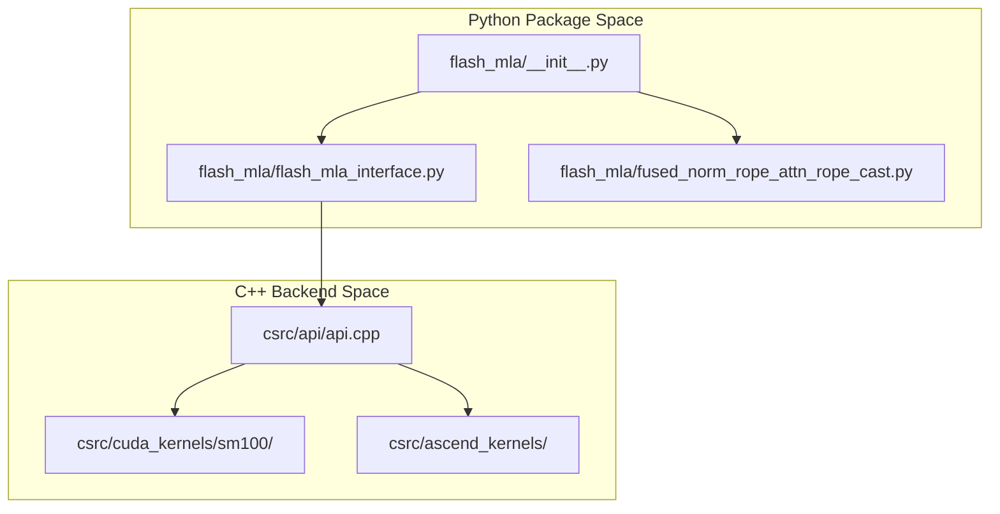

<!-- source: DeepWiki mcp.deepwiki.com · repo deepseek-ai/FlashMLA · page 1 Overview · fetched 2026-10-30 -->

# Overview

<details>
<summary>Relevant source files</summary>

The following files were used as context for generating this wiki page:

- [README.md](README.md)
- [flash_mla/__init__.py](flash_mla/__init__.py)

</details>


FlashMLA is DeepSeek's optimized attention kernel library designed to power inference of the [DeepSeek-V4.1](https://huggingface.co/deepseek-ai/DeepSeek-V4.1-Flash) model on NVIDIA SM100/SM103 GPUs and Huawei Ascend 950 NPUs [README.md:1-7](). The library provides token-level sparse attention kernels for prefill and decoding with FP8 or FP4 KV cache formats, a high-performance fused pipeline combining Q-norm, Q-RoPE, attention, O-RoPE (conjugate) and FP8 cast, as well as dense MHA prefill and backward kernels [README.md:5-7]().

For detailed information on capabilities, workload types, and performance characteristics, see [Purpose and Features](#1.1). For hardware prerequisites, toolchain versions, and platform requirements, see [Supported Hardware and Requirements](#1.2).

Sources: [README.md:1-7]()

## Purpose and Core Capabilities

FlashMLA implements highly optimized attention primitives tailored for the Multi-head Latent Attention (MLA) and DeepSeek Sparse Attention (DSA) mechanisms used in DeepSeek-V4.1 [README.md:5-7](). 

The primary public Python APIs and their functions exported in `flash_mla/__init__.py` include:

| API Function | Description | Stage / Pattern |
|--------------|-------------|-----------------|
| `get_mla_metadata` | Generates scheduling metadata for decoding operations | Decoding (Sparse) |
| `flash_mla_with_kvcache` | Executes MLA attention with paged FP8/FP4 KV cache | Decoding (Sparse) |
| `flash_mla_sparse_fwd` | Token-level sparse attention for prefill | Prefill (Sparse) |
| `flash_attn_varlen_func` | Dense variable-length attention | Prefill (Dense) |
| `fused_norm_rope_attn_rope_cast` | Fused Q-norm, Q-RoPE, attention, O-RoPE, and FP8 cast pipeline | Prefill & Decode |

For comprehensive coverage of sparse decode/prefill, dense MHA prefill/backward, FP8/FP4 KV cache memory layouts, and performance metrics across platforms, refer to [Purpose and Features](#1.1).

Sources: [README.md:5-7](), [flash_mla/__init__.py:1-22]()

## System Architecture and Integration

The library spans across Python application entry points, C++ dispatcher layers, and architecture-specific backends for NVIDIA GPUs and Huawei Ascend NPUs [README.md:5-13]().

Diagram: "Natural Language to Code Entity Mapping for Inference"
```mermaid
graph TD
    subgraph "Natural Language Space: Model Inference"
        [DeepSeekV4Model] --> [flash_mla_interface]
    end

    subgraph "Code Entity Space: Python Interface"
        [flash_mla_interface] --> [get_mla_metadata]
        [flash_mla_interface] --> [flash_mla_with_kvcache]
        [flash_mla_interface] --> [flash_mla_sparse_fwd]
        [flash_mla_interface] --> [fused_norm_rope_attn_rope_cast]
    end

    subgraph "Code Entity Space: C++ Dispatch & Kernels"
        [flash_mla_with_kvcache] --> [csrc_api]
        [flash_mla_sparse_fwd] --> [csrc_api]
        [csrc_api] --> [sm100_kernels]
        [csrc_api] --> [ascend_kernels]
    end
```
Sources: [README.md:5-15](), [flash_mla/__init__.py:1-22]()

Diagram: "Source Code Module Hierarchy"

Sources: [README.md:5-15](), [flash_mla/__init__.py:1-22]()

## Supported Hardware and Platforms

FlashMLA targets high-performance accelerators with strict hardware and software prerequisites:
- **NVIDIA Platform**: NVIDIA SM100 / SM103 GPUs, CUDA 13.1 and above (CUDA 13.2+ recommended for native instructions), PyTorch 2.0+ [README.md:77-81]().
- **Huawei Platform**: Huawei Ascend 950 NPU, CANN 9.2.0 and above (providing the `bisheng` compiler and Ascend C headers), `torch_npu`, and PyTorch 2.0+ [README.md:83-88]().

For detailed platform auto-detection logic, environment requirements, and build targets, see [Supported Hardware and Requirements](#1.2).

Sources: [README.md:75-89]()

---

