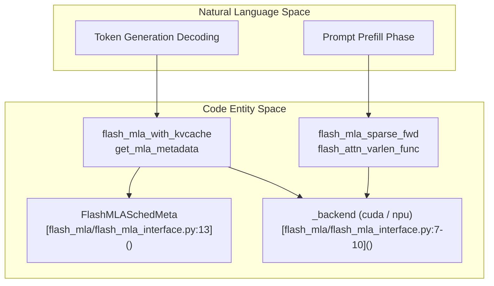
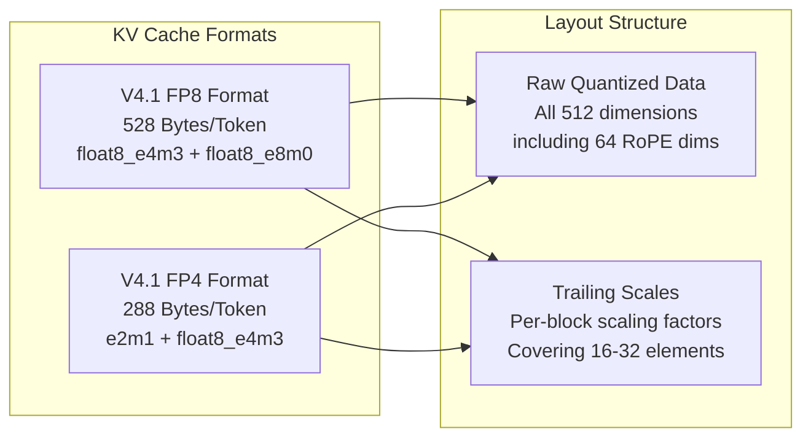
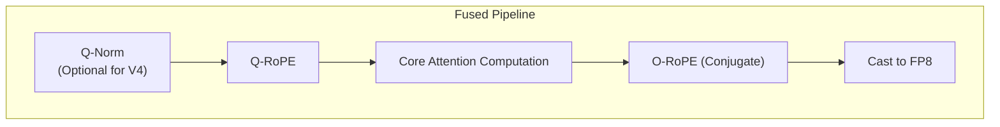
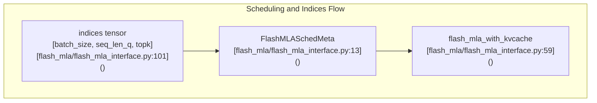

<!-- source: DeepWiki mcp.deepwiki.com · repo deepseek-ai/FlashMLA · page 1.1 Purpose and Features · fetched 2026-10-30 -->

# Purpose and Features

Relevant source files

The following files were used as context for generating this wiki page:

- [README.md](README.md)
- [flash_mla/flash_mla_interface.py](flash_mla/flash_mla_interface.py)

FlashMLA is DeepSeek's library of optimized attention kernels, powering the inference of the DeepSeek-V4.1 model on NVIDIA SM100/SM103 GPUs and Huawei Ascend 950 NPUs [README.md:5-7](). The library provides token-level sparse attention kernels for prefill and decoding with FP8 or FP4 KV cache formats, a fused pipeline combining normalization, RoPE, attention, conjugate RoPE, and FP8 casting, as well as dense MHA prefill and backward kernels [README.md:5-8]().

This page details the core features, KV cache layouts, pipeline architectures, and performance characteristics of FlashMLA. For hardware requirements and installation steps, see [Supported Hardware and Requirements](#1.2) and [Building from Source](#2.1).

Sources: [README.md:1-10]()

## Core Attention Operations and API Mapping

FlashMLA supports both sparse and dense attention patterns across prefill and decoding phases. The high-level architecture maps user-facing Python APIs to backend implementations across supported hardware platforms.

Sources: [README.md:5-10](), [flash_mla/flash_mla_interface.py:7-56]()

| Operation Type | API Function(s) | Primary Use Case | Hardware Support | Data Format |
|----------------|-----------------|------------------|------------------|-------------|
| **Dense Prefill** | `flash_attn_varlen_func` `flash_attn_varlen_qkvpacked_func` `flash_attn_varlen_kvpacked_func` | Processing full prompts with standard MHA | NVIDIA SM100 | BF16 |
| **Sparse Prefill** | `flash_mla_sparse_fwd` | Processing prompts with DeepSeek Sparse Attention (DSA) | NVIDIA SM100, Ascend 950 NPU | BF16 / FP8 |
| **Dense Decoding** | `flash_mla_with_kvcache` (without `indices`) | Token-by-token generation with full attention | NVIDIA SM100, Ascend 950 NPU | BF16 KV Cache |
| **Sparse Decoding** | `flash_mla_with_kvcache` (with `indices`) | Token-by-token generation with DSA | NVIDIA SM100, Ascend 950 NPU | FP8 / FP4 KV Cache |

Sources: [README.md:5-15](), [flash_mla/flash_mla_interface.py:59-77]()

## KV Cache Formats and Quantization

FlashMLA supports specialized FP8 and FP4 KV cache formats tailored for DeepSeek-V4.1, reducing memory footprint and alleviating memory bandwidth bottlenecks [README.md:5-7, 114-119]().

Sources: [flash_mla/flash_mla_interface.py:114-119]()

### Cache Layout Specifications

- **V4.1 FP8 KV Cache (528 Bytes per token)**: The raw data consists of 512 `float8_e4m3` values covering all 512 dimensions (including the 64 RoPE dimensions, meaning no separate bfloat16 portion is stored). The trailing scales consist of 16 bytes of `float8_e8m0` values, where each scale covers 32 consecutive `float8_e4m3` values [flash_mla/flash_mla_interface.py:118]().
- **V4.1 FP4 KV Cache (288 Bytes per token)**: The raw data consists of 256 bytes containing 512 `e2m1` values (two values packed per byte, with the even-indexed value in the low nibble). The trailing scales consist of 32 bytes of `float8_e4m3` values, each covering 16 consecutive `e2m1` values [flash_mla/flash_mla_interface.py:119]().

Sources: [flash_mla/flash_mla_interface.py:114-119]()

## Fused Norm-RoPE-Attention-RoPE-Cast Pipeline

FlashMLA provides a highly optimized fused kernel pipeline that integrates multiple operations into a single execution pass [README.md:7, 25, 41]().

Sources: [README.md:25, 41]()

This pipeline combines Q-norm, Q-RoPE, core attention, O-RoPE (conjugate), and the cast to FP8, eliminating intermediate memory roundtrips [README.md:25, 41](). It requires weight pre-permutation via `permute_q_b_proj` and `permute_wv_proj` [README.md:25, 41]().

Sources: [README.md:25, 41]()

## Sparse Attention and Scheduling

DeepSeek Sparse Attention (DSA) is supported via the `indices` tensor passed to `flash_mla_with_kvcache` [flash_mla/flash_mla_interface.py:59-106](). The tile scheduler metadata is managed via `FlashMLASchedMeta` initialized by `get_mla_metadata` [flash_mla/flash_mla_interface.py:13-56]().

Sources: [flash_mla/flash_mla_interface.py:13-106]()

Sources: [flash_mla/flash_mla_interface.py:13-106]()

## Performance Characteristics

FlashMLA achieves exceptional throughput across supported hardware platforms:

| Operation | Hardware Platform | Peak Performance | Notes |
|-----------|-------------------|------------------|-------|
| Fused Norm-RoPE-Attn-RoPE-Cast (Prefill) | NVIDIA B200 | Up to 1460 TFlops | CUDA 13.3 [README.md:41]() |
| Fused Norm-RoPE-Attn-RoPE-Cast (Decoding) | NVIDIA B200 | Up to 950 TFlops | CUDA 13.3 [README.md:41]() |
| Sparse Prefill | NVIDIA B200 | Up to 1350 TFlops | CUDA 13.3 [README.md:51]() |
| Sparse Decoding | NVIDIA B200 | Up to 1024 TFlops | CUDA 13.3 [README.md:61]() |
| Sparse Prefill | Huawei Ascend 950 NPU | Up to 410 TFlops | 95% of hardware peak [README.md:13, 53]() |
| Sparse Decoding | Huawei Ascend 950 NPU | Up to 360 TFlops | 83% of hardware peak [README.md:13, 63]() |
| Dense MHA Prefill (Forward) | NVIDIA B200 | Up to 1460 TFlops | CUTLASS FMHA [README.md:71]() |
| Dense MHA Prefill (Backward) | NVIDIA B200 | Up to 1000 TFlops | CUTLASS FMHA [README.md:71]() |

Sources: [README.md:13, 41-71]()

---

