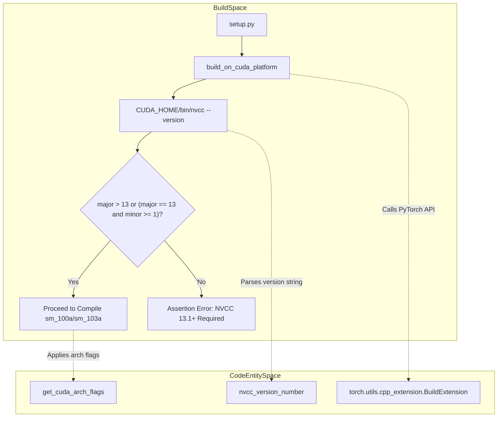
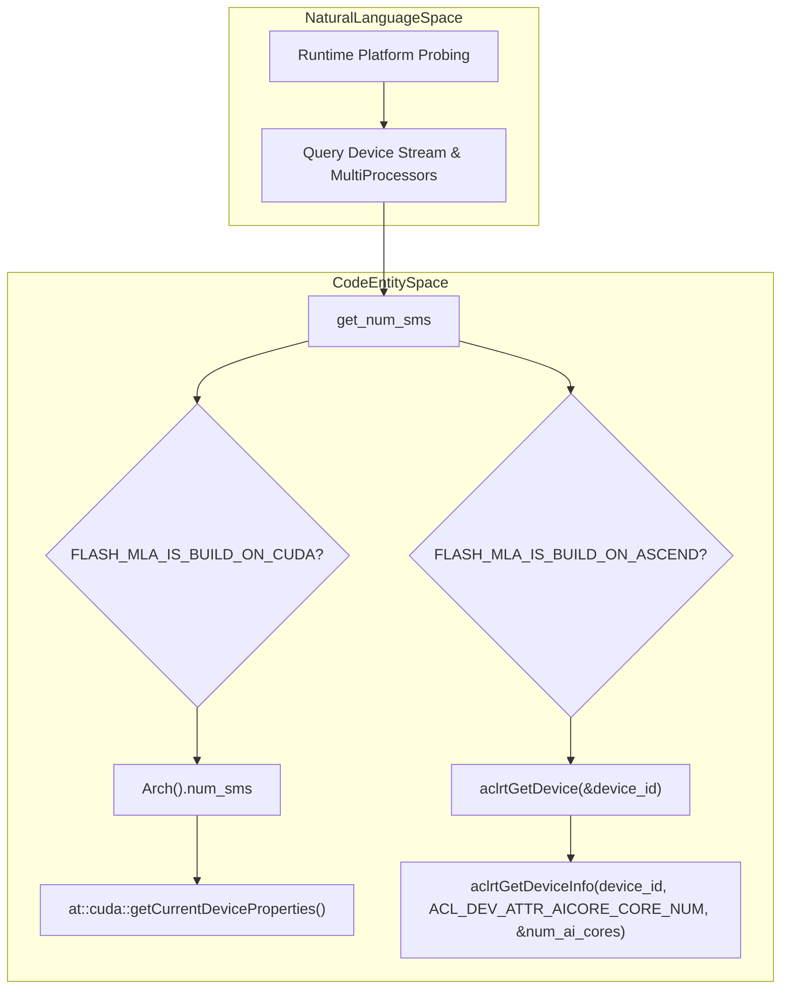

<!-- source: DeepWiki mcp.deepwiki.com · repo deepseek-ai/FlashMLA · page 1.2 Supported Hardware and Requirements · fetched 2026-10-30 -->

# Supported Hardware and Requirements

Relevant source files

The following files were used as context for generating this wiki page:

- [README.md](README.md)
- [csrc/api/common.h](csrc/api/common.h)
- [setup.py](setup.py)

This page specifies the target hardware architectures, compiler toolchain versions, and software prerequisites required to build and run FlashMLA. Following the 2026.09.30 release, FlashMLA has been updated to focus on next-generation NVIDIA SM100/SM103 architectures and Huawei Ascend 950 NPUs, dropping legacy support for older Hopper hardware [README.md:3-23]().

---

## Supported Hardware Targets

FlashMLA targets high-performance accelerator architectures across NVIDIA and Huawei platforms, leveraging architecture-specific features for quantized KV caches and sparse attention execution.

### NVIDIA GPU Support (`sm_100a` / `sm_103a`)

FlashMLA compiles explicitly for Blackwell-derived architecture targets using architecture-specific `-gencode` flags rather than family-wide abbreviations [setup.py:24-27]().

| Specification | Value | Notes |
|---------------|-------|-------|
| Architecture Codes | `sm_100a`, `sm_103a` | Required for instructions like `.scaled::n2::ue8m0` and optimized `exp` codegen [setup.py:24-27]() |
| Example Hardware | Blackwell B200 and derivatives | Primary testing and deployment platform [README.md:41]() |
| Minimum CUDA Version | CUDA 13.1+ (13.2+ recommended) | CUDA 13.2+ introduces native `cvt.rn.bf16x2` conversions [README.md:80]() |

Sources: [README.md:79-80](), [setup.py:24-27]()

### Huawei Ascend NPU Support (`Ascend 950`)

For non-NVIDIA deployments, FlashMLA provides sparse attention prefill and decoding kernels optimized for Huawei Ascend NPUs [README.md:13]().

| Specification | Value | Notes |
|---------------|-------|-------|
| Target Hardware | Huawei Ascend 950 NPU | AI Core utilization achieves up to 95% peak during prefill [README.md:13]() |
| Required Toolchain | CANN 9.2.0+ | Provides the `bisheng` compiler and Ascend C headers [README.md:86]() |
| Software Prerequisite | `torch_npu` | Integrates Ascend device streams with PyTorch [README.md:87]() |

Sources: [README.md:13](), [README.md:85-88]()

---

## Software Requirements and Toolchain Prerequisites

### NVIDIA Toolchain Requirements

Building CUDA extensions requires a compatible CUDA Toolkit and `nvcc` compiler instance bound to PyTorch's extension manager [setup.py:92-106]().

**NVCC Version Enforcement Flow**

Sources: [setup.py:79-110]()

- **NVCC Version Check**: The build orchestrator extracts the compiler version via `nvcc --version` and asserts that `major > 13 or (major == 13 and minor >= 1)` to support scaled conversion intrinsics [setup.py:102-109]().
- **PyTorch Prerequisite**: PyTorch 2.0+ is required for the C++ extension binding infrastructure [README.md:81]().

Sources: [README.md:80-81](), [setup.py:92-110]()

### Huawei Ascend Prerequisites

Building for the Huawei platform requires the CANN toolkit environment:
- **CANN 9.2.0+**: Supplies the `bisheng` compiler driver and required Ascend C header dependencies [README.md:86]().
- **`torch_npu`**: Necessary to bridge PyTorch tensor memory allocations and stream management with Ascend NPU execution contexts [README.md:87]().

Sources: [README.md:85-88]()

---

## Platform Auto-Detection and Runtime Device Probing

FlashMLA automatically detects the underlying hardware platform at runtime, querying device properties and multi-processor counts via platform-specific runtime APIs [csrc/api/common.h:40-75]().

**Hardware Detection and Core Count Probing**

- **CUDA Discovery**: The `Arch` struct instantiates `at::cuda::getCurrentDeviceProperties()` to query compute capability major/minor versions and Streaming Multiprocessor counts [csrc/api/common.h:40-57]().
- **Ascend Discovery**: On Ascend builds, `get_num_sms()` interacts with the DaVinci runtime via `aclrtGetDevice` and `aclrtGetDeviceInfo` querying `ACL_DEV_ATTR_AICORE_CORE_NUM` (managed via `/dev/davinci_manager` kernel drivers) to report total available AI cores [csrc/api/common.h:60-75]().

Sources: [csrc/api/common.h:40-75]()

---

