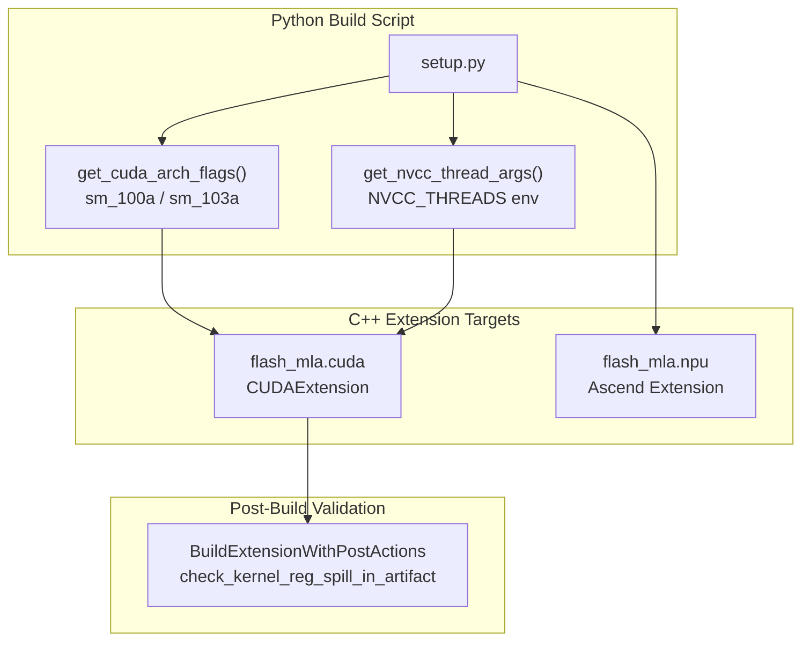
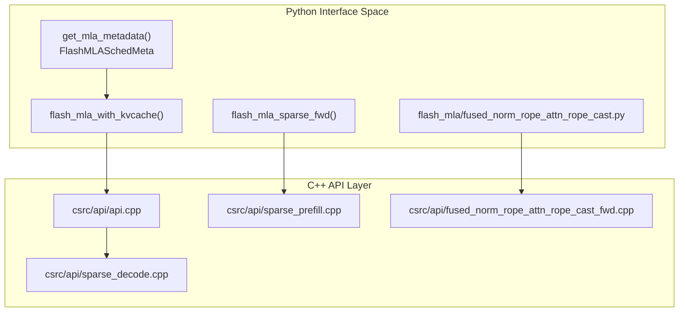

<!-- source: DeepWiki mcp.deepwiki.com · repo deepseek-ai/FlashMLA · page 2 Getting Started · fetched 2026-10-30 -->

# Getting Started

Relevant source files

The following files were used as context for generating this wiki page:

- [README.md](README.md)
- [setup.py](setup.py)

This document provides a quickstart guide for installing and using FlashMLA for NVIDIA SM100/SM103 GPUs and Huawei Ascend 950 NPUs [README.md:13-16, 79-86](). FlashMLA provides token-level sparse attention kernels for prefill and decoding with FP8/FP4 KV caches, dense prefill and backward kernels, and fused attention pipelines [README.md:5-7]().

For detailed installation and build orchestration, see [Building from Source](#2.1). For comprehensive usage patterns and code examples, see [Usage Examples](#2.2).

---

## 2.1. Building from Source

FlashMLA relies on a custom `setup.py` script to orchestrate compilation for either the NVIDIA CUDA platform or the Huawei Ascend NPU platform [setup.py:20-22, 92](). The build system inspects the target environment, configures architecture-specific nvcc or bisheng compiler flags, manages submodules such as CUTLASS and kerutils, and performs post-build checks like register-spill validation [setup.py:79-137]().

"Build Orchestration Flow"

**Build Orchestration Flow**: This diagram maps build configuration routines in `setup.py` to extension targets (`flash_mla.cuda` and `flash_mla.npu`) and post-build register-spill validation [setup.py:20-27, 111-137]().

For detailed configuration instructions, environment variables (`FLASH_MLA_BUILD_TARGET_PLATFORM`, `NVCC_THREADS`), and submodule requirements, see [Building from Source](#2.1).

Sources: [setup.py:20-137]()

---

## 2.2. Usage Examples

FlashMLA exposes high-level Python APIs that dispatch to optimized CUDA and Ascend C++ kernels [README.md:5-16, 83-88](). Common workflows include sparse MLA decoding with paged FP8/FP4 KV cache, sparse prefill, dense varlen prefill/backward, and the fused `norm-RoPE-attention-RoPE-cast` pipeline [README.md:5-7, 25-41]().

"API Dispatch Architecture"

**API Dispatch Architecture**: This diagram connects user-facing Python functions to underlying C++ translation units in `csrc/api/` [setup.py:11-18]().

For concrete code examples, tensor shape specifications, and pre-permutation requirements for weights, see [Usage Examples](#2.2).

Sources: [README.md:33-74](), [setup.py:11-18]()

---

## Next Steps

- **Building from Source**: For complete details on compilation settings, environment variables, and toolchain versions, see [Building from Source](#2.1).
- **Usage Examples**: For full Python code snippets covering decoding, prefill, and fused pipelines, see [Usage Examples](#2.2).

---

