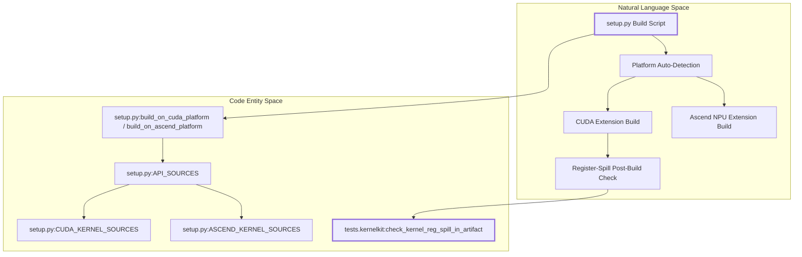
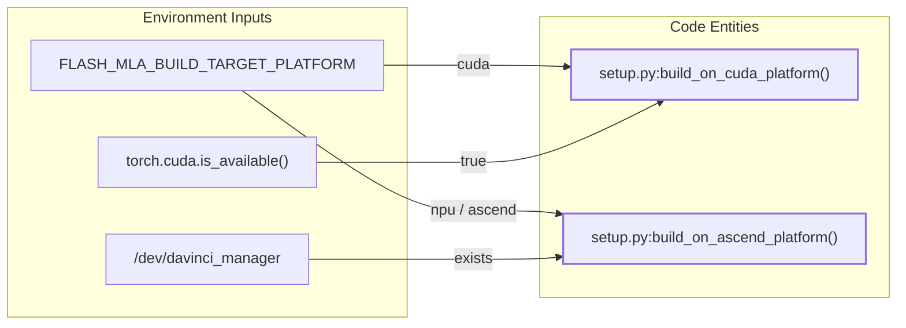
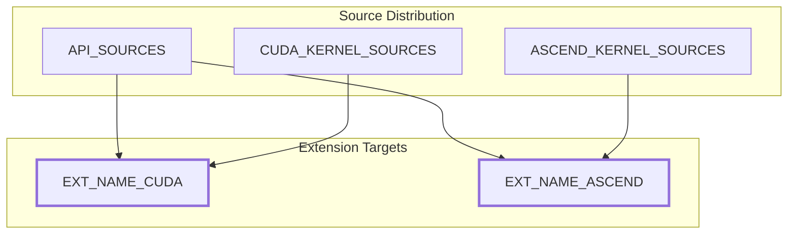
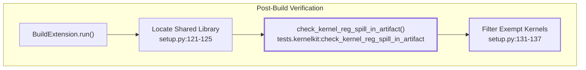

<!-- source: DeepWiki mcp.deepwiki.com · repo deepseek-ai/FlashMLA · page 2.1 Building from Source · fetched 2026-10-30 -->

# Building from Source

Relevant source files

The following files were used as context for generating this wiki page:

- [.gitignore](.gitignore)
- [.gitmodules](.gitmodules)
- [LICENSE](LICENSE)
- [setup.py](setup.py)

This document details the build orchestration for FlashMLA using `setup.py`, covering platform detection, CUDA versus Ascend NPU extension compilation, configuration via environment variables (`FLASH_MLA_BUILD_TARGET_PLATFORM` and `NVCC_THREADS`), submodule initialization for CUTLASS and kerutils, and the automated register-spill post-build verification.

---

## Build System Architecture and Orchestration

The build process is managed by `setup.py`, which inspects the target platform, configures compiler flags, initializes submodules, compiles C++ bindings and backend-specific kernels (CUDA SM100 or Ascend NPU), and runs post-build verification checks.

### Build Orchestration Flow

**Sources**: [setup.py:1-137]()

---

## Platform Detection and Target Configuration

FlashMLA supports two major backend hardware platforms: NVIDIA SM100/SM103 GPUs (CUDA) and Huawei Ascend 950 NPUs (Ascend). The build target can be explicitly forced via the `FLASH_MLA_BUILD_TARGET_PLATFORM` environment variable or automatically inferred based on the runtime environment (e.g., presence of `/dev/davinci_manager` for Ascend or PyTorch CUDA availability).

**Sources**: [setup.py:1-137]()

---

## CUDA vs Ascend Extension Builds

Depending on the detected or specified platform, `setup.py` compiles different sets of source files into distinct extension modules (`flash_mla.cuda` or `flash_mla.npu`).

### Source File Units

*   **API Sources (`API_SOURCES`)**: Common pybind11 and C++ binding implementation files located in `csrc/api/` [setup.py:11-18]().
*   **CUDA Kernel Sources (`CUDA_KERNEL_SOURCES`)**: Includes CUTLASS FMHA kernels, decoder schedulers, sparse decode/prefill kernels for SM100, and fused norm-RoPE-attention-RoPE-cast pipelines [setup.py:32-66]().
*   **Ascend Kernel Sources (`ASCEND_KERNEL_SOURCES`)**: Explicit template instantiations for Ascend sparse prefill and decode kernels (`.asc` files) [setup.py:70-77]().

**Sources**: [setup.py:11-77]()

---

## Environment Variables and Compilation Flags

The build process is configured through environment variables that control parallelism, target architecture, and compiler flags:

*   **`FLASH_MLA_BUILD_TARGET_PLATFORM`**: Selects between CUDA and Ascend compilation targets.
*   **`NVCC_THREADS`**: Configures the number of parallel compilation threads passed to NVCC (default: `32`) [setup.py:87-90]().
*   **CUDA Architecture Flags (`CUDA_ARCHS`)**: Set to `["sm_100a", "sm_103a"]` to leverage architecture-specific instructions such as scaled conversion (`cvt` with `.scaled::n2::ue8m0`) and optimized exponential operations [setup.py:24-28]().
*   **NVCC Version Enforcement**: `build_on_cuda_platform()` checks that NVCC version is `13.1` or higher, asserting compatibility with required Blackwell instructions [setup.py:102-110]().

**Sources**: [setup.py:24-110]()

---

## Submodule Management: CUTLASS and Kerutils

FlashMLA relies on external submodules for accelerated linear algebra primitives and shared kernel routines:
*   **CUTLASS**: Located at `csrc/3rdparty/cutlass`, providing high-performance tensor core operations [.gitmodules:1-3]().
*   **Kerutils**: Located under `csrc/3rdparty/kerutils`, providing shared kernel utility headers referenced during compilation [setup.py:130]().

**Sources**: [.gitmodules:1-3](), [setup.py:130]()

---

## Register-Spill Post-Build Verification

To ensure that performance-critical kernels do not suffer from register spilling, `setup.py` defines a custom subclass `BuildExtensionWithPostActions` [setup.py:111-114](). 

After compilation completes, `run()` executes a register-spill inspection across all generated shared library artifacts (`.so`) [setup.py:115-125]().

*   **Exemption Rule**: Upstream CUTLASS FMHA kernels (`_ZN7cutlass`) which intentionally maintain stack frames are exempt from the spill-free requirement [setup.py:131-137](). All kernels defined directly within the FlashMLA repository must remain register-spill-free [setup.py:131-134]().
*   **Bypassing**: Checks can be skipped by setting the `FLASH_MLA_SKIP_REG_SPILL_CHECK` environment variable [setup.py:129]().

**Sources**: [setup.py:111-137]()

---

