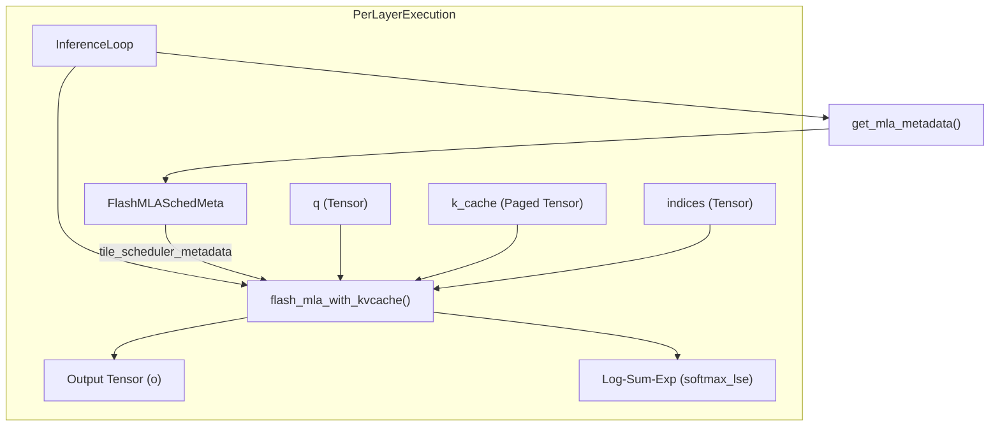
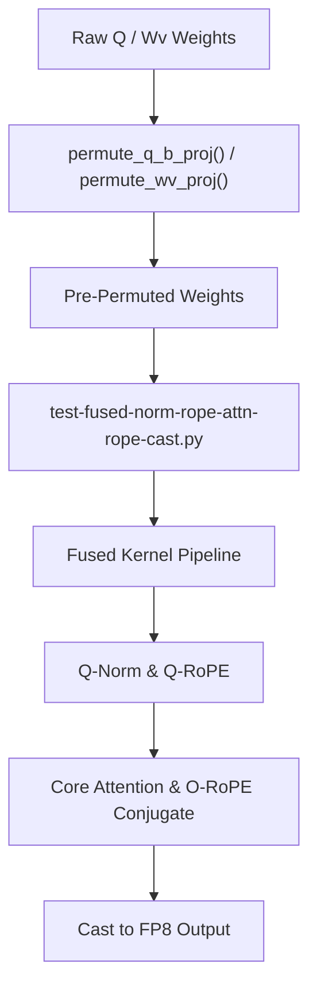

<!-- source: DeepWiki mcp.deepwiki.com · repo deepseek-ai/FlashMLA · page 2.2 Usage Examples · fetched 2026-10-30 -->

# Usage Examples

<details>
<summary>Relevant source files</summary>

The following files were used as context for generating this wiki page:

- [README.md](README.md)
- [flash_mla/flash_mla_interface.py](flash_mla/flash_mla_interface.py)

</details>


This page provides concrete code examples and usage patterns for FlashMLA, covering sparse MLA decoding with paged FP8/FP4 KV cache, sparse prefill, dense varlen prefill/backward, and the fused norm-RoPE-attention-RoPE-cast pipeline with weight pre-permutation [README.md:7-43]().

## Basic Usage Pattern & API Flow

The FlashMLA Python interface follows a metadata-driven execution pattern designed to separate scheduling setup from kernel invocation.

### Code Entity Mapping: API Flow

The following diagram bridges the high-level inference flow to the underlying code entities in `flash_mla`.

"Natural Language Space to Code Entity Space: API Flow"


The fundamental API usage pattern is implemented as follows:
1. Initialize the metadata container via `get_mla_metadata()` [flash_mla/flash_mla_interface.py:43-56]().
2. Invoke `flash_mla_with_kvcache()` per transformer layer during decoding or inference [flash_mla/flash_mla_interface.py:59-77]().

Sources: [README.md:90-107](), [flash_mla/flash_mla_interface.py:37-77]()

## Sparse MLA Decoding with Paged FP8/FP4 KV Cache

FlashMLA supports token-level sparse attention (DSA) during decoding using paged KV caches quantized to FP8 or FP4 formats [README.md:7-25]().

### KV Cache Layouts for DeepSeek-V4.1
The KV cache format is detected automatically from the last dimension (`bytes_per_token`) of `k_cache`:
- **V4.1 FP8 (528 Bytes per token)**: The raw data consists of 512 `float8_e4m3` values covering all dimensions (including the 64 RoPE dimensions, without a separate bfloat16 part). Trailing scales consist of 16 Bytes of `float8_e8m0` values, each scaling 32 consecutive `float8_e4m3` values [flash_mla/flash_mla_interface.py:118]().
- **V4.1 FP4 (288 Bytes per token)**: The raw data consists of 256 Bytes containing 512 `e2m1` values (2 values per byte). Trailing scales consist of 32 Bytes of `float8_e4m3` values, each scaling 16 consecutive `e2m1` values [flash_mla/flash_mla_interface.py:119]().

### Code Example: Sparse Decoding

```python
import torch
from flash_mla import get_mla_metadata, flash_mla_with_kvcache

# 1. Initialize metadata container
sched_meta, _ = get_mla_metadata()

# 2. Execute sparse MLA decoding with FP8/FP4 KV cache
o, lse = flash_mla_with_kvcache(
    q=q_tensor,                          # [batch_size, seq_len_q, num_heads_q, 512], bfloat16
    k_cache=k_cache_paged,               # [num_blocks, page_block_size, 1, bytes_per_token]
    block_table=None,
    cache_seqlens=None,
    head_dim_v=512,
    tile_scheduler_metadata=sched_meta,
    softmax_scale=1.0 / (512 ** 0.5),
    causal=False,                        # Sparse attention only
    is_fp8_kvcache=True,
    indices=indices_tensor,              # [batch_size, seq_len_q, topk], int32
)
```

Sources: [README.md:115-123](), [flash_mla/flash_mla_interface.py:59-119]()

## Sparse Prefill

Sparse prefill handles token-level sparse attention during the prefill phase, driven by specialized sparse attention kernels [README.md:7-13]().

### Code Example: Sparse Prefill Execution

```python
import torch
# Run sparse prefill benchmark / test suite
# python tests/test-sparse-prefill.py
```

The sparse prefill test suite validates correctness and performance against reference implementations, achieving high throughput (e.g., up to 1350 TFlops on NVIDIA B200 and 410 TFlops on Huawei Ascend 950 NPUs) [README.md:45-54]().

Sources: [README.md:45-54](), [tests/test-sparse-prefill.py:1-50]()

## Dense Varlen Prefill and Backward

FlashMLA supports dense Multi-Head Attention (MHA) prefill and backward computations on NVIDIA SM100 GPUs using CUTLASS-based collective and device layers [README.md:27-74]().

### Code Example: Dense MHA Prefill and Backward

```python
import torch
# Run dense MHA prefill and backward test suite
# python tests/test_fmha_sm100.py
```

This kernel supports causal masking, sliding-window attention, and full backward propagation, achieving up to 1460 TFlops in forward pass and 1000 TFlops in backward pass on B200 [README.md:65-74]().

Sources: [README.md:27-74](), [tests/test_fmha_sm100.py:1-50]()

## Fused Norm-RoPE-Attention-RoPE-Cast Pipeline

The fused norm-RoPE-attention-RoPE-cast kernel combines Q-norm, Q-RoPE, core attention, O-RoPE (conjugate), and cast-to-FP8 into a single execution step [README.md:25-44]().

### Code Entity Mapping: Fused Pipeline

"Natural Language Space to Code Entity Space: Fused Pipeline"


### Code Example: Fused Pipeline Execution

```python
import torch
# Run the fused pipeline benchmark and test
# python tests/test-fused-norm-rope-attn-rope-cast.py
```

Running this test requires [TileLang](https://github.com/tile-ai/tilelang), [Tile-Kernels](https://github.com/deepseek-ai/TileKernels/), and [DeepGEMM](https://github.com/deepseek-ai/DeepGEMM) [README.md:39](). It requires pre-permuting weights (`permute_q_b_proj` and `permute_wv_proj`) and delivers up to 1460 TFlops during prefill and 950 TFlops during decoding on B200 [README.md:41]().

Sources: [README.md:25-44](), [tests/test-fused-norm-rope-attn-rope-cast.py:1-50]()

---

