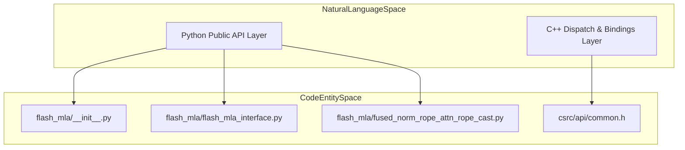
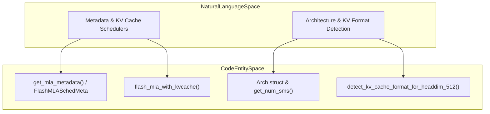

<!-- source: DeepWiki mcp.deepwiki.com · repo deepseek-ai/FlashMLA · page 3 API Reference · fetched 2026-10-30 -->

# API Reference

Relevant source files

The following files were used as context for generating this wiki page:

- [csrc/api/common.h](csrc/api/common.h)
- [flash_mla/__init__.py](flash_mla/__init__.py)

This page provides a high-level overview of the public Python and C++ APIs exposed by FlashMLA. The library provides a user-facing Python interface [flash_mla/__init__.py:1-22]() that delegates to a high-performance C++ and CUDA/Ascend extension layer [csrc/api/common.h:1-28](). 

**Scope**: As a parent reference page, this section summarizes the core API groups and their architectural roles. For deep technical details, parameter specifications, and implementation mechanics, please refer to the child pages:
- [Python API](#3.1)
- [C++ Interface](#3.2)
- [Fused Norm-RoPE-Attention-RoPE-Cast API](#3.3)

---

## Architecture to Code Mapping

The following diagrams illustrate how high-level attention and decoding operations map directly onto FlashMLA's Python module exports, C++ dispatchers, and underlying files.

Sources: [flash_mla/__init__.py:1-22](), [flash_mla/flash_mla_interface.py:37-435](), [csrc/api/common.h:1-191]()

Sources: [flash_mla/flash_mla_interface.py:8-70](), [csrc/api/common.h:41-75](), [csrc/api/common.h:170-179]()

---

## 3.1 Python API

The Python API serves as the primary entry point for model inference pipelines. It exposes metadata generation utilities, sparse/dense decoding kernels, sparse prefill functions, and variable-length dense multi-head attention (MHA) primitives [flash_mla/__init__.py:3-10](). 

Key exported symbols include `get_mla_metadata`, `FlashMLASchedMeta`, `flash_mla_with_kvcache`, `flash_mla_sparse_fwd`, and varlen attention variants (`flash_attn_varlen_func`, `flash_attn_varlen_qkvpacked_func`, `flash_attn_varlen_kvpacked_func`) [flash_mla/__init__.py:14-22](). These functions handle tensor validations, shape checking, and argument preparation before invoking compiled extensions.

For complete parameter lists, tensor layout requirements, and behavioral documentation, see [Python API](#3.1).

Sources: [flash_mla/__init__.py:1-22](), [flash_mla/flash_mla_interface.py:1-435]()

---

## 3.2 C++ Interface

The C++ extension layer manages hardware dispatch, stream synchronization, architecture validation, and kernel bindings [csrc/api/common.h:1-191](). It defines common utilities under `csrc/api/common.h`, such as the `Arch` struct for detecting GPU capabilities (e.g., SM100 Blackwell features) [csrc/api/common.h:41-57](), helper functions for active stream retrieval [csrc/api/common.h:79-87](), and compile-time template dispatch macros like `DISPATCH_NUM_HEADS` [csrc/api/common.h:99-110]().

Additionally, this layer implements KV cache format detection for 512-dimensional head features (`detect_kv_cache_format_for_headdim_512`) [csrc/api/common.h:170-179]() and feature validation checks via the `DECLARE_SUPPORTED_FEATURES` macro [csrc/api/common.h:189-191]().

For detailed binding definitions, parameters structures (`params.h`), and implementation base dispatchers (`ImplBase`), see [C++ Interface](#3.2).

Sources: [csrc/api/common.h:1-191]()

---

## 3.3 Fused Norm-RoPE-Attention-RoPE-Cast API

FlashMLA provides a specialized fused pipeline combining layer normalization, Rotary Position Embedding (RoPE), attention computation, post-attention RoPE, and type casting into optimized routines [flash_mla/__init__.py:12](). 

Implemented in `flash_mla/fused_norm_rope_attn_rope_cast.py`, this API includes dedicated prefill and decode entrypoints, weight preprocessing routines (`permute_q_b_proj` and `permute_wv_proj`), TMA-aligned scale layouts, and native DeepGEMM interoperability for low-precision execution.

For detailed integration guides and preprocessing specifications, see [Fused Norm-RoPE-Attention-RoPE-Cast API](#3.3).

Sources: [flash_mla/__init__.py:12](), [flash_mla/fused_norm_rope_attn_rope_cast.py:1-150]()

---

