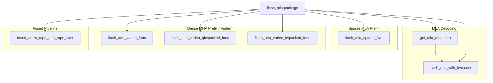
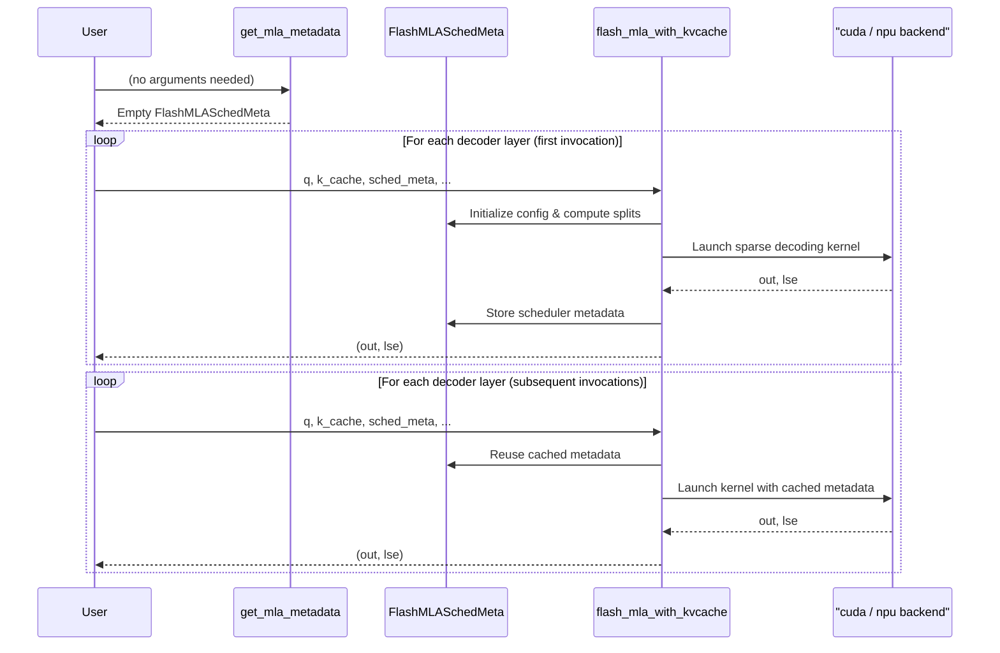
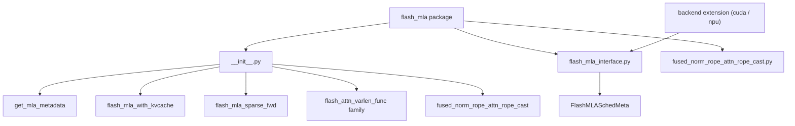

<!-- source: DeepWiki mcp.deepwiki.com · repo deepseek-ai/FlashMLA · page 3.1 Python API · fetched 2026-10-30 -->

# Python API

<details>
<summary>Relevant source files</summary>

The following files were used as context for generating this wiki page:

- [flash_mla/__init__.py](flash_mla/__init__.py)
- [flash_mla/flash_mla_interface.py](flash_mla/flash_mla_interface.py)

</details>


This document provides comprehensive documentation for all Python-facing functions in FlashMLA. The library provides multiple distinct APIs for different attention computation scenarios, including MLA decoding, sparse prefill, dense varlen prefill/backward, and the fused norm-RoPE-attention-RoPE-cast pipeline.

For details about the underlying C++ implementation, see [C++ Interface](#3.2). For details on the fused pipeline, see [Fused Norm-RoPE-Attention-RoPE-Cast API](#3.3).

## API Categories

The FlashMLA Python APIs are organized by use case and attention pattern, exported directly from the `flash_mla` package [flash_mla/__init__.py:3-12]():



**API Category Mapping**

| API Function | Use Case | Attention Mode | GPU / NPU Support | KV Cache Format |
|--------------|----------|----------------|-------------------|-----------------|
| `get_mla_metadata` + `flash_mla_with_kvcache` | Decoding (token generation) | Sparse / MQA | SM100 / Ascend | FP8 / FP4 |
| `flash_mla_sparse_fwd` | Prefill (prompt processing) | Sparse | SM100 / Ascend | N/A (direct input) |
| `flash_attn_varlen_func` family | Prefill (prompt processing) | Dense | SM100 only | N/A (direct input) |
| `fused_norm_rope_attn_rope_cast` | Fused Pre-Attention Pipeline | Prefill / Decode | SM100 only | Dynamic |

**Sources:** [flash_mla/flash_mla_interface.py:3-11](), [flash_mla/__init__.py:3-13]()

## MLA Decoding API

The MLA Decoding API provides token-by-token generation with paged KV cache support. It uses a stateful metadata caching approach where scheduling metadata is initialized via `get_mla_metadata()` and populated or reused across calls to `flash_mla_with_kvcache` [flash_mla/flash_mla_interface.py:13-76]().

### Execution Flow



**Sources:** [flash_mla/flash_mla_interface.py:43-119]()

### FlashMLASchedMeta

A dataclass that manages tile scheduler metadata and configuration state [flash_mla/flash_mla_interface.py:12-41]().

#### Class Definition

```python
@dataclasses.dataclass
class FlashMLASchedMeta:
    @dataclasses.dataclass
    class Config:
        b: int
        s_q: int
        h_q: int
        page_block_size: int
        h_k: int
        causal: bool
        is_fp8_kvcache: bool
        topk: Optional[int]
        extra_page_block_size: Optional[int]
        extra_topk: Optional[int]
        enable_batch_invariant: bool

    have_initialized: bool = False
    config: Optional[Config] = None
    tile_scheduler_metadata: Optional[torch.Tensor] = None   # (num_sm_parts, 8), dtype torch.int32
    num_splits: Optional[torch.Tensor] = None                # (batch_size + 1), dtype torch.int32
```

**Sources:** [flash_mla/flash_mla_interface.py:12-41]()

### get_mla_metadata

Returns an empty `FlashMLASchedMeta` instance [flash_mla/flash_mla_interface.py:43-56]().

#### Function Signature

```python
def get_mla_metadata(
    *args,
    **kwargs
) -> Tuple[FlashMLASchedMeta, None]
```

**Sources:** [flash_mla/flash_mla_interface.py:43-56]()

### flash_mla_with_kvcache

Performs MLA attention computation with paged KV cache support [flash_mla/flash_mla_interface.py:59-77]().

#### Parameters

| Parameter | Type | Description |
|-----------|------|-------------|
| `q` | `torch.Tensor` | Query tensor `(batch_size, seq_len_q, num_heads_q, head_dim)` in `bfloat16` (`head_dim` must be 512, `num_heads_q` 64 or 128) [flash_mla/flash_mla_interface.py:80-81]() |
| `k_cache` | `torch.Tensor` | Paged KV cache `(num_blocks, page_block_size, num_heads_k, bytes_per_token)` [flash_mla/flash_mla_interface.py:82-84]() |
| `head_dim_v` | `int` | Value head dimension (must be 512) [flash_mla/flash_mla_interface.py:89]() |
| `tile_scheduler_metadata` | `FlashMLASchedMeta` | Scheduler metadata container from `get_mla_metadata()` [flash_mla/flash_mla_interface.py:90-94]() |
| `indices` | `torch.Tensor` | KV indices for sparse attention `(batch_size, seq_len_q, topk)` [flash_mla/flash_mla_interface.py:101-106]() |
| `attn_sink` | `Optional[torch.Tensor]` | Attention sink tensor `(num_heads_q,)` in `torch.float32` [flash_mla/flash_mla_interface.py:107]() |
| `extra_k_cache` / `extra_indices_in_kvcache` | `Optional[torch.Tensor]` | Optional extra tokens to attend to [flash_mla/flash_mla_interface.py:108]() |
| `enable_batch_invariant` | `bool` | Disables split-KV decoding path if `True` to ensure deterministic layout partitioning [flash_mla/flash_mla_interface.py:110-112]() |

#### KV Cache Formats for DeepSeek V4.1

The format is detected automatically from the last dimension (`bytes_per_token`) of `k_cache` [flash_mla/flash_mla_interface.py:114-119]():
- **V4.1 FP8 (528 Bytes per token)**: 512 `float8_e4m3` values for NoPE/RoPE dimensions, followed by 16 Bytes of `float8_e8m0` scales (each covering 32 consecutive values) [flash_mla/flash_mla_interface.py:118]().
- **V4.1 FP4 (288 Bytes per token)**: 256 Bytes containing 512 `e2m1` values (2 values per byte), followed by 32 Bytes of `float8_e4m3` scales (each covering 16 consecutive `e2m1` values) [flash_mla/flash_mla_interface.py:119]().

**Sources:** [flash_mla/flash_mla_interface.py:59-119]()

## Package Exports in `flash_mla/__init__.py`

The package initialization file `flash_mla/__init__.py` exposes the public API surface and versioning [flash_mla/__init__.py:1-22]():

```python
__version__ = "1.0.0"

from flash_mla.flash_mla_interface import (
    get_mla_metadata,
    flash_mla_with_kvcache,
    flash_attn_varlen_func,
    flash_attn_varlen_qkvpacked_func,
    flash_attn_varlen_kvpacked_func,
    flash_mla_sparse_fwd
)

from . import fused_norm_rope_attn_rope_cast

__all__ = [
    "get_mla_metadata",
    "flash_mla_with_kvcache",
    "flash_attn_varlen_func",
    "flash_attn_varlen_qkvpacked_func",
    "flash_attn_varlen_kvpacked_func",
    "flash_mla_sparse_fwd",
    "fused_norm_rope_attn_rope_cast"
]
```

**Sources:** [flash_mla/__init__.py:1-22]()

## Module Structure



**Sources:** [flash_mla/__init__.py:3-22](), [flash_mla/flash_mla_interface.py:7-11]()

---

