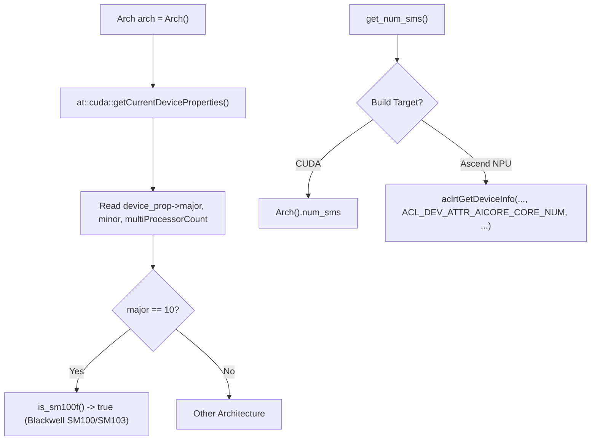
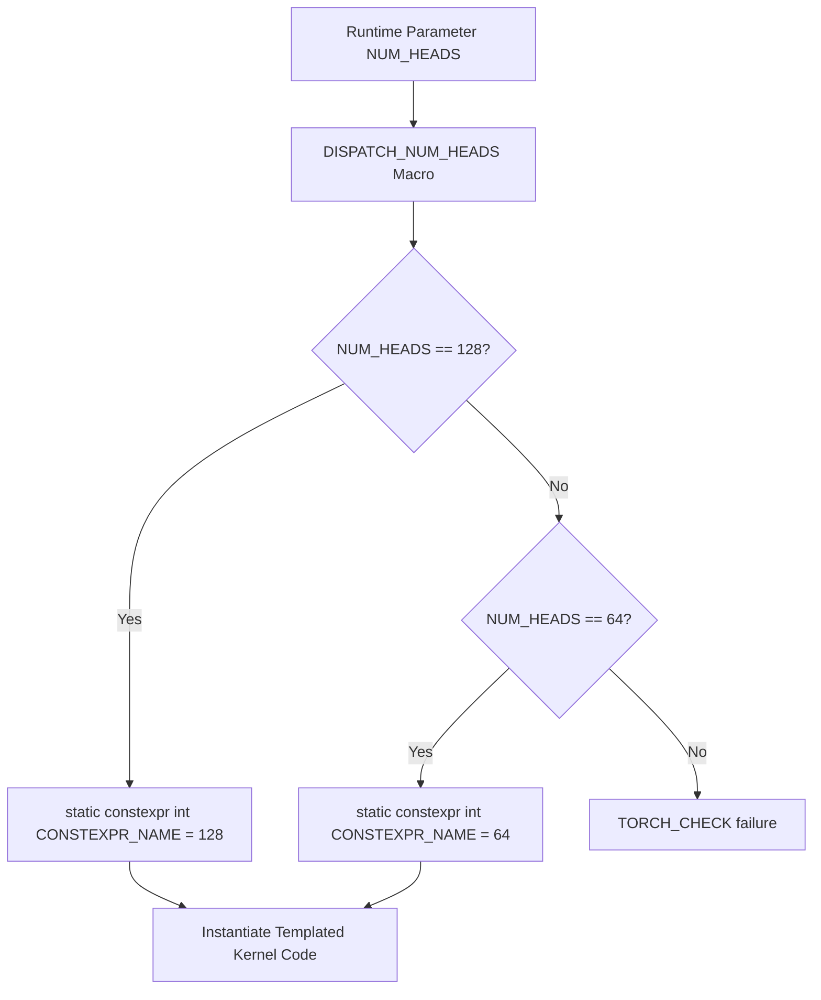

<!-- source: DeepWiki mcp.deepwiki.com · repo deepseek-ai/FlashMLA · page 3.2 C++ Interface · fetched 2026-10-30 -->

# C++ Interface

<details>
<summary>Relevant source files</summary>

The following files were used as context for generating this wiki page:

- [csrc/api/common.h](csrc/api/common.h)
- [csrc/params.h](csrc/params.h)

</details>


The C++ API layer provides the architecture-aware dispatch mechanism between the Python bindings and the underlying CUDA kernel implementations (and Ascend NPU kernels). This layer handles runtime hardware capability detection, KV cache format validation, compile-time template parameter dispatch, and type-safe parameter packaging.

The core API infrastructure is defined in `[csrc/api/common.h]()` and `[csrc/params.h]()`.

## Architecture Detection and Platform Utilities

The `Arch` struct queries current CUDA device properties to determine hardware capabilities, specifically checking for Blackwell (`sm_100a`/`sm_103a`) GPU features via `is_sm100f()` [csrc/api/common.h:40-57](). In addition, platform-agnostic helpers retrieve the number of Streaming Multiprocessors (or Ascend AI cores) via `get_num_sms()` [csrc/api/common.h:61-75]() and active streams via `get_current_stream()` [csrc/api/common.h:79-87]().

```cpp
struct Arch {
    int major;
    int minor;
    int num_sms;
    cudaDeviceProp* device_prop;

    Arch();
    bool is_sm100f() const;
};
```
[csrc/api/common.h:40-57]()

**Diagram: Arch Detection and Device Query Flow**

Sources: [csrc/api/common.h:40-75]()

## KV-Format Detection and Feature Validation

FlashMLA supports multiple quantized KV cache formats (such as DeepSeek V4.1 FP8 and FP4 formats). The function `detect_kv_cache_format_for_headdim_512()` inspects the number of bytes per token (`bytes_per_token`) to determine the active `ModelType` [csrc/api/common.h:170-179](). 

Furthermore, `dispatch_kv_formats()` handles runtime dispatch over valid pairs of primary and extra KV formats [csrc/api/common.h:183-186](). Kernel implementations declare their supported features using the `DECLARE_SUPPORTED_FEATURES` macro [csrc/api/common.h:189-191]().

```cpp
inline ModelType detect_kv_cache_format_for_headdim_512(int bytes_per_token) {
    for (ModelType mt : {ModelType::V41, ModelType::V41_FP4}) {
        if (bytes_per_token == kv_cache_bytes_per_token(mt)) {
            return mt;
        }
    }
    // Error handling ...
}
```
[csrc/api/common.h:170-179]()

Sources: [csrc/api/common.h:169-191]()

## Template Dispatch Macros and Enum Utilities

To avoid runtime branching overhead in performance-critical sections, the API provides compile-time dispatch macros that convert runtime variables into `static constexpr` constants:

- `DISPATCH_NUM_HEADS(NUM_HEADS, CONSTEXPR_NAME, ...)`: Dispatches query head dimensions (64 or 128) [csrc/api/common.h:99-110]().
- `DISPATCH_BOOLEAN_FLAG(FLAG, CONSTEXPR_NAME, ...)`: Dispatches boolean configuration flags [csrc/api/common.h:112-121]().

Additionally, compile-time and runtime enum-to-string utilities (`get_static_enum_name` and `get_dynamic_enum_name`) inspect compiler function signatures (`__PRETTY_FUNCTION__` / `__FUNCSIG__`) to provide clear string representations of enums for error reporting [csrc/api/common.h:124-163]().

**Diagram: Template Dispatch Mechanism**

Sources: [csrc/api/common.h:99-121]()

## Core Parameter Structures (`params.h`)

Kernel arguments are organized into robust C++ structures defined in `[csrc/params.h]()`. These structures are shared between host-side dispatch code and device kernels.

### Supported Model Types and Modes
- `ModelType`: Enumerates `V41` (DeepSeek V4.1 with `d_qk=512`, RoPE FP8, tile size 32) and `V41_FP4` (FP4 `e2m1` with `e4m3` scales, tile size 16) [csrc/params.h:39-42]().
- `SparseAttnFwdMode`: Enumerates `Prefill`, `Decode`, and `DecodeWithSplitKV` [csrc/params.h:44-48]().

### Key Parameter Structs
- `SparseAttnFwdParams`: Encapsulates dimensions, scaling factors (`sm_scale`, `sm_scale_div_log2`), input tensors (`q`, `kv`, `indices`, `attn_sink`, `topk_length`), strides, and output tensors (`out`, `max_logits`, `lse`) for sparse attention prefill [csrc/params.h:54-79]().
- `DecodingSchedMeta`: 32-byte aligned metadata structure (`CUTE_ALIGNAS(4*8)`) describing work assignments for split-KV decoding partitions across SMs [csrc/params.h:83-95]().
- `GetDecodeSchedMetaParams`: Parameters for the tile scheduler metadata generation kernel [csrc/params.h:99-114]().
- `SparseAttnDecodeParams`: Manages batch dimensions, paged KV cache properties (`num_blocks`, `page_block_size`), model types, indices, output buffers, and secondary `extra_kv` configurations for multi-cache setups [csrc/params.h:118-145]().

Sources: [csrc/params.h:1-145]()

---

