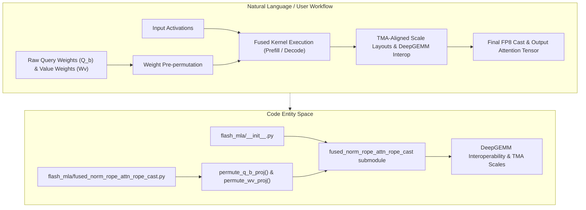
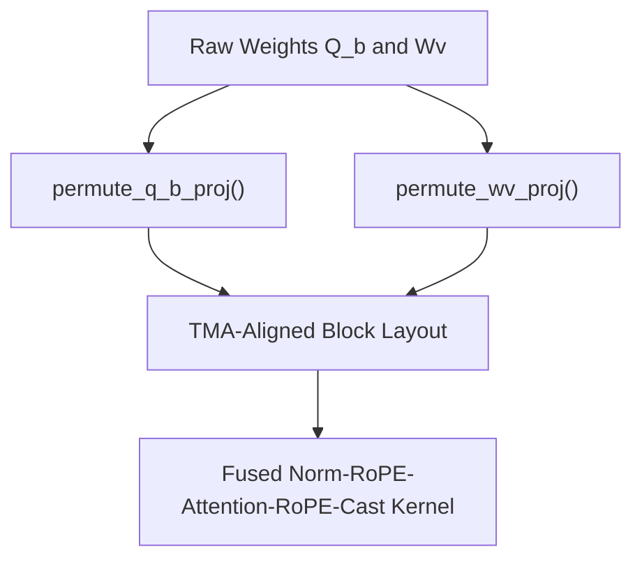

<!-- source: DeepWiki mcp.deepwiki.com · repo deepseek-ai/FlashMLA · page 3.3 Fused Norm-RoPE-Attention-RoPE-Cast API · fetched 2026-10-30 -->

# Fused Norm-RoPE-Attention-RoPE-Cast API

Relevant source files

The following files were used as context for generating this wiki page:

- [README.md](README.md)
- [flash_mla/__init__.py](flash_mla/__init__.py)

The `flash_mla/fused_norm_rope_attn_rope_cast.py` module provides Python entrypoints and utilities for FlashMLA's high-performance fused attention pipeline [README.md:25-27] [flash_mla/__init__.py:12-12]. This pipeline combines Q-normalization (supported for V4 models), Q-RoPE (Rotary Position Embedding), core attention computation, conjugate O-RoPE, and FP8 casting into a single unified kernel execution [README.md:25-27, 41-42]. By eliminating intermediate global memory roundtrips for small operations, the fused kernel achieves significantly higher compute efficiency—reaching up to 1460 TFlops during prefill and 950 TFlops during decoding on NVIDIA B200 hardware [README.md:41-42].

---

## Architecture and Pipeline Overview

The fused norm-RoPE-attention-RoPE-cast architecture minimizes memory bandwidth bottlenecks by merging multiple independent transformation and attention phases into a continuous execution block. 

**Sources:** `flash_mla/__init__.py:12-21`, `README.md:33-44`, `flash_mla/fused_norm_rope_attn_rope_cast.py`

---

## Weight Preprocessing: `permute_q_b_proj` and `permute_wv_proj`

To achieve optimal Tensor Core throughput and satisfy hardware memory access constraints in the fused kernel, projection weights must be pre-permuted before runtime [README.md:41-42].

* **`permute_q_b_proj`**: Pre-permutes the query projection weights (`Q_b`) to align with the blocked memory layout expected by the fused Q-norm and Q-RoPE routines [README.md:41-42].
* **`permute_wv_proj`**: Pre-permutes the value projection weights (`Wv`) to match the TMA (Tensor Memory Accelerator) load patterns used during core attention and subsequent O-RoPE transformations [README.md:41-42].

These preprocessing functions are executed offline or during model initialization, trading a one-time setup cost for sustained high performance during inference [README.md:41-42].

**Sources:** `README.md:33-44`, `flash_mla/fused_norm_rope_attn_rope_cast.py`

---

## TMA-Aligned Scale Layouts and DeepGEMM Interoperability

The fused pipeline integrates closely with external high-performance libraries such as [DeepGEMM](https://github.com/deepseek-ai/DeepGEMM) and [TileLang](https://github.com/tile-ai/tilelang) / [Tile-Kernels](https://github.com/deepseek-ai/TileKernels) [README.md:39-40]. 

1. **TMA-Aligned Scale Layouts**: Quantization scales utilized in the FP8 KV cache and output casting operations are organized into TMA-friendly memory layouts [README.md:25-27, 41-42]. This enables hardware-accelerated asynchronous bulk memory transfers directly into shared memory without software address calculations.
2. **DeepGEMM Interoperability**: The module interfaces directly with DeepGEMM primitives to handle low-precision general matrix multiplications efficiently, ensuring that intermediate activations maintain numerical stability while operating in FP8 formats [README.md:39-40].

**Sources:** `README.md:33-44`, `flash_mla/fused_norm_rope_attn_rope_cast.py`

---

## Prefill and Decode Entrypoints

The module exposes dedicated Python entrypoints for both sparse prefill and decoding phases [README.md:33-44]:

* **Prefill Entrypoint**: Handles variable-length sequence prefilling, executing the complete fused sequence of normalization, positional embedding, attention score calculation, conjugate position embedding, and final FP8 quantization in a single pass [README.md:25-27, 41-42].
* **Decode Entrypoint**: Optimized for token-level sparse decoding, leveraging pre-permuted weights and TMA scale layouts to maximize memory bandwidth utilization [README.md:25-27, 41-42].

> **Note:** The fused norm-RoPE-attention-RoPE-cast kernel currently targets NVIDIA CUDA platforms only; Huawei Ascend NPU execution is not supported for this specific fused variant [README.md:43-43].

**Sources:** `README.md:33-44`, `flash_mla/__init__.py:12-21`, `flash_mla/fused_norm_rope_attn_rope_cast.py`

---

