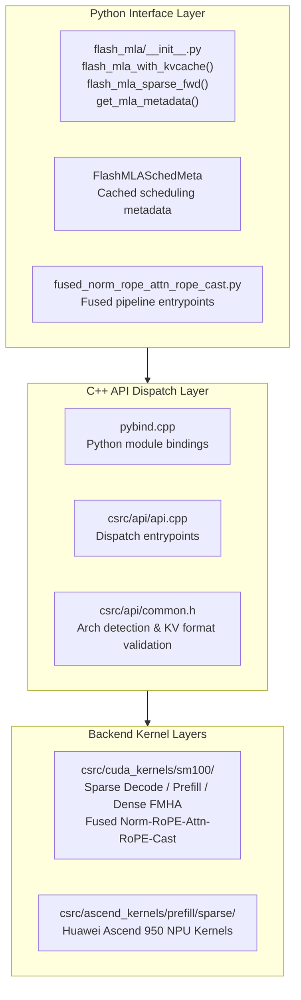
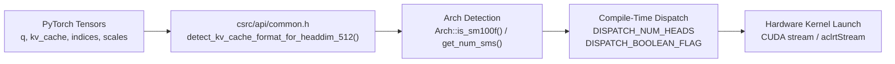
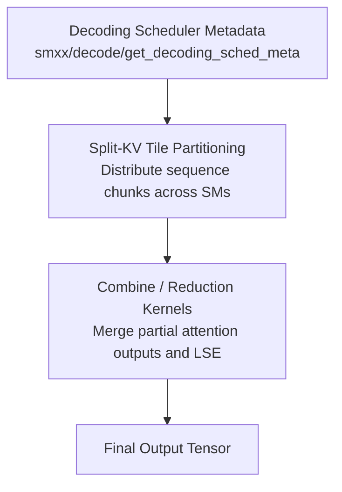
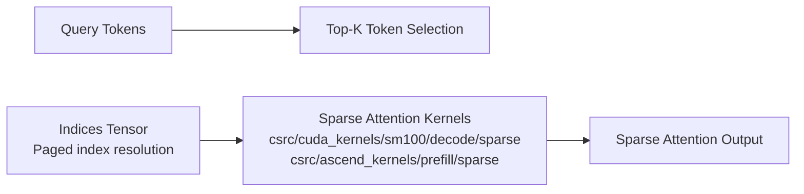

<!-- source: DeepWiki mcp.deepwiki.com · repo deepseek-ai/FlashMLA · page 4 Architecture and Implementation · fetched 2026-10-30 -->

# Architecture and Implementation

Relevant source files

The following files were used as context for generating this wiki page:

- [README.md](README.md)
- [csrc/api/common.h](csrc/api/common.h)

## Purpose and Scope

This page provides a high-level overview of FlashMLA's architecture for DeepSeek-V4.1 inference on NVIDIA SM100/SM103 GPUs and Huawei Ascend 950 NPUs. It explains how the system is organized into layers, how dispatch flows through the extension boundaries, and how backend execution is handled. For detailed implementation specifics, see the child pages:
- System Architecture Overview ([System Architecture Overview](#4.1))
- KV Cache Formats and Quantization ([KV Cache Formats and Quantization](#4.2))
- Scheduling and Split-KV Strategy ([Scheduling and Split-KV Strategy](#4.3))
- Kernel Performance Optimizations ([Kernel Performance Optimizations](#4.4))
- Sparse Attention Implementation ([Sparse Attention Implementation](#4.5))

Sources: [README.md:1-25](), [csrc/api/common.h:1-29]()

## Multi-Layer Architecture

FlashMLA follows a multi-layer design that separates high-level Python utilities from platform-specific C++ bindings and hardware-accelerated kernels across NVIDIA CUDA and Huawei Ascend platforms.

- **Python Interface Layer**: Exposes user-facing functions and manages metadata caching (`FlashMLASchedMeta`) to avoid redundant setup across inference steps [README.md:1-50]().
- **C++ API Dispatch Layer**: Orchestrates tensor validations, device capability checks via the `Arch` struct [csrc/api/common.h:40-57](), KV format detectors (`detect_kv_cache_format_for_headdim_512`) [csrc/api/common.h:170-179](), and dispatch macros (`DISPATCH_NUM_HEADS`, `DISPATCH_BOOLEAN_FLAG`) [csrc/api/common.h:99-121]().
- **Backend Kernel Layers**: Target NVIDIA SM100/SM103 GPUs (`csrc/cuda_kernels/sm100/`) and Huawei Ascend 950 NPUs (`csrc/ascend_kernels/`) [README.md:75-89]().

Sources: [README.md:1-89](), [csrc/api/common.h:1-191]()

## Dispatch Flow and Feature Validation

The C++ dispatch mechanism inspects input tensor properties, validates hardware compatibility, and dispatches to template-specialized kernels.

Key validation checks handled in `csrc/api/common.h`:
- `bytes_per_token` verification to identify DeepSeek-V4.1 FP8 or FP4 paged layouts [csrc/api/common.h:170-179]().
- Stream extraction across CUDA and Ascend via `get_current_stream()` [csrc/api/common.h:78-87]().
- Query head dimension checks via `DISPATCH_NUM_HEADS` supporting `num_heads_q == 64` and `num_heads_q == 128` [csrc/api/common.h:97-110]().

For details, see [System Architecture Overview](#4.1).

Sources: [csrc/api/common.h:40-191]()

## KV Cache Formats and Quantization Overview

FlashMLA implements specialized quantized KV cache formats tailored for DeepSeek-V4.1 inference, balancing memory bandwidth reduction with precision preservation.

| Format | Bytes per Token | Quantization Scheme | Target Use Case |
|---|---|---|---|
| **V4.1 FP8** | 528 B/token | `float8_e4m3` (NoPE) + `float8_e8m0` scales per 32 elements + unquantized RoPE | Paged sparse decoding & prefill |
| **V4.1 FP4** | 288 B/token | `float2_e2m1` (FP4) + `float8_e4m3` scales per 16 elements + unquantized RoPE | Ultra-low memory footprint decoding |

For details on block layouts, NoPE/RoPE splits, and tile scaling factors, see [KV Cache Formats and Quantization](#4.2).

Sources: [README.md:1-25](), [csrc/api/common.h:165-179]()

## Scheduling and Split-KV Strategy

To maximize SM occupancy and balance workloads across execution units, FlashMLA utilizes specialized decoding schedulers and split-KV partitioning.

For details on metadata generation, batch-invariant modes, and dynamic tile scheduling, see [Scheduling and Split-KV Strategy](#4.3).

Sources: [README.md:1-30]()

## Kernel Performance Optimizations

FlashMLA incorporates hardware-specific acceleration techniques to saturate tensor core throughput and hide memory latency:
- **Seesaw Warpgroup Scheduling**: Interleaves compute and memory-bound warpgroups to optimize execution overlap [README.md:1-50]().
- **Fine-Grained TMA-GEMM Pipelining**: Asynchronous Tensor Memory Accelerator (TMA) operations feeding Tensor Cores directly.
- **Distributed Shared Memory (DSM)**: Efficient cross-CTA communication and dequantization propagation.

For a comprehensive breakdown, see [Kernel Performance Optimizations](#4.4).

Sources: [README.md:1-50]()

## Sparse Attention Implementation (DSA)

DeepSeek Sparse Attention (DSA) utilizes token-level sparsity via pre-computed indices tensors to restrict attention computation to relevant KV cache blocks.

For details on index semantics, attention sinks, and small-topk specializations, see [Sparse Attention Implementation](#4.5).

Sources: [README.md:1-30](), [csrc/api/common.h:1-29]()

---

