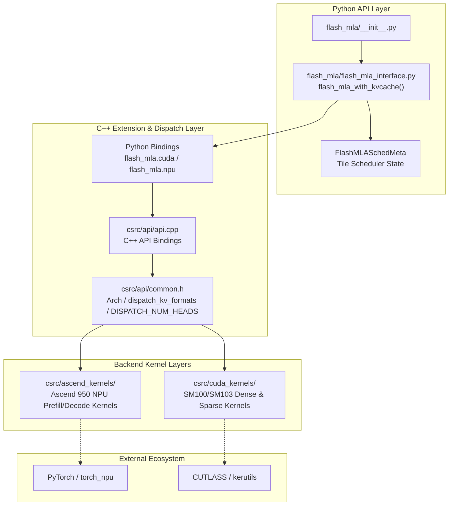
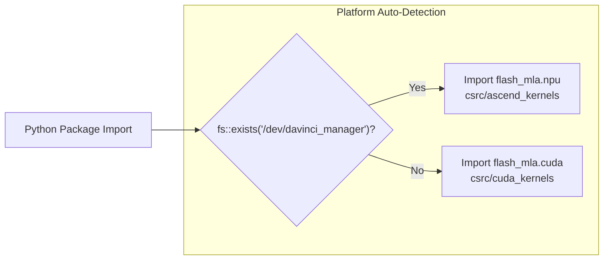
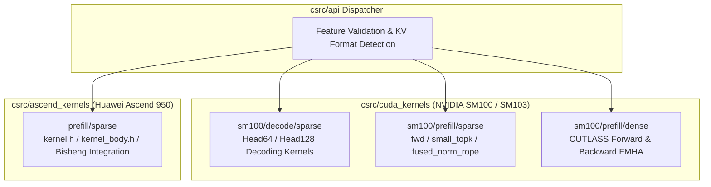

<!-- source: DeepWiki mcp.deepwiki.com · repo deepseek-ai/FlashMLA · page 4.1 System Architecture Overview · fetched 2026-10-30 -->

# System Architecture Overview

<details>
<summary>Relevant source files</summary>

The following files were used as context for generating this wiki page:

- [csrc/api/common.h](csrc/api/common.h)
- [flash_mla/flash_mla_interface.py](flash_mla/flash_mla_interface.py)

</details>


## Purpose and Scope

This document describes the high-level system architecture of FlashMLA, focusing on its multi-layer design that bridges user-facing Python APIs, the C++ extension and dispatch layer (`csrc/api`), and backend architecture-specific kernel layers for NVIDIA SM100/SM103 GPUs (`csrc/cuda_kernels`) and Huawei Ascend NPUs (`csrc/ascend_kernels`). It details platform auto-detection, compile-time dispatch macros, feature validation, and data flow across layers.

Sources: [flash_mla/flash_mla_interface.py:1-11](), [csrc/api/common.h:1-191]()

---

## Three-Layer System Architecture

FlashMLA is organized into three distinct layers, ensuring clear separation of concerns between user-facing abstractions, C++ dispatch logic, and hardware-specific kernel execution for NVIDIA and Ascend targets.



**Three-Layer Architecture and Code Entity Mapping**: Shows the traversal from Python entry points (`flash_mla_with_kvcache`) down through C++ dispatch (`csrc/api/common.h`) to backend execution engines (`csrc/cuda_kernels` or `csrc/ascend_kernels`).

Sources: [flash_mla/flash_mla_interface.py:1-119](), [csrc/api/common.h:1-191]()

---

## Platform and Hardware Auto-Detection

FlashMLA dynamically selects its hardware backend at runtime based on the presence of accelerator device manager nodes in the filesystem.



**Platform Auto-Detection Dispatch Flow**: Inspects `/dev/davinci_manager` to route execution between NVIDIA CUDA and Huawei Ascend NPU implementations.

- **NVIDIA CUDA Path**: When `/dev/davinci_manager` is absent, the package imports `flash_mla.cuda` [flash_mla/flash_mla_interface.py:7-10](). The C++ `Arch` struct queries `cudaDeviceProp` to identify device properties such as compute capability and multiprocessor counts [csrc/api/common.h:41-57]().
- **Huawei Ascend NPU Path**: When `/dev/davinci_manager` is present, the package imports `flash_mla.npu` [flash_mla/flash_mla_interface.py:7-8](). Device initialization queries `aclrtGetDevice` and `aclrtGetDeviceInfo` to determine AI core counts [csrc/api/common.h:60-75]().

Sources: [flash_mla/flash_mla_interface.py:7-11](), [csrc/api/common.h:41-75]()

---

## C++ Dispatch Layer and Compile-Time Macros

The C++ extension layer (`csrc/api/common.h`) provides powerful compile-time dispatch macros and runtime validation mechanisms to map tensor properties to specialized template instantiations.

### Dispatch Macros and Templates

| Macro / Function | Purpose | Code Reference |
|------------------|---------|----------------|
| `DISPATCH_NUM_HEADS` | Dispatches runtime `num_heads_q` (64 or 128) to compile-time constants | [csrc/api/common.h:97-110]() |
| `DISPATCH_BOOLEAN_FLAG` | Dispatches runtime boolean flags to compile-time `constexpr bool` | [csrc/api/common.h:112-121]() |
| `detect_kv_cache_format_for_headdim_512` | Identifies KV cache model format (`V41` or `V41_FP4`) from bytes-per-token | [csrc/api/common.h:169-179]() |
| `dispatch_kv_formats` | Dispatches runtime `(kv, extra_kv)` format pairs to templated implementations | [csrc/api/common.h:181-186]() |
| `DECLARE_SUPPORTED_FEATURES` | Macro to declare supported `FeatureT` enums in dispatcher implementation classes | [csrc/api/common.h:189-191]() |

### Code Snippet: Compile-Time Head Dispatching
```cpp
#define DISPATCH_NUM_HEADS(NUM_HEADS, CONSTEXPR_NAME, ...) \
    [&] () { \
        if (NUM_HEADS == 128) { \
            static constexpr int CONSTEXPR_NAME = 128; \
            return __VA_ARGS__(); \
        } else if (NUM_HEADS == 64) { \
            static constexpr int CONSTEXPR_NAME = 64; \
            return __VA_ARGS__(); \
        } else { \
            TORCH_CHECK(false, "Unsupported num_heads_q: ", NUM_HEADS); \
        } \
    } ();
```
*(Cited from `csrc/api/common.h:97-110`)*

Sources: [csrc/api/common.h:97-191]()

---

## Backend Kernel Layers

Once dispatch parameters are resolved, control flow is handed off to architecture-specific backends:



**Backend Kernel Dispatch Routing**: Illustrates how the C++ API layer routes validated execution requests into the respective CUDA SM100 or Ascend NPU kernel modules.

Sources: [csrc/api/common.h:160-191]()

---
Sources: [flash_mla/flash_mla_interface.py:1-119](), [csrc/api/common.h:1-191]()

---

