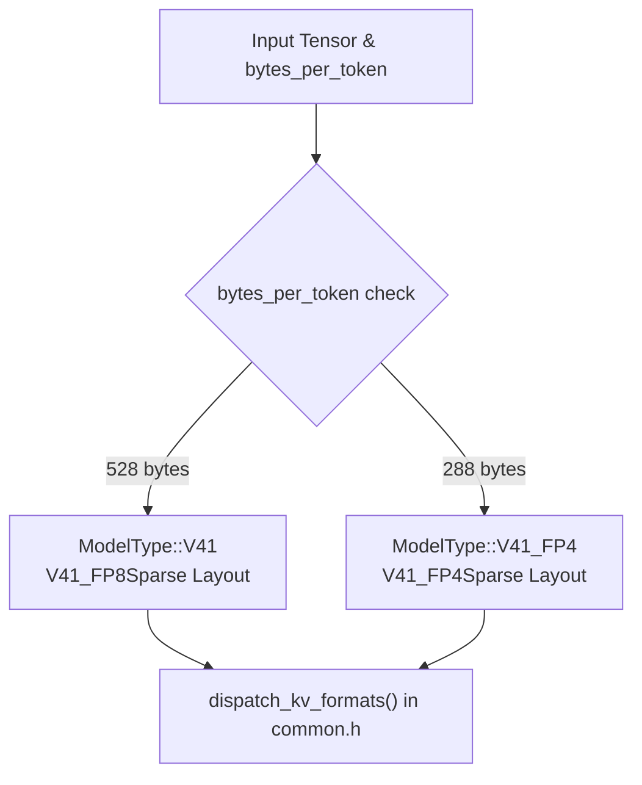
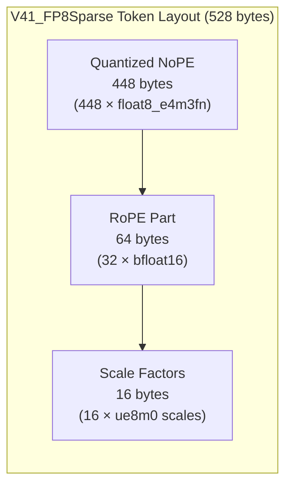
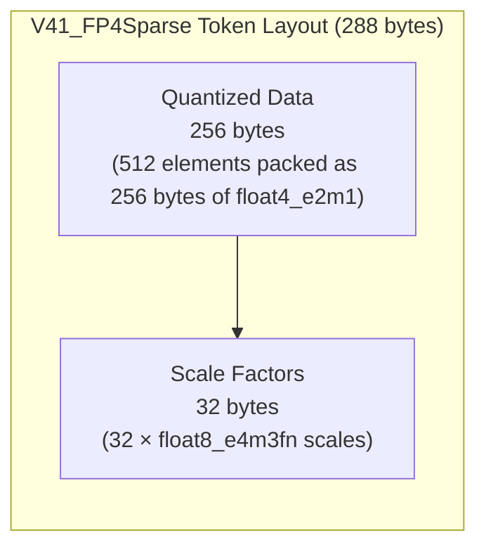
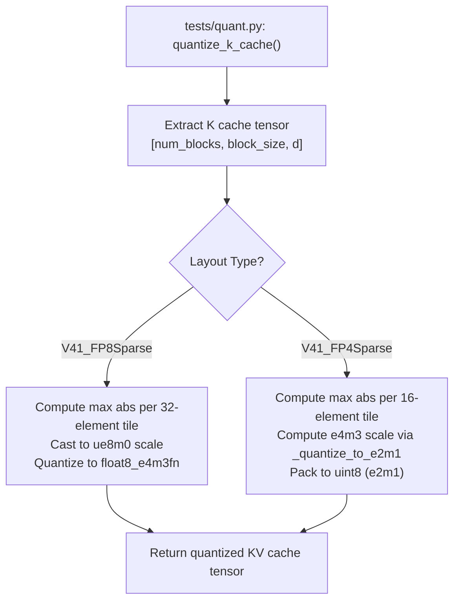

<!-- source: DeepWiki mcp.deepwiki.com · repo deepseek-ai/FlashMLA · page 4.2 KV Cache Formats and Quantization · fetched 2026-10-30 -->

# KV Cache Formats and Quantization

<details>
<summary>Relevant source files</summary>

The following files were used as context for generating this wiki page:

- [csrc/api/common.h](csrc/api/common.h)
- [docs/20250929-hopper-fp8-sparse-deep-dive.md](docs/20250929-hopper-fp8-sparse-deep-dive.md)
- [tests/quant.py](tests/quant.py)

</details>


## Purpose and Scope

This document details the paged KV cache memory formats and quantization schemes used by FlashMLA for DeepSeek-V4.1 inference. It covers the V4.1 FP8 (528 bytes/token) and FP4 (288 bytes/token) paged layouts, NoPE (non-positional encoding) and RoPE (rotary positional encoding) splits, tile-based scaling strategies, and python reference utilities (`quantize_k_cache`, `_quantize_to_e2m1`, etc.) found in the test suite and API dispatch layer. For information on how these formats are processed during sparse attention decoding, see [Sparse Attention Implementation](#4.5).

Sources: [tests/quant.py:1-124](), [csrc/api/common.h:169-186]()

---

## Overview of V4.1 KV Cache Layouts

FlashMLA supports fine-grained tile-based quantization to reduce KV cache memory consumption while preserving numerical stability for attention computations. For DeepSeek-V4.1, the cache dimension `d = 512` is split into a quantized NoPE region (`d_nope = 448`) and an unquantized RoPE region (`d_rope = 64`).

The runtime format is determined by examining the number of bytes per token via `detect_kv_cache_format_for_headdim_512` in `csrc/api/common.h`:


Sources: [csrc/api/common.h:169-186](), [tests/quant.py:8-24]()

---

## V41_FP8Sparse Layout (528 Bytes per Token)

In the `V41_FP8Sparse` layout (`KVCacheLayout.V41_FP8Sparse`), each token occupies 528 bytes, structured into quantized NoPE elements, scale factors, and unquantized RoPE elements.



| Component | Offset / Size | Data Type | Description |
|-----------|---------------|-----------|-------------|
| Quantized NoPE | 448 bytes | `float8_e4m3fn` | 14 tiles of 32 elements each (448 elements total) |
| RoPE Part | 64 bytes | `bfloat16[32]` | Unquantized rotary positional encoding values (2 tiles of 32 elements) |
| Scale Factors | 16 bytes | `float8_e8m0fnu` (or int8 view on NPU) | 16 scale factors (one per 32-element tile) |

Sources: [tests/quant.py:8-24](), [tests/quant.py:72-96]()

---

## V41_FP4Sparse Layout (288 Bytes per Token)

The `V41_FP4Sparse` layout (`KVCacheLayout.V41_FP4Sparse`) packs 4-bit floating-point data (`e2m1`) to achieve an even higher compression ratio, totaling 288 bytes per token.



| Component | Size | Data Type | Description |
|-----------|------|-----------|-------------|
| Quantized Data | 256 bytes | `uint8` (packing `e2m1`) | 512 elements across 32 tiles of 16 elements (NoPE + RoPE are both quantized in FP4 format) |
| Scale Factors | 32 bytes | `float8_e4m3fn` | 32 scale factors (one per 16-element tile) |

Sources: [tests/quant.py:8-24](), [tests/quant.py:98-124]()

---

## Quantization Algorithm and Tile-Based Scaling

The Python reference implementation in `tests/quant.py` demonstrates how raw `bfloat16` or `float16` key caches are quantized into tile-scaled FP8 or FP4 representations.



### Key Quantization Functions

1. **`_cast_scale_inv_to_ue8m0`**:
   Rounds inverse scales to power-of-2 `ue8m0` values to align with hardware constraints [tests/quant.py:26-27]():
   ```python
   def _cast_scale_inv_to_ue8m0(scales_inv: torch.Tensor, out_dtype = torch.float32) -> torch.Tensor:
       return torch.pow(2, torch.clamp_min(scales_inv, 1e-4).log2().ceil()).to(out_dtype)
   ```

2. **`_quantize_to_e2m1`**:
   Performs round-to-nearest FP4 (`e2m1`) quantization with PTX-compatible saturation and tie-breaking semantics [tests/quant.py:31-51]():
   ```python
   def _quantize_to_e2m1(x: torch.Tensor) -> torch.Tensor:
       ...
   ```

Sources: [tests/quant.py:26-124]()

---

## Dequantization Reference Utilities

To validate kernel accuracy, the test suite implements dequantization utilities that reverse the tile scaling and unpacking process.

- **`dequantize_k_cache`** (implied alongside `quantize_k_cache`): Unpacks `e2m1` or `e4m3` buffers, multiplies by the corresponding tile scale factors, and restores `bfloat16` tensors for error verification against reference attention implementations.
- **`_dequantize_e2m1`**: Maps 4-bit `e2m1` codes back to floating-point magnitudes using pre-defined lookup tables (`_E2M1_MAGNITUDES`) [tests/quant.py:29-56]():
  ```python
  def _dequantize_e2m1(codes: torch.Tensor) -> torch.Tensor:
      mags = _E2M1_MAGNITUDES.to(codes.device)
      val = mags[(codes & 7).long()]
      return torch.where((codes & 8) != 0, -val, val)
  ```

Sources: [tests/quant.py:29-56]()

---

## Hardware Dequantization Bottleneck and Crossover

Due to the lack of direct native instructions casting `float8_e4m3` to `bfloat16` on certain architectures (e.g., Hopper H800), dequantization requires a multi-step type conversion sequence (`float8` → `half` → `float32` → `bfloat16`) that can become a performance bottleneck [docs/20250929-hopper-fp8-sparse-deep-dive.md:13-25]().

FlashMLA addresses this by employing **crossover** via Distributed Shared Memory (DSM) in CTA clusters, allowing neighboring thread blocks to share dequantized key/value blocks and cut dequantization overhead in half [docs/20250929-hopper-fp8-sparse-deep-dive.md:27-46]().

Sources: [docs/20250929-hopper-fp8-sparse-deep-dive.md:13-46]()

---

