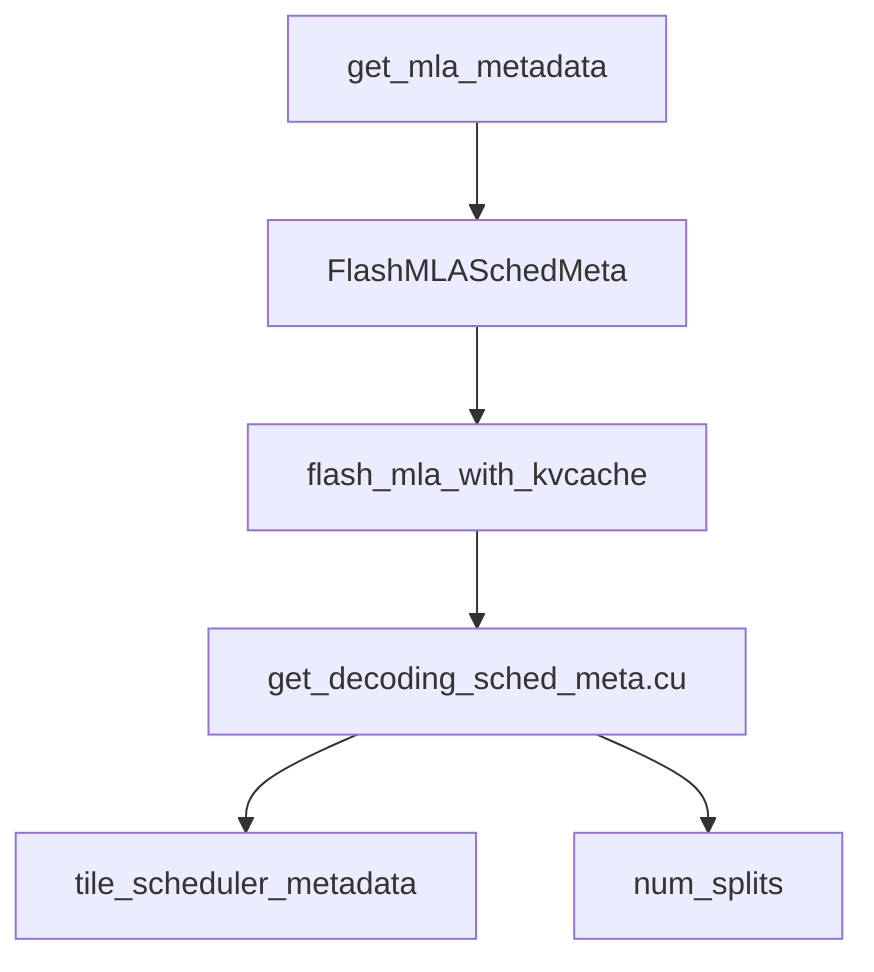
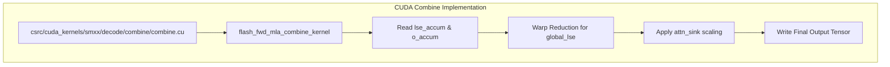
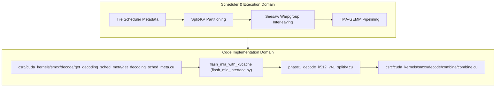

<!-- source: DeepWiki mcp.deepwiki.com · repo deepseek-ai/FlashMLA · page 4.3 Scheduling and Split-KV Strategy · fetched 2026-10-30 -->

# Scheduling and Split-KV Strategy

Relevant source files

The following files were used as context for generating this wiki page:

- [docs/20250422-new-kernel-deep-dive.md](docs/20250422-new-kernel-deep-dive.md)
- [flash_mla/flash_mla_interface.py](flash_mla/flash_mla_interface.py)
- [setup.py](setup.py)

This page explains the tile scheduling mechanism, decoding scheduler metadata generation (`csrc/cuda_kernels/smxx/decode/get_decoding_sched_meta/get_decoding_sched_meta.cu`), split-KV partitioning, combine kernels (`csrc/cuda_kernels/smxx/decode/combine/combine.cu`), batch-invariant mode, and tile scheduling across SMs for FlashMLA.

Sources: [setup.py:37-40](), [flash_mla/flash_mla_interface.py:12-41]()

## Purpose and Scope

FlashMLA utilizes a multi-stage scheduling and partitioning strategy during decoding to maximize hardware utilization across Streaming Multiprocessors (SMs) on NVIDIA GPUs. When dealing with long attention sequences or high concurrency requirements where standard work allocation leaves SMs under-utilized, FlashMLA generates tile scheduling metadata, splits work across multiple SM parts using a split-KV approach, and merges partial outputs via a dedicated combine kernel. This page details the data structures, execution flow, batch-invariant constraints, and register-level seesaw scheduling primitives.

Sources: [flash_mla/flash_mla_interface.py:12-113](), [docs/20250422-new-kernel-deep-dive.md:17-43]()

## Decoding Scheduler Metadata Generation

To distribute decoding workloads evenly across available GPU SMs, FlashMLA generates scheduler metadata prior to kernel execution. 

### Python Metadata Interface
The Python API defines `FlashMLASchedMeta` to store configuration states, tiling dimensions, and tensor references for scheduler metadata and split counts [flash_mla/flash_mla_interface.py:12-41](). The helper function `get_mla_metadata` returns an uninitialized instance of `FlashMLASchedMeta`, which is populated during the initial invocation of `flash_mla_with_kvcache` [flash_mla/flash_mla_interface.py:43-56]().

**Metadata Generation and Data Flow**

Sources: [flash_mla/flash_mla_interface.py:12-56](), [setup.py:38]()

### Metadata Tensor Layout
The `tile_scheduler_metadata` tensor is stored as a 2D `torch.int32` tensor of shape `(num_sm_parts, 8)` or `(num_sm_parts, DecodingSchedMetaSize // 4)`, while `num_splits` tracks split boundaries per batch entry [flash_mla/flash_mla_interface.py:39-40](). The underlying CUDA implementation (`get_decoding_sched_meta.cu`) inspects batch dimensions, sequence lengths, and top-k selections to compute these work partitions [setup.py:38]().

Sources: [flash_mla/flash_mla_interface.py:33-40](), [setup.py:38]()

## Split-KV Partitioning and Combine Kernels

When sequence lengths or block counts exceed single-pass thresholds, FlashMLA splits the KV cache tokens across multiple thread blocks and SMs.

### Split-KV Kernels
Kernels compiled with split-KV support—such as `phase1_decode_k512_v41_splitkv.cu` and `phase1_decode_k512_v41fp4_splitkv.cu`—compute partial attention outputs and partial Log-Sum-Exp (`lse`) values [setup.py:48,50](). Because each split processes only a fraction of the KV tokens, it cannot compute the final softmax normalization factor independently.

### Combine Kernel Implementation
The partial results are merged using the combine kernel defined in `csrc/cuda_kernels/smxx/decode/combine/combine.cu` [setup.py:39](). The combine kernel performs global reductions across all splits for each query head, calculating a global normalization factor (`global_lse`), applying optional attention sink scaling (`attn_sink`), and casting the output back to the target datatype [flash_mla/flash_mla_interface.py:107]().

**Combine Kernel Code Entity Mapping**

Sources: [setup.py:39](), [flash_mla/flash_mla_interface.py:107]()

## Batch-Invariant Mode

FlashMLA supports a batch-invariant execution mode controlled via the `enable_batch_invariant` parameter in `flash_mla_with_kvcache` [flash_mla/flash_mla_interface.py:76](). 

- When `enable_batch_invariant=True`, the split-KV decoding path is explicitly disabled [flash_mla/flash_mla_interface.py:110-112]().
- This ensures that numerical results remain strictly invariant regardless of how the batch is partitioned across SMs or thread blocks.
- Users must preserve the same `enable_batch_invariant` boolean state across repeated invocations when reusing a `FlashMLASchedMeta` instance [flash_mla/flash_mla_interface.py:110-112]().

Sources: [flash_mla/flash_mla_interface.py:76](), [flash_mla/flash_mla_interface.py:110-112]()

## Tile Scheduling and Seesaw Scheduling across SMs

To saturate Tensor Cores in compute-bound decoding scenarios, FlashMLA employs advanced tile scheduling and "seesaw" scheduling on Hopper/SM100 architectures [docs/20250422-new-kernel-deep-dive.md:17-43]().

### Register Constraints and Vertical Splitting
Due to `WGMMA` instruction requirements, output matrices ($64 \times 512$) occupy 32,768 32-bit registers [docs/20250422-new-kernel-deep-dive.md:21](). With 65,536 registers available per SM, storing two full output matrices simultaneously is infeasible [docs/20250422-new-kernel-deep-dive.md:21-22](). FlashMLA resolves this by vertically splitting the output matrix and value blocks into left and right halves ($O_L$ and $O_R$, $64 \times 256$ each) [docs/20250422-new-kernel-deep-dive.md:25]().

### Seesaw Execution Flow
The scheduler interleaves two warpgroups in a ping-pong fashion:
1. **Warpgroup 0** computes projections against block $K_0$ and updates $O_L$ [docs/20250422-new-kernel-deep-dive.md:28-32]().
2. **Warpgroup 1** computes projections against block $K_1$ and updates $O_R$ [docs/20250422-new-kernel-deep-dive.md:29-35]().
3. The warpgroups exchange partial scaling states to update the opposite halves, overlapping CUDA Core softmax operations with Tensor Core matrix multiplications [docs/20250422-new-kernel-deep-dive.md:36-42]().

**Bridging Natural Language Concepts to Code Entities**

Sources: [setup.py:38-39](), [flash_mla/flash_mla_interface.py:59-113](), [docs/20250422-new-kernel-deep-dive.md:17-43]()

Sources: [setup.py:38-50](), [flash_mla/flash_mla_interface.py:12-113](), [docs/20250422-new-kernel-deep-dive.md:17-57]()

---

