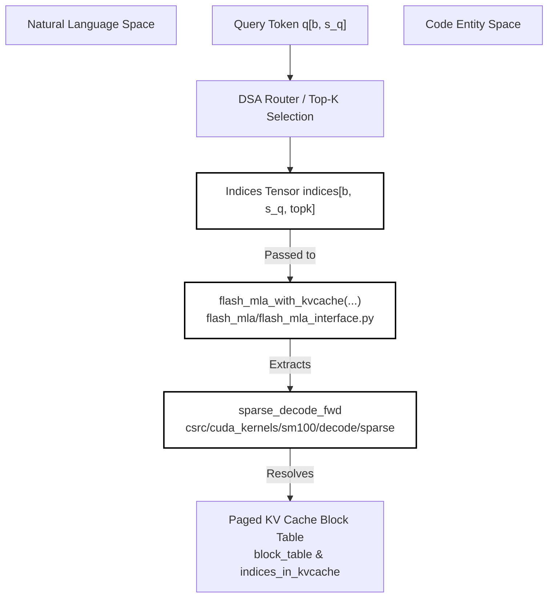
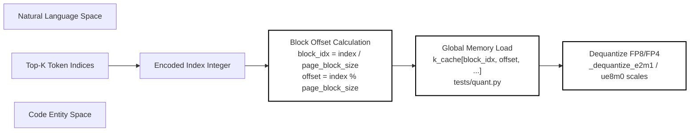

<!-- source: DeepWiki mcp.deepwiki.com · repo deepseek-ai/FlashMLA · page 4.5 Sparse Attention Implementation · fetched 2026-10-30 -->

# Sparse Attention Implementation

Relevant source files

The following files were used as context for generating this wiki page:

- [README.md](README.md)
- [flash_mla/flash_mla_interface.py](flash_mla/flash_mla_interface.py)
- [tests/quant.py](tests/quant.py)

## Purpose and Scope

This document explains how FlashMLA implements DeepSeek Sparse Attention (DSA) as introduced in the DeepSeek V3.2 and V4.1 model series. Sparse attention allows query tokens to attend to a dynamically selected subset of key-value tokens, substantially reducing computational complexity while retaining model accuracy across large context lengths. 

This leaf page details the indices tensor semantics, top-$k$ token selection, paged index resolution, attention sinks, and small-$topk$ kernel specializations.

Sources: [README.md:5-8](), [flash_mla/flash_mla_interface.py:1-120]()

---

## Overview: Token-Level Sparse Attention

FlashMLA implements token-level sparse attention, where each query token attends to a custom subset of key-value tokens indexed via explicit `indices` tensors. Unlike block-sparse or fixed local window patterns, token-level sparsity allows arbitrary per-token routing determined by the router network.

| Component / Phase | Code Symbol / Interface | Primary Purpose | KV Cache Layout / Dtype |
|----------------|-------------------------|-----------------|-------------------------|
| **Sparse Decode** | `flash_mla_with_kvcache` (`flash_mla/flash_mla_interface.py`) | Autoregressive token generation over sparse context | FP8 / FP4 paged KV cache (`KVCacheLayout`) |
| **Sparse Prefill** | `flash_mla_sparse_prefill` / `sparse_prefill_fwd` | Initial prompt processing with pre-selected sparse indices | Direct bfloat16 or quantized KV cache |
| **Fused Pipeline** | `fused_norm_rope_attn_rope_cast` | Combining Q-norm, Q-RoPE, attention, O-RoPE, and FP8 cast | Interoperates with DeepGEMM & TileLang |

Sources: [README.md:5-44](), [flash_mla/flash_mla_interface.py:59-119]()

---

## Indices Tensor Semantics and Top-K Token Selection

The `indices` tensor explicitly dictates which KV tokens each query attends to. The layout differs between decoding and prefill phases.

*Diagram 1: Natural language space mapping of token selection to code entities (`flash_mla/flash_mla_interface.py` and `sparse_decode_fwd`).*

### Decode Phase Indices (`indices`)
For decoding, `indices` has shape `(batch_size, seq_len_q, topk)` with `torch.int32` data type [flash_mla/flash_mla_interface.py:101-106]():
- `indices[i][j][k]` stores the linear address or combined block-offset for the $k$-th attended token.
- Specifically, `indices_in_kvcache[i][j][k] = (page_block_index * page_block_size) + offset_in_block`.
- **Invalid entries** must be set exactly to `-1`. The decoding kernel treats `-1` as an invalid marker and performs no upper-bound check on other values.

Sources: [flash_mla/flash_mla_interface.py:101-106]()

### Dynamic Top-K Length (`topk_length`)
To avoid padding overhead when different queries require different numbers of attended tokens, FlashMLA accepts `topk_length` and `extra_topk_length` tensors of shape `(batch_size,)` [flash_mla/flash_mla_interface.py:109-110]():
- Only the leftmost `topk_length[i]` entries in the indices tensor are processed for batch element `i`.

Sources: [flash_mla/flash_mla_interface.py:109-110]()

---

## Paged Index Resolution and Memory Access

In the sparse decode path, the KV cache is stored in paged blocks. The indices integrate block indexing directly so that explicit page table lookups inside the inner loop are minimized.

*Diagram 2: Code entity resolution of paged sparse indices into memory access (`tests/quant.py`).*

### KV Cache Layouts & Quantization (`KVCacheLayout`)
As defined in `tests/quant.py`, FlashMLA supports two sparse KV cache layouts for DeepSeek V4.1:
1. **`V41_FP8Sparse`**: 528 bytes per token (512 bytes of `float8_e4m3` data across 512 dimensions, including 64 RoPE dimensions, followed by 16 bytes of `ue8m0` scale factors where each scale covers 32 consecutive elements) [flash_mla/flash_mla_interface.py:118-119](), [tests/quant.py:14-15]().
2. **`V41_FP4Sparse`**: 288 bytes per token (256 bytes containing 512 `e2m1` FP4 values packed 2 per byte, followed by 32 bytes of `float8_e4m3` scale factors covering 16 elements each) [flash_mla/flash_mla_interface.py:118-119](), [tests/quant.py:16]().

Sources: [flash_mla/flash_mla_interface.py:116-119](), [tests/quant.py:8-24]()

---

## Attention Sinks and Optional Features

FlashMLA incorporates auxiliary mechanisms to stabilize sparse attention:

- **Attention Sink (`attn_sink`)**: An optional tensor of shape `(num_heads_q,)` and type `torch.float32`. When provided, the final attention output is scaled by $\frac{\exp(\text{lse})}{\exp(\text{lse}) + \exp(\text{attn\_sink})}$ [flash_mla/flash_mla_interface.py:107](). A value of $+\infty$ forces the head output to zero, while $-\infty$ has no effect. The returned log-sum-exp (`lse`) remains unaffected.
- **Extra KV Cache (`extra_k_cache` & `extra_indices_in_kvcache`)**: Allows concurrent attention over a secondary paged cache structure using auxiliary indices [flash_mla/flash_mla_interface.py:108]().

Sources: [flash_mla/flash_mla_interface.py:107-108]()

---

## Small-TopK Specialization and Prefill Variants

For scenarios with very small $topk$ budgets (e.g., $topk \le 64$ or $128$), FlashMLA provides dedicated specialized code paths (such as `fwd_for_small_topk` variants) [README.md:25-29](). These variants optimize register allocation and shared memory staging to avoid warp idle cycles when the workload per query head is extremely compact.

Sources: [README.md:25-29]()

---
Sources: [README.md:1-98](), [flash_mla/flash_mla_interface.py:1-120](), [tests/quant.py:1-60]()

---

