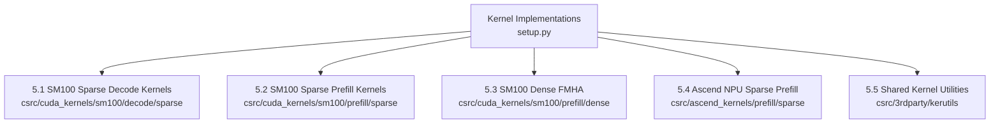

<!-- source: DeepWiki mcp.deepwiki.com · repo deepseek-ai/FlashMLA · page 5 Kernel Implementations · fetched 2026-10-30 -->

# Kernel Implementations

Relevant source files

The following files were used as context for generating this wiki page:

- [setup.py](setup.py)

This page provides a high-level overview of FlashMLA's backend kernel implementations across NVIDIA SM100/SM103 architectures and Huawei Ascend NPUs. FlashMLA supports highly optimized sparse decoding, sparse prefill, dense CUTLASS-based FMHA forward/backward passes, and fused pipeline operations.

For detailed technical specifications, template instantiations, and inner loop structures, please refer to the child pages linked below.

Sources: [setup.py:32-77]()

---

## 5.1 SM100 Sparse Decode Kernels

The SM100 sparse decoding backend (`csrc/cuda_kernels/sm100/decode/sparse`) implements high-performance token generation for DeepSeek models using compressed KV caches (such as FP8 and FP4 formats). These kernels support both head-64 and head-128 configurations [setup.py:53-56](), managing split-KV reductions and paged KV cache index resolution efficiently.

Configs and core layouts are modularized into `config.h` and `kernel.cuh` structures, supporting specialized instantiations per KV format (`v41_h64.cu`, `v41fp4_h64.cu`) [setup.py:53-56](). Dequantization utilities handle scale recovery on-the-fly during global-to-shared memory transfers.

For details, see [SM100 Sparse Decode Kernels](#5.1).

Sources: [setup.py:32-57]()

---

## 5.2 SM100 Sparse Prefill Kernels

FlashMLA's sparse prefill kernels (`csrc/cuda_kernels/sm100/prefill/sparse`) handle context processing under DeepSeek Sparse Attention (DSA) patterns. Key entrypoints include standard forward variants (`fwd`), small-topk specialized paths (`fwd_for_small_topk`), and the core attention pipeline `fused_norm_rope_attn_rope_cast_fwd` [setup.py:42-65]().

Weight preprocessing and layout transformation are handled by dedicated modules such as `permute_q_b_proj` and `permute_wv_proj` [setup.py:64-65](), ensuring optimal TMA access patterns for Blackwell hardware units.

For details, see [SM100 Sparse Prefill Kernels](#5.2).

Sources: [setup.py:42-66]()

---

## 5.3 SM100 Dense FMHA (CUTLASS) Forward and Backward

For dense FlashMulti-Head Attention (FMHA) prefill and training workloads, FlashMLA integrates CUTLASS-based primitives under `csrc/cuda_kernels/sm100/prefill/dense/` [setup.py:34-35](). These span collective, device, and kernel layers supporting causal masking, sliding-window attention, and full backward gradients (`fmha_cutlass_fwd_sm100.cu`, `fmha_cutlass_bwd_sm100.cu`) [setup.py:34-35](). Workspace allocation and pipeline synchronization are coordinated via CUTLASS device templates.

For details, see [SM100 Dense FMHA (CUTLASS) Forward and Backward](#5.3).

Sources: [setup.py:34-35]()

---

## 5.4 Ascend NPU Sparse Prefill Kernels

FlashMLA supports Huawei Ascend 950 NPUs through specialized sparse prefill implementations located in `csrc/ascend_kernels/prefill/sparse/` [setup.py:70-76](). These kernels are structured around `kernel.h` and `kernel_body.h`, utilizing `fast_div_mod` helpers and explicit template instantiations (`run_sparse_fwd_kernel`) compiled via the Bisheng toolchain [setup.py:68-76]().

For details, see [Ascend NPU Sparse Prefill Kernels](#5.4).

Sources: [setup.py:68-77]()

---

## 5.5 Shared Kernel Utilities and Memory Hierarchy

Cross-cutting helper libraries and hardware abstraction primitives reside in `csrc/3rdparty/kerutils` and architectural include files like `common_subroutine.h` and `helpers.h`. These manage TMA (Tensor Memory Accelerator) descriptor configurations, explicit pipeline staging across the memory hierarchy (GMEM → SMEM → TMEM → registers), and arithmetic type conversions.

For details, see [Shared Kernel Utilities and Memory Hierarchy](#5.5).

Sources: [setup.py:1-137]()

---

