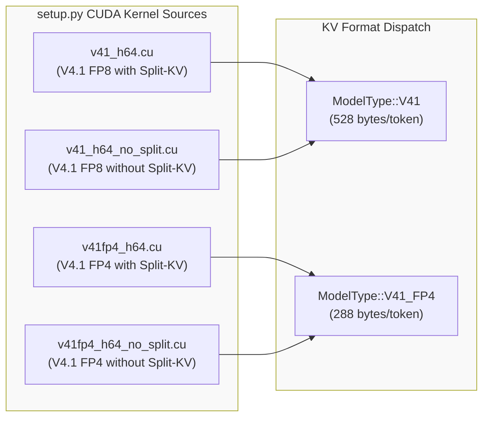
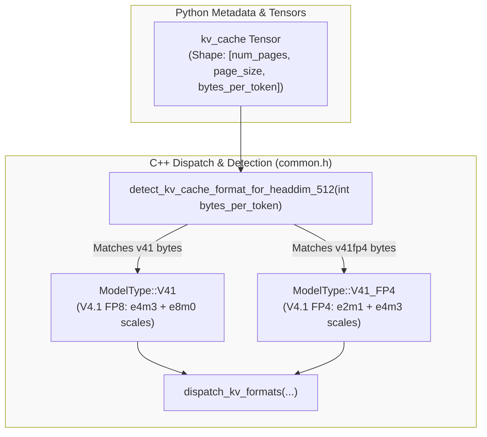
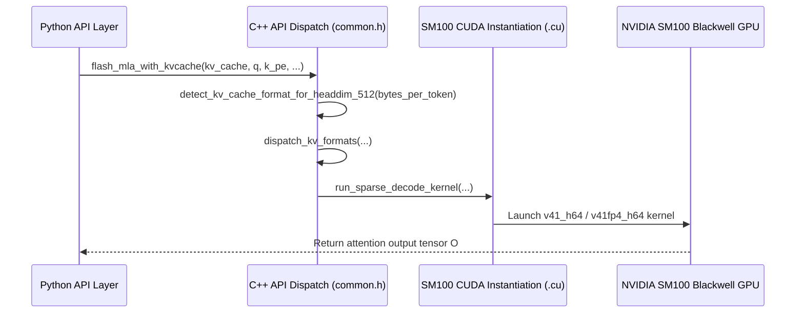

<!-- source: DeepWiki mcp.deepwiki.com · repo deepseek-ai/FlashMLA · page 5.1 SM100 Sparse Decode Kernels · fetched 2026-10-30 -->

# SM100 Sparse Decode Kernels

Relevant source files

The following files were used as context for generating this wiki page:

- [csrc/api/common.h](csrc/api/common.h)
- [setup.py](setup.py)

## Purpose and Scope

This page provides full technical documentation for the NVIDIA SM100 (Blackwell) sparse decode kernels located in `csrc/cuda_kernels/sm100/decode/sparse/`. These kernels implement token-by-token generation for DeepSeek Multi-head Latent Attention (MLA) using quantized paged KV caches (FP8 and FP4 formats) and sparse attention indexing (`head64` and `head128` head configurations). We examine the header configuration (`config.h`), core kernel templates (`kernel.cuh`), explicit instantiations across V4.1 KV formats (with and without Split-KV), and associated dequantization and KV cache utilities.

Sources: `setup.py:52-56`, `csrc/api/common.h:165-179`

---

## Directory Structure and `config.h`/`kernel.cuh` Organization

The SM100 sparse decode codebase separates configuration logic, hardware intrinsics, and kernel templates from compilation translation units. The following diagram illustrates the relationship between the natural language architecture and the source code entities in `csrc/cuda_kernels/sm100/decode/sparse/`:

```mermaid
graph TB
    subgraph NaturalLanguage["Natural Language Space"]
        ConfigLayer["Configuration & Parameters"]
        KernelCore["Core Kernel Templates"]
        Instantiations["Explicit Instantiations"]
        DequantUtils["KV Cache & Dequantization Utilities"]
    end

    subgraph CodeSpace["Code Entity Space"]
        DirSparse["csrc/cuda_kernels/sm100/decode/sparse/"]
        ConfigH["config.h / helpers.h"]
        KernelCuh["head64/kernel.cuh<br/>head128/kernel.cuh"]
        InstV41["head64/instantiations/v41_h64.cu<br/>head64/instantiations/v41_h64_no_split.cu"]
        InstFP4["head64/instantiations/v41fp4_h64.cu<br/>head64/instantiations/v41fp4_h64_no_split.cu"]
        KVFormat["csrc/cuda_kernels/kv_cache_format.h<br/>detect_kv_cache_format_for_headdim_512"]
    end

    ConfigLayer --> ConfigH
    KernelCore --> KernelCuh
    Instantiations --> InstV41
    Instantiations --> InstFP4
    DequantUtils --> KVFormat

    DirSparse --> ConfigH
    DirSparse --> KernelCuh
    DirSparse --> InstV41
    DirSparse --> InstFP4

    style NaturalLanguage fill:#f9f9f9
    style CodeSpace fill:#f9f9f9
```

Sources: `setup.py:52-56`, `csrc/api/common.h:15-16`, `csrc/api/common.h:169-179`

---

## Instantiations per KV Format

The SM100 sparse decode kernels are compiled as explicit instantiations in `csrc/cuda_kernels/sm100/decode/sparse/head64/instantiations/` (and corresponding head128 paths). The build orchestrator in `setup.py` registers these target instantiations to support different model quantization variants and splitting strategies:

### Key Instantiation Files

- **`v41_h64.cu`**: Instantiates the `head64` sparse decode kernel for V4.1 FP8 KV cache with Split-KV enabled, allowing large context workloads to be partitioned across multiple SM thread blocks [setup.py:53]().
- **`v41_h64_no_split.cu`**: Instantiates the single-block/non-split version for V4.1 FP8 KV cache, reducing synchronization overhead for lower context lengths [setup.py:54]().
- **`v41fp4_h64.cu`**: Instantiates the kernel for V4.1 FP4 compressed KV cache with Split-KV [setup.py:55]().
- **`v41fp4_h64_no_split.cu`**: Instantiates the non-split variant for V4.1 FP4 KV cache [setup.py:56]().

Sources: `setup.py:52-56`, `csrc/api/common.h:169-186`

---

## Dequantization and KV Cache Utilities

KV cache format detection and dequantization utilities bridge the gap between high-level Python metadata and low-level SM100 tensor operations. The C++ API layer inspects the tensor stride and dimensions (`bytes_per_token`) to determine the active quantization format.

### KV Cache Format Functions

- `detect_kv_cache_format_for_headdim_512(int bytes_per_token)`: Evaluates the stride/size of token blocks for $d_{qk} = 512$ models and returns either `ModelType::V41` or `ModelType::V41_FP4` [csrc/api/common.h:170-179]().
- `dispatch_kv_formats(...)`: Templated helper that unpacks runtime `ModelType` enums into compile-time constants for kernel template instantiation [csrc/api/common.h:183-186]().

Sources: `csrc/api/common.h:165-186`

---

## Implementation Data Flow and Kernel Execution

The execution flow for SM100 sparse decode kernels starts from the Python API bindings, proceeds through architecture and KV format validation in `common.h`, and dispatches to the compiled `.cu` translation units.

Sources: `setup.py:52-56`, `csrc/api/common.h:169-186`

---

