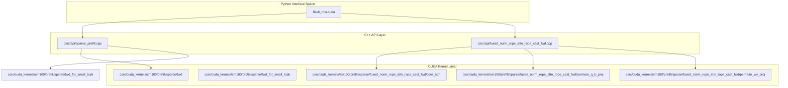
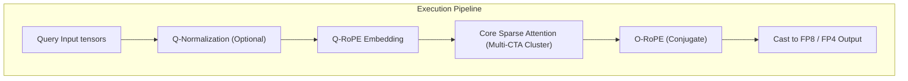

<!-- source: DeepWiki mcp.deepwiki.com · repo deepseek-ai/FlashMLA · page 5.2 SM100 Sparse Prefill Kernels · fetched 2026-10-30 -->

# SM100 Sparse Prefill Kernels

Relevant source files

The following files were used as context for generating this wiki page:

- [README.md](README.md)
- [setup.py](setup.py)

This page documents the implementation details, data flow, and architecture of the SM100 sparse prefill kernels (`sm100/prefill/sparse`), including the `fwd` and `fwd_for_small_topk` variants, the `fused_norm_rope_attn_rope_cast_fwd` core attention pipeline, and the weight pre-permutation utilities (`permute_q_b_proj` and `permute_wv_proj`).

---

## 1. Overview of Sparse Prefill Architecture

The SM100 sparse prefill subsystem handles token-level sparse attention (DeepSeek Sparse Attention / DSA) on NVIDIA SM100/SM103 architectures. It features standard forward pass implementations (`fwd`), optimized variations for restricted top-k selections (`fwd_for_small_topk`), and a highly fused pipeline that combines normalization, rotary position embedding (RoPE), core attention, conjugate RoPE, and FP8/FP4 casting.

The API bindings and kernel instantiations are orchestrated through `setup.py` and exposed via `csrc/api/sparse_prefill.cpp` and `csrc/api/fused_norm_rope_attn_rope_cast_fwd.cpp` [setup.py:13-17]().

Sources: `setup.py`, `csrc/api/sparse_prefill.cpp`, `csrc/api/fused_norm_rope_attn_rope_cast_fwd.cpp`

---

## 2. Standard and Small Top-K Prefill Variants (`fwd` & `fwd_for_small_topk`)

The sparse prefill execution path is divided into standard forward (`fwd`) and specialized small top-k (`fwd_for_small_topk`) paths to maximize instruction throughput and shared memory utilization depending on the sparsity pattern.

### Kernel Instantiations
* **Standard Forward (`fwd`)**: Instantiated for head dimensions 64 and 128 with a key dimension $k=512$. Key files include:
  * `csrc/cuda_kernels/sm100/prefill/sparse/fwd/head64/instantiations/phase1_h64_k512.cu` [setup.py:42-42]()
  * `csrc/cuda_kernels/sm100/prefill/sparse/fwd/head128/instantiations/phase1_k512.cu` [setup.py:43-43]()
* **Small Top-K Forward (`fwd_for_small_topk`)**: Optimized for head dimension 128 with $k=512$, providing specialized phases for decoding-like or reduced top-k prefill workloads, supporting both V4.1 FP8 and FP4 cache formats with and without Split-KV:
  * `csrc/cuda_kernels/sm100/prefill/sparse/fwd_for_small_topk/head128/instantiations/phase1_k512.cu` [setup.py:46-46]()
  * `csrc/cuda_kernels/sm100/prefill/sparse/fwd_for_small_topk/head128/instantiations/phase1_decode_k512_v41.cu` [setup.py:47-47]()
  * `csrc/cuda_kernels/sm100/prefill/sparse/fwd_for_small_topk/head128/instantiations/phase1_decode_k512_v41_splitkv.cu` [setup.py:48-48]()
  * `csrc/cuda_kernels/sm100/prefill/sparse/fwd_for_small_topk/head128/instantiations/phase1_decode_k512_v41fp4.cu` [setup.py:49-49]()
  * `csrc/cuda_kernels/sm100/prefill/sparse/fwd_for_small_topk/head128/instantiations/phase1_decode_k512_v41fp4_splitkv.cu` [setup.py:50-50]()

Sources: `setup.py`

---

## 3. Fused Norm-RoPE-Attention-RoPE-Cast Pipeline (`fused_norm_rope_attn_rope_cast_fwd`)

To eliminate intermediate memory roundtrips between small operations, FlashMLA provides a fully fused kernel (`fused_norm_rope_attn_rope_cast_fwd`) that integrates Q-normalization, Q-RoPE, core attention, O-RoPE (conjugate), and casting to FP8/FP4 formats [README.md:25]().

### Core Attention Instantiations
The core attention kernel is instantiated for head counts $H_Q \in \{64, 128\}$ (utilizing 2-CTA clusters for 128 heads) across multiple model modes and normalization settings [setup.py:29-30, 60-63]():
* Models / Modes: `v41` prefill, `v41` decode, `v41fp4` decode [setup.py:60-62]()
* Normalization variants: `norm` and `nonorm` (Q-norm is used in V4 models but omitted in V4.1) [README.md:25](), [setup.py:63]()

Sources: `README.md`, `setup.py`

---

## 4. Weight Pre-Permutation Kernels (`permute_q_b_proj` & `permute_wv_proj`)

Because the fused norm-RoPE-attn-RoPE-cast kernel expects layouts aligned with TMA and tensor memory (TMEM) access patterns, weights must be pre-permuted before inference execution [README.md:41]().

* **`permute_q_b_proj`**: Pre-permutes the query projection weights (`csrc/cuda_kernels/sm100/prefill/sparse/fused_norm_rope_attn_rope_cast_fwd/permute_q_b_proj/kernel.cu`) [setup.py:64-64]().
* **`permute_wv_proj`**: Pre-permutes the value/key projection weights (`csrc/cuda_kernels/sm100/prefill/sparse/fused_norm_rope_attn_rope_cast_fwd/permute_wv_proj/kernel.cu`) [setup.py:65-65]().

Sources: `README.md`, `setup.py`

---

