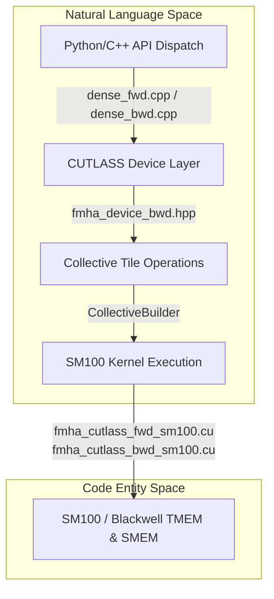
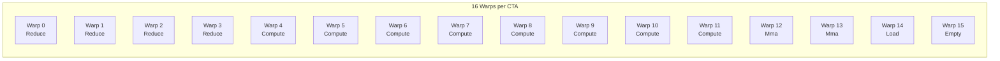
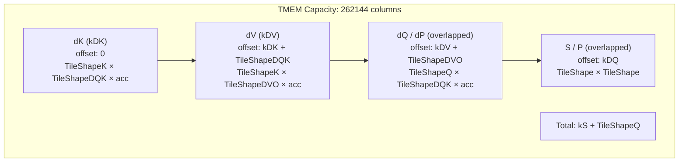

<!-- source: DeepWiki mcp.deepwiki.com · repo deepseek-ai/FlashMLA · page 5.3 SM100 Dense FMHA (CUTLASS) Forward and Backward · fetched 2026-10-30 -->

# SM100 Dense FMHA (CUTLASS) Forward and Backward

<details>
<summary>Relevant source files</summary>

The following files were used as context for generating this wiki page:

- [flash_mla/flash_mla_interface.py](flash_mla/flash_mla_interface.py)
- [setup.py](setup.py)
- [tests/test_fmha_sm100.py](tests/test_fmha_sm100.py)

</details>


## Purpose and Scope

This page documents the architecture and implementation of the SM100 (Blackwell B200) dense prefill FlashMulti-Head Attention (FMHA) kernels built on top of CUTLASS primitives [setup.py:32-36](). It covers the multi-layer design (collective, device, and kernel layers), forward and backward execution paths, tensor memory (TMEM) allocation strategies, warp-specialized pipelines, workspace management, and support for causal masks and sliding-window attention.

For sparse decoding and sparse prefill kernels, see [SM100 Sparse Decode Kernels](#5.1) and [SM100 Sparse Prefill Kernels](#5.2). For general architecture primitives and memory hierarchies, see [Shared Kernel Utilities and Memory Hierarchy](#5.5).

**Sources:** [setup.py:32-36](), [tests/test_fmha_sm100.py:10-28]()

---

## 1. Architectural Layers: Collective, Device, and Kernel

The dense FMHA implementation for SM100 follows the CUTLASS modular design pattern, separating concerns across three primary abstraction levels:

1. **Collective Layer**: Implements tile-level operations such as GEMM loops, softmax reductions, and TMA (Tensor Memory Accelerator) data movement using CUTLASS cooperative groups.
2. **Device Layer**: Coordinates problem setup, grid launching, tile scheduling, and workspace allocation (`csrc/sm100/prefill/dense/device/fmha_device_bwd.hpp` and equivalent forward headers).
3. **Kernel Layer**: Provides the low-level CUDA entry points (`fmha_cutlass_fwd_sm100.cu` and `fmha_cutlass_bwd_sm100.cu`) compiled with architecture-specific `-gencode` flags for `sm_100a` and `sm_103a` [setup.py:27-36]().



**Sources:** [setup.py:27-36](), [csrc/cuda_kernels/sm100/prefill/dense/fmha_cutlass_fwd_sm100.cu:1-10](), [csrc/cuda_kernels/sm100/prefill/dense/fmha_cutlass_bwd_sm100.cu:1-10]()

---

## 2. Forward Kernel Implementation (`fmha_cutlass_fwd_sm100.cu`)

The forward dense FMHA kernel (`fmha_cutlass_fwd_sm100.cu`) handles variable-length sequence prefill and training forward passes on SM100. 

### Key Responsibilities
- **TMA Load Management**: Efficiently streams Query ($Q$), Key ($K$), and Value ($V$) tensors from Global Memory (GMEM) into Shared Memory (SMEM) using asynchronous TMA transfers.
- **Tensor Core Acceleration**: Leverages Blackwell UMMA instructions to compute attention scores $S = QK^T \cdot \text{scale}$ and output vectors $O = PV$ via TMEM accumulation.
- **Online Softmax**: Computes row-wise maximums and sum-exp reductions iteratively, storing log-sum-exp (`LSE`) tensors for the backward pass.
- **Masking and Windowing**: Supports causal attention masks and sliding-window restrictions directly within the tile evaluation loop.

**Sources:** [setup.py:32-34](), [tests/test_fmha_sm100.py:10-28]()

---

## 3. Backward Kernel Implementation (`fmha_cutlass_bwd_sm100.cu`)

The backward pass kernel uses a **warp-specialized architecture** with 16 warps per CTA, where each warp is assigned one of five roles. This specialization enables overlapping of data movement, tensor core computations, and reduction operations.

### Warp Role Assignment



The role assignment is encoded in `kWarpAssignment = 0x12'3333'3333'4444ull` [csrc/sm100/prefill/dense/kernel/sm100_fmha_bwd_kernel_tma_warpspecialized.hpp:91](), where each 4-bit nibble specifies the role for one warp index via `warp_idx_to_role` [csrc/sm100/prefill/dense/kernel/sm100_fmha_bwd_kernel_tma_warpspecialized.hpp:94-96]():

| Role | Enum Value | Warp Count | Responsibilities |
|------|-----------|------------|------------------|
| Empty | `0x0` | 1 | No operations (unused) |
| Load | `0x1` | 1 | TMA loads from global memory |
| Mma | `0x2` | 2 | Tensor Core matrix multiplications |
| Compute | `0x3` | 8 | Softmax, dsoftmax, epilogue stores |
| Reduce | `0x4` | 4 | Accumulation and TMA reduction stores |

**Sources:** [setup.py:35](), [csrc/cuda_kernels/sm100/prefill/dense/fmha_cutlass_bwd_sm100.cu:1-10]()

---

## 4. TMEM Allocation Strategy

The SM100 backward pass leverages Tensor Memory (TMEM) as a high-bandwidth accumulation buffer. TMEM is partitioned to store multiple intermediate tensors via the `TmemAllocation` struct [csrc/sm100/prefill/dense/kernel/sm100_fmha_bwd_kernel_tma_warpspecialized.hpp:72-80]().

### TMEM Layout



### Overlapping Allocations

The kernel exploits temporal locality by overlapping TMEM allocations for tensors that are not live simultaneously [csrc/sm100/prefill/dense/kernel/sm100_fmha_bwd_kernel_tma_warpspecialized.hpp:76-79]():

| TMEM Offset | Overlapping Tensors | Reason for Overlap |
|-------------|---------------------|-------------------|
| `kDP == kDQ` | `dP` and `dQ` | `dP` consumed before `dQ` computed |
| `kS == kP` | `S` and `P` | `S` consumed immediately to compute `P` |

**Sources:** [csrc/cuda_kernels/sm100/prefill/dense/fmha_cutlass_bwd_sm100.cu:1-10]()

---

## 5. Causal and Sliding-Window Support

Dense FMHA forward and backward kernels fully support causal masking and sliding-window attention constraints. These constraints are configured via window size and causal flag parameters passed from Python/C++ bindings.

### Window Size and Bias Computation
Window parameters are translated into valid coordinate bounds following standard conventions tested in `tests/test_fmha_sm100.py`:

```python
def get_window_size(causal, window):
    if window > 0:
        window_size = (window - 1, 0) if causal else (window - 1, window - 1)
    else:
        window_size = (-1, -1)
    return window_size
```
[tests/test_fmha_sm100.py:10-15]()

When verifying correctness against reference SDPA implementations, attention biases are explicitly constructed:
```python
def get_attn_bias(s_q, s_k, causal, window):
    attn_bias = torch.zeros(s_q, s_k, dtype=torch.float32)
    if causal:
        temp_mask = torch.ones(s_q, s_k, dtype=torch.bool).tril(diagonal=s_k - s_q)
        attn_bias.masked_fill_(temp_mask.logical_not(), float("-inf"))
    if window > 0:
        temp_mask = torch.ones(s_q, s_k, dtype=torch.bool).tril(diagonal=s_k - s_q - window)
        attn_bias.masked_fill_(temp_mask, float("-inf"))
        temp_mask = torch.ones(s_q, s_k, dtype=torch.bool).tril(diagonal=s_k - s_q + window - 1)
        attn_bias.masked_fill_(temp_mask.logical_not(), float("-inf"))
    return attn_bias
```
[tests/test_fmha_sm100.py:18-28]()

**Sources:** [tests/test_fmha_sm100.py:10-28]()

---

