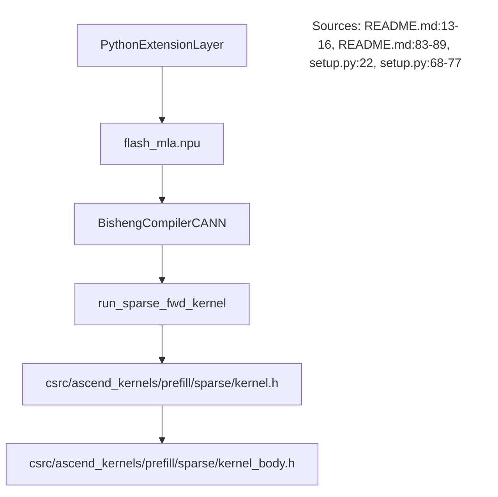
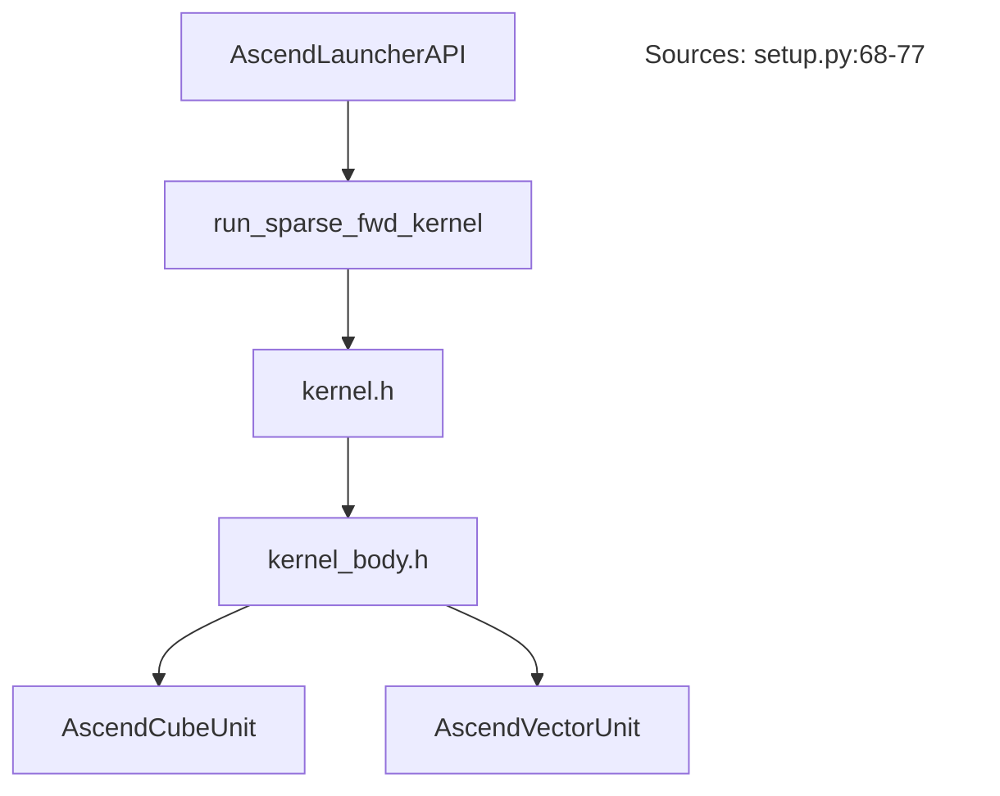
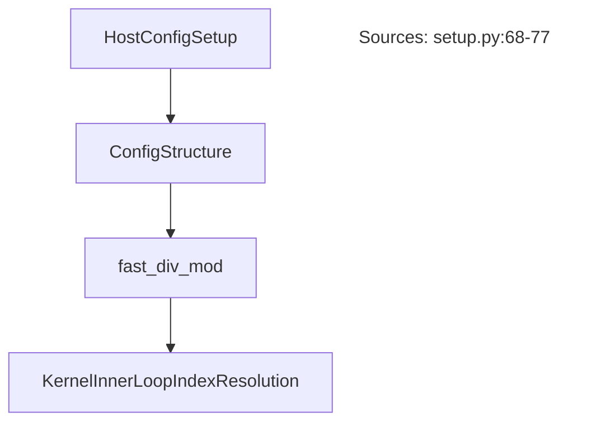
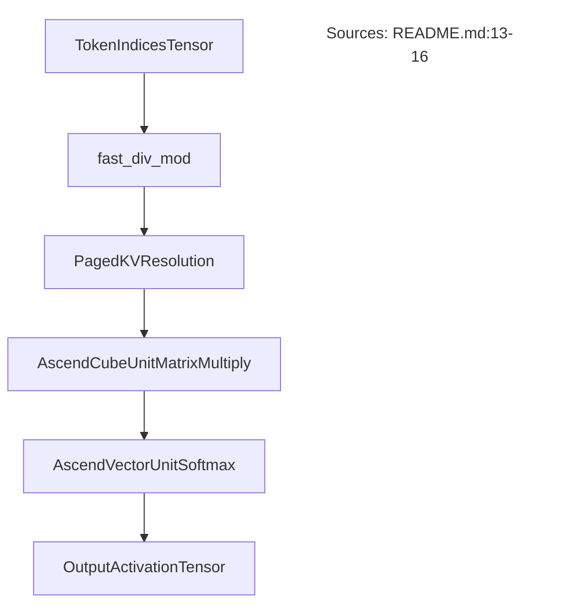

<!-- source: DeepWiki mcp.deepwiki.com · repo deepseek-ai/FlashMLA · page 5.4 Ascend NPU Sparse Prefill Kernels · fetched 2026-10-30 -->

# Ascend NPU Sparse Prefill Kernels

Relevant source files

The following files were used as context for generating this wiki page:

- [README.md](README.md)
- [setup.py](setup.py)

## Overview and Hardware Target

The Ascend NPU sparse attention kernels are engineered to support token-level sparse attention (DeepSeek Sparse Attention / DSA) on Huawei Ascend 950 NPUs [README.md:13-16]. These kernels achieve up to 410 TFlops during prefilling—representing approximately 95% of the theoretical hardware peak—and 360 TFlops during decoding (83% peak) [README.md:13-16]. 

The compilation and execution workflow targets the Huawei CANN toolkit (version 9.2.0 and above) utilizing the `bisheng` compiler and `torch_npu` bindings [README.md:83-89]. Unlike NVIDIA CUDA builds (`flash_mla.cuda`), the Ascend extension (`flash_mla.npu`) compiles explicit template instantiations written in Ascend C source/header structures [setup.py:22, setup.py:68-77].

Sources: [README.md:13-16](), [README.md:83-89](), [setup.py:22](), [setup.py:68-77]()

---

## Core Kernel Structure (`kernel.h` and `kernel_body.h`)

The sparse prefill and decoding kernels for the Huawei Ascend platform are structured around modular header-based templates located under `csrc/ascend_kernels/prefill/sparse/`. The architecture separates interface declarations from computation logic using two primary files:
- `kernel.h`: Defines the main template signature, host/device wrappers, and the entrypoint function `run_sparse_fwd_kernel`.
- `kernel_body.h`: Implements the core device-side loops, block tiling, GEMM instruction orchestration, softmax reduction, and memory access patterns tailored for the Ascend AI Core vector and cube units.

Sources: [setup.py:68-77]()

---

## Configuration and `fast_div_mod` Helpers

Efficient index calculations and thread-block coordinate mapping on Ascend NPUs require avoiding costly integer division instructions within inner loops. The Ascend sparse prefill kernel architecture includes specialized configuration structures and fast divisor modification helpers (`fast_div_mod`).

- **Configuration structs**: Encapsulate tensor strides, head dimensions (`h64`), block sizes, top-k selection parameters, and sequence lengths.
- **`fast_div_mod` helpers**: Precompute magic multipliers and shift amounts on the host, allowing device threads to replace runtime divisions with fast multiplication and bitwise shift operations when resolving paged KV cache indices and attention sink offsets.

Sources: [setup.py:68-77]()

---

## Explicit Template Instantiations and Bisheng Compilation

The build system orchestrates the compilation of Ascend kernels through explicit template instantiations rather than dynamic JIT compilation. As defined in `setup.py`, the `ASCEND_KERNEL_SOURCES` list specifies distinct `.asc` instantiation files that instantiate `run_sparse_fwd_kernel` across head counts, sparse modes, and KV cache formats [setup.py:68-77]:

| Instantiation File | Head Count | Mode | KV Cache Format | Attention Sink |
| :--- | :--- | :--- | :--- | :--- |
| `v41_h64_prefill_nosink.asc` [setup.py:71]() | 64 [setup.py:68]() | Prefill [setup.py:71]() | V4.1 FP8 [README.md:25]() | No Sink [setup.py:71]() |
| `v41_h64_prefill_sink.asc` [setup.py:72]() | 64 [setup.py:68]() | Prefill [setup.py:72]() | V4.1 FP8 [README.md:25]() | Sink Enabled [setup.py:72]() |
| `v41_h64_decode_nosink.asc` [setup.py:73]() | 64 [setup.py:68]() | Decode [setup.py:73]() | V4.1 FP8 [README.md:25]() | No Sink [setup.py:73]() |
| `v41_h64_decode_sink.asc` [setup.py:74]() | 64 [setup.py:68]() | Decode [setup.py:74]() | V4.1 FP8 [README.md:25]() | Sink Enabled [setup.py:74]() |
| `v41fp4_h64_decode_nosink.asc` [setup.py:75]() | 64 [setup.py:68]() | Decode [setup.py:75]() | V4.1 FP4 [README.md:25]() | No Sink [setup.py:75]() |
| `v41fp4_h64_decode_sink.asc` [setup.py:76]() | 64 [setup.py:68]() | Decode [setup.py:76]() | V4.1 FP4 [README.md:25]() | Sink Enabled [setup.py:76]() |

Compilation is driven by the Huawei Bisheng compiler provided with CANN 9.2.0+, translating these explicit instantiations into optimized NPU binary objects packaged into `flash_mla.npu` [README.md:83-89, setup.py:22, setup.py:68-77].

Sources: [README.md:83-89](), [setup.py:22](), [setup.py:68-77]()

---

## Algorithmic Deep-Dive and Performance Characteristics

The technical details and optimization strategies for the Ascend prefill and decoding kernels are documented in the official deep-dive report (`docs/20260930-ascend-prefill-deep-dive.md`) [README.md:13-16]. Key highlights include:
- **Memory Bandwidth Optimization**: Direct loading and unpacking of FP8 (e4m3 with e8m0 scales) and FP4 (e2m1 with e4m3 scales) KV cache formats to match the Ascend vector register widths.
- **Cube-Vector Overlapping**: Pipelining matrix multiplication units (Cube) with element-wise softmax and scaling operations (Vector) to hide latency.
- **Sparse Index Resolution**: Leveraging pre-computed top-k index tensors and fast division routing to skip unselected KV blocks entirely, yielding high arithmetic intensity during prefill.

Sources: [README.md:13-16]()

---

