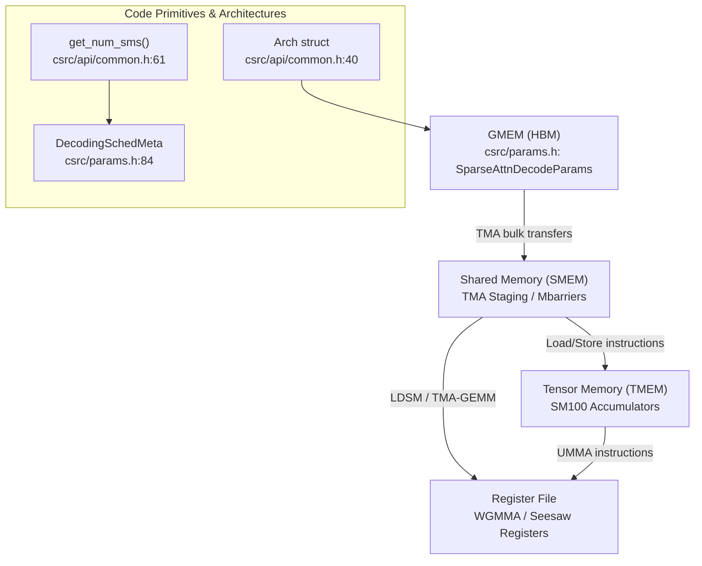
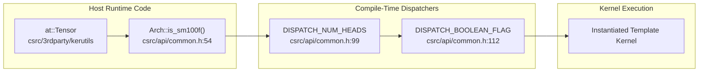
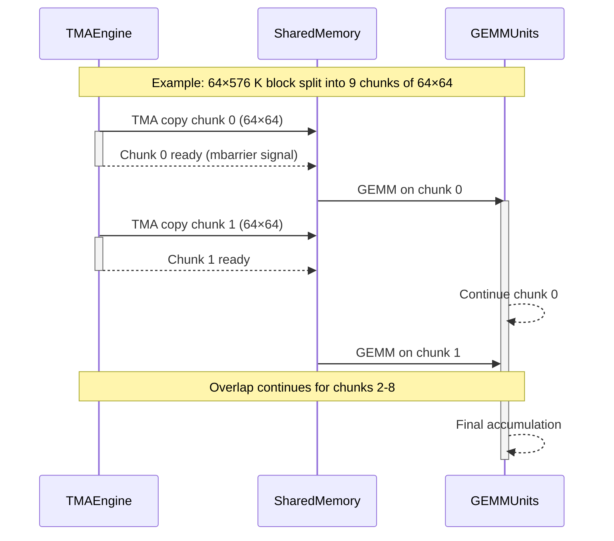
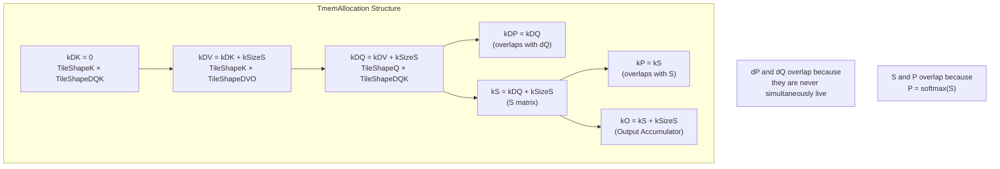
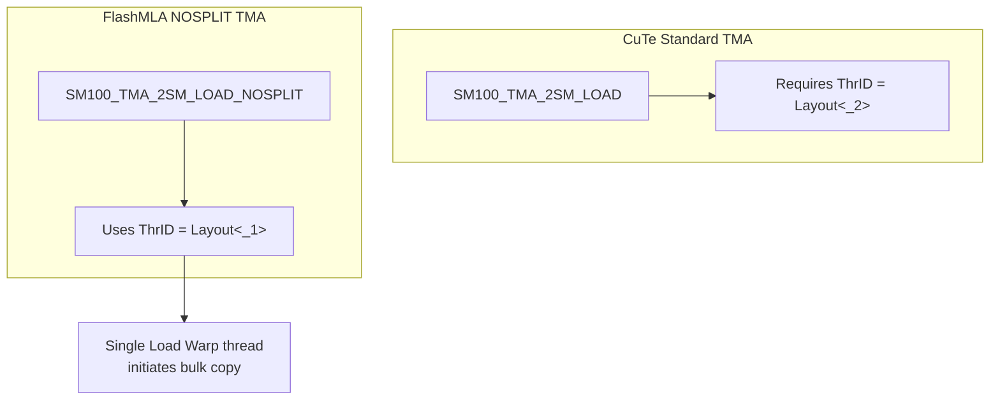
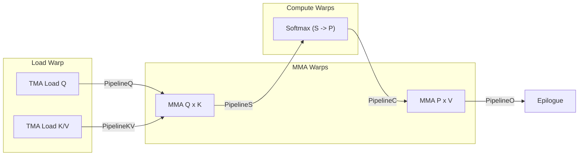

<!-- source: DeepWiki mcp.deepwiki.com · repo deepseek-ai/FlashMLA · page 5.5 Shared Kernel Utilities and Memory Hierarchy · fetched 2026-10-30 -->

# Shared Kernel Utilities and Memory Hierarchy

<details>
<summary>Relevant source files</summary>

The following files were used as context for generating this wiki page:

- [csrc/api/common.h](csrc/api/common.h)
- [csrc/params.h](csrc/params.h)
- [docs/20250422-new-kernel-deep-dive.md](docs/20250422-new-kernel-deep-dive.md)

</details>


## Purpose and Scope

This document explains the memory hierarchy, data movement patterns, and shared utilities in FlashMLA, focusing on SM90 (Hopper) and SM100 (Blackwell) architectures. The memory system spans four levels: Global Memory (HBM), Shared Memory (SMEM), Tensor Memory (TMEM), and Registers. Data movement between these levels is orchestrated using Tensor Memory Accelerator (TMA) hardware for asynchronous bulk copies, fine-grained pipelining to overlap memory transfers with computation, and careful staging to maximize bandwidth utilization. 

Additionally, this page documents shared kernel utilities located in `csrc/3rdparty/kerutils`, compilation/dispatch helpers in `csrc/api/common.h`, and architecture primitives used across CUDA and Ascend backends.

Key topics covered:
- Memory hierarchy characteristics and data flow (`GMEM → SMEM → TMEM → Registers`)
- Shared kernel utilities (`kerutils`) and architectural helper macros (`DISPATCH_NUM_HEADS`, `Arch`)
- TMA operations for Global Memory → Shared Memory transfers and `NOSPLIT` variants
- TMEM allocation and usage for intermediate accumulation (SM100)
- Fine-grained TMA-GEMM pipelining and "Seesaw" scheduling

Sources: `[docs/20250422-new-kernel-deep-dive.md:1-21]`, `[csrc/api/common.h:13-75]`, `[csrc/params.h:39-95]`

## Memory Hierarchy and Code Primitives

FlashMLA's kernels utilize a multi-level memory hierarchy mapped to architectural primitives and data structures to maximize performance.

**Title: MemoryHierarchyAndCodeEntities**


**Memory Level Characteristics:**

| Level | Capacity | Bandwidth | Latency | Primary Use / Code Mapping |
|-------|----------|-----------|---------|----------------------------|
| Global Memory (HBM) | ~80-141 GB | ~3.35 TB/s | ~300 cycles | Persistent tensors (`SparseAttnDecodeParams::q`, `kv`, `out`) `[csrc/params.h:131-140]()` |
| Shared Memory | ~228 KB | ~19 TB/s | ~20 cycles | TMA staging buffers, Mbarriers, Softmax reduction |
| Tensor Memory (TMEM) | 1 MB | Ultra-high | Few cycles | Accumulator matrices (`TmemAllocation` on SM100) `[csrc/sm100/prefill/dense/collective/sm100_fmha_fwd_mainloop_tma_warpspecialized.hpp:121-134]()` |
| Registers | 256 KB | Highest | Zero | Active computation, Output matrix in Seesaw scheduling `[docs/20250422-new-kernel-deep-dive.md:21-42]()` |

Sources: `[docs/20250422-new-kernel-deep-dive.md:1-21]`, `[csrc/api/common.h:40-75]`, `[csrc/params.h:131-140]`

## Shared Kernel Utilities and Helpers (`kerutils` & `common.h`)

FlashMLA relies on external helper libraries and internal utility macros to standardize device management, stream capture, and compile-time template dispatching.

### External Utilities (`kerutils`)
The codebase integrates utility headers from `csrc/3rdparty/kerutils` (such as `<kerutils/supplemental/torch_tensors.h>`) to interface cleanly with PyTorch tensor descriptors, memory alignment checkers, and data pointers across host and device code boundaries.

### Common API Helpers (`csrc/api/common.h`)
The runtime API layer defines essential hardware discovery structures and macro dispatchers:
- **`Arch` struct**: Detects CUDA device compute capability (`major`, `minor`) and streaming multiprocessor count (`num_sms`) `[csrc/api/common.h:40-57]()`.
- **`get_num_sms()`**: Retrieves the active SM count on CUDA or AI Core count on Ascend NPUs thread-safely `[csrc/api/common.h:61-75]()`.
- **`DISPATCH_NUM_HEADS`**: Template dispatcher mapping runtime query head counts (64 or 128) to compile-time constants `[csrc/api/common.h:99-110]()`.
- **`DISPATCH_BOOLEAN_FLAG`**: Converts runtime boolean flags into compile-time `constexpr` branches `[csrc/api/common.h:112-121]()`.

**Title: DispatchPipelineAndUtilities**


Sources: `[csrc/api/common.h:13-121]`, `[docs/20250422-new-kernel-deep-dive.md:1-10]`

## TMA Operations and Fine-Grained Pipelining

TMA (Tensor Memory Accelerator) is a hardware feature that enables efficient asynchronous data movement from global memory to shared memory. TMA operations are critical for achieving high memory bandwidth utilization by offloading memory copy operations from compute units.

### Fine-Grained TMA-GEMM Pipelining

FlashMLA employs fine-grained TMA copies to hide memory latency. Instead of loading an entire tile at once, the tile is split into smaller chunks (e.g., 64x64) that can be processed by GEMM units as they arrive.

**Title: FineGrainedTMAGEMMPipeline**


This technique allows the kernel to reach up to 80% Tensor Core utilization by keeping the pipeline full.

Sources: `[docs/20250422-new-kernel-deep-dive.md:52-57]`, `[csrc/sm100/prefill/dense/collective/sm100_fmha_load_tma_warpspecialized.hpp:181-200]`

### Seesaw Scheduling (SM90)

Due to register constraints (64k per SM), the SM90 kernel cannot use a traditional ping-pong buffer for the $64 \times 512$ output matrix, which alone occupies 32,768 registers. FlashMLA uses **Seesaw Scheduling**, splitting the output and V matrices vertically ($O_L, O_R$) and interleaving computation between two warpgroups to overlap CUDA Core (Softmax) and Tensor Core (WGMMA) operations.

Sources: `[docs/20250422-new-kernel-deep-dive.md:21-42]`

## TMEM (Tensor Memory) Usage and SM100 Primitives

On SM100, TMEM (1 MB) replaces registers as the primary location for accumulators. This allows for much larger tile sizes and more complex overlapping strategies.

### TMEM Allocation Strategy

The backward pass kernel demonstrates sophisticated TMEM allocation with overlapping to maximize utilization:

**Title: TmemAllocationGraph**


**Key TMEM Allocation Enums:**
- `kSizeS`: 128 units
- `kSizeO`: 128 units
- `kSizeP`: 32 units

Sources: `[docs/20250422-new-kernel-deep-dive.md:121-134]`, `[csrc/sm100/prefill/dense/collective/sm100_fmha_fwd_mainloop_tma_warpspecialized.hpp:121-134]`

### NOSPLIT TMA Variant (SM100)

FlashMLA implements a `NOSPLIT` variant for SM100 TMA operations. Standard CuTe `SM100_TMA_2SM_LOAD` requires two threads to cooperatively execute the TMA instruction. The `NOSPLIT` variant allows a single thread to initiate the operation, which is essential for FlashMLA's warp-specialized architecture where one warp (the "Load Warp") handles all memory movement.

**Title: NoSplitVsStandardTMA**


Sources: `[docs/20250422-new-kernel-deep-dive.md:7-10]`, `[docs/20250422-new-kernel-deep-dive.md:191-205]`

### Peer Bit Handling

In SM100 CTA-group operations, the mbarrier address must have its peer bit masked to ensure that transaction bytes update the correct barrier in the local CTA:

```cpp
// From tma_cta_group2_nosplit.h
uint32_t smem_int_mbar = cast_smem_ptr_to_uint(mbar_ptr) & Sm100MmaPeerBitMask;
```

Sources: `[docs/20250422-new-kernel-deep-dive.md:25]`, `[docs/20250422-new-kernel-deep-dive.md:51]`

## Asynchronous Data Movement Patterns

FlashMLA uses multiple specialized pipelines to coordinate data flow between the Load, MMA, and Compute warps.

**Title: ForwardPassDataMovementPipelines**


**Key Pipeline Classes:**
- `PipelineQ`: Coordinates Q tensor movement from SMEM to UMMA units.
- `PipelineKV`: Coordinates K and V tensor movement.
- `PipelineS`: Coordinates TMEM-based score matrix (S) from MMA to Softmax warps.
- `PipelineC`: Coordinates correction/softmax results back to MMA for V-accumulation.

Sources: `[docs/20250422-new-kernel-deep-dive.md:145-168]`, `[docs/20250422-new-kernel-deep-dive.md:156-163]`

## Cache Hints and Optimization

FlashMLA uses `cute::TMA::CacheHintSm90::EVICT_FIRST` for TMA copies. This hint tells the L2 cache that the data being loaded is unlikely to be reused soon, allowing the cache to evict it quickly and preserve space for other frequently accessed data (like LSE or accumulators).

Sources: `[docs/20250422-new-kernel-deep-dive.md:54-56]`, `[docs/20250422-new-kernel-deep-dive.md:220]`

---

