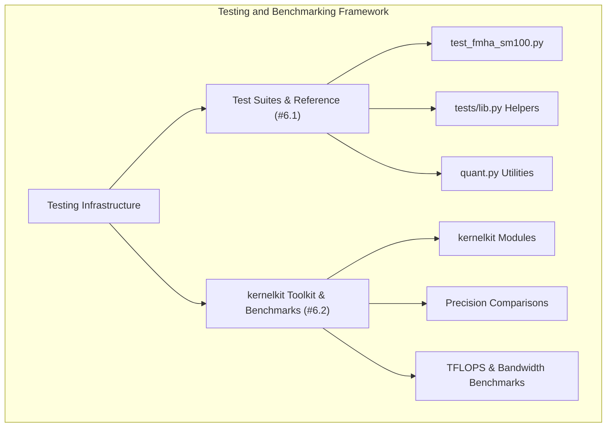

<!-- source: DeepWiki mcp.deepwiki.com · repo deepseek-ai/FlashMLA · page 6 Testing and Benchmarking · fetched 2026-10-30 -->

# Testing and Benchmarking

Relevant source files

The following files were used as context for generating this wiki page:

- [tests/lib.py](tests/lib.py)
- [tests/test_fmha_sm100.py](tests/test_fmha_sm100.py)

This page provides an overview of the testing and benchmarking infrastructure for FlashMLA, covering correctness verification test suites, reference implementations, quantization utilities, and performance benchmarking tools built upon the `kernelkit` testing framework.

For implementation details of the underlying kernels being tested, see [SM100 Sparse Decode Kernels](#5.1) and [SM100 Sparse Prefill Kernels](#5.2). For performance optimization strategies, see [Kernel Performance Optimizations](#4.4).

**Testing & Benchmarking Overview**: The verification architecture is partitioned into core functional test suites and the reusable `kernelkit` benchmarking toolkit.

Sources: [tests/test_fmha_sm100.py:1-166](), [tests/lib.py:1-181]()

---

## Test Suites and References (#6.1)

The FlashMLA test suite provides robust correctness verification across dense forward/backward passes, sparse decoding, sparse prefilling, and fused pipelines. Test harnesses utilize PyTorch-based reference implementations (`ref.py`) and specialized quantization utilities (`quant.py`) to validate custom FP8 and FP4 KV cache layouts against PyTorch scaled dot-product attention (SDPA) reference standards.

Helper utilities defined in `tests/lib.py` handle platform-specific device setup, test parameter encapsulation (`TestParam`, `TestTarget`), and numerical tolerance comparisons (`check_is_allclose`).

For detailed documentation on specific test scripts, reference implementations, and quantization helpers, see [Test Suites and References](#6.1).

Sources: [tests/test_fmha_sm100.py:1-166](), [tests/lib.py:1-181]()

---

## kernelkit Toolkit and Benchmarks (#6.2)

Performance benchmarking and hardware-specific validation are driven by the `tests/kernelkit` toolkit. This modular framework provides submodules for test building, execution benchmarking, platform detection, precision comparison, and code generation. 

Benchmarks measure raw execution time, throughput in TFLOPS, and memory bandwidth utilization across various sequence lengths and batch sizes. Additionally, the toolkit incorporates automated artifact checks to detect register spills and ensure optimal hardware register allocation during compilation.

For detailed documentation on the `kernelkit` modules, benchmarking workflows, and precision analysis helpers, see [kernelkit Toolkit and Benchmarks](#6.2).

Sources: [tests/test_fmha_sm100.py:151-160](), [tests/lib.py:9-31]()

---

