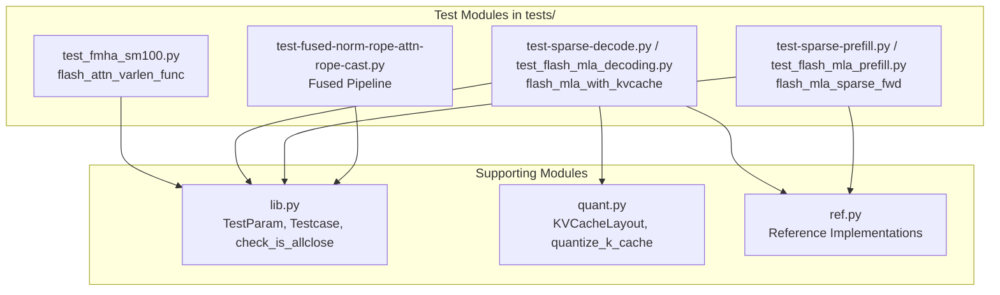
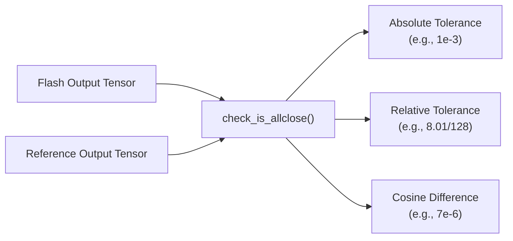
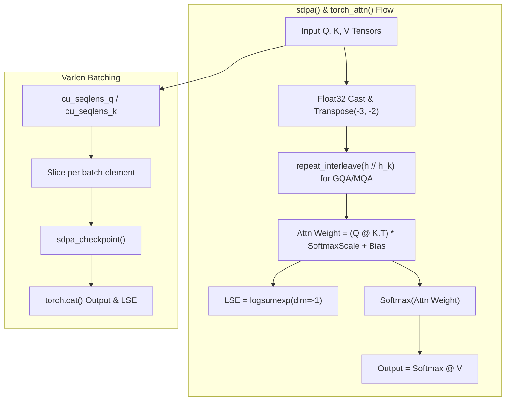
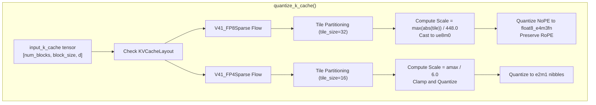

<!-- source: DeepWiki mcp.deepwiki.com · repo deepseek-ai/FlashMLA · page 6.1 Test Suites and References · fetched 2026-10-30 -->

# Test Suites and References

Relevant source files

The following files were used as context for generating this wiki page:

- [tests/lib.py](tests/lib.py)
- [tests/quant.py](tests/quant.py)
- [tests/test_fmha_sm100.py](tests/test_fmha_sm100.py)

## Purpose and Scope

The testing framework validates FlashMLA's correctness, numerical stability, and performance across diverse attention workloads, including dense varlen prefill, sparse decoding, sparse prefill, and the fused norm-RoPE-attention-RoPE-cast pipeline. The test suite comprises specialized test files under `tests/` that verify backend implementations against PyTorch and reference Python implementations (`ref.py`), supported by helper libraries (`lib.py`) and quantization utilities (`quant.py`).

For performance comparison tools and benchmarking against other implementations, see [kernelkit Toolkit and Benchmarks](#6.2). For details about the specific CUDA and Ascend kernels being tested, see [SM100 Sparse Decode Kernels](#5.1) and [SM100 Sparse Prefill Kernels](#5.2).

Sources: [tests/test_fmha_sm100.py:7-8](), [tests/lib.py:7-13](), [tests/quant.py:1-6]()

---

## Test Suite Organization and Test Files

The test suite is partitioned into focused modules, each exercising a specific slice of the FlashMLA kernel architecture.

**Test Suite Summary Table**:

| Test File | Primary API Tested | Target Operation | Platform Support | Key Features Validated |
|-----------|--------------------|------------------|------------------|----------------------|
| `test_fmha_sm100.py` | `flash_attn_varlen_func` | Dense Varlen MHA/GQA (Fwd + Bwd) | SM100 / SM103 CUDA | Causal masks, window sizes, variable sequence lengths, gradients |
| `test-sparse-decode.py` | `flash_mla_with_kvcache` | Sparse MLA Decoding | CUDA / Ascend NPU | FP8/FP4 KV caches, paged block layouts, split-KV reduction |
| `test-sparse-prefill.py` | `flash_mla_sparse_fwd` | Sparse Prefill | CUDA / Ascend NPU | Top-k token indices, small-topk specialization, variable lengths |
| `test-fused-norm-rope-attn-rope-cast.py` | Fused Pipeline Entrypoints | Norm-RoPE-Attention-RoPE-Cast | CUDA SM100 | Weight pre-permutation (`permute_q_b_proj`, `permute_wv_proj`), TMA scales |

Sources: [tests/test_fmha_sm100.py:50-116](), [tests/lib.py:32-67](), [tests/quant.py:8-25]()

---

## Correctness Validation Methodology

### Statistical Error Measurement

FlashMLA employs rigorous correctness checks via `kernelkit`'s `check_is_allclose()` helper (integrated through `tests/lib.py`) [tests/test_fmha_sm100.py:8](). Numerical verification compares GPU-generated outputs against reference computations using multiple statistical criteria:

- **Output Validation**: `check_is_allclose("out", out_flash.float(), out_torch, abs_tol=1e-3, rel_tol=8.01 / 128, cos_diff_tol=7e-6)` [tests/test_fmha_sm100.py:125]()
- **Log-Sum-Exp (LSE) Validation**: `check_is_allclose("lse", lse_flash.float(), lse_torch, abs_tol=1e-6, rel_tol=2.01 / 65536)` [tests/test_fmha_sm100.py:126]()
- **Gradient Validation**: `check_is_allclose("dq", q1.grad, q2.grad, abs_tol=1e-3, rel_tol=8.01 / 128, cos_diff_tol=7e-6)` [tests/test_fmha_sm100.py:130]()

Sources: [tests/test_fmha_sm100.py:125-132](), [tests/lib.py:8]()

---

## Reference Implementations (`ref.py` and `sdpa`)

To establish ground truth for dense and sparse attention operations, tests utilize reference implementations. In `tests/test_fmha_sm100.py`, Scaled Dot-Product Attention (`sdpa`) is implemented directly in PyTorch with checkpoint support for backward pass verification [tests/test_fmha_sm100.py:31-47]().

Sources: [tests/test_fmha_sm100.py:31-47](), [tests/test_fmha_sm100.py:98-114]()

---

## Helper Libraries and Test Parameter Generation (`lib.py`)

The `tests/lib.py` module defines core classes and helpers to parameterize test execution across platforms (`TestTarget.SPARSE_FWD`, `TestTarget.DECODE`) [tests/lib.py:32-35]().

### Key Structures in `lib.py`

- `TestParam`: Encapsulates query sequence length (`s_q`), key/value sequence length (`s_kv`), `topk`, head counts (`h_q`, `h_kv`), head dimensions (`d_qk`, `d_v`), platform capability checks (`can_run_on_and_clamp`), and decode-specific sub-parameters [tests/lib.py:50-103]().
- `RawTestParamForDecode`: A flattened test parameter structure for decoding test cases that converts cleanly into `TestParam via to_test_param()` [tests/lib.py:105-162]().
- `Testcase`: Groups resolved tensors (`q`, `kv`, `indices`, `sm_scale`, `attn_sink`, `topk_length`) for execution [tests/lib.py:165-174]().

Sources: [tests/lib.py:32-174]()

---

## Quantization and Dequantization Utilities (`quant.py`)

The `tests/quant.py` module provides simulation and quantization utilities for DeepSeek-V4.1 FP8 and FP4 sparse KV cache layouts.

### KV Cache Layouts and Metadata

The `KVCacheLayout` enumeration defines layout configurations:
- `V41_FP8Sparse`: `d=512`, `d_nope=448`, `d_rope=64`, `tile_size=32`, `num_tiles=16` (14 NoPE + 2 RoPE tiles; total 528 bytes/token) [tests/quant.py:8-15]().
- `V41_FP4Sparse`: `d=512`, `d_nope=448`, `d_rope=64`, `tile_size=16`, `num_tiles=32` (28 NoPE + 4 RoPE tiles; total 288 bytes/token) [tests/quant.py:8-17]().

### Quantization Implementation Details

- `_cast_scale_inv_to_ue8m0`: Converts scale inverses to `ue8m0` format aligned with tile kernel requirements (`FP8_AMAX_MARGIN`) [tests/quant.py:26-27]().
- `_quantize_to_e2m1`: Implements round-to-nearest FP4 e2m1 conversion with tie-to-even semantics (`cvt.rn.satfinite.e2m1x2.f32`) [tests/quant.py:31-51]().
- `quantize_k_cache`: Orchestrates tile-wise scaling and quantization across blocks for both FP8 and FP4 cache formats [tests/quant.py:58-124]().

Sources: [tests/quant.py:1-124]()

---

## Sources

- `[tests/test_fmha_sm100.py:7-166]()`
- `[tests/quant.py:1-124]()`
- `[tests/lib.py:7-181]()`

---

