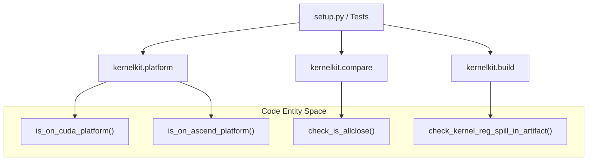
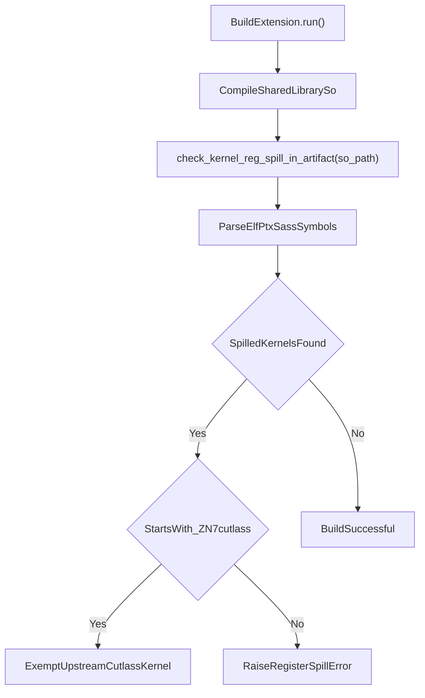

<!-- source: DeepWiki mcp.deepwiki.com · repo deepseek-ai/FlashMLA · page 6.2 kernelkit Toolkit and Benchmarks · fetched 2026-10-30 -->

# kernelkit Toolkit and Benchmarks

<details>
<summary>Relevant source files</summary>

The following files were used as context for generating this wiki page:

- [setup.py](setup.py)
- [tests/lib.py](tests/lib.py)
- [tests/test_fmha_sm100.py](tests/test_fmha_sm100.py)

</details>


## 1. Purpose and Scope
The `tests/kernelkit` toolkit provides foundational utility modules for building, testing, verifying precision, inspecting compilation artifacts (such as register-spill checks), and benchmarking FlashMLA kernels across CUDA and Ascend platforms [setup.py:119-129](), [tests/lib.py:9-11](). This page documents the core modules of the kernelkit toolkit, precision comparison helpers, post-build register-spill artifact validation, and throughput benchmarking frameworks.

Sources: [setup.py:119-129](), [tests/lib.py:9-11]()

## 2. Kernelkit Modules Overview
The `kernelkit` library is organized into several modular components supporting platform abstraction, code generation, precision control, and testing utilities:
- `bench`: Benchmarking execution helpers and timing routines.
- `build`: Compilation orchestration and build-time flags.
- `compare`: Numerical comparison and verification helpers (`check_is_allclose`).
- `generate`: Code generation and template instantiation scripts.
- `platform`: Platform detection utilities (`is_on_cuda_platform`, `is_on_ascend_platform`, `requires_platform`) [tests/lib.py:10-19]().
- `precision`: Data type definitions, quantization routines, and layout management [tests/lib.py:46-47]().
- `utils`: General helper functions like device synchronization (`device_synchronize`) [tests/lib.py:24-31]().

Title: "Kernelkit Module Architecture and Data Flow"

Sources: [setup.py:119-129](), [tests/lib.py:9-31]()

## 3. Precision Comparison Helpers and Tolerances
Correctness validation relies on precision comparison helpers like `check_is_allclose` [tests/test_fmha_sm100.py:8]() which enforce strict absolute, relative, and cosine difference tolerances across different data types (`bfloat16`, `float32`, FP8, FP4). For instance, attention outputs and Log-Sum-Exp (`lse`) values are verified with specific thresholds [tests/test_fmha_sm100.py:125-126]().

```python
# Example precision check invocation
assert check_is_allclose("out", out_flash.float(), out_torch, abs_tol=1e-3, rel_tol=8.01 / 128, cos_diff_tol=7e-6)
assert check_is_allclose("lse", lse_flash.float(), lse_torch, abs_tol=1e-6, rel_tol=2.01 / 65536)
``` [tests/test_fmha_sm100.py:125-126]()

Sources: [tests/test_fmha_sm100.py:8](), [tests/test_fmha_sm100.py:125-126]()

## 4. Register-Spill Artifact Checks
To ensure high kernel performance and prevent excessive register pressure on NVIDIA SM100/SM103 architectures, the build pipeline executes an automated post-build artifact check via `check_kernel_reg_spill_in_artifact` [setup.py:119-129](). Upstream CUTLASS kernels are exempt from this check [setup.py:131-134]().

Title: "Register-Spill Artifact Check Flow"

Sources: [setup.py:111-137]()

## 5. TFLOPS and Bandwidth Benchmarking
Benchmarking scripts (such as `tests/test_fmha_sm100.py`) utilize Triton's benchmarking utilities (`triton.testing.do_bench`) combined with analytical FLOPS and bandwidth formulas to measure performance [tests/test_fmha_sm100.py:151-155]().

```python
def timer(func, name):
    t = triton.testing.do_bench(func, warmup=2, rep=3)
    FLOPS = total_attn_compute * h * 2 * ((d + dv) if name == "fwd" else ((d * 3 + dv * 2)))
    print(f"{t:.3f} ms, {FLOPS / 10 ** 9 / t:.0f} TFLOP/s, name: {name}")
    return t
``` [tests/test_fmha_sm100.py:151-155]()

Sources: [tests/test_fmha_sm100.py:151-155]()

---

