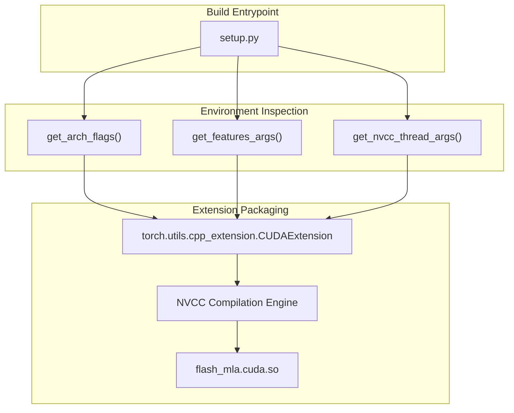
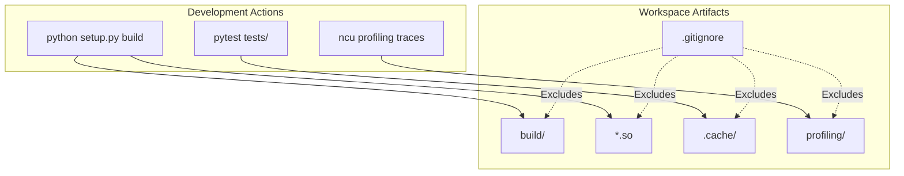

<!-- source: DeepWiki mcp.deepwiki.com · repo deepseek-ai/FlashMLA · page 7 Development Guide · fetched 2026-10-30 -->

# Development Guide

Relevant source files

The following files were used as context for generating this wiki page:

- [.gitignore](.gitignore)

This document provides high-level guidance for contributors extending the FlashMLA codebase. It covers the build orchestration flow, environment setup, external dependencies, and architectural design documentation. 

For detailed information on configuring your local workspace, IDE integration, and debugging artifacts, see [Development Environment Setup](#7.1).
For details on third-party submodules, toolchains (`CANNC` / `Bisheng`), PyTorch integration, and licensing, see [External Dependencies and Licensing](#7.2).
For historical architecture deep dives and design papers, see [Design Documents Archive](#7.3).

Sources: [setup.py:1-151]()

## Build Orchestration and Compilation Workflow

The FlashMLA build system is orchestrated by [setup.py](), which inspects the host environment, configures CUDA or Ascend toolchain flags, processes feature flags, and builds the Python extension modules via PyTorch's `CUDAExtension` [setup.py:1-151]().

Sources: [setup.py:1-151]()

### Build Configuration and Environment Variables

Contributors can control compilation behavior using specific environment variables parsed in [setup.py:16-51]():
- `FLASH_MLA_DISABLE_SM100`: Disables SM100 Blackwell kernel compilation when set to `TRUE` [setup.py:36-39]().
- `FLASH_MLA_DISABLE_SM90`: Disables SM90 Hopper kernel compilation [setup.py:37]().
- `FLASH_MLA_DISABLE_FP16`: Disables FP16 data type support [setup.py:21-23]().
- `NVCC_THREADS`: Controls parallel compilation threads passed to NVCC [setup.py:48-50]().

For detailed instructions on setting up debug builds, profiling outputs, and IDE configurations like `compile_commands.json`, see [Development Environment Setup](#7.1).

Sources: [setup.py:16-51](), [.gitignore:1-13]()

## Contributor Environment and Artifact Management

Development workflows produce various temporary files, build outputs, and profiling traces. The project root defines exclusion rules to keep the working tree clean.

Sources: [.gitignore:1-13]()

### External Submodules and Licensing

FlashMLA integrates external libraries such as CUTLASS and kernel utilities via Git submodules (`csrc/cutlass`, `csrc/kerutils`) [setup.py:52](). For comprehensive documentation on initializing submodules, version pinning, hardware toolchains (such as Huawei CANN/Bisheng), and project licensing terms, see [External Dependencies and Licensing](#7.2).

Sources: [.gitmodules:1-3](), [setup.py:52]()

### Design Documents Archive

Design decisions, kernel optimization strategies (such as Hopper FP8 sparse kernels and Ascend prefill implementations), and historical proposals are archived under the `docs/` directory. For an index and summaries of these deep dives, see [Design Documents Archive](#7.3).

---

