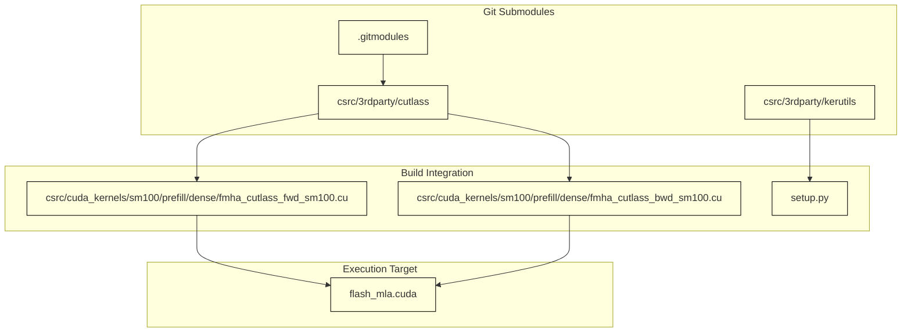
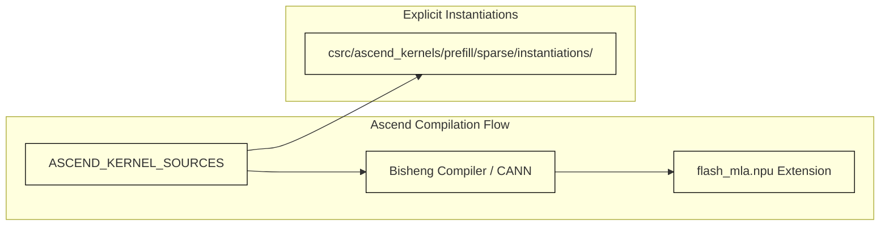
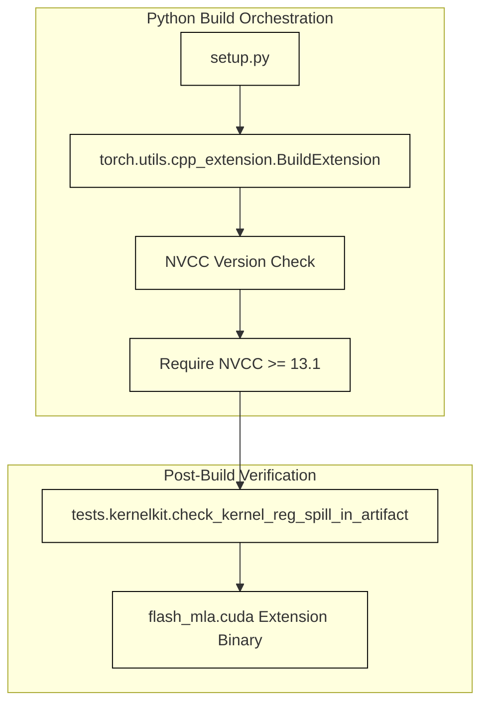
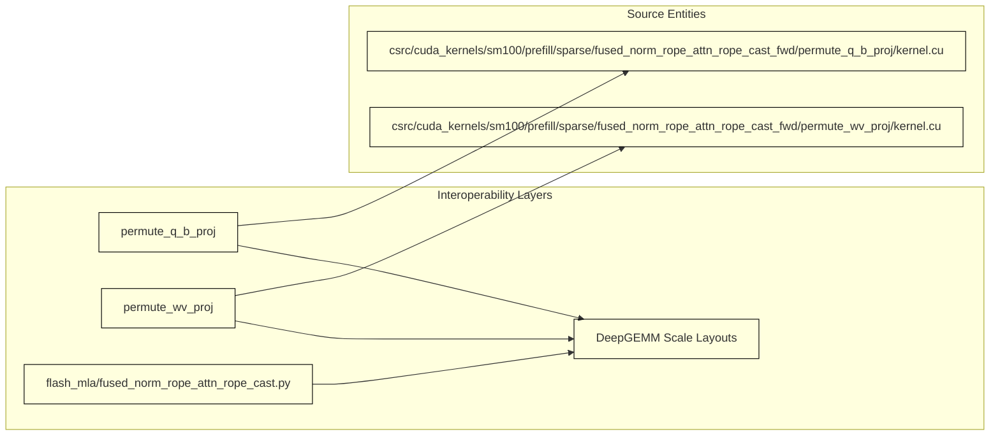
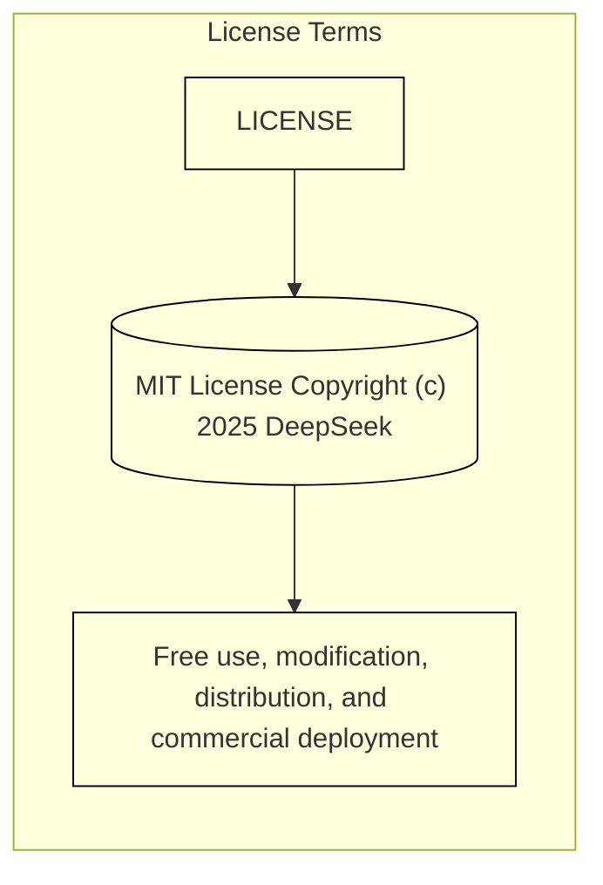

<!-- source: DeepWiki mcp.deepwiki.com · repo deepseek-ai/FlashMLA · page 7.2 External Dependencies and Licensing · fetched 2026-10-30 -->

# External Dependencies and Licensing

<details>
<summary>Relevant source files</summary>

The following files were used as context for generating this wiki page:

- [.gitmodules](.gitmodules)
- [LICENSE](LICENSE)
- [setup.py](setup.py)

</details>


This document describes all external dependencies required by FlashMLA, including the CUTLASS and kerutils submodules, the CANN/Bisheng Ascend toolchain, PyTorch and `torch_npu`, DeepGEMM interop, and the project's MIT license. For information about the overall build system configuration and compilation pipeline, see [Building from Source]().

## Purpose and Scope

FlashMLA supports dual hardware targets—NVIDIA SM100/SM103 GPUs and Huawei Ascend NPUs—and relies on a robust set of vendor SDKs, template libraries, python runtimes, and build orchestration tools. This document details the version constraints, submodule structures, toolchain hooks, and licensing terms governing the repository.

Sources: [setup.py:1-77](), [.gitmodules:1-3]()

---

## 1. CUTLASS and kerutils Submodules (`.gitmodules`)

FlashMLA integrates NVIDIA's CUTLASS library as a Git submodule to provide high-performance dense matrix multiplication and TMA template abstractions for Blackwell architecture [setup.py:34-35](). Additionally, shared kernel utilities are organized under `csrc/3rdparty/kerutils`.



**Submodule Specification**: The `.gitmodules` file pins the CUTLASS repository [.gitmodules:1-3]():
```ini
[submodule "csrc/3rdparty/cutlass"]
	path = csrc/3rdparty/cutlass
	url = https://github.com/NVIDIA/cutlass.git
```
These headers feed directly into the dense FMHA forward and backward compilation units defined in `setup.py` [setup.py:34-35]().

Sources: [setup.py:34-35](), [.gitmodules:1-3]()

---

## 2. CANN/Bisheng Toolchain for Ascend NPUs

For Huawei Ascend NPU deployment (`flash_mla.npu`), FlashMLA uses the CANN (Compute Architecture for Neural Networks) SDK and the Bisheng compiler toolchain [setup.py:22]().



**Kernel Sources**: The Ascend target compiles explicit template instantiations of `run_sparse_fwd_kernel` covering head 64 prefill/decode modes with or without attention sinks for FP8 and FP4 caches [setup.py:70-77]():
- `csrc/ascend_kernels/prefill/sparse/instantiations/v41_h64_prefill_nosink.asc` [setup.py:71]()
- `csrc/ascend_kernels/prefill/sparse/instantiations/v41_h64_decode_sink.asc` [setup.py:74]()
- `csrc/ascend_kernels/prefill/sparse/instantiations/v41fp4_h64_decode_sink.asc` [setup.py:76]()

Sources: [setup.py:22](), [setup.py:70-77]()

---

## 3. PyTorch and `torch_npu` Prerequisites

FlashMLA relies heavily on PyTorch's C++ extension framework (`torch.utils.cpp_extension`) to build platform-specific binaries (`flash_mla.cuda` and `flash_mla.npu`) [setup.py:21-22](), [setup.py:93-97]().



**NVCC Version Enforcement**: Compiling Blackwell SM100/SM103 CUDA kernels requires NVCC 13.1 or higher to support the `.scaled::n2::ue8m0` scaling conversion instructions [setup.py:27](), [setup.py:102-109]()）：
```python
assert major > 13 or (major == 13 and minor >= 1), \
    "Compiling the kernels requires NVCC 13.1 or higher (cvt with .scaled::n2::ue8m0)."
```

**Post-Build Analysis**: The custom `BuildExtensionWithPostActions` runs a register-spill inspection on built shared objects using `check_kernel_reg_spill_in_artifact`, exempting upstream CUTLASS kernels while enforcing strict zero-spill rules on repository-defined kernels [setup.py:111-137]().

Sources: [setup.py:21-27](), [setup.py:93-137]()

---

## 4. DeepGEMM Interoperability

FlashMLA interoperates closely with DeepGEMM primitives for low-precision matrix multiplication and scaling layouts. 



Weight preprocessing utilities (`permute_q_b_proj` and `permute_wv_proj`) format weights into TMA-aligned layouts compatible with DeepGEMM pipelines [setup.py:64-65]().

Sources: [setup.py:64-65]()

---

## 5. Project Licensing

FlashMLA is distributed under the terms of the MIT License, Copyright (c) 2025 DeepSeek [LICENSE:1-21]().



The full licensing text grants broad permissions for reuse under standard MIT conditions, requiring the inclusion of the copyright and permission notice in all copies or substantial portions of the software [LICENSE:5-21]().

Sources: [LICENSE:1-21]()

---

