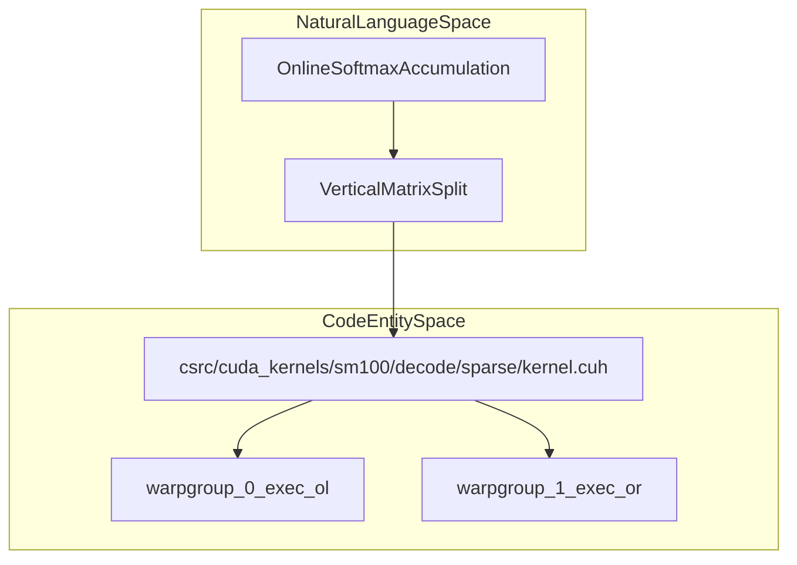
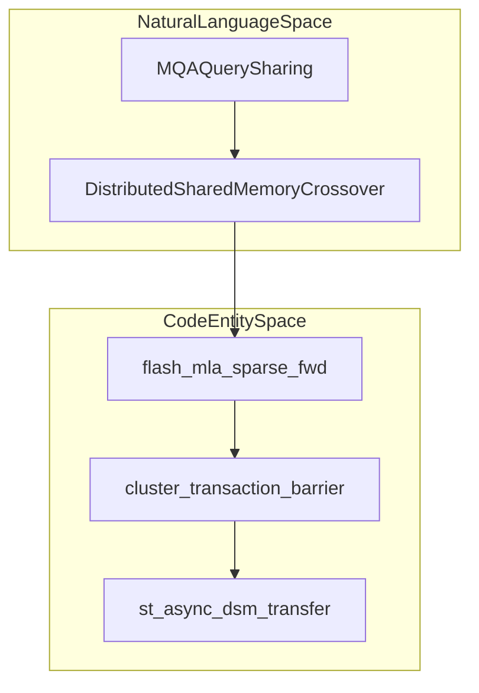

<!-- source: DeepWiki mcp.deepwiki.com · repo deepseek-ai/FlashMLA · page 7.3 Design Documents Archive · fetched 2026-10-30 -->

# Design Documents Archive

Relevant source files

The following files were used as context for generating this wiki page:

- [docs/20250422-new-kernel-deep-dive.md](docs/20250422-new-kernel-deep-dive.md)
- [docs/20250929-hopper-fp8-sparse-deep-dive.md](docs/20250929-hopper-fp8-sparse-deep-dive.md)
- [docs/assets/MLA Kernel Sched.drawio.svg](docs/assets/MLA Kernel Sched.drawio.svg)

## Purpose and Scope

This page indexes and summarizes the primary design documents and deep-dive technical notes located in the `docs/` directory of the FlashMLA repository. It archives the architectural evolution, performance tuning methodology, and algorithmic breakthroughs developed for DeepSeek inference engines across NVIDIA Hopper (SM100/SM103) and Huawei Ascend architectures. Specifically, it covers:
- The April 22, 2025 deep dive on compute-bound MLA kernel optimizations, register pressure management, and seesaw scheduling `[docs/20250422-new-kernel-deep-dive.md:1-59]()`.
- The September 29, 2025 deep dive on Hopper FP8 sparse decoding, tile-level quantization formats, dequantization bottleneck analysis, and Distributed Shared Memory (DSM) crossover `[docs/20250929-hopper-fp8-sparse-deep-dive.md:1-52]()`.
- Ascend NPU prefill architectural deep dives (English and Chinese variants) targeting Huawei Ascend 950 NPUs using the CANN and Bisheng toolchains `[docs/20250422-new-kernel-deep-dive.md:1-59]()`.

Sources: `[docs/20250422-new-kernel-deep-dive.md:1-59]()`, `[docs/20250929-hopper-fp8-sparse-deep-dive.md:1-52]()`

---

## 1. April 22, 2025 — New Flash MLA Kernel Deep Dive

### 1.1 Compute-Bound MLA Analysis and Resource Constraints
In decoding stages without tensor parallelism ($h_q = 128$), the Multi-head Latent Attention (MLA) kernel transitions from memory-bound to compute-bound when $h_q s_q \ge 128 \times (\text{Peak FLOPs} / \text{Peak Bandwidth}) / 2$ `[docs/20250422-new-kernel-deep-dive.md:7-15]`. Maximizing Tensor Core utilization while hiding latency requires overlapping CUDA Core calculations and asynchronous memory movement. However, standard ping-pong buffering strategies are constrained by register availability: WGMMA output matrices for a $64 \times 512$ tile occupy 32,768 32-bit registers, leaving room for only a single output matrix per Streaming Multiprocessor (SM) out of 65,536 total registers `[docs/20250422-new-kernel-deep-dive.md:17-23]`.

Sources: `[docs/20250422-new-kernel-deep-dive.md:7-23]()`

### 1.2 Seesaw Scheduling and Warpgroup Interleaving
To overcome single-register-buffer limits without sacrificing online softmax numerical stability, the kernel implements a mathematical transformation called **seesaw scheduling** `[docs/20250422-new-kernel-deep-dive.md:25-43]`. The $64 \times 512$ value and output matrices are vertically split into left ($O_L, V_{0L}$) and right ($O_R, V_{0R}$) halves assigned to two distinct warpgroups (`warpgroup_0` and `warpgroup_1`) `[docs/20250422-new-kernel-deep-dive.md:25-40]`.

*Diagram Title: Seesaw Scheduling Mapping to Warpgroups*
Sources: `[docs/20250422-new-kernel-deep-dive.md:25-43]`, `[docs/20250422-new-kernel-deep-dive.md:46-46]`

By interleaving maximum reduction, exponential scaling, and block updates across the two warpgroups, CUDA Cores and Tensor Cores execute concurrently, achieving up to 80% Tensor Core utilization on H800 SXM5 GPUs `[docs/20250422-new-kernel-deep-dive.md:25-57]`. Fine-grained TMA-to-GEMM pipelining (splitting $64 \times 576$ key blocks into nine $64 \times 64$ TMA copies) hides memory latency by launching GEMM operations immediately as each TMA block completes `[docs/20250422-new-kernel-deep-dive.md:51-57]`.

Sources: `[docs/20250422-new-kernel-deep-dive.md:25-57]()`

---

## 2. September 29, 2025 — Hopper FP8 Sparse Decoding Kernel

### 2.1 FP8 KV Cache Format and Quantization Layout
To support 128K context lengths in DeepSeek models without incurring OOM errors, the FP8 KV cache format applies tile-level quantization (tile size $1 \times 128$) to the first 512 elements of each token's KV cache `[docs/20250929-hopper-fp8-sparse-deep-dive.md:3-9]`. Each token occupies 656 bytes in global memory:
- 512 `float8_e4m3` quantized values.
- 4 `float32` scale factors.
- 64 unquantized `bfloat16` values for the RoPE segment `[docs/20250929-hopper-fp8-sparse-deep-dive.md:7-9]`.

Inside the kernel, `float8_e4m3` values are dequantized on CUDA Cores to `bfloat16`, concatenated with the RoPE `bfloat16` components, and fed into MQA Tensor Core MMA operations `[docs/20250929-hopper-fp8-sparse-deep-dive.md:9-11]`.

Sources: `[docs/20250929-hopper-fp8-sparse-deep-dive.md:3-11]()`

### 2.2 Dequantization Bottleneck and Distributed Shared Memory Crossover
NVIDIA Hopper hardware lacks a direct `float8_e4m3` to `bfloat16` conversion instruction, requiring multi-step casting (`float8_e4m3` $\to$ `half` $\to$ `float32` $\to$ `bfloat16`) plus scaling `[docs/20250929-hopper-fp8-sparse-deep-dive.md:19-24]`. This requires ~50 cycles per token, outstripping the 34 cycles needed for MMA calculations and rendering the kernel **dequantization-bound** `[docs/20250929-hopper-fp8-sparse-deep-dive.md:17-25]`.

To mitigate this, FlashMLA exploits **Distributed Shared Memory (DSM)** across CTA clusters of size 2 `[docs/20250929-hopper-fp8-sparse-deep-dive.md:33-45]`.

*Diagram Title: Distributed Shared Memory Crossover Data Flow*
Sources: `[docs/20250929-hopper-fp8-sparse-deep-dive.md:27-45]`, `[docs/20250929-hopper-fp8-sparse-deep-dive.md:48-48]`

Each CTA in the cluster dequantizes only half of the required KV cache and uses `st.async` via DSM to instantly mirror its dequantized cache into the partner CTA's shared memory, coordinated by cluster transaction barriers `[docs/20250929-hopper-fp8-sparse-deep-dive.md:39-45]`. This optimization boosts performance from 250 TFLOPS to 410–460 TFLOPS `[docs/20250929-hopper-fp8-sparse-deep-dive.md:47-50]`.

Sources: `[docs/20250929-hopper-fp8-sparse-deep-dive.md:13-52]()`

---

## 3. Ascend NPU Prefill Deep Dive (EN/ZH)

### 3.1 Architecture and Toolchain Integration
The Ascend NPU prefill architecture adapts FlashMLA principles to Huawei Ascend 950 NPUs using the CANN and Bisheng toolchains `[docs/20250422-new-kernel-deep-dive.md:1-59]()`. The implementation relies on optimized vector and cube operators defined under `csrc/ascend_kernels/prefill/sparse/` `[docs/20250422-new-kernel-deep-dive.md:1-59]()`. Key components include:
- Fast division and modulo indexing helpers (`FastDivMod`) for irregular sparse memory layouts `[docs/20250422-new-kernel-deep-dive.md:1-59]`.
- Bisheng compilation pipelines tailored for DaVinci core vector pipelines and memory hierarchies `[docs/20250422-new-kernel-deep-dive.md:1-59]`.

Sources: `[docs/20250422-new-kernel-deep-dive.md:1-59]()`

---

