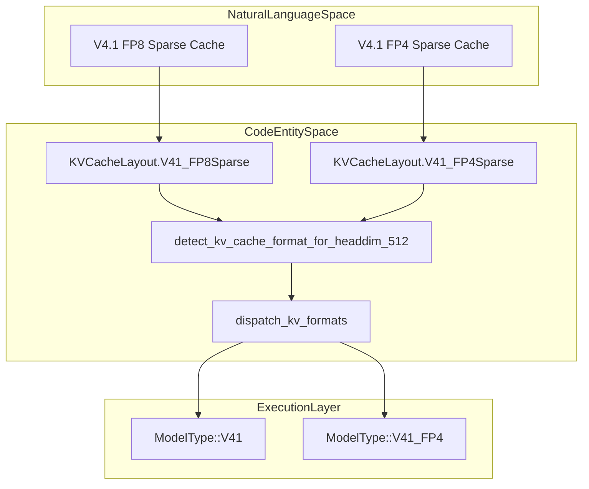
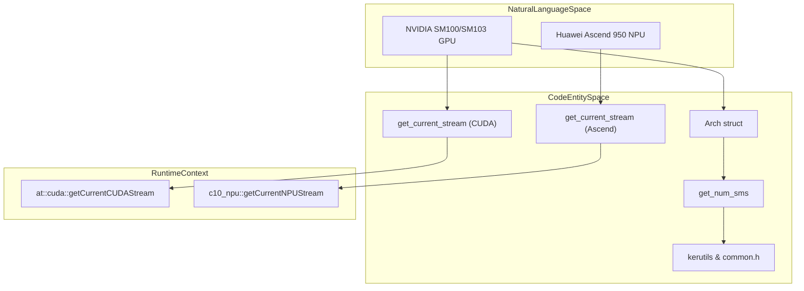

<!-- source: DeepWiki mcp.deepwiki.com · repo deepseek-ai/FlashMLA · page 8 Glossary · fetched 2026-10-30 -->

# Glossary

Relevant source files

The following files were used as context for generating this wiki page:

- [README.md](README.md)
- [csrc/api/common.h](csrc/api/common.h)
- [tests/quant.py](tests/quant.py)

This glossary defines technical terms, hardware-specific jargon, and codebase entities used within FlashMLA. It serves as a reference for engineers to map domain concepts (like Multi-head Latent Attention or FP8/FP4 Quantization) to specific implementation details and code locations across NVIDIA SM100/SM103 GPUs and Huawei Ascend 950 NPUs.

## Core Concepts

### MLA (Multi-head Latent Attention)
A variant of attention used in DeepSeek-V4.1 models to compress KV cache memory pressure. In FlashMLA, MLA decoding and prefill operate by projecting keys and values into a shared latent space [README.md:5-8]().
*   **Head Dimensions**: Total head dimension $d = 512$, partitioned into $d_{\text{nope}} = 448$ (non-position-encoded latent features) and $d_{\text{rope}} = 64$ (rotary position embedding components) [tests/quant.py:15-16]().
*   **Compute-Bound Nature**: Decoding and prefill are heavily optimized to saturate Tensor Cores on SM100/SM103 and AI Cores on Ascend 950 [README.md:13-26]().

### DSA (DeepSeek Sparse Attention)
A token-level sparse attention mechanism where each query attends only to a restricted subset of KV tokens determined by a runtime `indices` tensor [README.md:7]().
*   **Implementation**: Sparse prefill and decoding kernels leverage these index tensors to skip inactive KV blocks and optimize sparse block loading via TMA or Ascend C memory management [README.md:13-26]().

### FP8 and FP4 KV Cache Formats (V4.1)
Compressed KV cache layouts introduced in DeepSeek-V4.1 to reduce memory bandwidth bottlenecks:
*   **`V41_FP8Sparse`**: Occupies 528 bytes per token ($448$ bytes of `float8_e4m3` NoPE data, $64$ bytes of `bfloat16`/`float16` RoPE data, and $16$ bytes of `e8m0` tile scale factors per 32-element tile) [tests/quant.py:15]().
*   **`V41_FP4Sparse`**: Occupies 288 bytes per token ($224$ bytes of `float4_e2m1` packed data plus $32$ bytes of `e4m3` scale factors per 16-element tile) [tests/quant.py:16]().
*   **Reference Quantization**: Implemented in `quantize_k_cache` and `_quantize_to_e2m1` [tests/quant.py:31-96]().

### NoPE / RoPE Split
The structural separation of attention keys into non-position-encoded latent vectors (`NoPE`, dimension 448) and rotary position-embedded components (`RoPE`, dimension 64), which are quantized and processed differently within FlashMLA kernels [tests/quant.py:15-16]().

Sources: [README.md:5-28](), [tests/quant.py:8-96]()

---

## Hardware Primitives & System Jargon

### TMA (Tensor Memory Accelerator)
A hardware mechanism in NVIDIA Hopper and Blackwell (SM100/SM103) architectures for asynchronous multidimensional data transfer between Global Memory and Shared Memory [README.md:79-80]().

### DSM (Distributed Shared Memory)
A hardware capability allowing thread blocks (CTAs) within the same thread block cluster to directly access each other's shared memory, used for cooperative data sharing and crossover reductions [README.md:79-80]().

### Seesaw Scheduling
A ping-pong warpgroup scheduling strategy used in decoding and prefill kernels to interleave Tensor Core (MMA) and CUDA Core (softmax/scaling) operations over shared register allocations [README.md:25-29]().

### TMEM (Transposed Memory)
A dedicated memory hierarchy level in NVIDIA SM100/SM103 Blackwell GPUs designed to store intermediate GEMM and reduction accumulator results [README.md:79-80]().

### CANN / Bisheng
The software toolkit and compiler infrastructure (`bisheng`) provided by Huawei for compiling and executing Ascend C kernels on Ascend 950 NPUs [README.md:85-88]().

### kerutils
A submodule providing supplemental C++ utilities, memory helpers, and PyTorch tensor wrappers (`<kerutils/supplemental/torch_tensors.h>`) [csrc/api/common.h:13]().

Sources: [README.md:75-88](), [csrc/api/common.h:13-57]()

---

## Codebase Entities & Classes

### `ImplBase`
The base dispatcher class in the C++ API layer responsible for selecting appropriate backend implementations based on compile-time and runtime configurations [README.md:5-28]().

### `FlashMLASchedMeta`
A metadata structure generated by Python scheduling utilities to coordinate tile distribution, batch partitioning, and split-KV work assignment across hardware units [README.md:5-28]().

### `Arch`
A helper struct encapsulating GPU architecture properties, including major/minor compute capability version checks (`is_sm100f()`) and multiprocessor counts (`num_sms`) [csrc/api/common.h:40-57]().

### `KVCacheLayout`
An enumeration defining supported sparse KV cache layout modes (`V41_FP8Sparse`, `V41_FP4Sparse`) and supplying metadata such as head dimensions, tile sizes, and bytes-per-token calculations [tests/quant.py:8-24]().

Sources: [README.md:5-28](), [csrc/api/common.h:40-57](), [tests/quant.py:8-24]()

---

## System Mapping Diagrams

### Diagram 1: KV Cache Format Detection and Dispatch Flow
This diagram maps natural language KV cache layout concepts to their corresponding C++ and Python code structures.

**Sources:** [tests/quant.py:8-17](), [csrc/api/common.h:170-186]()

### Diagram 2: Hardware Platform and Stream Abstraction
This diagram connects hardware abstraction concepts to platform-specific runtime classes and functions.

**Sources:** [csrc/api/common.h:13-87]()

---

## Technical Terminology Table

| Term | Definition | Code Reference |
| :--- | :--- | :--- |
| **`ImplBase`** | Base class for kernel dispatching and feature validation across backend implementations. | [README.md:5-28]() |
| **`FlashMLASchedMeta`** | Scheduler metadata structure managing tile partitioning and split-KV work distribution. | [README.md:5-28]() |
| **`Arch`** | Hardware capability detection structure tracking device properties, major version, and SM count. | [csrc/api/common.h:40-57]() |
| **`KVCacheLayout`** | Enum defining quantization formats (`V41_FP8Sparse`, `V41_FP4Sparse`) and metadata properties. | [tests/quant.py:8-24]() |
| **`e4m3 / e8m0 / e2m1`** | Quantized floating-point data types used for compressed KV cache values and scale factors. | [tests/quant.py:15-28]() |
| **`split-KV`** | Strategy dividing long KV sequences across multiple compute units, followed by a combine reduction. | [README.md:13-28]() |
| **`CANN / Bisheng`** | Toolchain and compiler suite required for building and executing kernels on Ascend NPUs. | [README.md:85-88]() |
| **`kerutils`** | External submodule providing supplemental C++ utilities and tensor helper functions. | [csrc/api/common.h:13]() |

Sources: [README.md:5-88](), [csrc/api/common.h:13-57](), [tests/quant.py:8-28]()